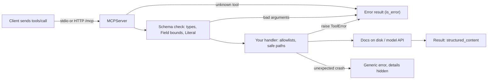
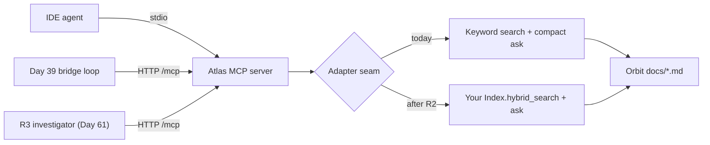
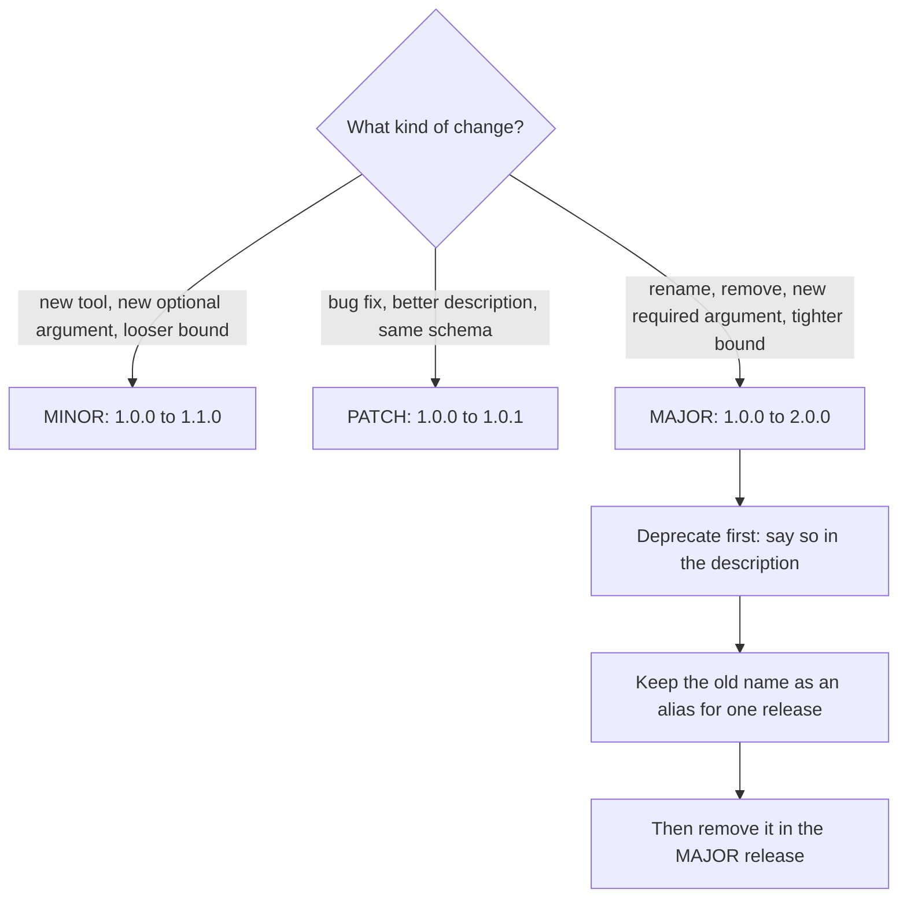

# Building an MCP Server

Your R2 assistant from Day 34 answers Orbit questions well, but only inside its Gradio tab. The maintainers' IDE agents can't call it, and neither can the R3 investigator you'll build in Day 61. Wrapped as an MCP server, any MCP host can use it. Any client can also send it anything, so validation and read-only defaults are part of the job from line one.

## At a Glance

- **Time:** ~2 h core (+ optional Go Deeper) · **Depth:** working
- **Prerequisites:** [Day 34: Capstone R2: Ask, a RAG Assistant with a UI](../../Phase_3_RAG/Day_034_capstone_r2_ask/capstone_r2_ask.md), [Day 39: MCP: Connecting to Tool Servers](../Day_039_mcp_clients/mcp_clients.md); helpful: [Day 36: Designing Tools](../Day_036_tool_design/tool_design.md), [Day 19: Testing LLM Code](../../Phase_2_Building_with_LLM_APIs/Day_019_testing_llm_code/testing_llm_code.md)
- **You'll build:** the Atlas MCP server (`search_docs`, `ask`, and an `orbit://docs/{doc_id}` resource) over stdio or Streamable HTTP, plus a pytest suite with a contract snapshot.
- **Stops at:** auth servers; remote hosting and OAuth 2.1 are [Day 74](../../Phase_8_Safety_and_Security/Day_074_least_privilege_mcp_security/least_privilege_mcp_security.md).
- **Fast path:** Know FastAPI and Day 39's client? Read "The Atlas MCP Server" and "Testing Your Server", then do Exercise 4 (~45 min).
- **Cost:** ≈ $0.02 on `gpt-6-luna`; only `ask` calls the model (prices as of 2026-11, [verify](https://developers.openai.com/api/docs/pricing)).
- **New terms:** `MCPServer`, tool annotations, resource template, `ToolError`, contract snapshot test

> **Coming from Software Engineering?** An MCP server is a small FastAPI service. Decorators turn typed functions into endpoints, and type hints become the schema: OpenAPI there, each tool's `input_schema` here. You still validate at the boundary, version the contract and write contract tests (tests that fail when your public interface changes). The difference is the caller: a model that sends surprising inputs with total confidence. Treat every argument like a public form post.

## R2 Is Stuck in a Browser Tab

Who wants R2's answers? A maintainer's coding agent checking the lease docs before editing a worker, a triage bot labelling an issue, your Day 61 investigator. Each speaks MCP (the Model Context Protocol from [Day 39](../Day_039_mcp_clients/mcp_clients.md), an open standard for AI hosts to discover and call tools). None of them can click a Gradio button. Instead of one integration per host, you'll write one server they can all connect to.

## A Service Counter for Your Systems

Picture a service counter in front of a warehouse: you choose what customers may ask for, check every request slip, and never hand over the back-room keys. An MCP server is that counter, with three kinds of thing on it:

| Primitive | Who decides to use it | Rule of thumb | Atlas example |
|---|---|---|---|
| **Tool** | The model, mid-task | A *verb*: computed on demand, takes arguments | `search_docs(query)`, `ask(question)` |
| **Resource** | The client or the user, often up front | A *noun* with an address: a page, a record, a file | `orbit://docs/leases-and-heartbeats` |
| **Prompt** | The user, from a menu | A reusable message template | "Summarize this doc for a new contributor" |

A doc page is a resource because it has a stable address a host can attach to the context. Search is a tool because the model must choose the query.

Equally important is what stays off the counter: no write tools (labelling, commenting, closing issues), no raw SQL, no "read any file". Writes need the approval gates from [Day 37](../Day_037_robust_tool_execution/robust_tool_execution.md), and a generic SQL or file tool hands an unknown caller the whole back room.

## Designing the Contract by Hand

Before coding, write down what a client will see from `list_tools`. It's your public API, and Day 61 is written against it. Apply the [Day 36](../Day_036_tool_design/tool_design.md) checklist: verb names, descriptions that say *when* to use the tool, few and bounded arguments.

| Name | Description (what the model reads) | Inputs | Output | Read-only? |
|---|---|---|---|---|
| `search_docs` | Find Orbit doc pages by keyword, best first. Use before reading or citing. | `query` (2–200 chars), `k` (1–10, default 5), `applies_to` (`2.x` / `3.x` / `all`, optional) | list of `{doc_id, title, section, snippet}` | yes |
| `ask` | Answer an Orbit question from the docs, with citations. Costs one model call. | `question` (3–500 chars) | `{answer, citations[{doc_id, quote}], degraded}` | yes |
| `orbit://docs/{doc_id}` | One doc page as Markdown. | `doc_id` from the 45 known ids | page text | yes |

Check it in your head. Can a model new to Orbit handle "what does the retries page say?" Yes: `search_docs`, then the resource. Run up a bill? Only via `ask`, which warns it. Read `.env`? Only if `doc_id` escapes the docs folder, which we'll try next.

## Name the Parts

The Python SDK (`mcp` 2.x; `uv add "mcp[cli]"`) gives you one class and a few decorators:

- **`MCPServer("atlas", version="1.0.0", instructions=...)`** is the server (v1 called it `FastMCP`). Pass only the name positionally.
- **`@mcp.tool()`** registers a tool; the parentheses matter. The docstring becomes its description, type hints (with Pydantic `Field(...)` bounds) become the `input_schema`, and the return annotation becomes the `output_schema`, so clients get typed `structured_content`.
- **Tool annotations** such as `ToolAnnotations(read_only_hint=True)` are behaviour hints hosts use to decide when to ask for approval.
- **`@mcp.resource("orbit://docs/{doc_id}")`** registers a **resource template**: a URI pattern whose `{doc_id}` becomes a function argument, so one function serves 45 pages.
- **`@mcp.prompt()`** registers a prompt template (Atlas needs none today).
- **`ToolError`** (from `mcp.server.mcpserver.exceptions`) is what you raise for an expected failure. The client gets `is_error=True` and your message, which the model can act on.

Here is where each check happens when a request arrives:



The SDK runs the schema checks; your handler holds your own rules.

## Your First Server

Start with one tool that scores each Orbit doc page by how often the query words appear and returns the best page ids.

```python
# script_id: day_040_mcp_servers/minimal_server
# A one-tool MCP server over stdio. Install: uv add "mcp[cli]"   Env: ORBIT_DATA (default datasets/orbit)
import os
from pathlib import Path

from mcp.server import MCPServer

DOCS = Path(os.environ.get("ORBIT_DATA", "datasets/orbit")) / "docs"
mcp = MCPServer("atlas-mini", version="0.1.0")

@mcp.tool()
def search_docs(query: str, k: int = 3) -> list[str]:
    """Find Orbit documentation pages by keyword. Returns up to k page ids, best first."""
    words = query.lower().split()
    scores = {p.stem: sum(p.read_text().lower().count(w) for w in words) for p in DOCS.glob("*.md")}
    return sorted((d for d in scores if scores[d]), key=scores.get, reverse=True)[:k]

if __name__ == "__main__":
    mcp.run()  # stdio is the default transport
```

You don't run this file yourself: a host launches it as a subprocess and talks over stdin and stdout. Here is a compact Day 39 client doing that:

```python
# script_id: day_040_mcp_servers/minimal_client
# Launches minimal_server.py over stdio and calls its tool. Install: uv add "mcp[cli]"   Env: ORBIT_DATA
import asyncio
import os
import sys
from pathlib import Path

from mcp import Client, StdioServerParameters

SERVER = Path(__file__).with_name("minimal_server.py")

async def main() -> None:
    # stdio servers inherit only a safe default env (PATH, HOME, ...), so pass what they need
    env = {"ORBIT_DATA": os.environ.get("ORBIT_DATA", "datasets/orbit")}
    params = StdioServerParameters(command=sys.executable, args=[str(SERVER)], env=env)
    async with Client(params) as client:
        tools = await client.list_tools()
        print([t.name for t in tools.tools])
        print(tools.tools[0].input_schema)
        result = await client.call_tool("search_docs", {"query": "lease"})
        print(result.structured_content)

asyncio.run(main())
```

```text
['search_docs']
{'type': 'object', 'properties': {'query': {'title': 'Query', 'type': 'string'}, 'k': {'default': 3, 'title': 'K', 'type': 'integer'}}, 'required': ['query'], 'title': 'search_docsArguments'}
{'result': ['leases-and-heartbeats', 'troubleshooting-duplicates', 'environment-variables-2x']}
```

You wrote no JSON Schema: `query: str, k: int = 3` became the `input_schema`, with `k` optional because it has a default. The `list[str]` return arrives wrapped as `{"result": [...]}` because `structured_content` must be a JSON object.

## Break It

Four mistakes cause most first-day MCP bugs. Make them on purpose so you recognise the symptoms.

**Constructor and decorator slips.** One fails silently, two at import time:

```python
# script_id: day_040_mcp_servers/break_it
# Three v1 habits that break on SDK v2. Install: uv add "mcp[cli]"
from mcp.server import MCPServer

mcp = MCPServer("atlas", "Search Orbit docs")  # meant as a description...
print(f"title={mcp.title!r} version={mcp.version!r}")  # ...it became the title

try:
    @mcp.tool  # missing ()
    def ping() -> str:
        return "pong"
except TypeError as err:
    print(f"TypeError: {err}")

try:
    MCPServer("atlas", port=8000)  # v1 habit: transport settings on the constructor
except TypeError as err:
    print(f"TypeError: {err}")
```

```text
title='Search Orbit docs' version=''
TypeError: The @tool decorator was used incorrectly. Did you forget to call it? Use @tool() instead of @tool
TypeError: MCPServer.__init__() got an unexpected keyword argument 'port'
```

The second positional argument is `title`, and `version` defaults to an empty string that clients will display. Pass `version=` and `instructions=` by keyword; host and port belong to `mcp.run()`.

**Writing to stdout.** On stdio, stdout *is* the protocol channel. Add `print("server starting")` before `mcp.run()` and the client logs `Failed to parse JSONRPC message from server` with `input_value='server starting'`. SDK 2.3 skips the line and diverts stdout to stderr once running; other hosts are less forgiving, and some hang. Log to stderr (`print(..., file=sys.stderr)` or `logging`).

**Trusting a path argument.** The serious one. The natural doc handler is `(DOCS / f"{doc_id}.md").read_text()`. Feed it `../README` and it reads outside the docs folder; without the `.md` suffix, `../../.env` reads your secrets. This is path traversal: `../` tricks that escape the folder you meant to serve. The demo puts the same naive line in a resource and in a tool, next to an allowlisted version:

```python
# script_id: day_040_mcp_servers/traversal_demo
# Same naive code as a resource and as a tool; only one is protected. Install: uv add "mcp[cli]"   Env: ORBIT_DATA
import asyncio
import os
from pathlib import Path

from mcp import Client, MCPError
from mcp.server import MCPServer
from mcp.server.mcpserver.exceptions import ToolError

DOCS = Path(os.environ.get("ORBIT_DATA", "datasets/orbit")) / "docs"
DOC_IDS = frozenset(p.stem for p in DOCS.glob("*.md"))
demo = MCPServer("traversal-demo")

@demo.resource("orbit://docs/{doc_id}")
def naive_resource(doc_id: str) -> str:
    return (DOCS / f"{doc_id}.md").read_text()  # BAD: trusts doc_id

@demo.tool()
def naive_get_doc(doc_id: str) -> str:
    """Return one doc page."""
    return (DOCS / f"{doc_id}.md").read_text()  # BAD: the same line, now inside a tool

@demo.tool()
def safe_get_doc(doc_id: str) -> str:
    """Return one doc page by its id."""
    if doc_id not in DOC_IDS:  # allowlist: only ids we know ever reach the filesystem
        raise ToolError(f"Unknown doc_id {doc_id!r}. Call search_docs to find ids.")
    return (DOCS / f"{doc_id}.md").read_text()

async def main() -> None:
    async with Client(demo) as client:
        try:
            await client.read_resource("orbit://docs/..%2FREADME")
        except MCPError as err:
            print("resource:", err)
        leaked = await client.call_tool("naive_get_doc", {"doc_id": "../README"})
        print("naive tool:", leaked.content[0].text.splitlines()[0])
        blocked = await client.call_tool("safe_get_doc", {"doc_id": "../README"})
        print("safe tool:", blocked.is_error, blocked.content[0].text)

asyncio.run(main())
```

```text
resource: Unknown resource: orbit://docs/..%2FREADME
naive tool: # The Orbit dataset
safe tool: True Error executing tool safe_get_doc: Unknown doc_id '../README'. Call search_docs to find ids.
```

The resource was saved by the SDK: `MCPServer` applies a default `ResourceSecurity` policy to template parameters that rejects `..` components, absolute paths and null bytes, even URL-encoded as `%2F`. Tools get no such check, and the naive tool returned the README from outside `docs/`. So Atlas checks an allowlist of known ids first and the resolved path second: defence in depth, where each layer assumes the previous one might fail.

## Validation and Actionable Errors

A model sends whatever its last step produced: `k=50`, `applies_to="v3"`, a 4,000-word question. Bad input must never reach your handler, and the error must tell the model how to fix its next call. Push what you can into the signature: the SDK enforces it before your code runs and publishes it in the schema.

```python
# script_id: day_040_mcp_servers/signature_sketch
# fragment
@mcp.tool(annotations=READ_ONLY)
def search_docs(
    query: Annotated[str, Field(min_length=2, max_length=200)],
    k: Annotated[int, Field(ge=1, le=10)] = 5,            # -> "minimum": 1, "maximum": 10
    applies_to: Literal["2.x", "3.x", "all"] | None = None,  # -> "enum": [...]
) -> list[DocHit]: ...
```

Send `k=50` and the client gets `is_error=True` with Pydantic's message; your function never runs:

```text
Error executing tool search_docs: 1 validation error for search_docsArguments
k
  Input should be less than or equal to 10 [type=less_than_equal, input_value=50, input_type=int]
```

Rules that can't live in a type ("this doc id must exist") go in the handler, raising `ToolError` with a message written *for the model*: what was wrong and what to do instead. `Unknown doc_id 'retries'. Closest: 'retries-and-backoff'.` earns a corrected retry; `Invalid input` earns the same mistake again. The SDK sorts failures into three kinds:

| What happened | What the client sees | Logged on the server |
|---|---|---|
| Arguments fail the schema | `is_error=True`, Pydantic's message | INFO |
| You `raise ToolError("...")` | `is_error=True`, `Error executing tool <name>: <your message>` | INFO, no traceback |
| Any other exception | `is_error=True`, only `Error executing tool <name>` | ERROR, with traceback |

The last row is a feature: a crash message might contain a path or connection string, so the SDK keeps it server-side. For resources, raise `ResourceNotFoundError` (or `ResourceError`) from the same module; the client receives an `MCPError` carrying your message.

## Read-Only by Default

Any connected client can call any tool, as often as it likes. Start from "nothing here changes anything".

**Say so in the annotations.** `ToolAnnotations(read_only_hint=True, destructive_hint=False, open_world_hint=False)` tells hosts the tool changes nothing, so they can skip the approval prompt. The spec says clients must treat annotations as untrusted unless they trust the server: they describe, your code enforces.

**Make the data layer refuse writes.** An older version of this lesson guarded SQL with "must start with SELECT" on a read-write connection and built table names with f-strings. A SELECT can still call a function with side effects, and an f-string identifier is an injection point. Use the [Day 33](../../Phase_3_RAG/Day_033_text_to_sql/text_to_sql.md) pattern instead: a read-only connection, so the engine itself refuses, and parameters for values.

```python
# script_id: day_040_mcp_servers/readonly_sketch
# fragment
conn = sqlite3.connect(f"file:{DB}?mode=ro", uri=True)               # the file refuses writes
row = conn.execute("SELECT title FROM issues WHERE id = ?", (issue_id,)).fetchone()
# conn.execute(f"SELECT COUNT(*) FROM {table}")  <- never: identifiers can't be parameters
```

Exercise 2 builds `get_issue` this way.

**Cap what costs money.** `ask` calls a model for whoever connects. Bound it three ways: a 500-character `question`, `max_output_tokens`, and a cost line per call on stderr (a stand-in for [Day 12](../../Phase_2_Building_with_LLM_APIs/Day_012_openai_sdk_production/openai_sdk_production.md)'s `CostTracker`). Per-user quotas need identity, which is [Day 83](../../Phase_9_Production/Day_083_auth_multitenancy_quotas/auth_multitenancy_quotas.md).

**Keep writes elsewhere.** If Atlas ever labels issues, that tool lives behind [Day 37](../Day_037_robust_tool_execution/robust_tool_execution.md)'s approval hook and [Day 55](../../Phase_6_Agents/Day_055_human_in_the_loop/human_in_the_loop.md)'s human-in-the-loop flow, not on a server any host can reach.

## The Atlas MCP Server

Now the real thing. It implements the contract table in five blocks: loading docs, typed results, a cost-capped `ask`, the guarded resource, then tools and transports. The blocks share a `script_id` and stitch into one `atlas_mcp_server.py`.



The lesson ships compact stand-ins for R2's retrieval and `ask()`. The seam is two functions, `keyword_search` and `answer_question`: swap in your own and nothing a client sees changes. The first block loads the 45 pages once and builds the doc-id allowlist from files that exist:

```python
# script_id: day_040_mcp_servers/atlas_mcp_server
# Atlas MCP server: Orbit docs search + cited answers, read-only, stdio or Streamable HTTP.
# Install: uv add "mcp[cli]" openai pydantic
# Env:     ORBIT_DATA (default datasets/orbit) · ATLAS_MODEL (default gpt-6-luna)
#          OPENAI_API_KEY (optional: without it, `ask` returns retrieval-only, degraded=True)
# Run:     python atlas_mcp_server.py          # stdio, for a host that launches it
#          python atlas_mcp_server.py --http   # http://127.0.0.1:8000/mcp
import math
import os
import re
import sys
from collections import Counter
from pathlib import Path

DATA_DIR = Path(os.environ.get("ORBIT_DATA", "datasets/orbit"))
DOCS_DIR = (DATA_DIR / "docs").resolve()
MODEL = os.environ.get("ATLAS_MODEL", "gpt-6-luna")
WORD = re.compile(r"[a-z0-9]+")

def parse_page(path: Path) -> dict:
    """Split the front matter (key: value lines between '---') from the Markdown body."""
    _, head, body = path.read_text(encoding="utf-8").split("---\n", 2)
    meta = {}
    for line in head.splitlines():
        key, _, value = line.partition(":")
        meta[key.strip()] = value.split(" #")[0].strip().strip('"')  # drop comments, quotes
    return meta | {"body": body, "tf": Counter(WORD.findall(body.lower()))}

PAGES = {p.stem: parse_page(p) for p in sorted(DOCS_DIR.glob("*.md"))}
DOC_IDS: frozenset[str] = frozenset(PAGES)  # the allowlist: no other id ever touches the disk
DF = Counter(term for page in PAGES.values() for term in page["tf"])  # pages containing each term

def snippet(body: str, terms: list[str], width: int = 240) -> str:
    """First prose paragraph that mentions a query term, flattened to one line."""
    for para in (p.strip() for p in body.split("\n\n")):
        if not para.startswith(("#", "`", "|")) and any(t in para.lower() for t in terms):
            return " ".join(para.split())[:width]
    return " ".join(body.split())[:width]
```

The second block holds search and the typed results. `Citation(doc_id, quote)` and `Answer` are compact copies of [Day 15](../../Phase_2_Building_with_LLM_APIs/Day_015_pydantic_for_llms/pydantic_for_llms.md)'s models, plus a `degraded` flag so clients can tell an answer from a fallback:

```python
# script_id: day_040_mcp_servers/atlas_mcp_server
from pydantic import BaseModel, Field

def keyword_search(query: str, k: int, applies_to: str | None = None) -> list[dict]:
    """Keyword scorer: rare words weigh more (IDF), and a word in the title adds a bonus."""
    terms = WORD.findall(query.lower())
    scored = []
    for doc_id, page in PAGES.items():
        if applies_to and page["applies_to"] not in (applies_to, "all"):
            continue
        score = sum(
            (page["tf"][t] + 5 * (t in page["title"].lower())) * math.log(len(PAGES) / DF[t])
            for t in terms if DF[t]
        )
        if score > 0:
            scored.append((score, doc_id))
    top = sorted(scored, reverse=True)[:k]
    return [PAGES[d] | {"doc_id": d, "snippet": snippet(PAGES[d]["body"], terms)} for _, d in top]

class DocHit(BaseModel):
    doc_id: str
    title: str
    section: str
    snippet: str

class Citation(BaseModel):  # Day 15's shape
    doc_id: str
    quote: str = Field(description="A sentence copied exactly from the cited page.")

class Draft(BaseModel):  # what the model must return
    answer: str
    citations: list[Citation]

class Answer(Draft):  # what the tool returns: the draft plus one honesty flag
    degraded: bool = False  # True = no model call was made; citations are raw retrieval
```

The third block is a compact [Day 28](../../Phase_3_RAG/Day_028_rag_pipeline/rag_pipeline.md) `ask()`: retrieve, then `responses.parse` into `Draft`. Without an API key it returns the passages with `degraded=True` instead of failing, which keeps the server and tests usable offline. `max_output_tokens` bounds the bill, and citations to pages the model never saw are dropped.

```python
# script_id: day_040_mcp_servers/atlas_mcp_server
# gpt-6-luna, USD per 1M input/output tokens; as of 2026-11, verify at developers.openai.com/api/docs/pricing
LUNA_PRICE = (0.10, 0.50)

def log_cost(usage) -> None:
    """Compact stand-in for Day 12's CostTracker: one line per call, on stderr."""
    usd = (usage.input_tokens * LUNA_PRICE[0] + usage.output_tokens * LUNA_PRICE[1]) / 1e6
    print(f"[atlas] ask {usage.input_tokens}+{usage.output_tokens} tok ${usd:.5f}", file=sys.stderr)

from mcp.server.mcpserver.exceptions import ToolError

def answer_question(question: str, hits: list[dict]) -> Answer:
    """Compact stand-in for R2's ask() (Days 28 and 34). Swap in your own through the seam."""
    if not hits or not os.environ.get("OPENAI_API_KEY"):
        cites = [Citation(doc_id=h["doc_id"], quote=h["snippet"]) for h in hits]
        return Answer(answer="No model call made; these are the closest passages.",
                      citations=cites, degraded=True)
    from openai import OpenAI  # imported here so the server starts without a key
    pages = "\n\n".join(f"<page id='{h['doc_id']}'>\n{h['body'][:4000]}\n</page>" for h in hits)
    resp = OpenAI().responses.parse(
        model=MODEL, text_format=Draft, input=f"{pages}\n\nQuestion: {question}",
        instructions="Answer only from the pages. Cite each claim with its page id and an exact "
                     "quote. If the pages don't answer the question, say so and cite nothing.",
        reasoning={"effort": "none"}, max_output_tokens=800)  # no reasoning: a small cap is safe
    log_cost(resp.usage)
    if resp.output_parsed is None:  # refusal, or cut off at max_output_tokens
        raise ToolError(f"Model returned no answer (status={resp.status}). Try a narrower question.")
    allowed = {h["doc_id"] for h in hits}  # drop citations to pages we never sent
    cites = [c for c in resp.output_parsed.citations if c.doc_id in allowed]
    return Answer(answer=resp.output_parsed.answer, citations=cites)
```

The fourth block creates the server and the guarded resource. `instructions=` reaches the client on connect and tells the host's model what the server is for. `safe_doc_path` is the allowlist-then-path check, raising `ResourceNotFoundError` so the client sees the hint:

```python
# script_id: day_040_mcp_servers/atlas_mcp_server
from difflib import get_close_matches
from typing import Annotated, Literal

from mcp.server import MCPServer
from mcp.server.mcpserver.exceptions import ResourceNotFoundError
from mcp.types import ToolAnnotations

READ_ONLY = ToolAnnotations(read_only_hint=True, destructive_hint=False, open_world_hint=False)

mcp = MCPServer(
    "atlas",
    version="1.0.0",
    instructions="Atlas knows Orbit, a Python background-jobs library. Use search_docs to "
    "find pages, ask for a cited answer, and the orbit://docs/{doc_id} resource for a full "
    "page. Every tool is read-only.",
)

def safe_doc_path(doc_id: str) -> Path:
    """Allowlist first, path check second: only known ids reach the filesystem."""
    if doc_id not in DOC_IDS:
        close = [d for d in sorted(DOC_IDS) if doc_id and doc_id in d]
        close = close or get_close_matches(doc_id, DOC_IDS, n=1, cutoff=0.5)
        hint = f" Closest: '{close[0]}'." if close else " Call search_docs to find ids."
        raise ResourceNotFoundError(f"Unknown doc_id '{doc_id}'.{hint}")
    path = (DOCS_DIR / f"{doc_id}.md").resolve()
    if not path.is_relative_to(DOCS_DIR):  # unreachable today; guards a future, looser allowlist
        raise ResourceNotFoundError(f"doc_id '{doc_id}' is outside the docs folder.")
    return path

@mcp.resource("orbit://docs/{doc_id}", mime_type="text/markdown")
def read_doc(doc_id: str) -> str:
    """One Orbit documentation page as Markdown, front matter included."""
    return safe_doc_path(doc_id).read_text(encoding="utf-8")
```

The last block registers the tools (descriptions say what, when and at what cost) and picks a transport. `--http` binds to `127.0.0.1` only, because there's no authentication yet.

```python
# script_id: day_040_mcp_servers/atlas_mcp_server
@mcp.tool(annotations=READ_ONLY)
def search_docs(
    query: Annotated[str, Field(min_length=2, max_length=200, description="Keywords, e.g. 'lease'")],
    k: Annotated[int, Field(ge=1, le=10, description="How many pages to return")] = 5,
    applies_to: Literal["2.x", "3.x", "all"] | None = None,
) -> list[DocHit]:
    """Find Orbit documentation pages by keyword, best match first.

    Use this to locate pages before reading or citing them. applies_to='3.x' keeps pages
    for 3.x plus version-agnostic ones; omit it to search everything. Returns [] on no match.
    """
    if not WORD.search(query.lower()):
        raise ToolError(f"Query {query!r} has no searchable words. Use keywords like 'retry backoff'.")
    hits = keyword_search(query, k, applies_to)
    return [DocHit(doc_id=h["doc_id"], title=h["title"], section=h["section"], snippet=h["snippet"])
            for h in hits]

@mcp.tool(annotations=READ_ONLY)
def ask(question: Annotated[str, Field(min_length=3, max_length=500)]) -> Answer:
    """Answer a question about Orbit from its docs, with citations (doc_id + exact quote).

    Makes one model call (well under $0.001 on gpt-6-luna). Prefer search_docs when page ids
    are enough. degraded=true means no model was available and the citations are raw passages.
    """
    # Adapter seam: finished Capstone R2? Replace keyword_search/answer_question with your
    # Index.hybrid_search() and ask(). Keep the tool name, arguments and Answer shape: Day 61 depends on them.
    return answer_question(question, keyword_search(question, k=3))

if __name__ == "__main__":
    if "--http" in sys.argv:  # loopback only: no auth until Day 74
        print(f"Atlas MCP server {mcp.version} on http://127.0.0.1:8000/mcp", file=sys.stderr)
        mcp.run(transport="streamable-http", host="127.0.0.1", port=8000)
    else:
        mcp.run()  # stdio: stdout belongs to the protocol, so log to stderr
```

Start it over HTTP:

```text
$ ORBIT_DATA=datasets/orbit python atlas_mcp_server.py --http
Atlas MCP server 1.0.0 on http://127.0.0.1:8000/mcp
INFO:     Started server process [41873]
INFO:     Waiting for application startup.
StreamableHTTP session manager started
INFO:     Application startup complete.
INFO:     Uvicorn running on http://127.0.0.1:8000 (Press CTRL+C to quit)
```

Your process id will differ. Without `--http` it waits silently on stdin for a host; that's correct, not a hang.

## Testing Your Server

Test it like any service: fast in-process tests plus a contract test, with a smoke test through the real transport as an extra. None needs Node or an API key.

**In-memory tests.** `Client(mcp)` connects to the server object in-process and hits the same schema checks and error handling as a real client. `raise_exceptions=True` surfaces protocol failures; tool errors still arrive as `is_error=True` results. The `anyio` marker ships with `mcp`.

```python
# script_id: day_040_mcp_servers/test_atlas_mcp_server
# Contract and behaviour tests, in-memory. Install: uv add --dev pytest   Env: ORBIT_DATA
# Run: uv run pytest test_atlas_mcp_server.py -q   (UPDATE_SNAPSHOTS=1 rewrites tool_contract.json)
import json
import os
from pathlib import Path

import pytest
from mcp import Client, MCPError

from atlas_mcp_server import mcp

CONTRACT = Path(__file__).with_name("tool_contract.json")

@pytest.fixture
def anyio_backend() -> str:
    return "asyncio"

@pytest.mark.anyio
async def test_search_returns_typed_hits() -> None:
    async with Client(mcp, raise_exceptions=True) as client:
        result = await client.call_tool("search_docs", {"query": "lease heartbeat", "k": 2})
    hits = result.structured_content["result"]
    assert not result.is_error and len(hits) == 2
    assert hits[0]["doc_id"] == "leases-and-heartbeats"

@pytest.mark.anyio
@pytest.mark.parametrize("args, expected", [
    ({"query": "lease", "k": 50}, "less than or equal to 10"),
    ({"query": "lease", "applies_to": "4.x"}, "'2.x', '3.x' or 'all'"),
])
async def test_bad_arguments_become_tool_errors(args: dict, expected: str) -> None:
    async with Client(mcp, raise_exceptions=True) as client:
        result = await client.call_tool("search_docs", args)
    assert result.is_error and expected in result.content[0].text
```

The **contract snapshot test** saves every tool's schemas to `tool_contract.json` on the first run (commit it). Afterwards any change to a name, argument, bound or return shape fails until you regenerate with `UPDATE_SNAPSHOTS=1`. It's [Day 19](../../Phase_2_Building_with_LLM_APIs/Day_019_testing_llm_code/testing_llm_code.md)'s snapshot pattern aimed at your API:

```python
# script_id: day_040_mcp_servers/test_atlas_mcp_server
@pytest.mark.anyio
async def test_unknown_doc_suggests_a_real_id() -> None:
    async with Client(mcp, raise_exceptions=True) as client:
        with pytest.raises(MCPError, match="Closest: 'retries-and-backoff'"):
            await client.read_resource("orbit://docs/retries")

@pytest.mark.anyio
async def test_tool_contract_matches_snapshot() -> None:
    async with Client(mcp) as client:
        tools = (await client.list_tools()).tools
    current = {t.name: {"input": t.input_schema, "output": t.output_schema} for t in tools}
    if os.environ.get("UPDATE_SNAPSHOTS") or not CONTRACT.exists():
        CONTRACT.write_text(json.dumps(current, indent=2, sort_keys=True) + "\n")
    expected = json.loads(CONTRACT.read_text())
    assert current == expected, "Tool contract changed: update the snapshot AND bump the version"
```

```text
$ ORBIT_DATA=datasets/orbit uv run pytest test_atlas_mcp_server.py -q
.....                                                                    [100%]
5 passed in 0.37s
```

**Beyond in-memory.** In-memory tests skip the transport, so they can't catch stdout pollution or missing environment variables. Launch the server as a subprocess once, the way [Day 39's client](../Day_039_mcp_clients/mcp_clients.md) and `minimal_client` above do, and turn anything odd into a pytest case. A full stdio smoke test and the optional MCP Inspector are in Go Deeper below.

## Versioning and Trade-offs

Once Day 61 calls `search_docs(query, k)`, those names are a promise. Use semver (MAJOR.MINOR.PATCH; MAJOR means breaking) and judge each change by what an *existing* caller sees:



Tightening is breaking: lower `k`'s maximum to 5 and callers sending `k=8` start failing. The snapshot fails even on MINOR changes, deliberately, so you bump `version=` in the same commit. Descriptions aren't snapshotted but still change which tool a model picks, so rerun [Day 36](../Day_036_tool_design/tool_design.md)'s tool-choice eval when you edit one.

When is an MCP server the wrong shape?

| Situation | Better choice | Why |
|---|---|---|
| One app uses these tools, and you own both sides | Plain function tools (Day 35–37) | No extra process, no protocol to version |
| Many hosts or agents should share the capability | **MCP server** | One implementation, discovered by every MCP host |
| High-throughput service-to-service calls | An ordinary HTTP API | MCP is shaped for model-driven calls, not bulk traffic |
| The capability writes or deletes | Keep it in-app behind approvals | Any connected client could call it |

### In production

- **Bind to `127.0.0.1` until you have auth.** OAuth 2.1, scopes and remote hosting are [Day 74](../../Phase_8_Safety_and_Security/Day_074_least_privilege_mcp_security/least_privilege_mcp_security.md).
- **DNS-rebinding protection** is automatic on localhost. Behind a real hostname, pass `transport_security=TransportSecuritySettings(allowed_hosts=[...])` (from `mcp.server.transport_security`) to `run()`, or requests get HTTP 421.
- **Request bodies** are capped at 4 MiB (HTTP 413 beyond).
- **Logs** go to stderr or OpenTelemetry; protocol logging (`ctx.info()`) is deprecated.
- **Rate-limit `ask`**, the tool that costs money; per-client quotas are [Day 83](../../Phase_9_Production/Day_083_auth_multitenancy_quotas/auth_multitenancy_quotas.md).
- **Load config yourself.** `MCPServer` reads no `MCP_*` variables or `.env` file.

## Go Deeper (optional)

<details><summary>Go deeper: what a client actually receives</summary>

Print one tool from `await client.list_tools()`. Beside `name` and `description` sit `input_schema` and `output_schema`. For `search_docs` the output schema wraps the list, `{"properties": {"result": {"type": "array", "items": {"$ref": "#/$defs/DocHit"}}}}`, hence `structured_content["result"]`. A Pydantic-model return like `ask`'s gets the model's schema with no wrapper. A text copy goes in `content[0].text` for clients that ignore structured output.

The docstring is sent verbatim, indentation included, so hosts pay tokens for your whitespace. Plain `def` handlers run on worker threads, so a slow `ask` doesn't block others, and shared state like `PAGES` must stay read-only.

</details>

<details><summary>Go deeper: a stdio smoke test and the Inspector</summary>

In-memory tests skip the transport. This one launches the server as a subprocess, like an IDE host, catching stdout pollution, missing environment variables and startup errors:

```python
# script_id: day_040_mcp_servers/smoke_test_stdio
# Launch the server as a host would and call both tools. Install: uv add "mcp[cli]"
# Env: ORBIT_DATA, optional OPENAI_API_KEY and ATLAS_MODEL (passed through to the server)
import asyncio
import os
import sys
from pathlib import Path
from mcp import Client, StdioServerParameters

SERVER = Path(__file__).with_name("atlas_mcp_server.py")
PASS_THROUGH = ("ORBIT_DATA", "ATLAS_MODEL", "OPENAI_API_KEY")  # beyond PATH, HOME, ...

async def main() -> None:
    env = {k: os.environ[k] for k in PASS_THROUGH if k in os.environ}
    params = StdioServerParameters(command=sys.executable, args=[str(SERVER)], env=env)
    async with Client(params) as client:
        print(client.server_info.name, client.server_info.version, client.protocol_version)
        print(sorted(t.name for t in (await client.list_tools()).tools))
        hits = await client.call_tool("search_docs", {"query": "dead letter queue", "k": 1})
        print(hits.structured_content["result"][0]["doc_id"])
        answer = await client.call_tool("ask", {"question": "Why did my job run twice?"})
        a = answer.structured_content
        print(a["degraded"], [c["doc_id"] for c in a["citations"]])

asyncio.run(main())
```

```text
atlas 1.0.0 2026-07-28
['ask', 'search_docs']
dead-letter-queue
True ['faq', 'troubleshooting-duplicates', 'quickstart']
```

Without a key, `ask` reports `degraded=True` with raw passages; with `OPENAI_API_KEY` set you get `False` and the model's citations (yours will differ). `2026-07-28` is the negotiated protocol revision.

**The Inspector (optional).** A browser UI for calling a server's tools by hand: `uv run mcp dev atlas_mcp_server.py`. It's a Node app whose docs require Node 22.19+, so it's off the critical path. Turn anything it reveals into a pytest case.

</details>

<details><summary>Go deeper: mount the server in your own ASGI app</summary>

Past the stop line: once you have health checks or REST routes, you want one process. Mount `mcp.streamable_http_app()` in a Starlette app (Day 77 builds on this). A mounted app's lifespan doesn't run, so the host app starts the session manager. The Day 39 client and Exercise 4 work unchanged against it.

```python
# script_id: day_040_mcp_servers/mount_asgi
# Mount the server in your own ASGI app (Day 77 builds on this). Install: uv add "mcp[cli]"
# Env: ORBIT_DATA. Serves http://127.0.0.1:8000/mcp
import contextlib
import uvicorn
from starlette.applications import Starlette
from starlette.routing import Mount
from atlas_mcp_server import mcp

@contextlib.asynccontextmanager
async def lifespan(app: Starlette):  # mounted apps don't run their own lifespan
    async with mcp.session_manager.run():
        yield

app = Starlette(routes=[Mount("/", app=mcp.streamable_http_app())], lifespan=lifespan)

if __name__ == "__main__":
    uvicorn.run(app, host="127.0.0.1", port=8000)
```

To swap in your R2 `Index.hybrid_search()` and `ask()`, replace the bodies of `keyword_search` and `answer_question`; while `DocHit` and `Answer` keep their fields, the contract snapshot stays green.

</details>

## Common Pitfalls

- **`TypeError: The @tool decorator was used incorrectly. Did you forget to call it?`** You wrote `@mcp.tool`; write `@mcp.tool()`.
- **`TypeError: MCPServer.__init__() got an unexpected keyword argument 'port'`.** A v1 habit: `host` and `port` belong to `mcp.run(transport="streamable-http", ...)`.
- **The client logs `Failed to parse JSONRPC message from server`, or hangs.** Something, often a startup `print()`, wrote to stdout on a stdio server. Log to stderr.
- **Works in-memory, but over stdio the docs or API key are missing.** A stdio subprocess inherits only a safe default environment (`PATH`, `HOME`, ...). Pass exactly what it needs via `StdioServerParameters(env={...})`.
- **After renaming `k` to `top_k`, old callers silently get 5 results.** Unknown arguments are dropped, not rejected, so renames break quietly. The contract snapshot catches it; ship renames as deprecate-then-remove.

> **Where we stop:** a local, unauthenticated server on stdio or `127.0.0.1`, because auth needs its own day. Remote hosting, OAuth 2.1, scopes and tool poisoning are [Day 74](../../Phase_8_Safety_and_Security/Day_074_least_privilege_mcp_security/least_privilege_mcp_security.md); production serving is [Day 77](../../Phase_9_Production/Day_077_fastapi_serving/fastapi_serving.md).

## Key Takeaways

- Build an MCP server when several hosts or agents need a capability; for one app you own, plain function tools are simpler.
- A tool is a verb the model calls; a resource is an addressable noun like `orbit://docs/{doc_id}`. Expose reads; keep writes, raw SQL and generic file access off the server.
- Type hints and `Field` bounds become the `input_schema`, enforced before your code runs. `ToolError` messages should tell the model how to fix its next call; unexpected exceptions stay hidden.
- The SDK guards resource templates, not tools: allowlist ids, resolve paths inside the folder, open databases `mode=ro`, cap what costs money. Annotations describe read-only; code enforces it.
- Test in-memory with `Client(mcp)`, smoke-test over stdio, snapshot the contract. Additive changes are MINOR; renames, removals and tighter bounds are MAJOR.

## Quick Reference

| API / pattern | When to use | Gotcha |
|---|---|---|
| `MCPServer("atlas", version="1.0.0", instructions="...")` | Create the server | Second positional argument is `title`; `version` defaults to `""` |
| `@mcp.tool(annotations=ToolAnnotations(read_only_hint=True))` | Register a tool | Needs `()`; annotations are untrusted hints |
| `Annotated[int, Field(ge=1, le=10)]`, `Literal[...]` | Bound inputs in the schema | Unknown extra arguments are ignored, not rejected |
| `-> list[DocHit]` / `-> Answer` | Typed output | Lists arrive as `structured_content["result"]` |
| `@mcp.resource("orbit://docs/{doc_id}", mime_type=...)` | Addressable read-only content | Default `ResourceSecurity` guards templates, not tools |
| `raise ToolError("...")` / `ResourceNotFoundError("...")` | Expected failures the model should see | Other exceptions show only `Error executing tool <name>` |
| `mcp.run()` / `mcp.run(transport="streamable-http", host="127.0.0.1", port=8000)` | stdio for local hosts; HTTP at `/mcp` | Never print to stdout on stdio |
| `Client(mcp, raise_exceptions=True)` + `@pytest.mark.anyio` | Fast in-memory tests | Skips the transport, so add one stdio smoke test (Go Deeper) |
| `StdioServerParameters(command=sys.executable, args=[...], env={...})` | Launch a server like a host does | Only a safe default env is inherited |
| `tool_contract.json` snapshot | Catch contract changes in CI | Bump `version=` in the same commit |

## Exercises

1. **Warm-up.** Add a read-only `list_doc_ids(section: str | None = None)` tool returning all doc ids or one section's. Call it in-memory with and without `section="Reliability"`.

<details><summary>Solution</summary>

This registers on the imported `mcp` for one process; in your copy, add it to `atlas_mcp_server.py` and update the snapshot.

```python
# script_id: day_040_mcp_servers/solution_ex1
# Warm-up: a read-only list_doc_ids tool, tested in memory. Install: uv add "mcp[cli]"   Env: ORBIT_DATA
import asyncio

from mcp import Client

from atlas_mcp_server import PAGES, READ_ONLY, mcp

@mcp.tool(annotations=READ_ONLY)
def list_doc_ids(section: str | None = None) -> list[str]:
    """List every Orbit doc id, optionally only one section (e.g. 'Reliability', 'Brokers')."""
    return sorted(d for d, page in PAGES.items() if section in (None, page["section"]))

async def main() -> None:
    async with Client(mcp) as client:
        everything = await client.call_tool("list_doc_ids", {})
        reliability = await client.call_tool("list_doc_ids", {"section": "Reliability"})
    print(len(everything.structured_content["result"]), reliability.structured_content["result"])

asyncio.run(main())
```

```text
45 ['dead-letter-queue', 'idempotency', 'leases-and-heartbeats', 'retries-and-backoff']
```

</details>

2. **Core: read-only by default.** Add `get_issue(issue_id: int)` over `issues/orbit.db` (`mode=ro`, parameterised). Return a typed summary, raise `ToolError` for unknown ids, and prove a write through the same helper fails.

<details><summary>Solution</summary>

```python
# script_id: day_040_mcp_servers/solution_ex2
# Exercise 2: read-only get_issue plus proof that writes fail. Install: uv add "mcp[cli]"   Env: ORBIT_DATA
import asyncio
import sqlite3
from contextlib import closing
from mcp import Client
from mcp.server.mcpserver.exceptions import ToolError
from pydantic import BaseModel
from atlas_mcp_server import DATA_DIR, READ_ONLY, mcp

DB = (DATA_DIR / "issues" / "orbit.db").resolve()

def connect_ro() -> sqlite3.Connection:
    return sqlite3.connect(f"file:{DB}?mode=ro", uri=True)  # Day 33's helper: the file refuses writes

class IssueSummary(BaseModel):
    id: int
    title: str
    state: str
    severity: str | None

@mcp.tool(annotations=READ_ONLY)
def get_issue(issue_id: int) -> IssueSummary:
    """Fetch one Orbit issue by its number: title, state and severity."""
    with closing(connect_ro()) as conn:  # `with conn` alone wouldn't close it
        row = conn.execute("SELECT id, title, state, severity FROM issues WHERE id = ?", (issue_id,)).fetchone()
    if row is None:
        raise ToolError(f"No issue #{issue_id} in the Orbit tracker. Check the number.")
    return IssueSummary(**dict(zip(IssueSummary.model_fields, row)))  # `?` placeholder above, never f-strings

async def main() -> None:
    async with Client(mcp) as client:
        print((await client.call_tool("get_issue", {"issue_id": 3})).structured_content)
        print((await client.call_tool("get_issue", {"issue_id": 99999})).content[0].text)
    try:
        connect_ro().execute("UPDATE issues SET state = 'open' WHERE id = 3")
    except sqlite3.OperationalError as err:
        print("write blocked:", err)

asyncio.run(main())
```

```text
{'id': 3, 'title': 'ORB-1001 CERTIFICATE_VERIFY_FAILED with rediss:// broker in container', 'state': 'closed', 'severity': 'S3'}
Error executing tool get_issue: No issue #99999 in the Orbit tracker. Check the number.
write blocked: attempt to write a readonly database
```

</details>

3. **Core: versioning discipline.** Rename `k` to `top_k` and run the tests. Which fail, and why does an old caller sending `k=2` get no error? Then ship a version both old and new callers can use, and pick its number.

<details><summary>Solution</summary>

Three fail: the snapshot and two tests still sending `k`. Unknown arguments are dropped, so `k=2` silently returns `top_k`'s default 5 hits, and `k=50` raises nothing. That silent failure is why renames are MAJOR.

The compatible version keeps `k` (marked deprecated) and adds an optional `top_k`. That's MINOR: set `version="1.1.0"`, regenerate with `UPDATE_SNAPSHOTS=1`, and remove `k` in 2.0.0.

```python
# script_id: day_040_mcp_servers/solution_ex3
# fragment
# Replaces search_docs in atlas_mcp_server.py, with version="1.1.0" on MCPServer(...)
@mcp.tool(annotations=READ_ONLY)
def search_docs(
    query: Annotated[str, Field(min_length=2, max_length=200)],
    k: Annotated[int, Field(ge=1, le=10, description="Deprecated since 1.1.0: use top_k.")] = 5,
    applies_to: Literal["2.x", "3.x", "all"] | None = None,
    top_k: Annotated[int | None, Field(ge=1, le=10, description="How many pages to return.")] = None,
) -> list[DocHit]:
    """Find Orbit documentation pages by keyword, best match first. Prefer top_k over k."""
    hits = keyword_search(query, top_k or k, applies_to)
    return [DocHit(doc_id=h["doc_id"], title=h["title"], section=h["section"], snippet=h["snippet"])
            for h in hits]
```

</details>

4. **Stretch (needs `OPENAI_API_KEY`): end to end.** Run the server with `--http`, and from a second terminal answer "Why can an Orbit job run twice?" through a compact Day 39 bridge loop: list the tools, offer them as function tools, and send each call back over MCP.

<details><summary>Solution</summary>

MCP schemas have optional fields with defaults, which strict mode rejects, hence `"strict": False`. Expect a `search_docs` or `ask` call, then a cited answer (your wording will differ).

```python
# script_id: day_040_mcp_servers/solution_ex4
# Exercise 4: answer an Orbit question through the HTTP server with a compact Day 39 bridge loop.
# Install: uv add "mcp[cli]" openai   Env: OPENAI_API_KEY, ATLAS_MODEL (default gpt-6-luna)
# Terminal 1: python atlas_mcp_server.py --http      Terminal 2: python solution_ex4.py
import asyncio
import json
import os

from mcp import Client
from openai import AsyncOpenAI

MODEL = os.environ.get("ATLAS_MODEL", "gpt-6-luna")

async def run_mcp_tool_loop(question: str, client: Client, *, max_rounds: int = 4) -> str:
    """Compact Day 39 bridge: MCP tools become Responses function tools; calls go back over MCP."""
    tools = [{"type": "function", "name": t.name, "description": t.description or "",
              "parameters": t.input_schema, "strict": False}  # MCP schemas aren't strict-shaped
             for t in (await client.list_tools()).tools]
    items: list = [{"role": "user", "content": question}]
    llm = AsyncOpenAI()
    for _ in range(max_rounds):
        resp = await llm.responses.create(model=MODEL, input=items, tools=tools)
        calls = [i for i in resp.output if i.type == "function_call"]
        if not calls:
            return resp.output_text
        items += resp.output
        for call in calls:
            result = await client.call_tool(call.name, json.loads(call.arguments))
            output = (json.dumps(result.structured_content) if result.structured_content
                      else result.content[0].text)  # errors arrive as text, is_error=True
            items.append({"type": "function_call_output", "call_id": call.call_id, "output": output})
    return "(stopped: max_rounds reached)"

async def main() -> None:
    async with Client("http://127.0.0.1:8000/mcp") as client:
        print(await run_mcp_tool_loop("Why can an Orbit job run twice? Cite the docs.", client))

asyncio.run(main())
```

</details>

## References & Further Reading

- [MCP Python SDK v2 docs](https://py.sdk.modelcontextprotocol.io/v2/): the official reference for `MCPServer`, `mcp dev` and running servers.
- [Testing MCP servers](https://py.sdk.modelcontextprotocol.io/v2/get-started/testing/): the in-memory `Client(mcp)` pattern used here.
- [v1 → v2 migration guide](https://py.sdk.modelcontextprotocol.io/v2/migration/): read before copying an older tutorial (`FastMCP` → `MCPServer`, snake_case fields).
- [MCP spec: Tools (2026-07-28)](https://modelcontextprotocol.io/specification/2026-07-28/server/tools): tools, error results, and why annotations are untrusted.
- [MCP spec: Streamable HTTP](https://modelcontextprotocol.io/specification/2026-07-28/basic/transports/streamable-http): what travels over `/mcp`.
- [Security best practices](https://modelcontextprotocol.io/docs/2026-07-28/tutorials/security/security_best_practices) and [Local server security](https://modelcontextprotocol.io/docs/2026-07-28/tutorials/security/local-server-security): the threat models Day 74 builds on.
- [MCP Inspector](https://modelcontextprotocol.io/docs/2026-07-28/tools/inspector): the optional debugger and its Node requirement.

## What's Next

Your tools can now be shared with any host over MCP. [Day 41: Workflow Patterns: Chaining, Routing & Parallelization](../Day_041_workflow_patterns/workflow_patterns.md) puts tools to work in fixed workflows: the Atlas issue router, where your code decides every step, with a baseline later agent days must beat.
