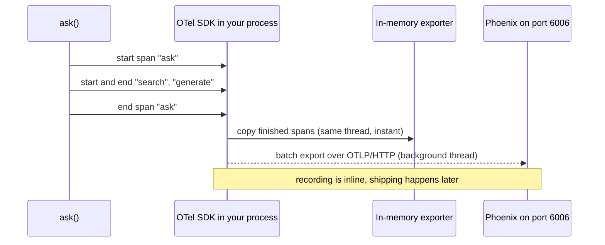
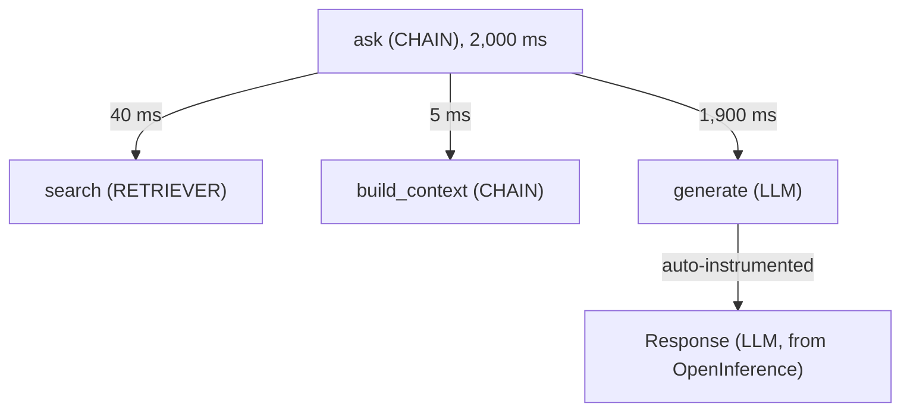
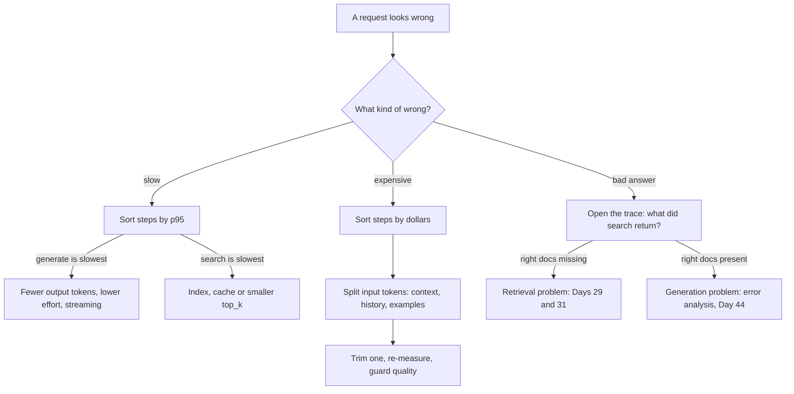
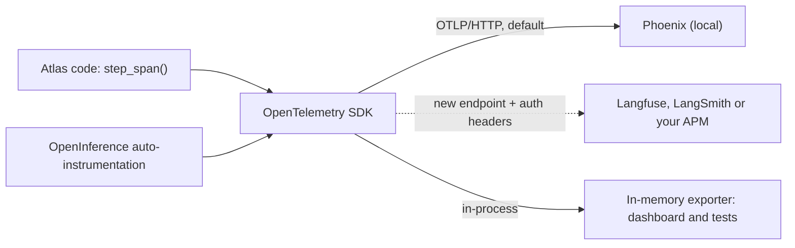

# Tracing & Observability in Depth

Two `ask()` calls on the same Orbit docs took 2 s and 9 s, and Day 12's call log only says "2 LLM calls, $0.0009". It can't tell you whether the 9 s went to search or to generation, or that most of the input tokens were context the answer never cited. Today every Atlas request leaves a trace, and you use the numbers it produces to fix the worst step and prove the fix worked.

## At a Glance

- **Time:** ~2 h core (+ optional Go Deeper) · **Depth:** working
- **Prerequisites:** [Day 12: The OpenAI SDK in Production Code](../../Phase_2_Building_with_LLM_APIs/Day_012_openai_sdk_production/openai_sdk_production.md), [Day 34: Capstone R2: Ask, a RAG Assistant with a UI](../../Phase_3_RAG/Day_034_capstone_r2_ask/capstone_r2_ask.md), [Day 41: Workflow Patterns: Chaining, Routing & Parallelization](../../Phase_4_Tools_and_MCP/Day_041_workflow_patterns/workflow_patterns.md); primer: [Backend & Production Vocabulary](../../Appendix_Primers/A10_backend_production_vocabulary.md)
- **You'll build:** `atlas/tracing.py` (`setup_tracing()`, `step_span()`, `attach_memory_exporter()`, `StepStats`, `summarize_spans()`), a traced mini-R2 `ask()` and `route_issue()`, a per-step cost/latency dashboard, and one measured fix
- **Stops at:** writing exporters; tail sampling and running an OpenTelemetry Collector (see [Day 82](../../Phase_9_Production/Day_082_containerize_deploy/containerize_deploy.md) and [Day 86](../../Phase_9_Production/Day_086_monitoring_feedback/monitoring_feedback.md))
- **Fast path:** Already know OpenTelemetry? Read the table in §Speaking the Standard, then §From Spans to Numbers and §Using the Numbers, and do Exercise 3 (about 45 min)
- **Cost:** ≈ $0.02 on `gpt-6-luna` for about 50 calls (prices as of 2026-11, [verify](https://developers.openai.com/api/docs/pricing)); $0 without a key, because an offline fake client runs instead
- **New terms:** trace & span, OpenTelemetry (OTel), GenAI semantic conventions, auto-instrumentation, p50/p95

> **Coming from Software Engineering?** This is distributed tracing, the same thing Jaeger or Datadog APM (application performance monitoring: tools that time every step of a request) do for microservices: a trace is one request, a span is one hop, and the parent/child links make the waterfall. It is even the same standard, OpenTelemetry, shipped over OTLP (the wire format OTel uses to send spans). What's new is the payload: tokens, dollars, model names and (optionally) prompt text become span attributes. Orbit itself already exports OTLP from its `[telemetry]` section, so Atlas joins a world your ops team already runs.

## Why a Call Log Isn't Enough

Here are the two Day 12 log lines for the slow and fast questions, trimmed:

```text
{"label": "ask", "model": "gpt-6-luna", "in": 3120, "out": 140, "usd": 0.000382, "latency_s": 1.9}
{"label": "ask", "model": "gpt-6-luna", "in": 3305, "out": 610, "usd": 0.000636, "latency_s": 8.7}
```

Each line describes one model call in isolation. It can't say what happened *around* the call: how long search took, how many chunks went into the prompt, which branch of the router ran, or which of three parallel checks was slow. The log is flat, and the request was a tree.

## A Trace Is an Itemised Receipt

Think of a trace as the itemised receipt for one request. Each line is a step with its time and its cost, and lines nest like sub-totals: "generate" sits inside "ask" the way "tax" sits inside "groceries".

A tiny worked example, by hand. One `ask()` call produced these steps:

| Step | Inside | Time | Input tokens | Output tokens |
|---|---|---|---|---|
| `ask` | (root) | 2,000 ms | | |
| `search` | `ask` | 40 ms | | |
| `build_context` | `ask` | 5 ms | | |
| `generate` | `ask` | 1,900 ms | 3,000 (2,400 of it context) | 300 |

Check it in your head:

- **Where did the time go?** 1,900 / 2,000 = 95% in `generate`. Search is not your problem.
- **What did it cost?** At $0.10 per 1M input and $0.50 per 1M output tokens (`gpt-6-luna`, as of 2026-11, verify): 3,000 × 0.10 / 1M + 300 × 0.50 / 1M = $0.00030 + $0.00015 = **$0.00045**.
- **What drives the cost?** Input is two thirds of the bill, and 2,400 / 3,000 = 80% of the input is retrieved context. Trimming context is the cheapest lever, and you'll pull it in §Using the Numbers.

The missing 55 ms is time inside `ask` that no child covers (overhead, parsing); traces show such gaps too.

## Traces, Spans and OpenTelemetry

- A **span** is one timed step: a name, a start and end time, a status (OK or ERROR), and **attributes** (key/value pairs such as `gen_ai.usage.input_tokens = 3000`).
- A **trace** is every span that shares one **trace id**. Each span except the root also stores its **parent's span id**, which is what turns a list into a tree.
- A **span kind** says what the step is. Phoenix uses OpenInference kinds such as `CHAIN`, `RETRIEVER`, `LLM` and `TOOL` to pick icons and views.
- **OpenTelemetry (OTel)** is the vendor-neutral standard and SDK for creating spans. An **exporter** sends finished spans to a **backend**, the app that stores and shows them (Phoenix, Langfuse, LangSmith, Jaeger).
- **Auto-instrumentation**: a library patches another (here, the OpenAI SDK) so its calls create spans with no tracing code from you.

Recording and shipping are separate moments. Your code records spans inline as it runs; an exporter ships them later, usually from a background thread:



The receipt above, drawn as the span tree you'll see in Phoenix. The extra `Response` span comes from auto-instrumentation, nested under your own `generate` span:



## Your First Trace in Local Phoenix

[Day 12](../../Phase_2_Building_with_LLM_APIs/Day_012_openai_sdk_production/openai_sdk_production.md) switched on Phoenix auto-instrumentation in one line. Here is the same idea as a standalone script, so you can see what one span looks like before you build trees. Start the server in a second terminal with `phoenix serve` (UI and OTLP/HTTP both on `http://localhost:6006`, no account needed):

```python
# script_id: day_042_tracing_observability/first_trace
# One Responses call, auto-traced into local Phoenix.
# Install: uv add "openai>=3.46,<4" arize-phoenix arize-phoenix-otel openinference-instrumentation-openai
# Env: OPENAI_API_KEY; optional ATLAS_MODEL, ORBIT_DATA. Services: `phoenix serve` in another terminal
import json
import os
from pathlib import Path

from openai import OpenAI
from phoenix.otel import register

MODEL = os.environ.get("ATLAS_MODEL", "gpt-6-luna")
DATA_DIR = Path(os.environ.get("ORBIT_DATA", "datasets/orbit"))

# Register before creating the client, so the OpenAI instrumentor is in place first
provider = register(project_name="atlas", endpoint="http://localhost:6006/v1/traces",
                    auto_instrument=True, verbose=False)
client = OpenAI()
q1 = json.loads((DATA_DIR / "eval/qa_gold.jsonl").read_text().splitlines()[0])
resp = client.responses.create(model=MODEL, input=q1["question"])
print(resp.output_text[:200])
provider.force_flush()  # ship the span now; a short script may exit before a batch is sent
print("View trace at http://localhost:6006 (project 'atlas')")
```

Expected output (your answer text will differ):

```text
In orbit.toml, lease_seconds defaults to 300 and heartbeat_seconds defaults to 30 ...
View trace at http://localhost:6006 (project 'atlas')
```

In the UI, open project `atlas`. You'll find one span named `Response`, kind `LLM`, with `llm.model_name`, `llm.token_count.prompt` and `llm.token_count.completion` attributes, plus the input and output messages. These are **OpenInference** names, not OTel `gen_ai.*` names; more on that soon.

## Spans by Hand: Nesting, and How It Breaks

A child span joins its parent's trace only if the parent is the **current span** when the child starts. OTel tracks "current" in a context variable, and `start_as_current_span()` sets it for the duration of its `with` block. This pure-OTel script needs no key and no Phoenix; it records spans into memory and prints which trace each one landed in:

```python
# script_id: day_042_tracing_observability/nesting
# How spans nest, and two ways to break the nesting. Pure OpenTelemetry: no key, no backend.
# Install: uv add opentelemetry-sdk. Env: none. Services: none.
from opentelemetry import trace
from opentelemetry.sdk.trace import TracerProvider
from opentelemetry.sdk.trace.export import SimpleSpanProcessor
from opentelemetry.sdk.trace.export.in_memory_span_exporter import InMemorySpanExporter

memory = InMemorySpanExporter()  # keeps finished spans in a list: ideal for tests and dashboards
provider = TracerProvider()
provider.add_span_processor(SimpleSpanProcessor(memory))
trace.set_tracer_provider(provider)
tracer = trace.get_tracer("atlas")

with tracer.start_as_current_span("ask"):  # right: children open inside the parent's `with`
    with tracer.start_as_current_span("search"):
        pass
    with tracer.start_as_current_span("generate"):
        pass

with tracer.start_as_current_span("ask_broken"):  # wrong 1: the step runs after `with` closed
    pass
with tracer.start_as_current_span("generate_orphan"):
    pass

parent = tracer.start_span("ask_not_current")  # wrong 2: start_span() doesn't make it current
with tracer.start_as_current_span("search_orphan"):
    pass
parent.end()

spans = memory.get_finished_spans()
names = {s.context.span_id: s.name for s in spans}
labels: dict[int, str] = {}
for s in spans:
    t = labels.setdefault(s.context.trace_id, f"T{len(labels) + 1}")
    print(f"{s.name:<16} trace={t}  parent={names.get(s.parent.span_id, '?') if s.parent else '-'}")
```

Expected output (spans print in the order they *finish*, so children come first):

```text
search           trace=T1  parent=ask
generate         trace=T1  parent=ask
ask              trace=T1  parent=-
ask_broken       trace=T2  parent=-
generate_orphan  trace=T3  parent=-
search_orphan    trace=T4  parent=-
ask_not_current  trace=T5  parent=-
```

Three spans, one trace is the shape you want. Each broken case starts a fresh trace, which Phoenix shows as an unrelated one-span request. The same thing happens when work hops to a thread pool, because threads don't inherit context variables (Exercise 2). `asyncio.gather()` and `asyncio.to_thread()` *do* copy the context, so Day 41's async checks nest without extra work.

## The Atlas Tracing Module

Now package what you learned into `atlas/tracing.py`, extending Day 12's `setup_tracing()`. Day 12 callers keep working: same first argument, same return value (a provider, or `None` when tracing is off). Three choices are worth pointing out before the code:

- **Batch export.** A `SimpleSpanProcessor` exports on the request path. With Phoenix stopped, one span end blocked for about 6.7 s of retries in our test. `batch=True` moves export to a background thread.
- **A reachability check.** If nothing listens on the endpoint, `setup_tracing()` skips the exporter and says so, instead of filling your terminal with retry warnings.
- **Content off by default.** `capture_content=False` sets OpenInference's hide-inputs/outputs switches, so prompt and answer text stay out of the backend. Atlas's own spans record ids, counts and dollars, never text.

```python
# script_id: day_042_tracing_observability/atlas/tracing
# atlas/tracing.py (Day 12 + Day 42): one trace per request, nested step spans, numbers from spans.
# Install: uv add opentelemetry-sdk arize-phoenix-otel openinference-instrumentation-openai
# Env: ATLAS_TRACING=0 (no exporter), ATLAS_OTLP_ENDPOINT, ATLAS_OTLP_HEADERS ("k=v,k2=v2")
# Services: `phoenix serve` (optional; without it spans stay in memory only)
from __future__ import annotations

import os
import socket
from collections.abc import Iterator
from contextlib import contextmanager
from urllib.parse import urlparse

from opentelemetry import trace
from opentelemetry.sdk.trace import TracerProvider
from opentelemetry.sdk.trace.export import SimpleSpanProcessor
from opentelemetry.sdk.trace.export.in_memory_span_exporter import InMemorySpanExporter

PHOENIX_URL = "http://localhost:6006/v1/traces"
OI_KINDS = {"chain", "retriever", "llm", "tool", "agent", "embedding", "reranker", "guardrail"}


def _reachable(url: str, timeout: float = 0.3) -> bool:
    u = urlparse(url)
    port = u.port or (443 if u.scheme == "https" else 80)
    try:
        with socket.create_connection((u.hostname or "localhost", port), timeout=timeout):
            return True
    except OSError:
        return False


def setup_tracing(project: str = "atlas", *, endpoint: str | None = None,
                  capture_content: bool = False) -> TracerProvider | None:
    """Send spans to Phoenix or any OTLP/HTTP backend. Returns None when no exporter is attached."""
    endpoint = endpoint or os.environ.get("ATLAS_OTLP_ENDPOINT", PHOENIX_URL)
    if os.environ.get("ATLAS_TRACING", "1") == "0" or not _reachable(endpoint):
        print(f"tracing: no exporter ({endpoint} is off or unreachable); in-memory spans still work")
        return None
    if not capture_content:  # read by OpenInference when it patches the SDK
        os.environ.setdefault("OPENINFERENCE_HIDE_INPUTS", "true")
        os.environ.setdefault("OPENINFERENCE_HIDE_OUTPUTS", "true")
    from phoenix.otel import register  # speaks plain OTLP, so the endpoint needn't be Phoenix

    raw = os.environ.get("ATLAS_OTLP_HEADERS", "")  # auth for hosted backends
    headers = dict(h.split("=", 1) for h in raw.split(",") if "=" in h) or None
    provider = register(project_name=project, endpoint=endpoint, headers=headers,
                        protocol="http/protobuf", batch=True, auto_instrument=True, verbose=False)
    print(f"tracing → {endpoint} (project {project!r})")
    return provider
```

Two small helpers finish the recording side. `attach_memory_exporter()` keeps a second copy of every span in memory for the dashboard and for tests. `step_span()` is the one function the rest of Atlas calls:

```python
# script_id: day_042_tracing_observability/atlas/tracing
def attach_memory_exporter() -> InMemorySpanExporter:
    """Copy every finished span into memory, beside whatever backend is configured."""
    provider = trace.get_tracer_provider()
    if not isinstance(provider, TracerProvider):  # tracing off: install a bare SDK provider
        provider = TracerProvider()
        trace.set_tracer_provider(provider)
    memory = InMemorySpanExporter()
    provider.add_span_processor(SimpleSpanProcessor(memory))  # in-process, so no network cost
    return memory


@contextmanager
def step_span(name: str, kind: str, **attrs) -> Iterator[trace.Span]:
    """One timed step. `kind` picks Phoenix's view; attrs become searchable span attributes."""
    oi_kind = kind.upper() if kind in OI_KINDS else "UNKNOWN"
    with trace.get_tracer("atlas").start_as_current_span(
            name, attributes={"atlas.kind": kind, "openinference.span.kind": oi_kind, **attrs}) as span:
        yield span  # an exception raised in here is recorded on the span, which is marked ERROR
```

Before any provider is set, `step_span()` returns cheap non-recording spans, so library code can call it unconditionally.

## Tracing Ask and the Issue Router

Three compact modules stand in for earlier days' code, so this lesson runs without Postgres; swap in your own later. They're imported, not run: from the folder holding `atlas/` and `replay.py`, run `python replay.py` (`python atlas/rag.py` fails with `No module named 'atlas'`).

First, `atlas/llm.py`. Every model call becomes one LLM span carrying the standard `gen_ai.*` attributes plus Atlas's own `atlas.cost_usd`. Without `OPENAI_API_KEY`, a fake client answers instead, with estimated tokens and invented latency: the plumbing and dashboard work offline, but its numbers say nothing about real performance.

```python
# script_id: day_042_tracing_observability/atlas/llm
# atlas/llm.py, compact (built on Day 12): one client, prices, and complete() as a traced LLM step.
# Install: uv add "openai>=3.46,<4" opentelemetry-sdk
# Env: OPENAI_API_KEY (unset = offline fake client), ATLAS_MODEL. Services: none.
from __future__ import annotations

import os
import random
import re
import time
from types import SimpleNamespace

from openai import OpenAI

from atlas.tracing import step_span

MODEL = os.environ.get("ATLAS_MODEL", "gpt-6-luna")
# USD per 1M (input, output) tokens. As of 2026-11, verify at https://developers.openai.com/api/docs/pricing
PRICES = {"gpt-6-luna": (0.10, 0.50), "gpt-6.1-terra": (1.00, 5.00)}


def cost_usd(model: str, input_tokens: int, output_tokens: int) -> float:
    p_in, p_out = PRICES[model]  # a KeyError beats a silent $0; cache discounts ignored here
    return (input_tokens * p_in + output_tokens * p_out) / 1_000_000


class FakeResponses:
    """Offline stand-in (Day 19's fake-client idea): estimated usage, invented latency."""

    def create(self, *, model: str, input: str, instructions: str = "", **_) -> SimpleNamespace:
        n_in = (len(instructions) + len(input)) // 4  # ~4 characters per token
        if instructions.startswith("Classify"):
            text = "question" if "?" in input[:300] else "bug"
        else:  # cite the first source in the context
            text = "See [{}].".format((re.findall(r"^\[([\w-]+)\]", input, re.M) or ["faq"])[0])
        n_out = random.Random(input).randint(40, 160)  # seeded by the input, so reruns match
        time.sleep(0.03 + n_in / 40_000 + n_out / 1_500)
        return SimpleNamespace(model=model, output_text=text,
                               usage=SimpleNamespace(input_tokens=n_in, output_tokens=n_out))


client = OpenAI() if os.environ.get("OPENAI_API_KEY") else SimpleNamespace(responses=FakeResponses())
```

```python
# script_id: day_042_tracing_observability/atlas/llm
def complete(input: str, *, instructions: str, step: str = "generate", model: str = MODEL) -> str:
    """One model call = one LLM span: standard gen_ai.* attributes plus Atlas's own cost."""
    with step_span(step, "llm", **{"gen_ai.operation.name": "chat",
                                  "gen_ai.provider.name": "openai",
                                  "gen_ai.request.model": model}) as span:
        r = client.responses.create(model=model, instructions=instructions, input=input)
        u = r.usage
        span.set_attributes({
            "gen_ai.response.model": r.model,
            "gen_ai.usage.input_tokens": u.input_tokens,
            "gen_ai.usage.output_tokens": u.output_tokens,
            "atlas.cost_usd": cost_usd(model, u.input_tokens, u.output_tokens),
        })
        return r.output_text
```

With a real key and Phoenix running, each `generate` span gets an auto-instrumented `Response` child holding the full request and token counts. Your span holds the numbers you aggregate; theirs holds the detail you click into.

Next, the mini-R2. `Index` is a keyword (tf-idf) stand-in for [Day 26](../../Phase_3_RAG/Day_026_pgvector_search/pgvector_search.md)'s vector index, one chunk per `## ` section of `docs/*.md`. `ask()` keeps [Day 28](../../Phase_3_RAG/Day_028_rag_pipeline/rag_pipeline.md)'s `Answer` and `Citation` names, and each step is a span:

```python
# script_id: day_042_tracing_observability/atlas/rag
# atlas/rag.py: compact mini-R2 (stand-in for Days 26-28 and your R2) with one span per step.
# Install: uv add pydantic opentelemetry-sdk. Env: ORBIT_DATA, ATLAS_TOP_K. Services: none.
from __future__ import annotations

import math
import os
import re
from collections import Counter
from pathlib import Path

from pydantic import BaseModel

from atlas.llm import complete
from atlas.tracing import step_span

DATA_DIR = Path(os.environ.get("ORBIT_DATA", "datasets/orbit"))
TOP_K = int(os.environ.get("ATLAS_TOP_K", "8"))
WORD = re.compile(r"[a-z0-9_]+(?:[.-][a-z0-9_]+)*")  # keeps orbit.toml and orb-1101 whole


class Citation(BaseModel):  # Day 15 / Day 28
    doc_id: str
    quote: str = ""


class Answer(BaseModel):
    text: str
    citations: list[Citation]


class Index:
    """Keyword stand-in for Day 26's Index: one chunk per '## ' section, tf-idf scoring."""

    def __init__(self, docs_dir: Path) -> None:
        self.chunks = [(p.stem, sec) for p in sorted(docs_dir.glob("*.md"))
                       for sec in re.split(r"\n(?=## )", p.read_text(encoding="utf-8"))]
        self.tf = [Counter(WORD.findall(text.lower())) for _, text in self.chunks]
        df = Counter(w for tf in self.tf for w in tf)
        self.idf = {w: math.log(len(self.chunks) / n) for w, n in df.items()}

    def search(self, query: str, k: int = TOP_K) -> list[tuple[str, str, float]]:
        terms = set(WORD.findall(query.lower()))
        scored = sorted(((sum(tf[t] * self.idf.get(t, 0.0) for t in terms), i)
                         for i, tf in enumerate(self.tf)), reverse=True)[:k]
        return [(self.chunks[i][0], self.chunks[i][1], score) for score, i in scored]
```

```python
# script_id: day_042_tracing_observability/atlas/rag
INSTRUCTIONS = ("Answer from the context only. Cite each source you use as [doc_id]. "
                "If the context does not answer the question, say you don't know.")


def ask(question: str, *, index: Index, k: int = TOP_K) -> Answer:
    """One request = one trace: ask → search → build_context → generate."""
    with step_span("ask", "chain", **{"atlas.top_k": k}) as root:
        with step_span("search", "retriever") as span:
            hits = index.search(question, k)
            for i, (doc_id, _, score) in enumerate(hits):  # OpenInference's flattened document list
                span.set_attribute(f"retrieval.documents.{i}.document.id", doc_id)
                span.set_attribute(f"retrieval.documents.{i}.document.score", score)
        with step_span("build_context", "chain") as span:
            context = "\n\n".join(f"[{doc_id}]\n{text}" for doc_id, text, _ in hits)
            span.set_attribute("atlas.context_chars", len(context))
        text = complete(f"Context:\n{context}\n\nQuestion: {question}", instructions=INSTRUCTIONS)
        cited = list(dict.fromkeys(re.findall(r"\[([\w-]+)\]", text)))  # ordered, no repeats
        root.set_attribute("atlas.cited", cited)
        return Answer(text=text, citations=[Citation(doc_id=d) for d in cited])
```

Finally, a compact `route_issue()` from Day 41: classify with the model, then run three checks in parallel with `asyncio.gather()`. The checks need no tracing glue, because each task starts with a copy of the current context:

```python
# script_id: day_042_tracing_observability/atlas/workflows
# atlas/workflows.py: compact Day 41 route_issue() with spans (subset of Day 41's RouteResult).
# Install: uv add pydantic opentelemetry-sdk. Env: as atlas/llm. Services: none.
from __future__ import annotations

import asyncio
import re
import time
from dataclasses import dataclass

from atlas.llm import complete
from atlas.rag import Index
from atlas.tracing import step_span

RISK = re.compile(r"ignore (all|previous) instructions|api[_-]?key|password", re.I)


@dataclass
class RouteResult:
    issue_id: int
    route: str
    needs_human: bool
    latency_s: float


async def find_duplicates(issue: dict, others: list[dict]) -> list[int]:
    with step_span("find_duplicates", "tool"):
        words = set(issue["title"].lower().split())
        return [o["id"] for o in others if o["id"] != issue["id"]
                and len(words & set(o["title"].lower().split())) >= 6]


async def match_docs(issue: dict, index: Index) -> list[str]:
    with step_span("match_docs", "retriever"):
        return [doc_id for doc_id, _, _ in index.search(issue["title"], 3)]


async def screen_risk(issue: dict) -> bool:
    with step_span("screen_risk", "guardrail"):
        return bool(RISK.search(issue["body"]))
```

```python
# script_id: day_042_tracing_observability/atlas/workflows
async def route_issue(issue: dict, *, index: Index, others: list[dict]) -> RouteResult:
    start = time.perf_counter()
    with step_span("route_issue", "chain", **{"atlas.issue_id": issue["id"]}) as root:
        kind = await asyncio.to_thread(  # the sync client runs in a thread; to_thread copies context
            complete, f"{issue['title']}\n\n{issue['body'][:2000]}", step="classify",
            instructions="Classify this GitHub issue. Reply with one word: bug, question, feature or docs.")
        dups, docs, risky = await asyncio.gather(
            find_duplicates(issue, others), match_docs(issue, index), screen_risk(issue))
        route = "needs_human" if risky else ("duplicate" if dups else kind.strip(" .\n").lower())
        root.set_attributes({"atlas.route": route, "atlas.doc_ids": docs})
        return RouteResult(issue["id"], route, risky, time.perf_counter() - start)
```

## Speaking the Standard: GenAI Semantic Conventions

Attribute names are where tracing gets messy. Three vocabularies meet in an Atlas trace:

- **OTel GenAI semantic conventions**: the vendor-neutral names (`gen_ai.*`). Their status is **Development**, and the spec has moved to its own repo, [`semantic-conventions-genai`](https://github.com/open-telemetry/semantic-conventions-genai). Names can still change; `gen_ai.system` already became `gen_ai.provider.name`.
- **OpenInference**: the names Phoenix's auto-instrumentation writes (`llm.*`, `openinference.span.kind`). As of 2026-11 it is the instrumentation that actually traces the Responses API. The official `opentelemetry-instrumentation-openai-v2` 2.4b0 wraps only Chat Completions and embeddings, so a `responses.create` call produces no span.
- **Atlas custom** (`atlas.*`): what no standard covers, such as dollars, prompt versions and eval case ids. Prefix your own names so they never collide with a future standard.

| Concept | OTel GenAI (`gen_ai.*`) | OpenInference (Phoenix) | Atlas custom |
|---|---|---|---|
| What the step is | `gen_ai.operation.name` (`chat`, `retrieval`, `execute_tool`, `invoke_agent`) | `openinference.span.kind` (`LLM`, `RETRIEVER`, `TOOL`, `CHAIN`) | `atlas.kind` |
| Provider | `gen_ai.provider.name` = `"openai"` | `llm.provider` | |
| Model | `gen_ai.request.model`, `gen_ai.response.model` | `llm.model_name` | |
| Tokens | `gen_ai.usage.input_tokens`, `gen_ai.usage.output_tokens` | `llm.token_count.prompt`, `.completion`, `.total` | |
| Cost | no attribute defined | `llm.cost.total` (and per-part `llm.cost.*`) | `atlas.cost_usd` |
| Retrieved docs | `gen_ai.retrieval.documents` | `retrieval.documents.N.document.id`, `.score` | `atlas.doc_ids` |
| Prompt/answer text | off by default; `OTEL_INSTRUMENTATION_GENAI_CAPTURE_MESSAGE_CONTENT=true` | `input.value`, `output.value`; hide with `OPENINFERENCE_HIDE_INPUTS`/`_OUTPUTS` | never recorded |
| Your own context | | `metadata`, `session.id` | `atlas.prompt_version`, `atlas.case_id`, `atlas.top_k` |

The spec names an OpenAI client span `"{operation} {model}"` (`chat gpt-6-luna`), kind `CLIENT`. Atlas names spans by *step* (`generate`, `classify`) because the dashboard groups by step; the auto-instrumented `Response` child carries provider detail. Content capture is off in both standards by default, for the reason [Day 73](../../Phase_8_Safety_and_Security/Day_073_privacy_pii/privacy_pii.md) spends a whole day on: prompts contain user data.

## From Spans to Numbers: A Cost/Latency Dashboard

Phoenix shows one trace at a time; deciding what to fix needs numbers across many requests. Two matter most:

- **p50** (the median): half the requests were faster than this. It describes the typical user.
- **p95**: 95% of requests were faster than this. It describes your unlucky users, and the 9 s request from the hook lives here. Averages hide it, so don't use them for latency.

Tokens are metered, and input and output are priced differently (on `gpt-6-luna`, output costs 5× input, as of 2026-11, verify). So the dashboard tracks input tokens, output tokens and dollars separately, per step. Errors count too: `step_span()` marks a span ERROR when an exception escapes it, so the error rate falls out of the same spans.

The last block of `atlas/tracing.py` turns finished spans into one `StepStats` row per step name. It only reads spans that `step_span()` made (they carry `atlas.kind`), so auto-instrumented `Response` spans never double-count tokens:

```python
# script_id: day_042_tracing_observability/atlas/tracing
from collections import defaultdict
from collections.abc import Iterable
from dataclasses import dataclass
from statistics import quantiles

from opentelemetry.sdk.trace import ReadableSpan
from opentelemetry.trace import StatusCode


@dataclass
class StepStats:
    name: str
    n: int
    p50_ms: float
    p95_ms: float
    input_tokens: int
    output_tokens: int
    cost_usd: float
    error_rate: float


def _pct(values: list[float], p: int) -> float:
    return values[0] if len(values) == 1 else quantiles(values, n=100, method="inclusive")[p - 1]


def summarize_spans(spans: Iterable[ReadableSpan]) -> list[StepStats]:
    """Group Atlas spans by name: p50/p95 latency, tokens, $ and error rate. Slowest p95 first."""
    groups: dict[str, list[ReadableSpan]] = defaultdict(list)
    for s in spans:
        if "atlas.kind" in (s.attributes or {}):
            groups[s.name].append(s)
    rows = []
    for name, group in groups.items():
        ms = [(s.end_time - s.start_time) / 1e6 for s in group]  # OTel timestamps are nanoseconds
        attrs = [s.attributes for s in group]
        rows.append(StepStats(
            name, len(group), _pct(ms, 50), _pct(ms, 95),
            sum(int(a.get("gen_ai.usage.input_tokens", 0)) for a in attrs),
            sum(int(a.get("gen_ai.usage.output_tokens", 0)) for a in attrs),
            sum(float(a.get("atlas.cost_usd", 0.0)) for a in attrs),
            sum(s.status.status_code is StatusCode.ERROR for s in group) / len(group)))
    return sorted(rows, key=lambda r: r.p95_ms, reverse=True)


def print_table(rows: list[StepStats]) -> None:
    print(f"{'step':<16}{'n':>4}{'p50 ms':>9}{'p95 ms':>9}{'in tok':>9}{'out tok':>9}{'$':>10}{'err':>6}")
    for r in rows:
        print(f"{r.name:<16}{r.n:>4}{r.p50_ms:>9.0f}{r.p95_ms:>9.0f}{r.input_tokens:>9,}"
              f"{r.output_tokens:>9,}{r.cost_usd:>10.5f}{r.error_rate:>6.0%}")


if __name__ == "__main__":  # offline smoke test: three fake requests, no backend needed
    import time

    setup_tracing()
    memory = attach_memory_exporter()
    for delay_ms in (40, 60, 400):
        with step_span("ask", "chain"), step_span("search", "retriever"):
            time.sleep(delay_ms / 1000)
    print_table(summarize_spans(memory.get_finished_spans()))
```

Now the replay driver. It turns tracing on *before* importing the modules that build the client, attaches the in-memory copy, then replays 20 `qa_gold` questions and 10 issues:

```python
# script_id: day_042_tracing_observability/replay
# Replay 20 qa_gold questions + 10 issues through traced Atlas; print the per-step dashboard.
# Install: uv add "openai>=3.46,<4" pydantic opentelemetry-sdk arize-phoenix-otel openinference-instrumentation-openai
# Env: OPENAI_API_KEY (optional: offline fake client without it), ORBIT_DATA. Services: `phoenix serve` (optional)
from __future__ import annotations

import asyncio
import json

from atlas.tracing import attach_memory_exporter, print_table, setup_tracing, summarize_spans

setup_tracing("atlas")  # first, so auto-instrumentation is in place before the client exists
memory = attach_memory_exporter()

from atlas.rag import DATA_DIR, Index, ask  # noqa: E402
from atlas.workflows import route_issue  # noqa: E402


def load(rel: str) -> list[dict]:
    return [json.loads(line) for line in (DATA_DIR / rel).read_text(encoding="utf-8").splitlines()]


QA, ISSUES = load("eval/qa_gold.jsonl")[:20], load("issues/issues.jsonl")
index = Index(DATA_DIR / "docs")


def run_ask(k: int) -> tuple[list, int]:
    """Replay QA at top_k=k. Returns its spans and how many answers cite a gold doc (Day 30-style)."""
    memory.clear()
    cites_gold = 0
    for case in QA:
        answer = ask(case["question"], index=index, k=k)
        cites_gold += any(c.doc_id in case["citations"] for c in answer.citations)
    return list(memory.get_finished_spans()), cites_gold


async def run_routes() -> list:
    memory.clear()
    for issue in ISSUES[:10]:
        await route_issue(issue, index=index, others=ISSUES)
    return list(memory.get_finished_spans())
```

## Using the Numbers: Fix One Hotspot

Use this chart to turn "something is wrong" into "look at this span":



For Atlas, the receipt already pointed at the "expensive" branch: most `generate` input is retrieved context. The second replay block prints the dashboard, then re-runs the questions with `top_k` cut from 8 to 4 and prints a before/after row. The guard matters as much as the saving: a cheaper run that cites gold docs less often is a regression, not a fix.

```python
# script_id: day_042_tracing_observability/replay
def request_row(label: str, spans: list, cites_gold: int) -> str:
    rows = {r.name: r for r in summarize_spans(spans)}
    req, gen = rows["ask"], rows["generate"]
    ctx_tokens = sum(s.attributes.get("atlas.context_chars", 0) for s in spans) / 4  # ≈ tokens
    return (f"{label:<9}{req.p95_ms:>8.0f}{gen.input_tokens / req.n:>12,.0f}"
            f"{ctx_tokens / gen.input_tokens:>9.0%}{gen.cost_usd / req.n * 1000:>11.4f}"
            f"{cites_gold:>8}/{req.n}")


if __name__ == "__main__":
    before, gold_before = run_ask(8)
    print_table(summarize_spans(before + asyncio.run(run_routes())))
    after, gold_after = run_ask(4)
    print(f"\n{'run':<9}{'p95 ms':>8}{'in tok/req':>12}{'context':>9}{'$/1k req':>11}{'cites gold':>11}")
    print(request_row("top_k=8", before, gold_before))
    print(request_row("top_k=4", after, gold_after))
    print("guard:", "OK" if gold_after >= gold_before else "FAILED, the cheaper run cites gold docs less")
```

Expected output with the offline fake client and no Phoenix (your numbers will differ, and real-model numbers differ more):

```text
tracing: no exporter (http://localhost:6006/v1/traces is off or unreachable); in-memory spans still work
step               n   p50 ms   p95 ms   in tok  out tok         $   err
ask               20      199      236        0        0   0.00000    0%
generate          20      198      235   67,917    2,154   0.00787    0%
route_issue       10      112      134        0        0   0.00000    0%
classify          10      109      130    2,013      991   0.00070    0%
find_duplicates   10        0        2        0        0   0.00000    0%
search            20        1        1        0        0   0.00000    0%
match_docs        10        1        1        0        0   0.00000    0%
screen_risk       10        0        0        0        0   0.00000    0%
build_context     20        0        0        0        0   0.00000    0%

run        p95 ms  in tok/req  context   $/1k req cites gold
top_k=8       236       3,396      98%     0.3934      13/20
top_k=4       192       2,179      98%     0.2666      13/20
guard: OK
```

Read it top down. `generate` dominates both time and money; `search` and the router's checks are noise. Context is 98% of `generate` input here (the receipt's 80% was a toy). Halving `top_k` cuts input tokens by about a third and `$/1k req` by a third, while p95 drops less, because answer length drives latency more than prompt length. The guard holds. On a real model, re-check the guard with [Day 30](../../Phase_3_RAG/Day_030_answer_evaluation/answer_evaluation.md)'s judge before you ship the change, since the fake client's answers only exercise the plumbing. Record the before/after row in your Ask scoreboard: that's today's measured improvement.

## Backends and Trade-offs

Because everything speaks OTLP, the backend is a configuration choice, not a code change:



| | Phoenix | Langfuse | LangSmith |
|---|---|---|---|
| Runs locally, no account | yes (`phoenix serve`) | self-hostable, or hosted with keys | hosted (EU and self-hosted endpoints exist) |
| Built on OTel | yes (OpenInference) | yes (SDK v5 is OTel-based) | own SDK; check its OTel docs before sending OTLP |
| Native Python SDK | `phoenix.otel.register` | `@observe`, `from langfuse.openai import OpenAI` | `@traceable`, `wrap_openai()` |
| Licence | Elastic-2.0 (source-available) | MIT SDK | MIT SDK |

Rule of thumb: start on local Phoenix, keep your code on plain OTel plus `step_span()`, and choose a hosted backend when a team needs shared access. Copy the OTLP endpoint and auth header from the backend's own OpenTelemetry docs into `ATLAS_OTLP_ENDPOINT` and `ATLAS_OTLP_HEADERS` (Exercise 4). Check hosted tier prices yourself; they weren't verified here.

Don't trace content for real user data until Day 73's redaction and retention are in place, and don't put spans in tight inner loops (a span per token costs more than it tells you).

### In production

- **Sampling.** Keep every trace in development. In production, sample at the root (head sampling, see Go Deeper) so a kept trace is always complete, but take cost totals from usage logs or metrics, which see every call.
- **Content and PII.** Ship with `capture_content=False`; redaction and retention policy belong to [Day 73](../../Phase_8_Safety_and_Security/Day_073_privacy_pii/privacy_pii.md).
- **Retention.** Traces with content are user data. Set the backend's retention period deliberately; don't leave it at the default.
- **Alerts.** p95 and $/request per step make good alert signals; wiring them up is [Day 86](../../Phase_9_Production/Day_086_monitoring_feedback/monitoring_feedback.md).
- **Overhead.** Batch export, a short reachability check at startup, and no spans in hot loops keep tracing cheap. [Day 88](../../Phase_9_Production/Day_088_operating_ai_systems/operating_ai_systems.md) uses these traces for incident triage.

## Go Deeper (optional)

<details><summary>Go deeper: how the parent link travels (contextvars)</summary>

OTel stores the current span in a `contextvars.ContextVar`. `start_as_current_span()` attaches a new context holding the span and detaches it when the `with` block exits. A child reads the current span at creation time, copies its trace id and records its span id as the parent. That's the whole mechanism.

Context variables follow *execution context*, not threads or call stacks:

- An `asyncio` task gets a **copy** of the context at creation, so `gather()` children see the parent span. `asyncio.to_thread()` also copies it.
- `ThreadPoolExecutor.submit()` does **not** copy it, so the worker sees an empty context and starts a new trace. The fix is `pool.submit(contextvars.copy_context().run, fn, *args)`, one fresh copy per task (a `Context` can't be entered by two threads at once).
- Across processes and services (a queue, an HTTP call), context travels in headers: OTel's propagators write a `traceparent` header and the receiver continues the trace. A job queue can do the same by storing those headers with the job, so an enqueue and the worker that runs it share one trace (this is a pattern, not something Orbit's docs promise).

</details>

<details><summary>Go deeper: simple vs batch span processors</summary>

A span processor decides *when* finished spans go to the exporter. `SimpleSpanProcessor` exports synchronously in `span.end()`, so a slow or dead backend slows your request. `BatchSpanProcessor` queues spans and exports from a background thread. Its trade-off is that the queue can be lost on a hard crash, and a short-lived process must flush before it exits (normal interpreter exit runs `shutdown()` through `atexit`, because `TracerProvider(shutdown_on_exit=True)` is the default).

```python
# script_id: day_042_tracing_observability/processor_timing
# Simple vs batch processor against a slow backend (a fake exporter that sleeps 50 ms per export).
# Install: uv add opentelemetry-sdk. Env: none. Services: none.
import time

from opentelemetry.sdk.trace import TracerProvider
from opentelemetry.sdk.trace.export import (BatchSpanProcessor, SimpleSpanProcessor, SpanExporter,
                                            SpanExportResult)


class SlowExporter(SpanExporter):
    def export(self, spans) -> SpanExportResult:
        time.sleep(0.05)  # one network round trip to a backend
        return SpanExportResult.SUCCESS


for processor_cls in (SimpleSpanProcessor, BatchSpanProcessor):
    provider = TracerProvider()  # a local provider, separate from the global one
    provider.add_span_processor(processor_cls(SlowExporter()))
    tracer = provider.get_tracer("demo")
    start = time.perf_counter()
    for _ in range(20):
        with tracer.start_as_current_span("step"):
            pass
    took_ms = (time.perf_counter() - start) * 1000
    provider.shutdown()  # the batch processor flushes its queue here, off the request path
    print(f"{processor_cls.__name__:<20} 20 spans cost the app {took_ms:,.0f} ms")
```

Expected output (your numbers will differ):

```text
SimpleSpanProcessor  20 spans cost the app 1,085 ms
BatchSpanProcessor   20 spans cost the app 1 ms
```

</details>

<details><summary>Go deeper: head sampling that keeps traces whole</summary>

At high traffic you don't need every trace. **Head sampling** decides at the root span, before anything is known about the request. `TraceIdRatioBased(0.1)` keeps about 10% of trace ids; wrapping it in `ParentBased` makes every child follow its root's decision, so you never store half a trace. **Tail sampling** ("keep every slow or failed trace") needs the whole trace first, so it runs in an OTel Collector, which is out of scope here.

```python
# script_id: day_042_tracing_observability/sampling
# Head sampling: keep ~10% of traces, and keep each kept trace complete.
# Install: uv add opentelemetry-sdk. Env: none. Services: none.
from opentelemetry.sdk.trace import TracerProvider
from opentelemetry.sdk.trace.export import SimpleSpanProcessor
from opentelemetry.sdk.trace.export.in_memory_span_exporter import InMemorySpanExporter
from opentelemetry.sdk.trace.sampling import ParentBased, TraceIdRatioBased

memory = InMemorySpanExporter()
provider = TracerProvider(sampler=ParentBased(TraceIdRatioBased(0.1)))
provider.add_span_processor(SimpleSpanProcessor(memory))
tracer = provider.get_tracer("demo")
for _ in range(1000):
    with tracer.start_as_current_span("ask"):
        with tracer.start_as_current_span("generate"):  # follows its root's decision
            pass
spans = memory.get_finished_spans()
roots = sum(s.parent is None for s in spans)
print(f"kept {roots} of 1000 traces; every kept trace is complete: {len(spans) == 2 * roots}")
```

Sampled-out spans are never recorded, so a dashboard built from sampled spans undercounts dollars by the sampling rate. Keep cost totals on Day 12's call log or on metrics.

</details>

<details><summary>Go deeper: LangSmith's and Langfuse's own SDKs</summary>

Both backends also offer decorator-style SDKs that trace without you touching OTel. They're worth knowing because you'll meet them in other codebases:

- **LangSmith** (`langsmith` 0.14): set `LANGSMITH_TRACING=true`, `LANGSMITH_API_KEY` and `LANGSMITH_PROJECT` (the older `LANGCHAIN_*` names are fallbacks only). Wrap the client with `wrap_openai(OpenAI())`, which patches `responses.create` and `responses.parse`, and decorate steps with `@traceable(run_type="retriever", name="search_docs")`. With tracing disabled it's a no-op, so the code runs without a key.
- **Langfuse** (`langfuse` 5.x, OTel-based): set `LANGFUSE_PUBLIC_KEY`, `LANGFUSE_SECRET_KEY` and `LANGFUSE_BASE_URL`, use `from langfuse.openai import OpenAI` as a drop-in client, and decorate steps with `@observe(as_type="retriever")`. Trace-level `user_id`/`session_id` go through `propagate_attributes(...)`. Short scripts must call `get_client().flush()`. Version 5 removed `update_current_trace` and `start_as_current_span`, so older tutorials won't run.

The trade-off: a vendor SDK gives richer vendor features, while `step_span()` on plain OTel keeps you portable. Many teams use OTel for the spine and a vendor SDK only where it adds something specific.

</details>

## Common Pitfalls

- **Phoenix UI is empty after a short script.** Spans sit in the batch queue. Normal exit flushes them through `atexit`, but a crash, `os._exit()`, a killed process or a serverless function frozen after it returns loses the queue. Call `provider.force_flush()` before the process can end.
- **Each step shows up as its own trace.** The span opened after the parent's `with` closed, was started with `start_span()` instead of `start_as_current_span()`, or ran in a `ThreadPoolExecutor`, which doesn't copy context. Open children inside the parent's block, and submit thread work as `contextvars.copy_context().run`.
- **Your terminal fills with `Transient error HTTPConnectionPool(host='localhost', port=6006): Max retries exceeded with url: /v1/traces (... Connection refused)`, then `Failed to export spans batch due to timeout, max retries or shutdown.`** Phoenix isn't running, or the endpoint is wrong. With a simple processor each span end also blocks for seconds. Start `phoenix serve`, use `batch=True`, or let `setup_tracing()`'s reachability check skip the exporter.
- **LLM spans and tokens appear twice.** Two instrumentors patch the same SDK (OpenInference plus `opentelemetry-instrumentation-openai-v2` for Chat Completions code). Pick one per process, and sum tokens only from your own step spans, as `summarize_spans()` does.
- **Prompts and user text appear in the backend, or a dashboard query stops matching.** Content capture was turned on for real traffic, or a library upgrade renamed attributes (`gen_ai.system` → `gen_ai.provider.name`). Keep `capture_content=False` outside development, and pin instrumentation versions.

> **Where we stop:** we record, ship and summarize spans, but don't write exporters, run an OTel Collector or do tail sampling; those are deployment concerns covered in [Day 82](../../Phase_9_Production/Day_082_containerize_deploy/containerize_deploy.md) and [Day 86](../../Phase_9_Production/Day_086_monitoring_feedback/monitoring_feedback.md).

## Key Takeaways

- A call log describes calls; a trace describes a *request*: a tree of timed spans sharing one trace id, which is what lets you say where the 9 s went.
- Children join a trace only if their parent is the current span: open them inside the parent's `with`, and copy context into thread pools (`asyncio` copies it for you).
- Three vocabularies meet in a trace: OTel `gen_ai.*` (standard, still Development), OpenInference `llm.*` (what Phoenix writes for the Responses API today) and your own prefixed `atlas.*` for cost, versions and case ids.
- Per-step p50/p95, input/output tokens, dollars and error rate computed from spans tell you which step to fix. Use p95 rather than averages for latency, and split input from output for cost.
- A fix is only real with a before/after measurement *and* a quality guard; the backend is config (OTLP endpoint and headers), so keep code on plain OTel.

## Quick Reference

| API / pattern | When to use | Gotcha |
|---|---|---|
| `phoenix serve` | local trace UI + OTLP/HTTP on `:6006` | `register()` without an endpoint defaults to gRPC on `:4317` |
| `register(project_name=, endpoint=, batch=True, auto_instrument=True)` | one-line setup; traces `responses.create` via OpenInference | call before creating the OpenAI client |
| `tracer.start_as_current_span(name, attributes=...)` | every step you want in the tree | `start_span()` records but doesn't become current |
| `step_span(name, kind, **attrs)` | Atlas's one tracing call | prefix custom keys with `atlas.` |
| `span.set_attributes({...})` | add tokens/cost after the call returns | values must be str, bool, int, float or lists of them |
| `InMemorySpanExporter` + `SimpleSpanProcessor` | dashboards and tests | call `.clear()` between runs |
| `summarize_spans(spans)` → `StepStats` | per-step p50/p95, tokens, $, error rate | reads only spans with `atlas.kind` |
| `contextvars.copy_context().run` | thread-pool work that must nest | one copy per task |
| `provider.force_flush()` | short scripts, serverless handlers | normal exit flushes via `atexit` |
| `OPENINFERENCE_HIDE_INPUTS` / `_OUTPUTS` | keep prompt text out of traces | set before instrumenting |

## Exercises

1. **Warm-up: tag requests.** Give `ask()` a `**span_attrs` parameter that lands on the `ask` span, and pass `atlas.case_id` and `atlas.prompt_version` from `run_ask()`. Find one case's spans again by its id, in Phoenix's span attributes and in memory.

<details><summary>Solution</summary>

Custom attributes are the cheapest way to make traces searchable by the things *you* care about.

```python
# script_id: day_042_tracing_observability/solution_ex1
# fragment: the changed lines only; the rest of atlas/rag.py and replay.py stays as shown
def ask(question: str, *, index: Index, k: int = TOP_K, **span_attrs) -> Answer:
    with step_span("ask", "chain", **{"atlas.top_k": k, **span_attrs}) as root:
        ...  # body unchanged

# replay.py, inside run_ask():
answer = ask(case["question"], index=index, k=k,
             **{"atlas.case_id": case["id"], "atlas.prompt_version": "ask-v1"})

# Later: every span of one case, via its root's trace id
root = next(s for s in memory.get_finished_spans() if s.attributes.get("atlas.case_id") == "qa-007")
case_spans = [s for s in memory.get_finished_spans() if s.context.trace_id == root.context.trace_id]
```

</details>

2. **Core: threads that lose the trace.** A teammate rewrote Day 41's checks as sync functions in a `ThreadPoolExecutor`, and Phoenix now shows them as separate one-span traces. Reproduce it, then make the checks appear as siblings under `route_issue`.

<details><summary>Solution</summary>

Threads start with an empty context; copying it per task restores the parent link.

```python
# script_id: day_042_tracing_observability/solution_ex2
# Install: uv add opentelemetry-sdk. Env: none. Services: none.
import contextvars
from concurrent.futures import ThreadPoolExecutor

from atlas.tracing import attach_memory_exporter, step_span

memory = attach_memory_exporter()
CHECKS = ("find_duplicates", "match_docs", "screen_risk")


def check(name: str) -> str:
    with step_span(name, "tool"):
        return name


def route(fixed: bool) -> None:
    with step_span("route_issue", "chain"), ThreadPoolExecutor(max_workers=3) as pool:
        if fixed:  # a fresh copy per task: one Context can't be entered by two threads at once
            futures = [pool.submit(contextvars.copy_context().run, check, n) for n in CHECKS]
        else:
            futures = [pool.submit(check, n) for n in CHECKS]
        for f in futures:
            f.result()


for fixed in (False, True):
    memory.clear()
    route(fixed)
    spans = memory.get_finished_spans()
    print(f"fixed={fixed}: {len({s.context.trace_id for s in spans})} trace(s) for {len(spans)} spans")
```

```text
fixed=False: 4 trace(s) for 4 spans
fixed=True: 1 trace(s) for 4 spans
```

</details>

3. **Core: $/request by query kind.** Replay the 40 queries in `eval/retrieval_queries.jsonl` and report dollars per 1,000 requests for each `kind` (`exact_term`, `semantic`, `multi_hop`), using only spans.

<details><summary>Solution</summary>

Tag each request's root, then attribute every span's cost to its trace's tag. This "group by an attribute of the root" pattern answers most "which kind of request is expensive?" questions.

```python
# script_id: day_042_tracing_observability/solution_ex3
# Install: as replay. Env: OPENAI_API_KEY optional (fake client without it), ORBIT_DATA.
import json
from collections import defaultdict

from atlas.tracing import attach_memory_exporter, step_span

memory = attach_memory_exporter()
from atlas.rag import DATA_DIR, Index, ask  # noqa: E402

index = Index(DATA_DIR / "docs")
lines = (DATA_DIR / "eval/retrieval_queries.jsonl").read_text(encoding="utf-8").splitlines()
for q in map(json.loads, lines):
    with step_span("eval_case", "chain", **{"atlas.query_kind": q["kind"]}):
        ask(q["query"], index=index)

spans = memory.get_finished_spans()
kind_of = {s.context.trace_id: s.attributes["atlas.query_kind"] for s in spans if s.name == "eval_case"}
cost, n = defaultdict(float), defaultdict(int)
for s in spans:
    kind = kind_of[s.context.trace_id]
    cost[kind] += s.attributes.get("atlas.cost_usd", 0.0)
    n[kind] += s.name == "eval_case"
for kind in sorted(cost):
    print(f"{kind:<11} n={n[kind]:>2}  ${cost[kind] / n[kind] * 1000:.4f} per 1k requests")
```

```text
exact_term  n=16  $0.2917 per 1k requests
multi_hop   n=10  $0.4231 per 1k requests
semantic    n=14  $0.4330 per 1k requests
```

</details>

4. **Stretch (optional, needs an account): same traces, another backend.** Send the replay's traces to Langfuse or LangSmith by changing configuration only. Use the Go Deeper notes on backends.

<details><summary>Solution</summary>

`setup_tracing()` already reads the endpoint and headers from the environment, so no Atlas code changes. Copy the OTLP/HTTP traces endpoint and the auth header from your backend's OpenTelemetry docs (both differ per vendor and region, so they aren't reproduced here), then re-run the replay:

```python
# script_id: day_042_tracing_observability/solution_ex4
# Shell first, with values from your backend's OpenTelemetry docs:
#   export ATLAS_OTLP_ENDPOINT="<your backend's OTLP/HTTP traces URL>"
#   export ATLAS_OTLP_HEADERS="<header-name>=<value>"
#   python replay.py
import os

from atlas.tracing import setup_tracing

provider = setup_tracing("atlas")
print("exporting to:", os.environ.get("ATLAS_OTLP_ENDPOINT", "Phoenix default") if provider else "nowhere")
```

If the backend's docs say it doesn't accept OTLP, use its native SDK from Go Deeper instead, and keep `step_span()` for the dashboard.

</details>

## References & Further Reading

- [OpenTelemetry GenAI semantic conventions](https://github.com/open-telemetry/semantic-conventions-genai): the spec's new home; read `docs/gen-ai/openai.md` for the OpenAI span attributes.
- [Arize Phoenix](https://github.com/Arize-ai/phoenix): the local trace UI used today, with setup docs.
- [OpenInference](https://github.com/Arize-ai/openinference): the instrumentors and attribute spec (`llm.*`, `retrieval.documents.*`) that Phoenix reads.
- [opentelemetry-instrumentation-openai-v2](https://github.com/open-telemetry/opentelemetry-python-contrib/tree/main/instrumentation-genai/opentelemetry-instrumentation-openai-v2): the official OpenAI instrumentor; watch its changelog for Responses support.
- [LangSmith SDK](https://github.com/langchain-ai/langsmith-sdk): `@traceable` and `wrap_openai`, if your team is on LangSmith.
- [Langfuse Python SDK v5](https://github.com/langfuse/langfuse-python): the OTel-based `@observe` SDK and its v5 migration notes.

## What's Next

You can now see every step of an Atlas request and measure it. Next you define what "good" means at scale: in [Day 43: Building Eval Datasets: Golden, Synthetic & Production](../Day_043_eval_datasets/eval_datasets.md) you grow 20 hand-picked questions into a versioned 100-case dataset that exposes Ask's real pass rate by slice.
