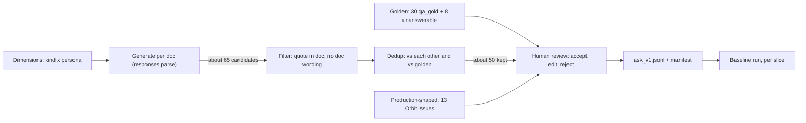
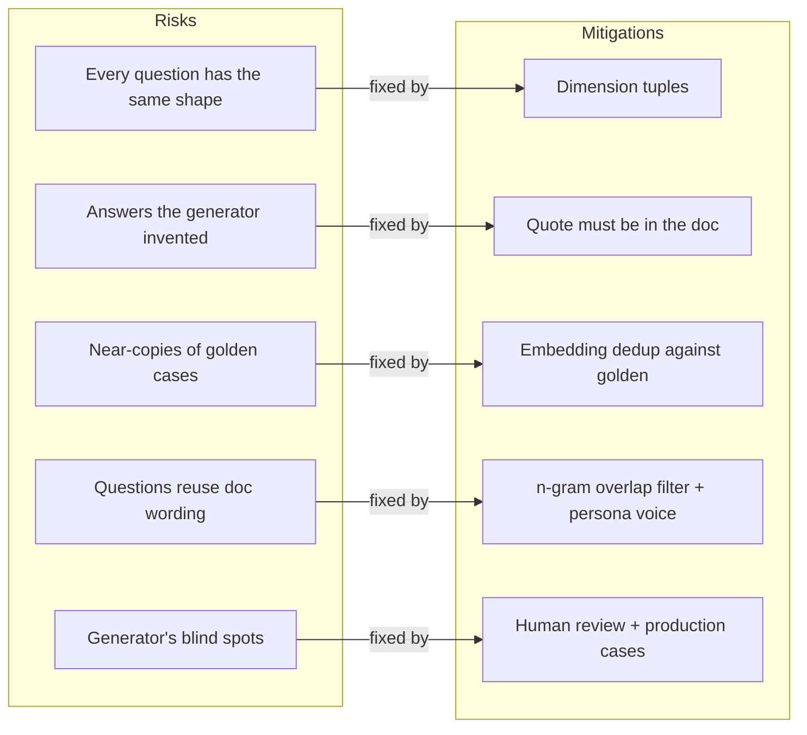
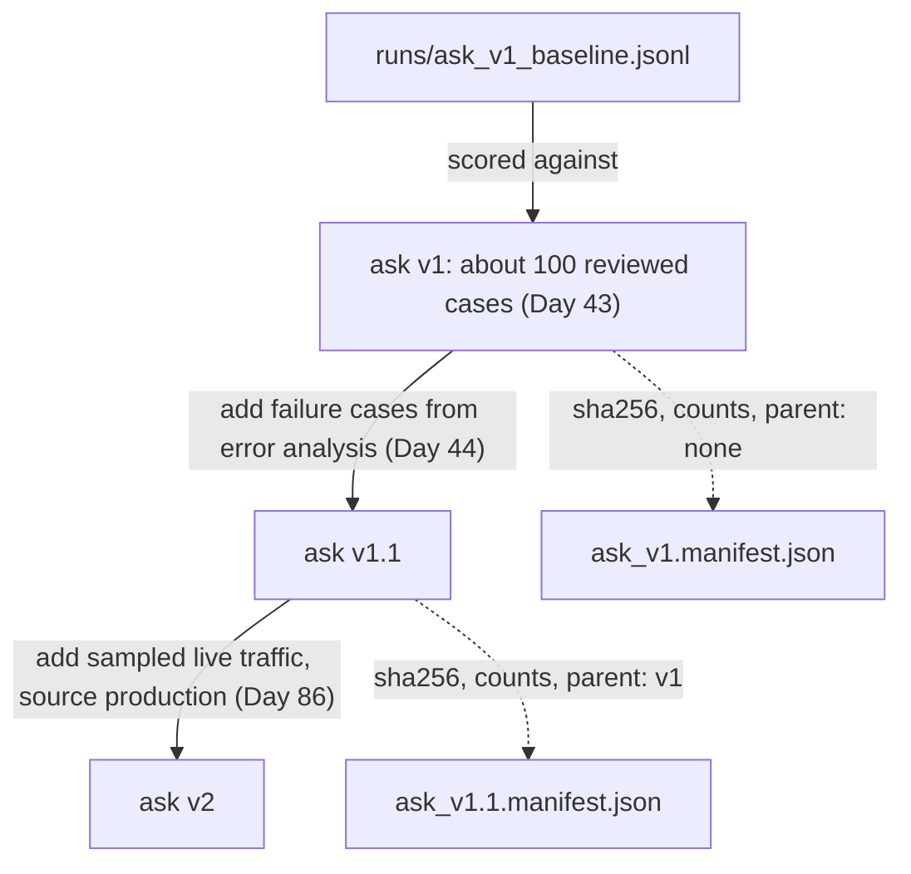

# Building Eval Datasets: Golden, Synthetic & Production

R2 scores 90% on the 30 `qa_gold` questions. Then the first five real maintainer questions break it: one vague ("jobs stuck"), one about the 2.x `orbit.ini`, one pasting an `ORB-1101` log line, one in Spanish, and one Orbit's docs can't answer. The score wasn't wrong. The dataset didn't cover what users ask. Today you build the 100-case, versioned set that the rest of this phase measures against.

## At a Glance

- **Time:** ~2 h core (+ optional Go Deeper) · **Depth:** working
- **Prerequisites:** [Day 16: Structured Outputs: Native JSON Schema & Extraction](../../Phase_2_Building_with_LLM_APIs/Day_016_structured_outputs/structured_outputs.md), [Day 20: Your First Eval Set](../../Phase_2_Building_with_LLM_APIs/Day_020_first_eval_set/first_eval_set.md), [Day 23: Embeddings & Semantic Similarity](../../Phase_3_RAG/Day_023_embeddings/embeddings.md), [Day 29: Evaluating Retrieval](../../Phase_3_RAG/Day_029_retrieval_evaluation/retrieval_evaluation.md), [Day 30: Evaluating RAG Answers](../../Phase_3_RAG/Day_030_answer_evaluation/answer_evaluation.md); primer [Eval metrics basics](../../Appendix_Primers/A12_eval_metrics_basics.md)
- **You'll build:** `atlas/evals/datasets.py` and `ask_v1`: about 100 reviewed cases (golden, synthetic, production-shaped, unanswerable) with a manifest, plus a per-slice baseline run of R2
- **Stops at:** benchmark construction, inter-annotator programs and dataset tooling products
- **Fast path:** Already know test matrices and fixtures? Read [Your First Synthetic Cases](#your-first-synthetic-cases), [Filter, Deduplicate, Ground](#filter-deduplicate-ground) and [Versioning: Datasets Are Code](#versioning-datasets-are-code), then do Exercise 2 (≈50 min)
- **Cost:** ≈ $0.05–0.15 on `gpt-6-luna` (≈65 generated candidates, embeddings, and a 100-case baseline with a judge; prices as of 2026-11, [verify](https://developers.openai.com/api/docs/pricing)). `EVAL_LIMIT=20` makes the baseline a few cents
- **New terms:** golden set, synthetic case, slice, dataset version (manifest), production sample

> **Coming from Software Engineering?** An eval dataset is a test matrix. You wouldn't test a web app on one browser and one OS; you list the axes (browser × OS × locale) and make sure every important cell has a test. Synthetic generation is property-based testing (the tool invents inputs from rules you give it, as Hypothesis does): you define the input space, generate many cases, and keep only the valid ones. And a dataset version is a schema migration: once applied, you never edit it in place, you write the next one. What doesn't transfer: the "expected value" is prose, so a human has to review it.

## Why 30 Golden Questions Can Mislead

A **golden set** is a set of cases written and checked by people who know the right answers. Day 20's `qa_gold.jsonl` is one: 30 questions, each with a reference answer and the doc ids that support it. It's high quality, and written by maintainers for maintainers: every question names the exact key or error code, is in English, and has an answer in the docs.

Real users write "jobs stuck", paste half a stack trace, write in Spanish, ask about 2.x, and ask things the docs never cover. Think of the dataset as an exam: with only straightforward questions, a pass means little.

## A Dataset Is a Test Plan

Before you write a single case, decide what "covered" means. Pick a few **dimensions** (axes along which questions differ) and the values each can take:

- **kind:** lookup ("what's the default?"), how-to ("how do I…?"), troubleshooting ("why does X fail?")
- **version:** 2.x or 3.x
- **persona:** new user, SRE on call, upgrader moving from 2.x

That's 3 × 2 × 3 = 18 cells. Now tick five `qa_gold` questions into the grid by hand:

| qa_gold question | kind | version | persona |
|---|---|---|---|
| qa-001 "default values of `lease_seconds` and `heartbeat_seconds`" | lookup | 3.x | ? |
| qa-003 "When does Orbit 2.x reach end of life?" | lookup | 2.x | ? |
| qa-004 "What does ORB-1202 mean and how should I fix it?" | troubleshooting | all | ? |
| qa-009 "Which environment variables does Orbit 2.x read?" | lookup | 2.x | ? |
| qa-011 "Why is pickup latency on the Postgres broker stuck at around 5 seconds?" | troubleshooting | all | ? |

The persona column is empty. Nobody wrote these as a panicking SRE or a confused new user, so a whole axis of the matrix is untested. Each tagged group, such as "all troubleshooting questions" or "all 2.x questions", is a **slice**: a subset you report a separate pass rate for.

The script below does the same tally for all 30 questions. Orbit's real version tag has a third value, `all`, for pages that apply to both lines, so it prints 9 kind × version cells:

```python
# script_id: day_043_eval_datasets/coverage_grid
# Tally the 30 qa_gold questions into a kind x version grid. No install, no API key.
# Env: ORBIT_DATA (optional, default datasets/orbit)
import itertools
import json
import os
import re
from collections import Counter
from pathlib import Path

DATA_DIR = Path(os.environ.get("ORBIT_DATA", "datasets/orbit"))
KINDS = ["lookup", "how_to", "troubleshooting"]
VERSIONS = ["2.x", "3.x", "all"]
PERSONAS = ["new_user", "sre_on_call", "upgrader"]

def guess_kind(question: str) -> str:
    """A rough first-pass tag from the wording. A reviewer corrects it later."""
    q = question.lower()
    if re.search(r"orb-\d{4}|error|fail|why|stuck|loop", q):
        return "troubleshooting"
    if re.search(r"^how (do|should|does)|in what order|work around", q):
        return "how_to"
    return "lookup"

lines = (DATA_DIR / "eval/qa_gold.jsonl").read_text(encoding="utf-8").splitlines()
rows = [json.loads(line) for line in lines if line.strip()]
cells = Counter((guess_kind(r["question"]), r["applies_to"]) for r in rows)
print(f"{'kind':<16}" + "".join(f"{v:>6}" for v in VERSIONS))
for kind in KINDS:
    print(f"{kind:<16}" + "".join(f"{cells[(kind, v)]:>6}" for v in VERSIONS))
full = list(itertools.product(KINDS, VERSIONS, PERSONAS))
print(f"\nkind x version cells filled: {len(cells)}/{len(KINDS) * len(VERSIONS)}")
print(f"kind x version x persona cells filled: 0/{len(full)} (qa_gold has no persona)")
```

```text
kind               2.x   3.x   all
lookup               3     7     8
how_to               0     2     3
troubleshooting      0     5     2

kind x version cells filled: 7/9
kind x version x persona cells filled: 0/27 (qa_gold has no persona)
```

Two cells are empty (2.x how-to and 2.x troubleshooting), several hold two or three cases (an anecdote, not a measurement), and an axis you never tagged is invisible.

## The Parts of an Eval Dataset

An eval dataset for Atlas draws on three sources, each with a different strength:

- **Golden cases:** written by someone who knows the answer. Highest trust, slowest to make. You have 30 and will add 8 unanswerable ones.
- **Synthetic cases:** generated from the docs along your dimensions, then filtered and reviewed. Cheap and good at filling empty cells, but they inherit the generator's habits.
- **Production samples:** questions real users sent, the only source of what people actually ask. Atlas has no traffic yet, so Orbit's `type:question` issues stand in; [Day 86](../../Phase_9_Production/Day_086_monitoring_feedback/monitoring_feedback.md) adds live samples to the same slot.



Every case has the same `EvalCase` shape. The rest of Phase 5 reads it, so keep the field names (and every `id`) stable. `expected` is `None` when the right behaviour is "the docs don't cover this", `tags` holds the slice values, `applies_to` is the version tag the docs carry ([Day 27](../../Phase_3_RAG/Day_027_hybrid_search/hybrid_search.md) filters on it), and a validator rejects `must_cite` ids that don't exist.

```python
# script_id: day_043_eval_datasets/eval_datasets
# eval_datasets.py: in your repo, atlas/evals/datasets.py. Schema, filters, dedup, versions, slices.
# Install: uv add pydantic numpy · Env: ORBIT_DATA (optional). No API key: callers pass `embed`.
import hashlib
import itertools
import json
import os
import random
import re
from collections import Counter, defaultdict
from datetime import datetime, timezone
from pathlib import Path
from typing import Callable, Iterable, Literal

import numpy as np
from pydantic import BaseModel, Field, field_validator

DATA_DIR = Path(os.environ.get("ORBIT_DATA", "datasets/orbit"))
DATASETS_DIR = Path(os.environ.get("ATLAS_DATASETS", "evals/datasets"))
DOC_IDS = {p.stem for p in (DATA_DIR / "docs").glob("*.md")}

class EvalCase(BaseModel):
    id: str                                    # never reuse or renumber: later days key on it
    question: str
    expected: str | None                       # None = the correct behaviour is to abstain
    must_cite: list[str] = Field(default_factory=list)
    applies_to: Literal["2.x", "3.x", "all"] = "all"
    tags: dict[str, str] = Field(default_factory=dict)
    source: Literal["golden", "synthetic", "production"]
    status: Literal["draft", "reviewed"] = "draft"

    @field_validator("must_cite")
    @classmethod
    def known_docs(cls, ids: list[str]) -> list[str]:
        unknown = [i for i in ids if i not in DOC_IDS]
        if unknown:
            raise ValueError(f"unknown doc id(s) {unknown}")
        return ids
```

Day 20's golden rows convert directly. They get tags too, so they show up in every slice table:

```python
# script_id: day_043_eval_datasets/eval_datasets
def guess_kind(question: str) -> str:
    """Same rough rule as coverage_grid; reviewers fix the tag when it's wrong."""
    q = question.lower()
    if re.search(r"orb-\d{4}|error|fail|why|stuck|loop", q):
        return "troubleshooting"
    if re.search(r"^how (do|should|does)|in what order|work around", q):
        return "how_to"
    return "lookup"

def golden_cases() -> list[EvalCase]:
    """The 30 hand-written qa_gold rows (Day 20) as reviewed EvalCases."""
    lines = (DATA_DIR / "eval/qa_gold.jsonl").read_text(encoding="utf-8").splitlines()
    rows = [json.loads(line) for line in lines if line.strip()]
    return [EvalCase(id=r["id"], question=r["question"], expected=r["answer"],
                     must_cite=r["citations"], applies_to=r["applies_to"], source="golden",
                     status="reviewed", tags={"kind": guess_kind(r["question"]), "lang": "en",
                                              "persona": "maintainer", "version": r["applies_to"]})
            for r in rows]
```

## Your First Synthetic Cases

A **synthetic case** is a question, with its expected answer, that a model wrote from a source document. The recipe has one rule that matters more than any other: give the generator a specific *tuple* of dimension values, not a vague "write some questions". The smallest version: one call, one doc, one tuple (SRE on call · troubleshooting), with [Day 16](../../Phase_2_Building_with_LLM_APIs/Day_016_structured_outputs/structured_outputs.md)'s `responses.parse` returning a typed list:

```python
# script_id: day_043_eval_datasets/first_synthetic
# uv add "openai>=3.46,<4" pydantic · OPENAI_API_KEY · one call, < $0.01 (as of 2026-11, verify)
import os
from pathlib import Path
from openai import OpenAI
from pydantic import BaseModel

MODEL = os.environ.get("ATLAS_MODEL", "gpt-6-luna")
DATA_DIR = Path(os.environ.get("ORBIT_DATA", "datasets/orbit"))
client = OpenAI()

class Draft(BaseModel):
    question: str
    expected: str   # the answer, one or two sentences
    quote: str      # exact sentence from the doc that supports `expected`
class Drafts(BaseModel):
    cases: list[Draft]

doc = (DATA_DIR / "docs/leases-and-heartbeats.md").read_text(encoding="utf-8")
resp = client.responses.parse(model=MODEL, reasoning={"effort": "low"}, text_format=Drafts,
    instructions="You write test questions for a docs assistant. Use only facts in the document.",
    input="Persona: SRE on call at 3 a.m. Kind: troubleshooting, mention one ORB error code.\n"
          f"Write 5 questions this persona would type, in their own words, with answers.\n\n<doc>\n{doc}\n</doc>")
for case in (resp.output_parsed or Drafts(cases=[])).cases:   # None on refusal or truncation
    print("-", case.question)
```

```text
- Paged for ORB-1102 WorkerHeartbeatLost on the report workers. Is the box dead or just busy?
- Logs full of ORB-1101 LeaseExpired right after a deploy. Are jobs running twice now?
- One job shows ORB-1101 every night at 02:00. Do I raise lease_seconds or heartbeat_seconds?
- Worker froze for 10 minutes, came back. Did its jobs get picked up by someone else?
- orbit doctor complains heartbeat_seconds is too high. What ratio does it want?
```

Your questions will differ. Notice the voice: short, specific, written from inside a problem. That comes from the tuple.

## Turn a Knob: No Dimensions, No Diversity

Now remove the tuple and ask for "5 questions about this document":

```python
# script_id: day_043_eval_datasets/first_synthetic
# Same doc, no persona and no kind. Compare the questions with the run above.
naive = client.responses.parse(
    model=MODEL, reasoning={"effort": "low"}, text_format=Drafts,
    instructions="You write test questions for a docs assistant. Use only facts in the document.",
    input=f"Write 5 questions about this document, with answers.\n\n<doc>\n{doc}\n</doc>")
for case in (naive.output_parsed or Drafts(cases=[])).cases:
    print("-", case.question)
```

```text
- What is a lease in Orbit?
- How do heartbeats work in Orbit?
- What happens when a lease expires?
- What does heartbeat_seconds control?
- What is the relationship between lease_seconds and heartbeat_seconds?
```

Three failures show up at once, and they're the classic ones:

1. **Near-duplicates.** Over ten docs you get "How do I configure X?" again and again.
2. **Doc wording.** "relationship between `lease_seconds` and `heartbeat_seconds`" reuses the doc's phrases, so keyword retrieval finds the page easily and the score rises for the wrong reason.
3. **Invented answers.** Without a "quote your evidence" rule, answers drift into plausible facts from the generator's memory.

`temperature` won't fix this. On GPT-6 models it's accepted only with reasoning effort `none`, and randomness only rephrases the same five questions. Diversity comes from the tuples.

## Filter, Deduplicate, Ground

The realistic pipeline generates per doc from sampled tuples and throws away what fails, counting every reject (a silent drop hides a generator problem). First the helpers:

```python
# script_id: day_043_eval_datasets/eval_datasets
DIMENSIONS = {"kind": ["lookup", "how_to", "troubleshooting"],
              "persona": ["new_user", "sre_on_call", "upgrader"]}

def make_tuples(dims: dict[str, list[str]], k: int, seed: int) -> list[dict[str, str]]:
    """k distinct combinations, sampled with a fixed seed so a rebuild picks the same ones."""
    combos = [dict(zip(dims, values)) for values in itertools.product(*dims.values())]
    return random.Random(seed).sample(combos, min(k, len(combos)))

def norm(text: str) -> str:
    """Lowercase words only: drops markdown, backticks and punctuation before comparing."""
    return " ".join(re.findall(r"[a-z0-9_.-]+", text.lower()))

def grounded(quote: str, doc_text: str) -> bool:
    """The supporting quote must really be in the doc. Short quotes prove nothing."""
    return len(quote.split()) >= 4 and norm(quote) in norm(doc_text)

def copies_doc(question: str, doc_text: str, n: int = 6) -> bool:
    """True if the question shares an n-word run with the doc: it reads like the docs, not a user."""
    words, doc = norm(question).split(), f" {norm(doc_text)} "
    return any(f" {' '.join(words[i:i + n])} " in doc for i in range(len(words) - n + 1))
```

Deduplication uses [Day 23](../../Phase_3_RAG/Day_023_embeddings/embeddings.md)'s embeddings. Two questions with cosine similarity above a threshold count as the same test. The check runs against the kept synthetic cases *and* the golden set. That second part stops **contamination** (test answers leaking into what you tune on): a reworded copy of `qa-001` would count the same test twice.

```python
# script_id: day_043_eval_datasets/eval_datasets
Embed = Callable[[list[str]], np.ndarray]   # texts -> (n, dim) array of unit-length rows

def dedup(cases: list[EvalCase], against: Iterable[EvalCase] = (), threshold: float = 0.9,
          *, embed: Embed, dropped: list | None = None) -> list[EvalCase]:
    """Keep a case only if no earlier kept case (or `against` case) is within `threshold` cosine."""
    pool = list(against)
    if not cases:
        return []
    vecs = embed([c.question for c in pool + cases])
    ref_ids, ref_vecs = [c.id for c in pool], list(vecs[:len(pool)])
    kept: list[EvalCase] = []
    for case, vec in zip(cases, vecs[len(pool):]):
        if ref_vecs:
            sims = np.asarray(ref_vecs) @ vec            # unit vectors: dot product = cosine
            j = int(np.argmax(sims))
            if sims[j] >= threshold:
                if dropped is not None:
                    dropped.append((case.id, ref_ids[j], float(sims[j])))
                continue
        kept.append(case)
        ref_ids.append(case.id)
        ref_vecs.append(vec)
    return kept
```

The generator script wires it together: 13 docs (including the only 2.x page, `environment-variables-2x`), 5 tuples each, about 65 candidates.

```python
# script_id: day_043_eval_datasets/build_dataset
# Generate, filter and dedup synthetic cases, then write a draft for human review.
# Install: uv add "openai>=3.46,<4" pydantic numpy · Env: OPENAI_API_KEY; ATLAS_MODEL, EMBED_MODEL, ORBIT_DATA
# Cost: 13 generation calls + one embeddings call ≈ $0.01-0.03 on gpt-6-luna (as of 2026-11, verify)
import json
import os
import re
from collections import Counter

import numpy as np
from openai import OpenAI
from pydantic import BaseModel, ValidationError

from eval_datasets import (DATA_DIR, DATASETS_DIR, DIMENSIONS, EvalCase, copies_doc, dedup,
                           golden_cases, grounded, make_tuples)

MODEL = os.environ.get("ATLAS_MODEL", "gpt-6-luna")
EMBED_MODEL = os.environ.get("EMBED_MODEL", "text-embedding-3-small")
client = OpenAI()
REJECTS: Counter[str] = Counter()

class Draft(BaseModel):
    question: str
    expected: str
    quote: str

class Drafts(BaseModel):
    cases: list[Draft]

GEN_INSTRUCTIONS = (
    "You write test questions for Atlas, an assistant that answers questions about the Orbit job "
    "library from its docs. For EACH tuple, in order, write one question that persona would really "
    "type: their own words and situation, never sentences copied from the doc. Answer it from the "
    "doc only, and copy the exact supporting sentence from the doc into `quote`.")

def embed_texts(texts: list[str]) -> np.ndarray:
    """Day 23's helper. OpenAI embeddings are unit length, so a dot product is the cosine."""
    resp = client.embeddings.create(model=EMBED_MODEL, input=texts)
    return np.asarray([d.embedding for d in resp.data], dtype=np.float32)
```

`generate_cases()` takes the tags from the tuple it asked for, not from what the model echoes back. That keeps slice labels honest, and adding a dimension later means changing only `DIMENSIONS`:

```python
# script_id: day_043_eval_datasets/build_dataset
def generate_cases(doc_id: str, tuples: list[dict[str, str]], n: int | None = None,
                   *, prefix: str = "syn") -> list[EvalCase]:
    doc = (DATA_DIR / "docs" / f"{doc_id}.md").read_text(encoding="utf-8")
    applies_to = re.search(r"^applies_to: (\S+)", doc, re.M).group(1).strip('"')
    tuples = tuples[:n] if n else tuples
    resp = client.responses.parse(
        model=MODEL, reasoning={"effort": "low"}, text_format=Drafts, instructions=GEN_INSTRUCTIONS,
        input=f"Tuples:\n{json.dumps(tuples)}\n\n<doc id=\"{doc_id}\">\n{doc}\n</doc>")
    drafts = resp.output_parsed.cases if resp.output_parsed else []
    if len(drafts) != len(tuples):
        REJECTS["wrong_count"] += abs(len(tuples) - len(drafts))
    cases = []
    for i, (tags, d) in enumerate(zip(tuples, drafts)):
        if not grounded(d.quote, doc):
            REJECTS["quote_not_in_doc"] += 1
        elif copies_doc(d.question, doc):
            REJECTS["copies_doc_wording"] += 1
        else:
            try:
                cases.append(EvalCase(
                    id=f"{prefix}-{doc_id}-{i}", question=d.question, expected=d.expected,
                    must_cite=[doc_id], applies_to=applies_to, source="synthetic",
                    tags={**tags, "version": applies_to, "lang": "en"}))
            except ValidationError:
                REJECTS["schema"] += 1
    return cases
```

```python
# script_id: day_043_eval_datasets/build_dataset
DOCS = ["leases-and-heartbeats", "retries-and-backoff", "idempotency", "migrating-2-to-3",
        "environment-variables-2x", "broker-redis", "broker-sqs", "scheduling-cron",
        "dead-letter-queue", "flows-error-handling", "dashboard-auth-oidc",
        "troubleshooting-duplicates", "deployment-kubernetes"]

if __name__ == "__main__":
    candidates: list[EvalCase] = []
    for seed, doc_id in enumerate(DOCS):
        candidates += generate_cases(doc_id, make_tuples(DIMENSIONS, k=5, seed=seed))
    dropped: list = []
    kept = dedup(candidates, against=golden_cases(), threshold=0.9, embed=embed_texts, dropped=dropped)
    for case_id, near_id, sim in sorted(dropped, key=lambda d: d[2])[:3]:
        print(f"  dropped {case_id} ~ {near_id} ({sim:.2f})")   # eyeball the pairs nearest 0.9
    total = len(candidates) + sum(REJECTS.values())
    print(f"kept {len(kept)}/{total} synthetic; filter rejects {dict(REJECTS)}; dedup drops {len(dropped)}")
    DATASETS_DIR.mkdir(parents=True, exist_ok=True)
    out = DATASETS_DIR / "ask_v1.synthetic.draft.jsonl"
    out.write_text("".join(c.model_dump_json() + "\n" for c in kept), encoding="utf-8")
    print(f"wrote {out}")
```

```text
  dropped syn-idempotency-3 ~ qa-021 (0.91)
  dropped syn-broker-sqs-1 ~ syn-broker-sqs-0 (0.92)
  dropped syn-migrating-2-to-3-2 ~ qa-010 (0.93)
kept 50/65 synthetic; filter rejects {'quote_not_in_doc': 5, 'copies_doc_wording': 3}; dedup drops 7
wrote evals/datasets/ask_v1.synthetic.draft.jsonl
```

Your counts will differ. Read the dropped pairs closest to 0.9 before trusting the threshold: two questions about one setting can be different tests (the default vs what happens when you exceed it).



## Production-Shaped Cases from Orbit Issues

A **production sample** is a question a real user sent, taken from logs or tickets. Synthetic cases fill the cells you thought of; production samples show you the ones you didn't. Orbit's 63 `type:question` issues look nothing like `qa_gold`: "orbit is slow", a Hindi title about `ORB-1001`, a Spanish report about `ORB-1202`, reporters who never say their version.

A random 12 would barely include the rare groups, so take a **stratified sample** (pick some from every group) with fixed quotas, over-representing non-English and vague questions on purpose. Add one injection fixture too: issue 20 hides an instruction addressed to AI assistants, a ready-made regression case for [Day 69](../../Phase_8_Safety_and_Security/Day_069_prompt_injection/prompt_injection.md).

Maintainers' replies give labels a head start: doc ids cited in backticks become `must_cite`, and the first reply becomes a draft `expected` to rewrite.

```python
# script_id: day_043_eval_datasets/production_cases
# Real-shaped cases from Orbit `type:question` issues + hand-written unanswerables -> a draft file.
# Install: uv add pydantic numpy · Env: ORBIT_DATA (optional). No API key.
import json
import random
import re

from eval_datasets import DATA_DIR, DATASETS_DIR, DOC_IDS, EvalCase, guess_kind

MAINTAINERS = {"mara-k", "devon-li", "sam-okafor", "ines-v"}
NON_LATIN = re.compile(r"[À-ÿऀ-ॿ぀-ヿ一-鿿]")  # accents, Devanagari, kana, CJK
QUOTAS = {"non_en": 4, "vague": 3, "2.x": 2, "3.x": 3}   # rare strata oversampled on purpose
INJECTION_FIXTURE = 20

def stratum(issue: dict) -> str:
    if NON_LATIN.search(issue["title"] + issue["body"][:400]):
        return "non_en"
    if issue["orbit_version"] is None:
        return "vague"                                    # the reporter never said which version
    return "2.x" if issue["orbit_version"].startswith("2.") else "3.x"

def to_case(issue: dict, group: str) -> EvalCase:
    replies = [c["body"] for c in issue["comments"] if c["author"] in MAINTAINERS]
    cited = sorted({m for r in replies for m in re.findall(r"`([a-z0-9-]+)`", r) if m in DOC_IDS})
    v = issue["orbit_version"] or ""
    version = "2.x" if v.startswith("2.") else "3.x" if v else "all"
    return EvalCase(
        id=f"prod-issue-{issue['id']}", question=f"{issue['title']}\n\n{issue['body']}",
        expected=replies[0][:600] if replies else None,  # a starting point; the reviewer rewrites it
        must_cite=cited, applies_to=version, source="production",
        tags={"kind": guess_kind(issue["title"]), "persona": "real_user", "version": version,
              "lang": "non_en" if group == "non_en" else "en", "stratum": group})
```

The second block adds eight **unanswerable** cases, each checked with `grep -ril` over `docs/` first (no page mentions Grafana, a 4.0 roadmap, Slack, a licence, TypeScript, Sentry, adoption or a mobile app). `expected=None` means the only correct answer is "the docs don't cover this".

```python
# script_id: day_043_eval_datasets/production_cases
UNANSWERABLE = [
    "Is there a Grafana dashboard template for Orbit's metrics?",
    "What's on the roadmap for Orbit 4.0?",
    "Is there an Orbit Slack or Discord where I can ask questions?",
    "Which open-source license is Orbit released under?",
    "Is there an official TypeScript client for enqueuing Orbit jobs from Node?",
    "Can Orbit report failed jobs to Sentry?",
    "How many companies run Orbit in production?",
    "Is there a mobile app for the Orbit dashboard?",
]

def sample_issues(seed: int = 43) -> list[EvalCase]:
    lines = (DATA_DIR / "issues/issues.jsonl").read_text(encoding="utf-8").splitlines()
    issues = [json.loads(line) for line in lines if line.strip()]
    questions = [i for i in issues if "type:question" in i["labels"]]
    rng = random.Random(seed)                             # same sample on every rebuild
    picked = []
    for group, k in QUOTAS.items():
        pool = [i for i in questions if stratum(i) == group]
        picked += [to_case(i, group) for i in rng.sample(pool, min(k, len(pool)))]
    fixture = next(i for i in issues if i["id"] == INJECTION_FIXTURE)
    return picked + [to_case(fixture, "injection")]

if __name__ == "__main__":
    cases = sample_issues() + [
        EvalCase(id=f"unans-{n:02d}", question=q, expected=None, source="golden",
                 tags={"kind": "unanswerable", "persona": "maintainer", "version": "all", "lang": "en"})
        for n, q in enumerate(UNANSWERABLE, 1)]
    DATASETS_DIR.mkdir(parents=True, exist_ok=True)
    out = DATASETS_DIR / "ask_v1.production.draft.jsonl"
    out.write_text("".join(c.model_dump_json() + "\n" for c in cases), encoding="utf-8")
    for c in cases[:5] + cases[-2:]:
        print(f"{c.id:<16}{c.tags.get('stratum', c.tags['kind']):<13}"
              f"{','.join(c.must_cite)[:30]:<32}{c.question.splitlines()[0][:32]}")
    print(f"{len(cases)} draft cases -> {out}")
```

```text
prod-issue-25   non_en       concepts-jobs,performance-tuni  ORB-1202 PayloadTooLarge al enco
prod-issue-63   non_en       deployment-docker,troubleshoot  Docker Compose में worker शुरू क
prod-issue-188  non_en       faq,scheduling-cron             cron式で ORB-1401 ScheduleParseErr
prod-issue-97   non_en       configuration-reference,enviro  Como migrar variáveis ORBIT_* pa
prod-issue-127  vague        flows-error-handling,flows-ove  flow not working
unans-07        unanswerable                                 How many companies run Orbit in
unans-08        unanswerable                                 Is there a mobile app for the Or
21 draft cases -> evals/datasets/ask_v1.production.draft.jsonl
```

## Labelling and Review

Every case starts as `status: draft`; a person makes it `reviewed`. Today that's you, standing in for a maintainer. Write the rules down first, because the hard calls repeat. Atlas's label guidelines:

1. **Keep** a question only if a real user could plausibly send it, in roughly those words.
2. `expected` must be true according to the `must_cite` docs *today*, and must answer what was asked. Maintainer replies can ask for details or be stale (issue 54's reply calls 2.8.0 the latest release; it's 3.2.1 now), so rewrite them.
3. Use `expected = None` only when no page answers the question, not even with "no". "Does Orbit support Kafka?" looks unanswerable, but the "Supported brokers" table in `concepts-brokers` lists Redis, Postgres and SQS, so the right answer is "no, those three", with a citation. That's why it isn't in the unanswerable list.
4. Vague questions ("jobs stuck") expect the first thing to check plus a request for the missing detail.
5. Reject a case that needs a full rewrite; a replacement is cheaper than your attention.

The review loop is a plain terminal tool. It appends decisions as you go, so you can quit and resume:

```python
# script_id: day_043_eval_datasets/review_cases
# Accept / edit / reject draft cases. No API key. Usage: python review_cases.py <draft.jsonl> ...
import sys
from pathlib import Path

from pydantic import ValidationError

from eval_datasets import EvalCase

HELP = "edit: e=expected (blank = abstain) c=must_cite k=kind · then a=accept r=reject q=quit"

def review(draft: Path) -> None:
    accepted = draft.with_name(draft.name.replace(".draft", ".reviewed"))
    rejected = draft.with_name(draft.name.replace(".draft", ".rejected"))
    done = {EvalCase.model_validate_json(line).id for p in (accepted, rejected) if p.exists()
            for line in p.read_text(encoding="utf-8").splitlines() if line}
    todo = [EvalCase.model_validate_json(line) for line in draft.read_text(encoding="utf-8").splitlines() if line]
    for case in (c for c in todo if c.id not in done):
        print(f"\n[{case.id}] {case.tags}\nQ: {case.question[:600]}\nA: {case.expected}\ncite: {case.must_cite}")
        update: dict = {}
        try:
            while (choice := input(f"{HELP}\n> ").strip().lower()) in ("e", "c", "k"):
                if choice == "e":
                    update["expected"] = input("expected: ").strip() or None
                elif choice == "c":
                    update["must_cite"] = [s.strip() for s in input("doc ids: ").split(",") if s.strip()]
                else:
                    update["tags"] = {**case.tags, "kind": input("kind: ").strip()}
        except EOFError:                       # Ctrl-D, or no terminal attached: stop cleanly
            choice = "q"
        if choice not in ("a", "r"):           # q, or an unknown key: save progress and stop
            break
        try:                                   # re-validate: an edited must_cite may be a typo
            case = EvalCase.model_validate({**case.model_dump(), **update, "status": "reviewed"})
        except ValidationError as err:
            print(err)
            continue
        with (rejected if choice == "r" else accepted).open("a", encoding="utf-8") as f:
            f.write(case.model_dump_json() + "\n")

if __name__ == "__main__":
    if len(sys.argv) < 2:
        print("usage: python review_cases.py <draft.jsonl> [more drafts...]")
    for arg in sys.argv[1:]:
        review(Path(arg))
```

```text
[prod-issue-28] {'kind': 'lookup', 'persona': 'real_user', 'version': 'all', 'lang': 'en', 'stratum': 'vague'}
Q: orbit is slow

after update everything is slow. jobs take forever. pls fix asap
A: Sorry to hear that. To dig in we need: ...
cite: ['performance-tuning']
edit: e=expected (blank = abstain) c=must_cite k=kind · then a=accept r=reject q=quit
> k
kind: troubleshooting
> e
expected: First tell apart jobs that wait longer to start from jobs that run longer; ask for the Orbit version, Python version and broker.
> a
```

Budget 30–40 seconds per case: this is the most valuable part of today, because you read every question your system will be judged on and catch wrong tags (like `lookup` above) and weak answers no metric would flag. Short on time? Review the 21 production-shaped drafts and about 15 synthetic ones; v1 is smaller (about 65 cases) but everything below still works.

## Versioning: Datasets Are Code

A **dataset version** is a frozen snapshot plus a **manifest**: a small JSON file with the SHA-256 hash of the data, counts per source and tag, creation time and parent version. The rules are the same as for migrations:

- **Never edit a version in place.** Fix one answer in `ask_v1.jsonl` and every score computed on v1 stops being comparable.
- **Write the next version instead.** `ask_v1.1` records `parent: v1`, so you can explain why two numbers differ.
- **Check the hash on load.** "Someone edited the file" becomes a loud error instead of silent drift.



```python
# script_id: day_043_eval_datasets/eval_datasets
class Manifest(BaseModel):
    name: str
    version: str
    sha256: str                            # of the JSONL bytes; load_dataset() checks it
    n: int
    counts: dict[str, dict[str, int]]      # "source" and every tag -> value -> count
    created: str
    parent: str | None = None              # the version this one was built from

def _counts(cases: list[EvalCase]) -> dict[str, dict[str, int]]:
    counts: dict[str, Counter] = defaultdict(Counter)
    for case in cases:
        counts["source"][case.source] += 1
        for tag, value in case.tags.items():
            counts[tag][value] += 1
    return {tag: dict(sorted(c.items())) for tag, c in sorted(counts.items())}

def save_dataset(cases: list[EvalCase], name: str, version: str, parent: str | None = None) -> Manifest:
    path = DATASETS_DIR / f"{name}_{version}.jsonl"
    if path.exists():
        raise FileExistsError(f"{path} exists; versions are immutable, so bump the version")
    ids = [c.id for c in cases]
    if len(ids) != len(set(ids)):
        raise ValueError(f"duplicate case ids: {sorted({i for i in ids if ids.count(i) > 1})}")
    if any(c.status != "reviewed" for c in cases):
        raise ValueError("only reviewed cases go into a version; finish review first")
    payload = "".join(c.model_dump_json() + "\n" for c in cases).encode("utf-8")
    DATASETS_DIR.mkdir(parents=True, exist_ok=True)
    path.write_bytes(payload)
    manifest = Manifest(name=name, version=version, sha256=hashlib.sha256(payload).hexdigest(),
                        n=len(cases), counts=_counts(cases), parent=parent,
                        created=datetime.now(timezone.utc).isoformat(timespec="seconds"))
    path.with_suffix(".manifest.json").write_text(manifest.model_dump_json(indent=2), encoding="utf-8")
    return manifest

def load_dataset(name: str, version: str) -> list[EvalCase]:
    path = DATASETS_DIR / f"{name}_{version}.jsonl"
    manifest = Manifest.model_validate_json(path.with_suffix(".manifest.json").read_text(encoding="utf-8"))
    payload = path.read_bytes()
    if hashlib.sha256(payload).hexdigest() != manifest.sha256:
        raise ValueError(f"{path.name} changed after it was versioned (sha256 mismatch). "
                         "Scores on it are no longer comparable: save a new version instead.")
    return [EvalCase.model_validate_json(line) for line in payload.decode("utf-8").splitlines() if line]
```

Freezing v1 takes a few lines; the second block breaks a copy on purpose so you see the guard fire:

```python
# script_id: day_043_eval_datasets/freeze_v1
# Assemble ask_v1 = golden + reviewed synthetic + reviewed production, then freeze it.
# Install: uv add pydantic numpy · No API key. Run after review_cases.py on both draft files.
import shutil

from eval_datasets import DATASETS_DIR, EvalCase, golden_cases, load_dataset, save_dataset

def read_reviewed(file_name: str) -> list[EvalCase]:
    path = DATASETS_DIR / file_name
    if not path.exists():
        print(f"(no {path} yet: run review_cases.py on the draft first)")
        return []
    return [EvalCase.model_validate_json(line) for line in path.read_text(encoding="utf-8").splitlines() if line]

cases = (golden_cases() + read_reviewed("ask_v1.synthetic.reviewed.jsonl")
         + read_reviewed("ask_v1.production.reviewed.jsonl"))
manifest = save_dataset(cases, "ask", "v1")
print(f"ask v1: n={manifest.n} sha256={manifest.sha256[:12]}… counts by source={manifest.counts['source']}")
assert len(load_dataset("ask", "v1")) == manifest.n
```

```python
# script_id: day_043_eval_datasets/freeze_v1
# Break it: "fix" one answer in a copy without bumping the version.
for suffix in (".jsonl", ".manifest.json"):
    shutil.copy(DATASETS_DIR / f"ask_v1{suffix}", DATASETS_DIR / f"ask_vtamper{suffix}")
tampered = DATASETS_DIR / "ask_vtamper.jsonl"
tampered.write_text(tampered.read_text(encoding="utf-8").replace("300", "600", 1), encoding="utf-8")
try:
    load_dataset("ask", "vtamper")
except ValueError as err:
    print("ValueError:", err)
```

```text
(no evals/datasets/ask_v1.synthetic.reviewed.jsonl yet: run review_cases.py on the draft first)
(no evals/datasets/ask_v1.production.reviewed.jsonl yet: run review_cases.py on the draft first)
ask v1: n=30 sha256=e0e57794edd8… counts by source={'golden': 30}
ValueError: ask_vtamper.jsonl changed after it was versioned (sha256 mismatch). Scores on it are no longer comparable: save a new version instead.
```

Without reviewed files you get only the 30 golden cases (above). After review, expect about `{'golden': 38, 'production': 13, 'synthetic': 50}`, so n ≈ 100. Commit both files; the manifest is what a pull-request reviewer reads.

## Baseline: R2 on v1, Slice by Slice

Now measure. The baseline uses a compact mini-R2 (keyword search over `## ` sections plus [Day 28](../../Phase_3_RAG/Day_028_rag_pipeline/rag_pipeline.md)'s cited answer) so it runs without Postgres; swap in your real `atlas.rag.ask()` from [Day 34](../../Phase_3_RAG/Day_034_capstone_r2_ask/capstone_r2_ask.md). Two checks per case: does the answer cite a doc from `must_cite`, and does [Day 30](../../Phase_3_RAG/Day_030_answer_evaluation/answer_evaluation.md)'s correctness judge agree with `expected`? For unanswerable cases the only pass is a clean abstain.

Results go to a run file, one `RunRecord` per case, with what Day 44 needs to find out *why* cases fail: retrieved doc ids and `applies_to`, answer, citations, checks, latency and cost.

```python
# script_id: day_043_eval_datasets/eval_datasets
class RunRecord(BaseModel):
    """One case's result. Days 44-47 read this shape, so keep the field names."""
    case_id: str
    question: str
    source: str
    tags: dict[str, str]
    retrieved_ids: list[str]
    retrieved_applies_to: list[str]
    answer: str
    citations: list[str]
    checks: dict[str, bool]
    passed: bool
    trace_id: str | None = None            # fill from Day 42's step_span when tracing is on
    latency_s: float = 0.0
    cost_usd: float = 0.0

def write_run(results: list[RunRecord], path: str | Path) -> Path:
    path = Path(path)
    path.parent.mkdir(parents=True, exist_ok=True)
    path.write_text("".join(r.model_dump_json() + "\n" for r in results), encoding="utf-8")
    return path

def _slice(r: RunRecord, tag: str) -> str:
    return r.source if tag == "source" else r.tags.get(tag, "(none)")

def pass_rate_by(results: list[RunRecord], tag: str) -> dict[str, float]:
    groups: dict[str, list[bool]] = defaultdict(list)
    for r in results:
        groups[_slice(r, tag)].append(r.passed)
    return {value: sum(v) / len(v) for value, v in sorted(groups.items())}

def slice_table(results: list[RunRecord], tags=("source", "kind", "version", "lang")) -> str:
    rows = [f"{'slice':<26}{'n':>4}{'pass':>7}"]
    for tag in tags:
        n = Counter(_slice(r, tag) for r in results)
        rows += [f"{tag + '=' + v:<26}{n[v]:>4}{rate:>7.0%}" for v, rate in pass_rate_by(results, tag).items()]
    return "\n".join(rows)
```

The baseline script, in three blocks: the mini-R2, the judge, then the runner.

```python
# script_id: day_043_eval_datasets/baseline_r2
# Run mini-R2 over ask_v1, grade every case, write runs/ask_v1_baseline.jsonl, print slices.
# Install: uv add "openai>=3.46,<4" pydantic numpy rank-bm25 · Env: OPENAI_API_KEY; ATLAS_MODEL, ORBIT_DATA, EVAL_LIMIT
# Cost: ~100 answers + ~90 judge calls ≈ $0.05-0.10 on gpt-6-luna (as of 2026-11, verify)
import os
import re
import time
from concurrent.futures import ThreadPoolExecutor
from dataclasses import dataclass

from openai import OpenAI
from pydantic import BaseModel
from rank_bm25 import BM25Okapi

from eval_datasets import DATA_DIR, EvalCase, RunRecord, load_dataset, slice_table, write_run

MODEL = os.environ.get("ATLAS_MODEL", "gpt-6-luna")
PRICES = {"gpt-6-luna": (0.10, 0.50)}     # USD per 1M input/output tokens, as of 2026-11, verify
client = OpenAI()
IDK = "I can't find that in the Orbit docs."

class Citation(BaseModel):
    doc_id: str
    quote: str

class Answer(BaseModel):
    text: str
    citations: list[Citation]

@dataclass
class Chunk:
    doc_id: str
    applies_to: str
    text: str

def tokenize(text: str) -> list[str]:
    return re.findall(r"[a-z0-9_]+", text.lower())

CHUNKS: list[Chunk] = []
for path in sorted((DATA_DIR / "docs").glob("*.md")):
    raw = path.read_text(encoding="utf-8")
    applies_to = re.search(r"^applies_to: (\S+)", raw, re.M).group(1).strip('"')
    body = re.sub(r"\A---\n.*?\n---\n", "", raw, flags=re.S)
    CHUNKS += [Chunk(path.stem, applies_to, s.strip()) for s in re.split(r"\n(?=## )", body) if s.strip()]
BM25 = BM25Okapi([tokenize(c.text) for c in CHUNKS])
```

```python
# script_id: day_043_eval_datasets/baseline_r2
def cost(usage) -> float:
    p_in, p_out = PRICES.get(MODEL, (0.0, 0.0))
    return (usage.input_tokens * p_in + usage.output_tokens * p_out) / 1e6

def ask(question: str, k: int = 6) -> tuple[Answer, list[Chunk], float]:
    """Mini-R2: a keyword-only stand-in for your Day 34 atlas.rag.ask()."""
    scores = BM25.get_scores(tokenize(question))
    hits = [CHUNKS[i] for i in sorted(range(len(CHUNKS)), key=lambda i: -scores[i])[:k]]
    context = "\n\n".join(f'<source doc_id="{h.doc_id}">\n{h.text}\n</source>' for h in hits)
    resp = client.responses.parse(
        model=MODEL, text_format=Answer, reasoning={"effort": "low"},
        instructions="You are Atlas, a support assistant for the Orbit job library. Answer ONLY from "
                     "<context> and cite each claim with its doc_id and an exact short quote. If the "
                     f"sources don't contain the answer, reply exactly '{IDK}' with no citations.",
        input=f"<context>\n{context}\n</context>\n\nQuestion: {question}")
    return resp.output_parsed or Answer(text=IDK, citations=[]), hits, cost(resp.usage)

class Verdict(BaseModel):
    reason: str        # evidence first, so the verdict follows from it
    passed: bool

def judge_correct(question: str, answer: str, reference: str) -> tuple[bool, float]:
    """Day 30's correctness judge, compact. Day 45 designs judges properly."""
    resp = client.responses.parse(
        model=MODEL, text_format=Verdict, reasoning={"effort": "low"},
        instructions="Grade one answer. In `reason`, quote the evidence; then set `passed`. When unsure, FAIL.",
        input="Does <answer> agree with <reference> on every fact <question> asks about? Extra correct "
              f"detail is fine.\n<question>{question}</question>\n<reference>{reference}</reference>\n"
              f"<answer>{answer}</answer>")
    return bool(resp.output_parsed and resp.output_parsed.passed), cost(resp.usage)
```

```python
# script_id: day_043_eval_datasets/baseline_r2
def grade(case: EvalCase) -> RunRecord:
    start = time.perf_counter()
    answer, hits, spent = ask(case.question)
    cited = [c.doc_id for c in answer.citations]
    abstained = answer.text.strip() == IDK and not cited
    if case.expected is None:                           # unanswerable: only a clean abstain passes
        checks = {"abstains": abstained}
    else:
        ok, judge_cost = (False, 0.0) if abstained else judge_correct(case.question, answer.text, case.expected)
        spent += judge_cost
        checks = {"correct": ok}
        if case.must_cite:
            checks["cites_expected_doc"] = bool(set(cited) & set(case.must_cite))
    return RunRecord(case_id=case.id, question=case.question, source=case.source, tags=case.tags,
                     retrieved_ids=[h.doc_id for h in hits], retrieved_applies_to=[h.applies_to for h in hits],
                     answer=answer.text, citations=cited, checks=checks, passed=all(checks.values()),
                     latency_s=time.perf_counter() - start, cost_usd=spent)

def run_eval(cases: list[EvalCase], workers: int = 8) -> list[RunRecord]:
    """Day 20's runner with threads: the calls are I/O-bound, so 8 workers cut wall time a lot."""
    with ThreadPoolExecutor(max_workers=workers) as pool:
        return list(pool.map(grade, cases))

if __name__ == "__main__":
    cases = load_dataset("ask", "v1")[: int(os.environ.get("EVAL_LIMIT", "1000"))]
    results = run_eval(cases)
    path = write_run(results, "runs/ask_v1_baseline.jsonl")
    golden = [r for r in results if r.case_id.startswith("qa-")]
    print(f"qa_gold only: {sum(r.passed for r in golden) / max(len(golden), 1):.0%} of {len(golden)}")
    print(f"all of v1:    {sum(r.passed for r in results) / len(results):.0%} of {len(results)} "
          f"(${sum(r.cost_usd for r in results):.3f}) -> {path}\n")
    print(slice_table(results))
```

```text
qa_gold only: 83% of 30
all of v1:    61% of 100 ($0.071) -> runs/ask_v1_baseline.jsonl

slice                        n   pass
source=golden               38    76%
source=production           13    23%
source=synthetic            49    59%
kind=how_to                 22    64%
kind=lookup                 34    74%
kind=troubleshooting        36    50%
kind=unanswerable            8    50%
version=2.x                  9    33%
version=3.x                 51    61%
version=all                 40    68%
lang=en                     96    64%
lang=non_en                  4     0%
```

Your numbers will differ (illustrative run; this keyword-only mini-R2 scores below the 90% of the hook). The shape matters: the 30-case score was flattering, production-shaped questions fail most, 2.x questions fail because keyword search returns 3.x pages, and every non-English case fails. Fixing starts in Day 44.

## Trade-offs and Small Samples

| Source | Cost per case | Realism | Main bias | Use it for |
|---|---|---|---|---|
| Golden (hand-written) | Minutes of expert time | Medium: experts phrase like experts | Writes what the author already knows | The trusted core, unanswerables, tricky edge cases |
| Synthetic (generated + reviewed) | Cents plus ~30 s of review | Medium-low | The generator's habits; it can't invent needs it hasn't seen | Filling empty matrix cells, scaling a slice |
| Production (sampled) | Free to collect, slow to label | High | Only covers what users already ask; contains PII | Finding the cells you didn't think of |

**How many cases is enough?** At n=100 each case is 1 point, and a difference under about 5 cases is noise: run-to-run variation alone can move that much. Per slice it's worse: at n=10 one case is 10 points, so "2.x went from 30% to 40%" is one question. Report n next to every rate, and read a slice under about 10 cases as examples, not a metric (Go Deeper has the arithmetic).

**Don't rely on synthetic cases** for facts the docs don't state, for debugging a user's real environment, for non-English phrasing, or for safety tests ([Day 75](../../Phase_8_Safety_and_Security/Day_075_red_teaming_ci/red_teaming_ci.md)). Golden and production cases cover those.

### In production

- Add cases from every incident and error-analysis round, as a new version.
- Sample live traffic by stratum once you have it ([Day 86](../../Phase_9_Production/Day_086_monitoring_feedback/monitoring_feedback.md)).
- Redact names, emails and keys before user questions enter a dataset in git ([Day 73](../../Phase_8_Safety_and_Security/Day_073_privacy_pii/privacy_pii.md)).
- Keep a held-out slice you never read while tuning prompts.
- Show the manifest diff in the pull request: new counts change what "pass rate" means.

## Go Deeper (optional)

<details><summary>Go deeper: how small is too small? Standard error and the Wilson interval</summary>

**In words.** A pass rate measured on 100 cases is an estimate. Draw another 100 questions of the same kind and you'd get a slightly different number. The *standard error* says how much that number typically wobbles, and roughly two standard errors either side gives a 95% interval.

**Toy numbers.** R2 passes 75 of 100 cases, so p = 0.75. The standard error is sqrt(0.75 × 0.25 / 100) = sqrt(0.001875) ≈ 0.0433. Times 1.96 gives ≈ 0.085, so the honest statement is "75% ± 8.5 points", anywhere from about 67% to 83%. A slice of 10 cases at the same rate gives sqrt(0.75 × 0.25 / 10) ≈ 0.137, which is ±27 points: nearly useless as a number.

**Formula.** For pass rate p over n cases, SE = sqrt(p(1 − p) / n), and the normal-approximation 95% interval is p ± 1.96·SE. It breaks at the edges: 8 out of 8 gives "100% ± 0", which is clearly overconfident. The **Wilson interval** fixes that by pulling the centre toward 50% and never returning zero width:

```python
# script_id: day_043_eval_datasets/wilson
# 95% intervals for a pass rate: normal approximation vs Wilson. Stdlib only, no API key.
from math import sqrt

Z = 1.96   # 95% confidence

def normal_interval(passed: int, n: int) -> tuple[float, float]:
    p = passed / n
    half = Z * sqrt(p * (1 - p) / n)
    return max(0.0, p - half), min(1.0, p + half)

def wilson_interval(passed: int, n: int) -> tuple[float, float]:
    p = passed / n
    centre = (p + Z**2 / (2 * n)) / (1 + Z**2 / n)
    half = Z * sqrt(p * (1 - p) / n + Z**2 / (4 * n**2)) / (1 + Z**2 / n)
    return centre - half, centre + half

for passed, n in [(75, 100), (61, 100), (3, 9), (8, 8), (0, 4)]:
    lo, hi = normal_interval(passed, n)
    wlo, whi = wilson_interval(passed, n)
    print(f"{passed:>3}/{n:<4} normal {lo:5.0%}-{hi:4.0%}   wilson {wlo:5.0%}-{whi:4.0%}")
```

```text
 75/100  normal   67%- 83%   wilson   66%- 82%
 61/100  normal   51%- 71%   wilson   51%- 70%
  3/9    normal    3%- 64%   wilson   12%- 65%
  8/8    normal  100%-100%   wilson   68%-100%
  0/4    normal    0%-  0%   wilson    0%- 49%
```

**Comparing two versions.** When v1 and v1.1 of the prompt run on the *same* cases, don't compare the two intervals; look at the cases that flipped. If 6 went fail→pass and 4 went pass→fail, the net +2 is noise. If 12 flipped one way and 1 the other, it's real. That paired comparison is what McNemar's test formalises. [Day 47](../../Phase_5_Evaluation_and_Observability/Day_047_evals_in_ci/evals_in_ci.md) builds the CI gate on this idea.

</details>

<details><summary>Go deeper: making synthetic cases harder and more realistic</summary>

The recipe above gives you coverage. These variations, used by teams with mature eval sets, give you difficulty and realism:

- **Generate the situation first, then the question.** Step one: "describe a realistic situation an SRE on call is in with Orbit's leases" (a paragraph). Step two: "write what they would type into a search box". The two-step version produces messier, more realistic questions than asking for the question directly, because the model writes from inside the scenario.
- **Borrow voice from production.** Put three or four real issue titles in the prompt as style examples (few-shot). Synthetic questions pick up the typos, missing context and impatience of real users. Keep those examples out of the dataset itself, or you leak them.
- **Perturb on purpose.** Add a `perturbation` dimension: typo, two questions in one, wrong version assumed ("in orbit.toml, how do I set ORBIT_RETRIES?"), false premise ("why did 3.2 remove Flows?"). False-premise questions are the best test of whether Atlas corrects the user instead of playing along.
- **Generate with a different model than the one you test.** A model asked to write questions tends to write the kind it answers well. Using a different generator (or a larger one, as in the stretch exercise) reduces that self-preference. This is a widely shared heuristic rather than a measured law, so ⚠ check it on your own reject rates.
- **Know where synthetic is weak.** Generators invent facts the docs don't state, can't reproduce a user's broken environment (real logs, half-edited configs), and write textbook Spanish where users write fast, mixed-language messages. Use them to scale a slice, not to define it.
- **Keep a hard slice, separately.** It's tempting to keep only cases the current system fails. That builds a set biased *against* today's system: any change looks like an improvement. If you do adversarial filtering, tag those cases `difficulty: hard` and report them as their own slice.
- **Multi-turn cases.** Real conversations include follow-ups ("and on SQS?"). A case can carry a short history list; your runner replays it. Atlas's R2 is single-turn, so this waits for the agent phase.

</details>

<details><summary>Go deeper: dataset hygiene once the set is shared</summary>

- **Write a dataset card** next to the manifest: what the set is for, how each source was built, the label guidelines, known gaps (no multi-turn cases, only four non-English ones), and who to ask. It answers the question every new teammate has: "can I trust this number?"
- **Audit your own labels.** A week after review, re-label a random 10% blind. Where you disagree with yourself, the guideline is unclear. Fix the guideline, then the labels, in a new version. [Day 46](../../Phase_5_Evaluation_and_Observability/Day_046_judge_validation/judge_validation.md) does the same thing for judges.
- **Retire cases when the product changes.** Orbit 2.x reaches end of life on 2026-12-31. After that, move 2.x cases into a `legacy` slice in a new version instead of deleting them; deleting silently raises the pass rate.
- **Where the files live.** A few thousand cases fit in git, and git gives you diffs and review. Beyond that, keep the data in object storage and commit only the manifest, with the hash as the pointer.
- **Hold out a test slice.** Tune prompts on one part, report on another you never read case by case. Otherwise your prompt slowly overfits the exact wording of the eval.

</details>

## Common Pitfalls

- **Synthetic slice scores higher than golden.** Questions reuse doc wording, so keyword retrieval always finds the page. Keep the "own words" instruction and `copies_doc()`, and spot-check five questions against their source.
- **Judge fails answers that look right.** The generator invented the expected answer. Keep `grounded()` on, and reject in review anything the quote doesn't support.
- **The same test appears three times, or a synthetic case is a reworded `qa-001`.** Dedup against golden too, and read the dropped pairs nearest the threshold; try 0.85 and 0.95 and see what changes.
- **`ValueError: ask_vtamper.jsonl changed after it was versioned (sha256 mismatch)`.** Someone edited a frozen file. Revert it, and put the fix in a new version with `parent` set. Scores on the old version stay valid.
- **`pydantic_core._pydantic_core.ValidationError: 1 validation error for EvalCase` … `Value error, unknown doc id(s) ['leases']`.** A typo or a hallucinated citation in `must_cite`. The validator is doing its job: count these rejects instead of silently dropping them.
- **`AttributeError: 'NoneType' object has no attribute 'cases'`.** `output_parsed` is `None` after a refusal or a truncated response. Guard it (`resp.output_parsed or Drafts(cases=[])`) and count the miss.

> **Where we stop:** we built one product's eval set by hand and with a generator; public benchmark construction, multi-annotator labelling programmes and dataset-management products are out of scope. The [OpenAI evaluation best practices](https://developers.openai.com/api/docs/guides/evaluation-best-practices) guide is a good next read.

## Key Takeaways

- A pass rate means something only relative to its dataset. 90% on 30 maintainer-written questions said nothing about vague, 2.x, non-English or unanswerable ones: draw the coverage matrix first.
- Diversity comes from dimension tuples (kind × persona × …) given to the generator, not from temperature. Without them you get near-duplicates in the docs' own wording.
- Every synthetic case is filtered (quote in the doc, no copied wording, valid schema), deduplicated against other cases *and* golden, and reviewed by a person. Count every reject.
- Production-shaped cases bring in what you didn't imagine: sample by stratum, keep an injection fixture and hand-checked unanswerables, and write label guidelines for the hard calls (Kafka is answerable: "no").
- A dataset version is immutable, with a manifest (hash, counts, parent). Compare runs only on the same version, report n per slice, and treat differences under about 5 cases at n=100 (1 case = 10 points at n=10) as noise.

## Quick Reference

| API / pattern | When to use | Gotcha |
|---|---|---|
| `client.responses.parse(model=, instructions=, input=, text_format=Drafts)` | Generate a typed batch of cases | `output_parsed` is `None` on refusal or truncation; set `reasoning`, not `temperature` |
| `itertools.product(*dims.values())` + `random.Random(seed).sample` | Build reproducible dimension tuples | Changing the seed or dims changes the dataset: that's a new version |
| `client.embeddings.create(model="text-embedding-3-small", input=[...])` | Dedup by cosine | Unit-length vectors: dot product is cosine; re-embed everything if you change the model |
| `dedup(cases, against=golden, threshold=0.9, embed=...)` | Drop near-duplicates and golden leakage | Inspect pairs near the threshold before trusting it |
| `save_dataset()` / `load_dataset()` + manifest sha256 | Freeze and load versions | `FileExistsError` on overwrite and `ValueError` on edits are features |
| `pass_rate_by(results, tag)` + n per slice | Read results per slice | Under ~10 cases a slice is examples, not a metric |

## Exercises

1. **Warm-up.** Add a `phrasing` dimension (`terse`, `rambling`, `code_paste`) and regenerate cases for one doc. Print each question with its phrasing tag. Does `code_paste` actually produce questions with pasted config or logs?

<details><summary>Solution</summary>

`GEN_INSTRUCTIONS` says "for EACH tuple", so a new dimension needs no prompt change: the tuple JSON carries it.

```python
# script_id: day_043_eval_datasets/solution_ex1
# Warm-up: a third dimension. Needs OPENAI_API_KEY (one call, < $0.01, as of 2026-11, verify).
from collections import Counter

from build_dataset import REJECTS, generate_cases
from eval_datasets import DIMENSIONS, make_tuples

dims = {**DIMENSIONS, "phrasing": ["terse", "rambling", "code_paste"]}   # 27 combinations now
cases = generate_cases("retries-and-backoff", make_tuples(dims, k=6, seed=7), prefix="syn-ex1")
for case in cases:
    print(f"[{case.tags['phrasing']:<10}] {case.question[:90]!r}")
print(Counter(c.tags["phrasing"] for c in cases), "rejects:", dict(REJECTS))
```

</details>

2. **Core.** Find the empty kind × version × persona cells in `ask_v1`, pick the worst one, and generate 5 draft cases to fill it. Explain why you chose that cell.

<details><summary>Solution</summary>

"Worst" here means an empty 2.x cell: 2.x is the thinnest version slice, and upgraders are the users most likely to ask about it. Golden and production cases use `persona: maintainer` / `real_user`, so only synthetic cases fill the persona axis, which is itself a finding.

```python
# script_id: day_043_eval_datasets/solution_ex2
# Core: find empty kind x version x persona cells in ask_v1 and fill one with 5 draft cases.
# Needs OPENAI_API_KEY for the generation step (one call, < $0.01, as of 2026-11, verify).
import itertools
import re
from collections import Counter

from build_dataset import generate_cases
from eval_datasets import DATA_DIR, DATASETS_DIR, DIMENSIONS, load_dataset

cases = load_dataset("ask", "v1")
filled = Counter((c.tags.get("kind"), c.tags.get("version"), c.tags.get("persona")) for c in cases)
grid = list(itertools.product(DIMENSIONS["kind"], ["2.x", "3.x", "all"], DIMENSIONS["persona"]))
empty = [cell for cell in grid if filled[cell] == 0]
print(f"{len(empty)}/{len(grid)} cells empty:", *empty, sep="\n  ")

kind, version, persona = next((c for c in empty if c[1] == "2.x"), empty[0])
applies = {p.stem: re.search(r"^applies_to: (\S+)", p.read_text(encoding="utf-8"), re.M).group(1).strip('"')
           for p in sorted((DATA_DIR / "docs").glob("*.md"))}
doc_id = next(d for d, a in applies.items() if a == version)
new = generate_cases(doc_id, [{"kind": kind, "persona": persona}] * 5, prefix="syn-fill")
out = DATASETS_DIR / "ask_v1.1.fill.draft.jsonl"
out.write_text("".join(c.model_dump_json() + "\n" for c in new), encoding="utf-8")
print(f"{len(new)} drafts for {(kind, version, persona)} from {doc_id} -> {out}; review them next")
```

</details>

3. **Core.** Create `ask_v1.1`: v1 plus 5 multi-hop cases from `eval/retrieval_queries.jsonl` (`kind: multi_hop`). Write their expected answers in review, save with `parent="v1"`, and re-run the baseline on the new slice only.

<details><summary>Solution</summary>

Run it once to write the draft, review it (press `e` on every case: retrieval queries have no answers), then run it again.

```python
# script_id: day_043_eval_datasets/solution_ex3
# Core: ask v1.1 = v1 + 5 multi-hop cases. No API key until the final re-score.
import json
import sys

from eval_datasets import DATA_DIR, DATASETS_DIR, EvalCase, load_dataset, save_dataset, slice_table

draft = DATASETS_DIR / "ask_v1.1.multihop.draft.jsonl"
reviewed = DATASETS_DIR / "ask_v1.1.multihop.reviewed.jsonl"
if not reviewed.exists():
    lines = (DATA_DIR / "eval/retrieval_queries.jsonl").read_text(encoding="utf-8").splitlines()
    hops = [r for r in map(json.loads, filter(None, lines)) if r["kind"] == "multi_hop"][:5]
    draft.write_text("".join(EvalCase(
        id=f"mh-{r['id']}", question=r["query"], expected=None, must_cite=r["relevant_doc_ids"],
        source="golden", tags={"kind": "multi_hop", "persona": "maintainer", "version": "all", "lang": "en"},
    ).model_dump_json() + "\n" for r in hops), encoding="utf-8")
    sys.exit(f"wrote {draft}: review it with review_cases.py (edit every answer), then re-run")

new = [EvalCase.model_validate_json(line) for line in reviewed.read_text(encoding="utf-8").splitlines() if line]
assert all(c.expected for c in new), "every multi-hop case needs an expected answer"
manifest = save_dataset(load_dataset("ask", "v1") + new, "ask", "v1.1", parent="v1")
print(f"v1.1: n={manifest.n} parent={manifest.parent} kind counts={manifest.counts['kind']}")

from baseline_r2 import run_eval   # needs OPENAI_API_KEY: re-score only the new slice
print(slice_table(run_eval(new), tags=("kind",)))
```

</details>

4. **Stretch (optional).** Use `gpt-6.1-terra` as the generator for one batch and compare its reject rate and diversity (mean pairwise cosine of the kept questions) against `gpt-6-luna`. Is the difference worth the price?

<details><summary>Solution</summary>

Terra's list price is 10× Luna's per token ($1.00 / $5.00 vs $0.10 / $0.50 per 1M, as of 2026-11, [verify](https://developers.openai.com/api/docs/pricing)); for three docs that's still cents. Lower mean cosine means more varied questions. With 15 tuples, one or two rejects is noise, so run more docs before you decide.

```python
# script_id: day_043_eval_datasets/solution_ex4
# Stretch: gpt-6-luna vs gpt-6.1-terra as generator, on the same tuples. Needs OPENAI_API_KEY.
import numpy as np

import build_dataset as bd
from eval_datasets import DIMENSIONS, make_tuples

DOCS = ["leases-and-heartbeats", "idempotency", "broker-sqs"]
for model in ("gpt-6-luna", "gpt-6.1-terra"):
    bd.MODEL = model                    # generate_cases reads the module-level MODEL at call time
    bd.REJECTS.clear()
    cases = [c for seed, doc in enumerate(DOCS)
             for c in bd.generate_cases(doc, make_tuples(DIMENSIONS, k=5, seed=seed))]
    vecs = bd.embed_texts([c.question for c in cases])
    upper = np.triu_indices(len(cases), k=1)
    mean_sim = float((vecs @ vecs.T)[upper].mean()) if len(cases) > 1 else float("nan")
    tried = len(cases) + sum(bd.REJECTS.values())
    print(f"{model:<14} kept {len(cases)}/{tried}  rejects {dict(bd.REJECTS)}  mean cosine {mean_sim:.2f}")
```

</details>

## References & Further Reading

- [OpenAI: Evaluation best practices](https://developers.openai.com/api/docs/guides/evaluation-best-practices): official guidance on building eval sets from real and synthetic data, and on what to measure.
- [OpenAI: Structured outputs](https://developers.openai.com/api/docs/guides/structured-outputs): `responses.parse`, `text_format`, refusals and schema limits used by the generator.
- [OpenAI: Embeddings](https://developers.openai.com/api/docs/guides/embeddings): model dimensions, normalisation and limits behind `dedup()`.
- [Hamel Husain: LLM evals FAQ](https://hamel.dev/blog/posts/evals-faq/): practitioner answers on synthetic data, dimensions and how many cases you need.
- [Eval metrics basics primer](../../Appendix_Primers/A12_eval_metrics_basics.md): pass rates, intervals and small-sample reasoning, from scratch.

## What's Next

You now have a number you can trust and a run file full of failures. In [Day 44: Error Analysis: From Traces to Failure Modes](../../Phase_5_Evaluation_and_Observability/Day_044_error_analysis/error_analysis.md) you read those failing cases and their traces, group them into a failure taxonomy, and fix the biggest one in R2's prompt, measured on the 38-case stand-in set (`qa_gold` 30 + 8 extras), or on `ask_v1` if you built it today.
