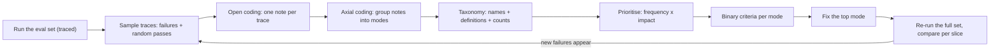
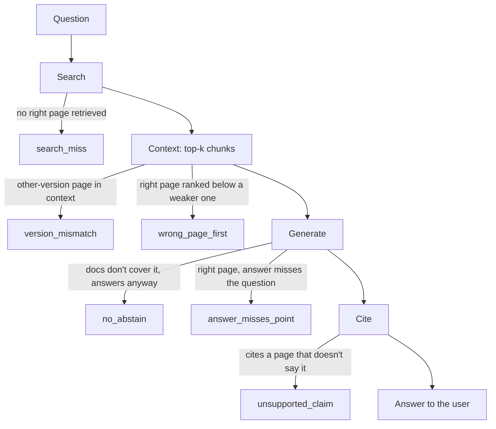
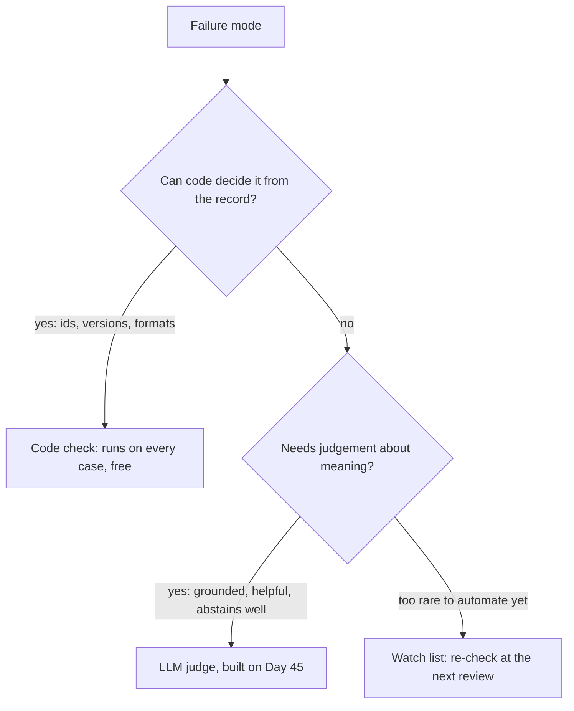

# Error Analysis: From Traces to Failure Modes

Day 43's baseline gives you one number: the share of the eval set that Atlas's R2 "Ask" passes. That number can't tell you what to fix, because "71% pass" or "faithfulness 0.71" doesn't name a bug. Today you read the failing traces the way you'd read bug reports, name what breaks, count it, and fix the biggest problem with numbers before and after.

## At a Glance

- **Time:** ~2 h core (+ optional Go Deeper) · **Depth:** working
- **Prerequisites:** [Day 42: Tracing & Observability in Depth](../../Phase_5_Evaluation_and_Observability/Day_042_tracing_observability/tracing_observability.md), [Day 43: Building Eval Datasets](../../Phase_5_Evaluation_and_Observability/Day_043_eval_datasets/eval_datasets.md); the check shape from [Day 20: Your First Eval Set](../../Phase_2_Building_with_LLM_APIs/Day_020_first_eval_set/first_eval_set.md)
- **You'll build:** `atlas/evals/analysis.py` (`Annotation`, `build_taxonomy()`, `Criterion`, two code checks), a 20-line trace reviewer, a ranked failure-mode table, three criteria, and a measured `applies_to` fix to R2
- **Stops at:** qualitative-research methods (grounded theory, codebooks, inter-coder reliability statistics)
- **Fast path:** Done bug triage before? Read [The Error-Analysis Loop](#the-error-analysis-loop) and [Turn Modes into Binary Criteria](#turn-modes-into-binary-criteria), copy the taxonomy template from the Quick Reference, then do Exercise 3 (≈45 min)
- **Cost:** $0 on the default offline path. The optional LLM runs cost ≈ $0.02 on `gpt-6-luna` for 38 cases at effort `low` (≈ $0.05 on Day 43's 100-case set; prices as of 2026-11, [verify](https://developers.openai.com/api/docs/pricing))
- **New terms:** error analysis, open coding, axial coding, failure mode / taxonomy, binary criterion

> **Coming from Software Engineering?** This is bug triage plus a postmortem: read the logs, find the *first* upstream error rather than the last symptom, group tickets by root cause, fix the most expensive class first. A failure taxonomy is a bug-label scheme (`version_mismatch` is like `area:config`, with a definition so two people label a ticket the same way), and a binary criterion is the regression test written after the incident. What transfers directly: blame the earliest broken stage, and re-run the whole suite after the fix.

## Why a Score Doesn't Tell You What to Fix

Suppose 28 of 38 cases pass. A bigger model, a new prompt or smaller chunks each cost an afternoon, and the number points at none of them: ten failures might be ten bugs or one bug ten times. Generic scores ("helpfulness 3.8/5", BLEU-style word overlap) can't know that Orbit has two config systems, `orbit.ini` for 2.x and `orbit.toml` for 3.x, and that mixing them is Atlas's worst mistake.

**Error analysis** finds those product-specific failures by reading: look at real traces, write what went wrong in your own words, group the notes into named failure modes, count them, fix the biggest. It's **qualitative** work (judged by reading, not by a formula) that ends in numbers you can track.

## The System Under Test: a Mini-R2 You Can Run Offline

Your real R2 from [Day 34](../../Phase_3_RAG/Day_034_capstone_r2_ask/capstone_r2_ask.md) needs Postgres, so this lesson reads traces from a compact stand-in: Day 27's keyword search plus a "generator" that quotes the best-matching sentence, or **abstains** (says it can't find the answer instead of guessing) when the evidence is weak. It needs no key; with one, you swap in the real model with one argument. Each record (one line of a JSONL file, meaning one JSON object per line) holds the question, the retrieved chunks with their `applies_to` version tag, the answer, the citations and whether the check passed. The stand-in writes `runs/mini_r2_{label}.jsonl`. If you built Day 43's `ask_v1.jsonl`, it also writes `runs/ask_v1_baseline.jsonl` and `runs/ask_v1_fix.jsonl` in the fields Days 45 and 46 read. Its `trace_id` is a hash, not a Day 42 OpenTelemetry id.

```python
# script_id: day_044_error_analysis/mini_r2
# mini_r2.py: a compact, offline stand-in for your Day 34 R2 "Ask". Save as mini_r2.py.
# Install: none (stdlib only) · Env: ORBIT_DATA (optional) · Services: none
import hashlib
import json
import math
import os
import re
from collections import Counter
from dataclasses import dataclass
from pathlib import Path

DATA_DIR = Path(os.environ.get("ORBIT_DATA", "datasets/orbit"))
WORD = re.compile(r"[a-z0-9_]+(?:[.\-*][a-z0-9_*]+)*")  # keeps orbit.toml, ORB-1202, ORBIT_* whole
STOP = set("a an and are can do does for how i in is it of on or the to what when which why with my".split())


@dataclass
class Chunk:
    doc_id: str
    applies_to: str  # "3.x" | "2.x" | "all", from the page's front matter (its metadata header)
    text: str


def terms(text: str) -> list[str]:
    return [t for t in WORD.findall(text.lower()) if t not in STOP]


def load_chunks() -> list[Chunk]:
    chunks = []
    for path in sorted((DATA_DIR / "docs").glob("*.md")):
        _, front, body = path.read_text(encoding="utf-8").split("---", 2)
        meta = dict(line.split(":", 1) for line in front.strip().splitlines() if ":" in line)
        applies = meta.get("applies_to", "all").strip().strip('"')
        for para in re.split(r"\n\s*\n", body):  # paragraph chunks: Day 25, simplified
            if len(para.split()) >= 12:
                chunks.append(Chunk(path.stem, applies, para.strip()))
    if not chunks:  # fail loudly: an empty corpus would make every check meaningless
        raise SystemExit(f"no docs under {DATA_DIR / 'docs'}; set ORBIT_DATA")
    return chunks
```

The index is BM25 (a keyword-ranking formula that scores rare words higher; Day 27's keyword half); `where` is the metadata filter you'll use for the fix.

```python
# script_id: day_044_error_analysis/mini_r2


class Index:
    """BM25 keyword search (Day 27's sparse half). `where` is Day 27's metadata filter."""

    def __init__(self, chunks: list[Chunk]):
        self.chunks, self.tfs = chunks, [Counter(terms(c.text)) for c in chunks]
        self.df = Counter(t for tf in self.tfs for t in tf)
        self.avg_len = sum(sum(tf.values()) for tf in self.tfs) / len(chunks)

    def search(self, query: str, k: int = 4, where=None) -> list[tuple[float, Chunk]]:
        n, hits = len(self.chunks), []
        for chunk, tf in zip(self.chunks, self.tfs):
            if where and not where(chunk):
                continue
            norm = 1.2 * (0.25 + 0.75 * sum(tf.values()) / self.avg_len)
            score = sum(math.log(1 + (n - self.df[t] + 0.5) / (self.df[t] + 0.5))
                        * tf[t] * 2.2 / (tf[t] + norm) for t in terms(query) if t in tf)
            if score > 0:
                hits.append((round(score, 1), chunk))
        return sorted(hits, key=lambda h: -h[0])[:k]


def extractive_generate(question: str, hits: list[tuple[float, Chunk]],
                        min_score: float = 6.0) -> tuple[str, list[str]]:
    """No-key 'generator': quote the best-matching sentence. Swap in llm_generate when you have a key."""
    if not hits or hits[0][0] < min_score:  # weak evidence: abstain
        return "I can't find this in the Orbit docs.", []
    best = hits[0][1]
    q = set(terms(question))
    sentence = max(re.split(r"(?<=[.!?])\s+", best.text), key=lambda s: len(q & set(terms(s))))
    cited = [best.doc_id] + [c.doc_id for _, c in hits[1:2] if c.doc_id != best.doc_id]
    return " ".join(sentence.split()), cited
```

Cases come from Day 43's `ask_v1.jsonl` if you built it, otherwise from Orbit's 30 `qa_gold` questions plus eight written from the docs (five version-specific, three unanswerable), because three 2.x cases can't show a pattern.

```python
# script_id: day_044_error_analysis/mini_r2


EXTRA_CASES = [  # added because qa_gold has few 2.x or unanswerable questions; Day 43's set has more
    ("x-v-01", "On Orbit 2.9 I changed concurrency in orbit.ini and nothing happened. Why?",
     ["environment-variables-2x"], "2.x"),
    ("x-v-02", "Can I set ORBIT_LEASE=5m on Orbit 2.x?", ["environment-variables-2x"], "2.x"),
    ("x-v-03", "I set ORBIT_PREFETCH=50 but workers still prefetch more jobs. Why?",
     ["environment-variables-2x"], "2.x"),
    ("x-v-04", "My 2.9 workers run jobs twice when a job takes longer than five minutes. "
     "Which setting do I raise?", ["environment-variables-2x", "leases-and-heartbeats"], "2.x"),
    ("x-v-05", "How do I set worker concurrency with an environment variable in Orbit 3.2?",
     ["configuration-reference"], "3.x"),
    ("x-na-01", "Which GPU types does Orbit support for GPU workers?", [], "all"),
    ("x-na-02", "What uptime SLA does the hosted Orbit Cloud offer?", [], "all"),
    ("x-na-03", "How do I enqueue Orbit jobs from a Node.js producer?", [], "all"),
]


def load_cases() -> list[dict]:
    """Day 43's ask_v1 if you built it, else qa_gold plus EXTRA_CASES, in the same dict shape."""
    ask_v1 = Path("evals/datasets/ask_v1.jsonl")
    if ask_v1.exists():
        return [json.loads(line) for line in ask_v1.open(encoding="utf-8")]
    gold = [json.loads(line) for line in (DATA_DIR / "eval/qa_gold.jsonl").open(encoding="utf-8")]
    cases = [{"id": g["id"], "question": g["question"], "expected": g["answer"],
              "must_cite": g["citations"], "applies_to": g["applies_to"]} for g in gold]
    cases += [{"id": i, "question": q, "expected": None, "must_cite": cite, "applies_to": v}
              for i, q, cite, v in EXTRA_CASES]
    return cases
```

`run_set()` writes one record per case. The offline check is "cites at least one gold page" ("cites nothing" when unanswerable); Day 43's correctness judge is stricter. `where_for` and `generate` make the fix and the LLM swap one-argument changes.

```python
# script_id: day_044_error_analysis/mini_r2


def run_set(cases: list[dict], *, label: str = "baseline", where_for=None,
            generate=extractive_generate, out: Path | None = None) -> list[dict]:
    """Answer every case and write one trace-shaped record per case (Day 43's run-file idea)."""
    index, records = Index(load_chunks()), []
    for case in cases:
        where = where_for(case["question"]) if where_for else None
        hits = index.search(case["question"], where=where)
        answer, cited = generate(case["question"], hits)
        gold = set(case["must_cite"])
        passed = bool(gold & set(cited)) if gold else not cited  # unanswerable: must abstain
        records.append({
            "case_id": case["id"], "context": "\n\n".join(c.text for _, c in hits), "applies_to": case["applies_to"], "question": case["question"],
            # Real runs store Day 42's OTel trace id; a hash keeps this offline demo reproducible.
            "trace_id": hashlib.sha256(f"{label}:{case['id']}".encode()).hexdigest()[:32],
            "retrieved": [{"doc_id": c.doc_id, "applies_to": c.applies_to, "score": s} for s, c in hits],
            "answer": answer, "citations": cited, "must_cite": case["must_cite"], "passed": passed})
    out = out or Path(f"runs/mini_r2_{label}.jsonl")
    out.parent.mkdir(parents=True, exist_ok=True)
    out.write_text("".join(json.dumps(r) + "\n" for r in records), encoding="utf-8")
    if label in ("baseline", "fix") and Path("evals/datasets/ask_v1.jsonl").exists():
        # Days 45-46 read these names and fields: case_id, version, question, answer, citations, retrieved_ids, context.
        ask = out.parent / f"ask_v1_{label}.jsonl"
        ask.write_text("".join(json.dumps({
            "case_id": r["case_id"], "version": "v1" if label == "baseline" else "v1.1",
            "question": r["question"], "answer": r["answer"], "citations": r["citations"],
            "retrieved_ids": [h["doc_id"] for h in r["retrieved"]], "context": r["context"]}) + "\n"
            for r in records), encoding="utf-8")
    return records


if __name__ == "__main__":
    recs = run_set(load_cases())
    print(f"{sum(r['passed'] for r in recs)}/{len(recs)} passed -> runs/mini_r2_baseline.jsonl")
```

```text
28/38 passed -> runs/mini_r2_baseline.jsonl
```

With a key, plug in the real generator: [Day 28](../../Phase_3_RAG/Day_028_rag_pipeline/rag_pipeline.md)'s `Answer`/`Citation` through `responses.parse` ([Day 16](../../Phase_2_Building_with_LLM_APIs/Day_016_structured_outputs/structured_outputs.md)). `extra_rule` is where the fix adds one prompt line.

```python
# script_id: day_044_error_analysis/llm_answer
# llm_answer.py: the real generate step for mini_r2. Save as llm_answer.py next to mini_r2.py.
# Install: uv add openai pydantic · Env: OPENAI_API_KEY, ATLAS_MODEL (optional) · Services: none
import os

from openai import OpenAI
from pydantic import BaseModel, Field

from mini_r2 import load_cases, run_set

MODEL = os.environ.get("ATLAS_MODEL", "gpt-6-luna")
client = OpenAI()
INSTRUCTIONS = ("Answer the question about Orbit using only the context. Cite the doc ids you used. "
                "If the context doesn't answer it, say you can't find it and cite nothing.")


class Citation(BaseModel):  # Day 28
    doc_id: str
    quote: str = Field(description="At most 25 words copied exactly from that source.")


class Answer(BaseModel):  # Day 28
    text: str
    citations: list[Citation]
```

`make_llm_generate()` returns a function with the same signature as `extractive_generate`, so `run_set()` doesn't care which one it gets:

```python
# script_id: day_044_error_analysis/llm_answer


def make_llm_generate(extra_rule: str = "", version_of=None):
    def llm_generate(question: str, hits: list) -> tuple[str, list[str]]:
        if not hits:
            return "I can't find this in the Orbit docs.", []
        rule = extra_rule
        if version_of:  # "all" means the question spans both versions: no single-version rule
            version = version_of(question)
            rule = extra_rule.format(version=version) if version != "all" else ""
        context = "\n\n".join(f"[{c.doc_id} | applies_to={c.applies_to}]\n{c.text}" for _, c in hits)
        resp = client.responses.parse(model=MODEL, instructions=INSTRUCTIONS + rule,
                                      input=f"Context:\n{context}\n\nQuestion: {question}",
                                      text_format=Answer, reasoning={"effort": "low"})
        answer = resp.output_parsed
        if answer is None:  # refusal or truncated output
            return f"(no answer: {resp.status})", []
        return answer.text, [c.doc_id for c in answer.citations]
    return llm_generate


if __name__ == "__main__":
    recs = run_set(load_cases(), generate=make_llm_generate())  # overwrites the offline baseline
    print(f"{sum(r['passed'] for r in recs)}/{len(recs)} passed")
```

A sentence picker can't blend two pages into one confident paragraph; an LLM can. The method is the same, but your notes will differ. Every output shown here is from the offline path.

## Read Traces Like Bug Reports

Do it by hand first. Each trace shows the question, the pages retrieved (with scores), the answer, what it cited, and the **gold** pages (the ones the dataset says a correct answer must cite). For each of these six baseline traces, write one line: **what is the first thing that went wrong?**

```text
[qa-006] PASS  Does retries=5 on @app.job mean five retries after the first attempt?
   retrieved retries-and-backoff          applies_to=3.x  score=25.2
   retrieved api-reference-flow           applies_to=3.x  score=12.4
   answer: `retries=5` means at most five runs: the first plus four retries.
   cited: ['retries-and-backoff', 'api-reference-flow']   gold: ['retries-and-backoff']
[qa-009] FAIL  Which environment variables does Orbit 2.x read, and do they override orbit.ini?
   retrieved installation                 applies_to=all  score=22.5
   retrieved configuration-reference      applies_to=3.x  score=17.9
   retrieved configuration-reference      applies_to=3.x  score=16.3
   retrieved environment-variables-2x     applies_to=2.x  score=16.0
   answer: 2.x reads configuration from `orbit.ini` and `ORBIT_*` environment variables (...)
   cited: ['installation', 'configuration-reference']   gold: ['environment-variables-2x']
[qa-016] FAIL  How long does Orbit keep dead-lettered jobs?
   retrieved troubleshooting-duplicates   applies_to=all  score=10.1
   retrieved broker-sqs                   applies_to=all  score=8.6
   answer: **Fix:** keep heartbeats well inside the lease, and give genuinely long jobs a larger lease:
   cited: ['troubleshooting-duplicates', 'broker-sqs']   gold: ['dead-letter-queue']
[qa-004] PASS  What does ORB-1202 mean and how should I fix it?
   retrieved dead-letter-queue            applies_to=all  score=7.7
   retrieved error-codes                  applies_to=all  score=7.6
   answer: Fix or wait out the outage, then replay.
   cited: ['dead-letter-queue', 'error-codes']   gold: ['error-codes', 'concepts-jobs', 'performance-tuning']
[qa-024] FAIL  How should I set terminationGracePeriodSeconds for Orbit workers on Kubernetes?
   retrieved concepts-workers             applies_to=3.x  score=11.6
   retrieved troubleshooting-duplicates   applies_to=all  score=10.9
   answer: Under Kubernetes, set `terminationGracePeriodSeconds` to at least your longest expected job duration.
   cited: ['concepts-workers', 'troubleshooting-duplicates']   gold: ['deployment-kubernetes']
[x-na-01] FAIL  Which GPU types does Orbit support for GPU workers?
   retrieved broker-redis                 applies_to=3.x  score=6.6
   retrieved installation                 applies_to=all  score=6.3
   answer: Orbit does not support Redis Cluster (sharded) mode.
   cited: ['broker-redis', 'installation']   gold: []
```

Now compare with my notes:

| Case | Check | My note (the first thing that went wrong) |
|---|---|---|
| qa-006 | pass | Fine. |
| qa-009 | fail | 2.x question, but two 3.x config chunks outrank the 2.x page, and it cites a 3.x page. |
| qa-016 | fail | The dead-letter-queue page is never retrieved; the answer is about leases. |
| qa-004 | **pass** | ORB-1202 is defined on `error-codes`, but a DLQ chunk ranks first and the answer says nothing about the error. |
| qa-024 | **fail** | The answer is right. The check is wrong: the gold set expects the Kubernetes page. |
| x-na-01 | fail | The docs don't cover GPUs; it answers with an unrelated Redis fact instead of saying so. |

Three habits show up. Name the **root cause**, the earliest step that went wrong: qa-009's text is fine, but its context was polluted before generation. Expect checks to be wrong in both directions: qa-004 passed but is useless, qa-024 failed but is correct. And write notes a teammate could reproduce; "bad answer" is not a note.

## The Error-Analysis Loop

Here is the whole method on one page:



The parts have names:

- **Open coding:** a free-text note per trace, with no label list yet.
- **Axial coding:** grouping notes into piles and naming them *after* reading, so you find what's there, not what you expected.
- **Failure mode:** one named pile with a one-line definition; the **taxonomy** is all modes with their counts.
- **Binary criterion:** a pass/fail rule for one mode, with a passing and a failing example. Binary, because "3 out of 5" scores drift between reviewers.
- **Saturation:** new traces stop producing new kinds of notes, so you can stop reading.
- **Slice:** a subset of cases, such as all 2.x questions or all unanswerable ones, whose pass rate you track separately ([Day 43](../../Phase_5_Evaluation_and_Observability/Day_043_eval_datasets/eval_datasets.md)).

To name the earliest broken step, walk the pipeline in order. Each step has its own typical failure:



Stop at the first failing edge: if search missed the page, blaming the prompt wastes a day. This is [Day 29](../../Phase_3_RAG/Day_029_retrieval_evaluation/retrieval_evaluation.md)'s retrieval-versus-generation split, applied trace by trace.

## A Trace Reviewer in 20 Lines

Raw JSONL tires reviewers, and tired reviewers write vague notes. This reviewer shows one case at a time and appends your note to `annotations.jsonl`, keyed by `case_id` and `trace_id`, so you can open the full span tree in [Day 42](../../Phase_5_Evaluation_and_Observability/Day_042_tracing_observability/tracing_observability.md)'s Phoenix when needed.

```python
# script_id: day_044_error_analysis/trace_reviewer
# trace_reviewer.py: one trace at a time; your note goes to annotations.jsonl. Resumable.
# Install: none (stdlib only) · Env: ORBIT_DATA (optional) · Needs: mini_r2.py next to this file
import json
from pathlib import Path

from mini_r2 import load_cases, run_set

RUN, NOTES = Path("runs/mini_r2_baseline.jsonl"), Path("annotations.jsonl")
records = ([json.loads(line) for line in RUN.open(encoding="utf-8")] if RUN.exists()
           else run_set(load_cases()))
done = {json.loads(line)["case_id"] for line in NOTES.open()} if NOTES.exists() else set()
for r in (r for r in records if r["case_id"] not in done):
    print(f"\n[{r['case_id']}] {'PASS' if r['passed'] else 'FAIL'}  {r['question']}")
    for hit in r["retrieved"]:
        print(f"   retrieved {hit['doc_id']:<28} applies_to={hit['applies_to']:<4} score={hit['score']}")
    print(f"   answer: {r['answer'][:200]}\n   cited: {r['citations']}   gold: {r['must_cite']}")
    try:
        note = input("note (first thing that went wrong; Enter = fine; q = quit): ").strip()
    except EOFError:  # no terminal attached (CI, piped input)
        break
    if note == "q":
        break
    with NOTES.open("a", encoding="utf-8") as f:
        f.write(json.dumps({"case_id": r["case_id"], "trace_id": r["trace_id"], "note": note,
                            "mode": None, "passed_check": r["passed"]}) + "\n")
```

```text
[qa-001] PASS  What are the default values of lease_seconds and heartbeat_seconds in orbit.toml?
   retrieved leases-and-heartbeats        applies_to=all  score=11.3
   ...
note (first thing that went wrong; Enter = fine; q = quit): fine, though the answer is a raw TOML block
```

`mode` starts as `None` because you name piles later, and `passed_check` sits next to your note so you can count how often the check disagreed with you.

## What You Sample Changes What You Find

Reading only failures misses "passed but wrong" cases like qa-004. So the rule is **every failure, plus a seeded random slice of passes** (seeded, so a teammate draws the same sample).

The `analysis` script starts with the annotation record and my notes on the 38 baseline traces; your `annotations.jsonl` replaces them. I filled the `mode` column *after* grouping (next section).

```python
# script_id: day_044_error_analysis/analysis
# analysis.py: annotations -> taxonomy -> criteria + code checks (atlas/evals/analysis.py). Save as analysis.py.
# Install: none (stdlib only) · Env: ORBIT_DATA (optional) · Needs: mini_r2.py next to this file
import json
import random
from collections import Counter
from dataclasses import dataclass
from pathlib import Path
from typing import Literal

from mini_r2 import load_cases, load_chunks, run_set

RUN = Path("runs/mini_r2_baseline.jsonl")


@dataclass
class Annotation:
    case_id: str
    trace_id: str
    note: str                 # open code: the first thing that went wrong, in your words
    mode: str | None          # axial code: the pile it landed in (filled in after grouping)
    passed_check: bool        # what the automated check said, so false passes stay visible
```

My notes, one line per trace that had a problem (traces not listed were fine):

```python
# script_id: day_044_error_analysis/analysis


AUTHOR_NOTES = {  # my notes on the offline baseline; yours live in annotations.jsonl
    "qa-002": ("quotes the bug description, not the release that fixed it", "answer_misses_point"),
    "qa-004": ("ORB-1202 defined on error-codes, but a DLQ chunk ranks first", "wrong_page_first"),
    "qa-005": ("answer is a TOML block; never states the three delays", "answer_misses_point"),
    "qa-007": ("changelog 'still open' line outranks the OIDC how-to (rank 4)", "wrong_page_first"),
    "qa-009": ("2.x question; two 3.x config chunks in context, cites a 3.x page", "version_mismatch"),
    "qa-013": ("talks about SQS priority queues; never says if Flows work on SQS", "answer_misses_point"),
    "qa-016": ("dead-letter-queue page not retrieved at all; answers about leases", "search_miss"),
    "qa-019": ("answer is a list of links, no aggregation advice", "answer_misses_point"),
    "qa-021": ("idempotency page only rank 3; quotes a DLQ side fact, no TTL", "wrong_page_first"),
    "qa-024": ("answer is right; check fails because gold expects the k8s page", "eval_bug"),
    "qa-028": ("glossary definition of Step outranks flows-error-handling", "wrong_page_first"),
    "qa-029": ("2.x heartbeat section never retrieved ('heartbeated' != 'heartbeats')", "search_miss"),
    "x-v-03": ("2.x question; all four chunks are 3.x; gives 3.2 prefetch advice", "version_mismatch"),
    "x-v-04": ("2.x question; top chunk is a 3.x Flow API page (ttl_days)", "version_mismatch"),
    "x-v-05": ("3.x question; three 2.x env-var chunks; describes a 2.x override", "version_mismatch"),
    "x-na-01": ("unanswerable; answers with a Redis Cluster fact instead of abstaining", "no_abstain"),
    "x-na-03": ("unanswerable; quotes a tracing table instead of abstaining", "no_abstain"),
}
```

Now turn the knob: failures only versus failures plus 15 random passes, then a saturation count over everything.

```python
# script_id: day_044_error_analysis/analysis


def load_records(path: Path = RUN) -> list[dict]:
    if not path.exists():
        return run_set(load_cases())  # no run file yet: make the offline baseline
    return [json.loads(line) for line in path.open(encoding="utf-8")]


def load_annotations(records: list[dict], path: Path = Path("annotations.jsonl")) -> list[Annotation]:
    if path.exists():  # your own notes from trace_reviewer.py win
        return [Annotation(**json.loads(line)) for line in path.open(encoding="utf-8")]
    by_id = {r["case_id"]: r for r in records}
    return [Annotation(cid, by_id[cid]["trace_id"], note, mode, by_id[cid]["passed"])
            for cid, (note, mode) in AUTHOR_NOTES.items() if cid in by_id]


def sample(records: list[dict], n_pass: int = 15, seed: int = 44) -> list[dict]:
    """Every failure plus a seeded random slice of passes: checks can be wrong in both directions."""
    fails = [r for r in records if not r["passed"]]
    passes = [r for r in records if r["passed"]]
    return fails + random.Random(seed).sample(passes, min(n_pass, len(passes)))


if __name__ == "__main__":
    records = load_records()
    notes = {a.case_id: a for a in load_annotations(records)}
    for label, picked in [("failures only", [r for r in records if not r["passed"]]),
                          ("failures + 15 passes", sample(records))]:
        found = [notes[r["case_id"]] for r in picked if r["case_id"] in notes]
        print(f"{label:<21} read {len(picked):>2}  notes {len(found):>2}  from passing cases "
              f"{sum(a.passed_check for a in found)}  modes {len({a.mode for a in found})}")
    seen, order = set(), sample(records, n_pass=len(records))
    for i in range(0, len(order), 10):  # saturation: do new traces still bring new modes?
        batch = {notes[r["case_id"]].mode for r in order[i:i + 10] if r["case_id"] in notes}
        print(f"traces {i + 1:>2}-{min(i + 10, len(order)):<2} new modes: {sorted(batch - seen)}")
        seen |= batch
```

```text
failures only         read 10  notes 10  from passing cases 0  modes 5
failures + 15 passes  read 25  notes 13  from passing cases 3  modes 6
traces  1-10 new modes: ['eval_bug', 'no_abstain', 'search_miss', 'version_mismatch', 'wrong_page_first']
traces 11-20 new modes: []
traces 21-30 new modes: ['answer_misses_point']
traces 31-38 new modes: []
```

Reading only failures, you'd never meet `answer_misses_point`: every case in it passed the check. Notice too that one quiet batch (11–20) wasn't saturation, because 21–30 still brought a new mode. Stop after two quiet batches in a row. Reading 38 traces takes about 20 minutes; on Day 43's 100 cases or a week of traffic, sampling plus that stopping rule keeps it to an afternoon.

Break it: hand-edit a key in `annotations.jsonl` and loading fails loudly, which is what you want, because a silently dropped note is a silently missing failure:

```text
TypeError: Annotation.__init__() got an unexpected keyword argument 'notes'
```

## From Notes to a Taxonomy

Read the notes side by side and push similar ones together. Name each pile after **the step that broke and how**, so the name suggests a fix: `version_mismatch` points at the context; "bad answers" points nowhere. Aim for 4–7 modes, merging until each has a fix you could ship. Notes about the *eval* (qa-024's wrong gold label) go on an "eval bugs" list; fix those in the dataset and bump its version (Day 43).

```python
# script_id: day_044_error_analysis/analysis


@dataclass
class FailureMode:
    name: str
    definition: str
    count: int
    impact: int      # 1 = annoying, 2 = wastes the user's time, 3 = wrong advice they may act on
    priority: int    # count x impact: a ranking aid, not a law


DEFINITIONS = {
    "version_mismatch": "Answer for one Orbit version is built from pages written for the other.",
    "wrong_page_first": "The right page is retrieved but a weaker page outranks it.",
    "no_abstain": "Docs don't cover the question, yet Atlas answers anyway.",
    "answer_misses_point": "The right page is in context but the answer doesn't address the question.",
    "search_miss": "No page that answers the question is retrieved.",
}
IMPACT = {"version_mismatch": 3, "no_abstain": 3, "wrong_page_first": 2,
          "search_miss": 2, "answer_misses_point": 1}


def build_taxonomy(annotations: list[Annotation], impact: dict[str, int],
                   definitions: dict[str, str] = DEFINITIONS) -> list[FailureMode]:
    """Count product modes; notes about the eval itself (eval_bug) go to a separate fix list."""
    counts = Counter(a.mode or "(uncoded)" for a in annotations if a.note and a.mode != "eval_bug")
    modes = [FailureMode(m, definitions.get(m, "?"), n, impact.get(m, 1), n * impact.get(m, 1))
             for m, n in counts.items()]
    return sorted(modes, key=lambda fm: (-fm.priority, -fm.count, fm.name))


if __name__ == "__main__":
    taxonomy = build_taxonomy(load_annotations(records), IMPACT)
    print(f"\n{'mode':<20} {'count':>5} {'impact':>6} {'priority':>8}")
    for fm in taxonomy:
        print(f"{fm.name:<20} {fm.count:>5} {fm.impact:>6} {fm.priority:>8}")
```

```text
mode                 count impact priority
version_mismatch         4      3       12
wrong_page_first         4      2        8
no_abstain               2      3        6
answer_misses_point      4      1        4
search_miss              2      2        4
```

Your reviewer notes show up as `(uncoded)` until you fill in `mode`, so you can see the grouping work left.

With many notes, a model can propose a first grouping via structured outputs. Send only the notes, never your labels, so it can't copy you. Then **you** decide, the way you'd review a junior colleague's labels.

```python
# script_id: day_044_error_analysis/llm_grouping
# llm_grouping.py: a model proposes piles; a human decides. Save next to mini_r2.py and analysis.py.
# Install: uv add openai pydantic · Env: OPENAI_API_KEY, ATLAS_MODEL (optional) · Services: none
import os

from openai import OpenAI
from pydantic import BaseModel, Field

from analysis import load_annotations, load_records

MODEL = os.environ.get("ATLAS_MODEL", "gpt-6-luna")
client = OpenAI()


class ProposedMode(BaseModel):
    name: str = Field(description="snake_case; names the broken step, e.g. search_miss")
    definition: str = Field(description="One sentence a teammate could apply to a new trace.")
    case_ids: list[str]


class Grouping(BaseModel):  # strict schemas need an object at the root, so wrap the list
    modes: list[ProposedMode]


notes = [a for a in load_annotations(load_records()) if a.note]
resp = client.responses.parse(
    model=MODEL, reasoning={"effort": "low"}, text_format=Grouping,
    instructions=("Group these error-analysis notes from a docs Q&A assistant into 4-7 failure modes. "
                  "Each note describes the first thing that went wrong in one trace. "
                  "Put every case id in exactly one mode. Don't invent case ids."),
    input="\n".join(f"{a.case_id}: {a.note}" for a in notes))
grouping = resp.output_parsed
if grouping is None:
    raise SystemExit(f"no grouping returned (status: {resp.status})")
for m in grouping.modes:
    print(f"{m.name:<22} {len(m.case_ids):>2}  {m.definition}")
used = [cid for m in grouping.modes for cid in m.case_ids]
print("missing:", {a.case_id for a in notes} - set(used), "duplicated:", len(used) - len(set(used)))
```

Models sometimes drop or duplicate ids, so the last line verifies coverage. It needs a key, so no output is shown.

## Prioritise: Frequency × Impact

Count alone misleads: four unhelpful answers cost less than two that tell a 2.x user to edit `orbit.toml`, a file their version never reads. Score **impact** 1–3 *by hand*, with a reason you'd defend:

| Mode | Count | Impact | Why that impact | Priority |
|---|---|---|---|---|
| `version_mismatch` | 4 | 3 | Config advice for the wrong version; the user acts on it and loses an afternoon | 12 |
| `wrong_page_first` | 4 | 2 | The answer is off-topic; the user has to search again | 8 |
| `no_abstain` | 2 | 3 | A confident non-answer to a question the docs can't answer | 6 |
| `answer_misses_point` | 4 | 1 | Unhelpful but harmless; the right page is cited | 4 |
| `search_miss` | 2 | 2 | No useful answer; same cost as `wrong_page_first` | 4 |

Weigh fix cost too: `wrong_page_first` needs [Day 31](../../Phase_3_RAG/Day_031_reranking_contextual_retrieval/reranking_contextual_retrieval.md)'s reranker. Security sits outside this arithmetic: a trace where Atlas follows instructions planted in a retrieved page (Orbit's `docs_poisoned/`) is a security issue at any count; see [Day 69](../../Phase_8_Safety_and_Security/Day_069_prompt_injection/prompt_injection.md).

## Turn Modes into Binary Criteria

A **criterion** checks for a mode on every future run. It needs a definition, a passing example, a failing example, and a decision: code or judgement?



Prefer code: it's free, deterministic and needs no validation. `version_matches` and `cites_existing_doc` only need cited ids and each page's `applies_to`. "Grounded" needs a reader, so it gets a definition today and a judge on [Day 45](../../Phase_5_Evaluation_and_Observability/Day_045_llm_as_judge/llm_as_judge.md).

```python
# script_id: day_044_error_analysis/analysis


@dataclass
class CheckResult:  # Day 20's shape
    name: str
    passed: bool
    detail: str = ""


@dataclass
class Criterion:
    name: str
    definition: str
    pass_example: str
    fail_example: str
    kind: Literal["code", "judge"]


CRITERIA = [
    Criterion("version_matches", "A version-specific question cites no page for the other version.",
              "2.x ORBIT_LEASE question cites environment-variables-2x",
              "2.x ORBIT_PREFETCH question cites configuration-reference (3.x)", "code"),
    Criterion("cites_existing_doc", "Every cited doc id exists in the corpus.",
              "cites ['idempotency']", "cites ['orbit-cloud-sla'] (no such page)", "code"),
    Criterion("grounded", "Every claim in the answer is supported by a cited chunk.",
              "'retries=5 means five runs', quoted", "says 3.1.2 fixed it, citing only contributing", "judge"),
]
APPLIES = {c.doc_id: c.applies_to for c in load_chunks()}


def check_version_matches(case: dict, pred: dict) -> CheckResult:
    clash = {"2.x": "3.x", "3.x": "2.x"}.get(case["applies_to"])
    bad = [d for d in pred["citations"] if APPLIES.get(d) == clash]
    return CheckResult("version_matches", not bad, f"cites {clash} pages {bad}" if bad else "")


def check_cites_existing_doc(case: dict, pred: dict) -> CheckResult:
    unknown = [d for d in pred["citations"] if d not in APPLIES]
    return CheckResult("cites_existing_doc", not unknown, f"unknown ids {unknown}" if unknown else "")
```

Both use Day 20's `(case, pred)` signature, so `run_eval()` accepts them. A run record carries the case fields they read, so here the record is passed as both. The last block compares runs per slice:

```python
# script_id: day_044_error_analysis/analysis


def slice_of(record: dict) -> str:
    return "unanswerable" if not record["must_cite"] else record["applies_to"]


def compare(before: list[dict], after: list[dict], checks=(check_version_matches,)) -> None:
    """Per-slice pass counts before -> after, so a fix that breaks another slice shows up."""
    def tally(recs: list[dict]) -> Counter:
        t = Counter()
        for r in recs:
            ok = r["passed"] and all(chk(r, r).passed for chk in checks)
            t[slice_of(r)] += ok
            t["overall"] += ok
            t["n:" + slice_of(r)] += 1
        return t
    b, a = tally(before), tally(after)
    print(f"{'slice':<13} {'n':>3} {'before':>7} {'after':>6}")
    for s in sorted({slice_of(r) for r in before}) + ["overall"]:
        n = len(before) if s == "overall" else b["n:" + s]
        print(f"{s:<13} {n:>3} {b[s]:>7} {a[s]:>6}")


if __name__ == "__main__":
    print()
    for chk in (check_version_matches, check_cites_existing_doc):
        fails = [r["case_id"] for r in records if not chk(r, r).passed]
        print(f"{chk.__name__:<26} fails on {len(fails)}: {fails}")
    print("needs a judge (Day 45):", [c.name for c in CRITERIA if c.kind == "judge"])
```

```text
check_version_matches      fails on 4: ['qa-009', 'x-v-03', 'x-v-04', 'x-v-05']
check_cites_existing_doc   fails on 0: []
needs a judge (Day 45): ['grounded']
```

The new check catches all four `version_mismatch` notes, including x-v-04, which the old check passed. `cites_existing_doc` finds nothing offline (the stand-in only cites what it retrieved), but a real model can invent a plausible doc id, and the check costs nothing.

## Fix the Top Mode and Measure

`version_mismatch` ranks first. The fix: detect the question's version, keep only pages for that version plus `all` pages ([Day 27's metadata filter](../../Phase_3_RAG/Day_027_hybrid_search/hybrid_search.md)), and on the LLM path add one prompt line. Start with the detector, and break it:

```python
# script_id: day_044_error_analysis/fix_version
# fix_version.py: fix the top mode (version_mismatch) and measure it. Save as fix_version.py.
# Install: none offline · Env: ORBIT_DATA (optional); ATLAS_USE_LLM=1 + OPENAI_API_KEY for the LLM path
# Needs: mini_r2.py and analysis.py (and llm_answer.py for the LLM path) next to this file
import re

V2 = re.compile(r"\b2\.(?:x|\d+)\b|orbit\.ini|\bORBIT_(?:[A-Z_]+|\*)")  # 2.9, orbit.ini, ORBIT_LEASE, ORBIT_*
V3 = re.compile(r"\b3\.(?:x|\d+)\b|orbit\.toml")


def detect_version(question: str) -> str:
    """'2.x' or '3.x' for the version a question is about; 'all' when it spans both (migrations)."""
    two, three = bool(V2.search(question)), bool(V3.search(question))
    if two and three:
        return "all"
    return "2.x" if two else "3.x"  # no signal: assume the current release


def naive_detect(question: str) -> str:  # the first version teams write
    return "2.x" if "2" in question else "3.x"


if __name__ == "__main__":
    for q in ["Can I set ORBIT_LEASE=5m on Orbit 2.x?",
              "How do I set worker concurrency with an environment variable in Orbit 3.2?",
              "How does Orbit handle a 2-hour delay on SQS?",
              "Does orbit migrate-config copy my ORBIT_* environment variables into orbit.toml?"]:
        print(f"{naive_detect(q):<4} {detect_version(q):<4} {q}")
```

```text
2.x  2.x  Can I set ORBIT_LEASE=5m on Orbit 2.x?
2.x  3.x  How do I set worker concurrency with an environment variable in Orbit 3.2?
2.x  3.x  How does Orbit handle a 2-hour delay on SQS?
3.x  all  Does orbit migrate-config copy my ORBIT_* environment variables into orbit.toml?
```

The naive version calls "3.2" and "2-hour" questions 2.x and would hide every 3.x page from them, so test a detector alone first. Now filter and re-run the **whole** set:

```python
# script_id: day_044_error_analysis/fix_version
import os

from analysis import compare, load_records
from mini_r2 import extractive_generate, load_cases, run_set

VERSION_RULE = (" The question is about Orbit {version}. Answer only for that version; if the"
                " context is for another version, say so instead of mixing them.")


def version_filter(question: str):
    """Day 27's metadata filter: keep pages for the detected version plus 'all' pages."""
    version = detect_version(question)
    if version == "all":
        return None
    return lambda chunk: chunk.applies_to in (version, "all")


if __name__ == "__main__":
    generate = extractive_generate
    if os.environ.get("ATLAS_USE_LLM"):  # same fix plus one prompt line on the real generator
        from llm_answer import make_llm_generate
        generate = make_llm_generate(VERSION_RULE, version_of=detect_version)
    before = load_records()
    after = run_set(load_cases(), label="fix", where_for=version_filter, generate=generate)
    print()
    compare(before, after)
    changed = [(b["case_id"], b["passed"], a["passed"]) for b, a in zip(before, after)
               if (b["passed"], b["citations"]) != (a["passed"], a["citations"])]
    print("changed cases:", changed)
```

```text
slice           n  before  after
2.x             7       3      6
3.x            15      12     12
all            13      11     11
unanswerable    3       1      1
overall        38      27     30
changed cases: [('qa-009', False, True), ('x-v-03', False, True), ('x-v-04', True, True), ('x-v-05', False, False)]
```

A case passes only if it passes the old check *and* `version_matches`, so "before" is 27, not 28. The 2.x slice goes from 3/7 to 6/7, overall from 71% to 79%, and no slice drops. x-v-05 still fails: the right 3.x page now ranks fourth, so it moved from `version_mismatch` to `wrong_page_first`. Fixes move cases between modes.

The per-slice table earned its place on my first attempt. My first `V2` pattern, `\bORBIT_[A-Z_]+`, missed the literal `ORBIT_*` in qa-010, so that migration question was filtered as 3.x and the `all` slice fell from 11 to 10. On the 2.x slice alone, the fix looked perfect.

With a key, run `python llm_answer.py`, then `ATLAS_USE_LLM=1 python fix_version.py`. The table above is offline only; LLM-path numbers weren't measured and will differ.

## Trade-offs and When Not to Use It

| Approach | Finds | Misses | Use it when |
|---|---|---|---|
| Error analysis (today) | Product-specific bugs, false passes, bugs in your eval | Rare modes your sample didn't contain | Before writing criteria; after any big change |
| Off-the-shelf metric suites (faithfulness, relevance) | Broad drops, quickly | What exactly broke, and Orbit-specific rules | As a smoke alarm next to your own criteria |
| Only the pass rate | Whether things got better or worse | Everything about why | Dashboards and CI gates, once criteria exist |

When not to: with fewer than about 20 traces there are no patterns yet (collect more, Day 43). Sampling isn't coverage: a 1% mode hides in a sample of 40, so write targeted cases for high-stakes behaviour. And taxonomies go stale after a model or retriever change, so re-read before trusting old counts.

### In production

- A weekly one-hour review of 30–50 sampled production traces, same JSONL shape; [Day 86](../../Phase_9_Production/Day_086_monitoring_feedback/monitoring_feedback.md) feeds user feedback into the sample.
- One owner per mode, keeping its definition, check and count current.
- Every new mode becomes an eval case before it's fixed.
- Track counts per mode over time, not only the pass rate.
- [Day 58](../../Phase_6_Agents/Day_058_debugging_agents/debugging_agents.md) applies the same loop to agent traces.

## Go Deeper (optional)

<details><summary>Go deeper: automatic first-failure hints</summary>

Once you know the step order, code can propose the earliest broken step for each trace. You still read the trace, but you start from a hint instead of a blank line. The walk follows diagram 2: search, then context, then rank, then cite.

```python
# script_id: day_044_error_analysis/first_failure
# first_failure.py: pre-label each trace with its earliest broken step (a hint, not a verdict).
# Install: none · Env: ORBIT_DATA (optional) · Needs: mini_r2.py and analysis.py next to this file
from collections import Counter

from analysis import AUTHOR_NOTES, load_records


def first_failure(r: dict) -> str | None:
    gold, ranked = set(r["must_cite"]), [h["doc_id"] for h in r["retrieved"]]
    clash = {"2.x": "3.x", "3.x": "2.x"}.get(r["applies_to"])
    if not gold:
        return "generate: answered an unanswerable question" if r["citations"] else None
    if not gold & set(ranked):
        return "search: no gold page retrieved"
    if clash and any(h["applies_to"] == clash for h in r["retrieved"]):
        return "context: other-version page in context"
    if ranked[0] not in gold:
        return "rank: gold page retrieved but not first"
    if not gold & set(r["citations"]):
        return "cite: gold page retrieved but not cited"
    return None


hints = {r["case_id"]: first_failure(r) for r in load_records()}
print(Counter(h for h in hints.values() if h).most_common())
for cid, (_, mode) in AUTHOR_NOTES.items():
    print(f"{cid:<8} {mode:<20} {hints[cid]}")
print("hinted but no note:", [c for c, h in hints.items() if h and c not in AUTHOR_NOTES])
```

```text
[('rank: gold page retrieved but not first', 9), ('search: no gold page retrieved', 5), ('context: other-version page in context', 2), ('generate: answered an unanswerable question', 2)]
qa-002   answer_misses_point  None
qa-009   version_mismatch     context: other-version page in context
x-v-03   version_mismatch     search: no gold page retrieved
qa-024   eval_bug             search: no gold page retrieved
...
hinted but no note: ['qa-003', 'qa-012', 'qa-026']
```

The disagreements teach more than the matches. For x-v-03 the hint says "search", while the human says "version": the right page was missed *because* 3.x pages crowded it out. The hint names the step; the human names the cause. The hint can't see `answer_misses_point` at all (qa-002 gets `None`), and it flags qa-003, whose answer is correct. Use hints to sort traces into a reading order, never as labels.

</details>

<details><summary>Go deeper: how many traces is enough?</summary>

In words: a mode you never sampled is a mode you'll never fix. The question is how likely a sample is to miss a mode completely.

Toy numbers: say a mode affects 5% of traces. The chance that one random trace avoids it is 0.95. The chance that 40 independent traces all avoid it is 0.95 multiplied by itself 40 times, about 0.13. So a sample of 40 misses a 5% mode roughly one time in eight. At 100 traces the chance falls to about 0.006.

Formula: P(miss) = (1 − p)ⁿ for a mode with rate p and a sample of n traces. Solving for n, you need n ≥ ln(0.05) / ln(1 − p) traces to see a rate-p mode with 95% confidence. That's about 59 traces for p = 5% and about 299 for p = 1%.

Two practical consequences. First, saturation (no new modes for 10–20 traces) is a good stopping rule for *common* modes, but it says nothing about rare ones. Second, for rare, high-stakes behaviour, sampling is the wrong tool: write targeted cases (the unanswerable and poisoned-page fixtures) so the eval always contains them.

</details>

<details><summary>Go deeper: where to keep the notes</summary>

This lesson keeps annotations in a JSONL file keyed by `case_id` and `trace_id`. It's deliberately boring: it diffs in Git, survives a change of tracing vendor, and joins to any trace store by id. Tracing tools also offer annotation features. Phoenix, for example, lets you attach labels and notes to spans in its UI (⚠ verify the current annotation API and export format against the [Phoenix repository](https://github.com/Arize-ai/phoenix) before building on it). A common setup is to annotate in the tool for convenience and export to JSONL nightly, so the dataset stays the source of truth.

Two habits from experienced teams: write notes before looking at the check result when you can (seeing PASS biases you towards "fine"), and keep one shared glossary of mode names, so "wrong_page_first" doesn't come back next month as "bad_ranking".

</details>

## Common Pitfalls

- **Notes name symptoms.** "Bad answer" everywhere makes one useless pile. Write the first upstream failure ("retrieved a 3.x page for a 2.x question").
- **Taxonomy decided before reading.** Start with a blog post's five labels and you'll find those five. Open-code first; name piles after.
- **Only failures reviewed.** False passes stay invisible (every `answer_misses_point` case passed). Add seeded random passes.
- **Over-splitting.** Fifteen modes from 40 notes leaves no fix worth shipping. Merge until each mode suggests one.
- **Fix measured on its own slice.** The 2.x slice can rise while `all` falls, as my first `ORBIT_*` regex showed. Compare every slice.
- **Wrong or broken data path.** A trailing comma in `annotations.jsonl` raises `json.decoder.JSONDecodeError: Expecting property name enclosed in double quotes`. A wrong `ORBIT_DATA` stops with `FileNotFoundError: [Errno 2] No such file or directory: '.../eval/qa_gold.jsonl'`, and `load_chunks()` refuses an empty `docs/` folder rather than scoring an empty corpus.

> **Where we stop:** we use open and axial coding as an engineering habit and skip the research methods behind them (grounded theory, formal codebooks, inter-coder reliability statistics). Measuring agreement between two reviewers, or between a reviewer and a judge, starts on [Day 46](../../Phase_5_Evaluation_and_Observability/Day_046_judge_validation/judge_validation.md).

## Key Takeaways

- A pass rate says *whether* Atlas got worse, never *what* to fix; generic metrics can't know Orbit's 2.x/3.x split, but reading traces can.
- Note the **first** thing that went wrong along search → context → generate → cite; blaming a later step wastes the fix.
- Sample every failure **plus** seeded random passes, and stop at saturation; checks are wrong in both directions (qa-004 passed, qa-024 failed, both wrongly).
- Group notes into 4–7 named modes *after* reading, rank them by count × a hand-scored impact, and turn each top mode into a binary criterion marked "code" or "judge".
- Fix the top mode, then re-run the **whole** set per slice: the version filter took the 2.x slice from 3/7 to 6/7 and overall from 27/38 to 30/38 (28/38 raw; 27 with `version_matches`), and the per-slice view caught a regex bug the 2.x slice alone hid.

## Quick Reference

| API / pattern | When to use | Gotcha |
|---|---|---|
| `Annotation(case_id, trace_id, note, mode, passed_check)` | One per reviewed trace, in `annotations.jsonl` | Leave `mode=None` while reading; fill it in after grouping |
| `sample(records, n_pass=15, seed=44)` | Choosing what to read | Seed it, so a teammate can draw the same sample |
| `build_taxonomy(annotations, impact)` | Counting modes and ranking by priority | Keep `eval_bug` notes out; fix those in the dataset |
| `Criterion(name, definition, pass_example, fail_example, kind)` | Turning a mode into a regression check | No examples means two reviewers will apply it differently |
| `check_version_matches(case, pred)` / `check_cites_existing_doc(case, pred)` | Code checks in Day 20's `(case, pred) -> CheckResult` shape | Code checks first; judges only for meaning |
| `detect_version()` + `where=` filter | Fixing `version_mismatch` with Day 27's metadata filter | Test the detector alone: `"2" in q` catches "3.2" and "2-hour" |
| `compare(before, after)` | Judging any fix | Read every slice, not only the one you targeted |
| `client.responses.parse(..., text_format=Grouping)` | Model-proposed grouping of many notes | Root must be an object; verify every case id is used exactly once |

Taxonomy template (copy into your README or tracker):

```text
mode: version_mismatch
definition: Answer for one Orbit version is built from pages written for the other.
count: 4 of 38 traces (2026-11-07, runs/mini_r2_baseline.jsonl)   impact: 3   priority: 12
example traces: qa-009, x-v-03, x-v-04, x-v-05
criterion: version_matches (code)   owner: <name>   fix: detect_version + applies_to filter
```

## Exercises

1. **Warm-up: re-rank with your impacts.** Change two scores in `IMPACT`, re-run the ranking, and justify the biggest move in two sentences.

<details><summary>Solution</summary>

```python
# script_id: day_044_error_analysis/solution_ex1
# Re-rank the taxonomy with your own impact scores. Needs mini_r2.py and analysis.py next to this file.
from analysis import IMPACT, build_taxonomy, load_annotations, load_records

notes = load_annotations(load_records())
mine = {**IMPACT, "wrong_page_first": 3, "answer_misses_point": 2}
for label, impact in [("course", IMPACT), ("mine", mine)]:
    ranked = build_taxonomy(notes, impact)
    print(f"{label:<7}", [f"{fm.name}={fm.priority}" for fm in ranked])
```

```text
course  ['version_mismatch=12', 'wrong_page_first=8', 'no_abstain=6', 'answer_misses_point=4', 'search_miss=4']
mine    ['version_mismatch=12', 'wrong_page_first=12', 'answer_misses_point=8', 'no_abstain=6', 'search_miss=4']
```

A sample justification: "An off-topic answer to an error-code question (qa-004) sends the user to the wrong runbook, so `wrong_page_first` is as costly as wrong config advice." The tie at the top is the useful outcome. Priority alone can't break it, so fix cost decides: the version filter ships today, while ranking needs Day 31.

</details>

2. **Core: a criterion and code check for `no_abstain`.** Write it with a passing and a failing trace, implement `check_abstains_when_unanswerable(case, pred)`, and run it.

<details><summary>Solution</summary>

```python
# script_id: day_044_error_analysis/solution_ex2
# Criterion + code check for no_abstain. Needs mini_r2.py and analysis.py next to this file.
from analysis import CheckResult, Criterion, load_records

ABSTAINS = Criterion(
    "abstains_when_unanswerable",
    "If no Orbit page answers the question, Atlas says it can't find it and cites nothing.",
    pass_example="x-na-02: \"I can't find this in the Orbit docs.\", cites []",
    fail_example="x-na-01: answers with a Redis Cluster fact, cites broker-redis",
    kind="code")  # code only because the eval set labels unanswerable cases (must_cite == [])


def check_abstains_when_unanswerable(case: dict, pred: dict) -> CheckResult:
    if case["must_cite"]:
        return CheckResult(ABSTAINS.name, True, "answerable case: not applicable")
    said_so = any(p in pred["answer"].lower() for p in ("can't find", "cannot find"))
    ok = said_so and not pred["citations"]
    return CheckResult(ABSTAINS.name, ok, "" if ok else f"answered: {pred['answer'][:50]}")


for r in load_records():
    if not r["must_cite"]:
        res = check_abstains_when_unanswerable(r, r)
        print(f"{r['case_id']:<8} {'PASS' if res.passed else 'FAIL'} {res.detail}")
```

```text
x-na-01  FAIL answered: Orbit does not support Redis Cluster (sharded) mode.
x-na-02  PASS 
x-na-03  FAIL answered: | Span name | Kind | Created by | When | |---|---|---
```

This is a code check only because the eval set *labels* which questions are unanswerable. On live traffic nobody tells you that, so "abstains correctly" becomes a judge criterion on Day 45. The phrase match is also brittle: an LLM might write "the docs don't cover this", so widen the list once you've read real abstentions.

</details>

3. **Core: fix `no_abstain` and measure.** `extractive_generate` abstains below `min_score=6.0`. Try 8 and 10, compare per slice and overall. Would you ship either?

<details><summary>Solution</summary>

```python
# script_id: day_044_error_analysis/solution_ex3
# Sweep the abstain threshold and compare per slice. Needs mini_r2.py and analysis.py next to this file.
from functools import partial

from analysis import compare, load_records
from mini_r2 import extractive_generate, load_cases, run_set

before = load_records()
for t in (8.0, 10.0):
    after = run_set(load_cases(), label=f"abstain_{t:g}",
                    generate=partial(extractive_generate, min_score=t))
    print(f"\nmin_score={t:g}")
    compare(before, after, checks=())
    print("flipped:", [(b["case_id"], b["passed"], a["passed"])
                       for b, a in zip(before, after) if b["passed"] != a["passed"]])
```

```text
min_score=8
slice           n  before  after
2.x             7       4      4
3.x            15      12     12
all            13      11     10
unanswerable    3       1      2
overall        38      28     28
flipped: [('qa-004', True, False), ('x-na-01', False, True)]

min_score=10
...
unanswerable    3       1      3
overall        38      28     27
flipped: [('qa-004', True, False), ('qa-013', True, False), ('qa-019', True, False), ('x-na-01', False, True), ('x-na-03', False, True)]
```

Don't ship either. At 8 the unanswerable slice gains one case and the `all` slice loses one: a wash. At 10 all three unanswerable cases pass, but three answerable 3.x and `all` cases start abstaining, and overall drops. A keyword score can't tell "weakly worded question" from "topic not covered". That's evidence for the real fix: an LLM generator told to abstain, checked by a Day 45 judge.

</details>

4. **Stretch (optional): two reviewers.** Have a colleague code the same traces blind. Compute raw agreement and list disagreements. What do they say about your definitions?

<details><summary>Solution</summary>

```python
# script_id: day_044_error_analysis/solution_ex4
# Compare two reviewers' modes on the same traces. Needs mini_r2.py and analysis.py next to this file.
from collections import Counter

from analysis import AUTHOR_NOTES

coder_a = {cid: mode for cid, (_, mode) in AUTHOR_NOTES.items()}
coder_b = {**coder_a,  # a colleague's labels; replace with real ones
           "qa-004": "exact_term_missed", "qa-029": "version_mismatch",
           "x-v-03": "search_miss", "qa-019": "wrong_page_first"}
shared = sorted(coder_a.keys() & coder_b.keys())
agree = [c for c in shared if coder_a[c] == coder_b[c]]
print(f"raw agreement: {len(agree)}/{len(shared)} = {len(agree) / len(shared):.0%}")
for c in shared:
    if coder_a[c] != coder_b[c]:
        print(f"  {c:<8} A={coder_a[c]:<20} B={coder_b[c]}")
print(Counter(frozenset((coder_a[c], coder_b[c])) for c in shared if c not in agree).most_common(1))
```

```text
raw agreement: 13/17 = 76%
  qa-004   A=wrong_page_first     B=exact_term_missed
  qa-019   A=answer_misses_point  B=wrong_page_first
  qa-029   A=search_miss          B=version_mismatch
  x-v-03   A=version_mismatch     B=search_miss
...
```

Two of the four disagreements are the same boundary: `search_miss` versus `version_mismatch` when wrong-version pages crowd out the right one. That's a definition problem, not a people problem. Add a tie-break to the definitions ("if other-version pages are in context, it's `version_mismatch`") and re-code. Raw agreement overstates things when one label dominates; Day 46 adds a chance-corrected measure.

</details>

## References & Further Reading

- [OpenAI: Evaluation best practices](https://developers.openai.com/api/docs/guides/evaluation-best-practices): designing evals from your own task and failures.
- [OpenAI: Structured outputs](https://developers.openai.com/api/docs/guides/structured-outputs): `responses.parse` and the schema rules `llm_grouping` relies on.
- [Arize Phoenix](https://github.com/Arize-ai/phoenix): Day 42's local trace UI, for opening a trace by id.
- [OpenInference](https://github.com/Arize-ai/openinference): the instrumentation that records `responses.create` calls in those traces.
- Hamel Husain and Shreya Shankar's evals FAQ (hamel.dev): the best-known practitioner write-up of open and axial coding for LLM apps. ⚠ We couldn't check the link from our build environment; search for it.

## What's Next

"Grounded" and "abstains correctly" on live traffic need judgement code can't supply. [Day 45: LLM-as-Judge](../../Phase_5_Evaluation_and_Observability/Day_045_llm_as_judge/llm_as_judge.md) builds one binary judge per mode from today's definitions and examples, then compares R2 before and after today's fix, criterion by criterion.
