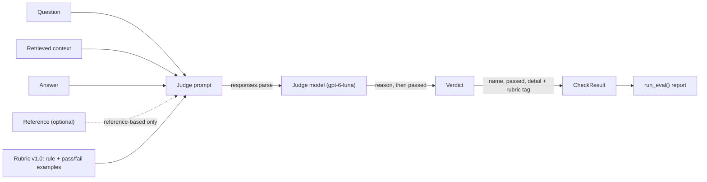
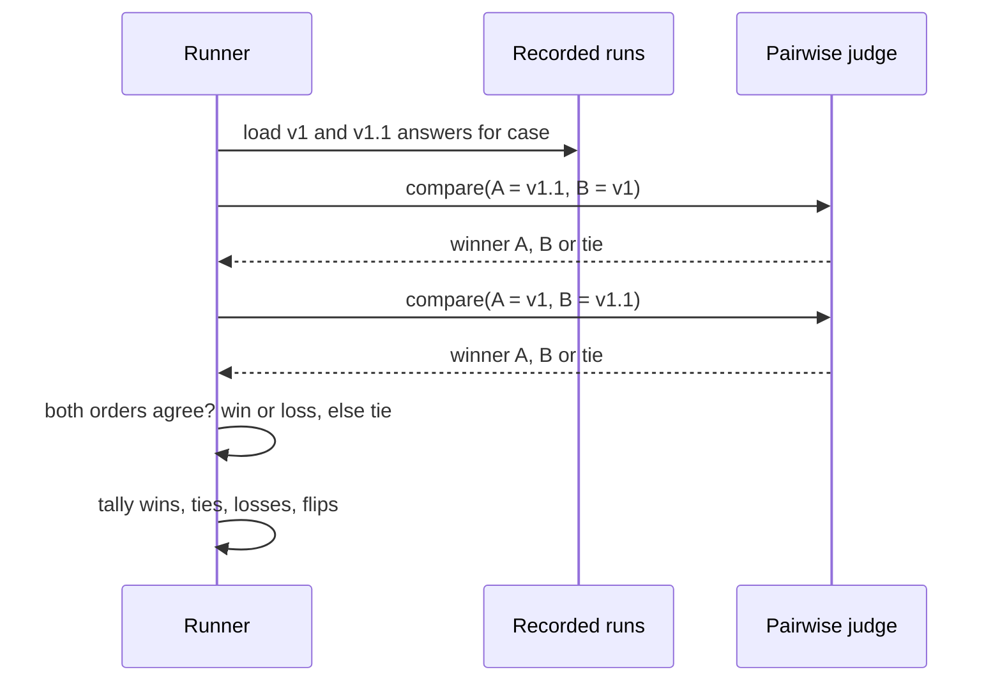
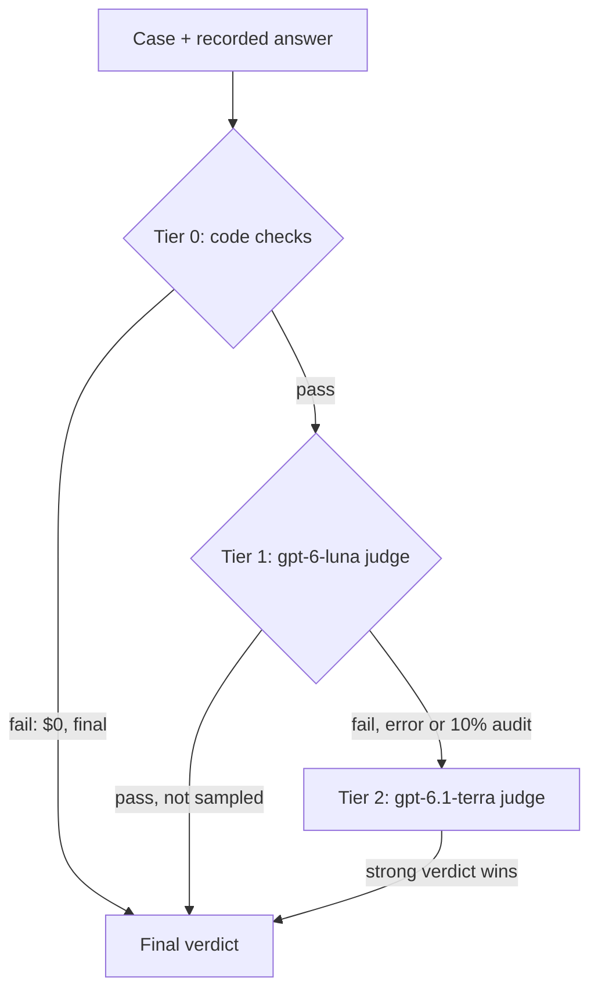

# LLM-as-Judge

Day 44 left you with two criteria that no regex can check: "is the answer grounded in the docs?" and "does it say so when the docs don't cover the question?". Reading 100 answers by hand after every prompt change doesn't scale past the first week. Today you build graders that read the way you do, one rule at a time, and you shape them so Day 46 can test whether to trust them.

## At a Glance

- **Time:** ~2 h core (+ optional Go Deeper) · **Depth:** working
- **Prerequisites:** [Day 16: Structured Outputs: Native JSON Schema & Extraction](../../Phase_2_Building_with_LLM_APIs/Day_016_structured_outputs/structured_outputs.md), [Day 20: Your First Eval Set](../../Phase_2_Building_with_LLM_APIs/Day_020_first_eval_set/first_eval_set.md), [Day 30: Evaluating RAG Answers](../../Phase_3_RAG/Day_030_answer_evaluation/answer_evaluation.md), [Day 43: Building Eval Datasets: Golden, Synthetic & Production](../../Phase_5_Evaluation_and_Observability/Day_043_eval_datasets/eval_datasets.md), [Day 44: Error Analysis: From Traces to Failure Modes](../../Phase_5_Evaluation_and_Observability/Day_044_error_analysis/error_analysis.md); helpful: [Eval metrics basics](../../Appendix_Primers/A12_eval_metrics_basics.md)
- **You'll build:** `atlas/evals/judges.py`: one binary judge per R2 failure mode, plugged into the eval runner as ordinary checks, plus a pairwise v1-vs-v1.1 comparison and a cost-tiered judge.
- **Stops at:** fine-tuned judges, reward models and multi-judge ensembles.
- **Fast path:** Already know LLM judges from Day 30? Read §Anatomy of a Judge, §Judges as Checks in the Runner and §Cost-Tiered Judging, copy the judge template, and do Exercise 2 (~45 min).
- **Cost:** ≈ $0.12 for the whole lesson with exercises (~140 `gpt-6-luna` + ~17 `gpt-6.1-terra` judge calls), ≈ $0.30 per 100 cases × 2 criteria with tiering (estimated with `tier_costs` below; reasoning tokens bill as output; prices as of 2026-11, [verify](https://developers.openai.com/api/docs/pricing)).
- **New terms:** LLM-as-judge, binary verdict, rubric, pairwise comparison, cost-tiered judging

> **Coming from Software Engineering?** A judge is a lint rule in CI, written in English. A good lint rule targets one bug class, prints a clear message, runs fast, costs little and is sometimes wrong, so you tune it instead of trusting it blindly. Judges follow the same rules: one judge per failure mode, a reason with every verdict, a cheap model by default, and a measured false-positive rate (that's Day 46). A god-rule that "checks code quality" from 1 to 5 would never survive code review; neither should a god-judge.

## Where Code Checks Run Out

Day 44's code checks catch what has an exact shape: a wrong version string, a citation to a doc that doesn't exist. Here are two answers to case `qa-008`, "Does a lease expiry count as a failed attempt?". Both cite `retries-and-backoff`, a real page, so `check_cites_existing_doc` passes both:

- **v1.1:** "Yes. Each redelivery after ORB-1101 LeaseExpired counts as an attempt, so a job that keeps outliving its lease ends in the DLQ with ORB-1301. Fix lease sizing, not retries."
- **v1:** "No. Lease expiries don't count. To stop reruns, set `max_retries_per_minute = 1` under `[retries]`."

The second answer is wrong, and `max_retries_per_minute` doesn't exist anywhere in Orbit. Spotting that takes reading the doc and comparing claims, which is a judgement, not a pattern match.

## A Judge Is a Marking Scheme

An **LLM-as-judge** is a second model call that grades an output against a marking scheme: "here are the question, the sources and the answer; does it break rule X? Say why, then yes or no." Think of a teacher with an answer key and one marking rule per question, except the teacher is a cheap model that never gets tired.

The marking rule matters more than the model. Try it by hand. Three answers to "How do I stop duplicate runs on long jobs?":

| Answer | Text (shortened) |
|---|---|
| A | "Raise `lease_seconds` above your longest job, e.g. 3600." |
| B | "Long jobs run twice when the lease expires (ORB-1101). Keep `heartbeat_seconds` at most a third of `lease_seconds`; if native code blocks heartbeats, raise `lease_seconds` to 900–1800. [leases-and-heartbeats]" |
| C | "Set `max_retries_per_minute = 1` under `[retries]`." |

First, rate each from 1 to 5, a **Likert scale** (a fixed 1–N rating). Most people give C a 1 and B a 4 or 5. A splits the room: one reviewer gives it a 2 because the docs say heartbeats, not a huge lease, carry long jobs; another gives it a 3 because it does reduce duplicates. Is B a 4 or a 5? Nobody can say what the difference means.

Now grade with a **binary verdict** (pass or fail on one stated rule): "PASS only if it recommends `heartbeat_seconds` tuning or a larger `lease_seconds` AND cites `leases-and-heartbeats`." A fails (no citation), B passes, C fails. Everyone agrees, and each fail tells you what to fix. That's why teams gate on pass/fail: a pass rate on a stated rule is a number you can act on, while "average quality went from 3.8 to 4.1" is not. OpenAI's evaluation guide gives the same advice: use pairwise comparison or pass/fail for more reliability.

## Anatomy of a Judge

A judge has five parts:

1. **Criterion:** one failure mode, phrased as a pass/fail test. One judge per failure mode, never one judge for "quality".
2. **Inputs:** the question, the retrieved context, the answer, and optionally a reference answer. A **reference-free** judge needs no expected answer, so it works on any traffic; a **reference-based** judge compares against gold and only works on labelled cases ([Day 30](../../Phase_3_RAG/Day_030_answer_evaluation/answer_evaluation.md) built one of each).
3. **Examples:** at least one concrete fail example and one pass example. Without a fail example a judge's idea of "grounded" drifts toward "sounds plausible".
4. **Output schema:** `Verdict(reason, passed)` with `reason` first. Structured Outputs generates fields in schema order, so the model writes its evidence before it commits to a verdict ([Day 16](../../Phase_2_Building_with_LLM_APIs/Day_016_structured_outputs/structured_outputs.md)).
5. **Rubric:** the marking scheme the judge reads, made of the criterion, its examples and the instructions. It carries a version, like any prompt ([Day 21](../../Phase_2_Building_with_LLM_APIs/Day_021_prompts_as_code/prompts_as_code.md)).



## Your First Judge

The smallest useful judge: one rule, one case, one call. It grades the v1 answer above.

```python
# script_id: day_045_llm_as_judge/first_judge
# One binary judge on one recorded answer. Install: uv add "openai>=3.46,<4" pydantic
# Env: OPENAI_API_KEY, ORBIT_DATA (default datasets/orbit), ATLAS_JUDGE_MODEL (optional) · Services: none
import os
from pathlib import Path

from openai import OpenAI
from pydantic import BaseModel

JUDGE_MODEL = os.environ.get("ATLAS_JUDGE_MODEL", "gpt-6-luna")
DATA_DIR = Path(os.environ.get("ORBIT_DATA", "datasets/orbit"))
client = OpenAI()

class Verdict(BaseModel):
    reason: str    # first, so the evidence is written before the verdict
    passed: bool

RUBRIC = ("You check ONE rule: every config key, error code and number in ANSWER must appear in "
          "CONTEXT. Quote any that don't in `reason`. PASS only if none are missing.")
context = (DATA_DIR / "docs/retries-and-backoff.md").read_text(encoding="utf-8")
answer = "No. Lease expiries don't count. To stop reruns, set max_retries_per_minute = 1 under [retries]."
resp = client.responses.parse(
    model=JUDGE_MODEL, instructions=RUBRIC, text_format=Verdict, reasoning={"effort": "low"},
    input=f"QUESTION: Does a lease expiry count as a failed attempt?\n\nCONTEXT:\n{context}\n\nANSWER:\n{answer}")
print(resp.output_parsed)
```

Expected output (your wording will differ):

```text
reason="ANSWER sets max_retries_per_minute under [retries], but CONTEXT lists only max_attempts, backoff and max_delay_seconds there. It also says lease expiries don't count, while CONTEXT says a lease expiry counts as an attempt." passed=False
```

Two settings deserve a note. `reasoning={"effort": "low"}` matters because the default effort is `medium`, and reasoning tokens bill as output; a narrow rule rarely needs more. And there's no `temperature`: sampling knobs only work with effort `none` (see Common Pitfalls).

## Turn a Knob: One God-Judge vs One Judge per Mode

What if you skip the discipline and ask for one overall score? The next script grades v1's answer to an unanswerable question, "Can I use Kafka as Orbit's broker?". The docs list Redis, Postgres and SQS only, yet v1 confidently gives a `kafka://` URL. It then breaks the grounded judge a second way: by hiding the docs from it.

```python
# script_id: day_045_llm_as_judge/break_it
# Two ways to break a judge: a vague 1-5 "quality" score, and a grounded judge that can't see the docs.
# Install: uv add "openai>=3.46,<4" pydantic · Env: OPENAI_API_KEY, ORBIT_DATA · Services: none
import os
from pathlib import Path

from openai import OpenAI
from pydantic import BaseModel

JUDGE_MODEL = os.environ.get("ATLAS_JUDGE_MODEL", "gpt-6-luna")
DATA_DIR = Path(os.environ.get("ORBIT_DATA", "datasets/orbit"))
client = OpenAI()

class Score(BaseModel):
    reason: str
    score: int      # 1-5, the Likert version

class Verdict(BaseModel):
    reason: str
    passed: bool

QUESTION = "Can I use Kafka as Orbit's broker?"
ANSWER = ('Yes. Set url = "kafka://broker:9092" under [broker] in orbit.toml and install '
          "orbit[kafka]. Kafka gives you ordered partitions for free. [concepts-brokers]")
CONTEXT = (DATA_DIR / "docs/concepts-brokers.md").read_text(encoding="utf-8")
GOD = "Rate the overall quality of ANSWER from 1 (bad) to 5 (excellent)."
ABSTAINS = ("ONE rule: if CONTEXT does not cover what QUESTION asks, ANSWER must say so and must not "
            "give a how-to. PASS if it abstains correctly, or if CONTEXT covers the question.")
GROUNDED = ("ONE rule: every config key, URL scheme, package name and number in ANSWER must appear in "
            "CONTEXT. If no CONTEXT is given, judge as best you can.")
```

One helper grades the same answer with any rubric and schema, with or without the docs:

```python
# script_id: day_045_llm_as_judge/break_it
def grade(rubric: str, schema: type[BaseModel], with_context: bool = True) -> BaseModel | None:
    ctx = f"CONTEXT:\n{CONTEXT}\n\n" if with_context else ""
    resp = client.responses.parse(model=JUDGE_MODEL, instructions=rubric, text_format=schema,
                                  reasoning={"effort": "low"},
                                  input=f"QUESTION: {QUESTION}\n\n{ctx}ANSWER:\n{ANSWER}")
    return resp.output_parsed

for label, rubric, schema, ctx in [("god judge 1-5", GOD, Score, True),
                                   ("abstains_when_unanswerable", ABSTAINS, Verdict, True),
                                   ("grounded, no docs", GROUNDED, Verdict, False),
                                   ("grounded, docs", GROUNDED, Verdict, True)]:
    print(f"{label:<28}", grade(rubric, schema, ctx))
```

Expected output (illustrative; your numbers will differ):

```text
god judge 1-5                reason='Clear, actionable and well formatted, but Kafka is not among the brokers listed.' score=3
abstains_when_unanswerable   reason='CONTEXT documents Redis, Postgres and SQS only; ANSWER gives a Kafka how-to instead of saying so.' passed=False
grounded, no docs            reason='The configuration looks plausible for a Kafka broker.' passed=True
grounded, docs               reason='kafka:// and orbit[kafka] do not appear in CONTEXT, which lists redis://, postgresql:// and sqs://.' passed=False
```

The god-judge saw the problem and still averaged it away into a 3. Averaged over 100 cases, a handful of confident hallucinations barely moves a 1–5 mean, while the binary `abstains_when_unanswerable` judge counts every one. The third line is the most common judge failure of all: **a grounded judge without the retrieved context passes everything that sounds right**. It has nothing to check against, so it grades plausibility. Always pass the context the generator actually saw.

## Judges as Checks in the Runner

Now the realistic version. Judges should grade **recorded** answers: if you regenerate answers every time you tweak a rubric, you can't tell a judge change from a generator change. Days 43 and 44 saved R2's v1 and v1.1 runs as `runs/ask_v1_baseline.jsonl` and `runs/ask_v1_fix.jsonl`. So that this lesson runs on its own, the next script writes a six-case stand-in with the same fields: four gold cases from `eval/qa_gold.jsonl` and two unanswerable ones. If you have your own run files, skip it and set `RUNS_DIR`.

```python
# script_id: day_045_llm_as_judge/recorded_runs
# Writes a small recorded run of R2 v1 and v1.1 to runs/ (stand-in for Day 43/44's run files).
# Install: stdlib only · Env: ORBIT_DATA (default datasets/orbit), RUNS_DIR (default runs) · Services: none
import json
import os
from pathlib import Path

DATA_DIR = Path(os.environ.get("ORBIT_DATA", "datasets/orbit"))
RUNS = Path(os.environ.get("RUNS_DIR", "runs"))
GOLD = {c["id"]: c for c in map(json.loads, (DATA_DIR / "eval/qa_gold.jsonl").read_text().splitlines())}
UNANSWERABLE = [  # the docs don't cover these; the right answer says so
    {"id": "u-001", "question": "Can I use Kafka as Orbit's broker?", "answer": None},
    {"id": "u-002", "question": "Does Orbit offer a managed cloud service with an uptime SLA?",
     "answer": None},
]
CASES = [GOLD[i] for i in ("qa-001", "qa-005", "qa-006", "qa-008")] + UNANSWERABLE
```

Each recorded answer keeps the doc ids the generator retrieved, because the grounded judge must see exactly that context:

```python
# script_id: day_045_llm_as_judge/recorded_runs
# case_id: (retrieved doc ids, v1 answer, v1.1 answer). Both versions cite only real docs.
ANSWERS = {
    "qa-001": (["configuration-reference", "leases-and-heartbeats"],
               "In [worker], lease_seconds defaults to 300 and heartbeat_seconds to 30.",
               "In [worker], lease_seconds defaults to 300 and heartbeat_seconds to 30; orbit doctor "
               "warns when heartbeat_seconds is more than a third of lease_seconds."),
    "qa-005": (["retries-and-backoff"], "2 s, 4 s and 8 s, before jitter.",
               "2 s, 4 s and 8 s before jitter; jitter then picks 50-100% of each delay."),
    "qa-006": (["retries-and-backoff"], "Yes: the first attempt plus five retries, six runs in total.",
               "No. retries counts the first attempt: retries=5 means at most five runs, the first "
               "plus four retries."),
    "qa-008": (["retries-and-backoff", "leases-and-heartbeats"],
               "No. Lease expiries don't count. To stop reruns, set max_retries_per_minute = 1 under [retries].",
               "Yes. Each redelivery after ORB-1101 LeaseExpired counts as an attempt, so a job that keeps "
               "outliving its lease ends in the DLQ with ORB-1301. Fix lease sizing, not retries."),
    "u-001": (["concepts-brokers"],
              'Yes. Set url = "kafka://broker:9092" under [broker] and install orbit[kafka].',
              "The Orbit docs don't cover Kafka. The documented brokers are Redis, Postgres and Amazon SQS."),
    "u-002": (["index", "faq"], "Yes. Orbit Cloud offers a 99.9% uptime SLA on the Pro plan.",
              "The Orbit docs don't describe a managed service or an SLA, so I can't answer that."),
}

def write_jsonl(path: Path, rows: list[dict]) -> None:
    path.parent.mkdir(parents=True, exist_ok=True)
    path.write_text("".join(json.dumps(r) + "\n" for r in rows), encoding="utf-8")

write_jsonl(RUNS / "cases.jsonl", CASES)
for slot, (version, name) in enumerate([("v1", "ask_v1_baseline"), ("v1.1", "ask_v1_fix")], start=1):
    write_jsonl(RUNS / f"{name}.jsonl", [
        {"case_id": cid, "version": version, "answer": ans[slot], "citations": ans[0],
         "retrieved_ids": ans[0]} for cid, ans in ANSWERS.items()])
print(f"wrote {len(CASES)} cases and 2 runs to {RUNS}/")
```

```text
wrote 6 cases and 2 runs to runs/
```

Now the module itself. `make_judge()` returns a function with Day 20's check shape, `(case, prediction) -> CheckResult`, so `run_eval()` takes code checks and judges in the same list. The client is built lazily, so importing the module (and testing it) needs no key.

```python
# script_id: day_045_llm_as_judge/judges
# atlas/evals/judges.py: one binary LLM judge per failure mode, shaped as Day 20 checks.
# Install: uv add "openai>=3.46,<4" pydantic · Env: OPENAI_API_KEY (only when a judge runs),
#   ATLAS_JUDGE_MODEL (default gpt-6-luna), ORBIT_DATA (default datasets/orbit) · Services: none
from __future__ import annotations

import json
import os
import random
from dataclasses import dataclass, field
from functools import cache
from pathlib import Path
from typing import Any, Callable, Literal, Sequence

import openai
from openai import OpenAI
from pydantic import BaseModel, ValidationError

JUDGE_MODEL = os.environ.get("ATLAS_JUDGE_MODEL", "gpt-6-luna")
STRONG_JUDGE_MODEL = os.environ.get("ATLAS_STRONG_JUDGE_MODEL", "gpt-6.1-terra")
DATA_DIR = Path(os.environ.get("ORBIT_DATA", "datasets/orbit"))
# USD per 1M tokens (input, output), as of 2026-11; verify at https://developers.openai.com/api/docs/pricing
PRICES = {"gpt-6-luna": (0.10, 0.50), "gpt-6.1-terra": (1.00, 5.00)}

@dataclass(frozen=True)
class CheckResult:          # Day 20's shape
    name: str
    passed: bool
    detail: str = ""

Check = Callable[[dict, Any], CheckResult]      # (case, prediction) -> verdict

class Verdict(BaseModel):
    reason: str     # generated first: the evidence comes before the verdict
    passed: bool

@cache
def default_client() -> OpenAI:     # lazy: no key needed until a judge actually runs
    return OpenAI()
```

A `Criterion` is Day 44's criterion plus the fields a judge needs. `RUBRICS` holds one per failure mode, each with a version:

```python
# script_id: day_045_llm_as_judge/judges
@dataclass(frozen=True)
class Criterion:            # compact Day 44 Criterion + judge fields
    name: str
    version: str
    rule: str               # one failure mode, phrased as a PASS/FAIL test
    fail_example: str       # concrete failing answer and why: the most useful line in the rubric
    pass_example: str
    uses_reference: bool = False    # True = reference-based (needs the gold answer)

RUBRICS: dict[str, Criterion] = {
    "grounded": Criterion(
        "grounded", "1.0",
        "Every config key, error code, version, number and behaviour claim in ANSWER is stated in "
        "CONTEXT. A plausible claim that CONTEXT doesn't state is a FAIL. An answer that says the "
        "docs don't cover the question is a PASS.",
        fail_example="'Set max_retries_per_minute = 1 under [retries]' when CONTEXT never mentions "
                     "max_retries_per_minute: FAIL, invented key.",
        pass_example="'retries=5 means at most five runs' when CONTEXT says exactly that: PASS."),
    "abstains_when_unanswerable": Criterion(
        "abstains_when_unanswerable", "1.0",
        "If CONTEXT does not contain what QUESTION asks for, ANSWER must say the docs don't cover it "
        "and must not give a how-to. If CONTEXT does cover it, PASS unless ANSWER refuses anyway.",
        fail_example="Q: 'Can I use Kafka?' CONTEXT documents Redis, Postgres and SQS. ANSWER gives a "
                     "kafka:// URL: FAIL, it should say Kafka isn't documented.",
        pass_example="Same question, ANSWER: 'The docs don't cover Kafka; the documented brokers are "
                     "Redis, Postgres and SQS.': PASS."),
}
```

Next, what the judge sees, and how its spend is tracked. Judge cost is kept apart from app cost, so a rubric that suddenly costs 3× shows up on its own line:

```python
# script_id: day_045_llm_as_judge/judges
@dataclass
class CostTracker:          # compact Day 12 tracker
    usd: dict[str, float] = field(default_factory=dict)
    calls: dict[str, int] = field(default_factory=dict)

    def record(self, model: str, usage: Any) -> float:
        p_in, p_out = PRICES.get(model, (0.0, 0.0))     # unknown model: count calls, not $
        cost = (usage.input_tokens * p_in + usage.output_tokens * p_out) / 1e6  # incl. reasoning
        self.usd[model] = self.usd.get(model, 0.0) + cost
        self.calls[model] = self.calls.get(model, 0) + 1
        return cost

TRACKER = CostTracker()

def _field(obj: Any, name: str) -> Any:     # predictions may be dicts (run files) or objects
    return obj[name] if isinstance(obj, dict) else getattr(obj, name)

def load_context(doc_ids: Sequence[str], max_chars: int = 8_000) -> str:
    """The retrieved docs, as the judge sees them. Without them it can only grade plausibility."""
    parts = []
    for doc_id in doc_ids:
        path = DATA_DIR / "docs" / f"{doc_id}.md"
        text = path.read_text(encoding="utf-8")[:max_chars] if path.exists() else "(missing doc)"
        parts.append(f"<doc id={doc_id}>\n{text}\n</doc>")
    return "\n".join(parts) or "(no documents retrieved)"

def render_prompt(criterion: Criterion, case: dict, pred: Any, examples: Sequence[dict] = ()) -> str:
    parts = [f"RULE: {criterion.rule}", f"FAIL EXAMPLE: {criterion.fail_example}",
             f"PASS EXAMPLE: {criterion.pass_example}"]
    parts += [f"EXAMPLE ({'PASS' if e['passed'] else 'FAIL'}): {e['text']}" for e in examples]
    parts += [f"QUESTION:\n{case['question']}", f"CONTEXT:\n{load_context(_field(pred, 'retrieved_ids'))}"]
    if criterion.uses_reference:
        parts.append(f"REFERENCE ANSWER:\n{case.get('answer') or '(none: the docs do not cover this)'}")
    parts.append(f"ANSWER:\n{_field(pred, 'answer')}")
    return "\n\n".join(parts)
```

The factory. Note the three outcomes: pass, fail, and **judge error**. A refusal, a truncated reply or an API failure is not evidence that the answer is bad, so it must not count as a fail:

```python
# script_id: day_045_llm_as_judge/judges
JUDGE_SYSTEM = ("You grade one answer from Atlas, a support assistant for the Orbit library, on ONE "
                "rule. Use only the material given. In `reason`, quote the evidence in one or two "
                "sentences, then set `passed`. When unsure, FAIL.")

def is_judge_error(result: CheckResult) -> bool:
    return result.detail.startswith("judge_error")

def make_judge(criterion: Criterion, *, model: str = JUDGE_MODEL, examples: Sequence[dict] = (),
               client: OpenAI | None = None, tracker: CostTracker | None = None) -> Check:
    tag = f"[{criterion.name}@{criterion.version} {model}]"    # which rubric graded this
    def judge(case: dict, pred: Any) -> CheckResult:
        try:
            resp = (client or default_client()).responses.parse(
                model=model, instructions=JUDGE_SYSTEM, text_format=Verdict,
                reasoning={"effort": "low"},        # default is medium; a narrow rule rarely needs it
                input=render_prompt(criterion, case, pred, examples))
        except (openai.APIError, ValidationError) as err:   # API failure or unparseable output
            return CheckResult(criterion.name, False, f"judge_error: {type(err).__name__} {tag}")
        (tracker or TRACKER).record(model, resp.usage)      # billed even when it fails to parse
        verdict = resp.output_parsed
        if verdict is None or resp.status == "incomplete":  # refusal or truncation
            return CheckResult(criterion.name, False, f"judge_error: status={resp.status} {tag}")
        return CheckResult(criterion.name, verdict.passed, f"{verdict.reason} {tag}")
    judge.__name__ = criterion.name
    return judge

def load_jsonl(path: str | Path) -> list[dict]:
    return [json.loads(line) for line in Path(path).read_text(encoding="utf-8").splitlines() if line.strip()]

def load_run(path: str | Path) -> list[dict]:
    """A recorded run: Day 43's RunRecord rows (case_id, version, answer, citations, retrieved_ids)."""
    return load_jsonl(path)
```

Before spending a cent, test the plumbing with a fake client. This is Day 19's habit: the judge's *logic* (prompt building, error bucketing, cost tracking) is ordinary code and deserves ordinary tests.

```python
# script_id: day_045_llm_as_judge/judge_offline
# Tests make_judge() with a fake client: no key, no network. Needs judges.py next to it.
# Install: uv add "openai>=3.46,<4" pydantic · Env: ORBIT_DATA (default datasets/orbit) · Services: none
from types import SimpleNamespace

from judges import RUBRICS, CostTracker, Verdict, is_judge_error, make_judge

class FakeResponses:
    def __init__(self, replies: list) -> None:
        self.replies, self.prompts = list(replies), []

    def parse(self, **kwargs):            # same keyword call the real SDK receives
        self.prompts.append(kwargs["input"])
        parsed, status = self.replies.pop(0)
        usage = SimpleNamespace(input_tokens=3_000, output_tokens=150)
        return SimpleNamespace(output_parsed=parsed, status=status, usage=usage)

fake = SimpleNamespace(responses=FakeResponses([
    (Verdict(reason="Every key appears in CONTEXT.", passed=True), "completed"),
    (Verdict(reason="max_retries_per_minute is not in CONTEXT.", passed=False), "completed"),
    (None, "incomplete"),                   # truncated or refused: a judge error, not a FAIL
]))
tracker = CostTracker()
judge = make_judge(RUBRICS["grounded"], client=fake, tracker=tracker)
case = {"id": "qa-008", "question": "Does a lease expiry count as a failed attempt?"}
pred = {"answer": "(recorded answer)", "retrieved_ids": ["retries-and-backoff"]}
results = [judge(case, pred) for _ in range(3)]
for r in results:
    print(f"passed={r.passed!s:<5} judge_error={is_judge_error(r)!s:<5} {r.detail}")
assert [r.passed for r in results] == [True, False, False]
assert [is_judge_error(r) for r in results] == [False, False, True]
assert "<doc id=retries-and-backoff>" in fake.responses.prompts[0]    # the judge saw the docs
print(f"judge spend: ${sum(tracker.usd.values()):.6f} over {sum(tracker.calls.values())} calls")
```

```text
passed=True  judge_error=False Every key appears in CONTEXT. [grounded@1.0 gpt-6-luna]
passed=False judge_error=False max_retries_per_minute is not in CONTEXT. [grounded@1.0 gpt-6-luna]
passed=False judge_error=True  judge_error: status=incomplete [grounded@1.0 gpt-6-luna]
judge spend: $0.001125 over 3 calls
```

Now the real run: v1 against v1.1, per criterion, with Day 44's free code check in the same list. The error budget at the end refuses to report a score when too many verdicts are missing:

```python
# script_id: day_045_llm_as_judge/compare_versions
# Judge R2 v1 vs v1.1 per criterion on recorded runs. Needs judges.py and recorded_runs.py's output.
# Install: as judges.py · Env: OPENAI_API_KEY, ORBIT_DATA, RUNS_DIR (default runs) · Services: none
import os
from pathlib import Path

from judges import (DATA_DIR, RUBRICS, TRACKER, CheckResult, is_judge_error, load_jsonl,
                    load_run, make_judge)

RUNS = Path(os.environ.get("RUNS_DIR", "runs"))

def check_cites_existing_doc(case: dict, pred: dict) -> CheckResult:    # compact Day 44 code check
    missing = [d for d in pred["citations"] if not (DATA_DIR / "docs" / f"{d}.md").exists()]
    return CheckResult("cites_existing_doc", bool(pred["citations"]) and not missing, ", ".join(missing))

def run_eval(cases: list[dict], run: list[dict], checks: list) -> dict[str, list[CheckResult]]:
    by_id = {r["case_id"]: r for r in run}          # compact Day 20 runner, grouped by check
    out: dict[str, list[CheckResult]] = {}
    for case in cases:
        for check in checks:
            result = check(case, by_id[case["id"]])
            out.setdefault(result.name, []).append(result)
    return out

def rate(results: list[CheckResult]) -> str:
    graded = [r for r in results if not is_judge_error(r)]      # errors leave the denominator
    errors = len(results) - len(graded)
    return f"{sum(r.passed for r in graded)}/{len(graded)}" + (f" ({errors} err)" if errors else "")
```

Run both versions through the same checks, print the table, then the reasons behind every v1 failure:

```python
# script_id: day_045_llm_as_judge/compare_versions
cases = load_jsonl(RUNS / "cases.jsonl")
checks = [check_cites_existing_doc, make_judge(RUBRICS["grounded"]),
          make_judge(RUBRICS["abstains_when_unanswerable"])]
reports = {v: run_eval(cases, load_run(RUNS / f), checks)
           for v, f in [("v1", "ask_v1_baseline.jsonl"), ("v1.1", "ask_v1_fix.jsonl")]}
print(f"{'criterion':<28}{'v1':>8}{'v1.1':>8}")
for name in reports["v1"]:
    print(f"{name:<28}{rate(reports['v1'][name]):>8}{rate(reports['v1.1'][name]):>8}")
for name, results in reports["v1"].items():         # read the reasons, not only the rates
    for case, r in zip(cases, results):
        if not r.passed:
            print(f"  v1 {case['id']} {name}: {r.detail[:88]}")
everything = [r for rep in reports.values() for rs in rep.values() for r in rs]
errors = sum(map(is_judge_error, everything))
print(f"judge spend: ${sum(TRACKER.usd.values()):.4f} over {sum(TRACKER.calls.values())} calls")
if errors > 0.02 * len(everything):
    raise SystemExit(f"{errors} judge errors (>2%): fix the judge before trusting these numbers")
```

Expected output (illustrative; your numbers will differ):

```text
criterion                         v1    v1.1
cites_existing_doc             6/6     6/6
grounded                       2/6     6/6
abstains_when_unanswerable       4/6     6/6
  v1 qa-006 grounded: ANSWER says retries=5 gives six runs; CONTEXT says retries=5 means at most fiv
  v1 qa-008 grounded: max_retries_per_minute does not appear in CONTEXT, and CONTEXT says a lease e
  v1 u-001 grounded: kafka:// and orbit[kafka] are not in CONTEXT, which documents Redis, Postgres
  v1 u-002 grounded: CONTEXT never mentions Orbit Cloud, a Pro plan or a 99.9% SLA. [grounded@1.0
  v1 u-001 abstains_when_unanswerable: CONTEXT does not cover Kafka, yet ANSWER gives a configuration how-t
  v1 u-002 abstains_when_unanswerable: CONTEXT does not describe a managed service; ANSWER invents one. [ab
judge spend: $0.0091 over 24 calls
```

This is the measured improvement the code check couldn't see: `cites_existing_doc` says 6/6 for both versions, while the judges show v1.1 fixing four grounding failures and two abstention failures. On the real 100-case set, add these two rows to the Ask scoreboard. Day 46 decides how much to trust them; until then they're directional.

## Pairwise: Which Version Is Better?

Per-criterion pass rates tell you *what* broke. Sometimes you want one overall call instead: "is v1.1 better than v1?". A **pairwise comparison** shows the judge both answers to the same question and asks which is better, or whether it's a tie. It's easier for a judge (and a person) to say "B is better" than to say "B is a 4.2", which is why pairwise works well for comparing prompt or model versions.

Judges have a known weakness here: **position bias**, a tendency to prefer whichever answer comes first (or second). OpenAI's evaluation guide lists it next to verbosity bias. You'll measure both on Day 46; today, build the habit that neutralises position bias: run every pair in both orders, and count a verdict that flips with the order as a tie.



```python
# script_id: day_045_llm_as_judge/judges
class PairwiseVerdict(BaseModel):
    reason: str
    winner: Literal["A", "B", "tie"]

PAIRWISE_RUBRIC = ("Two answers from Atlas to the same QUESTION, with the docs they retrieved. Which "
                   "would an Orbit maintainer rather receive? Prefer the answer whose claims are all in "
                   "CONTEXT, that answers what was asked, and that says so when the docs don't cover it. "
                   "Length is not quality. Say 'tie' if neither is clearly better. Explain first.")

def compare(case: dict, a: Any, b: Any, *, model: str = JUDGE_MODEL,
            client: OpenAI | None = None) -> PairwiseVerdict:
    ids = list(dict.fromkeys([*_field(a, "retrieved_ids"), *_field(b, "retrieved_ids")]))
    prompt = (f"QUESTION:\n{case['question']}\n\nCONTEXT:\n{load_context(ids)}\n\n"
              f"ANSWER A:\n{_field(a, 'answer')}\n\nANSWER B:\n{_field(b, 'answer')}")
    resp = (client or default_client()).responses.parse(
        model=model, instructions=PAIRWISE_RUBRIC, text_format=PairwiseVerdict,
        reasoning={"effort": "low"}, input=prompt)
    TRACKER.record(model, resp.usage)
    if resp.output_parsed is None:
        raise RuntimeError(f"no pairwise verdict for {case.get('id')} (status={resp.status})")
    return resp.output_parsed

def compare_both_orders(case: dict, new: Any, old: Any, **kwargs: Any) -> tuple[str, bool]:
    """('win' | 'loss' | 'tie', flipped) for `new` vs `old`. An order flip counts as a tie."""
    first = {"A": "new", "B": "old", "tie": "tie"}[compare(case, new, old, **kwargs).winner]
    second = {"A": "old", "B": "new", "tie": "tie"}[compare(case, old, new, **kwargs).winner]
    if first == second == "new":
        return "win", False
    if first == second == "old":
        return "loss", False
    return "tie", first != second
```

```python
# script_id: day_045_llm_as_judge/pairwise_run
# Pairwise v1.1 vs v1 on the recorded runs, both orders per pair. Needs judges.py + recorded runs.
# Install: as judges.py · Env: OPENAI_API_KEY, ORBIT_DATA, RUNS_DIR (default runs) · Services: none
import os
from collections import Counter
from pathlib import Path

from judges import TRACKER, compare_both_orders, load_jsonl, load_run

RUNS = Path(os.environ.get("RUNS_DIR", "runs"))
cases = load_jsonl(RUNS / "cases.jsonl")
old = {r["case_id"]: r for r in load_run(RUNS / "ask_v1_baseline.jsonl")}
new = {r["case_id"]: r for r in load_run(RUNS / "ask_v1_fix.jsonl")}
tally, flips = Counter(), 0
for case in cases:
    outcome, flipped = compare_both_orders(case, new[case["id"]], old[case["id"]])
    tally[outcome] += 1
    flips += flipped
    print(f"{case['id']:<8}{outcome:<6}{'(order flip)' if flipped else ''}")
print(f"v1.1 wins {tally['win']} · ties {tally['tie']} · loses {tally['loss']} · order flips {flips}")
print(f"judge spend: ${sum(TRACKER.usd.values()):.4f} over {sum(TRACKER.calls.values())} calls")
```

Expected output (illustrative; your numbers will differ):

```text
qa-001  tie   (order flip)
qa-005  tie
qa-006  win
qa-008  win
u-001   win
u-002   win
v1.1 wins 4 · ties 2 · loses 0 · order flips 1
judge spend: $0.0048 over 12 calls
```

`qa-001` is the instructive line: v1.1 adds a correct extra sentence, the judge preferred whichever answer it saw first, and the both-orders rule turned that noise into a tie instead of a fake win. On a 30-case set, report the result as "v1.1 wins W · ties T · loses L" next to the per-criterion table: the table says *where* v1.1 improved, the tally says *whether* it's better overall.

## Cost-Tiered Judging

Judging every case with a strong model is the most accurate plan and the most expensive one. **Cost-tiered judging** spends money only where it changes an outcome: free code checks first, a cheap judge on everything, and a stronger judge only on the cheap judge's fails plus a random audit sample of its passes. Without the audit sample, you'd never learn when the cheap judge passes things it shouldn't.



```python
# script_id: day_045_llm_as_judge/judges
def tiered_judge(criterion: Criterion, *, cheap: str = JUDGE_MODEL, strong: str = STRONG_JUDGE_MODEL,
                 audit_rate: float = 0.1, seed: int = 0, client: OpenAI | None = None,
                 tracker: CostTracker | None = None) -> Check:
    """Cheap judge on every case; the strong judge re-grades cheap FAILs, judge errors and a seeded
    audit sample of PASSes. The strong verdict is final."""
    first, second = (make_judge(criterion, model=m, client=client, tracker=tracker)
                     for m in (cheap, strong))
    def judge(case: dict, pred: Any) -> CheckResult:
        result = first(case, pred)
        # Seeded per case, so the same cases are audited on every run and runs stay comparable.
        audited = random.Random(f"{seed}:{criterion.name}:{case.get('id')}").random() < audit_rate
        if result.passed and not audited:
            return result
        final = second(case, pred)
        if is_judge_error(final):       # keep the error visible: don't hide it behind "escalated:"
            return final
        return CheckResult(final.name, final.passed, f"escalated: {final.detail}")
    judge.__name__ = criterion.name
    return judge
```

`tiered_judge()` returns an ordinary check, so it drops into `compare_versions` in place of `make_judge()`. Before you run it on 1,000 cases, estimate the bill. This estimator is stdlib only:

```python
# script_id: day_045_llm_as_judge/tier_costs
# Estimates $/run for three judging plans before you spend anything. Stdlib only, no key.
# Prices: USD per 1M tokens (input, output), as of 2026-11; verify at https://developers.openai.com/api/docs/pricing
PRICES = {"gpt-6-luna": (0.10, 0.50), "gpt-6.1-terra": (1.00, 5.00)}

def call_cost(model: str, in_tok: int, out_tok: int) -> float:
    p_in, p_out = PRICES[model]
    return (in_tok * p_in + out_tok * p_out) / 1e6

def plan_cost(n_cases: int, criteria: int, *, in_tok: int = 3_000, out_tok: int = 200,
              fail_rate: float = 0.2, audit_rate: float = 0.1) -> dict[str, float]:
    """out_tok includes reasoning tokens. Measure both from resp.usage on 10 real calls."""
    calls = n_cases * criteria
    luna, terra = call_cost("gpt-6-luna", in_tok, out_tok), call_cost("gpt-6.1-terra", in_tok, out_tok)
    escalated = calls * (fail_rate + (1 - fail_rate) * audit_rate)    # cheap FAILs + audited PASSes
    return {"all luna": calls * luna, "tiered": calls * luna + escalated * terra,
            "all terra": calls * terra}

if __name__ == "__main__":
    small, big = plan_cost(100, 2), plan_cost(1_000, 2)
    print(f"{'plan':<10}{'$/100 cases':>12}{'$/1000 cases':>14}")
    for plan in small:
        print(f"{plan:<10}{small[plan]:>12.3f}{big[plan]:>14.2f}")
    print("tiered at 50% fails:", f"{plan_cost(100, 2, fail_rate=0.5)['tiered']:.3f}")
```

```text
plan       $/100 cases  $/1000 cases
all luna         0.080          0.80
tiered           0.304          3.04
all terra        0.800          8.00
tiered at 50% fails: 0.520
```

Turn the knob in the last line: tiering pays off when most cases pass. On a version that fails half its cases, escalation eats most of the saving, so fix the generator first. These are estimates from assumed token counts, not measured prices; as of 2026-11, verify at the pricing page.

## Trade-offs: When NOT to Use a Judge

| What you're checking | Use | Why |
|---|---|---|
| Exact or structural: version string, cited id exists, JSON shape | Code check | Free, deterministic, never wrong about what it checks |
| Judgement on a stated rule: grounded, abstains_when_unanswerable, answers the question | Binary LLM judge | Scales; one rule keeps it debuggable |
| "Is version B better overall?" | Pairwise judge, both orders | Relative calls are more stable than absolute scores |
| High stakes: legal, medical, money moving | Human review (judge as a pre-filter at most) | A judge error costs more than reviewer time |
| Fixing the answer at runtime | Evaluator–optimizer ([Day 41](../../Phase_4_Tools_and_MCP/Day_041_workflow_patterns/workflow_patterns.md)) or guardrails ([Day 70](../../Phase_8_Safety_and_Security/Day_070_guardrails_moderation/guardrails_moderation.md)) | Today's judges grade offline; inline judging adds latency to every request |

Rule of thumb: if you can write it as an `assert`, write the `assert`. Reach for a judge only for the criteria Day 44's error analysis showed you can't.

### In production

- Version rubrics like prompts, in the [Day 21](../../Phase_2_Building_with_LLM_APIs/Day_021_prompts_as_code/prompts_as_code.md) registry; the `[name@version model]` tag in every `CheckResult.detail` makes runs comparable.
- Give judges their own budget line and alert on it; a rubric edit that doubles context doubles the bill.
- Judge prompts contain user questions and answers, so they fall under the same retention rules as the app ([Day 73](../../Phase_8_Safety_and_Security/Day_073_privacy_pii/privacy_pii.md)).
- Track the judge-error rate as its own metric and fail the run above 2%.
- A judge may *gate* a merge only after Day 46 shows it agrees with human labels; until then its numbers are advisory ([Day 47](../../Phase_5_Evaluation_and_Observability/Day_047_evals_in_ci/evals_in_ci.md) wires the gate).

## Go Deeper (optional)

<details><summary>Go deeper: why reason-first and low effort work</summary>

**Reason before verdict.** The Structured Outputs guide states that outputs are produced in the same order as the keys in the schema. With `Verdict(reason, passed)`, the model has written its evidence ("`max_retries_per_minute` does not appear in CONTEXT") before it emits `passed`, so the verdict is conditioned on that evidence. Put `passed` first and the model commits to a snap call, then writes a reason that justifies it. OpenAI's evaluation guide makes the same recommendation: reasoning before scoring improves eval performance.

**Why `low` effort is usually enough.** Reasoning effort controls how many hidden reasoning tokens the model may spend before answering; they bill as output. A narrow rule ("is every key in CONTEXT?") is a lookup-and-compare task, so extra deliberation rarely changes the verdict, but it does change the bill. Don't take that on faith; measure it. The probe below grades v1's recorded answers at three settings and prints `verdict/reasoning tokens` for each. Effort `none` is the only setting that accepts `temperature` (Luna and 6.1 Terra support it).

```python
# script_id: day_045_llm_as_judge/effort_probe
# Same grounded judge at effort none / low / medium: compare verdicts and reasoning tokens.
# Install: as judges.py · Env: OPENAI_API_KEY, ORBIT_DATA · Needs judges.py + recorded_runs.py output
from pathlib import Path

from judges import (JUDGE_MODEL, JUDGE_SYSTEM, RUBRICS, Verdict, default_client, load_jsonl,
                    load_run, render_prompt)

RUNS = Path("runs")
client = default_client()
cases = {c["id"]: c for c in load_jsonl(RUNS / "cases.jsonl")}
SETTINGS = {"none": {"reasoning": {"effort": "none"}, "temperature": 0},   # sampling only at none
            "low": {"reasoning": {"effort": "low"}},
            "medium": {"reasoning": {"effort": "medium"}}}                  # the default
for rec in load_run(RUNS / "ask_v1_baseline.jsonl"):
    prompt = render_prompt(RUBRICS["grounded"], cases[rec["case_id"]], rec)
    row = []
    for label, kwargs in SETTINGS.items():
        resp = client.responses.parse(model=JUDGE_MODEL, instructions=JUDGE_SYSTEM,
                                      text_format=Verdict, input=prompt, **kwargs)
        v = resp.output_parsed
        tokens = resp.usage.output_tokens_details.reasoning_tokens
        row.append(f"{label}={'error' if v is None else v.passed}/{tokens}")
    print(f"{rec['case_id']:<8}", "  ".join(row))
```

If all three columns agree on your cases, keep `low` (or `none` for the cheapest runs). If `none` disagrees with `low` on the hard cases, you've learned the rule needs deliberation, and Day 46's labels will tell you which setting is right.

</details>

<details><summary>Go deeper: few-shot examples and reference-based judges</summary>

**Examples from your own annotations.** `make_judge(..., examples=[{"text": ..., "passed": False}])` appends labelled examples to the rubric. The best ones come from Day 44's `annotations.jsonl`: borderline answers you and a teammate argued about, written down with the verdict you settled on. Two rules keep this honest. First, use only *dev* annotations; Day 46's 30 test labels must never appear in a rubric, or the judge is graded on its own answer key. Second, keep a mix: an all-FAIL example list nudges the judge toward failing.

**Reference-based judging.** When a case has a gold answer (`qa_gold.jsonl` does), set `uses_reference=True` and the judge sees a `REFERENCE ANSWER` block. A reference catches what grounding can't: an answer can be perfectly grounded in the wrong doc. The cost is coverage, since reference-based judges only run on labelled cases, while reference-free judges also work on production traffic ([Day 86](../../Phase_9_Production/Day_086_monitoring_feedback/monitoring_feedback.md)). Teams usually run both: reference-based on the golden set, reference-free everywhere. Exercise 4 builds one.

**Cheaper bulk runs.** A nightly 1,000-case judge run doesn't need answers in seconds. Batch and Flex processing are priced at 50% of Standard (as of 2026-11, verify at the pricing page); [Day 18](../../Phase_2_Building_with_LLM_APIs/Day_018_cost_latency_caching/cost_latency_caching.md) shows how. The rubric and system prompt form a stable prefix, so put them first and let prompt caching discount repeats.

</details>

<details><summary>Go deeper: the same judge in DeepEval</summary>

If your team already uses DeepEval, its `GEval` metric is the same idea packaged as a pytest assertion. Three differences matter. `GEval` returns a 0–1 score turned into pass/fail by `threshold`, so keep the criterion binary in spirit. Its judge calls go through Chat Completions internally, and its default judge model is `gpt-5.4`, so always pass `model=`. And `GEval(model="<str>")` raises `DeepEvalError` at construction if `OPENAI_API_KEY` is unset. This reference-based version uses only the 4.x names (`SingleTurnParams`, not `LLMTestCaseParams`):

```python
# script_id: day_045_llm_as_judge/deepeval_correct
# fragment: optional; uv add deepeval==4.3.3 · Env: OPENAI_API_KEY (needed at construction)
from deepeval import assert_test
from deepeval.metrics import GEval
from deepeval.test_case import LLMTestCase, SingleTurnParams

correct = GEval(
    name="Correct",
    criteria="Does the actual output agree with the expected output on every number and setting asked about?",
    evaluation_params=[SingleTurnParams.ACTUAL_OUTPUT, SingleTurnParams.EXPECTED_OUTPUT],
    model="gpt-6-luna", threshold=0.7)

def test_retries_meaning() -> None:
    case = LLMTestCase(input="Does retries=5 mean five retries after the first attempt?",
                       actual_output="Yes: the first attempt plus five retries, six runs in total.",
                       expected_output="No. retries=5 means at most five runs: the first plus four retries.")
    assert_test(case, [correct])          # expected to fail: v1's answer is wrong
```

Run it with plain `pytest` (DeepEval registers a pytest plugin); set `DEEPEVAL_TELEMETRY_OPT_OUT=1` to opt out of telemetry. Our hand-built judges stay the default path because they return Day 20's `CheckResult` and let you control the prompt, effort and cost tracking.

</details>

## Common Pitfalls

- **The judge passes everything.** Cause: it never saw the retrieved context, or the rubric has no concrete fail example, so it grades plausibility. Fix: pass the exact docs the generator saw (`load_context`) and add a fail example taken from a real failure.
- **Request rejected when you set `temperature`.** Cause: sampling knobs (`temperature`, `top_p`, `top_logprobs`) only work with `reasoning={"effort": "none"}`, on models that accept it (Luna, 6.1 Terra). Fix: drop `temperature`, or use effort `none`. ⚠ Verify the exact error text against the current [latest-model guide](https://developers.openai.com/api/docs/guides/latest-model).
- **A surprise bill from reasoning tokens.** Cause: the default effort is `medium`, and reasoning tokens bill as output. Fix: set `reasoning={"effort": "low"}` explicitly on every judge call and watch `usage.output_tokens_details.reasoning_tokens`.
- **`verdict` before `reason` in the schema.** Symptom: reasons that read like after-the-fact excuses. Cause: fields are generated in schema order. Fix: put `reason` first.
- **Refusals counted as fails.** Symptom: pass rate drops when nothing changed; `output_parsed is None` or `status == "incomplete"`. Fix: bucket them as `judge_error`, take them out of the denominator, and fail the run above 2%.
- **Scores that aren't comparable between runs.** Cause: someone edited the rubric without bumping its version. Fix: put `name@version model` in every `CheckResult.detail` and compare runs only with matching tags.

> **Where we stop:** we don't cover fine-tuned judges, reward models or multi-judge ensembles; for most product teams a validated prompt-based judge is enough, and the curious can start from the Zheng et al. paper in the references. Whether to *trust* these judges is [Day 46](../../Phase_5_Evaluation_and_Observability/Day_046_judge_validation/judge_validation.md).

## Key Takeaways

- Code checks grade shape; a judge grades meaning. Use a judge only for criteria like "grounded" that no `assert` can express.
- Binary verdicts on one stated rule beat 1–5 scales for gating: reviewers agree on them, and every fail says what to fix.
- A judge is criterion + inputs (question, retrieved context, answer, optional reference) + pass/fail examples + `Verdict(reason, passed)` with the reason first; without the context it grades plausibility and passes everything.
- Wrap each judge as a Day 20 check, grade recorded answers, keep judge errors in their own bucket, and tag results with the rubric version.
- Compare versions pairwise in both orders, and tier the cost: free code checks, a cheap judge on everything, a strong judge on fails plus an audit sample.

## Quick Reference

| API / pattern | When to use | Gotcha |
|---|---|---|
| `client.responses.parse(model=, instructions=, input=, text_format=Verdict, reasoning={"effort": "low"})` | Every judge call | `output_parsed` is `None` on refusal; check `status == "incomplete"` too |
| `Verdict(reason: str, passed: bool)` | One binary criterion | `reason` first: fields are generated in schema order |
| `make_judge(criterion, *, model, examples, client, tracker) -> Check` | Plug a judge into `run_eval()` | Pass the retrieved context, not only the answer |
| `PairwiseVerdict(reason, winner: "A" \| "B" \| "tie")` + `compare_both_orders()` | Is version B better overall? | One order only = position bias in your result |
| `tiered_judge(criterion, *, cheap, strong, audit_rate)` | Large runs on a budget | Keep the audit sample, or cheap-judge false passes stay invisible |
| `is_judge_error(result)` | Reporting | Errors leave the denominator; fail the run above 2% |

## Exercises

1. **Warm-up.** Sharpen the `grounded` rubric: add a fail example for a *contradiction* (not only an invented key), bump the version to 1.1, re-run all 12 recorded answers and print the verdicts that changed. Since the answers didn't change, every change is a rubric effect.

<details><summary>Solution</summary>

```python
# script_id: day_045_llm_as_judge/solution_ex1
# Calls the API through judges.py (client.responses.parse) · Env: OPENAI_API_KEY, ORBIT_DATA
from dataclasses import replace
from pathlib import Path

from judges import RUBRICS, load_jsonl, load_run, make_judge

RUNS = Path("runs")
sharper = replace(
    RUBRICS["grounded"], version="1.1",
    fail_example="'retries=5 gives six runs' when CONTEXT says retries counts the first attempt "
                 "(at most five runs): FAIL. A claim that contradicts CONTEXT fails exactly like an "
                 "invented key such as max_retries_per_minute.")
old, new = make_judge(RUBRICS["grounded"]), make_judge(sharper)
cases = {c["id"]: c for c in load_jsonl(RUNS / "cases.jsonl")}
changed = 0
for name in ("ask_v1_baseline.jsonl", "ask_v1_fix.jsonl"):
    for rec in load_run(RUNS / name):
        a, b = old(cases[rec["case_id"]], rec), new(cases[rec["case_id"]], rec)
        if a.passed != b.passed:
            changed += 1
            print(f"{name} {rec['case_id']}: {a.passed} -> {b.passed}  {b.detail[:80]}")
print(f"{changed} of 12 verdicts changed between grounded@1.0 and grounded@1.1")
```

</details>

2. **Core.** Add an `answers_question` judge ("does the answer address what was asked?", ignoring truth) as a new `Criterion` in `RUBRICS`, and run it next to the other two on both recorded runs. One judge per mode means it must not re-check grounding.

<details><summary>Solution</summary>

```python
# script_id: day_045_llm_as_judge/solution_ex2
# Calls the API through judges.py (client.responses.parse) · Env: OPENAI_API_KEY, ORBIT_DATA
from pathlib import Path

from judges import RUBRICS, Criterion, load_jsonl, load_run, make_judge

RUBRICS["answers_question"] = Criterion(
    "answers_question", "1.0",
    "ANSWER directly addresses what QUESTION asks (the yes/no, the number, the setting). Ignore "
    "whether it is true; another judge checks that. A clear 'the docs don't cover this' is a PASS.",
    fail_example="Q: 'What are the first three retry delays?' ANSWER explains jitter but gives no "
                 "delays: FAIL, the question isn't answered.",
    pass_example="Same question, ANSWER: '2 s, 4 s and 8 s before jitter.': PASS.")
RUNS = Path("runs")
cases = load_jsonl(RUNS / "cases.jsonl")
judges = [make_judge(RUBRICS[n]) for n in ("grounded", "abstains_when_unanswerable", "answers_question")]
for name in ("ask_v1_baseline.jsonl", "ask_v1_fix.jsonl"):
    by_id = {r["case_id"]: r for r in load_run(RUNS / name)}
    rows = [[j(c, by_id[c["id"]]).passed for j in judges] for c in cases]
    rates = [f"{j.__name__}={sum(col)}/{len(col)}" for j, col in zip(judges, zip(*rows))]
    print(name, " ".join(rates))
```

Expect `answers_question` to pass most v1 answers, including wrong ones: that's the point. It measures a different failure mode.

</details>

3. **Core.** Compare `tiered_judge()` with an all-`gpt-6.1-terra` judge for `grounded` on all 12 recorded answers: report the $ of each and how many final verdicts differ.

<details><summary>Solution</summary>

```python
# script_id: day_045_llm_as_judge/solution_ex3
# Calls the API through judges.py (client.responses.parse) · Env: OPENAI_API_KEY, ORBIT_DATA
from pathlib import Path

from judges import (RUBRICS, STRONG_JUDGE_MODEL, CostTracker, load_jsonl, load_run, make_judge,
                    tiered_judge)

RUNS = Path("runs")
t_tier, t_strong = CostTracker(), CostTracker()
tiered = tiered_judge(RUBRICS["grounded"], audit_rate=0.1, tracker=t_tier)
strong = make_judge(RUBRICS["grounded"], model=STRONG_JUDGE_MODEL, tracker=t_strong)
cases = {c["id"]: c for c in load_jsonl(RUNS / "cases.jsonl")}
differ = total = 0
for name in ("ask_v1_baseline.jsonl", "ask_v1_fix.jsonl"):
    for rec in load_run(RUNS / name):
        case = cases[rec["case_id"]]
        a, b = tiered(case, rec), strong(case, rec)
        total += 1
        differ += a.passed != b.passed
        if a.passed != b.passed:
            print(f"differs: {name} {rec['case_id']} tiered={a.passed} strong={b.passed}")
for label, t in [("tiered", t_tier), ("all-terra", t_strong)]:
    print(f"{label}: ${sum(t.usd.values()):.4f} over {t.calls}")
print(f"{differ} of {total} final verdicts differ")
```

On 12 cases expect few or no differences at roughly half the cost; on your 100-case set, the differences are the ones to hand-label first on Day 46.

</details>

4. **Stretch (optional, uses Go Deeper).** Build a reference-based `correct` judge (`uses_reference=True`) that compares answers with the gold answer, and list cases where `grounded` and `correct` disagree. Unanswerable cases have no gold answer; the judge must expect "the docs don't cover it".

<details><summary>Solution</summary>

```python
# script_id: day_045_llm_as_judge/solution_ex4
# Calls the API through judges.py (client.responses.parse) · Env: OPENAI_API_KEY, ORBIT_DATA
from pathlib import Path

from judges import RUBRICS, Criterion, load_jsonl, load_run, make_judge

correct = Criterion(
    "correct", "1.0",
    "ANSWER agrees with REFERENCE ANSWER on every fact QUESTION asks about (numbers, settings, "
    "yes/no). Extra correct detail is fine. If REFERENCE says the docs don't cover it, ANSWER must "
    "say so too.",
    fail_example="REFERENCE: 'at most five runs'. ANSWER: 'six runs in total': FAIL.",
    pass_example="REFERENCE: '300 and 30'. ANSWER: 'lease_seconds 300, heartbeat_seconds 30': PASS.",
    uses_reference=True)
RUNS = Path("runs")
judge_correct, judge_grounded = make_judge(correct), make_judge(RUBRICS["grounded"])
cases = {c["id"]: c for c in load_jsonl(RUNS / "cases.jsonl")}
for name in ("ask_v1_baseline.jsonl", "ask_v1_fix.jsonl"):
    for rec in load_run(RUNS / name):
        case = cases[rec["case_id"]]
        g, c = judge_grounded(case, rec), judge_correct(case, rec)
        flag = "  <- disagree" if g.passed != c.passed else ""
        print(f"{name:<22}{rec['case_id']:<8}grounded={g.passed!s:<6}correct={c.passed!s:<6}{flag}")
```

Disagreements are the interesting rows: "grounded but incorrect" usually means retrieval fetched the wrong page ([Day 29](../../Phase_3_RAG/Day_029_retrieval_evaluation/retrieval_evaluation.md)), not that the generator invented anything.

</details>

## References & Further Reading

- [OpenAI: Evaluation best practices](https://developers.openai.com/api/docs/guides/evaluation-best-practices): the LLM-as-a-judge section lists pairwise, single-answer and reference-guided grading, position and verbosity bias, and "pass/fail for more reliability".
- [OpenAI: Structured Outputs](https://developers.openai.com/api/docs/guides/structured-outputs): `responses.parse`, refusals, and the key-ordering guarantee behind reason-first verdicts.
- [OpenAI: Reasoning models](https://developers.openai.com/api/docs/guides/reasoning): effort values, reasoning-token billing and `incomplete` handling.
- [OpenAI: Pricing](https://developers.openai.com/api/docs/pricing): the source for every $ figure here; re-check before you budget.
- [Anthropic: Demystifying evals for AI agents](https://www.anthropic.com/engineering/demystifying-evals-for-ai-agents): a practitioner view of graders (code, model, human) and when each fits.
- Zheng et al., "Judging LLM-as-a-Judge with MT-Bench and Chatbot Arena" (2023), arXiv 2306.05685: the paper that measured position, verbosity and self-enhancement bias in judges. Search the ID on arxiv.org.

## What's Next

You now have judges that grade what code can't, but you have no evidence yet that they grade *correctly*. In [Day 46: Trusting Your Judge](../../Phase_5_Evaluation_and_Observability/Day_046_judge_validation/judge_validation.md) you hand-label 30 answers, measure how often the `grounded` judge agrees with you, test it for position and verbosity bias, and improve it from v1 to v2 before it's allowed to gate anything.
