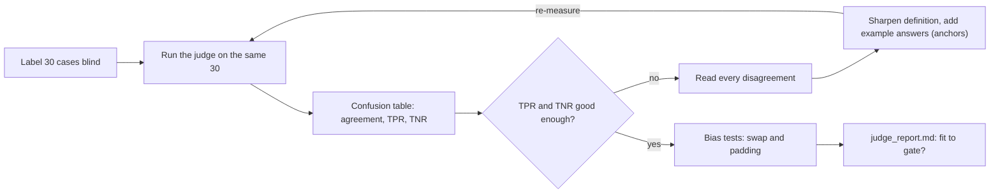
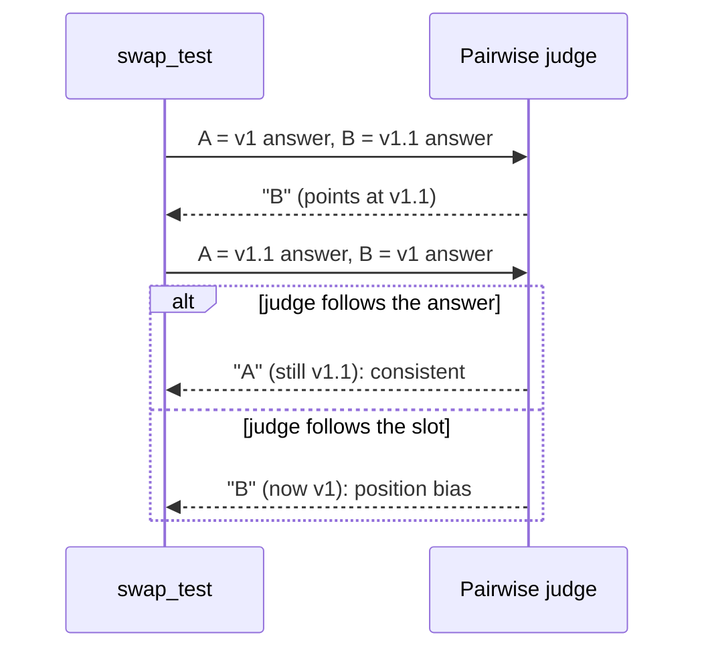
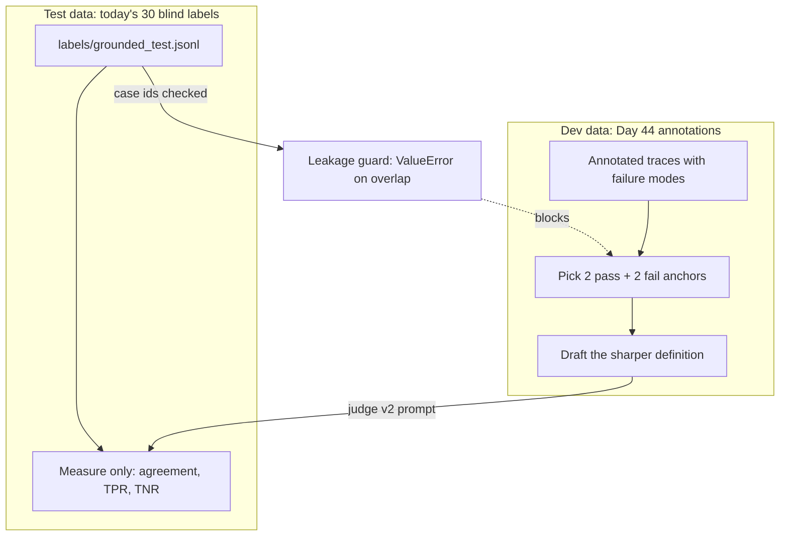

# Trusting Your Judge

Suppose yesterday's `grounded` judge reports that R2 prompt v1.1 passes 88% of `ask_v1` (illustrative). Then you read ten of those answers yourself, and three of them made something up. So which is it: is R2 good, or is the judge lenient? Today you grade the grader against your own labels before you let it block a merge.

## At a Glance

- **Time:** ~2 h core (+ optional Go Deeper) · **Depth:** intro→working
- **Prerequisites:** [Day 45: LLM-as-Judge](../../Phase_5_Evaluation_and_Observability/Day_045_llm_as_judge/llm_as_judge.md), [Day 44: Error Analysis: From Traces to Failure Modes](../../Phase_5_Evaluation_and_Observability/Day_044_error_analysis/error_analysis.md); primer [Eval metrics basics](../../Appendix_Primers/A12_eval_metrics_basics.md)
- **You'll build:** `atlas/evals/agreement.py`, 30 blind labels in `labels/grounded_test.jsonl`, and `reports/judge_report.md`: judge v1 → v2 agreement, TPR and TNR, swap consistency, verbosity flip rate and a "fit to gate" verdict
- **Stops at:** psychometrics (item response theory, Fleiss' kappa, significance tests)
- **Fast path:** Already know confusion matrices? Read [Break It: Biases You Can Test](#break-it-biases-you-can-test), [Fix the Judge, Measure on Held-Out Labels](#fix-the-judge-measure-on-held-out-labels) and [The Agreement Report](#the-agreement-report), then do Exercise 2 (≈40 min)
- **Cost:** ≈ $0.10–0.15 for the whole lesson on `gpt-6-luna` (~300 judge calls at effort `low`; prices as of 2026-11, [verify](https://developers.openai.com/api/docs/pricing)). No key? Every script still runs, using an offline stand-in judge
- **New terms:** TPR / TNR, confusion table, position bias, verbosity bias, anchors

> **Coming from Software Engineering?** This is testing your tests. In mutation testing (you deliberately break the code and check that the suite notices), a suite that stays green on broken code is worse than no suite, because it hands you false confidence. A lenient judge is that green suite. Tuning a judge also feels like tuning an alert: a false pass is a missed page, a false fail is a noisy page, and you track the two separately because they cost different things. What transfers: hold-out discipline (don't tune on the data you report), flake detection (run twice, in different orders), and a written report before anything gates CI.

## Why the Judge's Number Needs Checking

A judge is a model reading another model's output, with the same habits: it can be generous, swayed by length, or partial to one slot. So "88% grounded" mixes two things you can't yet separate: how good R2 is, and how strict the judge is.

Plain version: before you trust a new colleague's marking, you mark the same 30 papers yourself and compare. You look hardest at the papers *you* would fail, because a marker who passes everything looks great on the papers that deserve to pass.

Today: label a sample, compare, find where the judge goes wrong, fix it, and record whether it may gate CI in [Day 47](../../Phase_5_Evaluation_and_Observability/Day_047_evals_in_ci/evals_in_ci.md).

## Grade the Grader by Hand

Ten answers. You label each one pass or fail; the judge does the same. "Pass" is the positive class, the outcome the metrics are named after (the same choice as in the [Eval metrics basics primer](../../Appendix_Primers/A12_eval_metrics_basics.md)).

| Case | 1 | 2 | 3 | 4 | 5 | 6 | 7 | 8 | 9 | 10 |
|---|---|---|---|---|---|---|---|---|---|---|
| You | pass | pass | **fail** | pass | pass | **fail** | pass | pass | **fail** | pass |
| Judge | pass | pass | pass | pass | pass | fail | pass | pass | pass | pass |

Count with your finger:

- **Agreement:** the judge matches you on 8 of 10 cases (it is wrong on 3 and 9): **0.80**.
- **Of your 7 passes**, the judge passed all 7: **7/7 = 1.00**.
- **Of your 3 fails**, the judge caught 1 (case 6): **1/3 = 0.33**.

Now imagine a "judge" that answers "pass" without reading anything. It matches your 7 passes and misses all 3 fails: agreement **0.70**, only ten points below yours. Agreement alone can't tell you whether to trust a judge.

## Agreement, TPR and TNR

Arrange those counts as a **confusion table**, a 2×2 count of human verdict against judge verdict:

| | judge pass | judge fail |
|---|---|---|
| **you pass** | 7 (TP, true positive) | 0 (FN, false negative: judge missed a good answer) |
| **you fail** | 2 (FP, false positive: a bad answer slipped through) | 1 (TN, true negative: a bad answer caught) |

Three numbers come out of it:

- **Agreement** = (TP + TN) / n. Quick to read, and inflated whenever most answers pass.
- **TPR (true positive rate)** = TP / (TP + FN): of the answers you passed, the share the judge passed. Low TPR means the judge fails good answers, so CI blocks merges that were fine.
- **TNR (true negative rate)** = TN / (TN + FP): of the answers you failed, the share the judge failed. Low TNR means bad answers slip through, so CI stays green while quality drops.

For a judge that gates CI, **TNR is the one to watch first**: catching real failures is the job. A common team rule of thumb is "TPR and TNR both ≥ 0.8 on held-out labels" (held-out means labels you never used while tuning the judge). Treat it as a convention to agree on, not a published standard.

The day's process is a loop:



## Agreement in 15 Lines

The toy table in code (no install, no key):

```python
# script_id: day_046_judge_validation/agreement_min
# No install, no API key. Ten toy cases: True = pass, False = fail.
human = [True, True, False, True, True, False, True, True, False, True]
judge = [True, True, True, True, True, False, True, True, True, True]

def agreement(human: list[bool], judge: list[bool]) -> dict[str, float]:
    pairs = list(zip(human, judge))
    tp, fn = pairs.count((True, True)), pairs.count((True, False))
    fp, tn = pairs.count((False, True)), pairs.count((False, False))
    print(f"TP={tp} FN={fn} FP={fp} TN={tn}")
    return {"agreement": (tp + tn) / len(pairs),
            "TPR": tp / (tp + fn),       # real passes the judge passed
            "TNR": tn / (tn + fp)}       # real fails the judge caught

for name, verdicts in [("LLM judge", judge), ("always-pass", [True] * 10)]:
    stats = agreement(human, verdicts)
    print(name, " ".join(f"{k}={v:.2f}" for k, v in stats.items()))
```

```text
TP=7 FN=0 FP=2 TN=1
LLM judge agreement=0.80 TPR=1.00 TNR=0.33
TP=7 FN=0 FP=3 TN=0
always-pass agreement=0.70 TPR=1.00 TNR=0.00
```

The always-pass row is the lesson in one line: 0.70 agreement, 0.00 TNR. The Atlas version adds a typed result, a length check, and `nan` instead of a crash when a class has no labels (that is "unknown", not "zero").

```python
# script_id: day_046_judge_validation/agreement
# atlas/evals/agreement.py: measure a judge against human labels. Stdlib only, no API key.
from __future__ import annotations
from collections import Counter
from dataclasses import dataclass, replace
from typing import Callable, Sequence, TypeVar

T = TypeVar("T")

@dataclass(frozen=True)
class AgreementStats:
    n: int
    agreement: float
    tpr: float      # of human passes, the share the judge passed
    tnr: float      # of human fails, the share the judge failed (bad answers caught)
    tp: int
    fn: int
    fp: int
    tn: int

def _rate(num: int, den: int) -> float:
    return num / den if den else float("nan")   # "no fails labelled" is unknown, not 0

def agreement(human: Sequence[bool], judge: Sequence[bool]) -> AgreementStats:
    if len(human) != len(judge):
        raise ValueError(f"{len(human)} human labels vs {len(judge)} judge verdicts")
    c = Counter(zip(human, judge))
    tp, fn, fp, tn = c[True, True], c[True, False], c[False, True], c[False, False]
    return AgreementStats(len(human), _rate(tp + tn, len(human)),
                          _rate(tp, tp + fn), _rate(tn, tn + fp), tp, fn, fp, tn)

def confusion_table(s: AgreementStats) -> str:
    return ("| | judge pass | judge fail |\n|---|---|---|\n"
            f"| **human pass** | {s.tp} (TP) | {s.fn} (FN) |\n"
            f"| **human fail** | {s.fp} (FP) | {s.tn} (TN) |")
```

## Label 30 Cases Blind

Thirty labels take about 25 minutes and give you usable numbers. Two rules make them count.

**Hide the judge's verdict.** If you see "judge: PASS" before you decide, you drift toward agreeing with it, and your labels stop being an independent check. Label first, compare after.

**Make sure there are enough fails.** If only 3 of your 30 cases fail, TNR rests on 3 answers, and one mistake swings it by 0.33. Day 44's annotations mark which cases showed a failure mode, so sample up to half the set from those. They decide only *which* cases you label; the labels are fresh.

The compact data helpers below read your Day 44 run file (`runs/ask_v1_fix.jsonl`, R2 v1.1 answers). Without one, `demo_run()` builds 30 records from `eval/qa_gold.jsonl` and plants a wrong number in every third answer: mutation testing for judges.

```python
# script_id: day_046_judge_validation/judges
# atlas/evals/judges.py (compact): the Day 43-45 pieces this lesson needs, so it runs on its own.
# Install: uv add "openai>=3.46,<4" pydantic · Env: OPENAI_API_KEY (optional: without it an
# offline keyword stand-in judges, so you can see the mechanics), ATLAS_JUDGE_MODEL, ORBIT_DATA
from __future__ import annotations
import json, os, re
from dataclasses import dataclass
from functools import cache
from pathlib import Path
from typing import Literal, Sequence
from pydantic import BaseModel

DATA_DIR = Path(os.environ.get("ORBIT_DATA", "datasets/orbit"))
JUDGE_MODEL = os.environ.get("ATLAS_JUDGE_MODEL", "gpt-6-luna")
LABELS = Path("labels/grounded_test.jsonl")   # your 30 blind labels: the TEST set

@dataclass(frozen=True)
class Record:              # the Day 43 RunRecord fields this lesson reads
    case_id: str
    question: str
    answer: str
    context: str           # retrieved text the answer must rest on
    planted: bool = False  # demo data only: True when we broke the answer on purpose

def demo_run(n: int = 30) -> list[Record]:
    """No Day 44 run file? qa_gold answers, with a wrong number planted in every third one."""
    out = []
    for i, line in enumerate((DATA_DIR / "eval/qa_gold.jsonl").open(encoding="utf-8")):
        g = json.loads(line)
        ctx = "\n\n".join((DATA_DIR / "docs" / f"{d}.md").read_text(encoding="utf-8")[:4000]
                          for d in g["citations"])
        answer = g["answer"]
        if i % 3 == 2:   # bump a number (multi-digit first): the answer no longer matches the docs
            bump = lambda m: str(int(m.group()) + 1)
            answer = re.sub(r"\d{2,}", bump, answer, count=1)
            if answer == g["answer"]:
                answer = re.sub(r"\d+", bump, answer, count=1)
        out.append(Record(g["id"], g["question"], answer, ctx, answer != g["answer"]))
    return out[:n]
```

```python
# script_id: day_046_judge_validation/judges
def load_run(path: str | Path = "runs/ask_v1_fix.jsonl") -> list[Record]:
    if not Path(path).exists():
        return demo_run()
    keep = Record.__dataclass_fields__   # rename here if your RunRecord fields differ
    return [Record(**{k: v for k, v in json.loads(line).items() if k in keep})
            for line in Path(path).open(encoding="utf-8")]

def load_labels(records: Sequence[Record], path: Path = LABELS) -> dict[str, bool]:
    """Your blind labels as {case_id: passed}. Demo fallback: the planted flags."""
    if path.exists() and path.stat().st_size:
        return {d["case_id"]: d["passed"] for d in map(json.loads, path.open(encoding="utf-8"))}
    print(f"[demo] no labels in {path}: using planted flags as stand-in labels")
    return {r.case_id: not r.planted for r in records}
```

Save the `judges` blocks as `judges.py` and the `agreement` blocks as `agreement.py`, beside the scripts, which import them by those names. The labelling tool shows question, context and answer, never a verdict, and appends one line per label so you can quit and resume:

```python
# script_id: day_046_judge_validation/label_cases
# Blind labelling CLI. Run in a terminal from your project root: python label_cases.py
# No API key. ~25 min for 30 cases. Writes labels/grounded_test.jsonl (resumable).
import json, random
from pathlib import Path
from judges import LABELS, Record, load_run     # atlas/evals/judges.py in your repo

ANNOTATIONS = Path("annotations.jsonl")   # Day 44 dev notes: used ONLY to choose likely fails

def pick_cases(records: list[Record], n: int = 30, seed: int = 46) -> list[Record]:
    flagged = set()
    if ANNOTATIONS.exists():
        flagged = {a["case_id"] for a in map(json.loads, ANNOTATIONS.open()) if a.get("mode")}
    rng = random.Random(seed)
    likely = [r for r in records if r.case_id in flagged]
    picked = rng.sample(likely, min(len(likely), n // 2))           # up to half likely fails
    rest = [r for r in records if r not in picked]
    picked += rng.sample(rest, min(len(rest), n - len(picked)))
    rng.shuffle(picked)       # so the likely fails don't arrive in a predictable block
    return picked

def label(records: list[Record], out: Path = LABELS) -> int:
    out.parent.mkdir(parents=True, exist_ok=True)
    done = {json.loads(l)["case_id"] for l in out.open()} if out.exists() else set()
    with out.open("a", encoding="utf-8") as f:
        for i, r in enumerate(records, 1):
            if r.case_id in done:
                continue
            print(f"\n[{i}/{len(records)}] {r.case_id}  Q: {r.question}\n"
                  f"--- context (first 1500 chars)\n{r.context[:1500]}\n--- answer\n{r.answer}")
            try:
                key = input("grounded? [p]ass / [f]ail / [s]kip / [q]uit: ").strip().lower()
            except EOFError:   # no terminal (CI, piped stdin): stop cleanly
                print("\nno input available: run this in a terminal")
                break
            if key == "q":
                break
            if key in ("p", "f"):
                note = input("why (one line): ") if key == "f" else ""
                f.write(json.dumps({"case_id": r.case_id, "passed": key == "p", "note": note}) + "\n")
                done.add(r.case_id)
    return len(done)

if __name__ == "__main__":
    print(f"{label(pick_cases(load_run()))} labels in {LABELS}")
```

```text
[1/30] qa-017  Q: What does orbit dlq replay do to the job ID and attempt count?
--- context (first 1500 chars)
---
id: dead-letter-queue
title: Dead-letter queue
...
--- answer
It puts the job back on its original queue as a new job with a new ID. The arguments and
idempotency key are kept, the attempt count is reset to zero, ...
grounded? [p]ass / [f]ail / [s]kip / [q]uit: p
```

Write a note for every fail: those notes are where the fix comes from.

## Measure the Real Judge

Now run Day 45's judge on the same cases. The compact copy keeps its design (`reason` before `passed`, explicit effort, refusals raised as errors) but returns a plain `bool` instead of a `CheckResult`, which keeps the measuring code short.

```python
# script_id: day_046_judge_validation/judges
GROUNDED_V1 = "Pass if the answer is supported by the context. Fail otherwise."  # Day 45 rubric

class Verdict(BaseModel):
    reason: str      # first, so the evidence comes before the verdict
    passed: bool

@cache
def _client():
    from openai import OpenAI   # lazy import: offline runs never need a key
    return OpenAI()

def make_judge(definition: str, *, examples: Sequence[dict] = (), model: str = JUDGE_MODEL):
    """Day 45's binary judge, compact: returns judge(record) -> bool."""
    shots = "".join(f"\n\nExample ({'PASS' if e['passed'] else 'FAIL'})\nContext: {e['context']}"
                    f"\nAnswer: {e['answer']}\nWhy: {e['why']}" for e in examples)
    instructions = f"You grade ONE criterion: grounded.\n{definition}{shots}"
    def judge(rec: Record) -> bool:
        resp = _client().responses.parse(
            model=model, instructions=instructions, text_format=Verdict,
            reasoning={"effort": "low"},   # explicit: reasoning tokens bill as output
            input=f"Context:\n{rec.context}\n\nQuestion: {rec.question}\n\nAnswer: {rec.answer}")
        if resp.output_parsed is None:    # refusal or truncation: an error, never a verdict
            raise RuntimeError(f"judge_error on {rec.case_id}: status={resp.status}")
        return resp.output_parsed.passed
    return judge

def offline_judge(definition: str, examples: Sequence[dict] = ()):
    """No-key stand-in, lenient on purpose: most answer words must appear in the context.
    A definition that talks about numbers also requires every number to appear (the v2 rule)."""
    strict = "number" in definition.lower()
    def judge(rec: Record) -> bool:
        words = set(re.findall(r"[a-z_]{4,}", rec.answer.lower()))
        overlap = len(words & set(re.findall(r"[a-z_]{4,}", rec.context.lower())))
        nums = re.findall(r"\d+(?:\.\d+)*", rec.answer)
        exact = all(re.search(rf"(?<![\d.]){re.escape(n)}(?!\d)", rec.context) for n in nums)
        return overlap >= 0.6 * len(words) and (exact or not strict)
    return judge

def get_judge(definition: str, examples: Sequence[dict] = ()):
    if os.environ.get("OPENAI_API_KEY"):
        return make_judge(definition, examples=examples)
    print("[offline] OPENAI_API_KEY not set: keyword stand-in judge, not an LLM")
    return offline_judge(definition, examples)
```

Never ship the offline judge; it exists so the pipeline runs without a key. It is lenient the way real judges often are: it checks that the answer *sounds like* the context, not that the facts match.

```python
# script_id: day_046_judge_validation/judge_v1
# Judge v1 (Day 45's grounded rubric) on your labelled cases, compared with your labels.
# Env: OPENAI_API_KEY (optional) · ~30 judge calls ≈ $0.01-0.02 on gpt-6-luna (as of 2026-11, verify)
import json
from pathlib import Path
from agreement import agreement, confusion_table
from judges import GROUNDED_V1, get_judge, load_labels, load_run

records = load_run()
labels = load_labels(records)
cases = [r for r in records if r.case_id in labels]
judge = get_judge(GROUNDED_V1)
verdicts = {r.case_id: judge(r) for r in cases}

stats = agreement([labels[r.case_id] for r in cases], [verdicts[r.case_id] for r in cases])
print(f"n={stats.n} agreement={stats.agreement:.2f} TPR={stats.tpr:.2f} TNR={stats.tnr:.2f}")
print(confusion_table(stats))
for r in cases:   # read each disagreement next to your own note: this is where fixes come from
    if verdicts[r.case_id] != labels[r.case_id]:
        side = "judge PASS, you FAIL" if verdicts[r.case_id] else "judge FAIL, you PASS"
        print(f"- {r.case_id} ({side}): {r.answer[:80]}")
Path("reports").mkdir(exist_ok=True)
Path("reports/judge_v1_verdicts.json").write_text(json.dumps(verdicts, indent=1))
```

```text
# offline run (no key, demo data); with your labels and the LLM judge, your numbers will differ
[demo] no labels in labels/grounded_test.jsonl: using planted flags as stand-in labels
[offline] OPENAI_API_KEY not set: keyword stand-in judge, not an LLM
n=30 agreement=0.57 TPR=0.85 TNR=0.00
| | judge pass | judge fail |
|---|---|---|
| **human pass** | 17 (TP) | 3 (FN) |
| **human fail** | 10 (FP) | 0 (TN) |
- qa-003 (judge PASS, you FAIL): The 2.x line reaches end of life on 2027-12-31. 2.9.0, released 2025-11-20, is t
- qa-007 (judge FAIL, you PASS): This is a known issue in 3.2.0 that is still open. Make the proxy send X-Forward
- qa-012 (judge PASS, you FAIL): Keep [worker] prefetch at 101 or below. The default is 10. On 3.2.0 and 3.2.1, p
...  (13 disagreements in total)
```

In the offline run, every "judge PASS, you FAIL" line is a planted number, and TNR is 0.00: the judge caught none of them. Real judges fail the same way: the answer uses the context's words, so it reads as supported, and nobody checks that "100" became "101". That is a gap in the *definition* ("supported by the context" says nothing about exact values), and you fix it below.

## Break It: Biases You Can Test

Biases are *systematic* tilts you can provoke on purpose, without new labels. Two are cheap to test.

**Position bias** is a pairwise judge preferring whichever answer sits in a particular slot, A or B, regardless of content. The test: ask the same question twice with the answers swapped. A judge that follows the content names the same *answer* both times, which means its *label* changes, because the content moved to the other slot.



The classic bug in this test is comparing labels instead of answers: "it said B both times, great, consistent". The code maps each label back to the answer it pointed at before comparing. The fix for position bias is **order-averaging**: ask in both orders and keep a win only if it survives the swap, otherwise call it a tie.

```python
# script_id: day_046_judge_validation/agreement
Compare = Callable[[T, str, str], str]   # (case, answer in slot A, answer in slot B) -> "A"|"B"|"tie"

@dataclass(frozen=True)
class SwapResult:
    n: int
    consistency: float          # share of pairs whose winner survived the swap
    slot_wins: dict[str, int]   # how often each label won across both orders

def swap_test(pairs: Sequence[tuple[T, str, str]], compare: Compare) -> SwapResult:
    """pairs: (case, answer_x, answer_y). Runs each pair in both orders."""
    consistent, slots = 0, Counter()
    for case, x, y in pairs:
        first, second = compare(case, x, y), compare(case, y, x)   # x in slot A, then slot B
        slots.update([first, second])
        # The labels stay "A"/"B" while the content swaps, so an unbiased judge's LABEL flips.
        # Compare by answer identity: map each label back to the answer it pointed at.
        winner_1 = {"A": "x", "B": "y"}.get(first, "tie")
        winner_2 = {"A": "y", "B": "x"}.get(second, "tie")
        consistent += winner_1 == winner_2
    return SwapResult(len(pairs), _rate(consistent, len(pairs)), dict(slots))

def order_averaged(compare: Compare) -> Compare:
    """Wrap a pairwise judge: ask in both orders, keep a win only if it survives the swap."""
    def both(case, a: str, b: str) -> str:
        w1, w2 = compare(case, a, b), compare(case, b, a)
        if (w1, w2) == ("A", "B"):
            return "A"
        return "B" if (w1, w2) == ("B", "A") else "tie"
    return both
```

**Verbosity bias** is a judge rewarding longer answers. For a binary `grounded` judge, the test is padding: append a sentence that is true, irrelevant to the question, and copied from the context, then re-judge. Grounding can't legitimately change (the padding is in the context), so any verdict that flips is the judge reacting to length or noise. The padding must not change the answer's meaning; padding that adds a new claim invalidates the test.

```python
# script_id: day_046_judge_validation/agreement
def verbosity_test(cases: Sequence[T], judge: Callable[[T], bool],
                   pad: Callable[[T], str]) -> float:
    """Flip rate: share of cases whose verdict changes when pad(case) is appended to the answer.
    `cases` are dataclasses with an `answer` field."""
    flips = sum(judge(c) != judge(replace(c, answer=f"{c.answer} {pad(c)}")) for c in cases)
    return _rate(flips, len(cases))
```

The pairwise judge and the two data helpers for these tests join `judges.py`. With real run files, `load_pairs()` pairs v1 and v1.1 answers by case id; in demo mode it pairs each planted answer with the correct one, so you know which answer should win.

```python
# script_id: day_046_judge_validation/judges
class PairwiseVerdict(BaseModel):
    reason: str
    winner: Literal["A", "B", "tie"]

def compare(rec: Record, a: str, b: str, *, model: str = JUDGE_MODEL) -> str:
    """Day 45's pairwise judge, compact: which answer is better grounded in rec.context?"""
    if not os.environ.get("OPENAI_API_KEY"):   # offline stand-in: longer wins, ties go to A
        return "A" if len(a) >= len(b) else "B"
    resp = _client().responses.parse(
        model=model, text_format=PairwiseVerdict, reasoning={"effort": "low"},
        instructions="Pick the answer better grounded in the context. Say tie if they are equal.",
        input=f"Context:\n{rec.context}\n\nQuestion: {rec.question}\n\nAnswer A: {a}\n\nAnswer B: {b}")
    if resp.output_parsed is None:
        raise RuntimeError(f"judge_error on {rec.case_id}: status={resp.status}")
    return resp.output_parsed.winner

def load_pairs(old: str = "runs/ask_v1_baseline.jsonl", new: str = "runs/ask_v1_fix.jsonl"):
    """[(record, v1 answer, v1.1 answer)]. Demo mode: (record, correct answer, planted answer)."""
    if Path(old).exists() and Path(new).exists():
        v1 = {r.case_id: r.answer for r in load_run(old)}
        return [(r, v1[r.case_id], r.answer) for r in load_run(new)
                if r.case_id in v1 and v1[r.case_id] != r.answer]
    gold = [json.loads(line)["answer"] for line in (DATA_DIR / "eval/qa_gold.jsonl").open()]
    return [(r, gold[i], r.answer) for i, r in enumerate(demo_run()) if r.planted]

def pad_from_context(rec: Record) -> str:
    """True but irrelevant: the first prose line of the context, so grounding can't change."""
    lines = [l for l in rec.context.splitlines()
             if len(l) > 60 and not l.startswith(("#", "|", "-", "`"))]
    return lines[0] if lines else ""
```

Run both tests:

```python
# script_id: day_046_judge_validation/bias_tests
# Position-swap test on the pairwise judge, padding test on the binary judge.
# Env: OPENAI_API_KEY (optional) · ~180 calls ≈ $0.05-0.08 on gpt-6-luna (as of 2026-11, verify)
import json
from dataclasses import asdict
from pathlib import Path
from agreement import order_averaged, swap_test, verbosity_test
from judges import GROUNDED_V1, compare, get_judge, load_pairs, load_run, pad_from_context

pairs = load_pairs()
raw = swap_test(pairs, compare)
fixed = swap_test(pairs, order_averaged(compare))   # 4 calls per pair: both orders, twice
print(f"swap consistency  raw={raw.consistency:.2f}  slot_wins={raw.slot_wins}")
print(f"swap consistency  order-averaged={fixed.consistency:.2f}  slot_wins={fixed.slot_wins}")

flip = verbosity_test(load_run(), get_judge(GROUNDED_V1), pad_from_context)
print(f"verbosity flip rate (judge v1) = {flip:.2f}")
Path("reports").mkdir(exist_ok=True)
Path("reports/bias.json").write_text(json.dumps({"swap": asdict(fixed), "flip_rate_v1": flip}))
```

```text
# offline run; your numbers will differ
swap consistency  raw=0.00  slot_wins={'A': 20}
swap consistency  order-averaged=1.00  slot_wins={'tie': 20}
[offline] OPENAI_API_KEY not set: keyword stand-in judge, not an LLM
verbosity flip rate (judge v1) = 0.10
```

The offline compare is slot-biased by construction (on equal lengths it says "A"), and the swap test catches all of it: raw consistency 0.00, every win in slot A. Order-averaging turns those fake wins into ties, the honest answer from a judge that can't tell the two apart. With the LLM judge your numbers will differ; below about 0.9 raw consistency, never run that judge in one order only.

A third, **self-preference** (favouring its own model family's answers), needs two model families to test; see Go Deeper.

## Fix the Judge, Measure on Held-Out Labels

Three fixes, in order of how often they help:

1. **Sharpen the definition from the disagreements.** Your fail notes say things like "wrong default" or "advice not in the page". Write those into the rubric as explicit fail conditions.
2. **Add anchors.** Anchors are labelled calibration examples placed in the judge's prompt: two passes and two fails, each with a one-line "why". They show the judge where your line is better than any adjective can.
3. **Order-average pairwise calls** (done above).

The trap is where the anchors come from. If you copy cases from your 30 test labels into the prompt, the judge has seen the answers to the exam, and every number you report afterwards is inflated. Anchors come from **dev** data: Day 44's annotated traces, or hand-written examples on other cases. The 30 labels are **test** data: you measure on them and nothing else.



A softer leak: every change you make because of test disagreements makes the test set a little less held-out. Teams accept one round; after two or three, label 15–20 fresh cases for the final report.

```python
# script_id: day_046_judge_validation/judge_v2
# Judge v2: sharper definition + 2 pass / 2 fail anchors from DEV data; measured on TEST labels.
# Env: OPENAI_API_KEY (optional) · ~90 calls ≈ $0.03-0.05 on gpt-6-luna (as of 2026-11, verify)
# Needs reports/ from judge_v1.py and bias_tests.py.
import json
from pathlib import Path
from agreement import SwapResult, agreement, judge_report, verbosity_test
from judges import LABELS, get_judge, load_labels, load_run, pad_from_context

GROUNDED_V2 = """Pass only if EVERY claim in the answer is stated in the context.
- Every number, version, default, duration and error code must match the context exactly.
- Advice or facts that may be true but are absent from the context make the answer FAIL.
- Extra sentences copied from the context do not change the verdict."""

DEV_ANCHORS = Path("evals/anchors_grounded.jsonl")   # built from Day 44 annotations (DEV)
CTX = ("ORB-1901 BrokerRateLimited. Cause: SQS throttled a request from a worker or producer, "
       "most common on FIFO queues. Fix: lower the number of receive calls (fewer workers, "
       "prefetch <= 10) or spread work across message groups. SQS caps the visibility timeout at 12 hours.")
FALLBACK_ANCHORS = [   # hand-written on Orbit docs, on a question that is NOT in the test set
    {"case_id": "dev-01", "passed": True, "context": CTX, "why": "every claim is in the context",
     "answer": "SQS throttled the request. Use fewer workers or prefetch <= 10."},
    {"case_id": "dev-02", "passed": False, "context": CTX, "why": "the context says <= 10, not 50",
     "answer": "SQS throttled the request. Keep prefetch <= 50."},
    {"case_id": "dev-03", "passed": False, "context": CTX, "why": "raising a quota is not in the context",
     "answer": "SQS throttled the request. Ask AWS to raise your SQS quota."},
    {"case_id": "dev-04", "passed": True, "context": CTX, "why": "the extra sentence is in the context",
     "answer": "Spread work across message groups. SQS caps the visibility timeout at 12 hours."},
]

def load_anchors(test_ids: set[str]) -> list[dict]:
    anchors = ([json.loads(l) for l in DEV_ANCHORS.open()] if DEV_ANCHORS.exists()
               else FALLBACK_ANCHORS)
    leaked = test_ids & {a["case_id"] for a in anchors}
    if leaked:   # tuning on the test set makes every number you report meaningless
        raise ValueError(f"anchors overlap the test labels in {LABELS}: {sorted(leaked)}")
    return anchors
```

The second half re-measures on the same held-out labels, puts v1 and v2 side by side, and re-runs the padding test on v2:

```python
# script_id: day_046_judge_validation/judge_v2
records = load_run()
labels = load_labels(records)
cases = [r for r in records if r.case_id in labels]
human = [labels[r.case_id] for r in cases]
v1_file, bias_file = Path("reports/judge_v1_verdicts.json"), Path("reports/bias.json")
if not (v1_file.exists() and bias_file.exists()):
    raise SystemExit("run judge_v1.py and bias_tests.py first: they write reports/")
v1 = json.loads(v1_file.read_text())
before = agreement(human, [v1[r.case_id] for r in cases])

judge = get_judge(GROUNDED_V2, load_anchors(set(labels)))
v2 = {r.case_id: judge(r) for r in cases}
after = agreement(human, [v2[r.case_id] for r in cases])
for name, s in [("v1", before), ("v2", after)]:
    print(f"judge {name}: agreement={s.agreement:.2f} TPR={s.tpr:.2f} TNR={s.tnr:.2f}")

flip_v2 = verbosity_test(cases, judge, pad_from_context)
swap = SwapResult(**json.loads(bias_file.read_text())["swap"])
disagree = [f"{r.case_id}: judge {'PASS' if v2[r.case_id] else 'FAIL'}, "
            f"human {'PASS' if labels[r.case_id] else 'FAIL'}" for r in cases
            if v2[r.case_id] != labels[r.case_id]]
report = judge_report(after, swap, flip_v2, disagree, before=before, label_file=str(LABELS))
Path("reports/judge_report.md").write_text(report, encoding="utf-8")
print(report.splitlines()[-1])
```

```text
# offline run; your numbers will differ
judge v1: agreement=0.57 TPR=0.85 TNR=0.00
judge v2: agreement=0.87 TPR=0.85 TNR=0.90
**Fit to gate CI:** yes
```

Offline, the sharper rule lifts TNR from 0.00 to 0.90 at the same TPR. Your LLM numbers will differ; the before/after table is what goes into the report.

## The Agreement Report

A judge earns the right to block a merge with a short report: it names the label file (so anyone can check it was held-out), shows the confusion table, and ends with yes or no and the reasons.

```python
# script_id: day_046_judge_validation/agreement
def judge_report(stats: AgreementStats, swap: SwapResult, flip_rate: float,
                 disagreements: Sequence[str], *, before: AgreementStats | None = None,
                 label_file: str = "labels/grounded_test.jsonl", criterion: str = "grounded",
                 bar: float = 0.8, min_fails: int = 8) -> str:
    """Render judge_report.md. `bar` and `min_fails` are team conventions, not standards."""
    fails = stats.tn + stats.fp
    problems = [msg for ok, msg in [
        (stats.tpr >= bar, f"TPR {stats.tpr:.2f} < {bar}"),
        (stats.tnr >= bar, f"TNR {stats.tnr:.2f} < {bar}"),
        (fails >= min_fails, f"only {fails} human fails labelled (want >= {min_fails})"),
        (swap.consistency >= bar, f"swap consistency {swap.consistency:.2f} < {bar}"),
    ] if not ok]   # NaN fails every comparison, so "unknown" never counts as fit
    rows = ([("before", before)] if before else []) + [("this judge", stats)]
    return "\n".join([
        f"# Judge report: {criterion}", "",
        f"Labels: `{label_file}` (held-out, never used in prompts or anchors) · "
        f"n = {stats.n} · positive class = pass", "",
        "| judge | agreement | TPR | TNR |", "|---|---|---|---|",
        *[f"| {name} | {s.agreement:.2f} | {s.tpr:.2f} | {s.tnr:.2f} |" for name, s in rows], "",
        confusion_table(stats), "",
        f"Swap consistency (order-averaged): {swap.consistency:.2f} over {swap.n} pairs",
        f"Verbosity flip rate: {flip_rate:.2f}", "", "## Disagreements",
        *([f"- {d}" for d in disagreements] or ["- none"]), "",
        f"**Fit to gate CI:** {'yes' if not problems else 'no. ' + '; '.join(problems)}"])
```

A self-test with fake judges checks the measuring code itself (test the tester):

```python
# script_id: day_046_judge_validation/agreement
if __name__ == "__main__":
    @dataclass(frozen=True)
    class Toy:
        answer: str
    always_a = lambda case, a, b: "A"              # a judge that only looks at the slot
    print(swap_test([(None, "x", "y")] * 5, always_a))
    print(swap_test([(None, "x", "y")] * 5, order_averaged(always_a)))
    likes_length = lambda c: len(c.answer) > 20    # a judge that rewards padding
    print(verbosity_test([Toy("short"), Toy("a fine answer")], likes_length, lambda c: "padding" * 3))
    s = agreement([True] * 7 + [False] * 3, [True] * 9 + [False])
    print(judge_report(s, SwapResult(5, 1.0, {}), 0.0, ["case 3", "case 9"]).splitlines()[-1])
```

```text
SwapResult(n=5, consistency=0.0, slot_wins={'A': 10})
SwapResult(n=5, consistency=1.0, slot_wins={'tie': 10})
1.0
**Fit to gate CI:** no. TNR 0.33 < 0.8; only 3 human fails labelled (want >= 8)
```

`reports/judge_report.md` is today's deliverable; Day 47 gates only on judges whose report says "Fit to gate CI: yes".

## When Not to Trust the Judge

| What you see | What it means | What to do |
|---|---|---|
| TNR < 0.8, TPR fine | Bad answers slip through | Don't gate on it. Add fail anchors, sharpen fail conditions, re-measure |
| TPR < 0.8, TNR fine | Good answers get blocked | Gate as a warning only. Loosen wording that over-fails |
| Fewer than ~8 human fails | TNR rests on a handful of cases | Label more likely fails before deciding; report a range (Go Deeper) |
| Raw swap consistency < 0.9 | Position bias | Always order-average pairwise calls |
| Flip rate above a few percent | Verbosity or noise sensitivity | Add a padded pass anchor; state "extra text doesn't change the verdict" |
| The criterion or product changed | Your labels describe an old definition | Re-label a fresh sample |

A code check beats a validated judge whenever the criterion is checkable in code (exact error codes, citation ids). Keep judges for what code can't parse.

### In production

- Re-validate with the same report on every judge prompt or model change, before the new judge gates anything.
- Grow the label set from user feedback and flagged traffic ([Day 86](../../Phase_9_Production/Day_086_monitoring_feedback/monitoring_feedback.md)); keep test labels in their own file, under version control.
- Use two labellers on a shared subset and talk through every disagreement; it's how the definition gets sharp.
- Give each judge one owner, who signs the report and is paged when its numbers drift.
- Agent judges ([Day 59](../../Phase_6_Agents/Day_059_evaluating_agents/evaluating_agents.md)) and red-team judges ([Day 75](../../Phase_8_Safety_and_Security/Day_075_red_teaming_ci/red_teaming_ci.md)) reuse this report.

## Go Deeper (optional)

<details><summary>Go deeper: Cohen's kappa, agreement beyond chance</summary>

**In words.** Two PR reviewers who each approve 90% of PRs out of habit will agree most of the time by luck alone. Raw agreement overstates how much they think alike. Cohen's kappa subtracts the agreement you would expect by chance, given how often each rater says each label, and rescales what is left.

**Toy numbers.** An older version of this course compared 1–5 scores from a human and a judge on ten answers. They match on 7 of 10, so observed agreement p_o = 0.70. Chance agreement comes from the marginals: the human gave "5" three times and the judge gave "5" three times, so the pair lands on "5" by chance with probability 0.3 × 0.3 = 0.09. Summing over every score gives p_e = 0.22.

**Formula.** κ = (p_o − p_e) / (1 − p_e) = 0.48 / 0.78 ≈ 0.615.

```python
# script_id: day_046_judge_validation/kappa
# Cohen's kappa: agreement beyond chance. Stdlib only, no API key.
def cohens_kappa(a: list, b: list) -> float:
    if len(a) != len(b) or not a:
        raise ValueError("need two non-empty label lists of equal length")
    n = len(a)
    p_o = sum(x == y for x, y in zip(a, b)) / n                               # observed
    p_e = sum((a.count(c) / n) * (b.count(c) / n) for c in set(a) | set(b))   # by chance
    return 1.0 if p_e == 1 else (p_o - p_e) / (1 - p_e)

human = [5, 3, 4, 2, 5, 1, 4, 3, 5, 2]   # 1-5 scores
judge = [5, 4, 4, 2, 5, 1, 3, 3, 5, 3]
print(f"Cohen's kappa: {cohens_kappa(human, judge):.3f}")
toy_h = [True, True, False, True, True, False, True, True, False, True]   # today's toy table
toy_j = [True, True, True, True, True, False, True, True, True, True]
print(f"toy judge kappa: {cohens_kappa(toy_h, toy_j):.3f}")
print(f"always-pass kappa: {cohens_kappa(toy_h, [True] * 10):.3f}")
```

```text
Cohen's kappa: 0.615
toy judge kappa: 0.412
always-pass kappa: 0.000
```

The toy judge lands at about 0.41 ("moderate"), and the always-pass judge scores exactly 0: no agreement beyond chance, despite 0.70 raw agreement. The Landis and Koch (1977) bands are widely quoted as a rough reading guide, not a law:

| κ | < 0 | 0–0.20 | 0.21–0.40 | 0.41–0.60 | 0.61–0.80 | 0.81–1 |
|---|---|---|---|---|---|---|
| Reading | poor | slight | fair | moderate | substantial | almost perfect |

Kappa is a good single number for "do two labellers agree?". For "can this judge gate CI?", TPR and TNR are more useful, because they tell you *which* way the judge errs.

</details>

<details><summary>Go deeper: how sure are you with 30 labels? Ranges and a corrected pass rate</summary>

**A range, not a point.** With 12 human fails, one case moves TNR by about 0.08. The bootstrap gives an honest range: resample your 30 labelled cases with replacement many times (keeping each human label paired with its judge verdict), recompute the metric each time, and read off the middle 95% of the results.

**Correcting the judge's pass rate.** If you know TPR and TNR, you can estimate the true pass rate from the judge's reported one. The judge passes real passes at rate TPR and real fails at rate 1 − TNR, so judge_pass = TPR·p + (1 − TNR)·(1 − p). Solve for p. In the toy table (judge pass rate 0.90, TPR 1.00, TNR 0.33) that gives back the true 0.70.

```python
# script_id: day_046_judge_validation/uncertainty
# Bootstrap range for agreement/TNR at n=30, then a bias-corrected pass rate. Stdlib only.
import random

def bootstrap(human: list[bool], judge: list[bool], metric, n_boot: int = 2000, seed: int = 0):
    rng, vals = random.Random(seed), []
    for _ in range(n_boot):
        idx = rng.choices(range(len(human)), k=len(human))   # resample cases, keep pairs
        v = metric([human[i] for i in idx], [judge[i] for i in idx])
        if v == v:                                           # drop NaN (no fails drawn)
            vals.append(v)
    vals.sort()
    return vals[int(0.025 * len(vals))], vals[int(0.975 * len(vals)) - 1]

def agree(h, j):
    return sum(a == b for a, b in zip(h, j)) / len(h)

def tnr(h, j):
    fails = [v for hv, v in zip(h, j) if not hv]
    return sum(not v for v in fails) / len(fails) if fails else float("nan")

human = [True] * 18 + [False] * 12                               # 18 passes, 12 fails
judge = [True] * 17 + [False] + [False] * 10 + [True] * 2        # TPR 17/18, TNR 10/12
print("agreement %.2f, 95%% range %.2f-%.2f" % (agree(human, judge), *bootstrap(human, judge, agree)))
print("TNR %.2f, 95%% range %.2f-%.2f" % (tnr(human, judge), *bootstrap(human, judge, tnr)))

def corrected_pass_rate(judge_pass_rate: float, tpr: float, tnr: float) -> float:
    if tpr + tnr <= 1:   # no better than chance: nothing to correct with
        raise ValueError("TPR + TNR must exceed 1")
    return (judge_pass_rate + tnr - 1) / (tpr + tnr - 1)

print(f"toy table corrected pass rate: {corrected_pass_rate(0.90, 1.00, 1 / 3):.2f}")
```

```text
agreement 0.90, 95% range 0.77-1.00
TNR 0.83, 95% range 0.58-1.00
toy table corrected pass rate: 0.70
```

A TNR of 0.83 from 12 fails is compatible with anything from about 0.6 to 1.0. That's why the report wants at least ~8 fails, and why "fit to gate" decisions near the bar deserve more labels rather than more debate.

</details>

<details><summary>Go deeper: what experts also do</summary>

- **Test self-preference.** Generate the same answers with two model families and run the pairwise judge on cross-family pairs. If it prefers its own family well beyond what your labels support, use a judge from a different family or a code check.
- **Measure the humans first.** Two labellers on a shared 20-case subset, kappa between them, and a disagreement conversation. If humans only reach κ ≈ 0.5, no judge can do better than the definition allows; sharpen the definition before you tune the judge. ([Day 44](../../Phase_5_Evaluation_and_Observability/Day_044_error_analysis/error_analysis.md) has the two-coder stretch.)
- **Watch for drift.** Re-run the report monthly on a fresh small sample, even with no prompt change: production inputs shift, and a judge validated on last quarter's questions can drift on this quarter's.
- **Validate the cheap tier separately.** If you escalate from `gpt-6-luna` to `gpt-6.1-terra` (Day 45's tiered judge), each tier needs its own TPR/TNR, and the audit sample is where you get the labels.
- **Read the research.** Zheng et al. (2023), "Judging LLM-as-a-Judge with MT-Bench and Chatbot Arena", documents position, verbosity and self-enhancement bias. Shankar et al. (2024), "Who Validates the Validators?", studies aligning judge criteria with human preferences. Search arXiv by title to find them; the IDs we have on file are 2306.05685 and 2404.12272. (⚠ verify: neither arXiv page could be fetched when this lesson was checked, so they aren't linked; confirm the title and ID match before you cite them.)

</details>

## Common Pitfalls

- **Labelling while the verdict is visible.** Symptom: agreement is suspiciously high and your notes echo the judge's reasons. Cause: anchoring on the judge. Fix: label in the blind CLI first, compare afterwards.
- **Too few fails.** Symptom: TNR jumps from 0.33 to 1.00 between two runs. Cause: three fails in the sample. Fix: stratify with Day 44 annotations so a third to a half of cases are likely fails.
- **Anchors from the test set.** Symptom: v2 looks near-perfect, then misses obvious fails in CI. Cause: test cases copied into the prompt. Fix: keep `evals/anchors_grounded.jsonl` (dev) and `labels/grounded_test.jsonl` (test) apart; `load_anchors()` raises `ValueError: anchors overlap the test labels in labels/grounded_test.jsonl: ['qa-012']`.
- **Swap test comparing labels.** Symptom: an unbiased judge reports 0.00 consistency, a slot-biased one 1.00. Cause: checking that the label stays the same while the content moved. Fix: map each label back to the answer it pointed at, as `swap_test()` does.
- **Reporting agreement alone, or padding that changes meaning.** Symptom: "92% agreement" on a judge that catches nothing; a flip rate that measures your new claim, not length. Fix: always print n, TPR, TNR and the confusion table; pad only with sentences already in the context.

> **Where we stop:** we stop at percent agreement, TPR/TNR, kappa and bootstrap ranges; item response theory, Fleiss' kappa for many raters and significance tests are psychometrics (the statistics of measuring people and tests); for practical grader calibration, the [OpenAI evaluation best practices](https://developers.openai.com/api/docs/guides/evaluation-best-practices) guide is the next read.

## Key Takeaways

- A judge's pass rate mixes product quality with judge strictness; measure the judge against ~30 blind human labels before it gates anything.
- Agreement alone hides lenient judges: an always-pass judge scored 0.70 on the toy table. Report n, TPR, TNR and the confusion table, with "pass" as the positive class.
- For gating, TNR matters most; "TPR and TNR ≥ 0.8 on held-out labels, with enough fails" is a team convention you write down, not a standard.
- Position and verbosity bias are testable without labels: swap the slots and compare by answer identity, pad with true in-context text and count flips; order-averaging fixes position bias.
- Fix a judge with a sharper definition and anchors from dev data, then re-measure on the untouched test labels; the report names its label file and ends with "fit to gate: yes/no and why".

## Quick Reference

| API / pattern | When to use | Gotcha |
|---|---|---|
| `agreement(human, judge) -> AgreementStats` | Every judge, every change | TPR/TNR are `nan` when a class has no labels; that's "unknown", not "fit" |
| `confusion_table(stats)` | Next to every agreement number | Positive class is "pass"; say so in the report |
| `swap_test(pairs, compare) -> SwapResult` | Any pairwise judge | Compare by answer identity, not by label |
| `order_averaged(compare)` | Pairwise judges that gate | Doubles the calls; inconsistent pairs become ties |
| `verbosity_test(cases, judge, pad)` | Binary judges | Pad only with true text from the context |
| `load_anchors(test_ids)` | Building a judge v2 prompt | Raises `ValueError` if anchors overlap the test labels |
| `judge_report(...) -> str` | Before a judge gates CI | `bar=0.8`, `min_fails=8` are conventions; change them openly |

## Exercises

1. **Warm-up.** In `agreement_min`, make the judge fail case 1 (a real pass) and catch case 3 (a real fail). Predict agreement, TPR and TNR before you run it. What stayed the same, and what moved?

<details><summary>Solution</summary>

```python
# script_id: day_046_judge_validation/solution_ex1
human = [True, True, False, True, True, False, True, True, False, True]
judge = [False, True, False, True, True, False, True, True, True, True]   # 1 missed, 3 caught
pairs = list(zip(human, judge))
tp, fn = pairs.count((True, True)), pairs.count((True, False))
fp, tn = pairs.count((False, True)), pairs.count((False, False))
print(f"agreement={(tp + tn) / len(pairs):.2f} TPR={tp / (tp + fn):.2f} TNR={tn / (tn + fp):.2f}")
```

```text
agreement=0.80 TPR=0.86 TNR=0.67
```

Agreement is unchanged at 0.80, yet this judge catches twice as many bad answers and blocks one good one. Agreement can't tell those two judges apart; TPR and TNR can.

</details>

2. **Core: plant a position bias and catch it.** Write a fake pairwise judge that knows which answer is right but, 30% of the time, says "A" whatever sits there. Run `swap_test()` on 20 pairs raw and through `order_averaged()`. Report both consistencies and how many real wins order-averaging keeps.

<details><summary>Solution</summary>

```python
# script_id: day_046_judge_validation/solution_ex2
# Mutation-test the bias test: plant a slot bias, check swap_test sees it. No API key.
import random
from agreement import order_averaged, swap_test

rng = random.Random(7)

def biased_compare(case, a: str, b: str) -> str:
    if rng.random() < 0.3:        # the planted bias: ignore content, pick slot A
        return "A"
    return "A" if a == "good" else "B"

pairs = [(i, "good", "bad") for i in range(20)]
raw = swap_test(pairs, biased_compare)
fixed = swap_test(pairs, order_averaged(biased_compare))
wins = sum(order_averaged(biased_compare)(i, "good", "bad") == "A" for i in range(20))
print(f"raw consistency={raw.consistency:.2f} slot_wins={raw.slot_wins}")
print(f"order-averaged consistency={fixed.consistency:.2f}, real wins kept {wins}/20")
```

```text
raw consistency=0.55 slot_wins={'A': 29, 'B': 11}
order-averaged consistency=0.65, real wins kept 9/20
```

The bias only ever hurts the order where "good" sits in slot B, so the swap test catches it. Order-averaged consistency rises but stays below 1.00, because a pair can come out as a win in one order and a tie in the other. Order-averaging never awards a wrong win; the price is that biased pairs become ties, so you lose some real wins. Those lost wins are the cost of a biased judge, and they show up honestly instead of as false wins.

</details>

3. **Core: decide which judge may gate.** Three judges were measured on 30 held-out labels. As (TP, FN, FP, TN): lenient (18, 0, 7, 5), strict (15, 3, 1, 11), few-fails (25, 1, 0, 4). Build `AgreementStats` for each, render `judge_report()` and read the verdict line. Then open your own `reports/judge_report.md` and write one sentence: what would make it fit, or why it already is.

<details><summary>Solution</summary>

```python
# script_id: day_046_judge_validation/solution_ex3
# Which judge may gate CI? Rebuild stats from confusion counts and read each verdict. No API key.
from agreement import SwapResult, agreement, judge_report

def from_counts(tp: int, fn: int, fp: int, tn: int):
    human = [True] * (tp + fn) + [False] * (fp + tn)
    judge = [True] * tp + [False] * fn + [True] * fp + [False] * tn
    return agreement(human, judge)

swap = SwapResult(n=10, consistency=0.95, slot_wins={})
judges = {"lenient": from_counts(18, 0, 7, 5), "strict": from_counts(15, 3, 1, 11),
          "few-fails": from_counts(25, 1, 0, 4)}
for name, s in judges.items():
    verdict = judge_report(s, swap, 0.03, [], criterion=name).splitlines()[-1]
    print(f"{name}: agreement={s.agreement:.2f} TPR={s.tpr:.2f} TNR={s.tnr:.2f}\n  {verdict}")
```

```text
lenient: agreement=0.77 TPR=1.00 TNR=0.42
  **Fit to gate CI:** no. TNR 0.42 < 0.8
strict: agreement=0.87 TPR=0.83 TNR=0.92
  **Fit to gate CI:** yes
few-fails: agreement=0.97 TPR=0.96 TNR=1.00
  **Fit to gate CI:** no. only 4 human fails labelled (want >= 8)
```

"strict" has lower TPR than "lenient" but is the only one fit to gate. "few-fails" has the best agreement and perfect TNR, and it still isn't fit: four fails can't support a TNR claim.

</details>

4. **Stretch (optional, uses Go Deeper).** Suppose the judge reported 88% pass (illustrative, as in the hook). Assume TPR ≈ 1.0 and that your TNR is somewhere between 0.4 and 0.8. Estimate the true pass rate across that range. If you have a key, re-run `judge_v2.py` with `ATLAS_JUDGE_MODEL=gpt-6.1-terra` and compare TPR, TNR and cost with `gpt-6-luna` (Terra lists at 10× Luna's per-token price, as of 2026-11, [verify](https://developers.openai.com/api/docs/pricing)).

<details><summary>Solution</summary>

```python
# script_id: day_046_judge_validation/solution_ex4
# Suppose the judge says 88% pass. With TPR 1.0 and TNR in 0.4-0.8, what is the true pass rate? No API key.
def corrected_pass_rate(judge_pass_rate: float, tpr: float, tnr: float) -> float:
    if tpr + tnr <= 1:   # a judge no better than chance carries no signal
        raise ValueError("TPR + TNR must exceed 1")
    return (judge_pass_rate + tnr - 1) / (tpr + tnr - 1)

for tnr in (0.4, 0.5, 0.6, 0.8):
    print(f"TNR={tnr:.1f}: true pass rate ~ {corrected_pass_rate(0.88, 1.0, tnr):.2f}")
```

```text
TNR=0.4: true pass rate ~ 0.70
TNR=0.5: true pass rate ~ 0.76
TNR=0.6: true pass rate ~ 0.80
TNR=0.8: true pass rate ~ 0.85
```

The less the judge catches, the further its 88% sits above reality. At TNR 0.4 the true pass rate is about 70%, close to the "three in ten made something up" you saw by eye in the hook.

</details>

## References & Further Reading

- [OpenAI: Evaluation best practices](https://developers.openai.com/api/docs/guides/evaluation-best-practices): the provider's guidance on designing evals and calibrating model graders against human judgement.
- [Anthropic: Demystifying evals for AI agents](https://www.anthropic.com/engineering/demystifying-evals-for-ai-agents): a practitioner view of graders, reading transcripts and when to trust model-based checks.
- [OpenAI: Structured outputs](https://developers.openai.com/api/docs/guides/structured-outputs): `responses.parse`, `text_format` and refusals, which the compact judges rely on.
- [OpenAI: Reasoning](https://developers.openai.com/api/docs/guides/reasoning): effort values and why reasoning tokens show up on the output bill.
- [Eval metrics basics primer](../../Appendix_Primers/A12_eval_metrics_basics.md): confusion matrices, TPR/TNR and the positive-class choice, if today moved fast.
- [OpenAI pricing](https://developers.openai.com/api/docs/pricing): verify every per-token price behind the cost estimates here.

## What's Next

You now have a judge with a report that says whether it can be trusted. Tomorrow, [Day 47: Evals in CI: Regression Gates at Scale](../../Phase_5_Evaluation_and_Observability/Day_047_evals_in_ci/evals_in_ci.md), puts it to work: fast and full suites, a flake policy, an eval cache and a PR comment, with a gate that only lets validated judges block a merge, and that catches a regression you seed on purpose.
