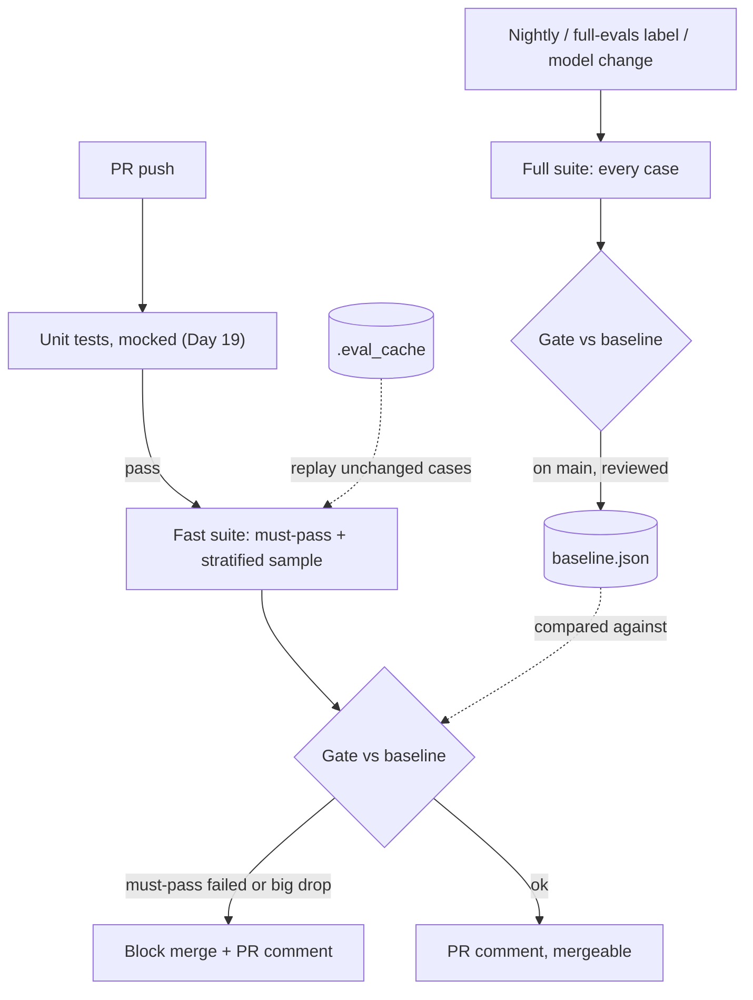
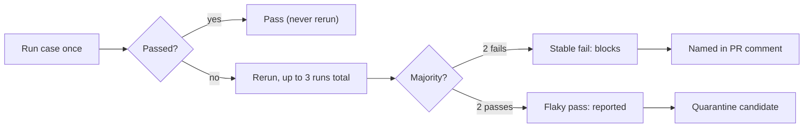
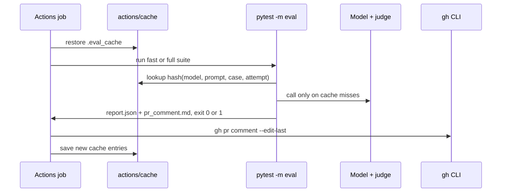

# Evals in CI: Regression Gates at Scale

The basic gate you added to R2 on Day 34 fails about one PR in five for no reason, so the team has learned to click "Re-run". Meanwhile, a prompt edit that dropped "answer only from the provided docs" sailed through, because none of its 20 cases needed that rule. (Illustrative, but common.) Today you build a gate people trust: fast where it can be, thorough where it must be, and specific when it says no.

## At a Glance

- **Time:** ~2 h core (+ optional Go Deeper) · **Depth:** working
- **Prerequisites:** [Day 19: Testing LLM Code](../../Phase_2_Building_with_LLM_APIs/Day_019_testing_llm_code/testing_llm_code.md), [Day 21: Prompts as Code & Model Migrations](../../Phase_2_Building_with_LLM_APIs/Day_021_prompts_as_code/prompts_as_code.md), [Day 34: Capstone R2](../../Phase_3_RAG/Day_034_capstone_r2_ask/capstone_r2_ask.md), [Day 43: Building Eval Datasets](../Day_043_eval_datasets/eval_datasets.md), [Day 45: LLM-as-Judge](../Day_045_llm_as_judge/llm_as_judge.md), [Day 46: Trusting Your Judge](../Day_046_judge_validation/judge_validation.md); primer [A09: pytest & CI](../../Appendix_Primers/A09_pytest_and_ci.md)
- **You'll build:** `tests/test_eval_gate.py` (the `atlas/evals/ci.py` functions, inlined) and `.github/workflows/evals.yml`: a gate that blocks a seeded R2 regression and comments the diff on the PR
- **Stops at:** building an eval platform
- **Fast path:** Already know CI test tiers and flaky-test quarantine? Read [Flake handling](#flake-handling-repeats-and-quarantine) and [Diffs people read](#diffs-people-read-the-pr-comment), then do Exercise 2 (~45 min).
- **Cost:** $0 offline (a deterministic fake model runs without `OPENAI_API_KEY`); live, a cold run is a few cents on `gpt-6-luna` and a warm rerun ≈ $0 (prices as of 2026-11, [verify](https://developers.openai.com/api/docs/pricing))
- **New terms:** fast vs full suite, flaky case, eval cache, baseline diff, must-pass case

> **Coming from Software Engineering?** You already run test tiers (unit per PR, end-to-end nightly), quarantine flaky tests, key build caches by a hash of their inputs (as Bazel or ccache do), and let coverage bots comment on PRs. Treat prompts and model IDs like infrastructure-as-code: config that changes only through a reviewed, tested pipeline. All of that transfers. The new part: every test run costs money and passes only with some probability, so you choose which runs to pay for and how many reruns it takes to believe a failure.

## Why the basic gate isn't enough

Day 34's gate runs about 20 fixed cases on every PR and fails if the pass rate drops. It has two problems that pull in opposite directions:

1. **Spurious failures.** Model outputs and judge verdicts vary between runs, so healthy cases sometimes fail. Enough of those, and nobody reads the red X.
2. **Missed regressions.** Twenty cases can't cover every rule in the prompt. If none is unanswerable, deleting the "say you don't know" rule is invisible.

A bigger suite fixes the second problem, worsens the first and costs more. You need a different design.

## A gate is a smoke alarm

An over-sensitive smoke alarm gets unplugged. You want one that rings only for real smoke and says which room. For a gate: don't fire on noise, never miss the fires you care most about, and name the case when you fire.

Check the noise problem in your head. Say each healthy case fails by chance 5% of the time, and any failure blocks. All 20 pass with probability 0.95²⁰ ≈ 0.36, so about 64% of good PRs see a red case.

```python
# script_id: day_047_evals_in_ci/flake_odds
# Stdlib only. Env: none. Services: none.
def p_spurious(n_cases: int, flake_rate: float) -> float:
    """Chance that at least one of n healthy, independent cases fails by bad luck."""
    return 1 - (1 - flake_rate) ** n_cases


for n in (1, 5, 20, 100):
    print(f"{n:>3} cases, each 5% flaky -> {p_spurious(n, 0.05):5.1%} of CI runs show a false failure")
```

```text
  1 cases, each 5% flaky ->  5.0% of CI runs show a false failure
  5 cases, each 5% flaky -> 22.6% of CI runs show a false failure
 20 cases, each 5% flaky -> 64.2% of CI runs show a false failure
100 cases, each 5% flaky -> 99.4% of CI runs show a false failure
```

"Re-run the whole job" is the wrong fix: it triples the bill and teaches the team to retry until green, which hides real failures too. Instead, rerun only the failing cases and let a majority decide.

## The parts of an eval gate

The parts, named as in the code:

- **Fast suite:** runs on every PR push: the **must-pass cases** (pinned because they protect a specific rule or a fixed bug; they always run and always block) plus a stratified sample of the rest.
- **Full suite:** every case; nightly on `main`, on a `full-evals` PR label, and on any model change.
- **Baseline:** main's scores in `baseline.json`, written only by `main`. The **baseline diff** puts the PR's scores next to it, per criterion and per case.
- **Flaky case:** its result changes on rerun with no code change. Reported, never blocking.
- **Eval cache:** model and judge outputs stored under a hash of their inputs, so an unchanged rerun costs $0.
- **Thresholds:** how big a drop blocks. The fast suite's is looser, because one case moves its score a lot.



Many teams run evals as a "warn but don't block" check. This gate blocks, and it earns that by being hard to fool and cheap to rerun.

## The smallest gate

The smallest useful gate is a pytest test that replays a recorded run (no API calls) and compares it to a baseline. Mark it `eval` so `pytest -m eval` selects it, as on [Day 19](../../Phase_2_Building_with_LLM_APIs/Day_019_testing_llm_code/testing_llm_code.md).

```python
# script_id: day_047_evals_in_ci/minimal_gate
# Install: uv add pytest · Env: none · Services: none. Replays a recorded run: no API calls, $0.
import sys

import pytest

RUN = {"qa-001": True, "qa-002": True, "qa-004": False, "qa-u01": True}  # stand-in for runs/ask_v1_fix.jsonl
BASELINE = {"pass_rate": 0.75, "max_drop": 0.05, "must_pass": ["qa-u01"]}  # stand-in for baseline.json


@pytest.mark.eval
def test_no_regression() -> None:
    broken = [c for c in BASELINE["must_pass"] if not RUN.get(c, False)]
    assert not broken, f"must-pass cases failed: {broken}"
    rate, floor = sum(RUN.values()) / len(RUN), BASELINE["pass_rate"] - BASELINE["max_drop"]
    assert rate >= floor, f"pass rate {rate:.2f} is below baseline {BASELINE['pass_rate']:.2f} - allowed drop"


if __name__ == "__main__":  # `-o markers=...` registers the marker; in a project, use pyproject.toml
    sys.exit(pytest.main([__file__, "-q", "-m", "eval", "-p", "no:cacheprovider", "-o", "markers=eval: model evals"]))
```

```text
.                                                                        [100%]
1 passed in 0.01s
```

Now break it: raise `"pass_rate"` to `0.90` (as if `main` improved) and rerun:

```text
E       AssertionError: pass rate 0.75 is below baseline 0.90 - allowed drop
E       assert 0.75 >= 0.85
FAILED minimal_gate.py::test_no_regression - AssertionError: pass rate 0.75 i...
```

Register the marker, or pytest warns `PytestUnknownMarkWarning: Unknown pytest.mark.eval - is this a typo?` on every run:

```toml
# pyproject.toml
[tool.pytest.ini_options]
markers = ["eval: model-backed eval suites (cost money; selected with -m eval)"]
```

Even this gate makes both decisions every real gate makes: some cases are absolute (must pass), and some scores are relative (no worse than main, minus a tolerance).

## The R2 gate harness

The real gate lives in `tests/test_eval_gate.py`; in your repo the reusable parts belong in `atlas/evals/ci.py`, inlined here so the lesson runs alone. The system under test is a compact **mini-R2** (a keyword index over `docs/*.md` plus `ask()`), standing in for your [Day 34](../../Phase_3_RAG/Day_034_capstone_r2_ask/capstone_r2_ask.md) R2. Point `predict()` at your real `ask()` when you copy it.

Without `OPENAI_API_KEY`, a deterministic fake model answers. It abstains when the docs don't cover a question (only if the prompt says to), and about 8% of its calls forget the citation, mimicking run-to-run variance. With a key, the real model and the [Day 45](../Day_045_llm_as_judge/llm_as_judge.md) judge run. The first block holds config and two prompt versions: `v1` and `v1-seeded`, today's deliberate regression.

```python
# script_id: day_047_evals_in_ci/test_eval_gate
# tests/test_eval_gate.py: Atlas R2's eval gate, with atlas/evals/ci.py inlined (self-contained lesson).
# Install: uv add "openai>=3.46,<4" pydantic pytest
# Env: OPENAI_API_KEY (unset: offline fake locally, cache-only replay in CI), ATLAS_MODEL, ATLAS_PROMPT,
#      EVAL_SUITE (fast|full), EVAL_OUT (where report/cache files go), ORBIT_DATA. Services: none.
# Run: pytest -m eval tests/test_eval_gate.py   or   python tests/test_eval_gate.py --help
from __future__ import annotations

import argparse, hashlib, json, os, random, re, sys, time
from dataclasses import asdict, dataclass, field
from pathlib import Path
from typing import Callable, Literal, Sequence

import pytest
from openai import OpenAI
from pydantic import BaseModel

MODEL = os.environ.get("ATLAS_MODEL", "gpt-6-luna")
JUDGE_MODEL = os.environ.get("ATLAS_JUDGE_MODEL", "gpt-6-luna")  # Day 45's judge model
PROMPT_VERSION = os.environ.get("ATLAS_PROMPT", "v1")
DATA_DIR = Path(os.environ.get("ORBIT_DATA", "datasets/orbit"))
OUT = Path(os.environ.get("EVAL_OUT", "."))      # baseline.json, report.json, pr_comment.md, .eval_cache/
RUBRIC_VERSION = "grounded-v2"                     # bump whenever Day 46 re-validates the judge
PRICE_IN, PRICE_OUT = 0.10 / 1e6, 0.50 / 1e6       # gpt-6-luna $/token (as of 2026-11, verify)
LIVE = bool(os.environ.get("OPENAI_API_KEY"))
CACHE_ONLY = not LIVE and bool(os.environ.get("CI"))  # fork PRs get no secrets: replay the cache only
client = OpenAI() if LIVE else None
ABSTAIN = "I don't know based on the Orbit docs."
PROMPTS = {  # compact stand-in for Day 21's registry; "v1-seeded" is today's deliberate regression
    "v1": "You are Atlas. Answer only from the provided docs. If they don't contain the answer, "
          f"reply exactly: {ABSTAIN} Cite doc ids in [brackets].",
    "v1-seeded": "You are Atlas. Answer the question helpfully. Cite doc ids in [brackets].",
}
COST = {"usd": 0.0}
LATENCIES: list[float] = []


def load_prompt(name: str, version: str) -> str:
    return PROMPTS[version]  # Day 21's load_prompt() reads prompts/<name>/<version>.txt instead
```

The dataset ships 30 QA gold cases sliced by `applies_to` (`2.x`, `3.x`, `all`); the lesson adds four unanswerable ones (Orbit has no Kafka, GraphQL or MongoDB). If you built [Day 43](../Day_043_eval_datasets/eval_datasets.md)'s 100-case `ask_v1.jsonl`, load that instead.

```python
# script_id: day_047_evals_in_ci/test_eval_gate
@dataclass(frozen=True)
class EvalCase:  # compact Day 43 EvalCase
    id: str
    question: str
    citations: tuple[str, ...]
    slice: str  # "2.x" | "3.x" | "all" | "unanswerable"


UNANSWERABLE = [  # stand-ins for Day 43's unanswerable slice: Orbit has no Kafka, GraphQL or MongoDB
    ("qa-u01", "How do I configure Orbit's Kafka broker?"),
    ("qa-u02", "What is the endpoint of Orbit's GraphQL API?"),
    ("qa-u03", "How do I store job results in MongoDB?"),
    ("qa-u04", "Which Kafka topic does Orbit use for the dead-letter queue?"),
]


def load_cases() -> list[EvalCase]:
    """Day 43's ask_v1.jsonl if you have it; here the shipped qa_gold.jsonl + 4 unanswerable cases."""
    rows = [json.loads(line) for line in (DATA_DIR / "eval/qa_gold.jsonl").open(encoding="utf-8")]
    cases = [EvalCase(r["id"], r["question"], tuple(r["citations"]), r["applies_to"]) for r in rows]
    return cases + [EvalCase(i, q, (), "unanswerable") for i, q in UNANSWERABLE]


WORD = re.compile(r"[a-z0-9_.-]{3,}")
STOP = set("the and what how does which when for with orbit use can should are from this that "
           "into why you after its there have has was not but will than then they".split())


def terms(text: str) -> set[str]:
    return {w.strip(".-") for w in WORD.findall(text.lower())} - STOP - {""}


class Index:  # keyword stand-in for Days 26-28's hybrid index: one chunk per "## " section
    def __init__(self, docs_dir: Path) -> None:
        self.chunks = [(p.stem, sec, terms(sec)) for p in sorted(docs_dir.glob("*.md"))
                       for sec in p.read_text(encoding="utf-8").split("\n## ") if sec.strip()]

    def search(self, query: str, k: int = 3) -> list[tuple[str, str]]:
        q = terms(query)
        ranked = sorted(self.chunks, key=lambda c: -len(q & c[2]))  # stable sort: ties keep file order
        return [(doc, text) for doc, text, _ in ranked[:k]]
```

Generators next; both add to `COST`.

```python
# script_id: day_047_evals_in_ci/test_eval_gate
def fake_llm(prompt: str, question: str, context: list[tuple[str, str]], attempt: int) -> str:
    """Offline stand-in for the model: deterministic, with the two behaviours this lesson needs."""
    q = terms(question)
    covered = len(q & set().union(*(terms(t) for _, t in context))) / max(len(q), 1)
    doc, text = context[0]
    best = max(re.split(r"(?<=[.!?])\s+", text), key=lambda s: len(q & terms(s)))
    best = re.sub(r"[\[\]`*#]", "", best).strip()  # drop markdown so a stray [x] isn't read as a citation
    if covered < 0.7:  # the docs don't really cover the question
        if "only from the provided docs" in prompt:
            return ABSTAIN
        return f"{best} Orbit also supports this through its plugin system. [{doc}]"  # invented claim
    if random.Random(f"{question}|{attempt}").random() < 0.08:
        return best  # ~8% of calls forget the citation, like a real model's run-to-run variance
    return f"{best} [{doc}]"


def generate(prompt: str, question: str, context: list[tuple[str, str]], attempt: int) -> str:
    if not LIVE:
        text = fake_llm(prompt, question, context, attempt)
        n_in, n_out = (len(prompt) + len(question) + sum(len(t) for _, t in context)) // 4, len(text) // 4
    else:
        docs = "\n\n".join(f"<doc id='{d}'>\n{t}\n</doc>" for d, t in context)
        resp = client.responses.create(model=MODEL, instructions=prompt, reasoning={"effort": "low"},
                                       input=f"{docs}\n\nQuestion: {question}")
        text, n_in, n_out = resp.output_text, resp.usage.input_tokens, resp.usage.output_tokens
    COST["usd"] += n_in * PRICE_IN + n_out * PRICE_OUT  # the fake's tokens are len/4 estimates
    return text
```

Checks keep Day 20's `case, prediction -> verdict` shape (a bool stands in for `CheckResult`). Two are [Day 44](../Day_044_error_analysis/error_analysis.md) code checks; `grounded` is the Day 45 judge (offline, a word-overlap stand-in). Only judges with a Day 46 "fit to gate" report may block. Verdicts are cached under the rubric version, so a rubric edit forces a fresh grade.

```python
# script_id: day_047_evals_in_ci/test_eval_gate
class Verdict(BaseModel):  # Day 45's binary verdict
    passed: bool
    reason: str


def grounded(case: EvalCase, gen: Gen) -> bool:
    """Day 45 judge (validated on Day 46) when live; offline, a word-overlap stand-in."""
    if gen.text.strip() == ABSTAIN:
        return True
    key = CACHE.key(kind="judge", model=JUDGE_MODEL, rubric=RUBRIC_VERSION, answer=gen.text, ctx=sha(gen.context))
    hit = CACHE.get(key) if (LIVE or CACHE_ONLY) else None
    if hit is None and not LIVE:  # offline (or unrecorded in CI): word-overlap stand-in, not a judge
        claims = terms(re.sub(r"\[[^\]]*\]", "", gen.text))
        return len(claims & terms(gen.context)) / max(len(claims), 1) >= 0.9
    if hit is None:
        r = client.responses.parse(
            model=JUDGE_MODEL, text_format=Verdict, reasoning={"effort": "none"}, temperature=0,
            instructions="Grade ONE criterion: is every claim in ANSWER supported by CONTEXT? "
                         "Return passed=false if any claim is missing from CONTEXT.",
            input=f"CONTEXT:\n{gen.context}\n\nANSWER:\n{gen.text}")
        COST["usd"] += r.usage.input_tokens * PRICE_IN + r.usage.output_tokens * PRICE_OUT
        hit = {"passed": bool(r.output_parsed and r.output_parsed.passed)}
        CACHE.put(key, hit)
    return hit["passed"]


def abstains_correctly(case: EvalCase, gen: Gen) -> bool:  # Day 44 code check
    return (gen.text.strip() == ABSTAIN) == (case.slice == "unanswerable")


def cites_real_doc(case: EvalCase, gen: Gen) -> bool:  # Day 44 code check
    cited = set(re.findall(r"\[([a-z0-9-]+)\]", gen.text))
    return gen.text.strip() == ABSTAIN or (bool(cited) and cited <= DOC_IDS)


CHECKS: dict[str, Callable[[EvalCase, Gen], bool]] = {
    "grounded": grounded, "abstains_correctly": abstains_correctly, "cites_real_doc": cites_real_doc}
```

The judge runs at effort `"none"` with `temperature=0` (on `gpt-6-luna`, sampling knobs need effort `"none"`). That reduces its variance but doesn't remove it, so you still need a flake policy.

## Flake handling: repeats and quarantine

The policy: run each case once. Passes are never rerun. A failure is rerun, up to k = 3 runs in total, and the majority decides. Failing twice is a **stable failure** and blocks. A case that changed its answer is **flaky**: it counts by majority, but the comment lists it separately so a human can quarantine it (it still runs and reports, but can't block; see Exercise 2).



Don't "fix" flakes by marking the eval job `continue-on-error: true`: that turns off the alarm for real fires too.

```python
# script_id: day_047_evals_in_ci/test_eval_gate
@dataclass
class CaseOutcome:
    case_id: str
    runs: list[bool]
    passed: bool
    flaky: bool
    criteria: dict[str, bool] = field(default_factory=dict)  # from the deciding (last) run
    evaluated: bool = True


def run_with_repeats(case: EvalCase, predict: Callable[[EvalCase, int], Gen | None],
                     checks: dict[str, Callable[[EvalCase, Gen], bool]], *, k: int = 3) -> CaseOutcome:
    runs: list[bool] = []
    last: dict[str, bool] = {}
    for attempt in range(k):
        gen = predict(case, attempt)
        if gen is None:  # cache-only mode and nothing recorded for this case
            return CaseOutcome(case.id, [], False, False, evaluated=False)
        last = {name: check(case, gen) for name, check in checks.items()}
        runs.append(all(last.values()))
        if runs[0] or max(runs.count(True), runs.count(False)) > k // 2:
            break  # passes are never rerun; failures rerun until a majority is reached
    return CaseOutcome(case.id, runs, runs.count(True) > runs.count(False), len(set(runs)) > 1, last)
```

Turn the knob. This simulates 1,000 CI jobs over 19 healthy cases (5% flaky) and one truly broken case:

```python
# script_id: day_047_evals_in_ci/flake_knob
# Stdlib only. Simulates 1,000 CI runs of a 20-case suite: 19 healthy cases that flake 5% of
# the time, plus 1 case that is truly broken. Compares k=1 (no reruns) with k=3 (rerun failures).
import random


def decide(healthy: bool, rng: random.Random, k: int, flake: float = 0.05) -> tuple[bool, bool]:
    """Rerun only failures, up to k runs in total; the majority decides. Returns (passed, flaky)."""
    runs = [healthy and rng.random() >= flake]
    while not runs[0] and len(runs) < k and max(runs.count(True), runs.count(False)) <= k // 2:
        runs.append(healthy and rng.random() >= flake)
    return runs.count(True) > runs.count(False), len(set(runs)) > 1


for k in (1, 3):
    rng = random.Random(7)
    false_blocks = caught = flaky = 0
    for _ in range(1000):
        healthy = [decide(True, rng, k) for _ in range(19)]
        false_blocks += any(not passed for passed, _ in healthy)
        caught += not decide(False, rng, k)[0]
        flaky += sum(f for _, f in healthy)
    print(f"k={k}: blocked by a healthy case in {false_blocks / 10:.1f}% of runs · "
          f"broken case caught {caught / 10:.0f}% · {flaky / 1000:.2f} flaky reports per run")
```

```text
k=1: blocked by a healthy case in 63.7% of runs · broken case caught 100% · 0.00 flaky reports per run
k=3: blocked by a healthy case in 8.1% of runs · broken case caught 100% · 0.92 flaky reports per run
```

Rerunning only failures cuts false blocks from about 64% to about 8%, still catches the broken case every time, and costs about 10% more calls instead of 3×. The remaining 8% comes from cases flaky enough to fail twice: fix or quarantine those.

## Controlling cost: caching and sampling

Two levers keep the bill down: the **eval cache** skips unchanged work, and **sampling** decides which cases run on a PR.

The cache is content-addressed: each entry is stored under a SHA-256 of every input that can change it. For a generation: model, prompt text, question, index version, `top_k` and attempt number. For a verdict: judge model, rubric version, answer and context. Leave one out and you get stale passes:

```python
# script_id: day_047_evals_in_ci/cache_key_knob
# Stdlib only. Env: none. Services: none. Why every input that changes the output belongs in the key.
import hashlib
import json


def key(**parts: object) -> str:
    return hashlib.sha256(json.dumps(parts, sort_keys=True).encode("utf-8")).hexdigest()[:12]


v1 = "Answer only from the provided docs. Cite the doc ID."
seeded = "Answer helpfully. Cite the doc ID."  # the grounding rule is gone
base = {"model": "gpt-6-luna", "question": "Does Orbit support Kafka?", "attempt": 0}

print("full key,   v1    :", key(**base, prompt=v1))
print("full key,   seeded:", key(**base, prompt=seeded), "<- miss: the edited prompt really runs")
print("no prompt,  v1    :", key(**base))
print("no prompt,  seeded:", key(**base), "<- hit: v1's old answer is replayed")
```

```text
full key,   v1    : d182422c6459
full key,   seeded: ce6142796f80 <- miss: the edited prompt really runs
no prompt,  v1    : fda5743e1216
no prompt,  seeded: fda5743e1216 <- hit: v1's old answer is replayed
```

The attempt number keeps reruns honest: attempt 1 is a fresh call, and a warm run replays the same three attempts. The harness's `EvalCache` adds disk storage and hit counts:

```python
# script_id: day_047_evals_in_ci/test_eval_gate
class EvalCache:
    """Content-addressed: each result is stored under a hash of every input that can change it."""

    def __init__(self, path: Path) -> None:
        self.path = path
        path.mkdir(parents=True, exist_ok=True)
        self.hits = self.misses = 0

    def key(self, **parts: object) -> str:
        blob = json.dumps(parts, sort_keys=True, ensure_ascii=False)  # sorted: same inputs, same key
        return hashlib.sha256(blob.encode("utf-8")).hexdigest()

    def get(self, key: str) -> dict | None:
        f = self.path / f"{key}.json"
        if f.exists():
            self.hits += 1
            return json.loads(f.read_text(encoding="utf-8"))
        self.misses += 1
        return None

    def put(self, key: str, value: dict) -> None:
        tmp = self.path / f"{key}.tmp"
        tmp.write_text(json.dumps(value), encoding="utf-8")
        tmp.replace(self.path / f"{key}.json")  # atomic rename: a killed job never leaves half a file


def sha(text: str) -> str:
    return hashlib.sha256(text.encode("utf-8")).hexdigest()[:16]
```

`predict()` wraps the mini-R2 `ask()` with the cache. In cache-only mode (CI without a key, as on fork PRs), a miss returns `None`: reported as "not evaluated", never guessed.

```python
# script_id: day_047_evals_in_ci/test_eval_gate
INDEX = Index(DATA_DIR / "docs")
CACHE = EvalCache(OUT / ".eval_cache")
DOC_IDS = {p.stem for p in (DATA_DIR / "docs").glob("*.md")}
INDEX_VERSION = sha("".join(text for _, text, _ in INDEX.chunks))  # re-chunk or edit docs: new keys


@dataclass
class Gen:  # one generation, exactly what the cache stores
    text: str
    context: str
    latency_ms: float


def predict(case: EvalCase, attempt: int) -> Gen | None:
    """Mini-R2 ask() behind the cache. Each attempt has its own key, so reruns are real reruns."""
    prompt = load_prompt("ask", PROMPT_VERSION)
    key = CACHE.key(kind="ask", model=MODEL, prompt=sha(prompt), question=case.question,
                    index=INDEX_VERSION, top_k=3, attempt=attempt)
    if (hit := CACHE.get(key)) is None:
        if CACHE_ONLY:
            return None  # no key and nothing recorded: report "not evaluated", never guess
        context = INDEX.search(case.question)
        t0 = time.perf_counter()
        text = generate(prompt, case.question, context, attempt)
        ms = (time.perf_counter() - t0) * 1000 if LIVE else 400 + len(text) * 2  # fake latency model
        hit = asdict(Gen(text, "\n\n".join(t for _, t in context), round(ms, 1)))
        CACHE.put(key, hit)
    LATENCIES.append(hit["latency_ms"])
    return Gen(**hit)
```

The fast suite holds the must-pass cases plus a **stratified** sample: a proportional share of each slice, at least one per slice, so no version disappears by chance. The fixed seed means every push to a PR sees the same cases.

```python
# script_id: day_047_evals_in_ci/test_eval_gate
def select_suite(cases: Sequence[EvalCase], suite: Literal["fast", "full"], *, n: int = 20,
                 seed: int = 42, must_pass: Sequence[str] = ()) -> list[EvalCase]:
    """Full = everything. Fast = must-pass cases + a stratified, seeded sample of the rest."""
    if suite == "full":
        return list(cases)
    pinned = [c for c in cases if c.id in must_pass]
    rest = [c for c in cases if c.id not in must_pass]
    slices: dict[str, list[EvalCase]] = {}
    for c in rest:
        slices.setdefault(c.slice, []).append(c)
    rng, budget, picked = random.Random(seed), max(n - len(pinned), 0), []
    for name in sorted(slices):  # proportional share per slice, at least one each
        group = slices[name]
        share = max(1, round(budget * len(group) / len(rest)))
        picked += rng.sample(group, min(share, len(group)))
    return pinned + picked
```

Turn the knob: how often does a plain random sample skip a whole slice?

```python
# script_id: day_047_evals_in_ci/sample_knob
# Stdlib only. Env: none. Services: none. Slice sizes match today's 34 cases.
import random

SLICES = {"2.x": 3, "3.x": 14, "all": 13, "unanswerable": 4}
CASES = [(name, i) for name, size in SLICES.items() for i in range(size)]


def stratified(rng: random.Random, n: int) -> list[tuple[str, int]]:
    picked = []
    for name, size in SLICES.items():  # proportional share, at least one per slice
        group = [c for c in CASES if c[0] == name]
        picked += rng.sample(group, max(1, round(n * size / len(CASES))))
    return picked


for label, pick in (("random", lambda r: r.sample(CASES, 12)), ("stratified", lambda r: stratified(r, 12))):
    rng = random.Random(0)
    missed = sum(all(s != "unanswerable" for s, _ in pick(rng)) for _ in range(10_000))
    print(f"{label:>10}: {missed / 100:4.1f}% of 12-case samples contain no unanswerable case")
```

```text
    random: 15.3% of 12-case samples contain no unanswerable case
stratified:  0.0% of 12-case samples contain no unanswerable case
```

Stratifying guarantees each slice shows up; pinning must-pass cases guarantees *which* cases do.

Offline numbers from the fake (generation only; tokens ≈ characters / 4). Your numbers will differ, and live runs add a judge call per answer:

| Run | Cases | Cache | Cost |
|---|---|---|---|
| Full suite, cold (writes `baseline.json`) | 34 | 0 hits | $0.0059 |
| Fast suite right after it, warm | 12 | all hits | $0.0000 |
| Fast suite after a prompt edit, cold again | 12 | 0 hits | $0.0032 |

## Diffs people read: the PR comment

A red X saying "eval failed" gets re-run. A comment saying "`qa-u01` and `qa-u02` stopped abstaining" gets fixed. The PR comment is the gate's real UI, built from a report. It shows scores per criterion, cost, and **p95 latency** (the time 95% of calls beat; the slowest 5% are worse).

`run_suite()` returns an `EvalReport` (saved as `report.json`); a full run on `main`, saved as `baseline.json`, is the same type.

```python
# script_id: day_047_evals_in_ci/test_eval_gate
@dataclass
class EvalReport:
    suite: str
    model: str
    prompt_version: str
    per_criterion: dict[str, float]
    outcomes: list[CaseOutcome]
    cost_usd: float
    p95_ms: float

    def save(self, path: Path) -> None:
        path.write_text(json.dumps(asdict(self), indent=1), encoding="utf-8")

    @classmethod
    def load(cls, path: Path) -> EvalReport:
        d = json.loads(path.read_text(encoding="utf-8"))
        return cls(**{**d, "outcomes": [CaseOutcome(**o) for o in d["outcomes"]]})


def scores(outcomes: Sequence[CaseOutcome], names: Sequence[str]) -> dict[str, float]:
    done = [o for o in outcomes if o.evaluated]
    return {n: round(sum(o.criteria[n] for o in done) / max(len(done), 1), 3) for n in names}


def run_suite(cases: Sequence[EvalCase], *, suite: str, k: int = 3) -> EvalReport:
    cost0 = COST["usd"]
    LATENCIES.clear()
    CACHE.hits = CACHE.misses = 0  # the PR comment reports this run's hit rate
    outcomes = [run_with_repeats(c, predict, CHECKS, k=k) for c in cases]
    lat = sorted(LATENCIES) or [0.0]
    return EvalReport(suite, MODEL, PROMPT_VERSION, scores(outcomes, list(CHECKS)), outcomes,
                      round(COST["usd"] - cost0, 5), lat[int(0.95 * (len(lat) - 1))])
```

`diff_reports()` compares like with like: main's scores are recomputed over the cases the PR ran. `gate()` turns the diff into reasons to block; an empty list passes.

```python
# script_id: day_047_evals_in_ci/test_eval_gate
@dataclass
class ReportDiff:
    base: EvalReport
    cur: EvalReport
    rows: list[tuple[str, float, float]]  # criterion, main, PR (main re-scored on the PR's cases)
    newly_failing: list[str]
    flaky: list[str]
    not_evaluated: list[str]


def diff_reports(baseline: EvalReport, current: EvalReport) -> ReportDiff:
    ids = {o.case_id for o in current.outcomes if o.evaluated}
    base_same = [o for o in baseline.outcomes if o.case_id in ids]  # compare like with like
    names = [n for n in current.per_criterion if n in baseline.per_criterion]  # new criteria wait for main
    base_scores = scores(base_same, names)
    was_ok = {o.case_id for o in base_same if o.passed}
    return ReportDiff(
        baseline, current,
        [(n, base_scores[n], current.per_criterion[n]) for n in names],
        [o.case_id for o in current.outcomes if o.evaluated and not o.passed and o.case_id in was_ok],
        [o.case_id for o in current.outcomes if o.flaky],
        [o.case_id for o in current.outcomes if not o.evaluated])


def gate(diff: ReportDiff, *, max_drop: float, must_pass: Sequence[str]) -> list[str]:
    """Reasons to block; an empty list means the gate passes."""
    failed = {o.case_id for o in diff.cur.outcomes if o.evaluated and not o.passed}
    reasons = []
    if bad := sorted(failed & set(must_pass)):
        reasons.append(f"{len(bad)} must-pass case(s) failed ({', '.join(bad)})")
    reasons += [f"{n} {b:.2f} -> {v:.2f} (allowed drop {max_drop:.2f})"
                for n, b, v in diff.rows if b - v > max_drop]
    return reasons
```

`render_pr_comment()` writes Markdown, and `evaluate()` picks the threshold. At n = 12 one case moves a score about 8 points, so the fast suite blocks on must-pass failures and large drops only.

```python
# script_id: day_047_evals_in_ci/test_eval_gate
def render_pr_comment(diff: ReportDiff, reasons: Sequence[str] = ()) -> str:
    c, b = diff.cur, diff.base
    out = [f"### Atlas eval gate: {'BLOCKED' if reasons else 'passed'}",
           f"`{c.suite}` suite, {len(c.outcomes)} cases ({len(MUST_PASS)} must-pass) · model `{c.model}` "
           f"(main `{b.model}`) · prompt `{c.prompt_version}` (main `{b.prompt_version}`)", "",
           "| criterion | main | PR | change |", "|---|---|---|---|"]
    out += [f"| {n} | {bv:.2f} | {v:.2f} | {v - bv:+.2f} |" for n, bv, v in diff.rows]
    out += ["", *[f"- **Blocking:** {r}" for r in reasons],
            f"- Newly failing: {', '.join(diff.newly_failing) or 'none'}",
            f"- Flaky (decided by rerun; reported, not blocking): {', '.join(diff.flaky) or 'none'}",
            f"- Cost ${c.cost_usd:.4f} (cache {CACHE.hits} hits / {CACHE.misses} misses) · "
            f"p95 {c.p95_ms:.0f} ms (main {b.p95_ms:.0f} ms)"]
    if diff.not_evaluated:
        out.append(f"- Not evaluated (no API key, nothing cached): {len(diff.not_evaluated)} cases")
    return "\n".join(out) + "\n"


MUST_PASS = ("qa-u01", "qa-u02")  # abstention cases the grounding rule exists for
FAST_N = int(os.environ.get("EVAL_FAST_N", "12"))  # use 20 with Day 43's 100-case set


def evaluate(suite: Literal["fast", "full"]) -> tuple[EvalReport, list[str]]:
    cases = select_suite(load_cases(), suite, n=FAST_N, must_pass=MUST_PASS)
    report = run_suite(cases, suite=suite)
    report.save(OUT / "report.json")
    diff = diff_reports(EvalReport.load(OUT / "baseline.json"), report)
    reasons = gate(diff, max_drop=0.15 if suite == "fast" else 0.05, must_pass=MUST_PASS)
    (OUT / "pr_comment.md").write_text(render_pr_comment(diff, reasons), encoding="utf-8")
    return report, reasons
```

Last, the pytest entry point CI calls, plus a CLI for local runs, baselines and migrations:

```python
# script_id: day_047_evals_in_ci/test_eval_gate
@pytest.mark.eval
def test_r2_gate() -> None:
    if not (OUT / "baseline.json").exists():
        pytest.skip("no baseline.json: run `python tests/test_eval_gate.py --write-baseline` on main")
    _, reasons = evaluate(os.environ.get("EVAL_SUITE", "fast"))
    assert not reasons, "gate failed: " + "; ".join(reasons)


def write_baseline() -> None:
    if os.environ.get("GITHUB_REF", "refs/heads/main") != "refs/heads/main":
        sys.exit("refusing to write baseline.json outside main")  # a PR must never move its own goalposts
    report = run_suite(load_cases(), suite="full")
    report.save(OUT / "baseline.json")
    print(f"baseline.json: {report.per_criterion} · ${report.cost_usd:.4f} · {len(report.outcomes)} cases")


if __name__ == "__main__":
    ap = argparse.ArgumentParser(description="Atlas R2 eval gate")
    ap.add_argument("--suite", choices=["fast", "full"], default=os.environ.get("EVAL_SUITE", "fast"))
    ap.add_argument("--write-baseline", action="store_true", help="main only: full run -> baseline.json")
    args = ap.parse_args()
    if args.write_baseline or not (OUT / "baseline.json").exists():
        write_baseline()
    _, reasons = evaluate(args.suite)
    print((OUT / "pr_comment.md").read_text(encoding="utf-8"))
    sys.exit(1 if reasons else 0)
```

Run it offline. With no baseline yet, the script writes one from a full run, then gates the fast suite:

```bash
python tests/test_eval_gate.py
```

```text
baseline.json: {'grounded': 1.0, 'abstains_correctly': 0.882, 'cites_real_doc': 0.971} · $0.0059 · 34 cases
### Atlas eval gate: passed
`fast` suite, 12 cases (2 must-pass) · model `gpt-6-luna` (main `gpt-6-luna`) · prompt `v1` (main `v1`)

| criterion | main | PR | change |
|---|---|---|---|
| grounded | 1.00 | 1.00 | +0.00 |
| abstains_correctly | 0.83 | 0.83 | +0.00 |
| cites_real_doc | 1.00 | 1.00 | +0.00 |

- Newly failing: none
- Flaky (decided by rerun; reported, not blocking): qa-011, qa-010
- Cost $0.0000 (cache 18 hits / 0 misses) · p95 1432 ms (main 1432 ms)
```

The two flaky cases are the fake's forgotten citations: each failed once, then passed twice. The fast run cost $0 because the baseline run had cached every attempt.

### The workflow

Fast suite on every PR push; full suite nightly, on the `full-evals` label and on manual migration runs. Action versions are current as of 2026-11; pin `setup-uv` to a full version (see Common Pitfalls).

```yaml
# .github/workflows/evals.yml
name: evals
on:
  pull_request:
    types: [opened, synchronize, reopened, labeled]
  schedule:
    - cron: "17 3 * * *"          # nightly full suite on main
  workflow_dispatch:
    inputs:
      model:
        description: "Candidate model id (runs the full suite against main's baseline)"
        type: string
        default: gpt-6-luna

permissions:
  contents: read
  pull-requests: write            # gh pr comment needs this

concurrency:
  group: evals-${{ github.ref }}
  cancel-in-progress: true        # a new push cancels the old, half-paid run

jobs:
  evals:
    runs-on: ubuntu-latest
    timeout-minutes: 20
    env:
      OPENAI_API_KEY: ${{ secrets.OPENAI_API_KEY }}   # empty on fork PRs -> cache-only mode
      ATLAS_MODEL: ${{ inputs.model || 'gpt-6-luna' }}
      EVAL_SUITE: ${{ (github.event_name == 'pull_request' && !contains(github.event.pull_request.labels.*.name, 'full-evals')) && 'fast' || 'full' }}
      EVAL_OUT: evals
      ORBIT_DATA: datasets/orbit
    steps:
      - uses: actions/checkout@v7
      - uses: astral-sh/setup-uv@v10.3.3
        with:
          enable-cache: true
      - uses: actions/cache@v6
        with:
          path: evals/.eval_cache
          key: eval-cache-${{ github.run_id }}   # unique, so every run saves its new entries
          restore-keys: eval-cache-               # restore the most recent cache
      - run: uv sync --locked --dev
      - name: Eval gate
        run: uv run pytest -m eval tests/test_eval_gate.py
      - name: Job summary
        if: always()
        run: if [ -f evals/pr_comment.md ]; then cat evals/pr_comment.md >> "$GITHUB_STEP_SUMMARY"; fi
      - name: PR comment
        if: always() && github.event_name == 'pull_request' && github.event.pull_request.head.repo.full_name == github.repository
        env:
          GH_TOKEN: ${{ github.token }}
        run: |
          if [ -f evals/pr_comment.md ]; then
            gh pr comment "${{ github.event.pull_request.number }}" --body-file evals/pr_comment.md --edit-last --create-if-none
          fi
```

Make `evals` a required status check in branch protection so it blocks. `--edit-last --create-if-none` keeps one comment per PR. `baseline.json` is committed under `evals/` and changes only through a reviewed PR from a `main` run.



## Catching the seeded regression

Now play the bad PR: `v1-seeded` drops the grounding rule, a "harmless cleanup" that reads better.

```bash
ATLAS_PROMPT=v1-seeded python tests/test_eval_gate.py
```

```text
### Atlas eval gate: BLOCKED
`fast` suite, 12 cases (2 must-pass) · model `gpt-6-luna` (main `gpt-6-luna`) · prompt `v1-seeded` (main `v1`)

| criterion | main | PR | change |
|---|---|---|---|
| grounded | 1.00 | 0.92 | -0.08 |
| abstains_correctly | 0.83 | 0.75 | -0.08 |
| cites_real_doc | 1.00 | 1.00 | +0.00 |

- **Blocking:** 2 must-pass case(s) failed (qa-u01, qa-u02)
- Newly failing: qa-u01, qa-u02
- Flaky (decided by rerun; reported, not blocking): qa-011, qa-010
- Cost $0.0032 (cache 0 hits / 19 misses) · p95 4742 ms (main 1432 ms)
```

Scores moved only 0.08, under the fast threshold; a random 12-case sample with no unanswerable question would have passed. The must-pass cases caught it, by name. On the full suite, the grounded drop blocks too:

```bash
ATLAS_PROMPT=v1-seeded python tests/test_eval_gate.py --suite full
```

```text
### Atlas eval gate: BLOCKED
`full` suite, 34 cases (2 must-pass) · model `gpt-6-luna` (main `gpt-6-luna`) · prompt `v1-seeded` (main `v1`)

| criterion | main | PR | change |
|---|---|---|---|
| grounded | 1.00 | 0.88 | -0.12 |
| abstains_correctly | 0.88 | 0.88 | +0.00 |
| cites_real_doc | 0.97 | 0.97 | +0.00 |

- **Blocking:** 2 must-pass case(s) failed (qa-u01, qa-u02)
- **Blocking:** grounded 1.00 -> 0.88 (allowed drop 0.05)
- Newly failing: qa-u01, qa-u02, qa-u04
- Flaky (decided by rerun; reported, not blocking): qa-010, qa-011, qa-013
- Cost $0.0035 (cache 19 hits / 28 misses) · p95 1722 ms (main 1432 ms)
```

Note `abstains_correctly` at +0.00 in the full run: the seeded prompt fixed three false abstentions and broke three correct ones. The average hides both; "newly failing" and must-pass expose them.

Under pytest, as CI runs it, the failure reads `AssertionError: gate failed: 2 must-pass case(s) failed (qa-u01, qa-u02)`.

## Gating a model migration

A model change is a code change, so it takes the same gate on the full suite. [Day 21](../../Phase_2_Building_with_LLM_APIs/Day_021_prompts_as_code/prompts_as_code.md) owns the migration drill and [Day 87](../../Phase_9_Production/Day_087_shipping_changes_safely/shipping_changes_safely.md) the at-scale playbook; here you only wire it in:

1. **Actions → evals → Run workflow** with `gpt-6.1-terra` (locally: `ATLAS_MODEL=gpt-6.1-terra python tests/test_eval_gate.py --suite full`).
2. The model ID is in every cache key, so everything runs cold: the one run you expect to pay full price for.
3. The diff compares against main's `gpt-6-luna` baseline. Must-pass failures or drops over 0.05 block; otherwise a human weighs cost and p95 (Terra lists at 10× Luna's prices as of 2026-11, [verify](https://developers.openai.com/api/docs/pricing)) and approves.
4. After merge, the nightly `main` run produces the new baseline.

Offline, the fake ignores the model, so the diff is flat.

## Trade-offs: what should block

| Signal | Blocks the PR? | Why |
|---|---|---|
| A must-pass case fails (stable, by majority) | Yes | It protects a specific rule or a past bug |
| Full suite: a criterion drops more than 0.05 | Yes | At about 100 cases, that's several cases, not noise |
| Fast suite: a drop of 0.15 or more | Yes | Large enough to be real even at n = 12–20 |
| Fast suite: a small drop | Warn | One case is about 5–8 points; check the full suite |
| A flaky case | Warn, quarantine candidate | Blocking on coin flips trains people to ignore the gate |
| A judge without a Day 46 "fit to gate" report | Warn only | An unvalidated grader can't veto a merge |

Set thresholds with [Day 43](../Day_043_eval_datasets/eval_datasets.md)'s small-sample rule (a few points on a small set is noise), and skip the job for changes that can't affect the model (docs, CI config) with a `paths:` filter.

### In production

- Fork PRs get no secrets and a read-only `GITHUB_TOKEN` (the per-run credential Actions provides): run cache-only, say so, and let a maintainer add `full-evals` after reviewing the code.
- Never combine `pull_request_target` (which runs with your repo's secrets) with a checkout of the PR's code: that hands secrets to untrusted code.
- Put a spend cap on the eval API key (a separate project or key with its own budget), and set `timeout-minutes` on the job.
- Write `baseline.json` only from `main`. A PR that rewrites its own baseline always passes.
- Append each nightly summary to `trend.jsonl`, so slow drift shows even when no PR crossed a threshold. Online evals come on [Day 86](../../Phase_9_Production/Day_086_monitoring_feedback/monitoring_feedback.md).

## Go Deeper (optional)

<details><summary>Go deeper: the flake math behind "rerun failures, majority of 3"</summary>

In words: a healthy case is blocked only if its first run fails *and* at least one of its reruns also fails.

With toy numbers, take a 5% flake rate. The first run fails with probability 0.05. The chance that both reruns pass is 0.95² = 0.9025, so the chance that at least one rerun fails is 0.0975. A healthy case therefore blocks with probability 0.05 × 0.0975 ≈ 0.49%. Across 19 healthy cases, that's 1 − (1 − 0.0049)¹⁹ ≈ 8.9% of runs, which matches the simulation's 8.1% within sampling noise.

As a formula, with flake rate f:

- Rerun only on failure: P(stable fail) = f · (1 − (1 − f)²). Expected runs per case = 1 + f + f(1 − f) ≈ 1.10 at f = 5%.
- Always run 3 and vote: P(stable fail) = 3f²(1 − f) + f³. That's about 0.73% at f = 5% and 2.8% at f = 10%, and it always costs 3 runs.

Always-3 is fairer to an unlucky first pass, but it costs nearly 3× as much. Rerun-on-failure gets most of the benefit for about 10% extra calls. Neither policy helps a case that is broken half the time. That case is a bug in your prompt or your judge, so fix it, or quarantine it while you fix it.

</details>

<details><summary>Go deeper: telling a judge flake from a generator flake</summary>

When a case is flaky, ask which part is noisy. The cache makes this cheap. Re-grade the *same* cached answer several times. If the verdict flips, the judge is the noise, so tighten its rubric and re-validate it ([Day 46](../Day_046_judge_validation/judge_validation.md)). If the verdict is stable but different attempts got different verdicts, the generator is the noise, so look at the prompt or lower its effort.

```python
# script_id: day_047_evals_in_ci/judge_flake_probe
# fragment: add to tests/test_eval_gate.py; needs OPENAI_API_KEY (bypasses the judge cache on purpose)
def judge_flips(case: EvalCase, attempt: int = 0, n: int = 5) -> tuple[int, int]:
    """Re-grade one cached answer n times. Returns (passes, fails) for the same answer."""
    gen = predict(case, attempt)          # cached generation: the answer does not change
    verdicts = []
    for _ in range(n):
        r = client.responses.parse(model=JUDGE_MODEL, text_format=Verdict,
                                   reasoning={"effort": "none"}, temperature=0,
                                   instructions="Grade ONE criterion: is every claim in ANSWER "
                                                "supported by CONTEXT?",
                                   input=f"CONTEXT:\n{gen.context}\n\nANSWER:\n{gen.text}")
        verdicts.append(bool(r.output_parsed and r.output_parsed.passed))
    return verdicts.count(True), verdicts.count(False)
```

A result like `(3, 2)` on an unchanged answer means the judge can't gate this case yet.

</details>

<details><summary>Go deeper: Promptfoo as the harness</summary>

[Promptfoo](https://github.com/promptfoo/promptfoo) is an open-source (MIT) eval and red-team CLI. It's now part of OpenAI, and it's the migration path OpenAI points to now that its hosted Evals platform has shut down (read-only since 2026-10-31, closed 2026-11-30). It's a **Node** tool, not Python: it needs Node ≥ 22.22.0, and you run it with `npx promptfoo@latest`. The commands that matter for CI:

- `promptfoo eval -c promptfooconfig.yaml [--repeat N] [--no-cache] [-o out.json|junit.xml]` exits with code **100** when any test fails, so it works as a gate step as-is. You can change the exit code with `PROMPTFOO_FAILED_TEST_EXIT_CODE`.
- `promptfoo validate config -c FILE` checks the YAML before you spend money.
- The provider ID for the Responses API is `openai:responses:<model>`, and assertion types include `icontains` and `llm-rubric`.

When to choose it: when your team wants a declarative YAML suite, a viewer (`promptfoo view`) and red-team plugins (used on [Day 75](../../Phase_8_Safety_and_Security/Day_075_red_teaming_ci/red_teaming_ci.md)) more than it wants Python. You still own the case selection, the must-pass list, the baseline diff and the policy for what blocks; that is the part of today's lesson that transfers. Calling your own Python `ask()` from Promptfoo uses its Python provider (⚠ verify the current provider config in Promptfoo's docs before you rely on it).

</details>

<details><summary>Go deeper: when the full suite gets slow or expensive</summary>

- **Shard it.** A GitHub Actions `strategy.matrix` with `shard: [0, 1, 2, 3]` runs four jobs in parallel. Each job keeps the cases where `index % 4 == shard`, and a final job merges the four `report.json` files before diffing. Wall time drops; the bill doesn't.
- **Batch it.** The nightly full suite isn't latency-sensitive, so it's a good fit for the Batch API. Batch and Flex are priced at 50% of Standard (as of 2026-11, [verify](https://developers.openai.com/api/docs/pricing)). See [Day 18](../../Phase_2_Building_with_LLM_APIs/Day_018_cost_latency_caching/cost_latency_caching.md).
- **Prune the cache.** Content-addressed entries are never invalidated; they become unreachable. Delete entries nobody has read in 30 days, or let `actions/cache` eviction do it.
- **Escalate judges.** Grade with the cheap judge, and send only borderline or disputed verdicts to `gpt-6.1-terra` (Day 45's `tiered_judge()`).
- **Back off on 429s.** Large suites hit rate limits; [Day 84](../../Phase_9_Production/Day_084_reliability_fallbacks/reliability_fallbacks.md) owns backoff. The SDK already retries 2× by default.

</details>

## Common Pitfalls

- **Rerunning the whole suite to beat flakes:** 3× cost, and real failures get retried away. Rerun only failing cases; report flaky ones separately.
- **Cache key without prompt text or rubric version:** a prompt edit "passes" on 100% cache hits, and the seeded regression slips through. Hash every input that affects output.
- **Fork PRs crash on the missing key:** `openai.OpenAIError: Missing credentials. Please pass an `api_key`, `workload_identity`, `admin_api_key`, or set the `OPENAI_API_KEY` or `OPENAI_ADMIN_KEY` environment variable.` Fork PRs get no secrets: build the client only when the key is set, run cache-only, and say "not evaluated".
- **`gh pr comment` fails with HTTP 403** (GitHub reports "Resource not accessible by integration"; ⚠ verify the exact text): add `permissions: pull-requests: write`; on fork PRs the token is read-only, so skip the comment and use the job summary.
- **Full-suite thresholds on the fast suite:** at n = 12 one case is ~8 points, so 0.05 blocks on noise. Gate fast on must-pass and large drops.
- **`astral-sh/setup-uv@v10` fails to resolve:** no floating major tags from v8 on. Pin `@v10.3.3` or its README's SHA.

> **Where we stop:** this is a gate, not an eval platform. Dashboards, statistical significance tests and production A/B tests are out of scope; eval-gated releases and A/B tests are [Day 87](../../Phase_9_Production/Day_087_shipping_changes_safely/shipping_changes_safely.md).

## Key Takeaways

- A gate that blocks on noise gets ignored: at 5% flake, 20 cases show a false red 64% of the time; rerunning only failures (majority of 3) cuts that to ~8% for ~10% more calls.
- Split the eval into a fast suite per PR (must-pass cases plus a seeded, stratified sample) and a full suite (nightly, on a label, on model changes); must-pass cases catch what a sample misses.
- A content-addressed cache keyed on every input makes warm reruns ≈ $0. Leave one input out, and a prompt edit replays stale passes.
- The PR comment is the gate's UI: per-criterion main vs PR on the same cases, newly failing IDs, flaky cases, $ and p95, because averages hide changes that cancel out.
- Model migrations run the full suite against main's baseline. Only `main` writes the baseline, fork PRs run cache-only, and `pull_request_target` never runs PR code with secrets.

## Quick Reference

| API / pattern | When to use | Gotcha |
|---|---|---|
| `select_suite(cases, "fast", n=20, seed=42, must_pass=...)` | Every PR push | Fixed seed, or diffs between pushes compare different cases |
| `run_with_repeats(case, predict, checks, k=3)` | Any LLM-graded case | Never rerun passes; report `flaky`, don't block on it |
| `EvalCache.key(**parts)` | Generator and judge outputs | Include model, prompt hash, rubric version, index version, attempt |
| `diff_reports(baseline, current)` | Before gating | Re-score main on the PR's cases (like with like) |
| `gate(diff, max_drop=..., must_pass=...)` | Deciding to block | Looser `max_drop` on the fast suite |
| `gh pr comment N --body-file f --edit-last --create-if-none` | Posting the diff | Needs `pull-requests: write`; fork PRs get a read-only token |
| `actions/cache@v6` with a unique `key` + `restore-keys` | Persisting `.eval_cache` | Caches are immutable, so a fixed key never saves new entries |
| `workflow_dispatch` input `model` | Model migrations | Cold run: the model ID is in every key |
| Unit tests → fast suite; e2e nightly → full suite | Planning tiers (SWE mapping) | LLM runs cost money and are probabilistic |
| Flaky quarantine → `quarantine.txt`; coverage bot → PR comment | Team workflow (SWE mapping) | Quarantine still runs and reports; must-pass cases are never quarantined |

## Exercises

1. **Warm-up: pin a version case.** Add [Day 44](../Day_044_error_analysis/error_analysis.md)'s version check as a criterion, and pin `qa-001` (a 3.x question about lease defaults) as a third must-pass case. Run the gate and find both changes in `pr_comment.md`.

<details><summary>Solution</summary>

```python
# script_id: day_047_evals_in_ci/solution_ex1
# fragment: add after CHECKS / MUST_PASS in tests/test_eval_gate.py
def version_matches(case: EvalCase, gen: Gen) -> bool:  # compact Day 44 check
    cited = set(re.findall(r"\[([a-z0-9-]+)\]", gen.text))
    return not (case.slice == "3.x" and "environment-variables-2x" in cited)  # 2.x-only page


CHECKS["version_matches"] = version_matches
MUST_PASS = ("qa-u01", "qa-u02", "qa-001")  # qa-001: 3.x lease defaults
```

The header now says `(3 must-pass)`, and `qa-001` runs on every push. The `version_matches` row stays out of the table until main's baseline has the criterion, because `diff_reports()` skips criteria that main hasn't scored. Run `python tests/test_eval_gate.py --write-baseline` on `main`, and the row appears.

</details>

2. **Core: quarantine.** Cases listed in `quarantine.txt` (one ID per line, `#` comments allowed) still run and appear in the comment, but they can never block. Must-pass cases ignore quarantine.

<details><summary>Solution</summary>

```python
# script_id: day_047_evals_in_ci/solution_ex2
# fragment: replaces gate() in tests/test_eval_gate.py
from dataclasses import replace


def quarantined() -> set[str]:
    f = OUT / "quarantine.txt"
    lines = f.read_text(encoding="utf-8").splitlines() if f.exists() else []
    return {ln.split("#")[0].strip() for ln in lines} - {""}


def gate(diff: ReportDiff, *, max_drop: float, must_pass: Sequence[str]) -> list[str]:
    q = quarantined() - set(must_pass)  # a flaky must-pass case needs a fix, not a hiding place
    keep = [o for o in diff.cur.outcomes if o.case_id not in q]
    cur = replace(diff.cur, outcomes=keep, per_criterion=scores(keep, list(diff.cur.per_criterion)))
    d = diff_reports(diff.base, cur)  # quarantined cases ran and are reported, but can't move a score
    bad = sorted(o.case_id for o in keep if o.case_id in must_pass and o.evaluated and not o.passed)
    reasons = [f"{len(bad)} must-pass case(s) failed ({', '.join(bad)})"] if bad else []
    reasons += [f"{n} {b:.2f} -> {v:.2f} (allowed drop {max_drop:.2f})"
                for n, b, v in d.rows if b - v > max_drop]
    return reasons
```

In `render_pr_comment()`, add `f"- Quarantined (ran, cannot block): {', '.join(sorted(quarantined())) or 'none'}"`. Put `qa-010` in `quarantine.txt`: it still runs and shows up as flaky, but it can't change a blocking score.

</details>

3. **Core: what the cache saves, and what invalidates it.** Measure the fast suite cold vs warm, then change the prompt, then change the model. Count the new cache entries each time.

<details><summary>Solution</summary>

```python
# script_id: day_047_evals_in_ci/solution_ex3
# Stdlib only. Runs tests/test_eval_gate.py (argv[1], default: next to this file) in a temp EVAL_OUT.
# Env: unset OPENAI_API_KEY for a $0 offline run; with a key this makes live calls (a few cents).
import os, shutil, subprocess, sys, tempfile, time
from pathlib import Path

GATE = Path(sys.argv[1]) if len(sys.argv) > 1 else Path(__file__).with_name("test_eval_gate.py")
OUT = Path(tempfile.mkdtemp(prefix="evals_"))
ENV = {k: v for k, v in os.environ.items() if k not in ("CI", "ATLAS_PROMPT", "ATLAS_MODEL")}
ENV["EVAL_OUT"] = str(OUT)


def entries() -> set[str]:
    return {p.name for p in (OUT / ".eval_cache").glob("*.json")}


def run(label: str, *args: str, **env: str) -> None:
    before, t0 = entries(), time.perf_counter()
    r = subprocess.run([sys.executable, str(GATE), *args], env=ENV | env, capture_output=True, text=True)
    cost = next((ln[2:] for ln in r.stdout.splitlines() if ln.startswith("- Cost")), r.stderr[-200:])
    print(f"{label:<20} {time.perf_counter() - t0:4.1f}s  +{len(entries() - before):>2} entries  {cost}")


subprocess.run([sys.executable, str(GATE), "--write-baseline"], env=ENV, capture_output=True)
shutil.rmtree(OUT / ".eval_cache")  # keep baseline.json, forget every cached call
run("fast, cold")
run("fast, warm")
run("prompt edited", ATLAS_PROMPT="v1-seeded")   # new prompt hash: every key changes
run("model changed", ATLAS_MODEL="gpt-6.1-terra")  # new model id: every key changes
shutil.rmtree(OUT)
```

```text
fast, cold            0.6s  +18 entries  Cost $0.0025 (cache 0 hits / 18 misses) · p95 1432 ms (main 1432 ms)
fast, warm            0.6s  + 0 entries  Cost $0.0000 (cache 18 hits / 0 misses) · p95 1432 ms (main 1432 ms)
prompt edited         0.6s  +19 entries  Cost $0.0032 (cache 0 hits / 19 misses) · p95 4742 ms (main 1432 ms)
model changed         0.7s  +18 entries  Cost $0.0025 (cache 0 hits / 18 misses) · p95 1432 ms (main 1432 ms)
```

Nothing is "invalidated" in place. A changed input produces new keys, and the old entries become unreachable. Offline, the fake runs in milliseconds, so the time column is flat; with a live model, the cold rows take far longer than the warm one.

</details>

4. **Stretch (optional): port the fast suite to Promptfoo.** Write the two must-pass cases as Promptfoo tests, run them with `--repeat 3`, and compare its report with your `pr_comment.md`. Needs Node ≥ 22.22 and a key.

<details><summary>Solution</summary>

```yaml
# promptfooconfig.yaml · run: npx promptfoo@latest eval -c promptfooconfig.yaml --repeat 3 -o out.json
description: Atlas ask() must-pass cases
prompts:
  - "Answer only from the provided docs. If they don't contain the answer, reply exactly: I don't know based on the Orbit docs.\n\nDocs:\n{{docs}}\n\nQuestion: {{question}}"
providers:
  - id: openai:responses:gpt-6-luna
tests:
  - vars:
      question: "How do I configure Orbit's Kafka broker?"
      docs: "Orbit supports three brokers: Redis, Postgres and SQS."
    assert:
      - type: icontains
        value: "I don't know based on the Orbit docs"
  - vars:
      question: "What is the endpoint of Orbit's GraphQL API?"
      docs: "Orbit exposes a Python API and a CLI."
    assert:
      - type: icontains
        value: "I don't know based on the Orbit docs"
      - type: llm-rubric
        value: "Does not invent an endpoint, URL or API"
```

Run `npx promptfoo@latest validate config -c promptfooconfig.yaml` first. The `docs` strings here are short stand-ins; for real retrieval, call your `ask()` through Promptfoo's Python provider (⚠ verify its config). When you compare reports, Promptfoo has no baseline diff and no must-pass policy. Its exit code 100 means "some test failed", so the selection, the thresholds and the comment remain your code.

</details>

## References & Further Reading

- [GitHub Actions: workflow syntax](https://docs.github.com/en/actions/reference/workflows-and-actions/workflow-syntax): `on`, `permissions`, `concurrency`, `workflow_dispatch` inputs and expressions.
- [Events that trigger workflows](https://docs.github.com/en/actions/reference/workflows-and-actions/events-that-trigger-workflows): `pull_request` activity types such as `labeled`, and why fork PRs get no secrets.
- [Secure use reference](https://docs.github.com/en/actions/reference/security/secure-use): the `pull_request_target` and untrusted-code risks behind the "In production" bullets.
- [actions/cache README](https://raw.githubusercontent.com/actions/cache/main/README.md): `key` vs `restore-keys`, the `cache-hit` output and current versions.
- [gh pr comment](https://cli.github.com/manual/gh_pr_comment): `--body-file`, `--edit-last` and `--create-if-none`.
- [Hamel Husain: LLM evals FAQ](https://hamel.dev/blog/posts/evals-faq/): a practitioner's view of what to automate in CI and what to keep human.
- [OpenAI cookbook: moving from OpenAI Evals to Promptfoo](https://developers.openai.com/cookbook/examples/evaluation/moving-from-openai-evals-to-promptfoo): the official migration path, if your team used the hosted Evals platform.

## What's Next

Ask is now measured, explained, judged and gated. In [Day 48: Your First Agent: The Loop, Stop Conditions & Budgets](../../Phase_6_Agents/Day_048_first_agent/first_agent.md), you build Atlas's first agent loop with tracing and this eval harness already in place, so every step is visible and every change is gated.
