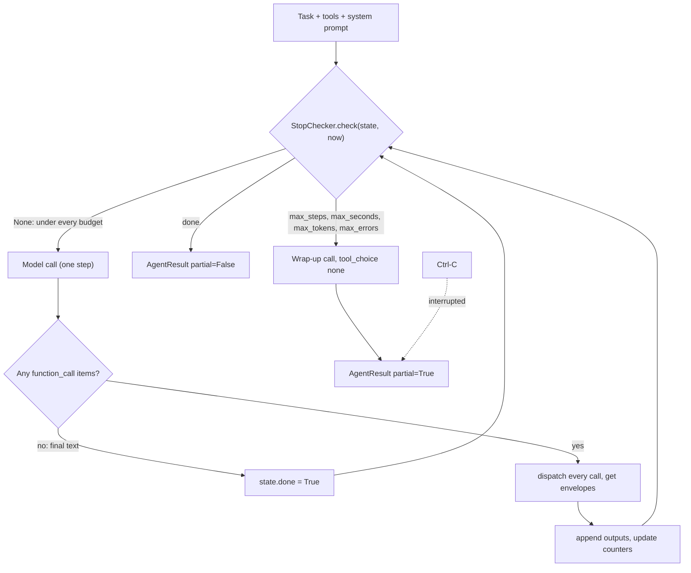
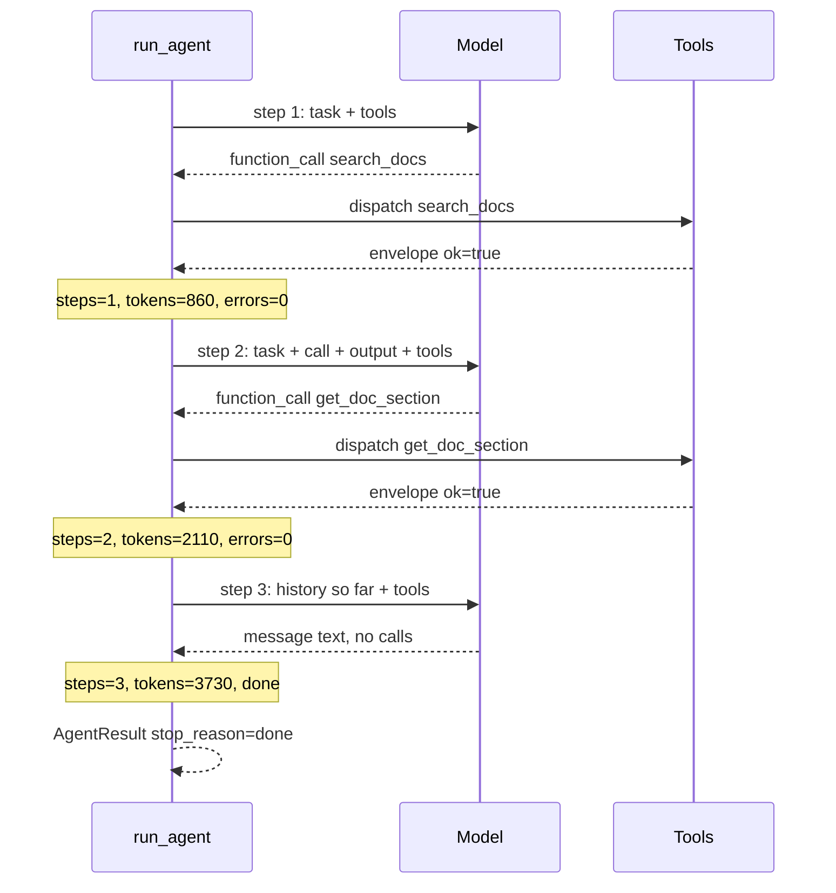
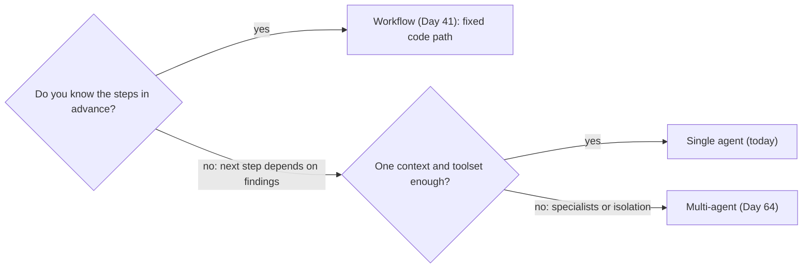

# Your First Agent: The Loop, Stop Conditions & Budgets

Day 41's router follows a procedure you wrote. Now a maintainer asks Atlas: "A worker re-runs a long job while it is still running. Is this a known issue, what do the docs say, and what is the likely cause?" The right steps depend on what each lookup turns up, so no fixed pipeline fits. Day 35's tool loop could run it, but its only brake is `max_rounds`: hit the cap and you get empty text after paying for every round. Today you own the loop, and a bounded run always ends with something you can use.

## At a Glance

- **Time:** ~2 h core (+ optional Go Deeper) · **Depth:** working
- **Prerequisites:** [Day 35: Function Calling: The Tool Loop](../../Phase_4_Tools_and_MCP/Day_035_function_calling/function_calling.md), [Day 36: Designing Tools: Schemas, Strict Mode & Descriptions](../../Phase_4_Tools_and_MCP/Day_036_tool_design/tool_design.md), [Day 37: Robust Tool Execution: Parallel Calls, Errors & Approvals](../../Phase_4_Tools_and_MCP/Day_037_robust_tool_execution/robust_tool_execution.md), [Day 42: Tracing & Observability in Depth](../../Phase_5_Evaluation_and_Observability/Day_042_tracing_observability/tracing_observability.md); helpful: [Day 12: The OpenAI SDK in Production Code](../../Phase_2_Building_with_LLM_APIs/Day_012_openai_sdk_production/openai_sdk_production.md), [Day 41: Workflow Patterns: Chaining, Routing & Parallelization](../../Phase_4_Tools_and_MCP/Day_041_workflow_patterns/workflow_patterns.md)
- **You'll build:** `atlas/agent.py`: `run_agent()` on native Responses tool calls with five stop conditions, budgets, a labelled partial result and a span per step, plus the fixed 5-issue agent set that Days 49–59 reuse.
- **Stops at:** frameworks (Day 53+); context management and memory are Days 49 and 50.
- **Fast path:** Already wrote Day 35's loop? Read "Five Stop Conditions" and "A Partial Result, Not a Crash", run `test_stop_checker`, then do Exercise 3 (~45 min).
- **Cost:** under $0.10 on `gpt-6-luna` (5 tasks × ~6 steps plus the break-it runs; prices as of 2026-11, [verify](https://developers.openai.com/api/docs/pricing)).
- **New terms:** agent, step, observation, stop condition, budget

> **Coming from Software Engineering?** An agent loop is a game loop or a REPL (read–eval–print loop) whose "input" is the model's next action. The stop checker is a circuit breaker (stops calling something that keeps failing) plus a timeout plus a retry ceiling, wrapped around a call you don't control. Budgets are resource quotas, like a cgroup quota (an OS-enforced resource cap) on a process that may never exit by itself. The partial result is a graceful SIGTERM handler (SIGTERM is the signal an OS sends to ask a process to exit): when the process must stop, it flushes what it has before exiting instead of dying mid-write.

## Not Every Task Has a Fixed Procedure

[Day 41](../../Phase_4_Tools_and_MCP/Day_041_workflow_patterns/workflow_patterns.md) drew the line: if you can write the steps down in advance, build a workflow, because it is cheaper, faster and easier to test. "Label this issue" fits. "Investigate this issue" does not. For one issue the answer sits in a past duplicate; for another you need two doc pages and the changelog; for a third, nothing in Orbit's data answers it and the honest reply is "not found".

Run Day 35's `run_tool_loop()` on the investigate task and two things go wrong. When the model keeps searching, the loop stops at `max_rounds` with `text=""`, so you paid for five rounds and got nothing. And nothing limits time, tokens or repeated failures: the round cap is the only brake.

## A Loop Where the Model Picks the Next Step

Picture a junior colleague with a deadline, a spend limit and a notebook. You hand them a question. They look something up, write down what they found, decide what to look up next, and repeat until they can answer. When the deadline arrives, a good colleague doesn't vanish. They hand over the notebook: "Here's what I established, here's what's missing, here's what I'd check next."

That is the whole design. The model plays the colleague and chooses each lookup. Your code plays the manager: it runs the tools, keeps the notebook (the conversation history), watches the clock and the budget, and asks for the hand-over when time is up.

Old ReAct ("reason + act") style agents made the model write "Thought: … Action: …" as text so code could parse it. Saying the next step out loud works the way rubber-duck debugging does: explaining the problem is what leads to the fix. Reasoning models now do that thinking in a **reasoning item**, and tool requests arrive as structured `function_call` items, so you never parse text.

## One Run by Hand

A toy task, "Is ORB-1301 retryable?", with limits of 8 steps and 100,000 tokens. The token numbers are made up but realistic in shape.

| Step | Model asks for | Observation (tool result) | Step tokens (in + out) | Counters vs limits |
|---|---|---|---|---|
| 1 | `search_docs("ORB-1301")` | `error-codes`, `retries-and-backoff` | 800 + 60 | steps 1/8 · tokens 860/100k |
| 2 | `get_doc_section("error-codes", "ORB-1301")` | "RetryExhausted: the job used all attempts and moved to the dead-letter queue" | 1,200 + 50 | steps 2/8 · tokens 2,110/100k |
| 3 | nothing: replies with text | none | 1,500 + 120 | steps 3/8 · tokens 3,730/100k → **done** |

Answer: "No. ORB-1301 means retries are already exhausted; replay the job from the dead-letter queue (doc `error-codes`)." Check the input column: it grows each step (800 → 1,200 → 1,500) because every call re-sends everything before it. Keep that in mind for the token budget.

## Name the Parts

- An **agent** is a loop in which the model chooses the next action, usually a tool call, until it decides to answer.
- A **step** is one model call plus every tool call that response asks for. Counting steps (not tool calls) keeps the count stable when the model calls three tools at once ([Day 37](../../Phase_4_Tools_and_MCP/Day_037_robust_tool_execution/robust_tool_execution.md)).
- An **observation** is what a tool returned, fed back as a `function_call_output` item. In the full agent below it is always Day 37's error envelope, `{"ok": true, "data": …}` or `{"ok": false, "error": {…}}`.
- A **stop condition** is a rule that ends the run: done, too many steps, seconds, tokens or consecutive errors, plus Ctrl-C.
- A **budget** is the limit a stop condition enforces (8 steps, 60 s, 100k tokens, 3 errors).
- A **partial result** is a labelled best-effort answer (`partial=True`) returned when a budget, not the model, ended the run.



Here is the same thing in time order for the three steps of the hand-run above (the second tool round is abbreviated), with the counters updating:



## Your First Agent

Start with the smallest version: two read-only tools over Orbit's data and a step cap. The first block builds the tools; the second is the loop.

```python
# script_id: day_048_first_agent/first_agent
# The smallest agent: a while loop, two read-only Orbit tools, one brake (max_steps).
# Install: uv add openai   Env: OPENAI_API_KEY, ATLAS_MODEL (default gpt-6-luna), ORBIT_DATA
# Services: none. Reads datasets/orbit/issues/orbit.db (read-only) and docs/*.md.
import json
import os
import sqlite3
from contextlib import closing
from pathlib import Path

from openai import OpenAI

MODEL = os.environ.get("ATLAS_MODEL", "gpt-6-luna")
DATA_DIR = Path(os.environ.get("ORBIT_DATA", "datasets/orbit"))


def search_issues(query: str) -> list[dict]:  # simplified from Day 35: keyword-ranked, no state/limit
    words = [w for w in query.lower().split() if len(w) > 2]
    uri = f"file:{DATA_DIR / 'issues' / 'orbit.db'}?mode=ro"  # read-only: tools can't write
    with closing(sqlite3.connect(uri, uri=True)) as db:
        rows = db.execute("SELECT id, title, lower(title || ' ' || body) FROM issues").fetchall()
    ranked = sorted(rows, key=lambda r: -sum(w in r[2] for w in words))[:5]
    return [{"id": i, "title": t} for i, t, text in ranked if any(w in text for w in words)]


def get_doc_section(doc_id: str) -> str:  # simplified from Day 35: whole page, capped, no heading
    path = DATA_DIR / "docs" / f"{Path(doc_id).name}.md"  # .name blocks ../ traversal
    return path.read_text(encoding="utf-8")[:3000] if path.exists() else f"unknown doc_id {doc_id!r}"


def schema(name: str, description: str, arg: str) -> dict:  # flat, strict tool schema (Day 36)
    return {"type": "function", "name": name, "description": description, "strict": True,
            "parameters": {"type": "object", "properties": {arg: {"type": "string"}},
                           "required": [arg], "additionalProperties": False}}


TOOLS = [schema("search_issues", "Keyword search over past Orbit issues.", "query"),
         schema("get_doc_section", "Read an Orbit doc page by id, e.g. 'retries-and-backoff'.", "doc_id")]
REGISTRY = {"search_issues": search_issues, "get_doc_section": get_doc_section}
```

```python
# script_id: day_048_first_agent/first_agent
def first_agent(task: str, max_steps: int = 6) -> str:
    client = OpenAI()
    items: list = [{"role": "user", "content": task}]
    for step in range(1, max_steps + 1):
        resp = client.responses.create(model=MODEL, input=items, tools=TOOLS,
                                       instructions="Investigate Orbit issues with the tools. Cite ids.")
        items += resp.output  # keep the model's calls and reasoning items (Day 35)
        calls = [i for i in resp.output if i.type == "function_call"]
        if not calls:  # no tool requested: the model chose to answer
            return resp.output_text
        for call in calls:
            print(f"step {step} {call.name}({call.arguments})")
            result = REGISTRY[call.name](**json.loads(call.arguments))
            items.append({"type": "function_call_output", "call_id": call.call_id,
                          "output": json.dumps(result)})
    return ""  # out of steps: nothing to show for the money spent


if __name__ == "__main__":
    print(first_agent("A worker re-runs a long job while it is still running. Is this a known "
                      "Orbit issue, what do the docs say, and what is the likely cause?"))
```

Expected output (your steps and wording will differ):

```text
step 1 search_issues({"query":"job runs twice long running worker"})
step 2 get_doc_section({"doc_id":"leases-and-heartbeats"})
step 3 search_issues({"query":"lease expired duplicate execution"})
Known issue: #4 and its duplicates describe lease expiry on long jobs ... (doc leases-and-heartbeats)
```

Notice what's new compared with Day 35: nothing in the code knows the steps. The model chose to search, read a doc, then search again with better words it learned from the doc.

## Break It: No Budgets, an Unanswerable Task

Now ask something Orbit's data can't answer, and also drop the line that keeps the model's own output in the history.

```python
# script_id: day_048_first_agent/break_it
# Two ways the bare loop fails. Save next to first_agent.py.   Env: OPENAI_API_KEY, ORBIT_DATA
import json

import openai
from openai import OpenAI

from first_agent import MODEL, REGISTRY, TOOLS

client = OpenAI()
items: list = [{"role": "user", "content": "Which maintainer approved Orbit's Kafka broker "
                                           "design in 2019? Quote the review comment."}]
for step in range(1, 9):  # Break 1: the step cap is the only brake
    resp = client.responses.create(model=MODEL, input=items, tools=TOOLS)
    print(f"step {step}: input_tokens={resp.usage.input_tokens}")
    items += resp.output
    calls = [i for i in resp.output if i.type == "function_call"]
    if not calls:
        print("answered:", resp.output_text[:120])
        break
    for c in calls:
        out = REGISTRY[c.name](**json.loads(c.arguments))
        items.append({"type": "function_call_output", "call_id": c.call_id, "output": json.dumps(out)})
else:
    print("hit the cap after 8 paid steps: answer = ''")

# Break 2: send your function_call_output without the model's function_call item
items = [{"role": "user", "content": "What does the retries-and-backoff doc say about max delay?"}]
resp = client.responses.create(model=MODEL, input=items, tools=TOOLS,
                               tool_choice={"type": "function", "name": "get_doc_section"})
call = next(i for i in resp.output if i.type == "function_call")
items.append({"type": "function_call_output", "call_id": call.call_id, "output": "..."})  # no resp.output
try:
    client.responses.create(model=MODEL, input=items, tools=TOOLS)
except openai.BadRequestError as e:  # branch on the class or status, never on the message text
    print(f"{type(e).__name__} status={e.status_code}")
```

Expected output (your numbers will differ):

```text
step 1: input_tokens=412
step 2: input_tokens=1630
step 3: input_tokens=2215
...
step 8: input_tokens=6904
hit the cap after 8 paid steps: answer = ''
BadRequestError status=400
```

Two lessons. First, input tokens climb every step because each call re-bills the whole history ([Day 35](../../Phase_4_Tools_and_MCP/Day_035_function_calling/function_calling.md) showed why), so eight steps cost far more than eight times step 1. The model may instead give up early with "I couldn't find that"; that counts as *done*, and it's the right answer. Second, the API rejects a `function_call_output` whose `call_id` has no matching `function_call` item in the input. The SDK raises `openai.BadRequestError` (status 400); print `e.message` to see the API's wording, but branch on the class or `status_code`, never the text. The fix is always `items += resp.output` before your outputs.

## Five Stop Conditions

Every limit protects something different, so you need all five. They are cheap integer and float comparisons, so check them before every step.

| Condition | What it protects | Default | Checked where |
|---|---|---|---|
| `done` | nothing: success, the model replied with no tool calls | none | after the step that replied |
| `max_steps` | runaway loops, repeated searching | 8 | before each step |
| `max_tokens` | money: cumulative input + output across steps | 100,000 | before each step |
| `max_errors` | hammering a broken tool or API | 3 consecutive error steps | before each step |
| `max_seconds` | the user's patience, request deadlines | 60 s | before each step; the in-flight call has its own timeout |

The defaults are a starting point, not a measurement. After you run the 5-issue set later today, set `max_steps` to about your 95th-percentile steps plus 2, and `max_tokens` from the measured tokens per task. Also note that a "4 of 8 steps used" figure is a budget gauge, not progress: an agent can finish at step 2 or never.

Time is the tricky one. The checker only runs *between* steps, so one slow model call can blow straight through `max_seconds`. You bound the in-flight call separately with a per-request timeout, `client.with_options(timeout=..., max_retries=...)`. The SDK retries twice by default, so the worst case for one call is roughly `(max_retries + 1) × timeout`.

First, config and run state.

```python
# script_id: day_048_first_agent/agent
# atlas/agent.py: run_agent() with five stop conditions, budgets and a labelled partial result.
# Install: uv add openai opentelemetry-api   Env: OPENAI_API_KEY, ATLAS_MODEL, ORBIT_DATA
# Services: none (orbit.db read-only, docs/*.md). Spans are no-ops until Day 42's setup_tracing().
from __future__ import annotations

import json
import os
import time
from dataclasses import dataclass, field
from typing import Literal

MODEL = os.environ.get("ATLAS_MODEL", "gpt-6-luna")
StopReason = Literal["done", "max_steps", "max_seconds", "max_tokens", "max_errors", "interrupted"]


@dataclass(frozen=True)
class AgentConfig:
    max_steps: int = 8               # starting point: re-set to p95 steps + 2 after the 5-set run
    max_seconds: float = 60          # wall clock, checked between steps
    max_tokens: int = 100_000        # cumulative input + output tokens across all steps
    max_errors: int = 3              # consecutive steps that had any failure
    effort: str | None = None        # None = the model's default ("medium" on gpt-6-luna)
    request_timeout: float = 30.0    # seconds per model call; raise it if you use effort="high"
    max_output_tokens: int = 25_000  # reasoning + visible output; the reasoning guide says reserve 25k


@dataclass
class RunState:
    started: float
    steps: int = 0
    tokens: int = 0
    consecutive_errors: int = 0
    done: bool = False
    calls: list[str] = field(default_factory=list)  # every "name(args)" so far, for debugging
```

The checker itself is a pure function of state and a clock reading you pass in, with no `datetime.now()` inside. That one decision makes it testable without sleeping or calling an API.

```python
# script_id: day_048_first_agent/agent
class StopChecker:
    """Pure: the same state and clock reading always give the same answer."""

    def __init__(self, config: AgentConfig) -> None:
        self.c = config

    def check(self, s: RunState, now: float) -> StopReason | None:
        if s.done:
            return "done"
        if s.steps >= self.c.max_steps:
            return "max_steps"
        if s.tokens >= self.c.max_tokens:
            return "max_tokens"
        if s.consecutive_errors >= self.c.max_errors:
            return "max_errors"
        if now - s.started >= self.c.max_seconds:
            return "max_seconds"
        return None
```

Order matters only when two limits trip at once: `done` always wins, so a step that answered *and* crossed the token line still counts as a success. The tests use a fake clock, a plain number:

```python
# script_id: day_048_first_agent/test_stop_checker
# Offline StopChecker tests with a fake clock: no API key, no network, no sleeping.
# Install: uv add --dev pytest   Run: uv run pytest test_stop_checker.py -q  (or: python test_stop_checker.py)
# Needs agent.py (the `agent` script) in the same folder.
from agent import AgentConfig, RunState, StopChecker

CFG = AgentConfig(max_steps=3, max_seconds=10, max_tokens=1_000, max_errors=2)


def check(now: float = 0.0, **state) -> str | None:
    return StopChecker(CFG).check(RunState(started=0.0, **state), now)


def test_keeps_going_under_every_limit() -> None:
    assert check(now=9.9, steps=2, tokens=999, consecutive_errors=1) is None


def test_each_limit_trips_at_its_boundary() -> None:
    assert check(steps=3) == "max_steps"
    assert check(tokens=1_000) == "max_tokens"
    assert check(consecutive_errors=2) == "max_errors"
    assert check(now=10.0) == "max_seconds"  # the fake clock jumps; nobody waits 10 s


def test_done_wins_over_a_limit_crossed_on_the_same_step() -> None:
    assert check(steps=3, tokens=5_000, done=True) == "done"


def test_first_limit_in_check_order_is_reported() -> None:
    assert check(now=99.0, steps=3, tokens=5_000) == "max_steps"


if __name__ == "__main__":
    for name, fn in list(globals().items()):
        if name.startswith("test_"):
            fn()
            print("PASS", name)
```

```text
PASS test_keeps_going_under_every_limit
PASS test_each_limit_trips_at_its_boundary
PASS test_done_wins_over_a_limit_crossed_on_the_same_step
PASS test_first_limit_in_check_order_is_reported
```

## The Realistic Agent

The `agent` script grows one concern per block. Next come the result types: a `StepRecord` per step and the `AgentResult` that Days 49–65 rely on, so its field names stay fixed.

```python
# script_id: day_048_first_agent/agent
@dataclass
class StepRecord:
    index: int
    tool_calls: list[str] = field(default_factory=list)  # "name(args)" for each call
    errors: int = 0              # failed tool calls, failed or incomplete model calls
    input_tokens: int = 0
    output_tokens: int = 0
    ms: int = 0


@dataclass
class AgentResult:
    text: str
    stop_reason: StopReason
    steps: list[StepRecord]
    usage: dict[str, int]        # {"input_tokens": n, "output_tokens": n}, wrap-up call included
    cost_usd: float
    partial: bool                # True whenever stop_reason != "done"
```

The four read-only tools are compact versions of Days 35–36: `search_issues`, `get_issue`, `search_docs` (a keyword stand-in for R2's index) and `get_doc_section`. Unknown ids raise `LookupError` with a hint.

```python
# script_id: day_048_first_agent/agent
import difflib
import sqlite3
from contextlib import closing
from functools import cache
from pathlib import Path

DATA_DIR = Path(os.environ.get("ORBIT_DATA", "datasets/orbit"))


def _rows(sql: str, *args) -> list[tuple]:  # built on Day 33: read-only connection
    with closing(sqlite3.connect(f"file:{DATA_DIR / 'issues' / 'orbit.db'}?mode=ro", uri=True)) as db:
        return db.execute(sql, args).fetchall()


@cache
def _docs() -> dict[str, str]:
    return {p.stem: p.read_text(encoding="utf-8") for p in sorted((DATA_DIR / "docs").glob("*.md"))}


def _rank(texts: dict, query: str, k: int) -> list:  # keyword stand-in for R2 search (Day 34)
    words = [w for w in query.lower().split() if len(w) > 2]
    scored = sorted(((sum(w in t.lower() for w in words), key) for key, t in texts.items()), reverse=True)
    return [key for score, key in scored[:k] if score > 0]


def search_issues(query: str) -> list[dict]:
    rows = {r[0]: r for r in _rows("SELECT id, title, state, duplicate_of, title || ' ' || body FROM issues")}
    keys = ("id", "title", "state", "duplicate_of")
    return [dict(zip(keys, rows[i][:4])) for i in _rank({i: r[4] for i, r in rows.items()}, query, 5)]


def get_issue(issue_id: int) -> dict:
    found = _rows("SELECT title, state, body, duplicate_of FROM issues WHERE id = ?", issue_id)
    if not found:
        raise LookupError(f"No issue #{issue_id}. Use ids returned by search_issues.")
    title, state, body, dup = found[0]
    labels = [r[0] for r in _rows("SELECT l.name FROM issue_labels il JOIN labels l ON l.id = il.label_id "
                                  "WHERE il.issue_id = ?", issue_id)]
    comments = [r[0][:300] for r in _rows("SELECT body FROM comments WHERE issue_id = ? ORDER BY position "
                                          "LIMIT 3", issue_id)]
    return {"id": issue_id, "title": title, "state": state, "labels": labels, "duplicate_of": dup,
            "body": body[:1500], "comments": comments}
```

```python
# script_id: day_048_first_agent/agent
def search_docs(query: str) -> list[dict]:
    meta = lambda text: {k: v.strip('"') for k, v in  # front matter lines look like "title: ..."
                         (ln.split(": ", 1) for ln in text.split("---")[1].strip().splitlines() if ": " in ln)}
    return [{"doc_id": d, "title": meta(_docs()[d]).get("title"), "applies_to": meta(_docs()[d]).get("applies_to")}
            for d in _rank(_docs(), query, 4)]


def get_doc_section(doc_id: str, heading: str | None) -> dict:
    if doc_id not in _docs():
        near = difflib.get_close_matches(doc_id, list(_docs()), n=3)
        raise LookupError(f"Unknown doc_id {doc_id!r}. Closest: {near}. Call search_docs first.")
    text = _docs()[doc_id]
    if heading:  # one "## " section, or the whole page if the heading doesn't exist
        parts = [p for p in text.split("\n## ") if p.lower().startswith(heading.lower())]
        text = "## " + parts[0] if parts else text
    return {"doc_id": doc_id, "text": text[:3000]}


def fn_tool(name: str, description: str, **props: dict) -> dict:  # flat strict schema (Day 36)
    return {"type": "function", "name": name, "description": description, "strict": True,
            "parameters": {"type": "object", "properties": props, "required": list(props),
                           "additionalProperties": False}}


STR, INT, OPT_STR = {"type": "string"}, {"type": "integer"}, {"type": ["string", "null"]}
TOOLS = [
    fn_tool("search_issues", "Keyword search over past Orbit issues; returns id, title, duplicate_of.", query=STR),
    fn_tool("get_issue", "Read one issue's body, labels and first comments. Use ids from search_issues.",
            issue_id=INT),
    fn_tool("search_docs", "Keyword search over Orbit docs; returns doc_id, title, applies_to (2.x/3.x).",
            query=STR),
    fn_tool("get_doc_section", "Read a doc page, or only its '## heading' section when heading is set.",
            doc_id=STR, heading=OPT_STR),
]
REGISTRY = {"search_issues": search_issues, "get_issue": get_issue, "search_docs": search_docs,
            "get_doc_section": get_doc_section}
```

The dispatcher maps every failure to one of Day 37's error kinds.

```python
# script_id: day_048_first_agent/agent
HINTS = {"unknown_tool": "That tool does not exist. Use only the tools you were given.",  # Day 37's kinds
         "bad_args": "The arguments did not match the schema. Fix them using the message.",
         "permanent": "Repeating this exact call will fail again. Fix the arguments or use another tool.",
         "unknown": "An unexpected error. Do not retry; tell the user it failed."}


def dispatch(name: str, arguments: str) -> tuple[str, bool]:
    """Run one call and never raise. Returns (envelope JSON, ok); envelope shape from Day 37."""
    if name not in REGISTRY:
        kind, msg = "unknown_tool", f"No tool {name!r}. Available: {sorted(REGISTRY)}"
    else:
        try:
            return json.dumps({"ok": True, "data": REGISTRY[name](**json.loads(arguments))}, default=str), True
        except (json.JSONDecodeError, TypeError) as e:  # bad JSON or wrong kwargs (before ValueError)
            kind, msg = "bad_args", str(e)
        except (LookupError, ValueError) as e:  # the same call will fail again
            kind, msg = "permanent", str(e)
        except Exception as e:  # the model gets a message it can act on, not a stack trace
            kind, msg = "unknown", f"{type(e).__name__}: {e}"
    err = {"kind": kind, "message": msg[:300], "retryable": False, "hint": HINTS[kind]}
    return json.dumps({"ok": False, "error": err}), False
```

Next, three small seams: cost (a compact Day 12 tracker), a span per step (Day 42; a span is one timed, labelled unit of work inside a trace), and `call_model`, the one function that talks to the API. The client is created on first use, so tests can import `agent` without a key and swap `call_model` for a fake.

```python
# script_id: day_048_first_agent/agent
from contextlib import contextmanager

import openai
from openai import OpenAI
from opentelemetry import trace

# USD per 1M input / output tokens; as of 2026-11, verify at developers.openai.com/api/docs/pricing
PRICES = {"gpt-6-luna": (0.10, 0.50)}


def cost_usd(model: str, input_tokens: int, output_tokens: int) -> float:  # built on Day 12
    p_in, p_out = PRICES.get(model, (0.0, 0.0))  # unknown model -> $0, so add its row first
    return (input_tokens * p_in + output_tokens * p_out) / 1_000_000  # ignores cache discounts


@contextmanager
def step_span(name: str, kind: str, **attrs):  # built on Day 42: no-op until setup_tracing()
    with trace.get_tracer("atlas").start_as_current_span(name, attributes={"atlas.kind": kind, **attrs}) as span:
        yield span


@cache
def get_client() -> OpenAI:
    return OpenAI()


def call_model(*, timeout: float, **kwargs):
    # max_retries=1 keeps one step's worst case near 2 x timeout (the SDK default is 2 retries)
    return get_client().with_options(timeout=timeout, max_retries=1).responses.create(**kwargs)
```

The step function holds the loop body. The system prompt follows the reasoning guide's advice: a goal, constraints and an output contract, without prescribing each step. The output contract makes "not found" a legitimate answer, which is what stops the model from searching forever to avoid admitting it.

```python
# script_id: day_048_first_agent/agent
AGENT_SYSTEM = """You are Atlas, investigating issues for the maintainers of Orbit, a Python jobs library.
Goal: answer the maintainer's question from tool results; never state facts the tools didn't show.
Constraints: tools are read-only. Prefer docs whose applies_to matches the issue's version (2.x or 3.x).
If a tool returns ok=false, read the hint and change approach instead of repeating the call.
Output contract, once you stop calling tools: three short sections. Found (cite issue #ids and doc ids),
Not found, Likely cause (or "unknown"). "Not found" is a valid, useful answer."""


def run_step(items: list, i: int, tools: list[dict], system: str, config: AgentConfig) -> tuple[StepRecord, str | None]:
    """One step = one model call + every tool call it asks for. Returns (record, final text or None)."""
    rec, t0, final = StepRecord(index=i), time.monotonic(), None
    extra = {"reasoning": {"effort": config.effort}} if config.effort else {}
    with step_span(f"agent.step {i}", "agent_step", **{"atlas.step": i}) as span:
        try:
            resp = call_model(timeout=config.request_timeout, model=MODEL, instructions=system, input=items,
                              tools=tools, max_output_tokens=config.max_output_tokens, **extra)
        except openai.APIError as e:  # timeouts and 5xx after SDK retries: an error step, not a crash
            rec.errors, rec.tool_calls = 1, [f"model_error({type(e).__name__})"]
            resp = None
        if resp is not None:
            rec.input_tokens, rec.output_tokens = resp.usage.input_tokens, resp.usage.output_tokens
            if resp.status == "incomplete":  # e.g. reasoning used every max_output_tokens
                rec.errors = 1
            else:
                items.extend(resp.output)  # calls + reasoning items first, or the next call gets a 400
                calls = [o for o in resp.output if o.type == "function_call"]
                for call in calls:
                    envelope, ok = dispatch(call.name, call.arguments)
                    rec.tool_calls.append(f"{call.name}({call.arguments})")
                    rec.errors += not ok
                    items.append({"type": "function_call_output", "call_id": call.call_id, "output": envelope})
                final = None if calls else resp.output_text
        span.set_attributes({"gen_ai.usage.input_tokens": rec.input_tokens,
                             "gen_ai.usage.output_tokens": rec.output_tokens, "atlas.errors": rec.errors})
    rec.ms = int((time.monotonic() - t0) * 1000)
    return rec, final
```

Three details carry the robustness. An API error becomes an *error step* that the checker counts, so a flaky network ends in `max_errors`, not a traceback. A response with `status == "incomplete"` is also an error step: its output isn't appended, because a truncated turn is not something you want the model to build on. And every call gets an output, even a failed one, because an unanswered `call_id` is a 400 on the next request.

## A Partial Result, Not a Crash

When a budget ends the run, raising an exception throws away everything the agent learned, and returning `""` is worse because it looks like success. Instead, make one more call with `tool_choice="none"` (tools stay attached, but the model may not call them) and ask it to report what it established and what is missing. Ctrl-C is different: the user wants out now, so skip the extra call and summarise locally.

```python
# script_id: day_048_first_agent/agent
WRAP_UP = ("You are out of budget and may not call tools. Using only the tool results above, state "
           "what you established (cite ids), what is still missing, and the next thing you would check.")


def wrap_up(items: list, tools: list[dict], system: str, config: AgentConfig, reason: str) -> tuple[str, int, int]:
    try:
        resp = call_model(timeout=config.request_timeout, model=MODEL, instructions=system,
                          input=[*items, {"role": "user", "content": WRAP_UP}], tools=tools,
                          tool_choice="none", max_output_tokens=config.max_output_tokens)
        return f"[partial: {reason}]\n{resp.output_text}", resp.usage.input_tokens, resp.usage.output_tokens
    except openai.APIError:
        return f"[partial: {reason}] The summary call failed too; see steps for what was tried.", 0, 0


def run_agent(task: str, *, tools: list[dict] = TOOLS, system: str = AGENT_SYSTEM,
              config: AgentConfig = AgentConfig()) -> AgentResult:
    items: list = [{"role": "user", "content": task}]
    state, checker, steps, text = RunState(started=time.monotonic()), StopChecker(config), [], ""
    try:
        while (reason := checker.check(state, time.monotonic())) is None:
            rec, final = run_step(items, state.steps + 1, tools, system, config)
            steps.append(rec)
            state.steps, state.tokens = state.steps + 1, state.tokens + rec.input_tokens + rec.output_tokens
            state.calls += rec.tool_calls
            state.consecutive_errors = state.consecutive_errors + 1 if rec.errors else 0  # a clean step resets
            if final is not None:
                text, state.done = final, True
    except KeyboardInterrupt:  # Ctrl-C: no extra API call, hand over what we have
        reason = "interrupted"
        text = f"[partial: interrupted after {len(steps)} steps] Tool calls so far: {state.calls}"
    usage = {"input_tokens": sum(s.input_tokens for s in steps), "output_tokens": sum(s.output_tokens for s in steps)}
    if reason not in ("done", "interrupted"):
        text, w_in, w_out = wrap_up(items, tools, system, config, reason)
        usage["input_tokens"] += w_in
        usage["output_tokens"] += w_out
    return AgentResult(text=text, stop_reason=reason, steps=steps, usage=usage,
                       cost_usd=cost_usd(MODEL, usage["input_tokens"], usage["output_tokens"]),
                       partial=reason != "done")
```

The last block renders the step table and gives the script a command line:

```python
# script_id: day_048_first_agent/agent
def render(result: AgentResult) -> str:
    rows = ["step | tools | in tok | out tok | ms", "---|---|---|---|---"]
    for s in result.steps:
        names = ", ".join(c.split("(")[0] for c in s.tool_calls) or "(answer)"
        rows.append(f"{s.index} | {names}{' !' * s.errors} | {s.input_tokens} | {s.output_tokens} | {s.ms}")
    rows.append(f"stop_reason={result.stop_reason} partial={result.partial} steps={len(result.steps)} "
                f"cost=${result.cost_usd:.4f}")
    return "\n".join(rows) + "\n\n" + result.text


if __name__ == "__main__":
    import sys

    task = " ".join(sys.argv[1:]) or ("A worker re-runs a long job while it is still running. Is this a "
                                      "known Orbit issue, what do the docs say, and what is the likely cause?")
    print(render(run_agent(task)))
```

Expected output of `python agent.py` (your steps, tokens and wording will differ):

```text
step | tools | in tok | out tok | ms
---|---|---|---|---
1 | search_issues, search_docs | 1180 | 214 | 2410
2 | get_issue, get_doc_section | 3020 | 188 | 2950
3 | search_issues | 4890 | 96 | 1730
4 | (answer) | 5410 | 402 | 3880
stop_reason=done partial=False steps=4 cost=$0.0019
```

Step 1 shows two tool calls in one step: parallel calls are on by default, and counting steps rather than calls keeps the budget meaningful. Now force a budget stop to see the partial result: `run_agent(task, config=AgentConfig(max_steps=2))` ends with `stop_reason=max_steps partial=True` and text that starts `[partial: max_steps]`.

You can prove all of this without a key. The test below swaps `call_model` for a scripted fake and runs the real loop, checker, tools and wrap-up:

```python
# script_id: day_048_first_agent/test_agent_offline
# Replays scripted model responses through run_agent: real loop and tools, fake model, no key.
# Run: uv run pytest test_agent_offline.py -q  (or: python test_agent_offline.py). Needs agent.py, ORBIT_DATA.
from types import SimpleNamespace as NS

import agent


def call(name: str, args: str, cid: str) -> NS:
    return NS(type="function_call", name=name, arguments=args, call_id=cid)


def reply(*output: NS, text: str = "") -> NS:
    return NS(output=list(output), output_text=text, status="completed",
              usage=NS(input_tokens=1_000, output_tokens=100))


def script(*responses: NS) -> list[dict]:
    queue, seen = list(responses), []
    agent.call_model = lambda **kw: seen.append(kw) or queue.pop(0)  # record each request, replay
    return seen
```

```python
# script_id: day_048_first_agent/test_agent_offline
def test_done_after_two_tool_steps() -> None:
    script(reply(call("search_docs", '{"query": "lease heartbeat"}', "c1")),
           reply(call("get_doc_section", '{"doc_id": "leases-and-heartbeats", "heading": null}', "c2")),
           reply(NS(type="message"), text="Found: lease expiry (doc leases-and-heartbeats)"))
    r = agent.run_agent("Why does my long job run twice?")
    assert (r.stop_reason, r.partial, len(r.steps)) == ("done", False, 3)
    assert r.usage == {"input_tokens": 3_000, "output_tokens": 300}


def test_budget_stop_returns_a_labelled_partial() -> None:
    seen = script(*[reply(call("search_issues", '{"query": "kafka broker"}', f"c{i}")) for i in range(2)],
                  reply(NS(type="message"), text="Established: no Kafka issues. Missing: the review."))
    r = agent.run_agent("Who approved the Kafka broker?", config=agent.AgentConfig(max_steps=2))
    assert (r.stop_reason, r.partial, len(r.steps)) == ("max_steps", True, 2)
    assert seen[-1]["tool_choice"] == "none" and r.text.startswith("[partial: max_steps]")


def test_repeated_tool_errors_stop_with_max_errors() -> None:
    script(*[reply(call("get_issue", '{"issue_id": 999999}', f"c{i}")) for i in range(3)],
           reply(NS(type="message"), text="Established: issue 999999 does not exist."))
    r = agent.run_agent("Summarise issue 999999", config=agent.AgentConfig(max_errors=3))
    assert r.stop_reason == "max_errors" and [s.errors for s in r.steps] == [1, 1, 1]


if __name__ == "__main__":
    for name, fn in list(globals().items()):
        if name.startswith("test_"):
            fn()
            print("PASS", name)
```

```text
PASS test_done_after_two_tool_steps
PASS test_budget_stop_returns_a_labelled_partial
PASS test_repeated_tool_errors_stop_with_max_errors
```

## The 5-Issue Scoreboard

One impressive run proves nothing. From today to Day 59 the agent runs on the same five issues, so every change (context management, memory, planning, frameworks) gets compared on equal terms. The set is chosen by *property* from `eval/triage_gold.jsonl`, never by hard-coded id, so it survives a regenerated dataset: a bug report with logs, a question, a duplicate, the vaguest report and a docs issue.

```python
# script_id: day_048_first_agent/agent_set
# Pick the fixed 5-issue agent set (reused Days 49-59), then print scoreboard row D48.
# Env: ORBIT_DATA; OPENAI_API_KEY to run the agent (without a key it only writes agent_set.json).
import json
import os
from pathlib import Path
from statistics import mean

from agent import DATA_DIR, AgentConfig, run_agent

TASK = ("Investigate Orbit issue #{id} ({title!r}): is it a duplicate of an earlier issue, what do "
        "the docs say, and what is the likely cause?")
WANTS = {  # kind -> predicate on (gold record, issue); None = vaguest (shortest body) left
    "duplicate": lambda g, i: g["duplicate_of"] is not None,
    "docs": lambda g, i: "type:docs" in g["labels"],
    "question": lambda g, i: "type:question" in g["labels"],
    "bug with logs": lambda g, i: "type:bug" in g["labels"] and "```" in i["body"],
    "vague": None,
}


def _jsonl(path: Path) -> list[dict]:
    return [json.loads(line) for line in path.read_text(encoding="utf-8").splitlines() if line.strip()]


def pick_agent_set(path: Path | None = Path("agent_set.json")) -> list[str]:
    issues = {i["id"]: i for i in _jsonl(DATA_DIR / "issues" / "issues.jsonl")}
    gold = sorted(_jsonl(DATA_DIR / "eval" / "triage_gold.jsonl"), key=lambda g: g["issue_id"])
    picked: list[dict] = []
    for kind, want in WANTS.items():
        pool = [g for g in gold if g["issue_id"] not in {p["issue_id"] for p in picked}
                and (want is None or want(g, issues[g["issue_id"]]))]
        if want is None:
            pool.sort(key=lambda g: len(issues[g["issue_id"]]["body"]))
        if pool:
            iss = issues[pool[0]["issue_id"]]
            picked.append({"issue_id": iss["id"], "kind": kind, "task": TASK.format(**iss)})
    if path:
        path.write_text(json.dumps(picked, indent=2), encoding="utf-8")
    return [p["task"] for p in picked]
```

```python
# script_id: day_048_first_agent/agent_set
def scoreboard(tasks: list[str], config: AgentConfig = AgentConfig()) -> list[dict]:
    rows = []
    for task in tasks:
        r = run_agent(task, config=config)
        rows.append({"steps": len(r.steps), "calls": sum(len(s.tool_calls) for s in r.steps),
                     "stop_reason": r.stop_reason, "cost_usd": r.cost_usd, "text": r.text})
    return rows


if __name__ == "__main__":
    tasks = pick_agent_set()
    for t in tasks:
        print(t[:90])
    if not os.environ.get("OPENAI_API_KEY"):
        print("wrote agent_set.json; set OPENAI_API_KEY to run the scoreboard")
        raise SystemExit(0)
    rows = scoreboard(tasks)
    print("\ntask | steps | calls | stop_reason | $")
    for n, r in enumerate(rows, 1):
        print(f"{n} | {r['steps']} | {r['calls']} | {r['stop_reason']} | {r['cost_usd']:.4f}")
    print(f"D48 | mean steps {mean(r['steps'] for r in rows):.1f} | done "
          f"{sum(r['stop_reason'] == 'done' for r in rows)}/5 | ${mean(r['cost_usd'] for r in rows):.4f}/task")
```

Without a key, the selection runs and prints (this part is deterministic for the course dataset):

```text
Investigate Orbit issue #22 ('Same job runs on two workers at once (video transcode)'): is
Investigate Orbit issue #204 ('Typo in cli-reference: "Comma-seperated" in the orbit worke
Investigate Orbit issue #10 ('worker not picking up jobs'): is it a duplicate of an earlie
Investigate Orbit issue #13 ('ORB-1002 BrokerAuthError even though the password is correct
Investigate Orbit issue #186 ('Postgres broker: every job waits ~5 seconds before it start
wrote agent_set.json; set OPENAI_API_KEY to run the scoreboard
```

With a key, you get the scoreboard row (illustrative shape; your numbers will differ, so record your own):

```text
task | steps | calls | stop_reason | $
1 | 4 | 6 | done | 0.0016
...
D48 | mean steps 4.6 | done 5/5 | $0.0019/task
```

Write your row into the README scoreboard. Don't claim any later change "improved quality" unless you also read the five answers and grade them by hand against `reply_points` in `triage_gold.jsonl`; steps and dollars alone say nothing about whether the answers are right.

## Agent or Workflow?

An agent buys flexibility with unpredictability. Before reaching for one, ask whether you know the steps.



| Concern | Workflow (Day 41) | Single agent (today) | Multi-agent ([Day 64](../../Phase_7_Multi_Agent_Systems/Day_064_multi_agent_when/multi_agent_when.md)) |
|---|---|---|---|
| Cost variance | low: fixed number of calls | medium: 1 to `max_steps` calls | high: several loops |
| Latency | predictable | depends on the path | the longest worker plus coordination |
| Testability | unit-test each step | test the checker and tools; evaluate trajectories ([Day 59](../Day_059_evaluating_agents/evaluating_agents.md)) | hardest |
| Debuggability | read the code path | read the step trace | read several traces |
| Use when | the procedure is known | the steps depend on what you find | one context or toolset can't hold the job |

Rule of thumb: start with a workflow, move to an agent only for the open-ended part, and keep the agent's tools read-only until you add approvals.

### In production

- **Budgets per tenant**, not only per run: a loop that is cheap once is expensive ten thousand times ([Day 83](../../Phase_9_Production/Day_083_auth_multitenancy_quotas/auth_multitenancy_quotas.md)).
- **A trace per step** (Day 42's `step_span`) so you can see which step burned the budget; alert on cost per task ([Day 86](../../Phase_9_Production/Day_086_monitoring_feedback/monitoring_feedback.md)).
- **A kill switch**: a config flag that makes `run_agent` return a partial result immediately, for incidents.
- **Side-effect tools sit behind approval** (Day 37's gate now, graph-level approval on Day 55). Today's tools are read-only on purpose.
- **Log tool arguments, never secrets**: step records keep `name(args)`, so keep keys out of arguments.

## Go Deeper (optional)

<details><summary>Go deeper: why step n costs more than step 1</summary>

Every step re-sends the whole history, so input tokens grow step by step, and the *total* billed input grows roughly with the square of the step count.

Toy numbers: each step adds about 1,000 tokens (the model's call, the tool's result). Step 1 sends 1k, step 2 sends 2k, and so on. Six steps bill 1k + 2k + 3k + 4k + 5k + 6k = 21k input tokens, not 6k.

Formula: with base size `b` and growth `g` per step, total input after `n` steps is `n·b + g·n(n−1)/2`. Doubling the steps roughly quadruples the input bill.

```python
# script_id: day_048_first_agent/history_cost
# Offline arithmetic: billed input when every step re-sends the history. No key needed.
PRICE_IN = 0.10  # gpt-6-luna $ per 1M input tokens; as of 2026-11, verify at developers.openai.com/api/docs/pricing


def billed_input(steps: int, base: int = 1_000, growth: int = 1_000) -> int:
    return sum(base + growth * (n - 1) for n in range(1, steps + 1))


for n in (1, 6, 12, 24):
    tokens = billed_input(n)
    print(f"{n:>2} steps: {tokens:>7,} input tokens  ${tokens * PRICE_IN / 1e6:.4f}")
```

```text
 1 steps:   1,000 input tokens  $0.0001
 6 steps:  21,000 input tokens  $0.0021
12 steps:  78,000 input tokens  $0.0078
24 steps: 300,000 input tokens  $0.0300
```

Two levers shrink this. Prompt caching bills a repeated prefix at a discount ([Day 18](../../Phase_2_Building_with_LLM_APIs/Day_018_cost_latency_caching/cost_latency_caching.md) owns it), and `cost_usd()` above ignores that discount, so it slightly overestimates. Context engineering, which clears old tool results and compacts history, is [Day 49](../Day_049_context_engineering/context_engineering.md).

</details>

<details><summary>Go deeper: reasoning items, store and the history list</summary>

`items.extend(resp.output)` copies every output item, including **reasoning items**. That matters in two modes:

- **Default (`store` omitted, which means true):** the response is stored server-side for 30 days. Replaying the full output list keeps the model's earlier reasoning available.
- **`store=False` (stateless, for zero-data-retention setups):** reasoning items then carry `encrypted_content`, so the same "append everything" rule still works. Filtering the list down to messages and function calls is the usual cause of reasoning being lost between steps.

The alternative is `previous_response_id`, which chains stored responses so you send only new items. It doesn't save money (earlier tokens are still billed as input) and `instructions` don't carry over, so you'd re-send the system prompt anyway. A manual list keeps you in control of what the model sees, which Day 49 builds on.

</details>

<details><summary>Go deeper: what experienced teams add next</summary>

- **Progress-aware stops.** Budgets cap cost, not waste. Teams also stop when the last N steps found nothing new (no new issue or doc id in any observation), a cousin of the stuck detector in Exercise 2.
- **Budget hand-off to the user.** On `max_steps`, an interactive app can show the partial result with a "continue for 4 more steps" button that resumes from the saved `items`. Durable resume is [Day 54](../Day_054_langgraph_durability/langgraph_durability.md).
- **Same knobs, other names.** LangGraph's `recursion_limit` is `max_steps` ([Day 53](../Day_053_langgraph_graphs/langgraph_graphs.md)); the Agents SDK's `max_turns` (default 10) is the same idea ([Day 56](../Day_056_openai_agents_sdk/openai_agents_sdk.md)). Knowing the loop means you know what those settings do.
- **ReAct, for reading older code.** ReAct ("reason + act") prompted models to print `Thought:`/`Action:` lines that code parsed with regular expressions. Native tool calls replaced the parsing; the idea of thinking before acting lives on in reasoning items.

</details>

## Common Pitfalls

- **The budget is set but runs still take minutes.** Time is only checked between steps, and one slow call (with SDK retries) blows through it. Set a per-call timeout with `with_options(timeout=..., max_retries=1)` and keep the check before every step.
- **Cost is far above `max_steps × one call`.** Every step re-bills the whole history. Print tokens per step (the `render` table) and set `max_tokens`, not only `max_steps`.
- **A 400 on step 2.** The history lacks the model's `function_call` or reasoning items, or a `call_id` got no output. Do `items.extend(resp.output)` before appending outputs, and answer every call, even failed ones ([Day 35](../../Phase_4_Tools_and_MCP/Day_035_function_calling/function_calling.md)).
- **`done` on a reply that gave up.** The model said "I couldn't find it", and the loop counts that as finished. That is correct: completion means "a reply with no tool calls". Make the output contract ask for Found / Not found, and never detect completion by searching for a "DONE" string.
- **The same failing call repeats until `max_steps`.** Errors aren't counted, or a success elsewhere resets them. Count consecutive error steps and return Day 37's envelope with a hint the model can act on.
- **Empty text with `status == "incomplete"`.** Reasoning used all of `max_output_tokens`. Give it 25,000+ tokens of headroom and treat the step as an error step, as `run_step` does.

> **Where we stop:** this is one agent on a loop you wrote, with read-only tools; context management is [Day 49](../Day_049_context_engineering/context_engineering.md), memory is [Day 50](../Day_050_agent_memory/agent_memory.md), and frameworks start at [Day 53](../Day_053_langgraph_graphs/langgraph_graphs.md).

## Key Takeaways

- Use an agent only when the steps can't be written down in advance; a known procedure is a Day 41 workflow, which is cheaper and easier to test.
- A step is one model call plus every tool call it requests; append `resp.output` first, then one `function_call_output` per `call_id`.
- Five stop conditions protect different things (done, steps, seconds, tokens, consecutive errors); check them before every step in a pure `StopChecker` you can test with a fake clock.
- A budget stop returns a labelled partial result from one `tool_choice="none"` wrap-up call; Ctrl-C returns what you have without another call.
- Measure on a fixed set (steps, `stop_reason`, $ per task, hand-graded answers) before believing any change helped.

## Quick Reference

| API / pattern | When to use | Gotcha |
|---|---|---|
| `items.extend(resp.output)` | after every model call | drop it and the next call fails with a 400 |
| `{"type": "function_call_output", "call_id": ..., "output": ...}` | one per `function_call` | every call needs an answer, even on error |
| `StopChecker.check(state, now) -> StopReason \| None` | before each step | pass the clock in; no `time` calls inside |
| `client.with_options(timeout=30, max_retries=1)` | bound one in-flight call | the checker can't interrupt a running call |
| `tool_choice="none"` | the wrap-up call | tools stay attached; the model may not call them |
| `resp.status == "incomplete"` | after each call | count as an error step; raise `max_output_tokens` |
| `reasoning={"effort": "low"}` | cheaper, faster steps | measure answer quality before switching |
| `AgentResult.partial` | callers deciding what to show | `True` for every stop except `done` |

## Exercises

1. **Warm-up.** Run `run_agent()` on the unanswerable Kafka question from "Break It" with `AgentConfig(max_steps=3)`. Read the partial result: what does it say it established, and what is missing?

<details><summary>Solution</summary>

```python
# script_id: day_048_first_agent/solution_ex1
# Needs agent.py next to this file.   Env: OPENAI_API_KEY, ORBIT_DATA
import os

from agent import AgentConfig, render, run_agent

if not os.environ.get("OPENAI_API_KEY"):
    raise SystemExit("Set OPENAI_API_KEY to run this exercise (it calls the model).")

task = "Which maintainer approved Orbit's Kafka broker design in 2019? Quote the review comment."
result = run_agent(task, config=AgentConfig(max_steps=3))
print(render(result))
assert result.partial  # either max_steps (wrap-up text) or done with a "Not found" answer
```

Expect either `stop_reason=max_steps` with text starting `[partial: max_steps]` that lists the searches tried and says no Kafka broker exists in the data, or `stop_reason=done` with a "Not found" section, if the model gives up early. If you get `done`, `partial` is `False`, so drop the assert and compare the two outcomes instead.

</details>

2. **Core.** Add a stuck detector: if the last three tool calls are identical (same name and arguments), stop with a new reason `stuck`. Write it as a `StopChecker` subclass with an offline test that uses `RunState.calls`.

<details><summary>Solution</summary>

```python
# script_id: day_048_first_agent/solution_ex2
# Offline. Needs agent.py. To use it: add "stuck" to StopReason and build StuckChecker in run_agent.
from agent import AgentConfig, RunState, StopChecker


class StuckChecker(StopChecker):
    def __init__(self, config: AgentConfig, window: int = 3) -> None:
        super().__init__(config)
        self.window = window

    def check(self, s: RunState, now: float):
        recent = s.calls[-self.window:]
        if not s.done and len(recent) == self.window and len(set(recent)) == 1:
            return "stuck"  # the model keeps asking the same thing: more steps won't help
        return super().check(s, now)


def test_stuck_after_three_identical_calls() -> None:
    same = ['search_issues({"query": "kafka"})'] * 3
    assert StuckChecker(AgentConfig()).check(RunState(started=0, steps=3, calls=same), 1.0) == "stuck"


def test_not_stuck_when_arguments_change() -> None:
    calls = [f'search_issues({{"query": "kafka {i}"}})' for i in range(3)]
    assert StuckChecker(AgentConfig()).check(RunState(started=0, steps=3, calls=calls), 1.0) is None


if __name__ == "__main__":
    test_stuck_after_three_identical_calls()
    test_not_stuck_when_arguments_change()
    print("PASS stuck detector")
```

`stuck` fires before `max_steps` would, which saves the remaining steps. It checks `done` first so a final answer still wins.

</details>

3. **Core.** Run the 5-issue set with `AgentConfig(effort="low")` and `AgentConfig(effort="medium")`. Compare steps, `stop_reason` and $ per task, then hand-grade the five answers of each run (0–2 points against `reply_points`). Is the cheaper setting good enough?

<details><summary>Solution</summary>

```python
# script_id: day_048_first_agent/solution_ex3
# Needs agent.py and agent_set.py next to this file.   Env: OPENAI_API_KEY, ORBIT_DATA
import json
import os
from pathlib import Path
from statistics import mean

from agent import DATA_DIR, AgentConfig
from agent_set import pick_agent_set, scoreboard

if not os.environ.get("OPENAI_API_KEY"):
    raise SystemExit("Set OPENAI_API_KEY to run this exercise (it calls the model).")
tasks = pick_agent_set()  # also rewrites agent_set.json, read below for ids and kinds
gold = {json.loads(l)["issue_id"]: json.loads(l) for l in
        (DATA_DIR / "eval" / "triage_gold.jsonl").read_text().splitlines() if l.strip()}
picked = json.loads(Path("agent_set.json").read_text())

for effort in ("low", "medium"):
    rows = scoreboard(tasks, AgentConfig(effort=effort))
    print(f"\n== effort={effort}: mean steps {mean(r['steps'] for r in rows):.1f}, "
          f"done {sum(r['stop_reason'] == 'done' for r in rows)}/5, ${mean(r['cost_usd'] for r in rows):.4f}/task")
    for p, r in zip(picked, rows):
        print(f"\n#{p['issue_id']} ({p['kind']}) gold points: {gold[p['issue_id']]['reply_points']}")
        print(r["text"][:600])
        # Grade by hand: 2 = covers the gold points, 1 = partly, 0 = wrong or missing. Record it.
```

Fill in a table: effort · mean steps · done/5 · $/task · hand grade /10. Only call `low` "good enough" if its hand grade is close to `medium`'s; a lower bill with worse answers is not a win.

</details>

4. **Stretch (optional, goes past today's stop line).** Write `run_agent_async()` with `AsyncOpenAI` and `asyncio.timeout()`, so the wall-clock limit cancels even an in-flight call. Return `(text, stop_reason)`. See [Async Python I](../../Appendix_Primers/A04a_async_python_basics.md) if `async with` is new.

<details><summary>Solution</summary>

```python
# script_id: day_048_first_agent/solution_ex4
# Needs agent.py.   Env: OPENAI_API_KEY, ORBIT_DATA.   Python 3.11+ for asyncio.timeout
import asyncio

from openai import AsyncOpenAI

from agent import AGENT_SYSTEM, MODEL, TOOLS, dispatch


async def run_agent_async(task: str, *, hard_seconds: float = 60, max_steps: int = 8) -> tuple[str, str]:
    items: list = [{"role": "user", "content": task}]
    async with AsyncOpenAI() as client:
        try:
            async with asyncio.timeout(hard_seconds):  # cancels the awaited call itself
                for _ in range(max_steps):
                    resp = await client.responses.create(model=MODEL, instructions=AGENT_SYSTEM,
                                                         input=items, tools=TOOLS)
                    items.extend(resp.output)
                    calls = [o for o in resp.output if o.type == "function_call"]
                    if not calls:
                        return resp.output_text, "done"
                    for c in calls:  # local tools are fast; slow ones belong in asyncio.to_thread
                        envelope, _ = dispatch(c.name, c.arguments)
                        items.append({"type": "function_call_output", "call_id": c.call_id, "output": envelope})
                return "[partial: max_steps]", "max_steps"
        except TimeoutError:
            return f"[partial: max_seconds after {hard_seconds}s]", "max_seconds"


if __name__ == "__main__":
    print(asyncio.run(run_agent_async("Is ORB-1301 retryable?", hard_seconds=5)))
```

Unlike the sync checker, `asyncio.timeout` interrupts the awaited request. The trade-off: a cancelled call gives you no usage numbers, so the cost of that last step is unknown. Day 53's graph runtimes give you the same hard limits.

</details>

## References & Further Reading

- [OpenAI: Function calling](https://developers.openai.com/api/docs/guides/function-calling): item shapes, `call_id`, `tool_choice` values and parallel calls used in every step.
- [OpenAI: Reasoning models](https://developers.openai.com/api/docs/guides/reasoning): effort values, the 25k headroom advice and `incomplete` handling.
- [OpenAI: Conversation state](https://developers.openai.com/api/docs/guides/conversation-state): manual history vs `previous_response_id`, `store`, and what gets billed again.
- [Anthropic: Building effective agents](https://www.anthropic.com/research/building-effective-agents): the workflow-vs-agent distinction and "find the simplest solution first".
- [OpenAI Agents SDK: Running agents](https://openai.github.io/openai-agents-python/running_agents/): how a framework exposes the same loop and its `max_turns` limit (Day 56).
- [LangGraph source and README](https://github.com/langchain-ai/langgraph): the graph runtime that turns today's loop into nodes and edges (Day 53).

## What's Next

Your agent now stops on time and on budget, but every step still re-sends the entire, growing history, and long tool results crowd out what matters. In [Day 49: Context Engineering](../Day_049_context_engineering/context_engineering.md) you'll give `run_agent` a context budget, clear old tool results and compact the history, then measure tokens and answer quality before and after on the same five issues.
