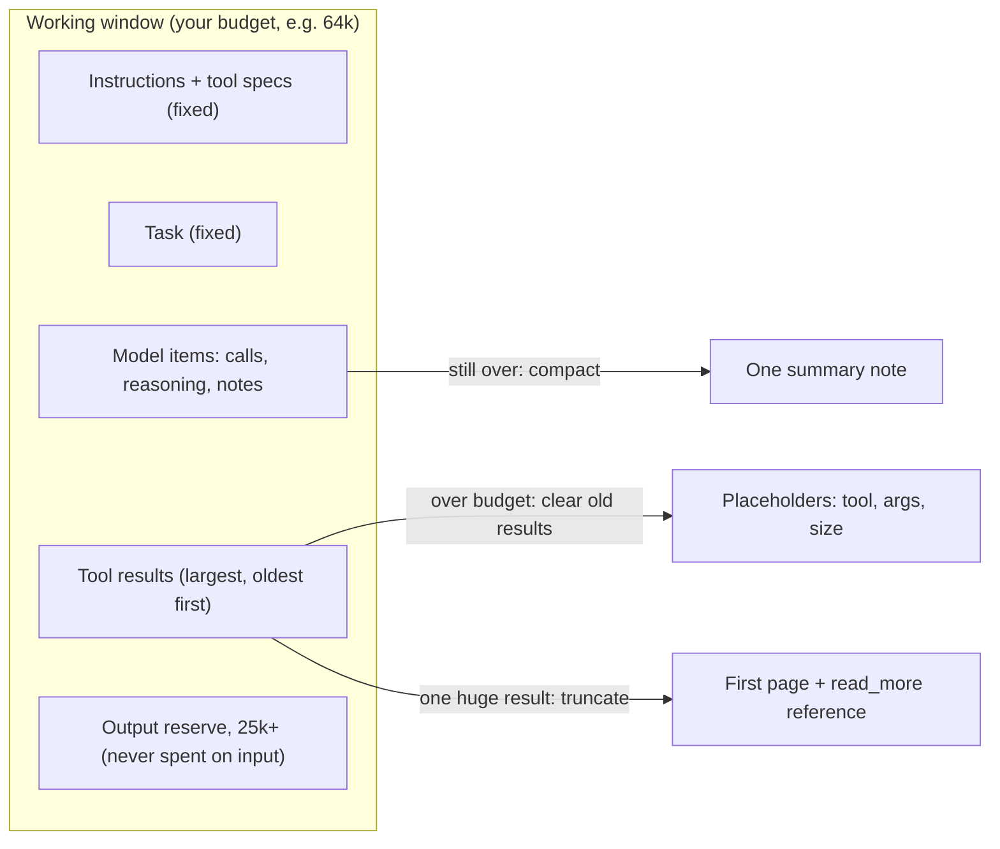
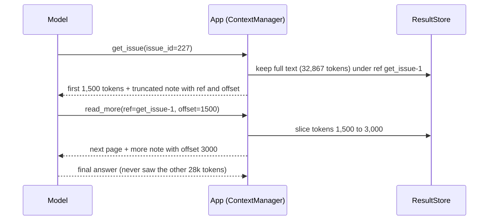
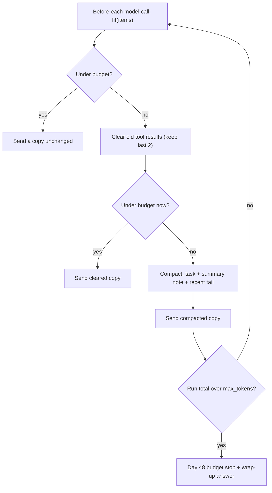

# Context Engineering: Budgets, Clearing & Compaction for Agents

Your Day 48 agent works until it reads something big. Orbit's longest issue carries more than 8,000 words of debug logs, and once the agent fetches it, every later step re-sends all of it. Cost climbs, the token budget stop fires, or the agent answers from the wrong half of the pile. Most long-running agent failures come from what you put in the window, not from the model, so today you manage the window deliberately and measure the result.

## At a Glance

- **Time:** ~2 h core (+ optional Go Deeper) · **Depth:** working
- **Prerequisites:** [Day 5: Inside the Transformer: Attention & Context Windows](../../Phase_1_How_LLMs_Work/Day_005_transformers_attention/transformers_attention.md), [Day 48: Your First Agent: The Loop, Stop Conditions & Budgets](../Day_048_first_agent/first_agent.md); helpful: [Day 4: Tokens: How Models Read Text](../../Phase_1_How_LLMs_Work/Day_004_tokens/tokens.md), [Day 35: Function Calling: The Tool Loop](../../Phase_4_Tools_and_MCP/Day_035_function_calling/function_calling.md)
- **You'll build:** `atlas/context.py` with `ContextBudget` and `ContextManager` (clear old tool results, truncate big results behind a `read_more` reference, compact history), wired into `run_agent(..., context=)` and measured before and after.
- **Stops at:** one agent's own window. Framework memory APIs start at [Day 53](../Day_053_langgraph_graphs/langgraph_graphs.md), long-term memory is [Day 50](../Day_050_agent_memory/agent_memory.md), and isolating work in sub-agents is [Day 64](../../Phase_7_Multi_Agent_Systems/Day_064_multi_agent_when/multi_agent_when.md).
- **Fast path:** Already budget tokens in production? Read "Name the Parts" and "Clear Old Tool Results", then do Exercise 2 (~45 min).
- **Cost:** ≈ $0.10 on `gpt-6-luna` for a few long-issue runs plus the 5-issue set per variant (prices as of 2026-11, [verify](https://developers.openai.com/api/docs/pricing)). Budget math, clearing and truncation run offline.
- **New terms:** context budget, output reserve, context rot, tool-result clearing, compaction

> **Coming from Software Engineering?** Treat the context window as a bounded in-memory working set (the data a process needs right now), with you as the memory manager. A budget with an output reserve is a heap with headroom, so allocation never fails mid-request. Clearing old tool results is cache eviction (dropping old entries to make room) that keeps the key, so the data can be re-fetched. Compaction is log rotation (archiving old logs into a compact form) with a summary on top, and fetch-by-reference is lazy loading: pass a pointer, not the whole blob.

## The Agent That Drowns in Its Own Notes

Recall the loop from [Day 48](../Day_048_first_agent/first_agent.md): each step sends the whole item list (instructions, tools, task, every earlier call and result), then appends the new calls and results. Nothing ever leaves. The script below replays a typical six-step investigation of Orbit's longest issue and counts what each call re-sends. It runs offline.

```python
# script_id: day_049_context_engineering/drowning_agent
# Replays a Day 48-style 6-step run on Orbit's longest issue and prints what each step re-sends.
# Install: uv add tiktoken   Env: ORBIT_DATA (default datasets/orbit)   Services: none (offline)
import os, sqlite3
from pathlib import Path
import tiktoken

DATA_DIR = Path(os.environ.get("ORBIT_DATA", "datasets/orbit"))
PRICE_IN = 0.10 / 1_000_000          # gpt-6-luna input, $/token (as of 2026-11; verify at the pricing page)
enc = tiktoken.get_encoding("o200k_base")   # approximate for GPT-6 (Day 4)

db = sqlite3.connect(f"file:{DATA_DIR / 'issues' / 'orbit.db'}?mode=ro", uri=True)
# Pick the long-log issue by property (most text), never by a hard-coded id
issue_id, body = db.execute("SELECT id, body FROM issues ORDER BY length(body) DESC LIMIT 1").fetchone()
comments = [c for (c,) in db.execute("SELECT body FROM comments WHERE issue_id = ? ORDER BY position", (issue_id,))]
issue_tokens = len(enc.encode("\n\n".join([body, *comments])))

# What each step ADDS to the history (call item + result); step 1 starts with instructions, tools, task
steps = [("search_issues", 400), (f"get_issue({issue_id})", issue_tokens), ("search_docs", 300),
         ("get_doc_section", 1_200), ("search_issues", 400), ("(answer)", 0)]
history, billed = 1_500, 0
print(f"issue #{issue_id}: {issue_tokens:,} tokens of logs\n")
print(f"{'step':<6}{'tool called':<18}{'input sent':>11}{'billed so far':>15}")
for n, (tool, added) in enumerate(steps, 1):
    billed += history                     # every call re-sends the whole history
    print(f"{n:<6}{tool:<18}{history:>11,}{billed:>15,}")
    history += added + 150                # +150 for the call item and a reasoning item
print(f"\ninput billed: {billed:,} tokens (≈ ${billed * PRICE_IN:.4f}); the log was re-sent {len(steps) - 2} times")
```

```text
issue #227: 32,867 tokens of logs

step  tool called        input sent  billed so far
1     search_issues           1,500          1,500
2     get_issue(227)          2,050          3,550
3     search_docs            35,067         38,617
4     get_doc_section        35,517         74,134
5     search_issues          36,867        111,001
6     (answer)               37,417        148,418

input billed: 148,418 tokens (≈ $0.0148); the log was re-sent 4 times
```

One tool result is 90% of every later request. A cent and a half per issue adds up, and Day 48's `max_tokens=100_000` stop now fires on a run that needed a few hundred tokens of that log. Worse, the model must find the two lines that matter in 33,000 tokens of dumps.

## A Desk, Not a Warehouse

Think of a desk. Everything on it is visible, but a crowded desk makes you miss the one note that matters. A good worker keeps the task and the latest papers on top, files the rest in a drawer with a label saying where to find it, and always leaves space to write.

That is the whole lesson in four moves:

1. **Keep** the task, the instructions and the most recent results in full.
2. **File** old results: replace the text with a label that says what it was and how to get it back.
3. **Fetch on demand:** show only the first page of a huge result, plus a reference to read more.
4. **Leave room to write:** never fill the window so far that the model can't reason and answer.

## A Budget by Hand

Do the arithmetic first on a toy agent with a 12,000-token working window. The reserve is 4,000 tokens, so input may use 8,000.

| Zone | Before | A 9k-token result lands | After clearing | After truncating the new result |
|---|---|---|---|---|
| Instructions + tool specs | 2,000 | 2,000 | 2,000 | 2,000 |
| Task | 500 | 500 | 500 | 500 |
| Model's own items (calls, reasoning, notes) | 1,500 | 1,500 | 1,500 | 1,500 |
| Old tool results | 3,000 | 3,000 | 100 (placeholders) | 100 |
| New tool result | 0 | 9,000 | 9,000 | 1,500 (+ reference) |
| **Input total** | 7,000 | **16,000** | **13,100** | **5,600** |
| Output reserve | 4,000 | 4,000 | 4,000 | 4,000 |
| Fits in 12,000? | yes | no | no | **yes** |

Clearing alone doesn't save you, because the new result is the problem. Truncating it to a first page with a pointer does. Notice what never shrinks: the instructions, the task and the reserve.

## Name the Parts

- **Context budget:** the number of tokens *you* allow one request to use. It is your working limit, a cost and quality choice. `gpt-6-luna` accepts 1,050,000 tokens (max input 922,000), but nobody should budget to that.
- **Output reserve:** the slice of the budget you keep free for reasoning plus the answer. OpenAI's reasoning guide suggests reserving at least 25,000 tokens when you start, and the reserve is what you pass as `max_output_tokens`.
- **Context rot:** the model's grip on any one fact weakens as more tokens surround it. "It fits" does not mean "the model uses it well". [Day 5](../../Phase_1_How_LLMs_Work/Day_005_transformers_attention/transformers_attention.md) covered why; today adds the agent angle, where the noise is your own old tool results.
- **Tool-result clearing:** replacing the text of old `function_call_output` items with a short placeholder, while keeping every item and its `call_id`.
- **Compaction:** replacing many old items with one compact summary (DIY) or with an opaque `compaction` item produced by the server.

One more idea needs no new name: **fetch-by-reference** returns a capped first page plus a pointer, and gives the model a `read_more` tool to fetch further pages.



## Count Before You Cut

You can't manage what you don't measure. The smallest useful budget counts each item as serialized JSON and compares the total to what is left after the reserve.

```python
# script_id: day_049_context_engineering/context_budget
# The smallest useful context budget: count what you send, keep a reserve. Offline.
# Install: uv add tiktoken   Env: ORBIT_DATA (default datasets/orbit)   Services: none
import json, os, sqlite3
from dataclasses import dataclass
from pathlib import Path
import tiktoken

enc = tiktoken.get_encoding("o200k_base")       # approximate for GPT-6 (Day 4)

@dataclass
class ContextBudget:
    window: int                                  # YOUR working limit, not the model maximum
    output_reserve: int                          # room for reasoning + the answer

    @property
    def available_input(self) -> int:
        return self.window - self.output_reserve

    def used(self, items: list[dict]) -> int:    # serialize each item, count its tokens
        return sum(len(enc.encode(json.dumps(i, ensure_ascii=False))) for i in items)

DATA_DIR = Path(os.environ.get("ORBIT_DATA", "datasets/orbit"))
db = sqlite3.connect(f"file:{DATA_DIR / 'issues' / 'orbit.db'}?mode=ro", uri=True)
iid, body = db.execute("SELECT id, body FROM issues ORDER BY length(body) DESC LIMIT 1").fetchone()
items = [{"role": "user", "content": f"Investigate Orbit issue #{iid}."},
         {"type": "function_call", "call_id": "c1", "name": "get_issue", "arguments": json.dumps({"issue_id": iid})},
         {"type": "function_call_output", "call_id": "c1", "output": body}]
b = ContextBudget(window=64_000, output_reserve=25_000)
used = b.used(items)
print(f"used={used:,} reserve={b.output_reserve:,} available_input={b.available_input:,} fits={used <= b.available_input}")
```

```text
used=32,790 reserve=25,000 available_input=39,000 fits=True
```

It fits, barely: one more doc page and this run is over budget. The count is approximate (tiktoken has no GPT-6 mapping). For exact numbers, `client.responses.input_tokens.count` takes the same `input` and `tools` as `create`.

```python
# script_id: day_049_context_engineering/live_checks
# Exact vs approximate token counts, then two ways to break an agent's context. Needs a key.
# Install: uv add "openai>=3.46,<4" tiktoken   Env: OPENAI_API_KEY, ATLAS_MODEL, ORBIT_DATA
import json, os, sqlite3
from pathlib import Path
import openai, tiktoken
from openai import OpenAI

MODEL = os.environ.get("ATLAS_MODEL", "gpt-6-luna")
DATA_DIR = Path(os.environ.get("ORBIT_DATA", "datasets/orbit"))
client = OpenAI()
enc = tiktoken.get_encoding("o200k_base")
GET_ISSUE = {"type": "function", "name": "get_issue", "description": "Full text of one Orbit issue.",
             "strict": True, "parameters": {"type": "object", "additionalProperties": False,
             "required": ["issue_id"], "properties": {"issue_id": {"type": "integer"}}}}

db = sqlite3.connect(f"file:{DATA_DIR / 'issues' / 'orbit.db'}?mode=ro", uri=True)
iid, body = db.execute("SELECT id, body FROM issues ORDER BY length(body) DESC LIMIT 1").fetchone()
items = [{"role": "user", "content": f"Investigate Orbit issue #{iid}."},
         {"type": "function_call", "call_id": "c1", "name": "get_issue", "arguments": json.dumps({"issue_id": iid})},
         {"type": "function_call_output", "call_id": "c1", "output": body}]
approx = sum(len(enc.encode(json.dumps(i, ensure_ascii=False))) for i in items)
exact = client.responses.input_tokens.count(model=MODEL, input=items, tools=[GET_ISSUE]).input_tokens
print(f"approx={approx:,} exact={exact:,} diff={exact - approx:+,}")
```

```text
approx=32,790 exact=… diff=…      # exact needs a key; expect them to differ by a few percent
```

Use the free local count inside the loop, and calibrate it against the exact count once per model.

## Break It: No Reserve, Broken Pairs

Two mistakes cause most context bugs. The first fills the window with input and leaves no room to answer. The second "frees space" by deleting items, which breaks the pairing between a call and its output. Both blocks continue `live_checks`.

```python
# script_id: day_049_context_engineering/live_checks
# (a) No reserve: a tiny output cap on a big input. Reasoning eats the cap before any text appears.
ask = items + [{"role": "user", "content": "Diagnose this issue."}]
r = client.responses.create(model=MODEL, input=ask, tools=[GET_ISSUE], max_output_tokens=200)
reason = r.incomplete_details.reason if r.incomplete_details else None
print(f"(a) status={r.status} reason={reason} text={r.output_text[:60]!r}")

# (b) Delete the call but keep its output: what naive "drop the oldest items" code does
orphan = [items[0], items[2], {"role": "user", "content": "Diagnose this issue."}]
try:
    client.responses.create(model=MODEL, input=orphan, tools=[GET_ISSUE])
except openai.BadRequestError as e:
    print(f"(b) HTTP {e.status_code}: {e.message[:120]}")
else:
    print("(b) accepted: no 400 on this model, so the pairing rule still applies (⚠ verify)")
```

```text
(a) status=incomplete reason=max_output_tokens text=''   # typical; depends on reasoning effort
(b) HTTP 400: …                     # message text not captured here (run without a key); ⚠ verify
```

When (a) comes back incomplete, you paid for input and reasoning and got nothing. The fix is a 25,000+ reserve passed as `max_output_tokens`, plus a loop that treats `incomplete` as an error step. In (b) the API rejects a `function_call_output` whose `call_id` matches no `function_call` in the input. OpenAI's migration guide lists both "sending a function result without the matching `call_id`" and "dropping reasoning, function call, or function call output items" as common errors. Whether dropping a reasoning item alone returns a 400 or quietly degrades the answer is not documented (⚠ verify), so the code never drops one alone; compaction removes whole old groups. **The rule for everything that follows: edit the content of items, never delete individual items from the middle of a pair.**

## Clear Old Tool Results

The cheapest fix is clearing. Once a result is a few steps old, the model has usually already acted on it: it noted the duplicate, picked the next doc. Replace its text with a placeholder that says which tool produced it, with which arguments, how big it was, and how to get it back. Every item and every `call_id` stays, so the pairing rule holds.

The realistic module starts with item helpers and a stricter budget. SDK output items are Pydantic models and your own items are dicts, so `as_dict` normalizes both and always returns copies: `fit()` must never mutate the caller's list, because Day 61 calls it once per graph node.

```python
# script_id: day_049_context_engineering/atlas_context
# atlas/context.py: budget, clear, truncate-by-reference and compact an agent's item list.
# Install: uv add tiktoken   Env: ORBIT_DATA (demo only)   Services: none. Runs offline:
# compaction takes any summarize(text) -> str callable, so the model call lives in agent code.
from __future__ import annotations
import copy, json, os, sqlite3
from dataclasses import dataclass
from pathlib import Path
from typing import Any, Callable, Iterable

import tiktoken

_ENC = tiktoken.get_encoding("o200k_base")   # approximate for GPT-6; exact: responses.input_tokens.count


def as_dict(item: Any) -> dict:
    """SDK items are Pydantic models, ours are dicts. Always return a copy we may edit."""
    if hasattr(item, "model_dump"):
        return item.model_dump(exclude_none=True)
    return copy.deepcopy(dict(item))


def count_tokens(text: str) -> int:          # built on Day 4
    return len(_ENC.encode(text))


def item_tokens(item: Any) -> int:
    return count_tokens(json.dumps(as_dict(item), ensure_ascii=False))


@dataclass(frozen=True)
class ContextBudget:
    window: int = 64_000           # your working limit (cost + quality), not the model's 1.05M
    output_reserve: int = 25_000   # reasoning + answer; pass it as max_output_tokens

    def __post_init__(self) -> None:
        if not 0 < self.output_reserve < self.window:
            raise ValueError("need 0 < output_reserve < window")

    @property
    def available_input(self) -> int:
        return self.window - self.output_reserve

    def used(self, items: Iterable[Any]) -> int:
        return sum(item_tokens(i) for i in items)

    def fits(self, items: Iterable[Any]) -> bool:
        return self.used(items) <= self.available_input
```

Now the clearing itself, plus a `pairing_ok` check you can assert in tests.

```python
# script_id: day_049_context_engineering/atlas_context
CLEARED = "[cleared: {name}({args}) returned ~{n:,} tokens; call {name} again to re-read]"


def _text(output: Any) -> str:
    return output if isinstance(output, str) else json.dumps(output, ensure_ascii=False)


def clear_tool_results(items: Iterable[Any], keep_last: int = 2, min_tokens: int = 200) -> list[dict]:
    """Replace the text of all but the last `keep_last` tool results with a placeholder.
    Every item and call_id survives, so each function_call keeps its output (no 400)."""
    out = [as_dict(i) for i in items]
    calls = {i["call_id"]: i for i in out if i.get("type") == "function_call"}
    outputs = [i for i in out if i.get("type") == "function_call_output"]
    for item in outputs[:-keep_last] if keep_last else outputs:
        text = _text(item["output"])
        if text.startswith("[cleared:") or count_tokens(text) < min_tokens:
            continue                                  # already cleared, or too small to matter
        call = calls.get(item["call_id"], {})
        item["output"] = CLEARED.format(name=call.get("name", "tool"),
                                        args=call.get("arguments", ""), n=count_tokens(text))
    return out


def pairing_ok(items: Iterable[Any]) -> bool:
    """Every function_call has exactly one output and every output has its call."""
    d = [as_dict(i) for i in items]
    calls = sorted(i["call_id"] for i in d if i.get("type") == "function_call")
    outs = sorted(i["call_id"] for i in d if i.get("type") == "function_call_output")
    return calls == outs
```

The placeholder carries the tool name and arguments, so a model that needs the data again repeats the identical call instead of guessing new searches. `min_tokens` skips small results: clearing 60 tokens saves nothing and costs a cache miss.

## Fetch by Reference

Clearing helps with *old* results. The 33,000-token issue is a *new* result, and the model needs part of it right now. So cap every tool result at about 1,500 tokens, keep the full text in a store on your side, and give the model a tool to page through it.



```python
# script_id: day_049_context_engineering/atlas_context
class ResultStore:
    """Full tool results live here; the model sees a capped first page plus a reference."""

    def __init__(self, max_tokens: int = 1_500) -> None:
        self.max_tokens = max_tokens
        self._blobs: dict[str, list[int]] = {}       # ref -> token ids of the full text

    def cap(self, tool: str, text: str) -> str:
        toks = _ENC.encode(text)
        if len(toks) <= self.max_tokens:
            return text
        ref = f"{tool}-{len(self._blobs) + 1}"
        self._blobs[ref] = toks
        rest = len(toks) - self.max_tokens
        return (_ENC.decode(toks[: self.max_tokens]) + f"\n[truncated: {rest:,} more tokens; "
                f'use read_more(ref="{ref}", offset={self.max_tokens})]')

    def read_more(self, ref: str, offset: int) -> str:
        toks = self._blobs.get(ref)
        if toks is None:                              # an error the model can act on (Day 37)
            return f"error: unknown ref {ref!r}; use a ref from a [truncated: ...] note"
        offset = max(0, offset)                       # a model can send a negative offset
        end = offset + self.max_tokens
        tail = f'\n[more: use read_more(ref="{ref}", offset={end})]' if end < len(toks) else "\n[end]"
        return _ENC.decode(toks[offset:end]) + tail


READ_MORE_TOOL = {
    "type": "function", "name": "read_more", "strict": True,
    "description": "Read the next page of a truncated tool result. Use only a ref and offset "
                   "taken from a [truncated: ...] or [more: ...] note.",
    "parameters": {"type": "object", "additionalProperties": False, "required": ["ref", "offset"],
                   "properties": {"ref": {"type": "string"}, "offset": {"type": "integer"}}},
}
```

The store lives for one run; making it survive a crash is [Day 54](../Day_054_langgraph_durability/langgraph_durability.md)'s checkpointing.

## Compaction, Two Ways

Sometimes clearing and truncating are not enough: a 30-step run accumulates calls, reasoning and short results that all add up. Compaction replaces the old middle of the transcript with one summary. Start with the DIY version, rewritten from an older chat-style `SummarizingConversationManager` onto Responses items.

```python
# script_id: day_049_context_engineering/atlas_context
SUMMARY_PROMPT = ("Summarize these earlier agent steps for the agent itself. Copy issue numbers, doc ids, "
                  "versions, config keys and error codes VERBATIM. Say what was found, what was ruled "
                  "out and what is still open. At most 200 words.")


def render(items: list[dict]) -> str:
    """Plain-text transcript for the summarizer. Reasoning items are opaque, so they are skipped."""
    lines = []
    for i in items:
        kind = i.get("type", "message")
        if kind == "function_call":
            lines.append(f"CALL {i['name']}({i['arguments']})")
        elif kind == "function_call_output":
            lines.append(f"RESULT: {_text(i['output'])}")
        elif kind == "message":
            c = i.get("content")
            text = c if isinstance(c, str) else " ".join(p.get("text", "") for p in c or [])
            lines.append(f"{i.get('role', '?').upper()}: {text}")
    return "\n".join(lines)


def safe_split(items: list[dict], keep_recent: int) -> int:
    """Start of the recent tail, moved left so no call is separated from its output or reasoning."""
    cut = max(1, len(items) - max(1, keep_recent))
    while cut > 1 and (items[cut].get("type") == "function_call_output"
                       or items[cut - 1].get("type") in ("reasoning", "function_call")):
        cut -= 1
    return cut


def compact(items: Iterable[Any], summarize: Callable[[str], str], keep_recent: int = 6) -> list[dict]:
    """DIY compaction: the task (items[0]) + one summary note + the recent tail."""
    out = [as_dict(i) for i in items]
    if any(i.get("type") == "compaction" for i in out):
        return out                       # server-side compaction owns this transcript; don't mix
    cut = safe_split(out, keep_recent)
    if cut <= 1:
        return out                       # nothing old enough to summarize
    note = summarize(render(out[1:cut]))
    return [out[0], {"role": "user", "content": f"[Notes on earlier steps]\n{note}"}, *out[cut:]]
```

The task message is never summarized, and neither are the instructions, which travel separately in `instructions=`. A summary that paraphrases the task is how agents drift onto a different problem.

The `ContextManager` ties the pieces together in a fixed order, cheapest first:



```python
# script_id: day_049_context_engineering/atlas_context
class ContextManager:
    """Keeps an agent's input under budget: clear old results first, compact only if still over."""

    def __init__(self, budget: ContextBudget | None = None, *, keep_last: int = 2,
                 max_tool_tokens: int | None = 1_500, keep_recent: int = 6,
                 summarize: Callable[[str], str] | None = None) -> None:
        self.budget = budget or ContextBudget()
        self.keep_last, self.keep_recent, self.summarize = keep_last, keep_recent, summarize
        self.store = ResultStore(max_tool_tokens) if max_tool_tokens else None

    def cap(self, tool: str, text: str) -> str:          # wrap every tool result with this
        return self.store.cap(tool, text) if self.store else text

    def tools(self) -> list[dict]:                        # extra tool specs this manager needs
        return [READ_MORE_TOOL] if self.store else []

    def clear_tool_results(self, items: Iterable[Any], keep_last: int | None = None) -> list[dict]:
        return clear_tool_results(items, self.keep_last if keep_last is None else keep_last)

    def compact(self, items: Iterable[Any]) -> list[dict]:
        if self.summarize is None:                        # no summarizer configured: clear-only mode
            return [as_dict(i) for i in items]
        return compact(items, self.summarize, self.keep_recent)

    def fit(self, items: Iterable[Any]) -> list[dict]:
        """Return a NEW list that fits when possible. Never mutates `items`."""
        out = [as_dict(i) for i in items]
        if self.budget.fits(out):
            return out
        out = self.clear_tool_results(out)
        if self.budget.fits(out):
            return out
        return self.compact(out)        # may still be over: run_agent's max_tokens stop is the backstop
```

The last block adds an offline Orbit transcript (reused by the exercises) and a demo with a stand-in summarizer, so you can watch every stage fire without a key. The tiny 3,000-token input budget is deliberate: it forces each stage to run.

```python
# script_id: day_049_context_engineering/atlas_context
def orbit_transcript(data_dir: Path | None = None, n_docs: int = 3) -> list[dict]:
    """An offline agent transcript: a search, the long-log issue, then its component's docs."""
    data_dir = data_dir or Path(os.environ.get("ORBIT_DATA", "datasets/orbit"))
    db = sqlite3.connect(f"file:{data_dir / 'issues' / 'orbit.db'}?mode=ro", uri=True)
    iid, title, body = db.execute(
        "SELECT id, title, body FROM issues ORDER BY length(body) DESC LIMIT 1").fetchone()
    comp = db.execute("SELECT l.value FROM labels l JOIN issue_labels il ON il.label_id = l.id "
                      "WHERE il.issue_id = ? AND l.kind = 'comp'", (iid,)).fetchone()[0]
    db.close()
    docs = list(dict.fromkeys([data_dir / "docs" / f"{comp}.md", *sorted((data_dir / "docs").glob("*.md"))]))
    calls = [("search_issues", {"query": title[:40]}, "[5 short search results]"), ("get_issue", {"issue_id": iid}, body)]
    calls += [("get_doc_section", {"doc_id": p.stem, "heading": ""}, p.read_text(encoding="utf-8")) for p in docs[:n_docs]]
    items: list[dict] = [{"role": "user", "content": f"Investigate Orbit issue #{iid}: duplicate? docs? cause?"}]
    for n, (name, args, result) in enumerate(calls, 1):
        items += [{"type": "function_call", "call_id": f"call_{n}", "name": name, "arguments": json.dumps(args)},
                  {"type": "function_call_output", "call_id": f"call_{n}", "output": result}]
    return items


if __name__ == "__main__":
    import re
    items = orbit_transcript()
    fake = lambda text: "kept " + ", ".join(sorted(set(re.findall(r"ORB-\d{4}|#\d+", text))))  # no model call
    cm = ContextManager(ContextBudget(window=28_000, output_reserve=25_000), keep_recent=2, summarize=fake)
    b = cm.budget
    print(f"start:     {len(items)} items, {b.used(items):,} tokens (available_input={b.available_input:,})")
    cleared = cm.clear_tool_results(items)
    print(f"cleared:   {b.used(cleared):,} tokens, pairing_ok={pairing_ok(cleared)}, original still {b.used(items):,}")
    fitted = cm.fit(items)
    note = next((i["content"] for i in fitted if str(i.get("content", "")).startswith("[Notes")), "(none)")
    print(f"fit():     {len(fitted)} items, {b.used(fitted):,} tokens, pairing_ok={pairing_ok(fitted)}")
    print(f"note:      {note.splitlines()[-1]}")
    capped = cm.cap("get_issue", items[4]["output"])
    print(f"capped:    {count_tokens(capped):,} tokens, ends {capped.splitlines()[-1]}")
    page = cm.store.read_more(ref="get_issue-1", offset=1_500)
    print(f"read_more: {count_tokens(page):,} tokens, ends {page.splitlines()[-1]}")
```

```text
start:     11 items, 37,518 tokens (available_input=3,000)
cleared:   3,484 tokens, pairing_ok=True, original still 37,518
fit():     4 items, 1,667 tokens, pairing_ok=True
note:      kept ORB-1201, ORB-1202, ORB-1501, ORB-1502, ORB-1503, ORB-1601
capped:    1,526 tokens, ends [truncated: 30,914 more tokens; use read_more(ref="get_issue-1", offset=1500)]
read_more: 1,518 tokens, ends [more: use read_more(ref="get_issue-1", offset=3000)]
```

In the `note` line, the log's `ORB-1001` and `#227` are missing, because `fit()` cleared the log *before* compacting, so the summarizer never saw it. Cheapest-first is the right default, but it means a cleared result's facts survive only in the placeholder or in the model's own earlier notes. Exercise 3 makes you check fact survival in code.

### Server-side compaction

OpenAI can compact for you. Add `context_management=[{"type": "compaction", "compact_threshold": N}]` to `responses.create`. When the rendered context passes `N` tokens, the server compacts, emits an opaque `compaction` output item and continues. With a manual item list you append the output as usual, and you *may* drop everything before the latest compaction item. Never edit that item: it is encrypted and not meant to be read. There is also a standalone `client.responses.compact(model=..., input=[...])` for when you want to choose the moment; its output is the canonical next window, so pass it back as-is.

```python
# script_id: day_049_context_engineering/server_compaction
# Server-side compaction: inline in responses.create, then the standalone compact endpoint.
# Install: uv add "openai>=3.46,<4"   Env: OPENAI_API_KEY, ATLAS_MODEL, ORBIT_DATA, ATLAS_COMPACT_THRESHOLD
import os, sqlite3
from pathlib import Path
import openai
from openai import OpenAI

MODEL = os.environ.get("ATLAS_MODEL", "gpt-6-luna")
# The guide's examples use 200_000 and state no minimum (⚠ verify). Low here so a demo triggers it;
# if the API rejects it, raise ATLAS_COMPACT_THRESHOLD rather than editing code.
THRESHOLD = int(os.environ.get("ATLAS_COMPACT_THRESHOLD", "20000"))
DATA_DIR = Path(os.environ.get("ORBIT_DATA", "datasets/orbit"))
client = OpenAI()

db = sqlite3.connect(f"file:{DATA_DIR / 'issues' / 'orbit.db'}?mode=ro", uri=True)
iid, body = db.execute("SELECT id, body FROM issues ORDER BY length(body) DESC LIMIT 1").fetchone()
items: list = []                                  # a long transcript: the log pasted in parts
for n, start in enumerate(range(0, len(body), 12_000), 1):
    items += [{"role": "user", "content": f"Log part {n} of issue #{iid}:\n{body[start:start + 12_000]}"},
              {"role": "assistant", "content": "Noted."}]
items.append({"role": "user", "content": "Which error code appears, and what do the two symptoms share?"})

try:
    resp = client.responses.create(model=MODEL, input=items, store=False,  # store=False: ZDR-friendly
                                   context_management=[{"type": "compaction", "compact_threshold": THRESHOLD}])
except openai.BadRequestError as e:
    raise SystemExit(f"rejected ({e.message[:120]}); try a larger ATLAS_COMPACT_THRESHOLD")
print("output types:", [i.type for i in resp.output], "| input tokens:", resp.usage.input_tokens)
items += resp.output
latest = max((n for n, i in enumerate(items) if getattr(i, "type", None) == "compaction"), default=None)
if latest is None:
    print(f"no compaction item: the context stayed under {THRESHOLD:,} tokens")
else:   # the guide allows dropping items before the latest compaction item, whatever the order in output
    items = items[latest:]

window = client.responses.compact(model=MODEL, input=items)   # you pick the moment; don't prune its output
nxt = client.responses.create(model=MODEL, store=False,
                              input=[*window.output, {"role": "user", "content": "One-line fix suggestion?"}])
print(len(window.output), "items in the compacted window |", nxt.output_text[:200])
```

```text
output types: [… 'compaction' …, 'message'] | input tokens: …   # shape only; item order not verified
… items in the compacted window | …
```

| | DIY `compact()` | Server `context_management` |
|---|---|---|
| You can read the summary | yes | no (opaque, encrypted) |
| You control what is kept verbatim | yes, via the prompt | no |
| Extra calls | one summarizer call per compaction | none (or one `compact` call) |
| Works with any provider | yes | OpenAI Responses only |
| Testable offline | yes, with a fake summarizer | no |

## Wire It Into the Agent

Save the script above as `atlas_context.py` (Day 61 turns it into `atlas/context.py`) and the blocks below as `atlas_agent.py` beside it. They hold a compact Day 48 agent with one new parameter. `context.fit()` runs before every model call, every tool result goes through `context.cap()`, and `read_more` joins the tools when truncation is on. The reserve becomes `max_output_tokens`, `incomplete` counts as an error step, and the Day 48 budget stop stays as the backstop. `fit()` counts items only, not `instructions` or tool specs, so leave slack in the window.

```python
# script_id: day_049_context_engineering/atlas_agent
# Compact Day 48 agent + context= hook. Install: uv add "openai>=3.46,<4" tiktoken
# Env: OPENAI_API_KEY, ATLAS_MODEL (default gpt-6-luna), ORBIT_DATA   Services: none
# built on Day 48 (run_agent, AgentConfig, AgentResult) and Days 35-36 (tools); full versions there
from __future__ import annotations
import json, os, re, sqlite3, time
from dataclasses import dataclass
from pathlib import Path
from typing import Callable

from openai import OpenAI
from atlas_context import SUMMARY_PROMPT, ContextBudget, ContextManager

MODEL = os.environ.get("ATLAS_MODEL", "gpt-6-luna")
DATA_DIR = Path(os.environ.get("ORBIT_DATA", "datasets/orbit"))
DB = f"file:{DATA_DIR / 'issues' / 'orbit.db'}?mode=ro"          # read-only: the agent never writes
client = OpenAI()


def _q(sql: str, *args) -> list[tuple]:
    db = sqlite3.connect(DB, uri=True)
    try:
        return db.execute(sql, args).fetchall()
    finally:
        db.close()


def search_issues(query: str) -> str:
    words = re.findall(r"\w+", query.lower())[:4] or [""]
    where = " AND ".join("lower(title || ' ' || body) LIKE ?" for _ in words)
    rows = _q(f"SELECT id, title, state, duplicate_of FROM issues WHERE {where} LIMIT 5", *[f"%{w}%" for w in words])
    return json.dumps([dict(zip(("id", "title", "state", "duplicate_of"), r)) for r in rows])


def get_issue(issue_id: int) -> str:              # returns everything: this is the context hog
    row = _q("SELECT title, body FROM issues WHERE id = ?", issue_id)
    if not row:
        return f"error: no issue {issue_id}; use search_issues to find ids"
    comments = [b for (b,) in _q("SELECT body FROM comments WHERE issue_id = ? ORDER BY position", issue_id)]
    return "\n\n".join([f"# {row[0][0]}", row[0][1], *comments])
```

```python
# script_id: day_049_context_engineering/atlas_agent
def search_docs(query: str) -> str:               # keyword stand-in for R2's index (Day 34)
    words = set(re.findall(r"\w+", query.lower()))
    scored = [(sum(p.read_text(encoding="utf-8").lower().count(w) for w in words), p.stem)
              for p in (DATA_DIR / "docs").glob("*.md")]
    return json.dumps([doc for n, doc in sorted(scored, reverse=True)[:3] if n])


def get_doc_section(doc_id: str, heading: str) -> str:
    path = DATA_DIR / "docs" / f"{Path(doc_id).name}.md"        # .name blocks ../ traversal
    if not path.exists():
        return f"error: no doc {doc_id!r}; use search_docs first"
    text = path.read_text(encoding="utf-8")
    parts = [p for p in re.split(r"(?m)^(?=#{1,3} )", text) if heading.lower() in p[:120].lower()]
    return parts[0] if heading and parts else text


def _spec(fn: Callable, desc: str, **props: str) -> dict:
    return {"type": "function", "name": fn.__name__, "description": desc, "strict": True,
            "parameters": {"type": "object", "additionalProperties": False, "required": list(props),
                           "properties": {k: {"type": t} for k, t in props.items()}}}


REGISTRY = {f.__name__: f for f in (search_issues, get_issue, search_docs, get_doc_section)}
TOOLS = [_spec(search_issues, "Keyword search over past Orbit issues: ids, titles, duplicate_of.", query="string"),
         _spec(get_issue, "Full text of one Orbit issue with comments. Can be very long.", issue_id="integer"),
         _spec(search_docs, "Find up to 3 Orbit doc ids for a keyword query.", query="string"),
         _spec(get_doc_section, 'Read a doc section by heading text; heading="" returns the whole page.',
               doc_id="string", heading="string")]
AGENT_SYSTEM = ("You are Atlas, investigating Orbit issues for maintainers. Use the tools; never guess. "
                "Finish with: likely duplicate (issue number or none), relevant doc ids, likely cause, "
                "what is still unknown. Copy error codes and issue numbers exactly.")
PRICE_IN, PRICE_CACHED, PRICE_OUT = 0.10e-6, 0.01e-6, 0.50e-6  # gpt-6-luna $/token, as of 2026-11; verify
```

```python
# script_id: day_049_context_engineering/atlas_agent
@dataclass
class AgentConfig:                                 # Day 48 defaults
    max_steps: int = 8
    max_seconds: float = 60
    max_tokens: int = 100_000                      # cumulative input + output across steps
    max_errors: int = 3


@dataclass
class StepRecord:
    index: int
    tool_calls: list[str]
    errors: int
    input_tokens: int
    output_tokens: int
    ms: int


@dataclass
class AgentResult:
    text: str
    stop_reason: str
    steps: list[StepRecord]
    usage: dict
    cost_usd: float
    partial: bool


def run_tool(name: str, arguments: str, context: ContextManager | None) -> str:
    try:
        args = json.loads(arguments)
        if name == "read_more" and context and context.store:
            return context.store.read_more(**args)
        out = REGISTRY[name](**args)
    except Exception as e:                         # an envelope the model can read, not a crash (Day 37)
        return f"error: {type(e).__name__}: {e}"
    return context.cap(name, out) if context else out


def _cost(u) -> float:
    cached = u.input_tokens_details.cached_tokens
    return (u.input_tokens - cached) * PRICE_IN + cached * PRICE_CACHED + u.output_tokens * PRICE_OUT
```

```python
# script_id: day_049_context_engineering/atlas_agent
def run_agent(task: str, *, tools: list[dict] = TOOLS, system: str = AGENT_SYSTEM,
              config: AgentConfig = AgentConfig(), context: ContextManager | None = None) -> AgentResult:
    items: list = [{"role": "user", "content": task}]
    specs = tools + (context.tools() if context else [])
    extra = {"max_output_tokens": context.budget.output_reserve} if context else {}
    steps, usage, cost, errors, t0 = [], {"input_tokens": 0, "output_tokens": 0}, 0.0, 0, time.monotonic()
    stop = "max_steps"
    for n in range(1, config.max_steps + 1):
        if context:
            items = context.fit(items)             # clear / compact BEFORE the call, on a copy
        t = time.monotonic()
        resp = client.responses.create(model=MODEL, instructions=system, input=items, tools=specs, **extra)
        usage["input_tokens"] += resp.usage.input_tokens
        usage["output_tokens"] += resp.usage.output_tokens
        cost += _cost(resp.usage)
        items += resp.output                       # keep reasoning + calls: pairing!
        calls = [i for i in resp.output if i.type == "function_call"]
        outs = [run_tool(c.name, c.arguments, context) for c in calls]
        items += [{"type": "function_call_output", "call_id": c.call_id, "output": o} for c, o in zip(calls, outs)]
        bad = sum(o.startswith("error:") for o in outs) + (resp.status == "incomplete")
        errors = errors + bad if bad else 0        # consecutive error steps
        steps.append(StepRecord(n, [c.name for c in calls], bad, resp.usage.input_tokens,
                                resp.usage.output_tokens, int((time.monotonic() - t) * 1000)))
        if not calls and resp.status == "completed":
            return AgentResult(resp.output_text, "done", steps, usage, cost, False)
        if errors >= config.max_errors:
            stop = "max_errors"; break
        if usage["input_tokens"] + usage["output_tokens"] > config.max_tokens:
            stop = "max_tokens"; break
        if time.monotonic() - t0 > config.max_seconds:
            stop = "max_seconds"; break
    # Budget stop: one wrap-up call with no tools, so the run still ends with something usable (Day 48)
    items = context.fit(items) if context else items
    wrap = client.responses.create(model=MODEL, instructions=system, tools=specs, tool_choice="none", **extra,
                                   input=[*items, {"role": "user", "content": "Stop. State what you found and what is missing."}])
    return AgentResult(wrap.output_text, stop, steps, usage, cost + _cost(wrap.usage), True)
```

```python
# script_id: day_049_context_engineering/atlas_agent
def make_summarizer(model: str = MODEL, prompt: str = SUMMARY_PROMPT) -> Callable[[str], str]:
    """One cheap call that turns old steps into a note. Plug into ContextManager(summarize=...)."""
    def summarize(transcript: str) -> str:
        r = client.responses.create(model=model, instructions=prompt, input=transcript,
                                    reasoning={"effort": "low"})
        return r.output_text
    return summarize


def long_issue_id() -> int:                        # by property, never hard-coded
    return _q("SELECT id FROM issues ORDER BY length(body) DESC LIMIT 1")[0][0]


if __name__ == "__main__":
    task = f"Investigate Orbit issue #{long_issue_id()}: duplicate? what do the docs say? likely cause?"
    for label, ctx in [("baseline", None), ("context", ContextManager(summarize=make_summarizer()))]:
        r = run_agent(task, context=ctx)
        print(f"{label:<9} stop={r.stop_reason} steps={len(r.steps)} "
              f"input={r.usage['input_tokens']:,} cost=${r.cost_usd:.4f}")
        print("          input per step:", [s.input_tokens for s in r.steps])
```

```text
baseline  stop=… steps=… input=… cost=$…        # shape only: run it to get your numbers
          input per step: […]                   # look for the jump after get_issue
context   stop=… steps=… input=… cost=$…
          input per step: […]                   # expect flatter: the log arrives as 1,500-token pages
```

## Measure It

A context strategy is a claim about cost and quality, so test it the Day 48 way: same tasks, change one thing, report the numbers side by side. The tasks are the long-log issue plus the 5-issue set Day 48 saved in `agent_set.json` (if that file is missing, the script picks five issues by the same properties). Quality is checked by code where it can be: the answer must contain the log's rarest `ORB-` code and, when the issue has one, the gold duplicate number.

```python
# script_id: day_049_context_engineering/measure_context
# Scoreboard row D49: baseline vs clear vs clear+truncate vs +compaction. Needs a key.
# Install: uv add "openai>=3.46,<4" tiktoken   Env: OPENAI_API_KEY, ATLAS_MODEL, ORBIT_DATA
# Cost: ≈ $0.10 on gpt-6-luna for 6 tasks x 4 variants (as of 2026-11; verify at the pricing page)
import json, re
from pathlib import Path

from atlas_agent import DATA_DIR, make_summarizer, run_agent
from atlas_context import ContextBudget, ContextManager


def fallback_set(issues: dict[int, dict]) -> list[int]:
    """Day 48's properties: traceback bug, question, duplicate, vague, docs."""
    rules = [lambda r: "Traceback" in r["body"], lambda r: "type:question" in r["labels"],
             lambda r: r["duplicate_of"] is not None, lambda r: len(r["body"]) < 400,
             lambda r: "type:docs" in r["labels"]]
    return [next(i for i, r in sorted(issues.items()) if rule(r)) for rule in rules]


def load_cases() -> list[dict]:
    rows = (json.loads(line) for line in (DATA_DIR / "issues" / "issues.jsonl").open(encoding="utf-8"))
    issues = {r["id"]: r for r in rows}
    saved = Path("agent_set.json")                 # written by Day 48's pick_agent_set()
    # Day 48 saves a list of {"issue_id", "kind", "task"}; otherwise pick five by the same properties
    ids = [int(p["issue_id"]) for p in json.loads(saved.read_text())] if saved.exists() else fallback_set(issues)
    long_id = max(issues, key=lambda i: len(issues[i]["body"]))
    return [issues[i] for i in dict.fromkeys([long_id, *ids])]


def passes(issue: dict, answer: str) -> bool:
    codes = re.findall(r"ORB-\d{4}", issue["body"])
    want = [min(sorted(set(codes)), key=codes.count)] if codes else []   # rarest code; sorted() breaks ties the same way every run
    ok = all(w in answer for w in want)
    dup = issue["duplicate_of"]
    return ok and (dup is None or str(dup) in re.findall(r"\d+", answer))
```

```python
# script_id: day_049_context_engineering/measure_context
def variant(name: str) -> ContextManager | None:   # a fresh manager per run: its ResultStore is per run
    b = ContextBudget(window=64_000, output_reserve=25_000)
    return {"baseline": None,
            "clear": ContextManager(b, max_tool_tokens=None),
            "clear+truncate": ContextManager(b),
            # a tight window forces compaction to actually fire on these short runs
            "+compaction": ContextManager(ContextBudget(40_000, 25_000), summarize=make_summarizer())}[name]


if __name__ == "__main__":
    cases = load_cases()
    print(f"{'variant':<16}{'steps':>6}{'input tokens':>14}{'$':>9}{'checks':>8}")
    for name in ["baseline", "clear", "clear+truncate", "+compaction"]:
        steps = tokens = passed = 0
        cost = 0.0
        with open(f"answers_{name}.jsonl", "w", encoding="utf-8") as log:
            for issue in cases:
                r = run_agent(f"Investigate Orbit issue #{issue['id']}: duplicate? docs? likely cause?",
                              context=variant(name))
                steps, tokens, cost = steps + len(r.steps), tokens + r.usage["input_tokens"], cost + r.cost_usd
                passed += passes(issue, r.text)
                log.write(json.dumps({"id": issue["id"], "stop": r.stop_reason, "answer": r.text}) + "\n")
        print(f"{name:<16}{steps:>6}{tokens:>14,}{cost:>9.4f}{passed:>5}/{len(cases)}")
```

```text
variant          steps  input tokens        $  checks
baseline             …             …        …    …/6      # shape only: your numbers will differ
clear                …             …        …    …/6
clear+truncate       …             …        …    …/6
+compaction          …             …        …    …/6
```

Copy your row into the agent scoreboard. Short issues never approach the budget; the long issue is where clearing and truncation should show up. Compaction can lose a fact, and `checks` is how you find out. If a variant costs more or passes fewer checks, write that down.

## Which Strategy When

| Strategy | Saves | Risk | Use when |
|---|---|---|---|
| Output reserve | failed calls | none (fewer input tokens available) | always |
| Clear old tool results | old, already-used results | the model re-fetches what it needs | runs longer than ~5 steps, or results over a few hundred tokens |
| Truncate + `read_more` | one huge result | the answer sits on a page the model never reads | any tool that can return unbounded text (logs, files, pages) |
| DIY compaction | long histories of many small items | the summary drops an exact value | 20+ step runs; you need to read or test the summary |
| Server compaction | the same, with no summarizer code | opaque; OpenAI only | very long runs on Responses, or ZDR with `store=False` |

### In production

- Editing old items changes the cached prefix from that point on ([Day 18](../../Phase_2_Building_with_LLM_APIs/Day_018_cost_latency_caching/cost_latency_caching.md)), so `fit()` only edits when the budget is exceeded, which batches rewrites instead of breaking the cache every step.
- Never summarize the system instructions or the task; send them in full every call.
- Log per-step input tokens and which `fit()` stage fired, next to the Day 42 trace spans, and alert when a run passes about 70% of its budget.
- Server compaction output is opaque and works with `store=False`, which suits zero-data-retention setups; retention policy itself is [Day 73](../../Phase_8_Safety_and_Security/Day_073_privacy_pii/privacy_pii.md).
- When one agent's window can't hold the job even with all of this, the next tool is isolating sub-tasks in sub-agents with their own windows, which is [Day 64](../../Phase_7_Multi_Agent_Systems/Day_064_multi_agent_when/multi_agent_when.md).

## Go Deeper (optional)

<details><summary>Go deeper: context rot in plain words</summary>

A model reads every token in the window on every step, and attention ([Day 5](../../Phase_1_How_LLMs_Work/Day_005_transformers_attention/transformers_attention.md)) spreads a fixed amount of "focus" across all of them. More tokens means each one gets a smaller share, and similar-looking distractors compete with the fact you care about. Orbit's long issue is a worst case: thousands of near-identical log lines, two symptoms, one error code.

Chroma's context-rot study tested this across many models and reports that performance degrades as input length grows, even on simple retrieval-style tasks, and that distractors and the way the haystack is structured matter. The study and its code are in the [chroma-core/context-rot](https://github.com/chroma-core/context-rot) repository; read their numbers there rather than quoting a figure from memory.

The practical consequences for agents:

- "It fits in 1M tokens" is a capacity statement, not a quality statement. Budget well below the limit.
- Old tool results are distractors for the current step. Clearing them can improve answers, not only cost, but only your eval can say whether it does for your task.
- Put what matters where the model is most likely to use it: the task in full, recent results in full, older context as short labelled notes.

</details>

<details><summary>Go deeper: why step n re-bills steps 1 to n</summary>

In words: every call sends the whole history, so a result added at step k is paid for again at every step after it.

Toy numbers: six steps, each adding 1,000 tokens. Step 1 sends 1k, step 2 sends 2k, ..., step 6 sends 6k. Total input billed is 1 + 2 + 3 + 4 + 5 + 6 = 21k tokens, not 6k.

Formula: with a fixed prefix P and Δ tokens added per step, n steps bill n·P + Δ·n(n−1)/2 input tokens. The growth is quadratic in steps. A single big result R added at step k costs R·(n − k) extra, which is why the drowning replay above re-sent the 32,867-token log four times.

Prompt caching ([Day 18](../../Phase_2_Building_with_LLM_APIs/Day_018_cost_latency_caching/cost_latency_caching.md)) softens this: an unchanged prefix of 1,024+ tokens is billed at the cached rate ($0.01 vs $0.10 per 1M on `gpt-6-luna`, as of 2026-11, [verify](https://developers.openai.com/api/docs/pricing)). That is also the hidden cost of clearing: the first edited item and everything after it is no longer a cache hit on that call. Clearing in batches, only when over budget, pays that miss once instead of every step.

</details>

<details><summary>Go deeper: search inside a stored result instead of paging</summary>

Paging works when the answer is near the top. For logs it often isn't, and the model may page through 20 pages to find one line. Experts also give the model a search over the stored blob, so it pulls only matching lines. This extends the `ResultStore` from `atlas_context`; add the tool spec next to `READ_MORE_TOOL` and dispatch it the same way in `run_tool`.

```python
# script_id: day_049_context_engineering/search_ref
# A grep tool over a truncated result, so the model fetches matching lines, not pages. Offline.
# Install: uv add tiktoken   Env: ORBIT_DATA
import re
from atlas_context import ResultStore, _ENC, count_tokens, orbit_transcript


def search_ref(store: ResultStore, ref: str, pattern: str, max_lines: int = 20) -> str:
    toks = store._blobs.get(ref)
    if toks is None:
        return f"error: unknown ref {ref!r}"
    rx = re.compile(re.escape(pattern), re.IGNORECASE)            # literal match: no regex from the model
    hits = [line for line in _ENC.decode(toks).splitlines() if rx.search(line)]
    shown = hits[:max_lines]
    return "\n".join(shown) + f"\n[{len(hits)} matching lines, showing {len(shown)}]"


store = ResultStore()
issue_text = orbit_transcript()[4]["output"]
print(store.cap("get_issue", issue_text).splitlines()[-1])
result = search_ref(store, "get_issue-1", "ORB-")
print(f"{count_tokens(result)} tokens:\n{result}")
```

The pattern is escaped on purpose: a regex written by a model can be slow or wrong, and a literal substring is what a maintainer would grep for anyway.

</details>

## Common Pitfalls

- **HTTP 400 after clearing.** An output item was removed, or kept without its call, so a `call_id` no longer matches. Replace the `output` text and keep every item; assert `pairing_ok(items)` in tests.
- **The agent re-fetches the same cleared result in a loop.** The placeholder said nothing useful. Include the tool name, the exact arguments, the size, and "call again to re-read", as `CLEARED` does.
- **Cost goes up after adding compaction.** Each summarizer call costs tokens, and rewriting history breaks the cached prefix. Compact only when clearing wasn't enough, never every step.
- **Answers get worse after summarizing.** The summary paraphrased an exact value such as `ORB-1001` or `3.2.0`. Tell the summarizer to copy ids, versions and codes verbatim, then check that they survive in code (Exercise 3).
- **Empty answer with `status == "incomplete"`.** No output reserve: `max_output_tokens` was too small for reasoning plus the answer. Reserve 25,000+ and count `incomplete` as an error step.
- **`KeyError: 'Could not automatically map gpt-6-luna to a tokeniser...'`.** tiktoken has no GPT-6 mapping. Use `tiktoken.get_encoding("o200k_base")`, label the count approximate, and use `client.responses.input_tokens.count` for exact numbers.

> **Where we stop:** one agent managing its own window. Memory that survives across runs is [Day 50](../Day_050_agent_memory/agent_memory.md), framework helpers such as LangChain's summarization and context-editing middleware arrive with [Day 53](../Day_053_langgraph_graphs/langgraph_graphs.md), and splitting work across sub-agents with separate windows is [Day 64](../../Phase_7_Multi_Agent_Systems/Day_064_multi_agent_when/multi_agent_when.md).

## Key Takeaways

- Every agent step re-sends the whole item list, so one big tool result is billed again on every later step and buries the facts that matter. Measure tokens per step before changing anything.
- A context budget is your own working limit, not the model's maximum. Keep an output reserve of 25k+ and pass it as `max_output_tokens`, or reasoning eats the answer and you get `incomplete` with empty text.
- Shrink content, never pairs: clearing replaces old `function_call_output` text with a labelled placeholder and keeps every item and `call_id`; deleting a call or its output gets a 400.
- Cap big results and fetch the rest by reference with `read_more`; compact (DIY summary or server `context_management`) only when clearing and truncation are not enough, and keep ids and codes verbatim.
- `fit()` runs cheapest-first on a copy before every call, the Day 48 budget stop stays as the backstop, and the scoreboard (steps, tokens, $, checks) decides whether a strategy helped.

## Quick Reference

| API / pattern | When to use | Gotcha |
|---|---|---|
| `ContextBudget(window, output_reserve)` · `.available_input` | Every agent | `window` is your limit, not 1,050,000 |
| `client.responses.input_tokens.count(model=, input=, tools=)` | Exact count, once per model to calibrate | Needs a key; local tiktoken is approximate |
| `max_output_tokens=reserve` + check `resp.status == "incomplete"` | Every call | Input and reasoning are billed even when nothing comes back |
| `clear_tool_results(items, keep_last=2)` | Long runs | Edit `output` text only; keep items and `call_id`s |
| `ResultStore.cap()` + `read_more(ref, offset)` tool | Unbounded tool output | The store is per run; persist it if runs resume |
| `compact(items, summarize, keep_recent=6)` | 20+ step runs | Split only at safe points; never summarize the task |
| `context_management=[{"type": "compaction", "compact_threshold": N}]` | Server compaction | Append the opaque item; you may drop items before it; don't edit it |
| `client.responses.compact(model=, input=)` | Compact at a moment you choose | Pass `output` back as-is; don't prune it |
| `ContextManager.fit(items)` | Before every model call | Returns a new list; may still be over, so keep the budget stop |

## Exercises

1. **Warm-up.** Change `keep_last` to 0, 2 and 5 on the offline Orbit transcript. Print tokens, how many results were cleared, and `pairing_ok`. Then say which value you would ship and why.

<details><summary>Solution</summary>

```python
# script_id: day_049_context_engineering/solution_ex1
# Warm-up: the keep_last knob, offline. Install: uv add tiktoken   Env: ORBIT_DATA
from atlas_context import ContextBudget, clear_tool_results, orbit_transcript, pairing_ok

items = orbit_transcript(n_docs=5)
budget = ContextBudget()
print(f"before: {budget.used(items):,} tokens, {sum(i.get('type') == 'function_call_output' for i in items)} results")
for keep in (0, 2, 5):
    out = clear_tool_results(items, keep_last=keep)
    cleared = sum(str(i.get("output", "")).startswith("[cleared:") for i in out)
    print(f"keep_last={keep}: {budget.used(out):,} tokens, {cleared} cleared, pairing_ok={pairing_ok(out)}")
```

`keep_last=0` saves the most but blinds the model to the result it asked for one step ago, so it tends to call the same tool again (in a live run, count repeated tool names in `r.steps`). `keep_last=5` clears only the long log and keeps all five docs in full, so the saving is small. Tiny results (under `min_tokens`) are never cleared, which is why `keep_last=0` shows 6 cleared out of 7. 2 is a sensible default: the model keeps what it is acting on now.

</details>

2. **Core.** Run the agent on the long issue with `output_reserve=1_000` and then `25_000` (same 64k window). Compare `stop_reason`, steps, $ and the answer, and explain both results.

<details><summary>Solution</summary>

```python
# script_id: day_049_context_engineering/solution_ex2
# Exercise 2 (Core): the reserve effect. Needs a key.   Env: OPENAI_API_KEY, ORBIT_DATA
from atlas_agent import long_issue_id, run_agent
from atlas_context import ContextBudget, ContextManager

task = f"Investigate Orbit issue #{long_issue_id()}: duplicate? docs? likely cause?"
for reserve in (1_000, 25_000):
    cm = ContextManager(ContextBudget(window=64_000, output_reserve=reserve))
    r = run_agent(task, context=cm)
    errors = sum(s.errors for s in r.steps)
    print(f"reserve={reserve:>6,} stop={r.stop_reason} steps={len(r.steps)} error_steps={errors} "
          f"${r.cost_usd:.4f}\n  {r.text[:150]!r}")
```

This is a prediction to test, not a measured result (no live run backs it here). What to look for: if reasoning uses the whole 1,000-token cap, steps come back `incomplete`, `error_steps` climbs, and three in a row stop the run on `max_errors` with a thin wrap-up, while you still pay for every input. If your 1,000 run finishes with `done`, reasoning fit under the cap on this task; try a harder task or higher effort. With 25,000 the cap should rarely bind. Write down which case you saw: a small reserve saves money only when the answers still arrive.

</details>

3. **Core.** Tighten the summarizer prompt until the log's error code and the issue's Orbit version survive five compactions in a row. Check survival in code, not by eye.

<details><summary>Solution</summary>

```python
# script_id: day_049_context_engineering/solution_ex3
# Exercise 3 (Core): verbatim facts through 5 compactions. Needs a key.   Env: OPENAI_API_KEY, ORBIT_DATA
import json, re
from atlas_agent import make_summarizer
from atlas_context import SUMMARY_PROMPT, compact, orbit_transcript

items = orbit_transcript()
log = items[4]["output"]
facts = {re.findall(r"ORB-\d{4}", log)[0], re.findall(r"Orbit (\d+\.\d+\.\d+)", log)[0]}
prompt = SUMMARY_PROMPT + (" Start with a line 'FACTS:' listing every error code, version and issue "
                           "number from the input, copied exactly, including those from earlier notes.")
summarize = make_summarizer(prompt=prompt)
for rnd in range(1, 6):
    items = compact(items, summarize, keep_recent=2)
    note = items[1]["content"]
    print(f"round {rnd}: missing={sorted(f for f in facts if f not in note) or 'none'}")
    n = len(items)                       # one more step, so there is something new to compact
    items += [{"type": "function_call", "call_id": f"x{n}", "name": "search_docs",
               "arguments": json.dumps({"query": f"step {n}"})},
              {"type": "function_call_output", "call_id": f"x{n}", "output": "[3 short results]"}]
```

From round 2 on, the previous note is itself summarized, so a value lost once is lost for good. The `FACTS:` line gives the model a fixed slot to carry values forward. If anything is still missing after five rounds, keep a facts list in code (regex the codes out of results) and append it to the note instead of trusting the summary.

</details>

4. **Stretch (optional, past the stop line).** On a 30-step transcript, compare server compaction with DIY `compact()`: $, latency and whether the answer still contains the error code. This previews the trade-offs of framework memory APIs in Day 53.

<details><summary>Solution</summary>

```python
# script_id: day_049_context_engineering/solution_ex4
# Stretch: server vs DIY compaction on ~30 steps. Needs a key.   Env: OPENAI_API_KEY, ORBIT_DATA
import re, time
from atlas_agent import MODEL, _cost, client, make_summarizer
from atlas_context import compact, orbit_transcript

items = orbit_transcript(n_docs=28)                        # 30 call/result pairs
code = re.findall(r"ORB-\d{4}", items[4]["output"])[0]
q = {"role": "user", "content": "Which error code did the issue's log show, and the likely cause?"}
tool = [{"type": "function", "name": n, "description": n, "strict": True,
         "parameters": {"type": "object", "properties": {}, "required": [], "additionalProperties": False}}
        for n in ("search_issues", "get_issue", "get_doc_section")]

t = time.perf_counter()
diy_items = compact(items, make_summarizer(), keep_recent=4)
diy = client.responses.create(model=MODEL, input=[*diy_items, q], tools=tool)
diy_s = time.perf_counter() - t                            # includes the summarizer call

t = time.perf_counter()
srv = client.responses.create(model=MODEL, input=[*items, q], tools=tool, store=False,
                              context_management=[{"type": "compaction", "compact_threshold": 20_000}])
srv_s = time.perf_counter() - t
for name, r, s in [("diy", diy, diy_s), ("server", srv, srv_s)]:
    print(f"{name:<7} {s:5.1f}s ${_cost(r.usage):.4f} code_kept={code in r.output_text}")
```

The DIY cost line leaves out the summarizer call's own tokens; add them for a fair total. Server compaction needs no summarizer code, but you can't read or test what it kept. DIY lets you assert on the note. Repeat each a few times before concluding anything, because latency varies run to run. The tool specs are minimal stubs so the transcript's calls have matching definitions.

</details>

## References & Further Reading

- [OpenAI: Compaction](https://developers.openai.com/api/docs/guides/compaction): server-side `context_management` and the standalone compact endpoint, including what you may and may not prune.
- [OpenAI: Conversation state](https://developers.openai.com/api/docs/guides/conversation-state): manual item lists vs `previous_response_id`, and why prior tokens are still billed.
- [OpenAI: Token counting](https://developers.openai.com/api/docs/guides/token-counting): the exact `input_tokens` endpoint used to calibrate local counts.
- [OpenAI: Reasoning](https://developers.openai.com/api/docs/guides/reasoning): the 25k reserve advice and handling `incomplete`.
- [OpenAI: Function calling](https://developers.openai.com/api/docs/guides/function-calling): call and output item shapes and the `call_id` pairing.
- [Anthropic: Effective context engineering for AI agents](https://www.anthropic.com/research/effective-context-engineering-for-ai-agents): a practitioner view of context as a finite resource, with compaction, note-taking and just-in-time retrieval.
- [Chroma: context-rot](https://github.com/chroma-core/context-rot): the code and pointer to the report on how quality degrades with input length.
- [OpenAI: Prompt caching](https://developers.openai.com/api/docs/guides/prompt-caching): why editing history changes what is cached.

## What's Next

Your agent now keeps its window tidy within one run, but forgets everything when the run ends. [Day 50: Memory for Agents](../Day_050_agent_memory/agent_memory.md) decides what is worth keeping across runs, how to recall it into the window you budgeted today, and how to delete it.
