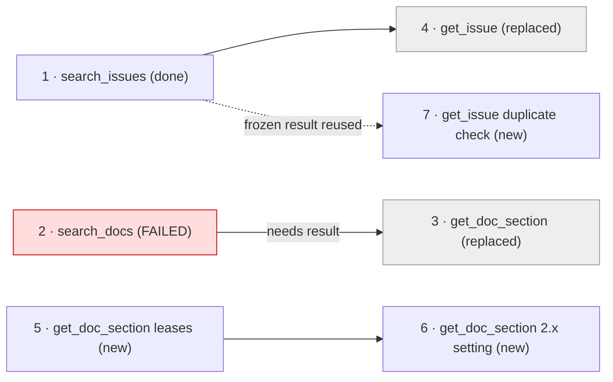
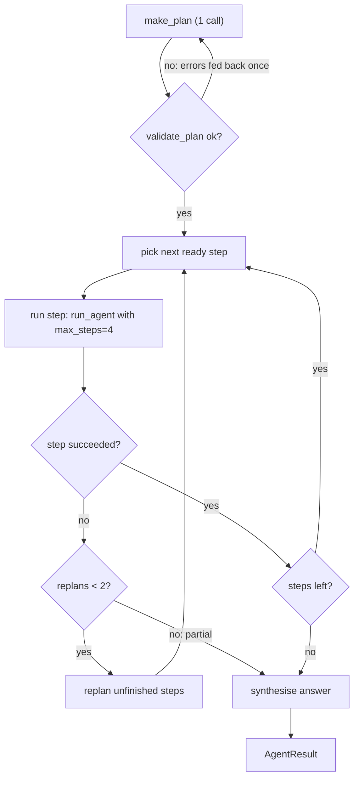
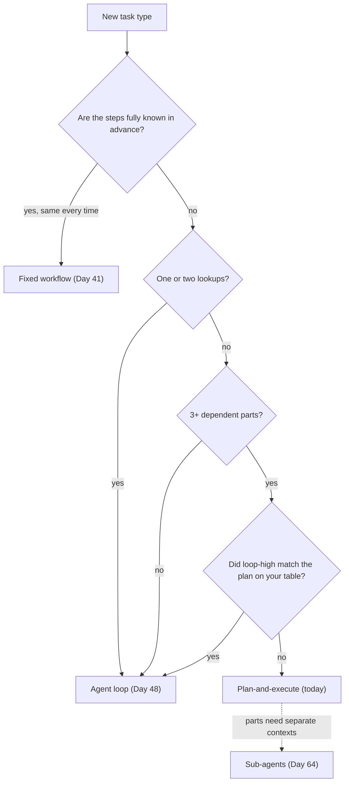

# Planning & Re-planning

Your Day 48 agent decides one step at a time. On a three-part Orbit investigation it sometimes wanders: it re-runs the same search, or answers two parts and forgets the third. A written plan costs one extra model call and gives you a progress bar, a budget per step, and a clear place to recover when a step fails. Does it pay for itself? Today you measure that on five tasks, and the honest answer is "for some of them".

## At a Glance

- **Time:** ~2 h core (+ optional Go Deeper) · **Depth:** working
- **Prerequisites:** [Day 48: Your First Agent: The Loop, Stop Conditions & Budgets](../Day_048_first_agent/first_agent.md), [Day 11: Reasoning: Chain-of-Thought & Reasoning Models](../../Phase_2_Building_with_LLM_APIs/Day_011_reasoning_cot/reasoning_cot.md); helpful: [Day 45: LLM-as-Judge](../../Phase_5_Evaluation_and_Observability/Day_045_llm_as_judge/llm_as_judge.md), [Day 16: Structured Outputs](../../Phase_2_Building_with_LLM_APIs/Day_016_structured_outputs/structured_outputs.md)
- **You'll build:** `atlas/plan.py`, a plan-and-execute agent with validated plans, per-step budgets and re-planning on failure, plus a plan-vs-loop scoreboard row on the Day 48 five-issue set.
- **Stops at:** tree search / MCTS (searching over many candidate plans). The critic loop belongs to [Day 41](../../Phase_4_Tools_and_MCP/Day_041_workflow_patterns/workflow_patterns.md).
- **Fast path:** Already run a plan-and-execute agent? Read "Plan vs Loop, Measured" and "Effort Instead of a Plan", then do Exercise 1 (~45 min).
- **Cost:** ≈ $0.15 on `gpt-6-luna` for the whole day (5 tasks × loop and plan, plus 3 effort variants; prices as of 2026-11, [verify](https://developers.openai.com/api/docs/pricing)).
- **New terms:** plan-and-execute, plan step, dependency, re-planning, done-when check

> **Coming from Software Engineering?** Plan-and-execute works like a build system such as `make` or Bazel. It computes a dependency graph first, then builds each target in order, and a failed target triggers a rebuild of everything downstream of it. The graph is a DAG (directed acyclic graph: steps joined by arrows with no cycles), and the run order is a topological order (every step comes after what it needs). The plan itself is like `EXPLAIN` in a database, which shows the query plan without running it, or a migration plan you review before applying. Re-planning is a retry that changes the query instead of repeating it.

## When the Loop Wanders

Give the Day 48 loop issue #22 ("Same job runs on two workers at once") and ask for a full investigation: find related past issues, check the lease docs for the reporter's version, and propose a fix. Run it three times and look at the step records:

```text
run 1  steps=7  tools=search_issues,search_issues,get_issue,search_docs,get_doc_section,search_docs  stop=done
run 2  steps=4  tools=search_docs,get_doc_section,search_docs                                          stop=done   # never looked for past issues
run 3  steps=8  tools=search_issues,search_docs,search_issues,search_docs,search_issues,...            stop=max_steps
```

*(Illustrative: your runs will differ.)* Nothing is broken: the loop picks each move from its context. Run 2 skipped a whole part of the task, and run 3 circled until the step budget stopped it.

## A Checklist Before the Trip

Before a road trip with five stops, you write a checklist: fuel, then the hotel, then the museum that closes at 5. It costs ten minutes and pays off because the stops depend on each other. For a trip to the corner shop, it's wasted effort.

**Plan-and-execute** is the same idea: one call writes a short list of steps, then the agent runs them one at a time. It helps when a task has several dependent parts. For a single lookup it's pure overhead: an extra call, extra tokens, extra latency.

## A Plan by Hand

Here is a plan for issue #22, written on paper. Each **plan step** has a goal, a tool hint, the steps it depends on, and a **done-when check**: an observable result that tells you the step finished.

| id | goal | tool hint | depends on | done when |
|---|---|---|---|---|
| 1 | Find past issues about one job running on two workers | `search_issues` | none | lists up to 3 issue ids with titles |
| 2 | Find what makes a lease expire in Orbit 2.8 | `search_docs` | none | names the doc id and the lease timeout rule |
| 3 | Get the exact setting that controls lease length in 2.x | `get_doc_section` | 2 | quotes the setting name and its default |
| 4 | Check whether the closest past issue is a duplicate | `get_issue` | 1 | says "duplicate of #N" or "not a duplicate", with a reason |

A **dependency** means "this step needs that step's result": step 3 waits for step 2, and step 4 waits for step 1.

Now suppose step 2 fails: the search returns nothing. Step 1 is finished, so you keep it. Steps 3 and 4 haven't run yet, so you rewrite them, along with a new attempt at step 2's goal (perhaps going straight to `get_doc_section("leases-and-heartbeats")`). That is **re-planning**: replace the unfinished part of the plan and keep what already worked.



## Name the Parts

| Part | What it is | Lives in |
|---|---|---|
| Plan | A goal plus 1–6 steps, as validated data | `Plan`, `PlanStep` |
| Planner | One structured-output call that writes the plan | `make_plan()` |
| Validator | Code that rejects a bad plan before it runs | `validate_plan()` |
| Executor | Runs ready steps in dependency order, each with a small budget | `execute_plan()` |
| Re-planner | Rewrites the unfinished steps after a failure, at most twice | `replan()` |
| Synthesis | One final call that turns step results into the answer | `run_planned_agent()` |



These steps are **not** sub-agents: one agent runs them all, and results pass forward as text. Isolated workers with their own context are [Day 64](../../Phase_7_Multi_Agent_Systems/Day_064_multi_agent_when/multi_agent_when.md).

## Plans as Data

A plan you can't inspect is a plan you can't validate. So the plan is a Pydantic model, written by the model through structured outputs ([Day 16](../../Phase_2_Building_with_LLM_APIs/Day_016_structured_outputs/structured_outputs.md)).

There is one catch. Strict structured outputs send **every** field as required, so a Python default doesn't make a field optional to the model. That's why there are two step types: `PlanStepDraft` is what the model writes (no defaults, `str | None` for "may be empty"), and `PlanStep` adds the runtime state (`status`, `result`) that only your executor sets.

```python
# script_id: day_051_planning_replanning/plan_model
# atlas/plan.py, offline half: plan data model, validation and a model-free executor.
# Install: uv add pydantic   ·   Env vars: none   ·   Services: none (runs without an API key)
import functools
from dataclasses import dataclass
from graphlib import CycleError, TopologicalSorter
from typing import Any, Callable, Literal

from pydantic import BaseModel


class PlanStepDraft(BaseModel):
    """The model-facing step. Strict outputs need every field, so no defaults here."""
    id: int
    goal: str
    tool_hint: str | None          # a real tool name, or None for "think, no tool"
    depends_on: list[int]
    done_when: str                 # an observable result, checked by a human or a test


class PlanDraft(BaseModel):
    goal: str
    steps: list[PlanStepDraft]


class PlanStep(PlanStepDraft):
    """The executor's step: the draft plus state the model never writes."""
    status: Literal["pending", "done", "failed", "skipped"] = "pending"
    result: str | None = None


class Plan(BaseModel):
    goal: str
    steps: list[PlanStep]
    replans: int = 0

    @classmethod
    def from_draft(cls, draft: PlanDraft) -> "Plan":
        return cls(goal=draft.goal, steps=[PlanStep(**s.model_dump()) for s in draft.steps])

    def step(self, step_id: int) -> PlanStep:
        return next(s for s in self.steps if s.id == step_id)

    def table(self) -> str:
        return "\n".join(f"{s.id:>2}  {s.status:<8} {s.tool_hint or '-':<16} {s.goal[:56]}"
                         for s in self.steps)
```

Now ask the model for a plan and print it. Nothing runs yet; this is the `EXPLAIN` step.

```python
# script_id: day_051_planning_replanning/make_plan_demo
# Ask for a plan and print it. No execution.
# Install: uv add openai pydantic  ·  Env: OPENAI_API_KEY, optional ATLAS_MODEL  ·  Needs plan_model.py beside it
import os

from openai import OpenAI
from plan_model import PlanDraft

MODEL = os.environ.get("ATLAS_MODEL", "gpt-6-luna")
client = OpenAI()

TASK = ("Investigate Orbit issue #22: the same job runs on two workers at once (Orbit 2.8.0, ORB-1101). "
        "Find related past issues, check the lease docs for 2.x, and propose a fix.")
resp = client.responses.parse(
    model=MODEL,
    instructions=("Plan this investigation in 2-6 steps. Tools: search_issues, get_issue, search_docs, "
                  "get_doc_section. Each step names one tool (or null), earlier step ids it needs, "
                  "and an observable done_when."),
    input=TASK,
    text_format=PlanDraft,
)
draft = resp.output_parsed          # None on a refusal or truncated output: check it
print(draft.model_dump_json(indent=2) if draft else f"no plan: status={resp.status}")
```

```text
{
  "goal": "Find why issue #22 runs one job twice and propose a fix",
  "steps": [
    {"id": 1, "goal": "Search past issues for duplicate execution on two workers",
     "tool_hint": "search_issues", "depends_on": [], "done_when": "lists up to 3 issue ids with titles"},
    {"id": 2, "goal": "Find the 2.x docs on leases and heartbeats", "tool_hint": "search_docs", ...},
    ...
  ]
}
```

*(Your plan will differ.)*

## Break It: Plans That Lie

A model-written plan can look tidy and still be unrunnable. Five failures show up again and again:

- **A cycle:** step 2 waits for step 3 and step 3 waits for step 2. The executor waits forever.
- **A forward dependency:** step 1 depends on step 3. Ids are supposed to be the run order, so this hints the model lost track.
- **A tool that doesn't exist:** `"tool_hint": "read_logs"`. The step agent can't call it.
- **Twelve steps** for a three-part question. Each step costs at least one model call.
- **"Investigate the issue"** as a step goal. It repeats the task, so it has no observable end.

The validator returns readable errors instead of raising. Readable errors serve two readers: you, in a test, and the planner, which gets one chance to fix its plan.

```python
# script_id: day_051_planning_replanning/plan_model
MAX_PLAN_STEPS = 6
VAGUE_GOALS = {"investigate the issue", "solve the issue", "answer the question", "figure it out"}


def validate_plan(plan: Plan | PlanDraft, tool_names: set[str], *,
                  done_ids: frozenset[int] = frozenset(), max_steps: int = MAX_PLAN_STEPS) -> list[str]:
    """Readable problems with a plan; [] means it may run. `done_ids` are frozen steps a re-plan may use."""
    errors: list[str] = []
    ids = {s.id for s in plan.steps}
    if not 1 <= len(plan.steps) <= max_steps:
        errors.append(f"plan has {len(plan.steps)} steps; allowed 1..{max_steps}")
    for s in plan.steps:
        if s.id in done_ids:
            errors.append(f"step {s.id} reuses the id of a finished step")
        for d in s.depends_on:
            if d not in ids and d not in done_ids:
                errors.append(f"step {s.id} depends on unknown step {d}")
            elif d in ids and d > s.id:
                errors.append(f"step {s.id} depends on later step {d}; number steps in run order")
        if s.tool_hint is not None and s.tool_hint not in tool_names:
            errors.append(f"step {s.id} uses unknown tool {s.tool_hint!r}; choose from {sorted(tool_names)}")
        if s.goal.strip(" .").lower() in VAGUE_GOALS:
            errors.append(f"step {s.id} goal {s.goal!r} repeats the task; give it one concrete result")
    try:  # graphlib catches what the id rule can't, such as a step that waits on itself
        graph = {s.id: [d for d in s.depends_on if d in ids] for s in plan.steps}
        list(TopologicalSorter(graph).static_order())
    except CycleError as exc:
        errors.append(f"dependency cycle: {' -> '.join(map(str, exc.args[1]))}")
    return errors
```

The fixtures run with no API key. Write the bad plans first, watch each one fail validation, and keep them as a regression test.

```python
# script_id: day_051_planning_replanning/validate_plan_test
# Offline fixtures for validate_plan. Run: python validate_plan_test.py  (or pytest validate_plan_test.py)
# Install: uv add pydantic pytest  ·  Needs plan_model.py beside it
from plan_model import PlanDraft, validate_plan

TOOLS = {"search_issues", "get_issue", "search_docs", "get_doc_section"}


def plan(*steps: tuple) -> PlanDraft:
    """steps as (id, goal, tool_hint, depends_on); done_when is filled in."""
    return PlanDraft(goal="diagnose #22", steps=[
        {"id": i, "goal": g, "tool_hint": t, "depends_on": d, "done_when": "names a doc id"}
        for i, g, t, d in steps])


GOOD = plan((1, "Find similar past issues", "search_issues", []),
            (2, "Read the 2.x lease docs", "get_doc_section", []),
            (3, "Check the closest issue for a duplicate", "get_issue", [1]))
BAD = {
    "cycle": plan((1, "Find issues", "search_issues", []), (2, "Read docs", "search_docs", [3]),
                  (3, "Read section", "get_doc_section", [2])),
    "forward": plan((1, "Read section", "get_doc_section", [2]), (2, "Find docs", "search_docs", [])),
    "unknown_tool": plan((1, "Read worker logs", "read_logs", [])),
    "too_many": plan(*[(i, f"Search topic {i}", "search_docs", []) for i in range(1, 13)]),
    "vague": plan((1, "Investigate the issue", None, [])),
}


def test_good_plan_passes() -> None:
    assert validate_plan(GOOD, TOOLS) == []


def test_every_bad_plan_is_caught() -> None:
    for name, p in BAD.items():
        assert validate_plan(p, TOOLS), f"{name} slipped through"


if __name__ == "__main__":
    test_good_plan_passes()
    test_every_bad_plan_is_caught()
    for name, p in BAD.items():
        print(f"{name:<13} {validate_plan(p, TOOLS)}")
```

```text
cycle         ['step 2 depends on later step 3; number steps in run order', 'dependency cycle: 2 -> 3 -> 2']
forward       ['step 1 depends on later step 2; number steps in run order']
unknown_tool  ["step 1 uses unknown tool 'read_logs'; choose from ['get_doc_section', 'get_issue', 'search_docs', 'search_issues']"]
too_many      ['plan has 12 steps; allowed 1..6']
vague         ["step 1 goal 'Investigate the issue' repeats the task; give it one concrete result"]
```

The fixes are rules: at most 6 steps, `tool_hint` from the real registry, an observable `done_when`. The prompt states them; the validator enforces them.

## Execute the Plan

The executor is plain code. It picks the next **ready** step (pending, with every dependency done), runs it, writes back `status` and `result`, and stops at the first failure. It takes the step runner as a function argument, so the same executor runs with a real agent, a scripted fake in tests, or a different framework later.

```python
# script_id: day_051_planning_replanning/plan_model
@dataclass
class StepOutcome:
    ok: bool
    text: str                 # the step's result, passed on to steps that depend on it
    reason: str = ""          # why it failed; the re-planner reads this
    tool_calls: int = 0
    cost_usd: float = 0.0


RunStep = Callable[[PlanStep, Plan], StepOutcome]


def next_ready(plan: Plan) -> PlanStep | None:
    done = {s.id for s in plan.steps if s.status == "done"}
    return next((s for s in sorted(plan.steps, key=lambda s: s.id)
                 if s.status == "pending" and set(s.depends_on) <= done), None)


def execute_steps(plan: Plan, run_step: RunStep, log: list[tuple[int, StepOutcome]]) -> PlanStep | None:
    """Run ready steps in dependency order. Return the first failed step, or None if all finished."""
    while (step := next_ready(plan)) is not None:
        out = run_step(step, plan)
        log.append((step.id, out))
        step.status, step.result = ("done", out.text) if out.ok else ("failed", out.reason)
        if not out.ok:
            return step
    return None


def flaky(fn: Callable[..., Any], *, times: int = 1, empty: Any = None) -> Callable[..., Any]:
    """Fault injector: `fn` returns `empty` for its first `times` calls, then works normally."""
    calls = 0

    @functools.wraps(fn)
    def wrapper(*args: Any, **kwargs: Any) -> Any:
        nonlocal calls
        calls += 1
        return empty if calls <= times else fn(*args, **kwargs)
    return wrapper
```

Each step needs a real agent. Here is a compact copy of the Day 48 loop with four read-only Orbit tools. Your own `atlas/agent.py` works too; the names match.

```python
# script_id: day_051_planning_replanning/orbit_agent
# Compact Atlas agent: 4 read-only Orbit tools + run_agent().  # built on Day 35-37 and Day 48
# Install: uv add openai  ·  Env: OPENAI_API_KEY, optional ATLAS_MODEL, ORBIT_DATA (default datasets/orbit)
import json
import os
import re
import sqlite3
import time
from dataclasses import dataclass, field
from pathlib import Path
from typing import Literal

from openai import OpenAI

MODEL = os.environ.get("ATLAS_MODEL", "gpt-6-luna")
DATA_DIR = Path(os.environ.get("ORBIT_DATA", "datasets/orbit"))
PRICE_PER_M = {"gpt-6-luna": (0.10, 0.50)}   # $ in/out per 1M tokens, as of 2026-11; verify at the pricing page
client = OpenAI()
WORD = re.compile(r"[a-z0-9-]{3,}")


def cost_of(input_tokens: int, output_tokens: int) -> float:
    p_in, p_out = PRICE_PER_M.get(MODEL, (0.0, 0.0))   # unknown model: 0, so add its price
    return (input_tokens * p_in + output_tokens * p_out) / 1_000_000


def _db() -> sqlite3.Connection:   # read-only, as in Day 33's connect_ro()
    return sqlite3.connect(f"file:{DATA_DIR / 'issues' / 'orbit.db'}?mode=ro", uri=True)


def search_issues(query: str) -> list[dict]:
    words = set(WORD.findall(query.lower()))
    rows = _db().execute("SELECT id, title, state, orbit_version, body FROM issues").fetchall()
    hits = sorted(((len(words & set(WORD.findall(f"{r[1]} {r[4]}".lower()))), r) for r in rows),
                  key=lambda x: -x[0])
    return [{"id": r[0], "title": r[1], "state": r[2], "version": r[3]} for n, r in hits[:5] if n]


def get_issue(issue_id: int) -> dict:
    db = _db()
    row = db.execute("SELECT title, body, state, duplicate_of FROM issues WHERE id = ?", (issue_id,)).fetchone()
    if row is None:
        raise LookupError(f"no issue #{issue_id}")
    notes = db.execute("SELECT author, body FROM comments WHERE issue_id = ? ORDER BY position LIMIT 3",
                       (issue_id,)).fetchall()
    return {"title": row[0], "body": row[1][:1500], "state": row[2], "duplicate_of": row[3],
            "comments": [f"{a}: {b[:300]}" for a, b in notes]}
```

```python
# script_id: day_051_planning_replanning/orbit_agent
def _docs() -> dict[str, str]:
    return {p.stem: p.read_text(encoding="utf-8") for p in sorted((DATA_DIR / "docs").glob("*.md"))}


def search_docs(query: str) -> list[dict]:   # keyword stand-in for the R2 index (Day 34)
    words = set(WORD.findall(query.lower()))
    scored = sorted(((len(words & set(WORD.findall(t.lower()))), d, t) for d, t in _docs().items()), reverse=True)
    out = []
    for n, doc_id, text in scored[:3]:
        applies = re.search(r"^applies_to: (.+)$", text, re.M)
        out.append({"doc_id": doc_id, "applies_to": applies and applies[1].strip('"'), "score": n})
    return [d for d in out if d["score"]]


def get_doc_section(doc_id: str, heading: str | None) -> dict:
    text = _docs().get(doc_id)
    if text is None:
        raise LookupError(f"no doc {doc_id!r}; call search_docs first")
    if heading:
        parts = re.split(r"^## ", text, flags=re.M)
        text = next((p for p in parts if p.lower().startswith(heading.lower())), text)
    return {"doc_id": doc_id, "text": text[:2500]}


def _tool(fn, desc: str, props: dict) -> dict:   # flat, strict Responses tool schema (Day 35)
    return {"type": "function", "name": fn.__name__, "description": desc, "strict": True,
            "parameters": {"type": "object", "properties": props, "required": list(props),
                           "additionalProperties": False}}


REGISTRY = {f.__name__: f for f in (search_issues, get_issue, search_docs, get_doc_section)}
TOOLS = [
    _tool(search_issues, "Keyword search over past Orbit issues; returns ids and titles.", {"query": {"type": "string"}}),
    _tool(get_issue, "Read one issue with its first comments.", {"issue_id": {"type": "integer"}}),
    _tool(search_docs, "Find Orbit doc pages by keywords; returns doc ids and applies_to.", {"query": {"type": "string"}}),
    _tool(get_doc_section, "Read a doc page, or one '## ' section of it.",
          {"doc_id": {"type": "string"}, "heading": {"type": ["string", "null"]}}),
]


def dispatch(name: str, arguments: str) -> str:
    """Run a tool and return a Day 37 envelope as JSON. Never raises."""
    try:
        return json.dumps({"ok": True, "data": REGISTRY[name](**json.loads(arguments))})
    except KeyError:
        return json.dumps({"ok": False, "error": {"kind": "unknown_tool", "message": name}})
    except (LookupError, TypeError, ValueError) as exc:
        return json.dumps({"ok": False, "error": {"kind": "permanent", "message": str(exc)}})
```

```python
# script_id: day_051_planning_replanning/orbit_agent
StopReason = Literal["done", "max_steps", "max_seconds", "max_tokens", "max_errors", "interrupted"]


@dataclass
class AgentConfig:
    max_steps: int = 8
    max_seconds: float = 60
    max_tokens: int = 100_000
    max_errors: int = 3
    effort: str | None = None          # sent as reasoning={"effort": ...} when set (Day 11)


@dataclass
class StepRecord:
    index: int
    tool_calls: list[str]
    errors: int
    input_tokens: int
    output_tokens: int
    ms: int


@dataclass
class AgentResult:
    text: str
    stop_reason: StopReason
    steps: list[StepRecord]
    usage: dict = field(default_factory=lambda: {"input_tokens": 0, "output_tokens": 0})
    cost_usd: float = 0.0
    partial: bool = False


AGENT_SYSTEM = ("You are Atlas, investigating Orbit issues for maintainers. Check facts with the tools and "
                "prefer docs whose applies_to matches the reporter's version. Stop as soon as you can answer. "
                "Output: a short answer that cites doc ids and issue numbers.")
```

```python
# script_id: day_051_planning_replanning/orbit_agent
def run_agent(task: str, *, tools: list[dict] = TOOLS, system: str = AGENT_SYSTEM,
              config: AgentConfig = AgentConfig()) -> AgentResult:
    items: list = [{"role": "user", "content": task}]
    steps: list[StepRecord] = []
    usage, errors, text, t0 = {"input_tokens": 0, "output_tokens": 0}, 0, "", time.monotonic()
    extra = {"reasoning": {"effort": config.effort}} if config.effort else {}
    while True:
        stop = ("max_steps" if len(steps) >= config.max_steps else
                "max_seconds" if time.monotonic() - t0 > config.max_seconds else
                "max_tokens" if sum(usage.values()) >= config.max_tokens else
                "max_errors" if errors >= config.max_errors else None)
        if stop:   # Day 48 adds a wrap-up call here; this copy returns what it has
            return AgentResult(text, stop, steps, usage, cost_of(**usage), partial=True)
        started = time.monotonic()
        resp = client.responses.create(model=MODEL, instructions=system, input=items, tools=tools, **extra)
        usage["input_tokens"] += resp.usage.input_tokens
        usage["output_tokens"] += resp.usage.output_tokens
        items += resp.output
        calls = [i for i in resp.output if i.type == "function_call"]
        bad = int(resp.status == "incomplete")          # truncated output counts as an error
        for call in calls:
            out = dispatch(call.name, call.arguments)
            bad += not json.loads(out)["ok"]
            items.append({"type": "function_call_output", "call_id": call.call_id, "output": out})
        errors = errors + 1 if bad else 0               # consecutive failing steps
        text = resp.output_text or text
        steps.append(StepRecord(len(steps), [c.name for c in calls], bad, resp.usage.input_tokens,
                                resp.usage.output_tokens, int((time.monotonic() - started) * 1000)))
        if not calls and resp.status == "completed":
            return AgentResult(text, "done", steps, usage, cost_of(**usage), partial=False)
```

Now the planner module. Three ideas matter here.

1. **Count every call.** The `Meter` records planner, re-planner, step agents and synthesis. A plan that "saves money" by not counting its own planning call saves nothing.
2. **Give each step a small budget:** `AgentConfig(max_steps=4)`. A step that can't finish in four calls has failed, which is a signal to re-plan, not to keep looping.
3. **Pass only what a step needs:** the goal, the step's goal and done-when, and its dependencies' one-line results, not the whole history. That's where a plan can save tokens (see Go Deeper).

```python
# script_id: day_051_planning_replanning/planner
# atlas/plan.py, model half: make_plan, execute_plan, replan, run_planned_agent.
# Install: uv add openai pydantic opentelemetry-api  ·  Env: OPENAI_API_KEY (+ ATLAS_MODEL, ORBIT_DATA)
# Needs orbit_agent.py and plan_model.py beside it.
import time
from dataclasses import dataclass, field

from opentelemetry import trace
from orbit_agent import MODEL, TOOLS, AgentConfig, AgentResult, StepRecord, client, cost_of, run_agent
from plan_model import (MAX_PLAN_STEPS, Plan, PlanDraft, PlanStep, StepOutcome, execute_steps,
                        run_plan, validate_plan)

tracer = trace.get_tracer("atlas.plan")   # no-op until Day 42's setup_tracing() installs a provider
PLANNER = ("You plan Orbit issue investigations for a tool-using agent. Write 1-{n} steps, numbered from 1 "
           "in run order. Each step has one concrete goal, the one tool it needs (tool_hint) or null, the "
           "earlier step ids it needs (depends_on), and done_when: an observable result such as 'lists up "
           "to 3 issue ids'. Don't add a final 'write the answer' step. Tools: {tools}.")


@dataclass
class Meter:
    """Counts EVERY call in a planned run: planner, re-planner, step agents, synthesis."""
    records: list[StepRecord] = field(default_factory=list)
    usage: dict = field(default_factory=lambda: {"input_tokens": 0, "output_tokens": 0})
    cost_usd: float = 0.0

    def add_response(self, resp, started: float) -> None:
        i, o = resp.usage.input_tokens, resp.usage.output_tokens
        self.records.append(StepRecord(len(self.records), [], 0, i, o, int((time.monotonic() - started) * 1000)))
        self.usage["input_tokens"] += i
        self.usage["output_tokens"] += o
        self.cost_usd += cost_of(i, o)

    def add_result(self, r: AgentResult) -> None:
        self.records += r.steps
        for k in self.usage:
            self.usage[k] += r.usage[k]
        self.cost_usd += r.cost_usd


def _draft(instructions: str, prompt: str, effort: str, meter: Meter) -> PlanDraft:
    started = time.monotonic()
    resp = client.responses.parse(model=MODEL, instructions=instructions, input=prompt,
                                  text_format=PlanDraft, reasoning={"effort": effort})
    meter.add_response(resp, started)
    if resp.output_parsed is None:
        raise ValueError(f"no plan returned (status={resp.status})")
    return resp.output_parsed
```

```python
# script_id: day_051_planning_replanning/planner
def make_plan(task: str, *, tools: list[dict] = TOOLS, effort: str = "medium",
              max_steps: int = MAX_PLAN_STEPS, meter: Meter | None = None) -> Plan:
    """One planning call, validated; one repair attempt with the errors, then give up."""
    meter = meter or Meter()
    names = {t["name"] for t in tools}
    system = PLANNER.format(n=max_steps, tools=", ".join(sorted(names)))
    draft = _draft(system, task, effort, meter)
    if errors := validate_plan(draft, names, max_steps=max_steps):
        fix = f"{task}\n\nYour previous plan was rejected:\n- " + "\n- ".join(errors)
        draft = _draft(system, fix, effort, meter)
        if errors := validate_plan(draft, names, max_steps=max_steps):
            raise ValueError("invalid plan: " + "; ".join(errors))
    return Plan.from_draft(draft)


def step_prompt(step: PlanStep, plan: Plan) -> str:
    deps = "\n".join(f"- step {d}: {(plan.step(d).result or '')[:300]}" for d in step.depends_on)
    return (f"Overall goal: {plan.goal}\nYour step: {step.goal}\nDone when: {step.done_when}\n"
            f"Suggested tool: {step.tool_hint or 'none'}\nResults you can rely on:\n{deps or '- none'}\n"
            "Reply with this step's result in at most 3 sentences, or exactly NOT FOUND.")


def failure_reason(r: AgentResult) -> str | None:
    """A step failed if it hit a budget, found nothing, or every tool call came back as an error."""
    if r.stop_reason != "done":
        return f"step agent stopped: {r.stop_reason}"
    if not r.text.strip() or "NOT FOUND" in r.text:
        return "no result found"
    calls = sum(len(s.tool_calls) for s in r.steps)
    if calls and sum(s.errors for s in r.steps) >= calls:
        return "every tool call returned an error envelope"
    return None


def make_step_runner(config: AgentConfig, meter: Meter):
    def run_step(step: PlanStep, plan: Plan) -> StepOutcome:
        with tracer.start_as_current_span(f"plan.step.{step.id}", attributes={"atlas.tool_hint": step.tool_hint or ""}):
            r = run_agent(step_prompt(step, plan), config=config)
        meter.add_result(r)
        reason = failure_reason(r)
        return StepOutcome(ok=reason is None, text=r.text.strip(), reason=reason or "",
                           tool_calls=sum(len(s.tool_calls) for s in r.steps), cost_usd=r.cost_usd)
    return run_step


def execute_plan(plan: Plan, *, config: AgentConfig = AgentConfig(max_steps=4),
                 meter: Meter | None = None) -> Plan:
    """Run the plan once, without re-planning; stops at the first failed step."""
    execute_steps(plan, make_step_runner(config, meter or Meter()), log=[])
    return plan
```

## Re-plan When a Step Fails

A step **fails** when its agent hit a budget (`stop_reason != "done"`), returned nothing useful, or every tool call came back as a Day 37 error envelope. Then `replan()` asks the model to rewrite only the unfinished steps. Finished steps are frozen: the new steps may depend on them, but may not repeat or renumber them. A cap of two re-plans stops the "same failure, re-planned forever" loop and returns a partial result instead.

This is re-planning on **step failure** only. Asking a critic to score a finished answer and loop until it improves is the evaluator–optimizer pattern from [Day 41](../../Phase_4_Tools_and_MCP/Day_041_workflow_patterns/workflow_patterns.md) (its `refine()` loop); the two combine, but they answer different questions.

First, the pure part, which runs offline. `merge_replan` freezes done steps, marks the old unfinished ones `skipped` (kept for the audit trail), and renumbers the new steps after every existing id. `run_plan` is the whole control loop with the model calls passed in as functions.

```python
# script_id: day_051_planning_replanning/plan_model
def merge_replan(plan: Plan, draft: PlanDraft) -> Plan:
    """Keep finished steps, retire unfinished ones, append the new steps with fresh ids."""
    first = max(s.id for s in plan.steps) + 1
    remap = {d.id: first + i for i, d in enumerate(draft.steps)}
    old = [s if s.status in ("done", "failed") else s.model_copy(update={"status": "skipped"})
           for s in plan.steps]
    new = [PlanStep(**d.model_dump() | {"id": remap[d.id], "depends_on": [remap.get(x, x) for x in d.depends_on]})
           for d in draft.steps]
    return Plan(goal=plan.goal, steps=old + new, replans=plan.replans + 1)


@dataclass
class PlanRun:
    plan: Plan
    log: list[tuple[int, StepOutcome]]
    partial: bool
    stop: str          # "done", "replan_cap" or "replan_failed: ..."


def run_plan(plan: Plan, run_step: RunStep, replan_fn: Callable[[Plan, PlanStep, str], PlanDraft],
             tool_names: set[str], *, max_replans: int = 2) -> PlanRun:
    log: list[tuple[int, StepOutcome]] = []
    while (failed := execute_steps(plan, run_step, log)) is not None:
        if plan.replans >= max_replans:
            return PlanRun(plan, log, partial=True, stop="replan_cap")
        try:
            draft = replan_fn(plan, failed, failed.result or "")
        except ValueError as exc:     # e.g. the model returned no plan
            return PlanRun(plan, log, partial=True, stop=f"replan_failed: {exc}")
        done = frozenset(s.id for s in plan.steps if s.status == "done")
        if errors := validate_plan(draft, tool_names, done_ids=done):
            return PlanRun(plan, log, partial=True, stop="replan_failed: " + "; ".join(errors))
        plan = merge_replan(plan, draft)
    return PlanRun(plan, log, partial=False, stop="done")
```

Watch it work with no model: scripted step results (step 2 returns nothing) and a scripted re-planner.

```python
# script_id: day_051_planning_replanning/plan_dry_run
# Offline dry run of execute -> fail -> re-plan -> finish. No API key needed.
# Install: uv add pydantic  ·  Needs plan_model.py beside it
from plan_model import Plan, PlanDraft, PlanStep, StepOutcome, run_plan

TOOLS = {"search_issues", "get_issue", "search_docs", "get_doc_section"}
SCRIPT = {1: "Similar: #4 (lease expiry on long jobs), #57.", 2: "",   # step 2 finds nothing
          3: "ORBIT_LEASE, default 300 s.", 4: "#22 duplicates #4.",
          5: "leases-and-heartbeats: a lease ends when heartbeats stop.", 6: "ORBIT_LEASE (2.x), default 300 s.",
          7: "#22 duplicates #4: same lease expiry."}


def fake_step(step: PlanStep, plan: Plan) -> StepOutcome:
    text = SCRIPT[step.id]
    return StepOutcome(ok=bool(text), text=text, reason="" if text else "no result found", tool_calls=1)


def fake_replan(plan: Plan, failed: PlanStep, reason: str) -> PlanDraft:
    print(f"\nstep {failed.id} failed ({reason}); re-planning the unfinished steps")
    return PlanDraft(goal=plan.goal, steps=[
        {"id": 5, "goal": "Read the lease page directly", "tool_hint": "get_doc_section", "depends_on": [], "done_when": "quotes the lease rule"},
        {"id": 6, "goal": "Find the 2.x lease setting", "tool_hint": "get_doc_section", "depends_on": [5], "done_when": "names the setting"},
        {"id": 7, "goal": "Confirm the duplicate", "tool_hint": "get_issue", "depends_on": [1], "done_when": "says duplicate or not"}])


plan = Plan.from_draft(PlanDraft(goal="Diagnose #22", steps=[
    {"id": 1, "goal": "Find similar past issues", "tool_hint": "search_issues", "depends_on": [], "done_when": "lists ids"},
    {"id": 2, "goal": "Find the lease docs", "tool_hint": "search_docs", "depends_on": [], "done_when": "names a doc id"},
    {"id": 3, "goal": "Get the 2.x lease setting", "tool_hint": "get_doc_section", "depends_on": [2], "done_when": "names the setting"},
    {"id": 4, "goal": "Check the duplicate", "tool_hint": "get_issue", "depends_on": [1], "done_when": "says duplicate or not"}]))
run = run_plan(plan, fake_step, fake_replan, TOOLS, max_replans=2)
print(run.plan.table())
print(f"stop={run.stop} partial={run.partial} replans={run.plan.replans} steps_run={[i for i, _ in run.log]}")
```

```text
step 2 failed (no result found); re-planning the unfinished steps
 1  done     search_issues    Find similar past issues
 2  failed   search_docs      Find the lease docs
 3  skipped  get_doc_section  Get the 2.x lease setting
 4  skipped  get_issue        Check the duplicate
 5  done     get_doc_section  Read the lease page directly
 6  done     get_doc_section  Find the 2.x lease setting
 7  done     get_issue        Confirm the duplicate
stop=done partial=False replans=1 steps_run=[1, 2, 5, 6, 7]
```

Step 1 ran once, and new step 7 depends on it. Had the re-planner numbered its steps 2–4, `merge_replan` would renumber them to 5–7; reusing finished id 1 fails validation.

Now the model-backed half: the real `replan()`, synthesis, and `run_planned_agent()`, which returns a plain `AgentResult` so Day 48 reports and tests keep working.

```python
# script_id: day_051_planning_replanning/planner
REPLAN = ("Step {sid} failed: {reason}. These steps are finished and frozen; don't repeat them:\n{done}\n"
          "Write ONLY the remaining steps needed for the goal, numbered from {first}. They may depend on "
          "finished step ids. Avoid the approach that failed.")
SYNTH = ("Write the final reply to the maintainer from these step results only. Cite doc ids and issue "
         "numbers. If a part of the goal has no result, say what is missing.")


def replan(plan: Plan, failed: PlanStep, reason: str, *, effort: str = "medium",
           meter: Meter | None = None) -> PlanDraft:
    done = "\n".join(f"- {s.id}: {s.goal} -> {s.result}" for s in plan.steps if s.status == "done") or "- none"
    first = max(s.id for s in plan.steps) + 1
    prompt = REPLAN.format(sid=failed.id, reason=reason, done=done, first=first)
    system = PLANNER.format(n=MAX_PLAN_STEPS, tools=", ".join(sorted(t["name"] for t in TOOLS)))
    system = system.replace("numbered from 1", f"numbered from {first}")   # a re-plan must not reuse finished ids
    return _draft(system, f"Goal: {plan.goal}\n\n{prompt}", effort, meter or Meter())


def synthesize(plan: Plan, meter: Meter) -> str:
    notes = "\n".join(f"- step {s.id} [{s.status}] {s.goal}: {s.result}" for s in plan.steps
                      if s.status in ("done", "failed"))
    started = time.monotonic()
    resp = client.responses.create(model=MODEL, instructions=SYNTH, input=f"Goal: {plan.goal}\n{notes}")
    meter.add_response(resp, started)
    return resp.output_text


def run_planned(task: str, *, config: AgentConfig = AgentConfig(max_steps=4), max_replans: int = 2,
                planner_effort: str = "medium", max_plan_steps: int = MAX_PLAN_STEPS):
    """Plan, execute, re-plan on failure, synthesise. Returns (AgentResult, PlanRun) for reports."""
    meter = Meter()
    plan = make_plan(task, effort=planner_effort, max_steps=max_plan_steps, meter=meter)
    run = run_plan(plan, make_step_runner(config, meter),
                   lambda p, f, r: replan(p, f, r, effort=planner_effort, meter=meter),
                   {t["name"] for t in TOOLS}, max_replans=max_replans)
    text = synthesize(run.plan, meter)
    # The replan cap counts as an error budget, so a capped run reports max_errors and partial=True.
    result = AgentResult(text, "max_errors" if run.partial else "done", meter.records,
                         meter.usage, meter.cost_usd, partial=run.partial)
    return result, run


def run_planned_agent(task: str, *, config: AgentConfig = AgentConfig(max_steps=4),
                      max_replans: int = 2) -> AgentResult:
    return run_planned(task, config=config, max_replans=max_replans)[0]
```

To see a real re-plan, make `search_docs` come back empty: `flaky()` makes its first 4 calls return `[]`, enough to sink a 4-call step. The model decides which step absorbs them, so a leftover empty may sink a later search too and trigger a second re-plan or a `replan_cap` stop.

```python
# script_id: day_051_planning_replanning/replan_demo
# Live re-plan demo: search_docs returns [] for its first 4 calls. ≈ $0.01 on gpt-6-luna (as of 2026-11).
# Install: uv add openai pydantic opentelemetry-api  ·  Env: OPENAI_API_KEY  ·  Needs the three modules above
import orbit_agent
from plan_model import flaky
from planner import run_planned

orbit_agent.REGISTRY["search_docs"] = flaky(orbit_agent.REGISTRY["search_docs"], times=4, empty=[])
TASK = ("Investigate Orbit issue #22: the same job runs on two workers at once (Orbit 2.8.0, ORB-1101). "
        "Find related past issues, check the lease docs for 2.x, and propose a fix.")
result, run = run_planned(TASK)
print(run.plan.table())
for step_id, out in run.log:
    print(f"step {step_id}: ok={out.ok} tools={out.tool_calls} ${out.cost_usd:.4f} {out.reason}")
print(f"stop_reason={result.stop_reason} partial={result.partial} replans={run.plan.replans} "
      f"model_calls={len(result.steps)} cost=${result.cost_usd:.4f}")
print(result.text[:400])
```

```text
 1  done     search_issues    Search past issues for one job running on two workers
 2  failed   search_docs      Find the 2.x docs on leases and heartbeats
 3  skipped  get_doc_section  Read the lease timeout setting
 4  done     get_doc_section  Read leases-and-heartbeats directly
 5  done     get_doc_section  Read the 2.x lease setting in environment-variables-2x
step 1: ok=True tools=1 $0.0004
step 2: ok=False tools=3 $0.0006 no result found
step 4: ok=True tools=1 $0.0005
step 5: ok=True tools=1 $0.0005
stop_reason=done partial=False replans=1 model_calls=12 cost=$0.0031
Likely a duplicate of #4: a long blocking job stops heartbeats, the lease expires (ORB-1101) ...
```

*(Illustrative: your plan, steps, re-plan count and numbers will differ.)*

## Plan vs Loop, Measured

Now the real question. Take the Day 48 five-issue set and tag each task by shape: two **simple** ones (docs #204, question #10) that one lookup can answer, and three **multi-step** ones (duplicate #22, bug with logs #13, vague report #186) that need past issues, docs and a fix. Run both agents on each and record model calls, tool calls, dollars, seconds, quality and re-plans.

Quality is a binary judge per gold `reply_points` item from `eval/triage_gold.jsonl`, a compact version of [Day 45](../../Phase_5_Evaluation_and_Observability/Day_045_llm_as_judge/llm_as_judge.md)'s `make_judge`. Judges make mistakes, so read five answers yourself. If you disagree with the judge on more than one of the five, trust neither number until you've fixed the rubric ([Day 46](../../Phase_5_Evaluation_and_Observability/Day_046_judge_validation/judge_validation.md)).

```python
# script_id: day_051_planning_replanning/compare_plan_vs_loop
# Plan vs loop on the Day 48 five-issue set. ≈ $0.10 on gpt-6-luna (as of 2026-11, verify at the pricing page).
# Install: uv add openai pydantic opentelemetry-api  ·  Env: OPENAI_API_KEY, ORBIT_DATA  ·  Needs the modules above
import json
import sys
import time

from orbit_agent import DATA_DIR, MODEL, AgentConfig, client, run_agent
from planner import run_planned
from pydantic import BaseModel

# Day 48's pick_agent_set() writes agent_set.json with {issue_id, kind}. Docs and question issues need one lookup
# ("simple"); the duplicate, the bug with logs and the vague report need a full investigation ("multi").
try:
    AGENT_SET = {p["issue_id"]: "simple" if p["kind"] in ("docs", "question") else "multi"
                 for p in json.load(open("agent_set.json"))}
except FileNotFoundError:   # the ids Day 48 printed for the course dataset
    AGENT_SET = {204: "simple", 10: "simple", 22: "multi", 13: "multi", 186: "multi"}
ISSUES = {r["id"]: r for r in map(json.loads, (DATA_DIR / "issues/issues.jsonl").open())}
GOLD = {r["issue_id"]: r["reply_points"] for r in map(json.loads, (DATA_DIR / "eval/triage_gold.jsonl").open())}


class Verdict(BaseModel):   # built on Day 45
    reason: str
    passed: bool


def covers(answer: str, point: str) -> bool:
    resp = client.responses.parse(
        model=MODEL, text_format=Verdict, reasoning={"effort": "low"},
        instructions="Does the ANSWER state the substance of the POINT? Wording may differ. Be strict.",
        input=f"POINT: {point}\n\nANSWER:\n{answer}")
    return bool(resp.output_parsed and resp.output_parsed.passed)   # judge cost is not counted in the run


def task_for(issue_id: int) -> str:
    i = ISSUES[issue_id]
    return (f"Investigate Orbit issue #{issue_id}: {i['title']}\n\n{i['body'][:1500]}\n\n"
            "Find related past issues and the right docs for the reporter's version, then propose a reply.")


def measure(issue_id: int, variant: str, run) -> dict:
    started = time.monotonic()
    result, replans = run(task_for(issue_id))
    points = GOLD[issue_id]
    return {"task": issue_id, "kind": AGENT_SET[issue_id], "variant": variant, "steps": len(result.steps),
            "tools": sum(len(s.tool_calls) for s in result.steps), "usd": result.cost_usd,
            "s": time.monotonic() - started, "quality": sum(covers(result.text, p) for p in points) / len(points),
            "replans": replans, "text": result.text}
```

```python
# script_id: day_051_planning_replanning/compare_plan_vs_loop
VARIANTS = {
    "loop": lambda t: (run_agent(t, config=AgentConfig()), 0),
    "plan": lambda t: (lambda r: (r[0], r[1].plan.replans))(run_planned(t)),
}


def print_table(rows: list[dict]) -> None:
    print(f"{'task':>4} {'kind':<6} {'variant':<10} {'steps':>5} {'tools':>5} {'$':>7} {'s':>5} {'quality':>7} {'replans':>7}")
    for r in rows:
        print(f"{r['task']:>4} {r['kind']:<6} {r['variant']:<10} {r['steps']:>5} {r['tools']:>5} "
              f"{r['usd']:>7.4f} {r['s']:>5.1f} {r['quality']:>7.2f} {r['replans']:>7}")


def summary(rows: list[dict]) -> None:
    for kind in ("simple", "multi"):
        for v in sorted({r["variant"] for r in rows}):
            sel = [r for r in rows if r["kind"] == kind and r["variant"] == v]
            if sel:
                print(f"{kind:<6} {v:<10} mean $={sum(r['usd'] for r in sel) / len(sel):.4f} "
                      f"mean quality={sum(r['quality'] for r in sel) / len(sel):.2f}")


if __name__ == "__main__" and "--effort" not in sys.argv:
    rows = [measure(i, v, fn) for i in AGENT_SET for v, fn in VARIANTS.items()]
    print_table(rows)
    summary(rows)
    json.dump(rows, open("plan_vs_loop.json", "w"), indent=1)   # read 5 answers by hand from this file
```

```text
task kind   variant    steps tools       $     s quality replans
  10 simple loop           3     2  0.0012   4.1    1.00       0
  10 simple plan           7     3  0.0031  11.8    1.00       0
 204 simple loop           3     2  0.0013   4.6    0.50       0
 204 simple plan           8     3  0.0034  13.0    0.50       0
  22 multi  loop           6     5  0.0029  10.2    0.50       0
  22 multi  plan          11     5  0.0041  17.5    0.75       0
  ...
simple loop       mean $=0.0013 mean quality=0.75
simple plan       mean $=0.0033 mean quality=0.75
multi  loop       mean $=0.0030 mean quality=0.56
multi  plan       mean $=0.0043 mean quality=0.78
```

*(Illustrative shape only: run it and use your numbers. Five tasks is a small sample, so one run can flip a row.)*

Read the table in this order. Quality by kind: did the plan cover more reply points on the multi-step tasks? Cost and time by kind: on simple tasks the plan pays for planning and synthesis calls, and quality can't rise above "already right". Re-plans: if frequent, fix the step budget or tool descriptions, not the plan.

Write down what the numbers say, even if the plan loses. Add one row to the agent scoreboard in your README: `D51 · plan vs loop · multi: quality A→B, $ C→D · simple: plan costs Nx more`. [Day 61](../Day_061_capstone_r3_investigator/capstone_r3_investigator.md) uses the planner only if this row shows a win.

## Effort Instead of a Plan

A plan is one way to make the model think before it acts. Raising the reasoning effort ([Day 11](../../Phase_2_Building_with_LLM_APIs/Day_011_reasoning_cot/reasoning_cot.md)) is another, and it needs no new code. OpenAI's reasoning guide advises giving a reasoning model a clear goal, constraints and an output contract "without prescribing every intermediate step". That is advice, not a measurement on your tasks, so compare three variants on the three multi-step tasks:

```python
# script_id: day_051_planning_replanning/compare_plan_vs_loop
EFFORT_VARIANTS = {
    "loop-low": lambda t: (run_agent(t, config=AgentConfig(effort="low")), 0),
    "loop-high": lambda t: (run_agent(t, config=AgentConfig(effort="high")), 0),
    "plan-med/low": lambda t: (lambda r: (r[0], r[1].plan.replans))(
        run_planned(t, planner_effort="medium", config=AgentConfig(max_steps=4, effort="low"))),
}

if __name__ == "__main__" and "--effort" in sys.argv:   # python compare_plan_vs_loop.py --effort
    multi = [i for i, kind in AGENT_SET.items() if kind == "multi"]
    rows = [measure(i, v, fn) for i in multi for v, fn in EFFORT_VARIANTS.items()]
    print_table(rows)
    summary(rows)
```

Reasoning tokens bill as output, so `loop-high` costs more per call but may need fewer calls. Take a rule of thumb from your table, such as "if `loop-high` matches the plan's quality for less, skip the plan here", and re-run it when you change models.

## Plan or Loop?



| Situation | Choose | Why |
|---|---|---|
| Same steps every time | Workflow (Day 41) | Code is cheaper and more predictable than any plan |
| One or two lookups | Loop | A plan adds 2 calls of overhead and no quality |
| 3+ dependent parts, loop skips some | Plan | Progress per part, per-step budgets, recovery point |
| Higher effort fixes the loop | Loop with higher effort | Fewer moving parts |

### In production

- Store the plan as JSON next to the run (`plan.model_dump_json()`); resuming a half-finished plan after a crash is [Day 54](../Day_054_langgraph_durability/langgraph_durability.md).
- Show the plan for approval before expensive or side-effecting steps; that's [Day 55](../Day_055_human_in_the_loop/human_in_the_loop.md).
- Plans drift from reality: a result can make later steps pointless. Re-planning on failure is the minimum.
- Planning and synthesis calls are fixed overhead per task; count them in every cost report.
- Independent steps (no dependency between them) could run in parallel. That isn't built here; the Stretch exercise tries it.

## Go Deeper (optional)

<details><summary>Under the hood: why a plan can save tokens</summary>

In the loop, every model call re-sends the whole history: the task, every tool call and every tool result so far ([Day 49](../Day_049_context_engineering/context_engineering.md) is about trimming it). In a plan, each step agent starts fresh with the goal plus short dependency results.

Toy numbers. Say the task is 400 tokens and each tool round adds 1,200 tokens of results.

- **Loop, 8 calls:** call *k* sees 400 + 1,200 × (k − 1). Summed over k = 1..8: 8 × 400 + 1,200 × (0 + 1 + … + 7) = 3,200 + 33,600 = **36,800 input tokens**.
- **Plan, 4 steps × 2 calls, plus plan and synthesis:** each step call sees about 600 (goal, step, dependency lines), then 600 + 1,200. That's 4 × (600 + 1,800) = 9,600, plus a 700-token planning call and a 1,000-token synthesis call: **about 11,300 input tokens**.

As a formula, the loop's input grows as *n·t + r·n(n − 1)/2* for *n* calls with task size *t* and *r* tokens added per round: quadratic in *n*. The plan's input grows roughly linearly in the number of steps, because history resets each step. The catch is quality: a step that needs a detail its dependency summarised away will fail or guess. That's why `step_prompt` keeps 300 characters per dependency result, and why a pitfall below is about truncation. Prompt caching ([Day 18](../../Phase_2_Building_with_LLM_APIs/Day_018_cost_latency_caching/cost_latency_caching.md)) shrinks the loop's bill too, so measure, don't assume.

</details>

<details><summary>Go deeper: saving a plan and checking it before a run</summary>

A plan is plain data, so you can save it, diff it and review it like a migration file. This round trip is the seed of resumable runs (Day 54 does it properly with checkpoints).

```python
# script_id: day_051_planning_replanning/plan_checkpoint
# Save a half-finished plan, reload it, and see which step would run next. Offline.
# Install: uv add pydantic  ·  Needs plan_model.py beside it
from pathlib import Path

from plan_model import Plan, PlanDraft, next_ready, validate_plan

plan = Plan.from_draft(PlanDraft(goal="Diagnose #164", steps=[
    {"id": 1, "goal": "Find the Redis sizing rule", "tool_hint": "search_docs", "depends_on": [], "done_when": "names the doc id"},
    {"id": 2, "goal": "Compute connections for 12 workers", "tool_hint": None, "depends_on": [1], "done_when": "gives a number"}]))
plan.steps[0].status, plan.steps[0].result = "done", "broker-redis: about concurrency + 2 connections per worker"

path = Path("plan_164.json")
path.write_text(plan.model_dump_json(indent=1))
loaded = Plan.model_validate_json(path.read_text())
assert validate_plan(loaded, {"search_docs"}) == []
print("next step:", next_ready(loaded).goal)
```

```text
next step: Compute connections for 12 workers
```

</details>

<details><summary>Go deeper: what experts also try</summary>

- **Plan with tool arguments up front.** Some designs have the planner write the exact tool calls, with placeholders for earlier results, so the steps run without a model call each. It's cheaper, but brittle when a result changes what the next call should be.
- **Parallel DAG execution.** Independent steps run together, and a join step waits for them. `graphlib.TopologicalSorter.get_ready()` gives you each batch of ready steps; the Stretch exercise builds it.
- **Re-plan on surprise, not only on failure.** Ask the step agent to flag "this contradicts the plan", and re-plan then. Track how often it fires; a re-planner that runs after every step is a loop again, with extra cost.
- **Search over plans.** Tree search methods generate several candidate plans or actions, score them and expand the best (Monte Carlo tree search is one such method). That is beyond today's stop line, and the cost multiplies with every branch.

</details>

## Common Pitfalls

- **The model must fill a field you meant as optional.** Symptom: every step comes back with an invented `result`, or a hand-written strict schema is rejected with a 400 `BadRequestError` (⚠ verify the exact message against the structured-outputs guide). Cause: strict outputs require every field, and `text_format=` lists all fields as required whatever their Python default. Fix: keep a model-facing `PlanStepDraft` with no defaults and `str | None` for nullable fields, and add runtime state in `PlanStep`.
- **Steps repeat each other.** Symptom: three steps all run `search_docs` with near-identical queries. Cause: vague goals with no `done_when`. Fix: one observable result per step, rejected by `validate_plan` when vague.
- **Re-plan loops.** Symptom: the same step fails, gets re-planned, and fails again until the money runs out. Cause: no cap, or the re-planner never sees why it failed. Fix: `max_replans=2`, pass the failure reason in the prompt, then stop with `partial=True`.
- **The plan "wins" on one metric.** Symptom: fewer tokens but worse answers, or the reverse. Cause: you measured one number. Fix: report steps, $, seconds and quality side by side, by task kind.
- **Cost looks lower than it is.** Cause: planning, re-planning and synthesis calls went uncounted. Fix: route every call through one `Meter`.
- **A step ignores its dependency.** Symptom: step 3 searches again for what step 2 found. Cause: the result wasn't passed, or truncation cut the useful part. Fix: pass a one-line result per dependency in `step_prompt`, and test the prompt text.

> **Where we stop:** one plan, executed in order and re-planned when a step fails; searching over many candidate plans (tree search, MCTS) and critic loops are out of scope, see [Day 41](../../Phase_4_Tools_and_MCP/Day_041_workflow_patterns/workflow_patterns.md) for the critic.

## Key Takeaways

- A plan is useful only as validated data: steps with dependencies, a real tool hint and an observable `done_when`, rejected before it runs if it has a cycle, a forward dependency, an unknown tool, too many steps or a vague goal.
- The executor is plain code: run the next ready step with a small budget (`max_steps=4`), pass it only the goal and its dependencies' one-line results, and write back status and result.
- Re-plan only the unfinished steps when a step fails, keep finished steps frozen, and cap re-plans at 2 so failure ends in a partial result.
- Plan-and-execute adds a planning call and a synthesis call; measure it against the loop by task kind (steps, $, seconds, quality, re-plans) and report the result even when the plan loses.
- Raising reasoning effort is the cheaper fix when it closes the quality gap; choose a plan only when your table shows it beats `loop-high` on multi-step tasks.

## Quick Reference

| API / pattern | What it does | When to use | Gotcha |
|---|---|---|---|
| `client.responses.parse(text_format=PlanDraft)` | Plan as typed data | Every planning and re-planning call | `output_parsed` is `None` on refusal or truncation |
| `PlanStepDraft` vs `PlanStep` | Model fields vs runtime state | Always split them | Defaults don't make strict fields optional |
| `validate_plan(plan, tool_names, done_ids=)` | Readable errors, `[]` if OK | Before running, and after every re-plan | Duplicate ids slip through until Exercise 3 |
| `graphlib.TopologicalSorter` | Run order; `CycleError` on a cycle | Dependency checks, parallel batches | `exc.args[1]` holds the cycle |
| `run_plan(plan, run_step, replan_fn, ...)` | Execute, re-plan, stop | Any runner: real, scripted, async | Re-plans capped at `max_replans` |
| `flaky(fn, times=, empty=)` | Fault injection | Demos and tests of re-planning | Counts calls, not steps: leftover empties hit later steps |
| `AgentConfig(effort="high")` | Think harder per call | Before reaching for a plan | Reasoning tokens bill as output |

## Exercises

1. **Warm-up: the plan-size knob.** Cap plans at 3 steps (`run_planned(task, max_plan_steps=3)`) and run the five tasks. Which task breaks, and how: an invalid plan, a re-plan, or lower quality?

<details><summary>Solution</summary>

```python
# script_id: day_051_planning_replanning/solution_ex1
# Warm-up: plans capped at 3 steps. ≈ $0.05 on gpt-6-luna (as of 2026-11). Needs the lesson's modules.
from compare_plan_vs_loop import AGENT_SET, measure, print_table
from planner import run_planned


def capped(task: str):
    result, run = run_planned(task, max_plan_steps=3)
    return result, run.plan.replans


rows = []
for issue_id in AGENT_SET:
    try:
        rows.append(measure(issue_id, "plan-cap3", capped))
    except ValueError as exc:   # make_plan gave up: still invalid after one repair
        print(f"task {issue_id}: {exc}")
print_table(rows)
```

Typically the simple tasks are unaffected, and the multi-step bugs either merge parts into one overloaded step (lower quality) or need a re-plan. The cap trades plan overhead against coverage.

</details>

2. **Core: pause for approval.** Some steps should wait for a human, such as any step whose tool is in `NEEDS_APPROVAL`. Wrap a step runner so those steps print a question and run only on "yes". A "no" must fail the step with a reason the re-planner can read. There are no side-effecting tools yet, so use a scripted runner; [Day 55](../Day_055_human_in_the_loop/human_in_the_loop.md) does this for real.

<details><summary>Solution</summary>

```python
# script_id: day_051_planning_replanning/solution_ex2
# Exercise 2 (Core): an approval gate around any step runner. Offline (scripted steps).
from typing import Callable

from plan_model import Plan, PlanDraft, PlanStep, RunStep, StepOutcome, execute_steps

NEEDS_APPROVAL = {"get_issue"}   # stand-in; later, add_label / post_comment


def gated(run_step: RunStep, ask: Callable[[str], bool]) -> RunStep:
    def run(step: PlanStep, plan: Plan) -> StepOutcome:
        if step.tool_hint in NEEDS_APPROVAL and not ask(f"Run step {step.id} '{step.goal}' with {step.tool_hint}? [y/N] "):
            return StepOutcome(ok=False, text="", reason="denied by a human; don't retry this step")
        return run_step(step, plan)
    return run


def scripted(step: PlanStep, plan: Plan) -> StepOutcome:
    return StepOutcome(ok=True, text=f"result of step {step.id}")


def say_no(question: str) -> bool:   # use lambda q: input(q).lower() == "y" in a terminal
    print(question + "n")
    return False


plan = Plan.from_draft(PlanDraft(goal="Diagnose #22", steps=[
    {"id": 1, "goal": "Find similar issues", "tool_hint": "search_issues", "depends_on": [], "done_when": "lists ids"},
    {"id": 2, "goal": "Read the closest issue", "tool_hint": "get_issue", "depends_on": [1], "done_when": "duplicate or not"}]))
failed = execute_steps(plan, gated(scripted, say_no), log=[])
print(plan.table())
print("stopped at step", failed.id, "->", failed.result)
```

</details>

3. **Core: more plans that lie (test first).** Add five fixtures to `validate_plan_test`: a self dependency, duplicate ids, an empty `done_when`, an unknown tool and 20 steps. Run them before changing any code: which ones slip through? Then extend the validator until all five are caught.

<details><summary>Solution</summary>

```python
# script_id: day_051_planning_replanning/solution_ex3
# Exercise 3 (Core): new fixtures, then a stricter validator. Offline.
from plan_model import PlanDraft, validate_plan

TOOLS = {"search_issues", "get_issue", "search_docs", "get_doc_section"}


def step(i: int, deps: list[int] | None = None, tool: str | None = "search_docs", done: str = "names a doc id") -> dict:
    return {"id": i, "goal": f"Find fact {i}", "tool_hint": tool, "depends_on": deps or [], "done_when": done}


NEW_BAD = {
    "self_dependency": [step(1, [1])],
    "duplicate_ids": [step(1), step(1)],
    "empty_done_when": [step(1, done="  ")],
    "unknown_tool": [step(1, tool="grep_logs")],
    "twenty_steps": [step(i) for i in range(1, 21)],
}


def validate_plan_v2(plan: PlanDraft, tool_names: set[str], **kw) -> list[str]:
    errors = validate_plan(plan, tool_names, **kw)
    ids = [s.id for s in plan.steps]
    if dupes := sorted({i for i in ids if ids.count(i) > 1}):
        errors.append(f"duplicate step ids: {dupes}")
    errors += [f"step {s.id} has an empty done_when" for s in plan.steps if not s.done_when.strip()]
    return errors


for name, steps in NEW_BAD.items():
    p = PlanDraft(goal="g", steps=steps)
    before, after = validate_plan(p, TOOLS), validate_plan_v2(p, TOOLS)
    print(f"{name:<16} before={'caught' if before else 'MISSED':<7} after={after}")
    assert after, name
```

The self dependency is already caught by `graphlib` as a cycle. Duplicate ids and an empty `done_when` slip through the original validator; that's why you write the fixture before the fix.

</details>

4. **Stretch (past the stop line): parallel steps.** Steps with no dependency between them could run at the same time. Use `TopologicalSorter.get_ready()` to get each batch, run it with `asyncio.gather` under a `Semaphore`, and compare wall time with sequential execution. Multi-agent fan-out is [Day 64](../../Phase_7_Multi_Agent_Systems/Day_064_multi_agent_when/multi_agent_when.md).

<details><summary>Solution</summary>

```python
# script_id: day_051_planning_replanning/solution_ex4
# Stretch: batches of ready steps in parallel vs sequential. Offline; sleep stands in for run_agent.
import asyncio
import time
from graphlib import TopologicalSorter

DEPS = {1: [], 2: [], 3: [2], 4: [1], 5: []}   # 1, 2 and 5 are independent


async def run_step(step_id: int) -> str:
    await asyncio.sleep(0.2)   # with a real agent: an AsyncOpenAI call per step
    return f"result {step_id}"


async def sequential() -> dict[int, str]:
    return {s: await run_step(s) for s in TopologicalSorter(DEPS).static_order()}


async def parallel(limit: int = 3) -> dict[int, str]:
    sem, results, ts = asyncio.Semaphore(limit), {}, TopologicalSorter(DEPS)
    ts.prepare()

    async def one(s: int) -> None:
        async with sem:              # caps concurrent model calls (rate limits)
            results[s] = await run_step(s)

    while ts.is_active():
        batch = ts.get_ready()
        await asyncio.gather(*(one(s) for s in batch))
        ts.done(*batch)
    return results


for fn in (sequential, parallel):
    t0 = time.perf_counter()
    asyncio.run(fn())
    print(f"{fn.__name__:<10} {time.perf_counter() - t0:.2f}s")
```

```text
sequential 1.01s
parallel   0.40s
```

Waiting for a whole batch is simple but leaves speed on the table: step 4 could start as soon as step 1 finishes. Steps that share mutable state, or cost limits, are the reasons teams keep this sequential.

</details>

## References & Further Reading

- [Anthropic: Building effective AI agents](https://www.anthropic.com/research/building-effective-agents): when an agent beats a workflow, and the orchestrator–workers pattern behind plan-and-execute.
- [OpenAI: Reasoning models guide](https://developers.openai.com/api/docs/guides/reasoning): effort values, output-token headroom, and the advice to state goals and constraints rather than every step.
- [OpenAI: Structured Outputs guide](https://developers.openai.com/api/docs/guides/structured-outputs): `responses.parse`, strict-schema rules, refusals.
- [OpenAI: Function calling guide](https://developers.openai.com/api/docs/guides/function-calling): the tool and `call_id` shapes the step agent uses.
- [Python docs: graphlib](https://docs.python.org/3/library/graphlib.html): `TopologicalSorter`, `get_ready()`/`done()` for parallel batches, and `CycleError`.
- [Anthropic: Effective context engineering for AI agents](https://www.anthropic.com/research/effective-context-engineering-for-ai-agents): why giving each step a small, focused context helps.

## What's Next

Your planner treats search as one tool among four. In [Day 52: Agentic RAG: Search as a Tool](../Day_052_agentic_rag/agentic_rag.md), retrieval itself becomes an agent decision: the model chooses what to search, judges whether the results are enough, and searches again, and you compare that with Day 28's one-shot `ask()`.
