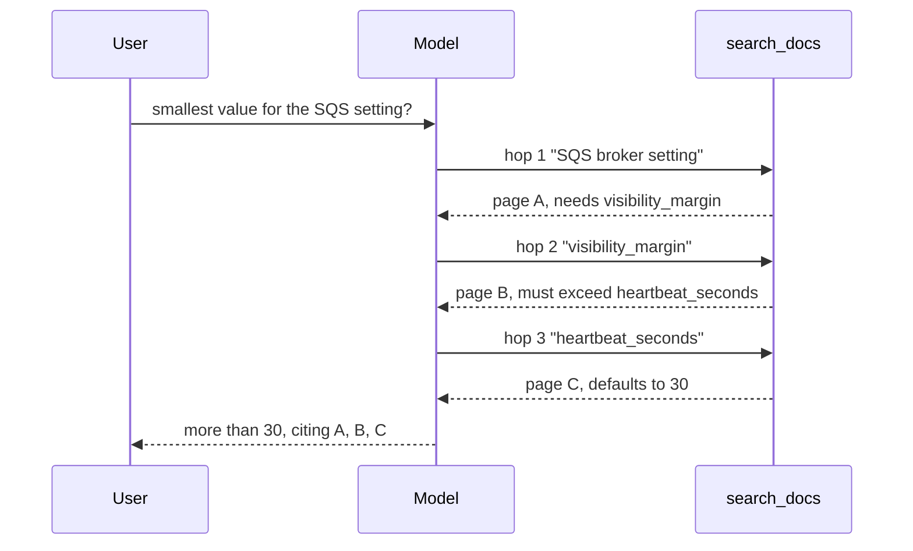
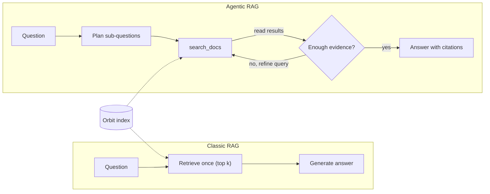
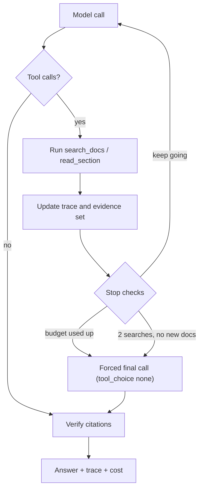

# Agentic RAG: Search as a Tool

A maintainer asks Atlas: *"A flow step that returns a big query result fails after finishing its work. Which error is it, and what should the step return instead?"* The answer is spread over three Orbit pages: flow steps and state, the flow API reference, and the error-code list. No single query brings back all three, so the one-pass `ask()` from Day 28 answers from what it got and guesses the rest. Today you let the model search, read the results and search again, then measure whether the extra calls were worth it.

## At a Glance

- **Time:** ~2 h core (+ optional Go Deeper) · **Depth:** working
- **Prerequisites:** [Day 31: Improving Retrieval](../../Phase_3_RAG/Day_031_reranking_contextual_retrieval/reranking_contextual_retrieval.md), [Day 38: Built-in Tools](../../Phase_4_Tools_and_MCP/Day_038_built_in_tools/built_in_tools.md), [Day 48: Your First Agent](../../Phase_6_Agents/Day_048_first_agent/first_agent.md). Helpful: [Day 28](../../Phase_3_RAG/Day_028_rag_pipeline/rag_pipeline.md) (`ask()`, citations), [Day 29](../../Phase_3_RAG/Day_029_retrieval_evaluation/retrieval_evaluation.md) and [Day 30](../../Phase_3_RAG/Day_030_answer_evaluation/answer_evaluation.md) (evals), [Day 37](../../Phase_4_Tools_and_MCP/Day_037_robust_tool_execution/robust_tool_execution.md) (error envelopes, parallel calls).
- **You'll build:** `atlas/agentic_rag.py` with `agentic_ask()`. It has a `search_docs` tool with a version filter, a query-planning prompt, three stop rules, a forced final answer and verified citations. You also get offline tests that need no API key, and a classic-vs-agentic eval report.
- **Stops at:** search-engine internals. How BM25, vector search and rerankers work is covered in Days 26–27 and 31. Multi-agent research is Day 64, and critic loops are Day 41.
- **Fast path:** Already comfortable with tool loops from Day 48? Read §"Measured: Agentic vs Classic" and do Exercise 3 (~45 min).
- **Cost:** ≈ $0.30 on `gpt-6-luna` for the eval plus exercises (prices as of 2026-11, [verify](https://developers.openai.com/api/docs/pricing)). The offline scripts cost $0.
- **New terms:** agentic RAG, query planning, hop / multi-hop, evidence recall, search budget

> **Coming from Software Engineering?** Classic RAG works like one SQL query followed by rendering the page: whatever the query returns is all the template gets. Agentic RAG works like a debugging session, where each `grep` result decides what you grep for next. The search tool is a read-only repository method that the model calls in a loop. `max_searches` is the query budget you would put on any code path prone to N+1 queries (a loop that fires one query per item). Your habits transfer: dedupe repeated queries, cap loops, and verify results came from your own data source.

## One Search Is Not Always Enough

Measure the problem first. This script builds a keyword index over the 45 Orbit doc pages, one chunk per `##` section. It's a compact BM25 stand-in for [Day 27](../../Phase_3_RAG/Day_027_hybrid_search/hybrid_search.md)'s hybrid index (BM25 scores a chunk by how often the query's rarer words appear in it). Save it as `orbit_index.py`, because later scripts import it. It runs every query in `eval/retrieval_queries.jsonl` once and reports **evidence recall**: the share of gold pages that appear anywhere in what retrieval returned.

```python
# script_id: day_052_agentic_rag/orbit_index
# orbit_index.py: compact BM25 stand-in for Day 27's Index (swap in Index.hybrid_search later).
# Install: nothing (stdlib only) · Env: ORBIT_DATA (default datasets/orbit) · Services: none
from __future__ import annotations
import json, math, os, re
from collections import Counter
from dataclasses import dataclass, replace
from pathlib import Path

DATA_DIR = Path(os.environ.get("ORBIT_DATA", "datasets/orbit"))

@dataclass(frozen=True)
class Hit:
    chunk_id: str
    doc_id: str
    heading: str
    applies_to: str          # "2.x" | "3.x" | "all", from the page's front matter
    text: str
    score: float = 0.0

def tokenize(text: str) -> list[str]:
    return re.findall(r"[a-z0-9_]+", text.lower())

def load_chunks(docs_dir: Path = DATA_DIR / "docs") -> list[Hit]:
    """One chunk per '## ' section. Front matter supplies doc_id, title and applies_to."""
    chunks = []
    for path in sorted(docs_dir.glob("*.md")):
        _, front, body = path.read_text(encoding="utf-8").split("---", 2)
        meta = dict(re.findall(r'^(\w+):\s*"?([^"#\n]*?)"?\s*(?:#.*)?$', front, re.M))
        for i, sec in enumerate(re.split(r"^## ", body, flags=re.M)):
            heading = sec.splitlines()[0].strip() if i else meta["title"]
            chunks.append(Hit(f"{meta['id']}#{i}", meta["id"], heading, meta.get("applies_to", "all"), sec.strip()))
    return chunks
```

Next comes the index. The `version` filter runs *before* the top-k cut, so a 3.x question can never be filled up with 2.x pages.

```python
# script_id: day_052_agentic_rag/orbit_index
class Index:
    def __init__(self, chunks: list[Hit], k1: float = 1.5, b: float = 0.75):
        self.chunks, self.by_id, self.k1, self.b = chunks, {c.chunk_id: c for c in chunks}, k1, b
        self.tf = [Counter(tokenize(f"{c.heading} {c.text}")) for c in chunks]
        self.len = [sum(t.values()) for t in self.tf]
        self.avg = sum(self.len) / len(self.len)
        df = Counter(term for t in self.tf for term in t)
        self.idf = {t: math.log(1 + (len(chunks) - d + 0.5) / (d + 0.5)) for t, d in df.items()}

    def _bm25(self, terms: list[str], i: int) -> float:
        tf, norm = self.tf[i], self.k1 * (1 - self.b + self.b * self.len[i] / self.avg)
        return sum(self.idf[t] * tf[t] * (self.k1 + 1) / (tf[t] + norm) for t in terms if t in tf)

    def search(self, query: str, k: int = 5, version: str | None = None) -> list[Hit]:
        terms = tokenize(query)
        ok = [i for i, c in enumerate(self.chunks) if version is None or c.applies_to in (version, "all")]
        top = sorted(ok, key=lambda i: -self._bm25(terms, i))[:k]
        return [replace(self.chunks[i], score=round(self._bm25(terms, i), 2)) for i in top]

def load_queries(kind: str | None = None) -> list[dict]:
    rows = [json.loads(l) for l in (DATA_DIR / "eval/retrieval_queries.jsonl").open(encoding="utf-8")]
    return [r for r in rows if kind in (None, r["kind"])]

def recall(doc_ids: list[str], gold: list[str]) -> float:
    return sum(g in set(doc_ids) for g in gold) / len(gold)

if __name__ == "__main__":
    index = Index(load_chunks())
    q = next(r for r in load_queries() if r["id"] == "rq-038")
    got = [h.doc_id for h in index.search(q["query"], k=5)]
    print("rq-038 retrieved:", sorted(set(got)), "\nmissing:", sorted(set(q["relevant_doc_ids"]) - set(got)))
    for kind in ("exact_term", "semantic", "multi_hop"):
        rows = load_queries(kind)
        for k in (5, 15):
            r = sum(recall([h.doc_id for h in index.search(x["query"], k)], x["relevant_doc_ids"]) for x in rows)
            print(f"{kind:<10} k={k:<2} evidence recall={r / len(rows):.2f}")
```

Expected output (BM25 is deterministic, so yours should match on the course dataset):

```text
rq-038 retrieved: ['api-reference-flow', 'flows-error-handling', 'flows-overview', 'flows-steps-and-state', 'results-backend']
missing: ['error-codes']
exact_term k=5  evidence recall=0.88
exact_term k=15 evidence recall=1.00
semantic   k=5  evidence recall=0.87
semantic   k=15 evidence recall=0.94
multi_hop  k=5  evidence recall=0.78
multi_hop  k=15 evidence recall=0.85
```

Read the rows first: `multi_hop` is the weak one, as in Day 29's baseline. Then compare k=5 with k=15: tripling `k` fixes `exact_term` but leaves `multi_hop` at 0.85, and rq-038's missing page stays missing even at k=15. It isn't ranked 6th. It shares almost no words with the question, because the word you need (the error code, `ORB-1202`) only appears once you read the first result.

## A Librarian Who Reads Before Asking Again

Picture two research librarians. The first one takes your question, grabs one armful of books from the most likely shelf, and writes an answer from those books. That is classic RAG: retrieve once, then generate. The second one pulls a book, reads the relevant page, notices "this setting was renamed in 3.0", and walks to a different shelf to look up the new name. That is **agentic RAG**: the model decides what to search, reads the results, and decides whether to search again. It is search exposed as a tool that the model calls in a loop. The second one gets to learn between trips.

## A Two-Hop Question by Hand

Before involving a model, trace a tiny example by hand. It uses three made-up pages (toy facts, not Orbit's):

- **A:** "The SQS broker needs the setting `visibility_margin`."
- **B:** "`visibility_margin` must exceed `heartbeat_seconds`."
- **C:** "`heartbeat_seconds` defaults to 30."

The question is: "On SQS, what is the smallest value I can use for the setting the broker needs?" A **hop** is one search whose query depends on the previous result, and a **multi-hop** answer needs facts from several hops.

```python
# script_id: day_052_agentic_rag/hand_trace
# A two-hop search by hand over a toy 3-page corpus (toy facts, not Orbit's). Stdlib only.
import re

PAGES = {"A": "The SQS broker needs the setting visibility_margin.",
         "B": "visibility_margin must exceed heartbeat_seconds.",
         "C": "heartbeat_seconds defaults to 30."}

def search(query: str) -> list[str]:
    """Return pages sharing at least one word with the query, best overlap first."""
    words = set(re.findall(r"\w+", query.lower()))
    scored = [(len(words & set(re.findall(r"\w+", t.lower()))), pid) for pid, t in PAGES.items()]
    return [pid for n, pid in sorted(scored, reverse=True) if n > 0][:2]   # top-2, like a tight k

question = "On SQS, what is the smallest value for the setting the broker needs?"
print("one-shot:", search(question))                  # only page A: B and C share no words
query, seen = "SQS broker setting", []
for hop in range(1, 4):
    new = [p for p in search(query) if p not in seen]
    seen += new
    learned = PAGES[new[0]] if new else "(nothing new)"
    print(f"hop {hop}: query={query!r:<28} new={new} learned: {learned}")
    names = [w for w in re.findall(r"[a-z]+_[a-z]+", learned) if w not in query]
    if not names:
        break
    query = names[-1]                                 # next query = the term we just learned
```

```text
one-shot: ['A']
hop 1: query='SQS broker setting'         new=['A'] learned: The SQS broker needs the setting visibility_margin.
hop 2: query='visibility_margin'          new=['B'] learned: visibility_margin must exceed heartbeat_seconds.
hop 3: query='heartbeat_seconds'          new=['C'] learned: heartbeat_seconds defaults to 30.
```

Each hop's query comes from the previous hop's result, and the original question contains none of those words. That is why the one-shot search found only page A.



## Name the Parts

- **Search tool:** a function the model may call, here `search_docs(query, version)`, returning short snippets with ids.
- **Query planning (decomposition):** breaking a question into the separate facts it needs, then searching one fact per query.
- **Evidence set:** every chunk the agent saw during the run. Citations are checked against it.
- **Trace:** the ordered list of searches and the new documents each one found.
- **Search budget:** a hard cap on tool calls, enforced in code and not in the prompt.
- **Stop rule:** the condition that ends the loop. There are three: budget used up, no new evidence, or the model says it is done.



Both arms share one index; what differs is who decides how often to query it.



## Search as a Tool in 20 Lines

The smallest working version is the Day 48 loop with one tool. `tool_choice="required"` on call 1 forces at least one search (no answering from memory), and `range(4)` caps model calls.

```python
# script_id: day_052_agentic_rag/agentic_min
# Minimal agentic RAG: the model calls search_docs until it can answer. Needs orbit_index.py beside it.
# Install: uv add "openai>=3.46,<4" · Env: OPENAI_API_KEY, ATLAS_MODEL, ORBIT_DATA · Services: none
import json, os
from openai import OpenAI
from orbit_index import Index, load_chunks

MODEL = os.environ.get("ATLAS_MODEL", "gpt-6-luna")
client, index = OpenAI(), Index(load_chunks())
TOOLS = [{"type": "function", "name": "search_docs", "strict": True,
          "description": "Keyword search over the Orbit docs. One fact per query.",
          "parameters": {"type": "object", "properties": {"query": {"type": "string"}},
                         "required": ["query"], "additionalProperties": False}}]
question = "a flow step that returns a big query result fails after finishing its work; which error is it and what should the step return instead"
items, searches = [{"role": "user", "content": question}], []
for step in range(4):                                   # hard cap: at most 4 model calls
    resp = client.responses.create(model=MODEL, input=items, tools=TOOLS,
                                   tool_choice="required" if step == 0 else "auto")
    items += resp.output                                # keep every item: reasoning, calls, messages
    calls = [i for i in resp.output if i.type == "function_call"]
    if not calls:
        break
    for c in calls:                                     # parallel calls arrive together; answer each
        q = json.loads(c.arguments)["query"]; searches.append(q)
        hits = [{"doc_id": h.doc_id, "heading": h.heading, "text": h.text[:600]} for h in index.search(q, k=3)]
        items.append({"type": "function_call_output", "call_id": c.call_id, "output": json.dumps(hits)})
print("searches:", searches, "\n", resp.output_text)
```

The output has this shape. It is illustrative, because the lesson was written without a live key; your queries and wording will differ:

```text
searches: ['flow step large result fails', 'ORB-1202 PayloadTooLarge']
 It's ORB-1202 PayloadTooLarge: the result is over [limits] max_payload_kb. Store it elsewhere and return a reference ...
```

## Break It: Loops, Memory Answers, Wrong Version

Turn one knob at a time on `agentic_min` and watch the `searches` list.

1. **Same query, again and again.** Ask something the docs don't cover ("What does Orbit's enterprise plan cost?"). The model often rephrases one query until the cap hits. The loop exits with `function_call` items still pending, so `resp.output_text` is `""`: a blank answer. **Fix:** dedupe normalised queries, stop after two searches with no new documents, and make one final call that *can't* call tools.
2. **Answers from memory.** Change the first `tool_choice` to `"auto"`. On familiar-sounding questions the model may answer plausibly with `searches: []`. **Fix:** keep `"required"` on call 1, and score "searched at least once" in your eval.
3. **Wrong version.** For a 3.x question, the model often cites `environment-variables-2x`, a 2.x-only page, as if it applied to 3.x. **Fix:** a `version` argument on the tool that filters by each page's `applies_to` before the top-k cut. Report wrong-version citations as a failure.

A fourth failure is invisible here because `agentic_min` doesn't check citations: the model can cite a page it never retrieved. Check every citation against the evidence set (Day 28's rule).

## The Realistic Agent

Now build `atlas/agentic_rag.py` in five blocks under one `script_id`. Each block adds one concern. Block 1 holds the data types. `SearchTrace.ranked_doc_ids()` returns documents in first-seen order, so Day 29's `evaluate_retrieval` can score the agent like a retriever.

```python
# script_id: day_052_agentic_rag/agentic_rag
# atlas/agentic_rag.py: search as a tool the model calls in a loop (built on Day 48's loop, Day 28's Answer).
# Install: uv add "openai>=3.46,<4" pydantic · Env: OPENAI_API_KEY, ATLAS_MODEL, ORBIT_DATA
# Needs orbit_index.py beside it. Services: none.
from __future__ import annotations
import functools, json, os, re, time
from dataclasses import dataclass, field
from typing import Literal
from openai import OpenAI
from pydantic import BaseModel
from orbit_index import Hit, Index, load_chunks, tokenize

MODEL = os.environ.get("ATLAS_MODEL", "gpt-6-luna")
PRICE_IN, PRICE_OUT = 0.10 / 1e6, 0.50 / 1e6   # gpt-6-luna $/token, as of 2026-11, verify at the pricing page
WEB_FEE = 10 / 1000                            # web_search $ per call, as of 2026-11, verify
IDK_TEXT = "I couldn't find this in the Orbit docs."

class Citation(BaseModel):          # compact Day 28 shape: the model must quote what it read
    doc_id: str
    quote: str

class Answer(BaseModel):
    text: str
    citations: list[Citation]
    abstained: bool

@dataclass
class SearchStep:
    query: str
    version: str | None
    doc_ids: list[str]
    new_doc_ids: list[str]          # documents this search surfaced for the first time

@dataclass
class SearchTrace:
    steps: list[SearchStep] = field(default_factory=list)
    seen: dict[str, Hit] = field(default_factory=dict)     # chunk_id -> Hit: the evidence set
    stop_reason: str = "model_done"   # model_done | search_budget | no_new_evidence | max_steps

    @property
    def n_searches(self) -> int:
        return len(self.steps)

    def ranked_doc_ids(self) -> list[str]:
        return list(dict.fromkeys(h.doc_id for h in self.seen.values()))   # first-seen order

    def stalled(self, window: int = 2) -> bool:
        last = self.steps[-window:]
        return len(last) == window and not any(s.new_doc_ids for s in last)
```

Block 2 holds the tools. `search_docs` keeps Day 36's name and arguments, adds `version`, and returns ≤300-character snippets (the best-matching paragraph) so ten searches don't flood the context. `read_section` opens one section in full when a snippet is cut off: just-in-time reading from [Day 49](../../Phase_6_Agents/Day_049_context_engineering/context_engineering.md). `k` stays in code, so the model can't widen its own context.

```python
# script_id: day_052_agentic_rag/agentic_rag
VERSION = {"type": ["string", "null"], "enum": ["2.x", "3.x", None]}
SEARCH_TOOL = {"type": "function", "name": "search_docs", "strict": True,
    "description": "Keyword search over the Orbit docs. One fact per query. Returns up to 5 section "
                   "snippets with chunk_id, doc_id, heading, applies_to and score. Set version when "
                   "the user names a release line; otherwise null.",
    "parameters": {"type": "object", "properties": {"query": {"type": "string"}, "version": VERSION},
                   "required": ["query", "version"], "additionalProperties": False}}
READ_TOOL = {"type": "function", "name": "read_section", "strict": True,
    "description": "Read one full doc section by chunk_id (from search_docs results).",
    "parameters": {"type": "object", "properties": {"chunk_id": {"type": "string"}},
                   "required": ["chunk_id"], "additionalProperties": False}}
WEB_TOOL = {"type": "web_search", "search_context_size": "low", "filters": {"allowed_domains": ["python.org"]}}

def snippet(text: str, query: str, n: int = 300) -> str:
    terms = set(tokenize(query))
    best = max(text.split("\n\n"), key=lambda p: len(terms & set(tokenize(p))))
    return " ".join(best.split())[:n]

def search_docs(index: Index, trace: SearchTrace, query: str,
                version: Literal["2.x", "3.x"] | None = None, k: int = 5) -> list[dict]:
    key = (" ".join(sorted(set(tokenize(query)))), version)
    if any((" ".join(sorted(set(tokenize(s.query)))), s.version) == key for s in trace.steps):
        trace.steps.append(SearchStep(query, version, [], []))       # counts toward the budget
        return [{"note": "Duplicate query: no new results. Search for what is still missing."}]
    hits = index.search(query, k=k, version=version)
    known = {h.doc_id for h in trace.seen.values()}
    ids = list(dict.fromkeys(h.doc_id for h in hits))
    trace.steps.append(SearchStep(query, version, ids, [d for d in ids if d not in known]))
    trace.seen.update({h.chunk_id: h for h in hits if h.chunk_id not in trace.seen})
    return [{"chunk_id": h.chunk_id, "doc_id": h.doc_id, "heading": h.heading,
             "applies_to": h.applies_to, "score": h.score, "snippet": snippet(h.text, query)} for h in hits]

def read_section(index: Index, trace: SearchTrace, chunk_id: str) -> dict:
    hit = index.by_id[chunk_id]                                       # KeyError -> error envelope
    trace.seen.setdefault(chunk_id, hit)
    return {"chunk_id": chunk_id, "doc_id": hit.doc_id, "applies_to": hit.applies_to, "text": hit.text[:2000]}
```

Block 3 covers dispatch and checks. Every tool error becomes an envelope the model can read (the [Day 37](../../Phase_4_Tools_and_MCP/Day_037_robust_tool_execution/robust_tool_execution.md) pattern), never a crash. `verify_citations` keeps only quotes that appear in a chunk the agent actually saw. If nothing survives, Atlas abstains.

```python
# script_id: day_052_agentic_rag/agentic_rag
def dispatch(call, index: Index, trace: SearchTrace) -> object:
    try:
        args = json.loads(call.arguments)
        if call.name == "search_docs":
            return search_docs(index, trace, args["query"], args.get("version"))
        if call.name == "read_section":
            return read_section(index, trace, args["chunk_id"])
        return {"error": {"type": "unknown_tool", "message": f"No tool named {call.name}"}}
    except (KeyError, ValueError) as e:
        return {"error": {"type": type(e).__name__, "message": str(e)}}

def _norm(s: str) -> str:
    return " ".join(re.sub(r"[`*]", "", s).lower().split())

def verify_citations(answer: Answer, trace: SearchTrace, web_urls: list[str] | tuple[()] = ()) -> Answer:
    """Keep citations whose quote is in a seen chunk of that doc (or whose URL the web tool returned)."""
    texts: dict[str, str] = {}
    for h in trace.seen.values():
        texts[h.doc_id] = texts.get(h.doc_id, "") + " " + _norm(h.text)
    good = [c for c in answer.citations
            if c.doc_id in web_urls or (c.doc_id in texts and _norm(c.quote) in texts[c.doc_id])]
    if answer.abstained or good:
        return answer.model_copy(update={"citations": good})
    return Answer(text=IDK_TEXT, citations=[], abstained=True)     # nothing verifiable: abstain

def usd_cost(usage) -> float:
    return usage.input_tokens * PRICE_IN + usage.output_tokens * PRICE_OUT

@functools.cache
def default_index() -> Index:
    return Index(load_chunks())
```

Block 4 is the loop. Before each model call it checks the stop rules (budget, no new evidence, step cap). If one fires, that call gets `tool_choice="none"`, so the model must answer from what it has. Every call uses `responses.parse(..., text_format=Answer)`, so a turn either requests tools or returns a typed `Answer`. An over-budget search still gets a reply (an error envelope), because every `function_call` must be answered before the next request.

```python
# script_id: day_052_agentic_rag/agentic_rag
SYSTEM = """You are Atlas. Answer questions about Orbit using only its docs.
1. Plan first: split the question into the separate facts it needs. Search one fact per query.
2. After each result, note what is still missing. Build the next query from words you just learned
   (a setting name, an error code, a page title), not by rephrasing the question.
3. Use read_section when a snippet looks relevant but is cut off.
4. Set version to "2.x" or "3.x" when the question names a release line.
5. Answer only from text you saw. Each citation quotes exact words from a result.
6. If the docs don't contain the answer, set abstained=true and say so."""

@dataclass
class AgenticRun:
    answer: Answer
    trace: SearchTrace
    cost_usd: float = 0.0
    latency_s: float = 0.0
    model_calls: int = 0
    web_calls: int = 0
    web_sources: list[str] = field(default_factory=list)
```

The loop itself:

```python
# script_id: day_052_agentic_rag/agentic_rag
def agentic_run(question: str, *, max_searches: int = 6, max_steps: int = 10, system: str = SYSTEM,
                tools: list[dict] | None = None, parallel: bool = True,
                client: OpenAI | None = None, index: Index | None = None) -> AgenticRun:
    client, index, tools = client or OpenAI(), index or default_index(), tools or [SEARCH_TOOL, READ_TOOL]
    extra = {"include": ["web_search_call.action.sources"]} if any(t["type"] == "web_search" for t in tools) else {}
    run = AgenticRun(Answer(text=IDK_TEXT, citations=[], abstained=True), SearchTrace())
    items, t0 = [{"role": "user", "content": question}], time.perf_counter()
    for step in range(max_steps):
        stop = ("search_budget" if run.trace.n_searches >= max_searches else
                "no_new_evidence" if run.trace.stalled() else
                "max_steps" if step == max_steps - 1 else None)
        resp = client.responses.parse(model=MODEL, instructions=system, input=items, tools=tools,
            text_format=Answer, parallel_tool_calls=parallel, **extra,
            tool_choice="none" if stop else "required" if step == 0 else "auto")
        run.model_calls += 1
        run.cost_usd += usd_cost(resp.usage)
        items += resp.output                                    # SDK drops parse-only fields on re-send
        for item in (i for i in resp.output if i.type == "web_search_call"):   # hosted tool: no dispatch
            run.web_calls += 1; run.cost_usd += WEB_FEE
            run.web_sources += [s.url for s in (getattr(item.action, "sources", None) or [])]
        calls = [i for i in resp.output if i.type == "function_call"]
        if not calls:                                           # the model answered
            run.trace.stop_reason = stop or "model_done"
            run.answer = verify_citations(resp.output_parsed or run.answer, run.trace, run.web_sources)
            break
        for call in calls:
            over = call.name == "search_docs" and run.trace.n_searches >= max_searches
            out = {"error": {"type": "search_budget", "message": "No searches left. Answer now."}} if over \
                else dispatch(call, index, run.trace)
            items.append({"type": "function_call_output", "call_id": call.call_id, "output": json.dumps(out)})
    else:
        run.trace.stop_reason = "max_steps"                     # still calling tools on the last step
    run.latency_s = time.perf_counter() - t0
    return run
```

Block 5 is the Atlas contract. `agentic_ask()` returns the same `Answer` type as Day 28's `ask()`, so callers can swap one for the other behind a flag.

```python
# script_id: day_052_agentic_rag/agentic_rag
def agentic_ask(question: str, *, max_searches: int = 6) -> Answer:
    return agentic_run(question, max_searches=max_searches).answer

if __name__ == "__main__":
    run = agentic_run("a flow step that returns a big query result fails after finishing its work; "
                      "which error is it and what should the step return instead")
    for s in run.trace.steps:
        print(f"search {s.query!r:<44} version={s.version} new={s.new_doc_ids}")
    print(f"searches {run.trace.n_searches} · stop={run.trace.stop_reason} · {run.model_calls} calls · "
          f"{len(run.answer.citations)} verified citations · ${run.cost_usd:.4f} · {run.latency_s:.1f}s")
    print(run.answer.text)
```

Your queries, counts and cost will differ. For these two queries the `new=` lists are exact, because BM25 is deterministic:

```text
search 'flow step large result fails'               version=None new=['results-backend', 'flows-steps-and-state', 'error-codes', 'api-reference-flow', 'flows-error-handling']
search 'ORB-1202 PayloadTooLarge'                   version=None new=['api-reference-orbit', 'troubleshooting-memory', 'configuration-reference']
searches 2 · stop=model_done · 4 calls · 2 verified citations · $0.00xx · 6.3s
```

## Prove the Fixes Offline

You can test the loop logic without a key. These tests drive the real `agentic_run` with a **scripted model**: an object with the client's `.responses.parse(...)` method that replays canned turns and, like a real model, can't call tools under `tool_choice="none"`. Each test reproduces one "Break It" failure and asserts the fix.

```python
# script_id: day_052_agentic_rag/test_agentic_rag
# Offline tests: a scripted fake model drives the real loop, tools and citation checks.
# Run: uv run pytest test_agentic_rag.py   (or python test_agentic_rag.py) · No key, no network.
import json
from types import SimpleNamespace as NS
from agentic_rag import Answer, Citation, SearchTrace, agentic_run, search_docs, verify_citations
from orbit_index import Index, load_chunks

INDEX = Index(load_chunks())
DONE = Answer(text="(scripted final answer)", citations=[], abstained=True)

def search(query: str, version: str | None = None) -> NS:
    return NS(type="function_call", name="search_docs", call_id=f"call-{query[:12]}",
              arguments=json.dumps({"query": query, "version": version}))

def turn(*calls: NS, parsed: Answer | None = None) -> NS:
    return NS(output=list(calls), output_parsed=parsed, usage=NS(input_tokens=2_000, output_tokens=150))

class ScriptedModel:
    """Duck-types the OpenAI client. Replays turns and records every tool_choice it receives."""
    def __init__(self, *turns: NS):
        self.turns, self.tool_choices, self.responses = list(turns), [], self
    def parse(self, **kwargs) -> NS:
        self.tool_choices.append(kwargs["tool_choice"])
        if kwargs["tool_choice"] == "none" or not self.turns:     # no tools allowed: must answer
            return turn(parsed=DONE)
        return self.turns.pop(0)

def test_repeated_query_stops_on_no_new_evidence():
    model = ScriptedModel(*[turn(search("lease expired")) for _ in range(6)])
    run = agentic_run("why do jobs run twice?", client=model, index=INDEX)
    assert model.tool_choices == ["required", "auto", "auto", "none"]   # call 1 must search
    assert (run.trace.n_searches, run.trace.stop_reason) == (3, "no_new_evidence")

def test_budget_forces_a_final_answer():
    model = ScriptedModel(turn(search("SQS visibility timeout")), turn(search("ORBIT_LEASE")), turn(search("dlq")))
    run = agentic_run("q", max_searches=2, client=model, index=INDEX)
    assert (run.trace.n_searches, run.trace.stop_reason, model.tool_choices[-1]) == (2, "search_budget", "none")

def test_version_filter_drops_2x_pages():
    trace = SearchTrace()
    hits = search_docs(INDEX, trace, "ORBIT_LEASE lease seconds", version="3.x")
    assert hits and all(h["applies_to"] in ("3.x", "all") for h in hits)
    assert "environment-variables-2x" not in trace.ranked_doc_ids()

def test_unverifiable_citations_are_dropped():
    trace = SearchTrace()
    hit = search_docs(INDEX, trace, "lease expired duplicate execution")[0]
    real = Citation(doc_id=hit["doc_id"], quote=hit["snippet"][:80])
    fake = Citation(doc_id="security", quote="Orbit encrypts every job with AES-512.")
    assert verify_citations(Answer(text="x", citations=[real, fake], abstained=False), trace).citations == [real]
    assert verify_citations(Answer(text="x", citations=[fake], abstained=False), trace).abstained

if __name__ == "__main__":
    for name, fn in [(n, f) for n, f in globals().items() if n.startswith("test_")]:
        fn(); print("PASS", name)
```

```text
PASS test_repeated_query_stops_on_no_new_evidence
PASS test_budget_forces_a_final_answer
PASS test_version_filter_drops_2x_pages
PASS test_unverifiable_citations_are_dropped
```

## Query Planning and the Deep-Research Pattern

The system prompt (`SYSTEM` in block 4) does the planning, and every rule in it is there for a reason:

| Rule | Failure it prevents |
|---|---|
| Split the question; one fact per query | One long query that matches nothing well |
| Next query uses words you just learned | Rephrasing the question (the loop failure) |
| `version` when a release line is named | 2.x pages cited for 3.x questions |
| Answer only from results; quote exactly | Memory answers and invented citations |
| Abstain when the docs don't say | Confident guesses on unanswerable questions |

**Independent** sub-questions ("default lease *and* default prefetch") can go out as several `search_docs` calls in one turn. Parallel calls are on by default, and the loop answers every call in a batch (Day 37). That's **breadth**. A sub-question that depends on an earlier answer must wait. That's **depth**. The deep-research pattern is breadth first, then depth: fan out, read, follow leads one at a time. The multi-agent version is [Day 64](../../Phase_7_Multi_Agent_Systems/Day_064_multi_agent_when/multi_agent_when.md)'s topic.

The loop never critiques its own answer: "stop searching" is a budget, not a critic. Evaluator–optimizer loops belong to [Day 41](../../Phase_4_Tools_and_MCP/Day_041_workflow_patterns/workflow_patterns.md).

## Add the Web

Some questions mix your docs with public facts. For example: "Orbit doesn't support Python 3.13 yet; until when does Python 3.12 get security fixes?" Add the hosted `web_search` tool from [Day 38](../../Phase_4_Tools_and_MCP/Day_038_built_in_tools/built_in_tools.md) next to `search_docs`. `WEB_TOOL` (block 2) limits it to `python.org` and its subdomains with `filters.allowed_domains`. OpenAI runs the search inside the same response, so there's nothing to dispatch. The loop counts `web_search_call` items, adds the fee, and collects source URLs (requested with `include=["web_search_call.action.sources"]`). Web citations are verified by URL against those sources, since you never saw the page text.

```python
# script_id: day_052_agentic_rag/web_demo
# Docs + web in one agent. Install: uv add "openai>=3.46,<4" pydantic · Env: OPENAI_API_KEY, ATLAS_MODEL
from openai import OpenAI
from agentic_rag import READ_TOOL, SEARCH_TOOL, SYSTEM, WEB_TOOL, agentic_run

WEB_RULE = "\n7. Use web_search only for facts outside Orbit. For those, cite the page URL as doc_id."
run = agentic_run("Orbit doesn't support Python 3.13 yet. Until when does Python 3.12 get security "
                  "fixes, and which Orbit 3.x releases support 3.12?",
                  tools=[SEARCH_TOOL, READ_TOOL, WEB_TOOL], system=SYSTEM + WEB_RULE, client=OpenAI())
print(f"doc searches {run.trace.n_searches} · web calls {run.web_calls} · ${run.cost_usd:.4f}")
print("doc citations:", [c.doc_id for c in run.answer.citations if not c.doc_id.startswith("http")])
print("web sources:", run.web_sources[:3])
print(run.answer.text)
```

Web search costs $10 per 1,000 calls plus content tokens at model rates (as of 2026-11, [verify](https://developers.openai.com/api/docs/pricing)). On Luna, one web call can cost more than a whole docs-only run.

## Measured: Agentic vs Classic

This section is the payoff. `compare_eval` runs both arms on the same cases, with the same `Answer` schema and the same citation check:

- **classic:** a compact Day 28 `ask()`, which retrieves k=5 once and answers once;
- **agentic:** `agentic_run()` with `max_searches=6`.

Cases: `multi_hop` and `exact_term` queries (gold pages), `qa_gold.jsonl` (gold citations), and three questions the docs can't answer (local stand-ins for Day 30's `UNANSWERABLE` set). **Pass** means citing at least one gold page, or abstaining when none applies. For faithfulness, plug in Day 45's judge.

```python
# script_id: day_052_agentic_rag/compare_eval
# Classic one-pass RAG vs agentic_run() on Orbit evals; writes reports/agentic_vs_classic.json.
# Install: uv add "openai>=3.46,<4" pydantic · Env: OPENAI_API_KEY, ATLAS_MODEL, ORBIT_DATA, EVAL_LIMIT
# Cost: ≈ $0.20 at EVAL_LIMIT=10 on gpt-6-luna (as of 2026-11, verify). Services: none.
import json, os, statistics, time
from pathlib import Path
from openai import OpenAI
from agentic_rag import (IDK_TEXT, MODEL, AgenticRun, Answer, SearchStep, SearchTrace,
                         agentic_run, default_index, usd_cost, verify_citations)
from orbit_index import DATA_DIR, load_queries

LIMIT = int(os.environ.get("EVAL_LIMIT", "10"))           # cases per kind
OUT_OF_SCOPE = ["What does an Orbit enterprise support contract cost per year?",
                "How many GitHub stars does the Orbit repository have?",
                "Which Kafka topic does Orbit's Kafka broker write dead letters to?"]
CLASSIC_SYSTEM = "Answer only from the context. Quote it exactly in citations. If it is not there, abstain."

def classic_run(question: str, *, client: OpenAI, k: int = 5) -> AgenticRun:
    """Compact Day 28 ask(): retrieve once, answer once. Same schema and citation check as the agent."""
    t0, hits = time.perf_counter(), default_index().search(question, k=k)
    ids = list(dict.fromkeys(h.doc_id for h in hits))
    trace = SearchTrace([SearchStep(question, None, ids, ids)], {h.chunk_id: h for h in hits}, "single_pass")
    context = "\n\n".join(f"[doc_id={h.doc_id}] {h.heading}\n{h.text}" for h in hits)
    resp = client.responses.parse(model=MODEL, instructions=CLASSIC_SYSTEM, text_format=Answer,
                                  input=f"Context:\n{context}\n\nQuestion: {question}")
    answer = resp.output_parsed or Answer(text=IDK_TEXT, citations=[], abstained=True)
    return AgenticRun(verify_citations(answer, trace), trace, usd_cost(resp.usage), time.perf_counter() - t0, 1)

def load_cases() -> list[dict]:
    cases = [{"kind": kind, "q": r["query"], "gold": r["relevant_doc_ids"]}
             for kind in ("multi_hop", "exact_term") for r in load_queries(kind)[:LIMIT]]
    qa = [json.loads(l) for l in (DATA_DIR / "eval/qa_gold.jsonl").open(encoding="utf-8")][:LIMIT]
    cases += [{"kind": "qa_gold", "q": r["question"], "gold": r["citations"]} for r in qa]
    return cases + [{"kind": "unanswerable", "q": q, "gold": []} for q in OUT_OF_SCOPE]

def score(run: AgenticRun, gold: list[str]) -> dict:
    seen, cited = run.trace.ranked_doc_ids(), {c.doc_id for c in run.answer.citations}
    passed = run.answer.abstained if not gold else (not run.answer.abstained and bool(cited & set(gold)))
    return {"recall": sum(g in seen for g in gold) / len(gold) if gold else None, "pass": passed,
            "abstained": run.answer.abstained, "searches": run.trace.n_searches,
            "chunks": len(run.trace.seen), "usd": run.cost_usd, "s": run.latency_s}
```

The second block prints one row per (kind, arm). The `chunks` column keeps it fair: the agent sees far more chunks than classic k=5, which is why `orbit_index` also reported k=15.

```python
# script_id: day_052_agentic_rag/compare_eval
def mean(xs: list) -> float:
    xs = [x for x in xs if x is not None]
    return sum(xs) / len(xs) if xs else float("nan")

if __name__ == "__main__":
    client, rows = OpenAI(), []
    for case in load_cases():
        for arm, run in (("classic", classic_run(case["q"], client=client)),
                         ("agentic", agentic_run(case["q"], client=client))):
            rows.append({"kind": case["kind"], "arm": arm, **score(run, case["gold"])})
    print(f"{'kind':<13}{'arm':<9}{'recall':>7}{'pass':>6}{'abst':>6}{'srch':>6}{'chunks':>7}{'$/q':>9}{'p50 s':>7}")
    for kind in dict.fromkeys(r["kind"] for r in rows):
        for arm in ("classic", "agentic"):
            g = [r for r in rows if r["kind"] == kind and r["arm"] == arm]
            col = lambda key: mean([r[key] for r in g])
            print(f"{kind:<13}{arm:<9}{col('recall'):>7.2f}{col('pass'):>6.2f}{col('abstained'):>6.2f}"
                  f"{col('searches'):>6.1f}{col('chunks'):>7.1f}{col('usd'):>9.4f}"
                  f"{statistics.median(r['s'] for r in g):>7.1f}")
    Path("reports").mkdir(exist_ok=True)
    Path("reports/agentic_vs_classic.json").write_text(json.dumps(rows, indent=2), encoding="utf-8")
    print("wrote reports/agentic_vs_classic.json")
```

The output is a table in this shape. The classic recall values are real: they come from the same BM25 index (exact_term is 0.90 on the first 10 cases). The rest is yours to fill in:

```text
kind         arm       recall  pass  abst  srch chunks      $/q  p50 s
multi_hop    classic     0.78     …     …   1.0    5.0        …      …
multi_hop    agentic        …     …     …     …      …        …      …
exact_term   classic     0.90     …     …   1.0    5.0        …      …
...
wrote reports/agentic_vs_classic.json
```

Read your table honestly. The expected pattern: the agent wins on `multi_hop` recall and pass rate, costs several times more per question, is slower at p50, and roughly ties on `exact_term`. Report what *your* run shows. If the agent doesn't beat classic at k=15 on `multi_hop`, planning wasn't the bottleneck, and a wider `k` or a reranker (Day 31) is cheaper. File each agent failure into Day 29's buckets (retrieval, ranking, generation) plus a fourth: **planning**, where the needed hop was never searched.

## Trade-offs and When NOT to Use It

| Situation | Use | Why |
|---|---|---|
| Single-fact lookup, exact names or error codes | Classic `ask()` | One query finds it; the agent only adds calls |
| Multi-hop ("we had X, now Y, which Z?") | Agentic | Later queries need words from earlier results |
| Vague question, unknown vocabulary | Agentic | The model refines its query after seeing results |
| Docs plus public web facts | Agentic + `web_search` | Two sources, different trust levels |
| Latency budget under ~3 s, or very high volume | Classic (maybe + reranker) | Each hop is another model call |

Rule of thumb: run classic first, and escalate to the agent only when classic abstains or retrieves low-scoring chunks. That keeps the cheap path cheap.

### In production

- Cap searches *and* tokens per request (`max_searches`, `max_output_tokens`), and log `stop_reason` on every run.
- Emit one span per search, with query, version and new doc ids (the [Day 42](../../Phase_5_Evaluation_and_Observability/Day_042_tracing_observability/tracing_observability.md) `step_span`), so you can debug a bad answer from its trace.
- Apply ACL (access-control list) filters inside `search_docs`, never in the prompt ([Day 27](../../Phase_3_RAG/Day_027_hybrid_search/hybrid_search.md)): the model must not be able to ask its way past them.
- Cache identical `(query, version)` searches, and log every query as a candidate eval case.
- Tool output is untrusted text. A poisoned page can contain instructions. [Day 69](../../Phase_8_Safety_and_Security/Day_069_prompt_injection/prompt_injection.md) covers the defences.

## Go Deeper (optional)

<details><summary>Go deeper: hop arithmetic (why one-shot retrieval decays with hops)</summary>

**In words.** One-shot retrieval must surface every needed page from the *original* question's words. A hop-2 page often shares few words with that question, so its chance of showing up is low. An agent searches for hop 2 *after* reading hop 1, using the term it just learned, so that query is better aimed. It can also retry a hop that came back empty.

**Toy numbers.** Say a well-aimed query finds its page 80% of the time, and a blind one (hop 2 using only the question's words) 50%. Assume the hops succeed independently. That is a simplification, because real hops are correlated.

```python
# script_id: day_052_agentic_rag/hop_math
# Toy model of retrieval success over hops. Assumes independent hops; numbers are illustrative.
p_aimed, p_blind = 0.8, 0.5
for hops in (1, 2, 3):
    one_shot = p_aimed * p_blind ** (hops - 1)            # later hops searched with the question's words
    agentic = p_aimed ** hops                             # each hop aimed with the previous result
    retry = (1 - (1 - p_aimed) ** 2) ** hops              # plus one retry per hop when it comes back empty
    print(f"{hops} hop(s): one-shot {one_shot:.2f} · agentic {agentic:.2f} · agentic+retry {retry:.2f}"
          f" · searches ≈ {hops}–{2 * hops}")
```

```text
1 hop(s): one-shot 0.80 · agentic 0.80 · agentic+retry 0.96 · searches ≈ 1–2
2 hop(s): one-shot 0.40 · agentic 0.64 · agentic+retry 0.92 · searches ≈ 2–4
3 hop(s): one-shot 0.20 · agentic 0.51 · agentic+retry 0.88 · searches ≈ 3–6
```

**Formula.** With per-hop success $p$, $h$ hops and $r$ tries per hop, success is $(1-(1-p)^r)^h$, and searches grow as roughly $h$ to $r \cdot h$. The gain is real only if the agent *notices* a miss, which is what the "note what is still missing" rule and the `no_new_evidence` stop are for.

</details>

<details><summary>Go deeper: breadth-then-depth research, done carefully</summary>

Production "deep research" agents tend to run in three phases. **Plan:** write the sub-questions down explicitly, either in the model's reasoning or as a short plan (Day 51's `make_plan()` works here). **Breadth:** issue the independent sub-questions as parallel `search_docs` calls in one turn. **Depth:** for each lead, open the section (`read_section`) and follow the new terms one hop at a time.

Three details matter more than the model you pick. First, **per-phase budgets**. A single `max_searches=6` can be spent entirely on breadth, so give breadth about half of it. Second, **evidence notes over raw text**. After each hop, keep a one-line note ("3.x ignores `ORBIT_*`; lease is now `[worker] lease_seconds`") and clear older tool results, using Day 49's `clear_tool_results`. Long research runs fail on context, not on search. Third, **a coverage check before answering**. List each sub-question with the chunk id that answers it. An empty row means one more targeted search, or an honest "the docs don't say" for that part.

When the sub-questions are large and truly independent, each one can go to its own researcher with its own context. That is a multi-agent design, and it costs more tokens. Day 64 measures when it pays off.

</details>

<details><summary>Go deeper: making the search tool production-grade</summary>

- **Swap the index without touching the loop.** `search_docs` only needs `.search(query, k, version)`. Pass Day 27's hybrid `Index` with a reranker from Day 31 inside. A better retriever often saves more hops than a better prompt.
- **Memoise per run.** The duplicate check stops identical queries from reaching the model again. Add a small `functools.lru_cache` (or a Redis cache) keyed on `(normalised query, version, index_version)` across runs. Bump `index_version` on every re-ingest so stale results expire.
- **Score the trajectory, not only the answer.** Useful agent-level checks are "searched at least once", "no repeated query", "stop_reason is not max_steps" and "no 2.x citation for a 3.x question". Day 59 turns these into a CI suite.
- **Watch context growth.** If `usage.input_tokens` jumps by thousands per hop, the tool is returning too much: keep snippets at ≤300 characters and let the model `read_section` on demand.
- **Bound the snippet, not the evidence.** Snippets keep each turn small, and `verify_citations` still checks quotes against the full chunk text. A quote from a section the model opened with `read_section` therefore verifies even when it was outside the snippet.

</details>

## Common Pitfalls

- **The same query until the budget burns.** *Symptom:* the trace shows the same query five times, and the answer is blank (`output_text == ""`). *Cause:* nothing told the model the search had found nothing new. *Fix:* dedupe normalised queries, return a "no new results" note, stop after two searches with no new doc ids, and force a final answer with `tool_choice="none"`.
- **Answers from memory with zero searches.** *Symptom:* `n_searches == 0`, and the answer is fluent but uncited. *Cause:* `tool_choice="auto"` on the first call. *Fix:* `"required"` on call 1, plus an eval check that the agent searched at least once.
- **Citing a page the agent never retrieved.** *Symptom:* a citation's `doc_id` isn't in `trace.ranked_doc_ids()`. *Cause:* citations are free text. *Fix:* `verify_citations` against the whole evidence set; drop the citation, or abstain if none survive.
- **Unanswered tool calls.** *Symptom:* a 400 error mentioning a missing tool output for a `call_id`. *Cause:* you skipped a call, for example one that came in over budget. *Fix:* answer every `function_call` (an error envelope counts) before the next request.
- **An unfair comparison.** *Symptom:* "agentic wins", with no context. *Cause:* the agent saw ~18 chunks, classic saw 5. *Fix:* report `chunks` beside recall; also run classic with `k` matching the agent's total.

> **Where we stop:** You treated the index as a black box with a `.search()` method. How BM25, vector search and rerankers work, and how to tune them, is in [Day 27](../../Phase_3_RAG/Day_027_hybrid_search/hybrid_search.md) and [Day 31](../../Phase_3_RAG/Day_031_reranking_contextual_retrieval/reranking_contextual_retrieval.md); several cooperating researchers are [Day 64](../../Phase_7_Multi_Agent_Systems/Day_064_multi_agent_when/multi_agent_when.md).

## Key Takeaways

- One retrieval pass fails on multi-hop, vague and wrong-version questions: the words for later pages only appear after you read the first result. A bigger `k` rarely fixes this.
- Agentic RAG exposes search as a tool. The model plans sub-questions, searches one fact per query, reads, and builds the next query from what it learned.
- Three stop rules are enforced in code: search budget, no new evidence (two searches with no new doc ids), and model done. Budget stops end in a forced final call with `tool_choice="none"`. None of the rules is a critic.
- Trust comes from checks, not from the prompt. The first call is required to search, a `version` filter applies, and every citation is verified against the evidence set, with abstention when none survive.
- Measure before adopting: compare with classic RAG on the same evals (recall, pass, abstain, searches, chunks, $, p50), then route simple lookups to classic.

## Quick Reference

| API / pattern | When to use | Gotcha |
|---|---|---|
| `tool_choice="required"` on call 1 | Force at least one search | Leave it on and the model can never stop; switch to `"auto"` after call 1 |
| `tool_choice="none"` | Forced final answer at a stop rule | Still pass `tools=`; the history contains function calls |
| `responses.parse(text_format=Answer, tools=...)` | Each turn is either tool calls or a typed answer | `output_parsed` is `None` on turns with only tool calls |
| `parallel_tool_calls` (default `True`) | Independent sub-questions in one turn | Answer *every* `call_id`, including over-budget ones |
| `search_docs(query, version, k)` | Docs search with a version filter | Filter before the top-k cut; keep `k` in code |
| `verify_citations(answer, trace)` | Before showing any answer | Normalise whitespace and markdown before matching quotes |
| `{"type": "web_search", "filters": {"allowed_domains": [...]}}` | Public facts beside your docs | $10 per 1k calls plus content tokens (as of 2026-11, verify); no scheme in domains |

## Exercises

1. **Warm-up: the budget knob.** Run `agentic_run` with `max_searches` set to 1, 2 and 6 on five `multi_hop` questions. Print evidence recall and $ per question for each budget. Where does extra budget stop buying recall?

<details><summary>Solution</summary>

```python
# script_id: day_052_agentic_rag/solution_ex1
# Budget sweep: evidence recall vs $ per question. Needs agentic_rag.py, compare_eval.py, orbit_index.py.
from openai import OpenAI
from agentic_rag import agentic_run
from compare_eval import load_cases, mean, score

client = OpenAI()
cases = [c for c in load_cases() if c["kind"] == "multi_hop"][:5]
for budget in (1, 2, 6):
    rows = [score(agentic_run(c["q"], max_searches=budget, client=client), c["gold"]) for c in cases]
    print(f"max_searches={budget}: recall={mean([r['recall'] for r in rows]):.2f} "
          f"searches={mean([r['searches'] for r in rows]):.1f} $/q={mean([r['usd'] for r in rows]):.4f}")
```

Expect recall to rise from 1 to 2 searches and then flatten. Cost keeps rising as long as the model keeps searching. If recall at 6 equals recall at 2, a budget of 3 is a safe default for this corpus.

</details>

2. **Core: how much of the gain is the plan?** Replace `SYSTEM` with a one-line prompt that has no planning rules. Rerun on the `multi_hop` cases, then compare recall, pass rate and searches with the full prompt.

<details><summary>Solution</summary>

```python
# script_id: day_052_agentic_rag/solution_ex2
# Ablation: planning rules vs a bare prompt on multi_hop. Same tools, budget and checks.
from openai import OpenAI
from agentic_rag import SYSTEM, agentic_run
from compare_eval import load_cases, mean, score

BARE = "You are Atlas. Use search_docs to answer questions about Orbit. Quote sources exactly. Abstain if unsure."
client = OpenAI()
cases = [c for c in load_cases() if c["kind"] == "multi_hop"]
for name, system in (("planned", SYSTEM), ("bare", BARE)):
    rows = [score(agentic_run(c["q"], system=system, client=client), c["gold"]) for c in cases]
    print(f"{name:<8} recall={mean([r['recall'] for r in rows]):.2f} pass={mean([r['pass'] for r in rows]):.2f} "
          f"searches={mean([r['searches'] for r in rows]):.1f}")
```

The difference between the two rows is what the plan buys you. With only 10 questions, a gap of one question (0.10) is noise. Rerun both arms once before concluding anything.

</details>

3. **Core: parallel vs sequential.** Ask three questions that each have three *independent* parts (for example, "What are the defaults for `lease_seconds`, `prefetch` and `retries`?"). Compare model calls, searches and p50 latency with `parallel=True` and `parallel=False`.

<details><summary>Solution</summary>

```python
# script_id: day_052_agentic_rag/solution_ex3
# Parallel tool calls vs one call per turn on questions with independent sub-questions.
import statistics
from openai import OpenAI
from agentic_rag import agentic_run

QUESTIONS = ["What are the 3.x defaults for lease_seconds, prefetch and retries?",
             "Which brokers does Orbit support, which result backends, and which deployment guides exist?",
             "What do ORB-1101, ORB-1202 and ORB-1601 mean?"]
client = OpenAI()
for parallel in (True, False):
    runs = [agentic_run(q, parallel=parallel, client=client) for q in QUESTIONS]
    print(f"parallel={parallel!s:<5} model calls={statistics.mean(r.model_calls for r in runs):.1f} "
          f"searches={statistics.mean(r.trace.n_searches for r in runs):.1f} "
          f"p50={statistics.median(r.latency_s for r in runs):.1f}s")
```

With `parallel=True`, expect fewer model calls for about the same number of searches, so lower latency. Searches stay similar because the work is the same. Only the number of round trips changes.

</details>

4. **Stretch (optional, uses Go Deeper ideas): web fallback.** Build `ask_with_fallback(question)`. It runs docs-only first, and only when that abstains does it rerun with `WEB_TOOL` added. Count how often the fallback fires on the three out-of-scope questions and on two Python-version questions, and what the web fee adds.

<details><summary>Solution</summary>

```python
# script_id: day_052_agentic_rag/solution_ex4
# Docs first; web only when the docs-only run abstains. Reports web calls and total cost.
from openai import OpenAI
from agentic_rag import READ_TOOL, SEARCH_TOOL, SYSTEM, WEB_TOOL, AgenticRun, agentic_run
from compare_eval import OUT_OF_SCOPE

WEB_RULE = "\n7. Use web_search only for facts outside Orbit. For those, cite the page URL as doc_id."
client = OpenAI()

def ask_with_fallback(question: str) -> tuple[AgenticRun, bool]:
    first = agentic_run(question, client=client)
    if not first.answer.abstained:
        return first, False
    web = agentic_run(question, tools=[SEARCH_TOOL, READ_TOOL, WEB_TOOL], system=SYSTEM + WEB_RULE, client=client)
    web.cost_usd += first.cost_usd                       # the failed docs-only run still cost money
    return web, True

for q in OUT_OF_SCOPE + ["When does Python 3.12 reach end of life?", "Is Python 3.13 a stable release?"]:
    run, fell_back = ask_with_fallback(q)
    print(f"fallback={fell_back!s:<5} web_calls={run.web_calls} ${run.cost_usd:.4f} abstained={run.answer.abstained} | {q[:50]}")
```

Out-of-scope Orbit questions should still abstain, because `allowed_domains` keeps the web search on `python.org`. The Python-version questions should fall back and be answered with URL citations. If a fallback answers an Orbit question from the web, tighten `WEB_RULE`.

</details>

## References & Further Reading

- [OpenAI: Function calling](https://developers.openai.com/api/docs/guides/function-calling): tool shapes, `call_id`, `tool_choice` and parallel calls, all used in the loop.
- [OpenAI: Web search tool](https://developers.openai.com/api/docs/guides/tools-web-search): `allowed_domains`, sources and citation display rules.
- [OpenAI: Structured outputs](https://developers.openai.com/api/docs/guides/structured-outputs): `responses.parse` and `text_format`, plus the strict-schema rules behind `Answer`.
- [Anthropic: Building effective agents](https://www.anthropic.com/research/building-effective-agents): when an agent beats a fixed workflow, and why simple loops win.
- [OpenAI: Pricing](https://developers.openai.com/api/docs/pricing): model token rates and the web-search fee (check before quoting costs).

## What's Next

Tomorrow you rebuild an agent like this one as an explicit graph of nodes and edges, with typed state and routing you can see and test, in [Day 53: LangGraph I: Graphs, State & Routing](../../Phase_6_Agents/Day_053_langgraph_graphs/langgraph_graphs.md). Today's `search_docs` tool returns as a node in the R3 Investigator ([Day 61](../../Phase_6_Agents/Day_061_capstone_r3_investigator/capstone_r3_investigator.md)).
