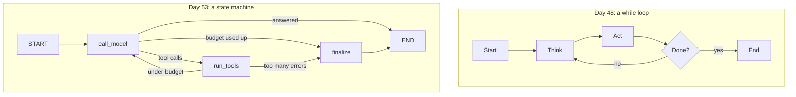
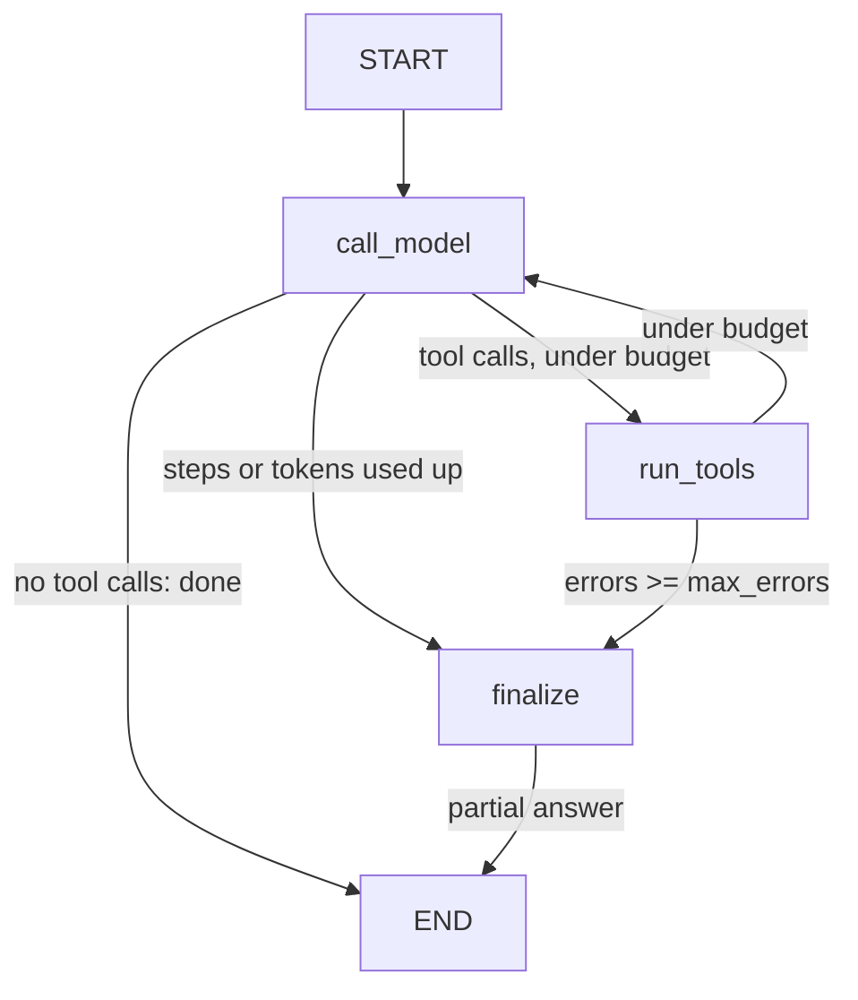
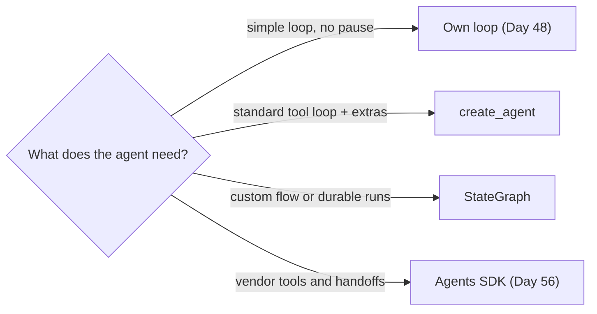

# LangGraph I: Graphs, State & Routing

Your Day 48 agent loop works. But each new need (pause for a human, resume after a crash, branch on a classification) means rewriting the `while`. LangGraph turns the loop into explicit pieces: a state object, steps that update it, and arrows that decide which step runs next. The Day 61 capstone runs on it. Today you rebuild the same agent with `create_agent` and as a `StateGraph`, and show both behave the same before Days 54 and 55 add durability and approvals.

## At a Glance

- **Time:** ~2 h core (+ optional Go Deeper) · **Depth:** working
- **Prerequisites:** [Day 48: Your First Agent: The Loop, Stop Conditions & Budgets](../Day_048_first_agent/first_agent.md); helpful: [Day 35: Function Calling: The Tool Loop](../../Phase_4_Tools_and_MCP/Day_035_function_calling/function_calling.md), [Day 37: Robust Tool Execution](../../Phase_4_Tools_and_MCP/Day_037_robust_tool_execution/robust_tool_execution.md), and the [Python for this course](../../Appendix_Primers/A03_python_for_this_course.md) primer for `TypedDict` and `Annotated`
- **You'll build:** `atlas/graph.py`, holding the Atlas issue investigator as a `create_agent` one-liner and as a hand-built `StateGraph` with budget-aware routing and a `finalize` node, plus a parity table against the Day 48 loop.
- **Stops at:** the LangGraph Platform, Studio and deployment. Subgraphs and the long-term `Store` are out of scope too ([Day 50](../Day_050_agent_memory/agent_memory.md) covers memory).
- **Fast path:** Already know state machines and Day 48? Read "The Standard Agent in One Call" and "Parity With the Day 48 Loop", then do Exercise 2 (~50 min).
- **Cost:** under $0.05 on `gpt-6-luna` with a key (3 runtimes × 5 issues); $0 without one, via a scripted offline model (prices as of 2026-11, [verify](https://developers.openai.com/api/docs/pricing)).
- **New terms:** state and reducer, node, conditional edge, `compile`, `recursion_limit`

> **Coming from Software Engineering?** A LangGraph graph is a state machine in the Redux or XState mould. The state is the store. A node is a reducer-style handler that receives the state and returns a *partial* update. Edges are the transition table. `compile()` is like `re.compile` or a prepared SQL statement: the structure is validated once, then run many times. `create_agent` is the framework's ready-made state machine for the standard tool loop; you write a `StateGraph` when you want to own the transition table yourself.

## Your Loop Is Already a State Machine

Here is the Day 48 loop with the details stripped out:

```python
# script_id: day_053_langgraph_graphs/d48_loop_sketch
# fragment
messages, steps, errors = [task], 0, 0          # hidden state: three local variables
while True:
    reply = model(messages); steps += 1         # "think"
    messages.append(reply)
    if not reply.tool_calls:                    # transition: done
        return reply.text
    if steps >= MAX_STEPS or errors >= MAX_ERRORS:
        return partial_answer(messages)         # transition: budget stop
    for call in reply.tool_calls:               # "act"
        result, failed = run(call)
        messages.append(result); errors += failed
```

It already has state (three locals), steps ("think" and "act") and transitions (the `if`s), all implicit. Pausing after "think" means returning mid-function and rebuilding the locals later; resuming after a crash means saving them somewhere; branching means another `if`. LangGraph makes each piece explicit, so you can save, stop and branch without rewriting the loop.

## A Board Game With a Score Card

Picture a board game. Squares are steps of work, arrows say where to go next, and some squares fork depending on a dice roll. You carry one score card: each square writes a few lines on it, and the next square reads it. For an agent:

- **Squares** are *nodes*: "call the model", "run the tools", "write a final answer".
- **The score card** is the *state*: the message list, a step counter, an error counter.
- **Arrows** are *edges*. A fork is a *conditional edge*: a small function that reads the card and picks the next square.

Each square writes only its *own* lines and never rewrites the whole card. That one rule explains most of LangGraph's behaviour.

## One Run by Hand

Before any code, trace one run on paper. The state is `{"steps": []}`. Two nodes take turns: `agent` returns `{"steps": ["agent"]}` and `tools` returns `{"steps": ["tools"]}`. The run goes agent → tools → agent → END.

What happens to `steps` depends on its **reducer**, the rule for merging a node's update into a field. With no reducer, the update *replaces* the old value. With `operator.add` it is *appended* (list + list).

| After node | Node returned | `steps` with an append reducer | `steps` with no reducer (replace) |
|---|---|---|---|
| (input) | `{"steps": []}` | `[]` | `[]` |
| `agent` | `{"steps": ["agent"]}` | `["agent"]` | `["agent"]` |
| `tools` | `{"steps": ["tools"]}` | `["agent", "tools"]` | `["tools"]` |
| `agent` | `{"steps": ["agent"]}` | `["agent", "tools", "agent"]` | `["agent"]` |

If the router says "stop once `len(steps) >= 3`", the append column stops after the third node, but the replace column never grows past one item and never stops. You'll trigger exactly this bug shortly.

## Name the Parts

| Part | What it is | In code |
|---|---|---|
| **State** | A `TypedDict` (a dict with named, typed keys) that every node reads | `class State(TypedDict): ...` |
| **Reducer** | How an update merges into one field: replace (default) or a function | `Annotated[list[str], operator.add]` |
| **Node** | A function `state -> partial update dict` | `builder.add_node("work", work)` |
| **Edge** | "After A, always run B" | `builder.add_edge(START, "work")` |
| **Conditional edge** | "After A, call this function to pick the next node" | `builder.add_conditional_edges("work", fn, [...])` |
| **`START` / `END`** | The virtual entry and exit nodes (the strings `"__start__"` and `"__end__"`) | `from langgraph.graph import START, END` |
| **`compile`** | Checks the wiring and returns a runnable graph | `graph = builder.compile()` |
| **`invoke` / `stream`** | Run to the end, or yield after each step | `graph.invoke(state, config)` |
| **`recursion_limit`** | The maximum number of steps per run; a fuse | `config = {"recursion_limit": 25}` |

LangGraph runs a graph in **supersteps**: one round in which every node that is due runs, then all their updates are merged through the reducers. A **thread** is one run or conversation, keyed by a `thread_id`, which matters once a checkpointer saves state between calls.

The diagram contrasts the hidden loop with the same agent as an explicit machine:



## The Smallest Graph

Install the pinned versions (as of 2026-11; check [PyPI](https://pypi.org/project/langgraph/) for newer ones):

```bash
uv add "langgraph==1.2.20" "langchain==1.4.9" "langchain-openai==1.7.4"
```

Here is the hand trace as code: one node in a loop, a conditional edge and an append reducer. There's no LLM, so it runs without a key.

```python
# script_id: day_053_langgraph_graphs/graph_toy
# The smallest useful graph: a node in a loop, a conditional edge, an append reducer.
# Install: uv add "langgraph==1.2.20". Env: none. Services: none.
import operator
from typing import Annotated, TypedDict

from langgraph.checkpoint.memory import InMemorySaver
from langgraph.graph import END, START, StateGraph

class State(TypedDict):
    steps: Annotated[list[str], operator.add]   # reducer: returned lists are appended

def work(state: State) -> dict:
    return {"steps": ["work"]}                   # a partial update, never the whole state

def keep_going(state: State) -> str:
    return "work" if len(state["steps"]) < 3 else END

builder = StateGraph(State)
builder.add_node("work", work)
builder.add_edge(START, "work")
builder.add_conditional_edges("work", keep_going, ["work", END])   # list = every possible target
graph = builder.compile(checkpointer=InMemorySaver())             # saves state per thread
cfg = {"configurable": {"thread_id": "toy-1"}, "recursion_limit": 25}
print(graph.invoke({"steps": []}, cfg))
```

```text
{'steps': ['work', 'work', 'work']}
```

`InMemorySaver` is the checkpointer (the component that saves state after every step) that lives in RAM. It's the canonical name; the older `MemorySaver` is an alias for the same class. With a checkpointer attached, every call needs a `thread_id`, so the graph knows which saved state to load. [Day 54](../Day_054_langgraph_durability/langgraph_durability.md) swaps it for SQLite and uses it to resume after a crash.

## Break It: No Reducer, No Limit, No Thread

Three mistakes cover most first-week LangGraph bugs. This script makes each one on purpose and prints the real error:

```python
# script_id: day_053_langgraph_graphs/break_it
# Three classic mistakes: no reducer, no exit (caught by recursion_limit), no thread_id.
# Install: uv add "langgraph==1.2.20". Env: none. Services: none.
import operator
from typing import Annotated, TypedDict

from langgraph.checkpoint.memory import InMemorySaver
from langgraph.errors import GraphRecursionError
from langgraph.graph import END, START, StateGraph

class Appending(TypedDict):
    steps: Annotated[list[str], operator.add]

class Replacing(TypedDict):
    steps: list[str]                             # no reducer: the last write wins

def build(schema, checkpointer=None):
    b = StateGraph(schema)
    b.add_node("work", lambda s: {"steps": ["work"]})
    b.add_edge(START, "work")
    b.add_conditional_edges("work", lambda s: "work" if len(s["steps"]) < 3 else END, ["work", END])
    return b.compile(checkpointer=checkpointer)

seen = []                                        # 1 + 2: the list never grows, so the loop never exits
try:
    for values in build(Replacing).stream({"steps": []}, {"recursion_limit": 5}, stream_mode="values"):
        seen.append(values["steps"])
except GraphRecursionError as exc:
    print("states seen:", seen)
    print("GraphRecursionError:", str(exc).splitlines()[0])

try:                                             # 3: a checkpointer needs a thread_id
    build(Appending, InMemorySaver()).invoke({"steps": []})
except ValueError as exc:
    print("ValueError:", exc)
```

```text
states seen: [[], ['work'], ['work'], ['work'], ['work'], ['work']]
GraphRecursionError: Recursion limit of 5 reached without hitting a stop condition. You can increase the limit by setting the `recursion_limit` config key.
ValueError: Checkpointer requires one or more of the following 'configurable' keys: thread_id, checkpoint_ns, checkpoint_id
```

What each failure teaches:

1. **No reducer means replace.** Every update overwrote `steps`, so it stayed `['work']`. That's the replace column of your hand trace.
2. **`recursion_limit` is your fuse.** It counts supersteps and raises `GraphRecursionError` when a run goes past it. The default in LangGraph 1.2.20 is **10,007**, not the 25 that older tutorials quote. With an LLM in the loop, 10,007 model calls is a large bill, so always pass the limit explicitly and keep a step budget in state as well.
3. **A checkpointer without a `thread_id` fails fast**, before any node runs.

## The Standard Agent in One Call

Most agents are the same machine: call the model, run any tools it asked for, repeat until it answers. LangChain ships that machine as `create_agent`. You give it a model, tools and a system prompt, and it returns a **compiled LangGraph graph**, so everything from the toy (`invoke`, `stream`, checkpointers) applies.

The Atlas investigator needs two read-only tools from [Day 35](../../Phase_4_Tools_and_MCP/Day_035_function_calling/function_calling.md). The first block of `atlas/graph.py` sets up config and the Day 48 budgets:

```python
# script_id: day_053_langgraph_graphs/atlas/graph
# atlas/graph.py: the Atlas investigator as create_agent and as a hand-built StateGraph.
# Install: uv add "langgraph==1.2.20" "langchain==1.4.9" "langchain-openai==1.7.4"
# Env: OPENAI_API_KEY (optional: without it a scripted offline model runs), ATLAS_MODEL, ORBIT_DATA
# Services: none. Reads datasets/orbit/issues/ (orbit.db read-only, issues.jsonl) and docs/*.md
import json
import os
import re
import sqlite3
from contextlib import closing
from dataclasses import dataclass
from pathlib import Path
from typing import Literal

from langchain.tools import tool

MODEL = os.environ.get("ATLAS_MODEL", "gpt-6-luna")
DATA_DIR = Path(os.environ.get("ORBIT_DATA", "datasets/orbit"))
PRICES_PER_1M = {"input": 0.10, "output": 0.50}   # gpt-6-luna USD, as of 2026-11, verify at the pricing page
SYSTEM = ("You investigate GitHub issues for Orbit, a Python background-jobs library. Search past "
          "issues and read the most relevant doc before answering. Cite issue ids and doc ids.")

@dataclass(frozen=True)
class AgentConfig:                     # built on Day 48 (compact): the budgets become routing rules
    max_steps: int = 8                 # model calls per run
    max_seconds: float = 60            # Exercise 2 adds this check to the router
    max_tokens: int = 100_000          # cumulative input + output tokens
    max_errors: int = 3                # failed tool calls

CONFIG = AgentConfig()
```

The tools are `@tool` wrappers around the Day 35 bodies. The decorator reads the type hints for the argument schema and the docstring for the description the model sees. Both return JSON strings, so every runtime passes the result through unchanged.

```python
# script_id: day_053_langgraph_graphs/atlas/graph
@tool
def search_issues(query: str, state: Literal["open", "closed"] | None = None, limit: int = 5) -> str:
    """Search past Orbit issues by keywords. Returns JSON rows with id, title and state."""
    # built on Day 35: a fixed, parameterised query on a read-only connection (the model never writes SQL)
    words = re.findall(r"[a-z0-9-]{3,}", query.lower())[:6] or [query.lower()]
    score = " + ".join(["(lower(title || ' ' || body) LIKE ?)"] * len(words))
    likes = [f"%{w}%" for w in words]
    sql = (f"SELECT id, title, state FROM issues WHERE ({score}) > 0 {'AND state = ?' if state else ''} "
           f"ORDER BY ({score}) DESC, id LIMIT ?")
    uri = f"file:{DATA_DIR / 'issues' / 'orbit.db'}?mode=ro"
    with closing(sqlite3.connect(uri, uri=True)) as db:
        rows = db.execute(sql, likes + ([state] if state else []) + likes + [limit]).fetchall()
    return json.dumps([{"id": i, "title": t, "state": s} for i, t, s in rows])

@tool
def get_doc_section(doc_id: str, heading: str | None = None) -> str:
    """Read an Orbit doc by id (e.g. 'retries-and-backoff'), optionally only one '## heading' section."""
    if not re.fullmatch(r"[a-z0-9-]+", doc_id):          # blocks '../' paths from a confused model
        raise ValueError(f"bad doc_id {doc_id!r}: use ids like 'retries-and-backoff'")
    path = DATA_DIR / "docs" / f"{doc_id}.md"
    if not path.exists():
        raise LookupError(f"no doc {doc_id!r}")
    text = path.read_text(encoding="utf-8")
    if heading:
        sections = re.split(r"(?m)^## ", text)
        text = next((s for s in sections if s.lower().startswith(heading.lower())), text)
    return json.dumps({"doc_id": doc_id, "text": text[:2000]})

TOOLS = [search_issues, get_doc_section]

def load_task(issue_id: int) -> str:
    """The issue as the agent's task. Issue text is untrusted input (injection defences: Day 69)."""
    for line in (DATA_DIR / "issues" / "issues.jsonl").open(encoding="utf-8"):
        issue = json.loads(line)
        if issue["id"] == issue_id:
            return f"{issue['title']}\n\nOrbit issue #{issue_id}:\n{issue['body'][:1500]}"
    raise LookupError(f"no issue {issue_id}")
```

Next comes the model. With a key, it's `ChatOpenAI`, LangChain's wrapper around the OpenAI API. Two arguments are not optional. `model=MODEL`, because the wrapper's default (`gpt-3.5-turbo`) was shut down on 2026-10-23. And `use_responses_api=True`, because in "auto" mode a tool-less call to `gpt-6-luna` still goes to Chat Completions. Without a key, a 25-line `ScriptedChatModel` stands in. It emits the same message shapes (search, read a doc, answer), so every script runs offline. LangChain's `GenericFakeChatModel` won't do: its `bind_tools` raises `NotImplementedError`.

```python
# script_id: day_053_langgraph_graphs/atlas/graph
from langchain_core.language_models import BaseChatModel
from langchain_core.messages import AIMessage, ToolMessage
from langchain_core.outputs import ChatGeneration, ChatResult

class ScriptedChatModel(BaseChatModel):
    """Offline stand-in: search issues, read the best-matching doc, then answer. Deterministic."""
    tools_bound: bool = False

    @property
    def _llm_type(self) -> str:
        return "scripted"

    def bind_tools(self, tools, *, tool_choice=None, **kwargs):
        return self.model_copy(update={"tools_bound": tool_choice != "none"})

    def _generate(self, messages, stop=None, run_manager=None, **kwargs) -> ChatResult:
        task = next(m.text for m in messages if m.type == "human")
        done = sum(m.type == "tool" for m in messages)
        words = set(re.findall(r"[a-z]+", task.splitlines()[0].lower()))   # the title
        doc = max(sorted(p.stem for p in (DATA_DIR / "docs").glob("*.md")),
                  key=lambda d: len(set(d.split("-")) & words))
        plan = [{"name": "search_issues", "args": {"query": task.splitlines()[0]}, "id": f"call_{done}"},
                {"name": "get_doc_section", "args": {"doc_id": doc}, "id": f"call_{done}"}]
        calls = plan[done:done + 1] if self.tools_bound else []
        text = "" if calls else f"Likely cause: see doc '{doc}' and the similar issues found. (scripted)"
        n_in = sum(len(m.text) for m in messages) // 4          # about 4 characters per token
        usage = {"input_tokens": n_in, "output_tokens": 40, "total_tokens": n_in + 40}
        reply = AIMessage(content=text, tool_calls=calls, usage_metadata=usage)
        return ChatResult(generations=[ChatGeneration(message=reply)])

def make_model() -> BaseChatModel:
    if not os.environ.get("OPENAI_API_KEY"):
        return ScriptedChatModel()
    from langchain_openai import ChatOpenAI
    return ChatOpenAI(model=MODEL, use_responses_api=True)    # always pass model=; force Responses
```

Two small helpers finish the setup: the [Day 37](../../Phase_4_Tools_and_MCP/Day_037_robust_tool_execution/robust_tool_execution.md) error envelope, so a failed tool call becomes a message the model can act on, and a token and cost sum over the AI messages (the [Day 12](../../Phase_2_Building_with_LLM_APIs/Day_012_openai_sdk_production/openai_sdk_production.md) `CostTracker` idea in four lines).

```python
# script_id: day_053_langgraph_graphs/atlas/graph
def envelope_err(exc: Exception) -> str:
    """Built on Day 37 (compact): a typed error the model can act on, never a stack trace."""
    kind = ("timeout" if isinstance(exc, TimeoutError) else "transient" if isinstance(exc, ConnectionError)
            else "denied" if isinstance(exc, PermissionError)
            else "permanent" if isinstance(exc, (LookupError, ValueError)) else "unknown")
    return json.dumps({"ok": False, "error": {"kind": kind, "message": str(exc)[:300],
                       "retryable": kind in ("timeout", "transient"), "hint": "fix the arguments or try another tool"}})

def usage_of(messages: list) -> tuple[int, int]:
    """(input, output) tokens summed over every AI message's usage_metadata."""
    usage = [m.usage_metadata or {} for m in messages if m.type == "ai"]
    return sum(u.get("input_tokens", 0) for u in usage), sum(u.get("output_tokens", 0) for u in usage)

def cost_usd(messages: list) -> float:
    n_in, n_out = usage_of(messages)
    return (n_in * PRICES_PER_1M["input"] + n_out * PRICES_PER_1M["output"]) / 1_000_000
```

Now the payoff. The whole standard agent, with a model-call budget enforced by middleware (a hook that runs around each model or tool call), takes one function:

```python
# script_id: day_053_langgraph_graphs/atlas/graph
from langchain.agents import create_agent
from langchain.agents.middleware import ModelCallLimitMiddleware

def build_langchain_agent(tools=TOOLS):
    """The standard tool loop in one call. Returns a compiled LangGraph graph."""
    return create_agent(make_model(), tools=tools, system_prompt=SYSTEM,
                        middleware=[ModelCallLimitMiddleware(run_limit=CONFIG.max_steps)])
```

Run it on issue #164 (Redis "max number of clients reached") and print the message trace:

```python
# script_id: day_053_langgraph_graphs/create_agent_run
# Run the create_agent version of Atlas on one Orbit issue and print the message trace.
# Install: as for atlas/graph. Env: OPENAI_API_KEY optional (scripted model without it), ORBIT_DATA
from atlas.graph import build_langchain_agent, cost_usd, load_task, usage_of

agent = build_langchain_agent()
print(type(agent).__name__)              # a compiled graph: invoke, stream and get_state all apply
result = agent.invoke({"messages": [{"role": "user", "content": load_task(164)}]},
                      {"recursion_limit": 25})
for m in result["messages"]:
    calls = [f"{c['name']}({c['args']})" for c in getattr(m, "tool_calls", [])]
    print(f"{m.type:>5} | {', '.join(calls) or repr(m.text[:70])}")
n_in, n_out = usage_of(result["messages"])
print(f"tokens in/out = {n_in}/{n_out}  cost = ${cost_usd(result['messages']):.5f}")
```

```text
CompiledStateGraph
human | 'ORB-1001 "max number of clients reached" after scaling out workers (no'
   ai | search_issues({'query': 'ORB-1001 "max number of clients reached" after scaling out workers (no failover involved)'})
 tool | '[{"id": 161, "title": "Redis failover causes reconnect storm: thousand'
   ai | get_doc_section({'doc_id': 'scaling-workers'})
 tool | '{"doc_id": "scaling-workers", "text": "---\\nid: scaling-workers\\ntitle'
   ai | "Likely cause: see doc 'scaling-workers' and the similar issues found. "
tokens in/out = 1740/120  cost = $0.00023
```

That's the scripted run; with a key, your numbers will differ. The shape is the point: Human → AI (tool call) → Tool → AI (tool call) → Tool → AI (answer). You did *not* write the loop, the tool dispatch or the "answer every tool call" bookkeeping. `ModelCallLimitMiddleware(run_limit=8)` ends the run after 8 model calls (`exit_behavior="end"` is the default; `"error"` raises instead).

Don't use `from langgraph.prebuilt import create_react_agent`. It still imports, but calling it warns that it has "moved to `langchain.agents`" and will be "removed in V2.0". `create_agent` is its replacement, and this is the only day that teaches it; [Day 56](../Day_056_openai_agents_sdk/openai_agents_sdk.md) and [Day 61](../Day_061_capstone_r3_investigator/capstone_r3_investigator.md) link back here.

## When the Default Is Not Enough

`create_agent`'s middleware covers many extras: retries, summarization ([Day 49](../Day_049_context_engineering/context_engineering.md)), call limits, a human-approval hook. Write your own `StateGraph` when you need:

- **Custom state:** steps, errors and `stop_reason` as typed fields you can route on, save and test.
- **Custom routing:** "too many tool errors → partial answer" as an edge you can see and change.
- **Your own pause points:** Day 55's approval node sits between "model proposed a side effect" and "tool runs".
- **Parallel branches:** search issues and docs at once, then merge (see Go Deeper).
- **Non-agent steps:** a deterministic triage node before the model, or a validator after it.

Atlas needs the first three by Day 55, so the capstone uses a `StateGraph`. For a plain tool-calling assistant, `create_agent` means less code to own.

## Your Agent as a StateGraph

Now build the same agent by hand. Start with the state. `messages` uses LangGraph's `add_messages` reducer, which appends new messages (and replaces one that has the same id). The counters have no reducer, so a node that returns `{"steps": 3}` sets the value outright. That's the behaviour you want for a counter the node computes itself.

Then come three nodes, each a plain function that takes the state and returns only the fields it changed:

- `call_model` asks the model and bumps `steps`.
- `run_tools` answers **every** tool call in the last AI message, failures included, and counts errors. Skipping one is not an option: the API rejects the next request if a tool call has no matching output (⚠ verify the exact error text).
- `finalize` makes one tool-free call for a partial answer when a budget runs out. First it answers any tool calls left dangling with a "skipped" envelope, so the saved history stays valid for Day 54's resume.

```python
# script_id: day_053_langgraph_graphs/atlas/graph
from typing import Annotated, TypedDict

from langchain_core.messages import AnyMessage, HumanMessage, SystemMessage
from langgraph.graph.message import add_messages

class AgentState(TypedDict):
    messages: Annotated[list[AnyMessage], add_messages]   # reducer: append (or replace by message id)
    steps: int                                            # no reducer: the last write wins
    errors: int
    stop_reason: str | None

def call_model(state: AgentState, llm) -> dict:
    reply = llm.invoke([SystemMessage(SYSTEM), *state["messages"]])
    return {"messages": [reply], "steps": state.get("steps", 0) + 1,
            "stop_reason": None if reply.tool_calls else "done"}

def run_tools(state: AgentState, tools_by_name: dict) -> dict:
    errors, results = state.get("errors", 0), []
    for call in state["messages"][-1].tool_calls:          # answer EVERY call, failures included
        try:
            content = tools_by_name[call["name"]].invoke(call["args"])
        except Exception as exc:                           # unknown tool, bad arguments, tool crash
            errors += 1
            content = envelope_err(exc)
        results.append(ToolMessage(content=content, tool_call_id=call["id"], name=call["name"]))
    return {"messages": results, "errors": errors}

FINALIZE_PROMPT = "Stop using tools. Give your best partial answer now and say what is still unknown."

def finalize(state: AgentState, llm) -> dict:
    skipped = [ToolMessage(content=json.dumps({"ok": False, "error": {"kind": "skipped", "message": "budget used up"}}),
                           tool_call_id=c["id"], name=c["name"])
               for c in getattr(state["messages"][-1], "tool_calls", [])]
    reply = llm.invoke([SystemMessage(SYSTEM), *state["messages"], *skipped, HumanMessage(FINALIZE_PROMPT)])
    reason = state.get("stop_reason") or stop_check(state) or "max_steps"
    return {"messages": [*skipped, reply], "stop_reason": reason}
```

The model and tool table are arguments, not globals, so the exercises can pass a broken tool.

## Routing: Conditional Edges and `Command`

The stop rules from Day 48 become one pure function, `stop_check`, which the routers call. It is cheapest checks first, needs no model, and is testable with a dict. Each router returns the *name* of the next node:



```python
# script_id: day_053_langgraph_graphs/atlas/graph
from langgraph.graph import END, START, StateGraph

def stop_check(state: AgentState, config: AgentConfig = CONFIG) -> str | None:
    """Built on Day 48's StopChecker: pure, cheapest first, unit-testable without a model."""
    if state.get("errors", 0) >= config.max_errors:
        return "max_errors"
    if state.get("steps", 0) >= config.max_steps:
        return "max_steps"
    if sum(usage_of(state["messages"])) >= config.max_tokens:
        return "max_tokens"
    return None

def route_after_model(state: AgentState) -> str:
    if not state["messages"][-1].tool_calls:
        return END                                         # the model answered
    return "finalize" if stop_check(state) else "run_tools"

def route_after_tools(state: AgentState) -> str:
    return "finalize" if stop_check(state) else "call_model"

def build_agent_graph(tools, *, checkpointer=None):
    llm = make_model()
    act, final = llm.bind_tools(tools), llm.bind_tools(tools, tool_choice="none")
    by_name = {t.name: t for t in tools}
    g = StateGraph(AgentState)
    g.add_node("call_model", lambda s: call_model(s, act))       # node names are a contract:
    g.add_node("run_tools", lambda s: run_tools(s, by_name))     # Days 54-55 and 61 build on them
    g.add_node("finalize", lambda s: finalize(s, final))
    g.add_edge(START, "call_model")
    g.add_conditional_edges("call_model", route_after_model, ["run_tools", "finalize", END])
    g.add_conditional_edges("run_tools", route_after_tools, ["call_model", "finalize"])
    g.add_edge("finalize", END)
    return g.compile(checkpointer=checkpointer)    # validates the wiring once; run it many times
```

`finalize` binds the tools with `tool_choice="none"` rather than dropping them, because its history still contains tool calls. The list passed to `add_conditional_edges` names every node a router may return, for validation and drawing.

Run it and watch each node's update arrive. `stream_mode="updates"` yields `{node_name: partial_update}` after each node, the diff. `"values"` yields the full state, the row. Passing both as a list gives `(mode, chunk)` tuples:

```python
# script_id: day_053_langgraph_graphs/stream_demo
# Run the StateGraph agent on one issue, streaming per-node diffs; then trip the recursion fuse.
# Install: as for atlas/graph. Env: OPENAI_API_KEY optional (scripted model without it), ORBIT_DATA
from langgraph.errors import GraphRecursionError

from atlas.graph import TOOLS, build_agent_graph, cost_usd, load_task

graph = build_agent_graph(TOOLS)
start = {"messages": [{"role": "user", "content": load_task(164)}],
         "steps": 0, "errors": 0, "stop_reason": None}
cfg = {"recursion_limit": 25}           # > 2 * max_steps + 1: the budget stops first; the limit is a fuse
final = None
for mode, chunk in graph.stream(start, cfg, stream_mode=["updates", "values"]):
    if mode == "values":
        final = chunk                    # the full state after each step; keep the last one
        continue
    for node, update in chunk.items():   # the diff a node returned
        calls = [c["name"] for m in update.get("messages", []) for c in getattr(m, "tool_calls", [])]
        print(f"{node:<10} steps={update.get('steps', '-')} errors={update.get('errors', '-')} "
              f"calls={calls} stop_reason={update.get('stop_reason')}")
print(f"stop_reason={final['stop_reason']} steps={final['steps']} cost=${cost_usd(final['messages']):.5f}")
try:
    graph.invoke(start, {"recursion_limit": 3})          # far too small, on purpose
except GraphRecursionError as exc:
    print("GraphRecursionError:", str(exc).splitlines()[0])
```

```text
call_model steps=1 errors=- calls=['search_issues'] stop_reason=None
run_tools  steps=- errors=0 calls=[] stop_reason=None
call_model steps=2 errors=- calls=['get_doc_section'] stop_reason=None
run_tools  steps=- errors=0 calls=[] stop_reason=None
call_model steps=3 errors=- calls=[] stop_reason=done
stop_reason=done steps=3 cost=$0.00023
GraphRecursionError: Recursion limit of 3 reached without hitting a stop condition. You can increase the limit by setting the `recursion_limit` config key.
```

Your numbers will differ with a live model. The budget (`max_steps=8`) is what normally stops a run; `recursion_limit` is the circuit breaker (a switch that trips to stop runaway damage) behind it. A full-budget run is 8 model calls, 7 tool rounds and 1 finalize, so about 16 supersteps, and 25 leaves headroom.

**The other routing style: `Command`.** A conditional edge keeps routing separate from work: the node updates state, then a router reads it. Sometimes the node that discovers the problem should decide on the spot. A node can return `Command(goto=..., update=...)` to update state *and* pick the next node in one step. Annotate the return type with the possible targets so LangGraph can draw and check the edges:

```python
# script_id: day_053_langgraph_graphs/command_toy
# A node that routes itself: Command(goto=..., update=...) instead of a separate router function.
# Install: uv add "langgraph==1.2.20". Env: none. Services: none.
from typing import Literal, TypedDict

from langgraph.graph import END, START, StateGraph
from langgraph.types import Command

class State(TypedDict):
    errors: int
    stop_reason: str | None

def flaky_tool(state: State) -> Command[Literal["flaky_tool", "finalize"]]:
    errors = state["errors"] + 1                       # pretend every attempt fails
    if errors >= 3:
        return Command(goto="finalize", update={"errors": errors, "stop_reason": "max_errors"})
    return Command(goto="flaky_tool", update={"errors": errors})

builder = StateGraph(State)
builder.add_node("flaky_tool", flaky_tool)
builder.add_node("finalize", lambda s: {})
builder.add_edge(START, "flaky_tool")                  # no edge out of flaky_tool: Command routes it
builder.add_edge("finalize", END)
print(builder.compile().invoke({"errors": 0, "stop_reason": None}, {"recursion_limit": 25}))
```

```text
{'errors': 3, 'stop_reason': 'max_errors'}
```

Use conditional edges when the decision reads several fields or several nodes share it. Use `Command` when one node owns the decision and should record *why* (`stop_reason`) in the same breath. Exercise 3 moves Atlas's `max_errors` stop to `Command`.

## Parity With the Day 48 Loop

Today's claim is only *the same behaviour*. The bench runs three runtimes on the same five issues with the same model, tools, prompt and budgets. The first is a compact port of the Day 48 loop onto the same chat-model object, so the three differ only in control flow.

```python
# script_id: day_053_langgraph_graphs/parity_bench
# Same 5 issues, model, tools and budgets; three runtimes: own loop, create_agent, StateGraph.
# Install: as for atlas/graph. Env: OPENAI_API_KEY optional (scripted model without it), ORBIT_DATA
# Writes reports/d53_parity.json. Without a key this checks control-flow parity, not answer quality.
import inspect
import json
from pathlib import Path

from langchain_core.messages import HumanMessage, SystemMessage

import atlas.graph as ag

def run_loop(task: str, config: ag.AgentConfig = ag.CONFIG) -> dict:
    """Built on Day 48 (compact): the same stop rules as a while loop over the same chat model."""
    llm, by_name = ag.make_model().bind_tools(ag.TOOLS), {t.name: t for t in ag.TOOLS}
    state = {"messages": [HumanMessage(task)], "steps": 0, "errors": 0}
    while True:
        reply = llm.invoke([SystemMessage(ag.SYSTEM), *state["messages"]])
        state["messages"].append(reply)
        state["steps"] += 1
        if not reply.tool_calls:
            return {**state, "stop_reason": "done"}
        if reason := ag.stop_check(state, config):
            return {**state, "stop_reason": reason}       # (Day 48 also writes a partial answer here)
        update = ag.run_tools(state, by_name)
        state["messages"] += update["messages"]
        state["errors"] = update["errors"]
        if reason := ag.stop_check(state, config):
            return {**state, "stop_reason": reason}
```

```python
# script_id: day_053_langgraph_graphs/parity_bench
lc_agent, graph = ag.build_langchain_agent(), ag.build_agent_graph(ag.TOOLS)
RUNNERS = {
    "own loop": run_loop,
    "create_agent": lambda t: lc_agent.invoke({"messages": [HumanMessage(t)]}, {"recursion_limit": 25}),
    "StateGraph": lambda t: graph.invoke({"messages": [HumanMessage(t)], "steps": 0, "errors": 0,
                                          "stop_reason": None}, {"recursion_limit": 25}),
}
LOC = {"own loop": [run_loop], "create_agent": [ag.build_langchain_agent],
       "StateGraph": [ag.call_model, ag.run_tools, ag.finalize, ag.route_after_model,
                      ag.route_after_tools, ag.build_agent_graph]}
set_file = Path("agent_set.json")                      # Day 48 writes a list of {"issue_id", ...}
issues = ([p["issue_id"] for p in json.loads(set_file.read_text())] if set_file.exists()
          else [10, 22, 164, 186, 204])                # stand-in ids if Day 48 hasn't run
rows = []
for issue_id in issues:
    for name, run in RUNNERS.items():
        msgs = (out := run(ag.load_task(issue_id)))["messages"]
        docs = [c["args"].get("doc_id") for m in msgs for c in getattr(m, "tool_calls", [])
                if c["name"] == "get_doc_section"]
        rows.append({"issue": issue_id, "runner": name, "steps": sum(m.type == "ai" for m in msgs),
                     "stop_reason": out.get("stop_reason")              # create_agent keeps no reason
                     or ("max_steps" if sum(m.type == "ai" for m in msgs) >= ag.CONFIG.max_steps else "done"),
                     "tokens": sum(ag.usage_of(msgs)),
                     "usd": ag.cost_usd(msgs), "doc": docs[-1] if docs else None})
print(f"{'runtime':<13} {'steps':>5} {'tokens':>7} {'usd':>9} {'LoC':>4}  stop reasons")
for name in RUNNERS:
    mine = [r for r in rows if r["runner"] == name]
    loc = sum(len(inspect.getsource(fn).splitlines()) for fn in LOC[name])
    print(f"{name:<13} {sum(r['steps'] for r in mine):>5} {sum(r['tokens'] for r in mine):>7} "
          f"{sum(r['usd'] for r in mine):>9.5f} {loc:>4}  {sorted({r['stop_reason'] for r in mine})}")
same = sum(len({r["doc"] for r in rows if r["issue"] == i}) == 1 for i in issues)
print(f"same doc read by all three runtimes: {same}/{len(issues)}")
Path("reports").mkdir(exist_ok=True)
Path("reports/d53_parity.json").write_text(json.dumps(rows, indent=2))
print("wrote reports/d53_parity.json")
```

```text
runtime       steps  tokens       usd  LoC  stop reasons
own loop         15    7328   0.00097   17  ['done']
create_agent     15    7328   0.00097    4  ['done']
StateGraph       15    7328   0.00097   40  ['done']
same doc read by all three runtimes: 5/5
wrote reports/d53_parity.json
```

These are scripted-model numbers: it makes the same calls everywhere by construction, so they prove the *plumbing* is equivalent, not real-model behaviour. With a key, runs vary: compare averages and add the row to the Agent scoreboard. LoC counts only the control-flow code each runtime makes you own.

This is **parity, not a win**. The `StateGraph` costs more lines than your loop and buys nothing new *today*. The payoff: Day 54 attaches a checkpointer to this exact graph to resume after a crash, and Day 55 inserts an approval node before `run_tools`. In the `while` loop, either means a rewrite.

## Trade-offs and When NOT to Use LangGraph

| You need | Use | Why |
|---|---|---|
| One simple agent, no pausing or resuming | Your own loop (Day 48) | Fewest concepts and dependencies; easiest to debug |
| The standard tool loop plus retries, limits or summarization | `create_agent` | About 10 lines; middleware covers the common extras |
| Custom state, routing, pause points or durable runs | `StateGraph` | You own the transition table; checkpoints come built in |
| OpenAI-hosted tools, handoffs and built-in tracing | The Agents SDK ([Day 56](../Day_056_openai_agents_sdk/openai_agents_sdk.md)) | Vendor features with less glue |



Don't adopt a graph for a fixed pipeline with no loop: a [Day 41](../../Phase_4_Tools_and_MCP/Day_041_workflow_patterns/workflow_patterns.md) function chain is clearer.

### In production

- Pin `langgraph==1.2.20` and `langchain==1.4.9` (as of 2026-11). Both move fast, and a minor release can move imports.
- Pass `recursion_limit` explicitly on every call and keep a step budget in state; never rely on the 10,007 default.
- Keep nodes small and returning partial updates. A node that mutates `state` in place, or returns the whole state, causes the bugs you saw in "Break It".
- Emit one span per node with [Day 42](../../Phase_5_Evaluation_and_Observability/Day_042_tracing_observability/tracing_observability.md)'s `step_span`; node names become span names, so keep them stable.
- Once Day 54 checkpoints the state, `AgentState` is a stored contract. Add fields with defaults; never rename one without a migration.

## Go Deeper (optional)

<details><summary>Go deeper: supersteps, parallel branches and why reducers exist</summary>

LangGraph's runtime is modelled on Pregel (Google's "think like a vertex" graph-processing system). Each piece of state lives in a **channel**, one per state key. A run proceeds in supersteps:

1. Find every node whose inputs changed in the last step. Those nodes are "due".
2. Run all due nodes. They read the *same* snapshot of the state, so none sees another's writes yet.
3. Merge every returned update into the channels, through each channel's reducer.
4. Save a checkpoint (if a checkpointer is attached), then repeat until no node is due.

Step 3 is why reducers exist. With one node per step, "replace" is unambiguous. With two nodes in the same step writing the same key, LangGraph needs a rule. With no reducer it refuses to guess and raises `InvalidUpdateError`. This toy fans out to two searches in parallel and joins them; edges from a *list* of nodes wait for all of them:

```python
# script_id: day_053_langgraph_graphs/fan_out
# Fan-out / fan-in: two nodes in one superstep write the same key. A reducer merges; none fails.
# Install: uv add "langgraph==1.2.20". Env: none. Services: none.
import operator
from typing import Annotated, TypedDict

from langgraph.errors import InvalidUpdateError
from langgraph.graph import END, START, StateGraph

class Safe(TypedDict):
    found: Annotated[list[str], operator.add]

class Unsafe(TypedDict):
    found: list[str]

def build(schema):
    g = StateGraph(schema)
    g.add_node("search_issues", lambda s: {"found": ["issue #4"]})
    g.add_node("search_docs", lambda s: {"found": ["doc idempotency"]})
    g.add_node("merge", lambda s: {})
    g.add_edge(START, "search_issues")
    g.add_edge(START, "search_docs")                       # both run in the same superstep
    g.add_edge(["search_issues", "search_docs"], "merge")  # fan-in: wait for both
    g.add_edge("merge", END)
    return g.compile()

print(build(Safe).invoke({"found": []}))
try:
    build(Unsafe).invoke({"found": []})
except InvalidUpdateError as exc:
    print("InvalidUpdateError:", str(exc).splitlines()[0])
print(build(Safe).get_graph().draw_mermaid())              # paste into any Mermaid renderer
```

```text
{'found': ['doc idempotency', 'issue #4']}
InvalidUpdateError: At key 'found': Can receive only one value per step. Use an Annotated key to handle multiple values.
---
config:
  flowchart:
    curve: linear
---
graph TD;
	__start__([<p>__start__</p>]):::first
	...
```

Two practical consequences:

- **Don't let meaning depend on the order of parallel writes.** Here the docs result landed first even though `search_issues` was wired first. Sort, or key results by source.
- **`draw_mermaid()` is a free design review.** Print it for any graph you build and compare it with the diagram you meant to draw. Missing `path_map` lists show up as edges that aren't there.

</details>

<details><summary>Go deeper: what create_agent builds, and the middleware hooks</summary>

`create_agent` returns a `CompiledStateGraph` like yours: a model node, a tool node and a router, with `messages` on `add_messages`. That's why `agent.get_graph().draw_mermaid()` works on it too. Middleware slots in as extra nodes or wrappers around those two.

LangChain 1.4.9 exports, from `langchain.agents.middleware`:

| Middleware | What it does | Course link |
|---|---|---|
| `ModelCallLimitMiddleware(thread_limit=, run_limit=, exit_behavior="end")` | Caps model calls per run or per thread | today |
| `ToolCallLimitMiddleware` | Caps tool calls | today's `max_steps` analogue |
| `ModelRetryMiddleware`, `ToolRetryMiddleware`, `ModelFallbackMiddleware` | Retries and fallbacks | backoff is owned by Day 84 |
| `SummarizationMiddleware(model, trigger=..., keep=("messages", 20))` | Summarizes old history | Day 49 |
| `HumanInTheLoopMiddleware(interrupt_on={...})` | Pauses before chosen tools; needs a checkpointer | Day 55 builds the graph version |
| `PIIMiddleware` | Redacts PII | Day 73 |

There are also decorator hooks (`before_model`, `after_model`, `wrap_model_call`, `wrap_tool_call`, `dynamic_prompt`) for writing your own. Check their signatures against the LangChain source before relying on them (⚠ verify).

`create_agent` also takes `response_format=` for a typed final answer (`result["structured_response"]`), plus `checkpointer=` and `store=`, so the Day 54 durability features work on it as well. The decision in the trade-off table is about *who owns the control flow*, not about features one side lacks.

</details>

## Common Pitfalls

- **`ChatOpenAI()` with no `model=`.** The default is `gpt-3.5-turbo`, which was shut down on 2026-10-23, so the first call fails. Always pass `model=MODEL`, plus `use_responses_api=True`; otherwise a tool-less `gpt-6-luna` call is sent to Chat Completions.
- **`from langgraph.prebuilt import create_react_agent`** warns that it has "moved to `langchain.agents` ... removed in V2.0". Use `from langchain.agents import create_agent`.
- **Messages vanish between nodes**, or a list stays at length 1. The field has no reducer, so each update replaces it. Use `Annotated[list[AnyMessage], add_messages]` for messages and `Annotated[list, operator.add]` for lists, and have nodes return partial dicts instead of mutating `state`.
- **A runaway loop runs up a bill.** `recursion_limit` defaults to 10,007, not 25. Pass it explicitly, and keep `steps` in state so the budget stops the run before the fuse (`GraphRecursionError: Recursion limit of 25 reached without hitting a stop condition`).
- **The API rejects a request because a tool call has no output** (⚠ verify the exact error text). An AI message's `tool_calls` lacked one tool result per call. Answer every call, errors included (`run_tools`), and dangling calls before a final request (`finalize`).
- **`ValueError: Checkpointer requires one or more of the following 'configurable' keys: thread_id, ...`** You compiled with a checkpointer but called without `{"configurable": {"thread_id": ...}}`. For files, `SqliteSaver` needs `uv add langgraph-checkpoint-sqlite` (Day 54).

> **Where we stop:** we don't cover the LangGraph Platform, Studio, deployment, subgraphs or the long-term `Store`. They solve hosting and cross-thread memory, which the course handles with its own stack (Days 50 and 77+). The curious can start at the [LangGraph repository](https://github.com/langchain-ai/langgraph).

## Key Takeaways

- A while-loop agent is already a state machine with hidden state and transitions; LangGraph makes the state, nodes and edges explicit so you can later save, pause and branch them.
- A node returns a partial update and each field's reducer merges it: no reducer replaces, `operator.add` and `add_messages` append. You can predict the result by hand, as in the trace table.
- `create_agent(model, tools=..., system_prompt=..., middleware=[...])` is the standard tool loop in about 10 lines and returns a compiled graph; always pass `model=` and `use_responses_api=True` to `ChatOpenAI`.
- In a `StateGraph`, Day 48's budgets become routers (`route_after_model`, `route_after_tools`) or a node returning `Command(goto=, update=)`. Run with an explicit `recursion_limit` and use `stream_mode="updates"` for diffs and `"values"` for full rows.
- On the same five issues the three runtimes show parity, not a win. Pick the own loop for simple agents, `create_agent` for the standard loop, and `StateGraph` when you need custom flow or durability.

## Quick Reference

| API / pattern | When to use | Gotcha |
|---|---|---|
| `StateGraph(State)` + `add_node` / `add_edge(START, ...)` | Owning the control flow | Use `add_edge(START, ...)`, not the old `set_entry_point` |
| `Annotated[list[str], operator.add]` | Lists that grow across steps | No reducer means last write wins |
| `Annotated[list[AnyMessage], add_messages]` | Chat history | Appends, and replaces messages with the same id |
| `add_conditional_edges(src, fn, [targets])` | Branching on state | List every possible target |
| `Command(goto=..., update=...)` | A node that routes itself | Annotate `-> Command[Literal[...]]` |
| `graph.compile(checkpointer=InMemorySaver())` | Per-thread state in RAM | Needs `{"configurable": {"thread_id": ...}}` |
| `invoke(state, {"recursion_limit": 25})` | Every run | Default is 10,007; `GraphRecursionError` when exceeded |
| `stream(..., stream_mode="updates" \| "values" \| [...])` | Logging diffs or full state | A list yields `(mode, chunk)` tuples |
| `create_agent(model, tools=, system_prompt=, middleware=)` | The standard tool loop | Returns a compiled graph |
| `ChatOpenAI(model=MODEL, use_responses_api=True)` | Any LangChain OpenAI model | Never rely on the default model or auto API choice |

## Exercises

1. **Warm-up: diff or row?** Run the Atlas graph on one issue with `stream_mode="updates"`, then with `"values"`. Print what each chunk contains, and decide which one you would write to your logs.

<details><summary>Solution</summary>

```python
# script_id: day_053_langgraph_graphs/solution_ex1
# Compare stream modes: "updates" = one diff per node, "values" = the full state per step.
from atlas.graph import TOOLS, build_agent_graph, load_task

graph = build_agent_graph(TOOLS)
start = {"messages": [{"role": "user", "content": load_task(10)}],
         "steps": 0, "errors": 0, "stop_reason": None}
for mode in ("updates", "values"):
    print(f"--- stream_mode={mode!r}")
    for chunk in graph.stream(start, {"recursion_limit": 25}, stream_mode=mode):
        if mode == "updates":
            for node, update in chunk.items():
                print(f"{node}: keys={sorted(update)} new_messages={len(update.get('messages', []))}")
        else:
            print(f"keys={sorted(chunk)} total_messages={len(chunk['messages'])}")
```

Log `updates`: each line names the node and carries only what it changed, so logs stay small and map onto spans. `values` repeats the whole growing history every step. It's useful for a debugger or a UI that redraws the full state, but the volume grows quadratically with run length.

</details>

2. **Core: a time budget as an edge.** Add Day 48's `max_seconds` check to `route_after_model`, and force it to fire with a slow fake tool. Record `stop_reason="max_seconds"`.

<details><summary>Solution</summary>

```python
# script_id: day_053_langgraph_graphs/solution_ex2
# A stop rule is an edge: route to finalize when the wall-clock budget is spent.
import time

from langgraph.graph import END, START, StateGraph

import atlas.graph as ag

MAX_SECONDS = 0.5                                  # tiny on purpose (Day 48 default: 60)
class TimedState(ag.AgentState):
    started_at: float                              # set once in the input; no node writes it
class SlowSearch:                                  # run_tools only needs .name and .invoke()
    name = "search_issues"
    def invoke(self, args: dict) -> str:
        time.sleep(0.6)
        return "[]"

def over_time(state) -> bool:
    return time.monotonic() - state["started_at"] >= MAX_SECONDS

def route_after_model(state) -> str:
    if not state["messages"][-1].tool_calls:
        return END
    return "finalize" if over_time(state) or ag.stop_check(state) else "run_tools"

llm = ag.make_model()
act, final = llm.bind_tools(ag.TOOLS), llm.bind_tools(ag.TOOLS, tool_choice="none")
tools = {"search_issues": SlowSearch(), "get_doc_section": ag.get_doc_section}
g = StateGraph(TimedState)
g.add_node("call_model", lambda s: ag.call_model(s, act))
g.add_node("run_tools", lambda s: ag.run_tools(s, tools))
g.add_node("finalize", lambda s: ag.finalize({**s, "stop_reason": "max_seconds" if over_time(s) else None}, final))
g.add_edge(START, "call_model")
g.add_conditional_edges("call_model", route_after_model, ["run_tools", "finalize", END])
g.add_edge("run_tools", "call_model")
g.add_edge("finalize", END)
out = g.compile().invoke({"messages": [{"role": "user", "content": ag.load_task(164)}], "steps": 0,
                          "errors": 0, "stop_reason": None, "started_at": time.monotonic()},
                         {"recursion_limit": 25})
print(f"stop_reason={out['stop_reason']} steps={out['steps']}")
```

```text
stop_reason=max_seconds steps=2
```

Time is checked *between* steps, so a single slow call can still overrun. Day 48's per-call timeout covers that case.

</details>

3. **Core: two routing styles.** Replace the `run_tools → finalize` conditional edge with a `run_tools` node that returns `Command(goto=..., update=...)` and sets `stop_reason="max_errors"` itself. Prove it with tools that always fail.

<details><summary>Solution</summary>

```python
# script_id: day_053_langgraph_graphs/solution_ex3
# The max_errors stop as a Command: the node that sees the errors routes and records why.
from typing import Literal

from langgraph.graph import END, START, StateGraph
from langgraph.types import Command

import atlas.graph as ag

MAX_ERRORS = 2

class Broken:                                       # every call fails, to force the error path
    def __init__(self, name: str):
        self.name = name
    def invoke(self, args: dict) -> str:
        raise ConnectionError("orbit.db unreachable")

BROKEN = {t.name: Broken(t.name) for t in ag.TOOLS}

def run_tools(state: ag.AgentState) -> Command[Literal["call_model", "finalize"]]:
    update = ag.run_tools(state, BROKEN)
    if update["errors"] >= MAX_ERRORS:
        return Command(goto="finalize", update={**update, "stop_reason": "max_errors"})
    return Command(goto="call_model", update=update)

llm = ag.make_model()
act, final = llm.bind_tools(ag.TOOLS), llm.bind_tools(ag.TOOLS, tool_choice="none")
g = StateGraph(ag.AgentState)
g.add_node("call_model", lambda s: ag.call_model(s, act))
g.add_node("run_tools", run_tools)                  # no outgoing edge: Command routes it
g.add_node("finalize", lambda s: ag.finalize(s, final))
g.add_edge(START, "call_model")
g.add_conditional_edges("call_model", ag.route_after_model, ["run_tools", "finalize", END])
g.add_edge("finalize", END)
out = g.compile().invoke({"messages": [{"role": "user", "content": ag.load_task(164)}],
                          "steps": 0, "errors": 0, "stop_reason": None}, {"recursion_limit": 25})
print(f"stop_reason={out['stop_reason']} errors={out['errors']} steps={out['steps']}")
print(out["messages"][2].content[:90])
```

```text
stop_reason=max_errors errors=2 steps=2
{"ok": false, "error": {"kind": "transient", "message": "orbit.db unreachable", "retryable": t
```

The conditional-edge version keeps the decision in one place that every node shares. The `Command` version puts it next to the evidence and records the reason atomically. Pick one style per decision, not both.

</details>

4. **Stretch (past the stop line): triage first.** Add a `triage` node before `call_model` that sends issues needing a human straight to `END` with `stop_reason="needs_human"`. Use [Day 41](../../Phase_4_Tools_and_MCP/Day_041_workflow_patterns/workflow_patterns.md)'s `classify_issue` if you have it, or a keyword stand-in.

<details><summary>Solution</summary>

```python
# script_id: day_053_langgraph_graphs/solution_ex4
# A deterministic triage node in front of the agent. Swap needs_human() for Day 41's classify_issue.
import re

from langgraph.graph import END, START, StateGraph

import atlas.graph as ag

SENSITIVE = re.compile(r"password|secret|api key|sk-|e-?mail|phone|delet", re.I)

def needs_human(text: str) -> bool:                 # stand-in for classify_issue(issue).needs_human
    return bool(SENSITIVE.search(text))

def triage(state: ag.AgentState) -> dict:
    return {"stop_reason": "needs_human" if needs_human(state["messages"][0].text) else None}

llm = ag.make_model()
act, final = llm.bind_tools(ag.TOOLS), llm.bind_tools(ag.TOOLS, tool_choice="none")
by_name = {t.name: t for t in ag.TOOLS}
g = StateGraph(ag.AgentState)
g.add_node("triage", triage)
g.add_node("call_model", lambda s: ag.call_model(s, act))
g.add_node("run_tools", lambda s: ag.run_tools(s, by_name))
g.add_node("finalize", lambda s: ag.finalize(s, final))
g.add_edge(START, "triage")
g.add_conditional_edges("triage", lambda s: END if s["stop_reason"] == "needs_human" else "call_model",
                        ["call_model", END])
g.add_conditional_edges("call_model", ag.route_after_model, ["run_tools", "finalize", END])
g.add_conditional_edges("run_tools", ag.route_after_tools, ["call_model", "finalize"])
g.add_edge("finalize", END)
graph = g.compile()
for issue_id in (13, 164):
    out = graph.invoke({"messages": [{"role": "user", "content": ag.load_task(issue_id)}],
                        "steps": 0, "errors": 0, "stop_reason": None}, {"recursion_limit": 25})
    print(f"#{issue_id}: stop_reason={out['stop_reason']} model_calls={out['steps']}")
```

```text
#13: stop_reason=needs_human model_calls=0
#164: stop_reason=done model_calls=3
```

A keyword screen is a weak classifier; Day 41 measures how weak against `triage_gold.jsonl`. The structural point holds either way: a cheap deterministic node in front of the model saves a model call on every issue it routes away.

</details>

## References & Further Reading

- [LangGraph on GitHub](https://github.com/langchain-ai/langgraph): source and README for `StateGraph`, reducers, `Command` and checkpointers; read the source when the docs and your installed version disagree.
- [LangChain on GitHub](https://github.com/langchain-ai/langchain): `create_agent` and the middleware classes live in `libs/langchain`; the quickest way to confirm a signature.
- [langgraph on PyPI](https://pypi.org/project/langgraph/): current versions and release dates, for pinning.
- [langgraph-checkpoint-sqlite](https://github.com/langchain-ai/langgraph/tree/main/libs/checkpoint-sqlite): the separate package Day 54 installs for `SqliteSaver`.
- [Anthropic: Building effective AI agents](https://www.anthropic.com/research/building-effective-agents): workflows versus agents, and why the simplest structure that works usually wins.

## What's Next

Your graph runs, but only in RAM: kill the process mid-run and the investigation is gone. In [Day 54: LangGraph II: Durable Execution, Checkpoints & Time Travel](../Day_054_langgraph_durability/langgraph_durability.md) you attach a SQLite checkpointer to `build_agent_graph`, crash it on purpose, resume from the last step, and replay and fork earlier runs to debug them.
