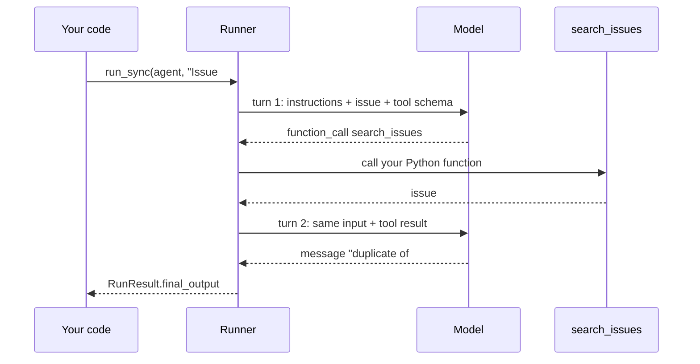
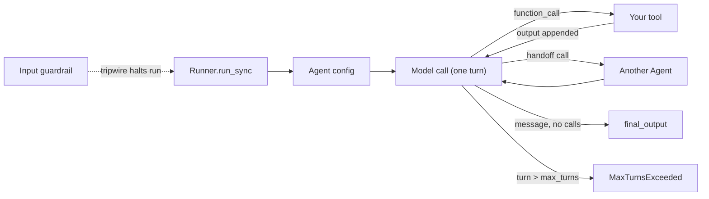
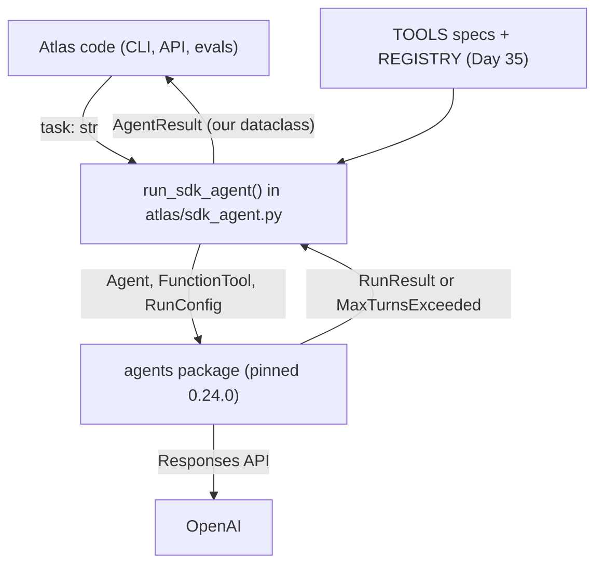
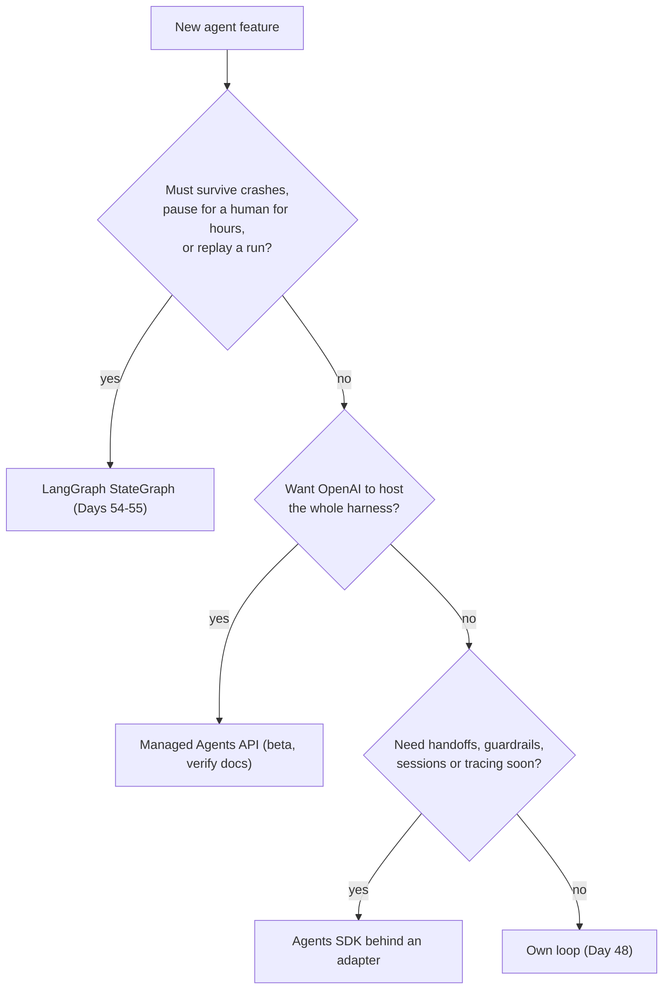

# The OpenAI Agents SDK

You have already written an agent loop by hand ([Day 48](../Day_048_first_agent/first_agent.md)) and rebuilt it as a graph ([Day 53](../Day_053_langgraph_graphs/langgraph_graphs.md)). Both work, and both are code you maintain. The OpenAI Agents SDK packages the same loop, plus tools, handoffs, guardrails, sessions and tracing, so you will meet it at work. Today you port the Atlas investigator to it, and you learn to use it without letting its types spread through your whole codebase.

## At a Glance

- **Time:** ~2 h core (+ optional Go Deeper) · **Depth:** working
- **Prerequisites:** [Day 48: Your First Agent: The Loop, Stop Conditions & Budgets](../Day_048_first_agent/first_agent.md), [Day 53: LangGraph I: Graphs, State & Routing](../Day_053_langgraph_graphs/langgraph_graphs.md); helpful: [Day 35: Function Calling: The Tool Loop](../../Phase_4_Tools_and_MCP/Day_035_function_calling/function_calling.md), [Day 37: Robust Tool Execution](../../Phase_4_Tools_and_MCP/Day_037_robust_tool_execution/robust_tool_execution.md), [Day 19: Testing LLM Code](../../Phase_2_Building_with_LLM_APIs/Day_019_testing_llm_code/testing_llm_code.md)
- **You'll build:** `atlas/sdk_agent.py`, the Day 48 agent on `openai-agents==0.24.0` behind a thin adapter that returns the same `AgentResult`, plus keyless pytest tests and a three-runtime comparison.
- **Stops at:** SDK internals, voice/realtime agents and MCP through the SDK; multi-agent design is [Day 64](../../Phase_7_Multi_Agent_Systems/Day_064_multi_agent_when/multi_agent_when.md).
- **Fast path:** Already built Days 48 and 53? Read "The Adapter" and "Choosing a Runtime", then do Exercise 2 (~45 min).
- **Cost:** ≈ $0.02 on `gpt-6-luna`, all of it from `compare_runtimes` (15 agent runs); every other script runs keyless (estimate; prices as of 2026-11, [verify](https://developers.openai.com/api/docs/pricing)).
- **New terms:** Agent / Runner, handoff, guardrail (and its tripwire), session, adapter (anti-corruption layer)

> **Coming from Software Engineering?** The Agents SDK is to your Day 48 loop what Express or Django is to a server you wrote on raw sockets. Routing, validation and middleware come built in; you accept its conventions and release cadence. The habit that transfers is the **anti-corruption layer**: one thin module translates the vendor's types into yours, so nothing else imports the vendor. `openai-agents` is pre-1.0: pin it exactly and keep an upgrade's blast radius to one file.

## Own It or Rent It?

Your Day 48 agent is about 60 lines of loop: call the model, run tool calls, append results, check five stop conditions, repeat. Around it sit more parts you maintain: tool schemas, the Day 37 error envelope, retries, tracing spans from [Day 42](../../Phase_5_Evaluation_and_Observability/Day_042_tracing_observability/tracing_observability.md), and conversation state. All of it is yours to debug at 2 a.m.

Each new request ("hand off to a docs specialist", "block issues that paste secrets") becomes another feature in your loop. The Agents SDK is OpenAI's open-source library (import name `agents`) that ships those features already written.

## A Contractor, Not a Rewrite

Think of hiring a contractor who already knows the job. You get a faster start and fewer chores, and you give up some control over the details: they use their own tools, their own order of work, and their own paperwork.

The SDK runs **the same loop you wrote**: instructions and tool schemas go to the Responses API, your functions run, results go back. Only the owner changes, which tells you what to check:

- **What the SDK automates:** the loop itself, tool schemas from type hints, handoffs, guardrails, session storage and tracing.
- **What stays yours:** budgets beyond a turn count, cost accounting, stop reasons your callers understand, and the decision about what data leaves your account.

## One Turn by Hand

Before any code, trace one run on paper. A maintainer files Orbit issue #41, "Nightly index rebuild runs twice even though orbit.ini sets lease = 900". You give the agent one tool, `search_issues`.

1. **Model call 1:** instructions, issue text and the tool schema go out; a `function_call` comes back: `search_issues({"query": "runs twice lease"})`.
2. **Tool run:** your function returns issue #4, "Monthly statement job runs twice, customers get two emails".
3. **Model call 2:** everything again plus the tool result; the model answers "#41 looks like a duplicate of #4 (lease expiry, ORB-1101)."
4. **Stop:** a message with no tool calls is a final answer.

That is **two turns** (a *turn* is one model call), three items (call, output, message) and one final answer. A model that kept calling tools would loop until a turn limit stopped it.



## Name the Parts

| Part | What it is | Day 48 equivalent |
|---|---|---|
| `Agent(name, instructions, model, tools)` | A configuration object: who the agent is and what it may call. It holds no conversation. | Your `system` prompt + `TOOLS` |
| `Runner.run_sync(agent, input, max_turns=...)` | The loop. `Runner.run` is the async version with the same arguments. | `run_agent()` |
| `@function_tool` | Turns a typed Python function into a tool; the schema comes from the type hints and docstring. Strict by default. | Your hand-written JSON schema |
| `RunResult` | What a run returns: `final_output`, `new_items` (every call, output and message), `raw_responses` (one per turn), `last_agent`. | `AgentResult` |
| `max_turns` | The turn budget. **The default is 10.** Going over raises `MaxTurnsExceeded`. | `AgentConfig.max_steps` |

Three more parts appear later today. A **handoff** lets one agent pass the whole conversation to another agent. A **guardrail** is a check that runs alongside the agent and can halt the run; when it fires, that is its **tripwire**. A **session** stores conversation history so a follow-up question sees earlier turns.



## Your First SDK Agent

Install with `uv add "openai-agents==0.24.0"`. The script runs without an API key: `ScriptedModel` from `agents.testing` is the SDK's own test double, a fake model that replays the turns you script. Set `OPENAI_API_KEY` and it runs on `MODEL` instead.

```python
# script_id: day_056_openai_agents_sdk/sdk_minimal
# Install: uv add "openai-agents==0.24.0"   Env: none (keyless); OPENAI_API_KEY switches to a live run
import os
os.environ.setdefault("OPENAI_AGENTS_DISABLE_TRACING", "1")  # samples never upload traces
from agents import Agent, Runner, function_tool
from agents.testing import ScriptedModel, assistant_message, function_call

MODEL = os.environ.get("ATLAS_MODEL", "gpt-6-luna")

@function_tool
def search_issues(query: str) -> str:
    """Search past Orbit issues by keyword. Returns matching ids and titles."""
    return '[{"id": 4, "title": "Monthly statement job runs twice, customers get two emails"}]'

# The paper trace above, as two scripted turns: call the tool, then answer.
fake = ScriptedModel([
    [function_call("search_issues", {"query": "runs twice lease"}, call_id="c1")],
    [assistant_message("#41 looks like a duplicate of #4 (lease expiry, ORB-1101).")],
])
agent = Agent(name="Atlas", instructions="Triage Orbit issues. Cite issue ids.",
              model=MODEL if os.environ.get("OPENAI_API_KEY") else fake, tools=[search_issues])
result = Runner.run_sync(agent, "Issue #41: nightly index rebuild runs twice.", max_turns=8)
print(result.final_output)
print("turns:", len(result.raw_responses), "| items:", [i.type for i in result.new_items])
```

```text
#41 looks like a duplicate of #4 (lease expiry, ORB-1101).
turns: 2 | items: ['tool_call_item', 'tool_call_output_item', 'message_output_item']
```

It matches the paper trace, with no schema, `while` or `call_id` bookkeeping written.

## Break It: Defaults That Bite

Three defaults catch nearly everyone. The next script trips all three, offline.

```python
# script_id: day_056_openai_agents_sdk/break_it
# Install: uv add "openai-agents==0.24.0"   Env: none (keyless)
import os
os.environ.setdefault("OPENAI_AGENTS_DISABLE_TRACING", "1")
from agents import Agent, MaxTurnsExceeded, Runner, function_tool
from agents.models import get_default_model
from agents.testing import ScriptedModel, assistant_message, function_call

# 1. Forget model= and the SDK picks its own default, not your ATLAS_MODEL.
print("Agent without model= runs on:", get_default_model())

@function_tool
def search_issues(query: str) -> str:
    """Search past Orbit issues by keyword."""
    return "[]"  # nothing found, so a stubborn model keeps searching

# 2. A model that never stops calling tools hits max_turns, and the SDK raises.
looping = ScriptedModel([[function_call("search_issues", {"query": f"try {i}"}, call_id=f"c{i}")]
                         for i in range(20)])
try:
    Runner.run_sync(Agent(name="Loop", model=looping, tools=[search_issues]), "find dupes", max_turns=3)
except MaxTurnsExceeded as e:
    print("MaxTurnsExceeded:", e, "| items so far:", len(e.run_data.new_items))

# 3. A crashing tool does NOT raise: the model gets a generic error string instead.
@function_tool
def get_doc_section(doc_id: str) -> str:
    """Read one Orbit doc page."""
    raise FileNotFoundError(f"docs/{doc_id}.md")

crashy = ScriptedModel([[function_call("get_doc_section", {"doc_id": "nope"}, call_id="d1")],
                        [assistant_message("Sorry, I could not read the docs.")]])
r = Runner.run_sync(Agent(name="Crash", model=crashy, tools=[get_doc_section]), "read nope")
print("tool output the model saw:", [i.output for i in r.new_items if i.type == "tool_call_output_item"])
```

```text
Agent without model= runs on: gpt-5.6-luna
MaxTurnsExceeded: Max turns (3) exceeded | items so far: 6
tool output the model saw: ['An error occurred while running the tool. Please try again.']
```

What each line teaches:

1. **The default model is `gpt-5.6-luna`** (or whatever `OPENAI_DEFAULT_MODEL` says). It is a live model, but not the one your cost tables assume. Always pass `model=MODEL`.
2. **`MaxTurnsExceeded` is an exception, not a result.** Your Day 48 loop returned a partial result with `stop_reason="max_steps"`; the SDK throws. The work done so far rides along on `e.run_data`, which the adapter will use.
3. **Tool exceptions are swallowed.** The model sees a vague message and may retry forever. In tests, `@function_tool(failure_error_function=None)` makes the SDK raise `UserError: Error running tool get_doc_section: ...`; in production, return your own error envelope (next section).

## The Adapter

Import a framework everywhere, and the 0.x release that renames `new_items` costs you forty files. An **adapter** is one module that alone imports `agents`, takes plain inputs and returns your Day 48 `AgentResult`. It's the anti-corruption layer from the callout, and it's why [Day 65](../../Phase_7_Multi_Agent_Systems/Day_065_handoffs_agents_as_tools/handoffs_agents_as_tools.md) can call `run_sdk_agent()` without knowing which runtime is underneath.



The adapter maps each SDK concept onto the Day 48 contract:

| SDK gives you | Adapter turns it into |
|---|---|
| `result.raw_responses` (one per turn) | `steps: list[StepRecord]`, one per model call, with tool names and tokens |
| `result.context_wrapper.usage` | `usage` dict + `cost_usd` via the Day 12 `CostTracker` |
| `MaxTurnsExceeded` (with `run_data`) | `stop_reason="max_steps"`, `partial=True` |
| A wall-clock overrun (the SDK has no time budget) | `asyncio.wait_for` → `stop_reason="max_seconds"`, `partial=True` |
| Tool exceptions | The Day 37 error envelope, so the model gets a typed, actionable error |

The file arrives in five blocks under one `script_id`, stitched into a single `sdk_agent.py`. The first copies the Day 48 contract compactly (no cross-lesson imports); keep it field-for-field identical.

```python
# script_id: day_056_openai_agents_sdk/sdk_agent
# atlas/sdk_agent.py: the Day 48 agent on the OpenAI Agents SDK, behind a thin adapter.
# Install: uv add "openai-agents==0.24.0"   Env: ORBIT_DATA; OPENAI_API_KEY only for live runs
# Services: none (orbit.db is opened read-only). This is the ONLY Atlas module that imports `agents`.
from __future__ import annotations

import asyncio, json, os, re, sqlite3
from dataclasses import dataclass
from pathlib import Path
from typing import Any, Callable, Literal

os.environ.setdefault("OPENAI_AGENTS_DISABLE_TRACING", "1")  # decide tracing per data class (Day 73)
from agents import Agent, FunctionTool, MaxTurnsExceeded, Model, RunConfig, Runner

MODEL = os.environ.get("ATLAS_MODEL", "gpt-6-luna")
DATA_DIR = Path(os.environ.get("ORBIT_DATA", "datasets/orbit"))
# USD per 1M tokens, as of 2026-11; verify at https://developers.openai.com/api/docs/pricing
PRICES = {"gpt-6-luna": {"input": 0.10, "cached": 0.01, "output": 0.50}}

# built on Day 48 (../Day_048_first_agent): compact copy, fields must match exactly
StopReason = Literal["done", "max_steps", "max_seconds", "max_tokens", "max_errors", "interrupted"]

@dataclass
class StepRecord:
    index: int
    tool_calls: list[str]
    errors: int
    input_tokens: int
    output_tokens: int
    ms: int = 0  # the SDK reports no per-step latency; read it from traces if you need it

@dataclass
class AgentResult:
    text: str
    stop_reason: StopReason
    steps: list[StepRecord]
    usage: dict[str, int]
    cost_usd: float
    partial: bool = False
```

The second block brings in the cost tracker from [Day 12](../../Phase_2_Building_with_LLM_APIs/Day_012_openai_sdk_production/openai_sdk_production.md) and two read-only tools from Day 35, described as plain Responses tool specs. Nothing here knows the SDK exists, which is the point: these specs also drive your own loop and the LangGraph version.

```python
# script_id: day_056_openai_agents_sdk/sdk_agent
class CostTracker:  # built on Day 12: compact
    def __init__(self) -> None:
        self.total_usd = 0.0

    def record(self, model: str, input_tokens: int, output_tokens: int, cached: int = 0) -> float:
        p = PRICES.get(model, PRICES["gpt-6-luna"])
        usd = ((input_tokens - cached) * p["input"] + cached * p["cached"] + output_tokens * p["output"]) / 1e6
        self.total_usd += usd
        return usd

tracker = CostTracker()

def search_issues(query: str, limit: int = 3) -> list[dict]:  # built on Day 35
    words = [w for w in re.findall(r"\w+", query.lower()) if len(w) > 2]
    db = sqlite3.connect(f"file:{DATA_DIR / 'issues' / 'orbit.db'}?mode=ro", uri=True)
    rows = db.execute("SELECT id, title, body, state, duplicate_of FROM issues").fetchall()
    db.close()
    hits = sorted(((sum(w in f"{t} {b}".lower() for w in words), i, t, s, d) for i, t, b, s, d in rows),
                  reverse=True)
    return [{"id": i, "title": t, "state": s, "duplicate_of": d} for n, i, t, s, d in hits[:limit] if n]

def get_doc_section(doc_id: str, heading: str) -> str:  # built on Day 35
    if not re.fullmatch(r"[a-z0-9-]+", doc_id):  # no path tricks like "../"
        raise ValueError(f"bad doc_id {doc_id!r}; use a page name like 'troubleshooting-duplicates'")
    for part in re.split(r"\n(?=## )", (DATA_DIR / "docs" / f"{doc_id}.md").read_text()):
        if part.startswith("## ") and heading.lower() in part.splitlines()[0].lower():
            return part[:2000]
    raise LookupError(f"no section matching {heading!r} in {doc_id}")

def _fn_spec(name: str, description: str, props: dict) -> dict:
    return {"type": "function", "name": name, "description": description, "strict": True,
            "parameters": {"type": "object", "properties": props, "required": list(props),
                           "additionalProperties": False}}

TOOLS: list[dict] = [
    _fn_spec("search_issues", "Keyword search over past Orbit issues; returns id, title, state, duplicate_of.",
             {"query": {"type": "string"}, "limit": {"type": "integer"}}),
    _fn_spec("get_doc_section", "Read one section of an Orbit doc page by page id and heading words.",
             {"doc_id": {"type": "string"}, "heading": {"type": "string"}}),
]
REGISTRY: dict[str, Callable[..., Any]] = {"search_issues": search_issues, "get_doc_section": get_doc_section}
```

The third block is the adapter itself. `to_sdk_tool()` builds a `FunctionTool` straight from a Day 35 spec instead of re-describing each tool with `@function_tool`, so your schema stays the single source of truth. Its `on_invoke_tool` callback receives the arguments as a JSON string and catches every exception into the Day 37 envelope, replacing the SDK's vague "An error occurred" with something the model can act on.

```python
# script_id: day_056_openai_agents_sdk/sdk_agent
def envelope_err(kind: str, message: str, hint: str | None = None) -> dict:  # built on Day 37
    return {"ok": False, "error": {"kind": kind, "message": message, "retryable": False, "hint": hint}}

def to_sdk_tool(spec: dict, fn: Callable[..., Any] | None = None) -> FunctionTool:
    """Wrap a Day 35 tool spec as an SDK FunctionTool; our schema and error envelope win."""
    fn = fn or REGISTRY[spec["name"]]

    async def invoke(ctx: Any, args_json: str) -> str:
        try:
            return json.dumps({"ok": True, "data": fn(**json.loads(args_json))})
        except Exception as exc:  # never let the SDK's generic error string reach the model
            kind = "bad_args" if isinstance(exc, (TypeError, ValueError)) else "permanent"
            return json.dumps(envelope_err(kind, str(exc), "fix the arguments or try another tool"))

    return FunctionTool(name=spec["name"], description=spec["description"],
                        params_json_schema=spec["parameters"], on_invoke_tool=invoke,
                        strict_json_schema=spec.get("strict", True))

AGENT_SYSTEM = ("You triage new Orbit issues. Search past issues and the docs before answering. "
                "Cite issue ids (#N) and doc page ids. If evidence is missing, say what is missing.")

def build_sdk_agent(model: str | Model = MODEL, *, tools: list[dict] = TOOLS, **agent_options: Any) -> Agent:
    """agent_options passes extra Agent fields through (input_guardrails, handoffs, ...)."""
    return Agent(name="Atlas investigator", instructions=AGENT_SYSTEM, model=model,
                 tools=[to_sdk_tool(s) for s in tools], **agent_options)
```

The fourth block runs the agent and translates the outcome. Turn and wall-clock budgets are enforced here; anything SDK-shaped is converted before it leaves the function.

```python
# script_id: day_056_openai_agents_sdk/sdk_agent
def _to_result(run: Any, model_name: str, stop: StopReason, text: str) -> AgentResult:
    """Map a RunResult (or MaxTurnsExceeded.run_data) to the Day 48 AgentResult."""
    failed = {i.raw_item["call_id"]: '"ok": false' in str(i.output)
              for i in run.new_items if i.type == "tool_call_output_item"}
    steps = []
    for n, resp in enumerate(run.raw_responses, start=1):
        calls = [o for o in resp.output if getattr(o, "type", "") == "function_call"]
        steps.append(StepRecord(n, [c.name for c in calls], sum(failed.get(c.call_id, False) for c in calls),
                                resp.usage.input_tokens, resp.usage.output_tokens))
    u = run.context_wrapper.usage
    cost = tracker.record(model_name, u.input_tokens, u.output_tokens, u.input_tokens_details.cached_tokens)
    usage = {"input_tokens": u.input_tokens, "output_tokens": u.output_tokens, "total_tokens": u.total_tokens}
    return AgentResult(text, stop, steps, usage, round(cost, 6), partial=stop != "done")

def run_sdk_agent(task: str, max_turns: int = 8, *, model: str | Model = MODEL,
                  max_seconds: float = 60.0, **agent_options: Any) -> AgentResult:
    agent = build_sdk_agent(model, **agent_options)
    name = model if isinstance(model, str) else MODEL  # test doubles are priced as MODEL
    config = RunConfig(workflow_name="atlas-investigator", trace_include_sensitive_data=False)
    try:  # inside async code (FastAPI, notebooks), await Runner.run(...) instead of asyncio.run
        run = asyncio.run(asyncio.wait_for(
            Runner.run(agent, task, max_turns=max_turns, run_config=config), timeout=max_seconds))
        return _to_result(run, name, "done", str(run.final_output))
    except MaxTurnsExceeded as exc:  # the SDK type stops here; callers get a partial AgentResult
        if exc.run_data is None:
            return AgentResult(str(exc), "max_steps", [], {}, 0.0, partial=True)
        return _to_result(exc.run_data, name, "max_steps", f"(stopped after {max_turns} turns)")
    except TimeoutError:  # wait_for cancelled the run, so its usage is lost
        return AgentResult(f"(stopped after {max_seconds}s)", "max_seconds", [], {}, 0.0, partial=True)
```

Last, a demo on the Day 48 five-issue set. Without a key, each issue gets a scripted model with made-up token counts. The `__main__` guard matters: tests and the comparison import this file.

```python
# script_id: day_056_openai_agents_sdk/sdk_agent
def scripted_investigation(issue: dict) -> Model:
    """Keyless stand-in: search, read a doc, answer. Token counts are illustrative, not measured."""
    from agents import Usage
    from agents.testing import ScriptedModel, assistant_message, function_call
    return ScriptedModel([
        [function_call("search_issues", {"query": issue["title"], "limit": 3}, call_id="s1")],
        [function_call("get_doc_section", {"doc_id": "troubleshooting-duplicates", "heading": "checklist"},
                       call_id="g1")],
        [assistant_message(f"#{issue['id']}: compared with past issues and the duplicates checklist.")],
    ], default_usage=Usage(requests=1, input_tokens=1500, output_tokens=120, total_tokens=1620))

def load_agent_set() -> list[int]:
    """Day 48's five issues (agent_set.json) if you have the file, else the same five by id."""
    path = Path("agent_set.json")
    return [int(i) for i in json.loads(path.read_text())] if path.exists() else [3, 6, 41, 62, 94]

if __name__ == "__main__":
    issues = {r["id"]: r for r in map(json.loads, (DATA_DIR / "issues" / "issues.jsonl").open())}
    live = bool(os.environ.get("OPENAI_API_KEY"))
    for iid in load_agent_set():
        issue = issues[iid]
        task = f"New issue #{iid}: {issue['title']}\n\n{issue['body'][:1500]}"
        res = run_sdk_agent(task, model=MODEL if live else scripted_investigation(issue))
        tools = sum(len(s.tool_calls) for s in res.steps)
        print(f"#{iid:<3} {res.stop_reason:<9} steps={len(res.steps)} tools={tools} cost_usd={res.cost_usd:.5f}")
    print(f"total ${tracker.total_usd:.4f}", "(live)" if live else "(scripted, illustrative usage)")
```

```text
#3   done      steps=3 tools=2 cost_usd=0.00063
#6   done      steps=3 tools=2 cost_usd=0.00063
#41  done      steps=3 tools=2 cost_usd=0.00063
#62  done      steps=3 tools=2 cost_usd=0.00063
#94  done      steps=3 tools=2 cost_usd=0.00063
total $0.0032 (scripted, illustrative usage)
```

Live, your numbers will differ. The shape is what matters: one line per run with `stop_reason`, steps and cost, the same row your Day 48 scoreboard prints. Two Day 48 budgets are missing: `max_tokens` and `max_errors`. The SDK has no switch for them; the Go Deeper section shows how to add them with run hooks.

## Sessions, Guardrails and Approvals

Three built-ins earn their place in Atlas. Each gets one short script; the deeper treatment lives on the days that own the topic.

**Sessions** answer follow-up questions. `SQLiteSession(session_id, db_path)` stores a conversation's items and replays them on the next run. The default `db_path` is `":memory:"`; pass a file path to survive restarts.

```python
# script_id: day_056_openai_agents_sdk/session_followup
# Install: uv add "openai-agents==0.24.0"   Env: none (keyless); writes chat.db in the working directory
import asyncio, os
os.environ.setdefault("OPENAI_AGENTS_DISABLE_TRACING", "1")
from agents import Agent, Runner, SQLiteSession
from agents.testing import ScriptedModel, assistant_message

MODEL = os.environ.get("ATLAS_MODEL", "gpt-6-luna")
live = bool(os.environ.get("OPENAI_API_KEY"))
fake = ScriptedModel([[assistant_message("#41 is a duplicate of #4: lease expiry (ORB-1101).")],
                      [assistant_message("troubleshooting-duplicates, 'Cause 1: lease expiry on long jobs'.")]])
agent = Agent(name="Atlas", instructions="Answer Orbit maintainers briefly.", model=MODEL if live else fake)

session = SQLiteSession("issue-41", "chat.db")  # one session id per conversation
asyncio.run(session.clear_session())             # fresh start each time you run the demo
Runner.run_sync(agent, "Is #41 a duplicate?", session=session)
second = Runner.run_sync(agent, "Which doc explains the fix?", session=session)  # no history by hand
print(second.final_output)
print("items stored:", len(asyncio.run(session.get_items())))
if not live:
    print("input items the model saw on turn 2:", len(fake.last_call.input))
```

```text
troubleshooting-duplicates, 'Cause 1: lease expiry on long jobs'.
items stored: 4
input items the model saw on turn 2: 3
```

The second run saw three items: question 1, answer 1 and question 2. One trap: a session can't be combined with `previous_response_id` or `conversation_id` (the server-side state from [Day 8](../../Phase_2_Building_with_LLM_APIs/Day_008_messages_and_state/messages_and_state.md)). The SDK refuses with `UserError: Session persistence cannot be combined with conversation_id, previous_response_id, or auto_previous_response_id.` Pick one place for history.

**Guardrails** halt a run when a check fails. Orbit issue #13 pastes an environment dump that includes `STRIPE_SECRET_KEY=sk-test-FAKE-…`. You don't want that text sent to a model or written to a trace, so an input guardrail blocks it.

```python
# script_id: day_056_openai_agents_sdk/input_guardrail
# Install: uv add "openai-agents==0.24.0"   Env: ORBIT_DATA (keyless)
import json, os, re
os.environ.setdefault("OPENAI_AGENTS_DISABLE_TRACING", "1")
from pathlib import Path
from agents import Agent, GuardrailFunctionOutput, InputGuardrailTripwireTriggered, Runner, input_guardrail
from agents.testing import ScriptedModel, assistant_message

DATA_DIR = Path(os.environ.get("ORBIT_DATA", "datasets/orbit"))
SECRET = re.compile(r"\bsk-[A-Za-z0-9-]{8,}")  # one key shape; a real scanner is Day 73's job

@input_guardrail(run_in_parallel=False)  # check BEFORE the model call, so a blocked run costs nothing
async def no_secrets(ctx, agent, user_input) -> GuardrailFunctionOutput:
    found = SECRET.findall(str(user_input))
    return GuardrailFunctionOutput(output_info={"secrets_found": len(found)}, tripwire_triggered=bool(found))

agent = Agent(name="Atlas", instructions="Triage Orbit issues.", input_guardrails=[no_secrets],
              model=ScriptedModel([[assistant_message("triaged: likely lease expiry")]]))
issues = {r["id"]: r for r in map(json.loads, (DATA_DIR / "issues" / "issues.jsonl").open())}
for iid in (41, 13):  # #13 contains a fake Stripe key in its env dump
    try:
        print(f"#{iid} ->", Runner.run_sync(agent, issues[iid]["body"]).final_output)
    except InputGuardrailTripwireTriggered as e:
        print(f"#{iid} -> blocked:", e.guardrail_result.output.output_info)
```

```text
#41 -> triaged: likely lease expiry
#13 -> blocked: {'secrets_found': 1}
```

Input guardrails run only on the *first* agent of a run; output guardrails only on the agent that produces the final output. The default `run_in_parallel=True` saves latency but lets the model call start, and bill, before the tripwire fires. This blocks secret shapes, not hostile instructions; injection defence is [Day 69](../../Phase_8_Safety_and_Security/Day_069_prompt_injection/prompt_injection.md).

**Approvals** pause a run before a side effect. Mark a tool `@function_tool(needs_approval=True)` and the run stops with `result.interruptions` (pending calls with `.name`, `.arguments`). Call `state = result.to_state()`, then `state.approve(item)` or `state.reject(item, rejection_message="...")`, and resume with `Runner.run_sync(agent, state)`. The design questions (what needs approval, who approves, the audit trail) belong to [Day 37](../../Phase_4_Tools_and_MCP/Day_037_robust_tool_execution/robust_tool_execution.md) and [Day 55](../Day_055_human_in_the_loop/human_in_the_loop.md); Exercise 3 wires it to `post_comment`.

## Tracing You Didn't Ask For

Tracing in the SDK is **on by default**: every run uploads spans, including prompts, tool arguments and outputs, to the OpenAI Traces dashboard. For Atlas that means issue text leaves through a channel you never configured. Every script today sets `OPENAI_AGENTS_DISABLE_TRACING=1`, and the adapter passes `RunConfig(trace_include_sensitive_data=False)`, which keeps timings but drops content if tracing is ever switched on. The other options (custom processors, ZDR orgs) are in Go Deeper; retention policy is [Day 73](../../Phase_8_Safety_and_Security/Day_073_privacy_pii/privacy_pii.md).

## Testing Without a Key

`ScriptedModel` turns agent tests into ordinary unit tests: script the model's turns, run the adapter, assert on the `AgentResult`. These run in CI with no key and no network, the same way the fakes from Day 19 do.

```python
# script_id: day_056_openai_agents_sdk/test_sdk_agent
# Offline adapter tests. Install: uv add --dev pytest   Env: ORBIT_DATA   Run: uv run pytest test_sdk_agent.py -q
import pytest
from agents.testing import ScriptedModel, assistant_message, function_call
from sdk_agent import TOOLS, AgentResult, build_sdk_agent, run_sdk_agent

def test_tool_call_then_answer():
    fake = ScriptedModel([[function_call("search_issues", {"query": "lease expiry", "limit": 2}, call_id="c1")],
                          [assistant_message("Duplicate of #4.")]])
    res = run_sdk_agent("Issue #41 runs twice", model=fake)
    assert (res.stop_reason, res.partial, res.text) == ("done", False, "Duplicate of #4.")
    assert [s.tool_calls for s in res.steps] == [["search_issues"], []]

def test_turn_overrun_returns_partial_instead_of_raising():
    loop = ScriptedModel([[function_call("search_issues", {"query": "x", "limit": 1}, call_id=f"c{i}")]
                          for i in range(5)])
    res = run_sdk_agent("loop forever", max_turns=3, model=loop)
    assert (res.stop_reason, res.partial, len(res.steps)) == ("max_steps", True, 3)

def test_bad_tool_args_become_an_envelope():
    fake = ScriptedModel([[function_call("get_doc_section", {"doc_id": "../etc", "heading": "x"}, call_id="g1")],
                          [assistant_message("Could not read that doc.")]])
    res = run_sdk_agent("read a doc", model=fake)
    assert res.steps[0].errors == 1 and res.stop_reason == "done"

def test_sdk_types_stay_inside_the_adapter():
    res = run_sdk_agent("hi", model=ScriptedModel([[assistant_message("hello")]]))
    assert isinstance(res, AgentResult) and len(build_sdk_agent().tools) == len(TOOLS)

if __name__ == "__main__":
    raise SystemExit(pytest.main([__file__, "-q"]))
```

```text
....                                                                     [100%]
4 passed in 0.05s
```

## Same Task, Three Runtimes

You now have the same agent three ways: your own loop (Day 48), LangGraph (Day 53) and the SDK. The fair comparison runs all three on the same five issues with the same tools, instructions and model, then measures instead of guessing. This is the one script today that needs `OPENAI_API_KEY`. The LangGraph side uses Day 53's `create_agent` version, compactly copied; swap in your `build_agent_graph()` if you built it.

```python
# script_id: day_056_openai_agents_sdk/compare_runtimes
# Same five issues, three runtimes. Needs OPENAI_API_KEY (≈ $0.02 on gpt-6-luna, as of 2026-11, verify).
# Install: uv add "openai-agents==0.24.0" langchain langchain-openai   Env: OPENAI_API_KEY, ORBIT_DATA
import inspect, json, time
from langchain.agents import create_agent
from langchain.tools import tool
from langchain_openai import ChatOpenAI
from openai import OpenAI
from sdk_agent import (AGENT_SYSTEM, DATA_DIR, MODEL, PRICES, REGISTRY, TOOLS, _to_result, build_sdk_agent,
                       load_agent_set, run_sdk_agent, to_sdk_tool)

client = OpenAI()

def usd(inp: int, out: int) -> float:  # list price, cache discounts ignored for all three runtimes
    return (inp * PRICES["gpt-6-luna"]["input"] + out * PRICES["gpt-6-luna"]["output"]) / 1e6

def own_loop(task: str, max_steps: int = 8) -> tuple[str, int, float]:  # built on Day 48: compact
    items, inp, out = [{"role": "user", "content": task}], 0, 0
    for step in range(1, max_steps + 1):
        resp = client.responses.create(model=MODEL, instructions=AGENT_SYSTEM, input=items, tools=TOOLS)
        inp, out = inp + resp.usage.input_tokens, out + resp.usage.output_tokens
        calls = [o for o in resp.output if o.type == "function_call"]
        if not calls:
            return resp.output_text, step, usd(inp, out)
        items += resp.output
        for c in calls:
            try:
                data = {"ok": True, "data": REGISTRY[c.name](**json.loads(c.arguments))}
            except Exception as exc:
                data = {"ok": False, "error": {"kind": "permanent", "message": str(exc)}}
            items.append({"type": "function_call_output", "call_id": c.call_id, "output": json.dumps(data)})
    return "(max_steps)", max_steps, usd(inp, out)
```

```python
# script_id: day_056_openai_agents_sdk/compare_runtimes
# built on Day 53: the create_agent version (explicit model and Responses API, see Day 53's traps)
# tool() needs a description; the tools have no docstrings, so reuse the Day 35 spec text
lc_tools = [tool(REGISTRY[s["name"]], description=s["description"]) for s in TOOLS]
graph = create_agent(ChatOpenAI(model=MODEL, use_responses_api=True), tools=lc_tools, system_prompt=AGENT_SYSTEM)

def langgraph_run(task: str, max_steps: int = 8) -> tuple[str, int, float]:
    out = graph.invoke({"messages": [{"role": "user", "content": task}]},
                       {"recursion_limit": 2 * max_steps + 1})
    ai = [m for m in out["messages"] if m.type == "ai"]
    inp = sum((m.usage_metadata or {}).get("input_tokens", 0) for m in ai)
    outp = sum((m.usage_metadata or {}).get("output_tokens", 0) for m in ai)
    return out["messages"][-1].text, len(ai), usd(inp, outp)

def sdk_run(task: str) -> tuple[str, int, float]:
    r = run_sdk_agent(task)
    return r.text, len(r.steps), r.cost_usd

RUNTIMES = {"own loop": (own_loop, [own_loop]),
            "LangGraph": (langgraph_run, [langgraph_run]),
            "Agents SDK": (sdk_run, [to_sdk_tool, build_sdk_agent, run_sdk_agent, _to_result])}
issues = {r["id"]: r for r in map(json.loads, (DATA_DIR / "issues" / "issues.jsonl").open())}
print(f"{'runtime':<11} {'loop LoC':>8} {'avg steps':>9} {'total $':>8} {'secs':>6}")
for name, (run, parts) in RUNTIMES.items():
    loc = sum(len(inspect.getsource(p).splitlines()) for p in parts)
    steps = cost = 0.0
    t0 = time.perf_counter()
    for iid in load_agent_set():
        _, n, c = run(f"New issue #{iid}: {issues[iid]['title']}\n\n{issues[iid]['body'][:1500]}")
        steps, cost = steps + n, cost + c
    print(f"{name:<11} {loc:>8} {steps / 5:>9.1f} {cost:>8.4f} {time.perf_counter() - t0:>6.1f}")
```

The LoC column counts only the code that drives the loop, not the shared tools; it is deterministic, so here it is from this lesson's code. Fill in the rest from your own run (your numbers will differ):

| Runtime | Loop LoC | Avg steps | Total $ | Seconds | What you got for free |
|---|---|---|---|---|---|
| Own loop | 16 | your run | your run | your run | nothing; you own every line |
| LangGraph (`create_agent`) | 7 | your run | your run | your run | checkpoints, interrupts (Days 54–55) |
| Agents SDK (adapter) | 46 | your run | your run | your run | sessions, guardrails, approvals, handoffs, tracing |

Write your verdict from the numbers only. With the same model, tools and instructions, all three send nearly the same requests, so close steps and cost are expected. **Parity is a valid result:** the choice then rests on the next table, not on price. Read the LoC column carefully too: the SDK's 46 lines are the adapter, mostly translation into `AgentResult`, which the other two compact versions skip entirely; LangGraph's 7 excludes the setup lines that build the tools and call `create_agent`.

## Choosing a Runtime

Each option answers "who owns the loop?" differently:

| Option | Control | Durability (resume after crash) | Lock-in | Testability offline | Debuggability |
|---|---|---|---|---|---|
| **Own loop** (Day 48) | Total | Only what you build | None | Fakes you write | Read your own code |
| **Agents SDK** (today) | High, through config and hooks | None built in; sessions store history, not run state | Medium; the adapter contains it | `ScriptedModel` | Traces dashboard, or your processor |
| **LangGraph `StateGraph`** (Days 53–55) | High, explicit nodes and edges | Checkpoints, resume, replay | Medium–high; graph code is LangGraph-shaped | Fake chat models | Checkpoint history, streamed updates |
| **LangChain `create_agent`** (Day 53) | Medium, via middleware | Through a LangGraph checkpointer | Medium–high | Fake chat models | Same as LangGraph |
| **OpenAI managed Agents API** (beta) | Low; OpenAI hosts the harness | Hosted by OpenAI ⚠ verify | High | ⚠ verify | ⚠ verify |

The last row needs care. OpenAI's docs describe a managed **Agents API**: a beta, hosted, Codex-style harness where OpenAI runs the loop. As of 2026-11 the released `openai` package (3.46.0) has no client for it, so this course has no code for it; read the [Agents guide](https://developers.openai.com/api/docs/guides/agents.md) for the current status (⚠ verify against current docs). Two older options are gone: the Assistants API shut down on 2026-08-26 and Agent Builder shuts down on 2026-11-30 (see the [deprecations page](https://developers.openai.com/api/docs/deprecations.md)). Swarm, the SDK's experimental predecessor, is replaced by it.



Rule of thumb: keep your own loop while the agent is small, move to the SDK when you'd otherwise rebuild its features, and to LangGraph when durability or long human pauses matter. Skip the SDK when you need resumable runs (it has no checkpoints) or a provider-neutral runtime; it is built around OpenAI models and the Responses API, and [Day 57](../Day_057_agent_frameworks/agent_frameworks.md) covers the alternatives.

### In production

- **Pin exactly** (`openai-agents==0.24.0`); read the changelog and run the adapter tests before every bump.
- **One importer:** only `atlas/sdk_agent.py` imports `agents`; a CI grep (`grep -rl "from agents" atlas/`) keeps it so.
- **`ScriptedModel` in CI**, live runs nightly; the evaluation suite on [Day 59](../Day_059_evaluating_agents/evaluating_agents.md) uses the same split.
- **Budgets stay yours:** turns and wall-clock in the adapter, tokens and errors in hooks, cost in `CostTracker`.
- **Tracing is a data decision.** Set it explicitly per environment; never inherit the default.

## Go Deeper (optional)

<details><summary>Go deeper: how the Runner loops, and what lands in new_items</summary>

Under the hood, `Runner.run` is a loop much like yours. Each turn it:

1. runs the input guardrails (first agent, first turn only), in parallel with the model call unless `run_in_parallel=False`;
2. calls the current agent's model with the instructions, the history and every tool and handoff rendered as a function schema (a handoff is a tool named `transfer_to_<agent_name>`, for example `transfer_to_docs_agent`);
3. sorts the output: plain messages, tool calls, handoff calls, approval requests;
4. runs the tool calls (pausing for any marked `needs_approval`), or switches the current agent on a handoff;
5. stops if the output is a final answer for the agent's `output_type` (plain text by default), otherwise checks `max_turns` and loops.

Everything that happened is recorded in `result.new_items`, typed by `.type`:

| Item type | Meaning |
|---|---|
| `message_output_item` | The model said something to the user |
| `tool_call_item` / `tool_call_output_item` | A tool was called / its result |
| `handoff_call_item` / `handoff_output_item` | A handoff was requested / it happened |
| `tool_approval_item` | A call waiting for approval (also in `result.interruptions`) |

`result.to_input_list()` turns the run back into input items, which is how you continue a conversation without a session. `result.last_agent` tells you which agent finished; after a handoff it is the specialist, and you should start the next turn from it. Handoffs and agents-as-tools (`agent.as_tool(tool_name=..., tool_description=...)`, where the calling agent keeps control) are compared properly on [Day 65](../../Phase_7_Multi_Agent_Systems/Day_065_handoffs_agents_as_tools/handoffs_agents_as_tools.md).

</details>

<details><summary>Go deeper: the budgets the SDK doesn't enforce</summary>

Day 48 stops on five conditions; the SDK enforces one (`max_turns`) and the adapter adds wall-clock time. The other two, a token budget and a streak of tool errors, fit naturally into **run hooks**: a `RunHooks` subclass whose async callbacks (`on_llm_start`, `on_llm_end`, `on_tool_start`, `on_tool_end`, `on_handoff`, `on_agent_start`, `on_agent_end`) the Runner calls at each event. An exception raised in `on_llm_start` or `on_llm_end` propagates out of `Runner.run_sync` unchanged, so those hooks can stop a run. One raised in `on_tool_end` is wrapped as a tool failure (`UserError: Error running tool search_issues: ...`), so the tool hook only counts and the next model hook decides.

```python
# script_id: day_056_openai_agents_sdk/budget_hooks
# Install: uv add "openai-agents==0.24.0"   Env: none (keyless)
import os
os.environ.setdefault("OPENAI_AGENTS_DISABLE_TRACING", "1")
from agents import Agent, RunHooks, Runner, Usage, function_tool
from agents.testing import ScriptedModel, function_call

class BudgetExceeded(Exception):
    def __init__(self, reason: str, usage: Usage) -> None:
        super().__init__(reason)
        self.reason, self.usage = reason, usage  # carry usage out: the adapter can still bill the run

class BudgetHooks(RunHooks):
    """Day 48's max_tokens and max_errors, enforced from the SDK's lifecycle callbacks."""
    def __init__(self, max_tokens: int = 100_000, max_errors: int = 3) -> None:
        self.max_tokens, self.max_errors, self.errors_in_a_row = max_tokens, max_errors, 0

    async def on_llm_end(self, context, agent, response) -> None:
        if context.usage.total_tokens > self.max_tokens:
            raise BudgetExceeded("max_tokens", context.usage)

    async def on_tool_end(self, context, agent, tool, result) -> None:  # count only: raising here
        self.errors_in_a_row = self.errors_in_a_row + 1 if '"ok": false' in str(result) else 0

    async def on_llm_start(self, context, agent, system_prompt, input_items) -> None:
        if self.errors_in_a_row >= self.max_errors:  # stop before paying for another turn
            raise BudgetExceeded("max_errors", context.usage)

@function_tool
def search_issues(query: str) -> str:
    """Search past Orbit issues."""
    return '{"ok": false, "error": {"kind": "transient", "message": "database is locked"}}'

def stubborn_model() -> ScriptedModel:  # keeps calling the failing tool; 850 tokens per turn
    return ScriptedModel([[function_call("search_issues", {"query": f"q{i}"}, call_id=f"c{i}")] for i in range(10)],
                         default_usage=Usage(requests=1, input_tokens=800, output_tokens=50, total_tokens=850))

for hooks in (BudgetHooks(max_tokens=2_000), BudgetHooks(max_errors=2)):
    try:
        Runner.run_sync(Agent(name="Atlas", model=stubborn_model(), tools=[search_issues]),
                        "find duplicates", hooks=hooks, max_turns=8)
    except BudgetExceeded as e:
        print(f"{e.reason}: stopped after {e.usage.requests} turns, {e.usage.total_tokens} tokens")
```

```text
max_tokens: stopped after 3 turns, 2550 tokens
max_errors: stopped after 2 turns, 1700 tokens
```

In `run_sdk_agent`, pass `hooks=BudgetHooks(...)` to `Runner.run` and catch `BudgetExceeded` next to `MaxTurnsExceeded`, mapping `e.reason` straight to the matching `StopReason`. Note the token check runs *after* a model call, so a run can overshoot the budget by one turn, which is the same trade-off the Day 48 `StopChecker` makes.

</details>

<details><summary>Go deeper: streaming, async and where the SDK fits in a service</summary>

`Runner.run_sync` is a convenience wrapper; in a web service you use the async API. `await Runner.run(agent, task, ...)` returns the same `RunResult`. `Runner.run_streamed(agent, task)` returns a `RunResultStreaming` immediately; iterate `async for event in result.stream_events():` to forward tokens and tool events to a UI, then read `final_output` when the stream ends. That is the hook for SSE (server-sent events) streaming on [Day 77](../../Phase_9_Production/Day_077_fastapi_serving/fastapi_serving.md); keep the streaming code inside the adapter too, yielding your own event type.

Two production details follow from the async design. First, never call `asyncio.run()` (or `run_sync`) from code already inside an event loop, such as a FastAPI handler or a notebook cell; Python raises `RuntimeError: asyncio.run() cannot be called from a running event loop`. Give the adapter an `async def arun_sdk_agent(...)` twin for those callers. Second, `asyncio.wait_for` cancels a timed-out run and discards its usage, so if you must bill partial runs, enforce wall-clock time in a hook (check elapsed time in `on_llm_start`) rather than by cancellation.

</details>

<details><summary>Go deeper: tracing options in detail</summary>

- **Off for samples and tests:** `OPENAI_AGENTS_DISABLE_TRACING=1` (every script today sets it), `set_tracing_disabled(True)`, or `RunConfig(tracing_disabled=True)`.
- **On without content:** `RunConfig(trace_include_sensitive_data=False)` keeps span timings and structure but drops prompts and outputs. The adapter sets this, so turning tracing on later doesn't leak issue bodies.
- **Elsewhere:** `set_trace_processors([...])` replaces the OpenAI exporter. The docs list Phoenix, Langfuse, LangSmith and Logfire as external processors; the span model is the one from [Day 42](../../Phase_5_Evaluation_and_Observability/Day_042_tracing_observability/tracing_observability.md).
- **Zero Data Retention (ZDR) orgs** can't use the Traces dashboard at all. Retention policy as a whole is [Day 73](../../Phase_8_Safety_and_Security/Day_073_privacy_pii/privacy_pii.md).

</details>

## Common Pitfalls

- **Costs don't match your tables.** You omitted `model=`, so the agent ran on the SDK default `gpt-5.6-luna`, not `MODEL`. Always write `Agent(..., model=MODEL)`; the adapter does it for you.
- **`agents.exceptions.MaxTurnsExceeded: Max turns (10) exceeded` reaches a caller.** The default `max_turns` is 10, and overrunning it raises. Catch it in the adapter and return a partial `AgentResult` built from `e.run_data`.
- **A tool bug disappears.** The model says it "could not read the docs" and nothing is logged, because the SDK sent it `An error occurred while running the tool. Please try again.` Use `failure_error_function=None` in tests and the Day 37 envelope in production.
- **`UserError: Session persistence cannot be combined with conversation_id, previous_response_id, or auto_previous_response_id.`** You mixed client-side and server-side history. Pick one.
- **Issue text shows up in a dashboard nobody approved.** Tracing is on by default. Set `OPENAI_AGENTS_DISABLE_TRACING=1` for samples and choose per data class in production ([Day 73](../../Phase_8_Safety_and_Security/Day_073_privacy_pii/privacy_pii.md)).
- **An upgrade breaks forty files.** A 0.x release renamed something you imported everywhere. Pin `==0.24.0` and keep the adapter as the only importer.

> **Where we stop:** we don't tour the SDK's internals, voice/realtime agents or MCP servers through the SDK, and multi-agent design waits for [Day 64](../../Phase_7_Multi_Agent_Systems/Day_064_multi_agent_when/multi_agent_when.md); the [SDK docs](https://openai.github.io/openai-agents-python/) cover the rest.

## Key Takeaways

- The SDK runs the same loop you wrote on Day 48. It automates schemas, the loop, handoffs, guardrails, sessions and tracing, while budgets, cost and stop reasons stay your job.
- One turn is one model call: a tool call plus a final answer is two turns, and the default limit is 10, after which `MaxTurnsExceeded` is raised rather than returned.
- Three defaults bite: the default model isn't yours, tool exceptions are hidden, and tracing uploads prompts; set `model=`, return your own envelope, choose tracing on purpose.
- A thin adapter (`run_sdk_agent` → `AgentResult`) keeps SDK types in one file, so tests use `ScriptedModel`, and an upgrade or a runtime swap touches one module.
- Choose the runtime by control, durability, lock-in and testability, and measure before claiming a winner; on the same model and tools, parity on steps and cost is a normal result.

## Quick Reference

| API / pattern | Use it for | Gotcha |
|---|---|---|
| `Agent(name, instructions, model=MODEL, tools=[...])` | Configure an agent | Omit `model=` and you get `gpt-5.6-luna` |
| `Runner.run_sync(agent, input, max_turns=8)` / `await Runner.run(...)` | Run the loop | Default `max_turns=10`; overrun raises `MaxTurnsExceeded` |
| `@function_tool` / `FunctionTool(name, description, params_json_schema, on_invoke_tool)` | Expose a function / wrap an existing schema | Exceptions go to the model as text; `failure_error_function=None` raises |
| `result.final_output`, `.new_items`, `.raw_responses`, `.context_wrapper.usage` | Read the outcome, trace and tokens | `raw_responses` has one entry per turn |
| `SQLiteSession(id, "chat.db")` + `session=` | Follow-up questions | Default is in-memory; can't mix with `previous_response_id` |
| `@input_guardrail(run_in_parallel=False)` | Block input before the model runs | Runs on the first agent only; raises `InputGuardrailTripwireTriggered` |
| `@function_tool(needs_approval=True)` → `result.to_state()` → `approve`/`reject` → `run_sync(agent, state)` | Human approval for side effects | Resume with the `RunState`, not the original input |
| `OPENAI_AGENTS_DISABLE_TRACING=1`, `RunConfig(trace_include_sensitive_data=False)` | Control what leaves your account | Tracing is on by default; unavailable to ZDR orgs |
| `agents.testing.ScriptedModel([[function_call(...)], [assistant_message(...)]])` | Keyless tests and demos | One inner list per turn; running out raises `UnexpectedModelCall` |

## Exercises

1. **Warm-up: a third tool.** Add Day 36's `get_issue(issue_id)` to the SDK agent as a Day 35 spec plus a `REGISTRY` entry, check that the agent now has three tools, and run a scripted call through `run_sdk_agent`.

<details><summary>Solution</summary>

`run_sdk_agent` forwards `tools=` to `build_sdk_agent`, so you extend the spec list instead of editing the adapter.

```python
# script_id: day_056_openai_agents_sdk/solution_ex1
# Install: uv add "openai-agents==0.24.0"   Env: ORBIT_DATA (keyless)
import os, sqlite3
os.environ.setdefault("OPENAI_AGENTS_DISABLE_TRACING", "1")
from agents.testing import ScriptedModel, assistant_message, function_call
from sdk_agent import DATA_DIR, REGISTRY, TOOLS, _fn_spec, build_sdk_agent, run_sdk_agent

def get_issue(issue_id: int) -> dict:  # built on Day 36: one issue by id, read-only
    db = sqlite3.connect(f"file:{DATA_DIR / 'issues' / 'orbit.db'}?mode=ro", uri=True)
    row = db.execute("SELECT id, title, state, duplicate_of FROM issues WHERE id = ?", (issue_id,)).fetchone()
    db.close()
    if row is None:
        raise LookupError(f"no issue #{issue_id}")
    return dict(zip(["id", "title", "state", "duplicate_of"], row))

REGISTRY["get_issue"] = get_issue
tools = TOOLS + [_fn_spec("get_issue", "Fetch one Orbit issue by numeric id.", {"issue_id": {"type": "integer"}})]
print("tool count:", len(build_sdk_agent(tools=tools).tools))

fake = ScriptedModel([[function_call("get_issue", {"issue_id": 4}, call_id="i1")],
                      [assistant_message("#4 is closed.")]])
res = run_sdk_agent("Is #4 still open?", model=fake, tools=tools)
print(res.stop_reason, [s.tool_calls for s in res.steps], res.text)
```

```text
tool count: 3
done [['get_issue'], []] #4 is closed.
```

</details>

2. **Core: guardrail as a stop reason.** Map `InputGuardrailTripwireTriggered` to a `StopReason` so callers get a blocked `AgentResult` instead of an exception. Test it on issue #41 (clean) and #13 (pastes a fake key).

<details><summary>Solution</summary>

Day 48's `StopReason` has no member for this, so add `"blocked"` to the `Literal` in your `atlas/sdk_agent.py` and move the `except` clause into `run_sdk_agent`. Here it's a wrapper so the file runs on its own.

```python
# script_id: day_056_openai_agents_sdk/solution_ex2
# Install: uv add "openai-agents==0.24.0"   Env: ORBIT_DATA (keyless)
import json, os, re
os.environ.setdefault("OPENAI_AGENTS_DISABLE_TRACING", "1")
from agents import GuardrailFunctionOutput, InputGuardrailTripwireTriggered, input_guardrail
from agents.testing import ScriptedModel, assistant_message
from sdk_agent import DATA_DIR, AgentResult, run_sdk_agent

SECRET = re.compile(r"\bsk-[A-Za-z0-9-]{8,}")

@input_guardrail(run_in_parallel=False)
async def no_secrets(ctx, agent, user_input) -> GuardrailFunctionOutput:
    found = SECRET.findall(str(user_input))
    return GuardrailFunctionOutput(output_info={"secrets_found": len(found)}, tripwire_triggered=bool(found))

def run_guarded(task: str, **kw) -> AgentResult:
    try:
        return run_sdk_agent(task, input_guardrails=[no_secrets], **kw)
    except InputGuardrailTripwireTriggered as e:  # the SDK type stops here, like MaxTurnsExceeded
        info = e.guardrail_result.output.output_info
        return AgentResult(f"(blocked by guardrail: {info})", "blocked", [], {}, 0.0, partial=True)

issues = {r["id"]: r for r in map(json.loads, (DATA_DIR / "issues" / "issues.jsonl").open())}
for iid in (41, 13):
    res = run_guarded(issues[iid]["body"], model=ScriptedModel([[assistant_message("triaged")]]))
    print(f"#{iid}", res.stop_reason, res.partial, res.text)
```

```text
#41 done False triaged
#13 blocked True (blocked by guardrail: {'secrets_found': 1})
```

</details>

3. **Core: approve or reject a comment.** Give the agent a `post_comment` tool with `needs_approval=True` that writes to a Day 37-style `MockTracker` file. Approve one run and reject another via `RunState`; confirm one comment was written. Compare with Day 55's graph version in two sentences.

<details><summary>Solution</summary>

```python
# script_id: day_056_openai_agents_sdk/solution_ex3
# Install: uv add "openai-agents==0.24.0"   Env: none (keyless); writes mock_tracker.jsonl
import json, os
os.environ.setdefault("OPENAI_AGENTS_DISABLE_TRACING", "1")
from pathlib import Path
from agents import Agent, Runner, function_tool
from agents.testing import ScriptedModel, assistant_message, function_call

TRACKER = Path("mock_tracker.jsonl")  # built on Day 37: MockTracker, a local stand-in for the issue tracker

@function_tool(needs_approval=True)  # not idempotent, so a human signs off on every call
def post_comment(issue_id: int, body: str) -> str:
    """Post a comment on an Orbit issue."""
    with TRACKER.open("a") as f:
        f.write(json.dumps({"action": "post_comment", "issue_id": issue_id, "body": body}) + "\n")
    return f"posted on #{issue_id}"

def run_with_decision(approve: bool) -> str:
    model = ScriptedModel([
        [function_call("post_comment", {"issue_id": 41, "body": "Duplicate of #4."}, call_id="p1")],
        [assistant_message("Done." if approve else "Not posted; a maintainer declined.")]])
    agent = Agent(name="Atlas", instructions="Comment on issues when asked.", model=model, tools=[post_comment])
    result = Runner.run_sync(agent, "Tell #41 it duplicates #4.")
    state = result.to_state()
    for item in result.interruptions:  # the run paused; nothing has been posted yet
        print("pending:", item.name, item.arguments)
        if approve:
            state.approve(item)
        else:
            state.reject(item, rejection_message="Maintainer declined: confirm the lease settings first.")
    return Runner.run_sync(agent, state).final_output

TRACKER.unlink(missing_ok=True)
print("approve ->", run_with_decision(True))
print("reject  ->", run_with_decision(False))
print("tracker lines:", len(TRACKER.read_text().splitlines()))
```

```text
pending: post_comment {"issue_id":41,"body":"Duplicate of #4."}
approve -> Done.
pending: post_comment {"issue_id":41,"body":"Duplicate of #4."}
reject  -> Not posted; a maintainer declined.
tracker lines: 1
```

Comparison: the SDK gives you approve and reject on a paused `RunState` in a few lines, but that state is a Python object in your process, so a pause that must outlive a restart is your problem (check the [human-in-the-loop docs](https://openai.github.io/openai-agents-python/human_in_the_loop/) for serialising it, ⚠ verify). Day 55's graph writes the pause to a checkpoint and also supports *editing* the arguments, which is why long, audited approvals belong in LangGraph.

</details>

4. **Stretch (optional, past the stop line): a docs specialist.** Add a second agent, "Docs agent", with only `get_doc_section`, and give the investigator a handoff to it. Ask a how-to question and read `result.last_agent`. What would `AgentResult` need in order to report which agent answered?

<details><summary>Solution</summary>

The handoff tool is named `transfer_to_docs_agent`, from the agent's name. The scripted model is shared, so the turns continue across the handoff.

```python
# script_id: day_056_openai_agents_sdk/solution_ex4
# Install: uv add "openai-agents==0.24.0"   Env: ORBIT_DATA; OPENAI_API_KEY switches to a live run
import os
os.environ.setdefault("OPENAI_AGENTS_DISABLE_TRACING", "1")
from agents import Agent, Runner
from agents.testing import ScriptedModel, assistant_message, function_call
from sdk_agent import MODEL, TOOLS, build_sdk_agent, to_sdk_tool

live = bool(os.environ.get("OPENAI_API_KEY"))
shared = ScriptedModel([
    [function_call("transfer_to_docs_agent", {}, call_id="h1")],
    [function_call("get_doc_section", {"doc_id": "retries-and-backoff", "heading": "backoff"}, call_id="g1")],
    [assistant_message("Set the backoff policy in orbit.toml; see retries-and-backoff.")],
])
docs_agent = Agent(name="Docs agent", handoff_description="Answers how-to questions from the Orbit docs.",
                   instructions="Answer only from the Orbit docs and cite the page id.",
                   model=MODEL if live else shared, tools=[to_sdk_tool(TOOLS[1])])
triage = build_sdk_agent(MODEL if live else shared, handoffs=[docs_agent])
result = Runner.run_sync(triage, "How do I configure exponential backoff for retries?", max_turns=8)
print("finished on:", result.last_agent.name)
print("items:", [i.type for i in result.new_items])
```

```text
finished on: Docs agent
items: ['handoff_call_item', 'handoff_output_item', 'tool_call_item', 'tool_call_output_item', 'message_output_item']
```

`AgentResult` would need an extra field such as `agent: str`, set from `result.last_agent.name` in `_to_result`. Adding it changes the Day 48 contract, so it's a deliberate decision; [Day 65](../../Phase_7_Multi_Agent_Systems/Day_065_handoffs_agents_as_tools/handoffs_agents_as_tools.md) makes it and covers when a handoff beats an agent-as-tool.

</details>

## References & Further Reading

- [OpenAI Agents SDK docs](https://openai.github.io/openai-agents-python/): the official home; start with the quickstart and the agents page.
- [Running agents](https://openai.github.io/openai-agents-python/running_agents/): the Runner loop, `max_turns`, `RunConfig` and conversation options.
- [Guardrails](https://openai.github.io/openai-agents-python/guardrails/): input, output and tool guardrails, and exactly which agent each runs on.
- [Sessions](https://openai.github.io/openai-agents-python/sessions/): `SQLiteSession` and the other session backends.
- [Human-in-the-loop](https://openai.github.io/openai-agents-python/human_in_the_loop/): `needs_approval`, interruptions and resuming from `RunState`.
- [Tracing](https://openai.github.io/openai-agents-python/tracing/): default-on tracing, the three ways to turn it off, custom processors and the ZDR note.
- [openai/openai-agents-python on GitHub](https://github.com/openai/openai-agents-python): the source and changelog; read it before every version bump.
- [OpenAI: Agents guide](https://developers.openai.com/api/docs/guides/agents.md): how OpenAI positions the Agents SDK, the managed Agents API and plain Responses.

## What's Next

The SDK is one framework among several. In [Day 57: The Agent Framework Landscape](../Day_057_agent_frameworks/agent_frameworks.md) you map the others onto today's decision table and rebuild the investigator in PydanticAI, behind the same `AgentResult`.
