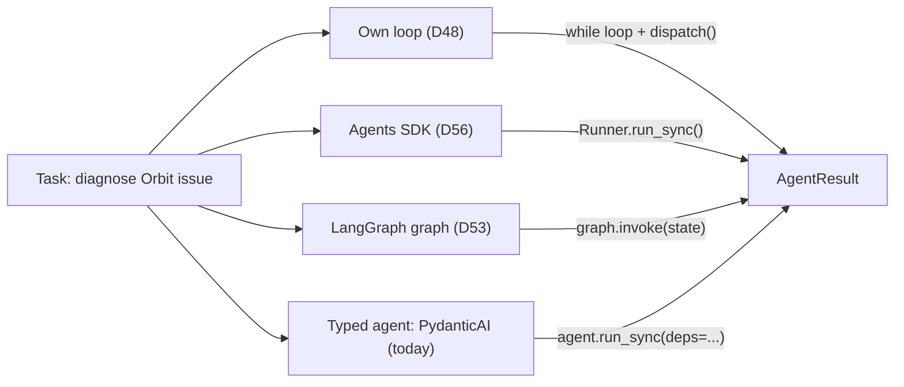
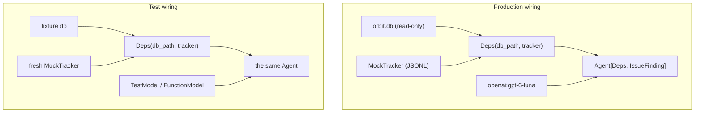
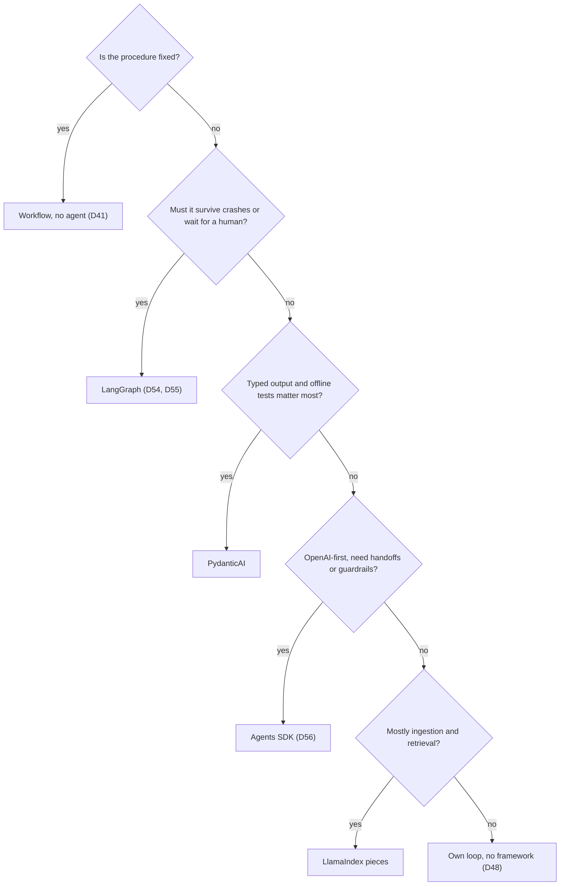

# The Agent Framework Landscape

Job posts name LangChain, LlamaIndex, CrewAI, PydanticAI and the OpenAI Agents SDK, often in the same
sentence. Each one automates a different slice of the loop you wrote on Day 48, and none of them removes
the need to understand that loop. Today you compare seven options on one Atlas task, build one of them
(PydanticAI) in detail with tests that need no API key, and leave with a table you can bring to a design
review.

## At a Glance

- **Time:** ~2 h core (+ optional Go Deeper) · **Depth:** intro
- **Prerequisites:** [Day 48: Your First Agent](../../Phase_6_Agents/Day_048_first_agent/first_agent.md), [Day 53: LangGraph I](../../Phase_6_Agents/Day_053_langgraph_graphs/langgraph_graphs.md), [Day 56: The OpenAI Agents SDK](../../Phase_6_Agents/Day_056_openai_agents_sdk/openai_agents_sdk.md), [Day 19: Testing LLM Code](../../Phase_2_Building_with_LLM_APIs/Day_019_testing_llm_code/testing_llm_code.md) (tools from [Day 35](../../Phase_4_Tools_and_MCP/Day_035_function_calling/function_calling.md))
- **You'll build:** `atlas/pydantic_agent.py`, a typed Orbit issue agent with injected dependencies, plus a pytest file that runs it on `TestModel` and `FunctionModel`, plus a five-issue measurement script
- **Stops at:** deep dives into extra frameworks (LlamaIndex, CrewAI and A2A appear as table rows only)
- **Fast path:** already shipped an agent framework? Read [the comparison table](#name-the-parts-the-comparison-table) and [the chooser](#trade-offs-and-when-to-use-none), then do Exercise 3 (~30 min)
- **Cost:** ≈ $0.05 or less on `gpt-6-luna` for five live runs; every other script is keyless (prices as of 2026-11, [verify](https://developers.openai.com/api/docs/pricing))
- **New terms:** dependency injection (`RunContext` / `deps`), `TestModel` / `FunctionModel`, lock-in, debuggability, A2A

> **Coming from Software Engineering?** Agent frameworks are web frameworks all over again. Django
> ships batteries, Flask stays minimal, and FastAPI turns type hints into schemas and injects
> collaborators with `Depends`. PydanticAI is the FastAPI of agents: your output type becomes the JSON
> schema the model must fill, and `deps` are injected the way `Depends` injects a database session, so a
> test can swap both the database and the model. Lock-in is the same question you ask about an ORM
> (a library that maps tables to classes): how much of your domain code imports the vendor? If the
> answer is "one adapter file", leaving is cheap.

## "Which Framework?" Is the Wrong First Question

Teams often open a design doc with "LangGraph or CrewAI?" and spend a week on it. Then they discover
the hard part was never the loop: it was the tools, the stop conditions, and the tests. The loop you
wrote on [Day 48](../../Phase_6_Agents/Day_048_first_agent/first_agent.md) automates nothing, but every
line is visible, so when it misbehaves you know where to look.

Ask a better question first: **what do you want automated, and what are you willing to give up for it?**
A framework can take over the tool-call loop, output validation, retries, state persistence, approvals
or tracing. Each one you hand over is code you no longer write, and also code you can no longer read
in your own repo.

We'll use one task all day, the same one as the Day 56 scoreboard: *diagnose a new Orbit issue from
the docs and past issues, and say whether it duplicates an earlier one.* The output is a small
`IssueFinding`: a summary, the doc ids that support it, and an optional `duplicate_of`.

## Same Job, Different Packaging

Think of a kitchen. One cook with a recipe card (a workflow) does a fixed dish fast. A sous-chef
(the Agents SDK) takes the order, picks tools and plates it, following house rules. A full brigade
with a pass and tickets (a graph) can pause a dish, hand it to the pastry station and resume tomorrow.
A typed agent (PydanticAI) is the sous-chef who also refuses to send a plate that doesn't match the
order slip. Same food, different amounts of structure around it.



All four end at the same `AgentResult` from Day 48. That shared return type is your exit plan: if
every framework sits behind a function that returns `AgentResult`, the rest of Atlas never knows
which one ran.

## Seven Rows by Hand

Before the big table, do this on paper: for each option, write what it calls the **agent**, a
**tool**, and one **step**. You'll see the same loop wearing different names.

| Option | "Agent" is… | "Tool" is… | One "step" is… |
|---|---|---|---|
| Own loop (D48) | your `run_agent()` function | an entry in `TOOLS` + `dispatch()` | one model call in the `while` loop |
| LangGraph (D53) | a compiled `StateGraph` | a function a node calls | one node run (bounded by `recursion_limit`) |
| `create_agent` (D53) | `create_agent(...)`, which returns a compiled graph | a `@tool` function | one model call (`ModelCallLimitMiddleware(run_limit=...)`) |
| Agents SDK (D56) | `Agent` run by `Runner` | a `@function_tool` | one turn (`max_turns`, default 10) |
| PydanticAI | `Agent[Deps, Output]` | a function taking `RunContext[Deps]` | one model request (`UsageLimits(request_limit=...)`) |
| LlamaIndex | `FunctionAgent` / `AgentWorkflow` | an entry in `tools=` | not covered here |
| CrewAI | `Agent(role, goal, backstory)` inside a `Crew` | an agent's tool | one `Task` in the crew's `Process` |

Every row has a model call, a list of callable functions, and a counter that stops runaway loops.
That's Day 48's loop. The differences are in what surrounds it.

## Name the Parts: The Comparison Table

Two tables follow. The first holds **verified** facts: package versions, abstractions and default
models, read from installed source on 2026-11-06. The second holds **judgment**: opinions that age fast
and that you should re-check before a real decision.

**Table A: verified (as of 2026-11-06, from installed packages)**

| Option | Pin | Core abstraction | Model if you omit it | Model-ID gotcha |
|---|---|---|---|---|
| Own loop | `openai==3.46.0` | `client.responses.create` in a loop | none; you always pass `MODEL` | none |
| LangGraph | `langgraph==1.2.20` | `StateGraph` nodes, edges, checkpointer | n/a (nodes call your model) | `recursion_limit` defaults to 10007, so pass it |
| `create_agent` | `langchain==1.4.9`, `langchain-openai==1.7.4` | returns a compiled LangGraph graph, plus middleware | `ChatOpenAI()` → `gpt-3.5-turbo`, shut down 2026-10-23 | pass `use_responses_api=True` or tool-less calls use Chat Completions |
| Agents SDK | `openai-agents==0.24.0` | `Agent` + `Runner`, handoffs, guardrails, sessions | `gpt-5.6-luna` (env `OPENAI_DEFAULT_MODEL`) | tracing is on by default |
| PydanticAI | `pydantic-ai-slim[openai]==2.66.0` | `Agent[Deps, Output]`, typed output, injected deps | none: `UserError` "`model` must either be set on the agent or included when calling it" | `"openai:<id>"` uses the Responses API |
| LlamaIndex | `llama-index-core==0.14.25`, `llama-index-llms-openai==0.8.3` | data/RAG-first: indexes, query engines; `FunctionAgent` on top | `OpenAI` → `gpt-3.5-turbo` (gone); `OpenAIResponses` → `gpt-4o-mini` (retires 2027-01-14) | hard-coded model table: `gpt-6.1-terra` raises `ValueError: Unknown model` |
| CrewAI | `crewai==1.15.36` (Python < 3.14) | `Crew` of `Agent(role, goal, backstory)` + `Task` + `Process` | `gpt-4.1-mini` (retires 2027-01-14) | its OpenAI provider defaults to `api="completions"`; pass `api="responses"` |

**Table B: judgment (as of 2026-11-06; re-check before you decide)**

| Option | What it automates | Lock-in | Debuggability | Best for | Avoid when |
|---|---|---|---|---|---|
| Own loop | nothing | none | highest: every line is yours | learning, small single-purpose agents | you're rebuilding checkpoints and approvals by hand |
| LangGraph | state, routing, checkpoints, resume, interrupts | medium-high: state and nodes are LangGraph shapes | good: state history, replay, fork ([Day 54](../../Phase_6_Agents/Day_054_langgraph_durability/langgraph_durability.md)) | long-running, durable, human-in-the-loop flows | a fixed three-step pipeline |
| `create_agent` | the standard tool loop + middleware (limits, summarization, approvals) | medium: LangChain message types | fair: it's a graph underneath | the standard loop, fast | you need custom control flow (drop to `StateGraph`) |
| Agents SDK | loop, handoffs, guardrails, sessions, tracing | medium: OpenAI-flavoured | good: traces by default | OpenAI-first teams, handoffs | Zero Data Retention orgs that rely on its hosted tracing (unavailable for ZDR) |
| PydanticAI | loop, typed output + validation retries, deps, test models | low-medium: tools are plain functions, schemas are Pydantic | good: plain Python and a readable message list | one agent with typed outputs and strong tests | durable multi-day workflows (not covered here; ⚠ verify its options) |
| LlamaIndex | ingestion, indexes, query engines, agents on top | medium-high on the data layer | mixed: many layers | RAG-heavy data prep | you only need a tool loop |
| CrewAI | role-based multi-agent orchestration | high: roles, tasks and crews are its DSL | lower: role text becomes prompt text you don't see | demos, role-play prototypes | you need tight control and offline tests |

Two terms in that table deserve a definition. **Lock-in** is the cost of leaving: how many files you
would rewrite to switch. **Debuggability** is how fast you can answer "why did it do that?" from logs,
state or a stack trace. CrewAI's `Agent(role, goal, backstory)` is a good lock-in example: those
three strings are prompt text that the framework assembles for you, so your prompt lives partly in
their code. We return to role-based teams on [Day 64](../../Phase_7_Multi_Agent_Systems/Day_064_multi_agent_when/multi_agent_when.md).

**A2A (Agent2Agent)** is not a framework but a protocol. It's an open spec (v1.0.1, under the Linux
Foundation, contributed by Google) for one agent to discover and call another through agent cards,
tasks and messages. It complements MCP: MCP connects an agent to tools
([Day 39](../../Phase_4_Tools_and_MCP/Day_039_mcp_clients/mcp_clients.md)), A2A connects an agent to
another agent. There's no A2A code in this course.

## A Minimal PydanticAI Agent

Start with the smallest typed agent: no tools, one output type, and a fake model so it runs without
a key. `TestModel` is a **test double** (a fake you swap in for a real collaborator) that ships with
PydanticAI. It never calls a network; it fills your output schema with placeholder values.

```python
# script_id: day_057_agent_frameworks/pydantic_minimal
# Install: uv add "pydantic-ai-slim[openai]==2.66.0"  ·  Env: none (TestModel)  ·  Services: none
import os

os.environ.setdefault("PYDANTIC_AI_NO_BANNER", "1")  # keep the startup banner out of the output
from pydantic import BaseModel
from pydantic_ai import Agent
from pydantic_ai.models.test import TestModel

MODEL = os.environ.get("ATLAS_MODEL", "gpt-6-luna")

class IssueFinding(BaseModel):
    summary: str
    doc_ids: list[str]
    duplicate_of: int | None = None

# defer_model_check=True: build the agent without OPENAI_API_KEY; the model is resolved at run time
agent = Agent(f"openai:{MODEL}", output_type=IssueFinding,
              instructions="Diagnose the Orbit issue.", defer_model_check=True)
result = agent.run_sync("Issue #240: nightly job ran twice on DST fall back", model=TestModel())
print(repr(result.output))
print(result.usage.requests, "request(s)")
```

```text
IssueFinding(summary='a', doc_ids=['a'], duplicate_of=None)
1 request(s)
```

`result.output` is a validated `IssueFinding`, not a string you parse. `TestModel` filled every field
with dummy values (`'a'`, `None`), which is enough to prove the wiring. To go live, drop
`model=TestModel()` and set `OPENAI_API_KEY`.

## Break It: Four Silent Defaults

Frameworks make choices for you, and some of those choices fail late or quietly. Here are the four
that bite most often. The first three are PydanticAI's, and you can trigger them offline.

```python
# script_id: day_057_agent_frameworks/silent_defaults
# Install: uv add "pydantic-ai-slim[openai]==2.66.0"  ·  Env: none  ·  Services: none
import os
import warnings

os.environ["PYDANTIC_AI_NO_BANNER"] = "1"
os.environ.pop("OPENAI_API_KEY", None)  # simulate a CI box or a fresh laptop
from pydantic import BaseModel
from pydantic_ai import Agent, UserError
from pydantic_ai.models.test import TestModel

class IssueFinding(BaseModel):
    summary: str

try:  # 1. building an OpenAI agent without a key fails at construction, not at the first call
    Agent("openai:gpt-6-luna", output_type=IssueFinding)
except UserError as e:
    print("1.", type(e).__name__, str(e)[:70])

try:  # 2. tutorials written for the 0.x API use result_type=
    Agent(TestModel(), result_type=IssueFinding)
except TypeError as e:
    print("2.", e)

result = Agent(TestModel(), output_type=IssueFinding).run_sync("hi")
try:  # 3. ...and result.data
    result.data
except AttributeError as e:
    print("3.", e)

with warnings.catch_warnings(record=True) as caught:  # 4. usage is a property now
    warnings.simplefilter("always")
    result.usage()
    print("4.", caught[0].message)
```

```text
1. UserError Set the `OPENAI_API_KEY` environment variable or pass it via `OpenAIPr
2. Agent.__init__() got an unexpected keyword argument 'result_type'
3. 'AgentRunResult' object has no attribute 'data'
4. `usage` is a property, not a method: use `.usage` instead of `.usage()`.
```

The other frameworks have a sharper version of the same trap: **a default model you didn't choose.**
`ChatOpenAI()` with no `model` falls back to `gpt-3.5-turbo`, which was shut down on 2026-10-23.
CrewAI falls back to `gpt-4.1-mini` over Chat Completions. LlamaIndex keeps its own table of known
models and rejects IDs it doesn't list. These packages aren't in the course venv, so the next block is
a reference fragment with the shapes verified on 2026-11-06.

```python
# script_id: day_057_agent_frameworks/model_id_check
# fragment: reference shapes; llama-index and crewai are not installed in the course venv
MODEL = "gpt-6-luna"
from langchain_openai import ChatOpenAI
chat = ChatOpenAI(model=MODEL, use_responses_api=True)    # never ChatOpenAI(): default is gpt-3.5-turbo

from crewai import LLM
crew_llm = LLM(model=f"openai/{MODEL}", api="responses")  # default api is "completions"

from llama_index.llms.openai import OpenAI as LlamaOpenAI
llm = LlamaOpenAI(model="gpt-6.1-terra")   # the constructor succeeds...
llm.metadata                               # ...first use raises ValueError: Unknown model ...

from openai import OpenAI                  # framework-free startup check: is the ID live?
live = {m.id: m.shutdown_date for m in OpenAI().models.list()}
assert MODEL in live, f"{MODEL} is not available to this key"
```

The rule that fixes all four: **always pass the model explicitly, and check the ID at startup.**

## Dependency Injection: Deps and Tools

The Day 48 agent reached for globals: a module-level database path, a module-level tracker. That
works until a test needs a different database. **Dependency injection** means passing collaborators
in rather than creating them inside, so the caller decides which database and which tracker the
agent sees.

PydanticAI's version: you declare a `Deps` type, every tool receives a `RunContext[Deps]` as its first
argument, and you pass a `Deps` instance per run. The tool's docstring becomes the tool description the
model reads, and its type hints become the JSON schema, as on
[Day 35](../../Phase_4_Tools_and_MCP/Day_035_function_calling/function_calling.md).



The first block holds the config, the dependency types and the output schema. `MockTracker` and
`connect_ro()` are compact copies of the Day 37 and Day 33 helpers.

```python
# script_id: day_057_agent_frameworks/pydantic_agent
# atlas/pydantic_agent.py: typed Orbit issue agent (PydanticAI)
# Install: uv add "pydantic-ai-slim[openai]==2.66.0"
# Env: OPENAI_API_KEY for live runs only; ATLAS_MODEL, ORBIT_DATA optional  ·  Services: none
from __future__ import annotations

import os
import re
import sqlite3
from contextlib import closing
from dataclasses import dataclass, field
from pathlib import Path

os.environ.setdefault("PYDANTIC_AI_NO_BANNER", "1")
from pydantic import BaseModel, Field
from pydantic_ai import Agent, RunContext, UsageLimitExceeded, UsageLimits

MODEL = os.environ.get("ATLAS_MODEL", "gpt-6-luna")
DATA_DIR = Path(os.environ.get("ORBIT_DATA", "datasets/orbit"))

@dataclass
class MockTracker:  # built on Day 37: side effects are recorded, never sent
    calls: list[dict] = field(default_factory=list)
    def record(self, action: str, **args: object) -> None:
        self.calls.append({"action": action, **args})

@dataclass
class Deps:
    db_path: Path
    tracker: MockTracker
    docs_dir: Path = DATA_DIR / "docs"
    current_issue: int | None = None  # tools only see issues filed before this one

class IssueFinding(BaseModel):
    summary: str = Field(description="One or two sentences: likely cause and next step")
    doc_ids: list[str] = Field(description="Doc ids (file names without .md) that support it")
    duplicate_of: int | None = Field(default=None, description="Earlier issue id with the same cause")

def connect_ro(db_path: Path) -> sqlite3.Connection:  # built on Day 33: read-only by URI
    return sqlite3.connect(f"file:{db_path}?mode=ro", uri=True)
```

The tools are plain functions. Nothing in them imports a model or a client, so they move to another
framework unchanged; that's most of your lock-in insurance.

```python
# script_id: day_057_agent_frameworks/pydantic_agent
def search_issues(ctx: RunContext[Deps], query: str, limit: int = 5) -> list[dict]:
    """Search earlier Orbit issues by keyword in the title or body.

    Args:
        query: a keyword or short phrase, e.g. "ran twice" or "ORB-1402".
        limit: maximum number of issues to return (at most 10).
    """
    before = ctx.deps.current_issue or 10**9
    with closing(connect_ro(ctx.deps.db_path)) as con:
        rows = con.execute(
            "SELECT id, title, state, duplicate_of FROM issues "
            "WHERE (title LIKE ?1 OR body LIKE ?1) AND id < ?2 ORDER BY id LIMIT ?3",
            (f"%{query}%", before, min(limit, 10)),
        ).fetchall()
    return [dict(zip(("id", "title", "state", "duplicate_of"), r)) for r in rows]

def search_docs(ctx: RunContext[Deps], query: str, limit: int = 3) -> list[dict]:
    """Find Orbit doc pages that mention every word of the query. Returns doc ids and snippets."""
    words = [w.lower() for w in re.findall(r"[\w-]+", query)]
    hits = []
    for path in sorted(ctx.deps.docs_dir.glob("*.md")):
        text = path.read_text(encoding="utf-8")
        if all(w in text.lower() for w in words):
            hits.append({"doc_id": path.stem, "snippet": text[:300]})
    return hits[: min(limit, 5)]
```

The last block builds the agent and adapts its result to Day 48's `AgentResult`, so the Atlas
scoreboard can compare it with the other runtimes.

```python
# script_id: day_057_agent_frameworks/pydantic_agent
INSTRUCTIONS = (
    "You triage new issues for Orbit, a Python background-jobs library. Search earlier issues "
    "and the docs before answering. Cite only doc ids returned by search_docs. Set duplicate_of "
    "only when an earlier issue has the same root cause."
)
PRICE_PER_M = {"gpt-6-luna": (0.10, 0.50)}  # USD in/out per 1M tokens, as of 2026-11; verify

def build_pydantic_agent(model: str | None = None) -> Agent[Deps, IssueFinding]:
    return Agent(model or f"openai:{MODEL}", deps_type=Deps, output_type=IssueFinding,
                 instructions=INSTRUCTIONS, tools=[search_issues, search_docs],
                 retries=2, defer_model_check=True)

@dataclass
class AgentResult:  # built on Day 48 (compact: steps is a count here)
    text: str
    stop_reason: str
    steps: int
    usage: dict
    cost_usd: float
    partial: bool = False

def run_pydantic_agent(task: str, deps: Deps, *, agent: Agent | None = None,
                       model: object = None, max_steps: int = 8) -> AgentResult:
    agent = agent or build_pydantic_agent()
    try:
        r = agent.run_sync(task, deps=deps, model=model,
                           usage_limits=UsageLimits(request_limit=max_steps))
    except UsageLimitExceeded as e:  # Day 48's max_steps stop, surfaced as a partial result
        return AgentResult(str(e), "max_steps", max_steps, {}, 0.0, partial=True)
    u = r.usage
    p_in, p_out = PRICE_PER_M.get(MODEL, (0.0, 0.0))
    return AgentResult(text=r.output.model_dump_json(), stop_reason="completed", steps=u.requests,
                       usage={"input_tokens": u.input_tokens, "output_tokens": u.output_tokens,
                              "tool_calls": u.tool_calls},
                       cost_usd=(u.input_tokens * p_in + u.output_tokens * p_out) / 1_000_000)
```

```python
# script_id: day_057_agent_frameworks/pydantic_agent
if __name__ == "__main__":  # keyless smoke run; pass model=None (and set OPENAI_API_KEY) to go live
    from pydantic_ai.models.test import TestModel

    deps = Deps(db_path=DATA_DIR / "issues" / "orbit.db", tracker=MockTracker(), current_issue=240)
    print(run_pydantic_agent("Issue #240: nightly job ran twice on DST", deps, model=TestModel()))
```

```text
AgentResult(text='{"summary":"a","doc_ids":["a"],"duplicate_of":null}', stop_reason='completed', steps=2, usage={'input_tokens': 345, 'output_tokens': 28, 'tool_calls': 2}, cost_usd=4.85e-05, partial=False)
```

Token counts from `TestModel` are synthetic, so ignore the cost here. Two details matter. `build_pydantic_agent()`
is a factory, so every test gets a fresh agent. And if you prefer decorators, `@agent.tool` on a
built agent registers the same kind of function; Exercise 1 uses it.

## Testing Without a Model

Here's the payoff of injection. A test swaps the model with `agent.override(model=...)`, a context
manager, and passes its own `Deps`. Two test models cover most needs:

- **`TestModel`** calls every tool once with dummy arguments, then returns schema-valid output. It
  proves the wiring: tools register, signatures parse, output validates.
- **`FunctionModel(fn)`** lets you script the model. `fn(messages, info)` sees the conversation so far
  and returns the next `ModelResponse`, so you can say "first call `search_issues`, then answer".

Set `pydantic_ai.models.ALLOW_MODEL_REQUESTS = False` at the top of the test file. Any test that
forgets the override then fails loudly instead of spending money, the same guard idea as Day 19's
`live` marker.

```python
# script_id: day_057_agent_frameworks/test_pydantic_agent
# tests/test_pydantic_agent.py · Install: uv add pytest "pydantic-ai-slim[openai]==2.66.0"
# Env: none · Needs pydantic_agent.py (this lesson) next to it; in Atlas: from atlas.pydantic_agent import ...
import pytest
import pydantic_ai.models
from pydantic_ai.messages import ModelMessage, ModelResponse, ToolCallPart, ToolReturnPart
from pydantic_ai.models.function import AgentInfo, FunctionModel
from pydantic_ai.models.test import TestModel
from pydantic_agent import DATA_DIR, Deps, IssueFinding, MockTracker, build_pydantic_agent

pydantic_ai.models.ALLOW_MODEL_REQUESTS = False  # a forgotten override fails instead of billing

@pytest.fixture
def deps() -> Deps:
    return Deps(db_path=DATA_DIR / "issues" / "orbit.db", tracker=MockTracker(), current_issue=240)

def tool_calls(result) -> list[str]:
    return [p.tool_name for m in result.all_messages() for p in m.parts if isinstance(p, ToolCallPart)]

def test_wiring_with_testmodel(deps: Deps) -> None:
    agent = build_pydantic_agent()
    with agent.override(model=TestModel()):
        result = agent.run_sync("Issue #240: job ran twice", deps=deps)
    assert {"search_issues", "search_docs"} <= set(tool_calls(result))
    assert isinstance(result.output, IssueFinding)
    assert deps.tracker.calls == []  # a read-only agent records no side effects
```

```python
# script_id: day_057_agent_frameworks/test_pydantic_agent
def search_then_answer(messages: list[ModelMessage], info: AgentInfo) -> ModelResponse:
    returns = [p for m in messages for p in m.parts if isinstance(p, ToolReturnPart)]
    if not returns:  # step 1: search past issues
        return ModelResponse(parts=[ToolCallPart("search_issues", {"query": "ORB-1402"})])
    first_hit = returns[0].content[0]["id"]  # step 2: answer via the output tool
    out = {"summary": "DST fall-back double run.", "doc_ids": ["scheduling-cron"],
           "duplicate_of": first_hit}
    return ModelResponse(parts=[ToolCallPart(info.output_tools[0].name, out)])

def test_scripted_two_steps(deps: Deps) -> None:
    agent = build_pydantic_agent()
    with agent.override(model=FunctionModel(search_then_answer)):
        result = agent.run_sync("Issue #240: job ran twice on DST", deps=deps)
    assert tool_calls(result)[0] == "search_issues"
    assert result.output.duplicate_of == 59  # issue 59 is the earliest ORB-1402 report
    assert result.usage.requests == 2

if __name__ == "__main__":
    raise SystemExit(pytest.main([__file__, "-q", "-p", "no:cacheprovider"]))
```

```text
..                                                                       [100%]
2 passed in 0.03s
```

(Your timing will differ; pytest may also print a warnings summary from other installed plugins.)

Compare this with Day 56: the Agents SDK's `ScriptedModel` takes a fixed list of responses up front,
while `FunctionModel` decides each response from the messages it receives. Both run offline; pick the
one whose framework you're testing.

## The Same Task, Measured

Opinions about frameworks are cheap; numbers on your task aren't. This script runs the PydanticAI
agent on the same five issues as the Day 56 scoreboard and prints one row per issue. Here a **step**
means one model request (`usage.requests`), which is what Day 48 counted as one loop iteration. With
`OPENAI_API_KEY` set it runs live on `MODEL`; without one it falls back to `TestModel`, so you can check
the plumbing first.

```python
# script_id: day_057_agent_frameworks/compare_task
# Install: uv add "pydantic-ai-slim[openai]==2.66.0"  ·  Needs pydantic_agent.py (this lesson)
# Env: OPENAI_API_KEY (optional: without it, runs on TestModel), ATLAS_MODEL, ORBIT_DATA
import json
import os
from contextlib import closing
from pathlib import Path

from pydantic_ai.models.test import TestModel
from pydantic_agent import DATA_DIR, MODEL, Deps, MockTracker, connect_ro, run_pydantic_agent

ISSUES = [22, 41, 102, 149, 240]  # the five-issue scoreboard set (three have a gold duplicate)
LIVE = bool(os.environ.get("OPENAI_API_KEY"))
DB = DATA_DIR / "issues" / "orbit.db"

def load_issue(issue_id: int) -> tuple[str, int | None]:
    with closing(connect_ro(DB)) as con:
        title, body, dup = con.execute(
            "SELECT title, body, duplicate_of FROM issues WHERE id = ?", (issue_id,)).fetchone()
    return f"Issue #{issue_id}: {title}\n\n{body[:1500]}", dup

src = Path(__file__).with_name("pydantic_agent.py").read_text(encoding="utf-8").splitlines()
loc = sum(1 for ln in src if ln.strip() and not ln.lstrip().startswith("#"))
print(f"mode: {'live ' + MODEL if LIVE else 'offline TestModel'} · agent LoC: {loc}")
print(f"{'issue':>5} {'steps':>5} {'tools':>5} {'tokens':>7} {'cost $':>9}  dup pred/gold")
total = 0.0
for issue_id in ISSUES:
    task, gold = load_issue(issue_id)
    deps = Deps(db_path=DB, tracker=MockTracker(), current_issue=issue_id)
    res = run_pydantic_agent(task, deps, model=None if LIVE else TestModel())
    pred = json.loads(res.text).get("duplicate_of") if not res.partial else "-"
    tokens = res.usage.get("input_tokens", 0) + res.usage.get("output_tokens", 0)
    total += res.cost_usd
    print(f"{issue_id:>5} {res.steps:>5} {res.usage.get('tool_calls', 0):>5} {tokens:>7} "
          f"{res.cost_usd:>9.5f}  {pred}/{gold}")
print(f"total ≈ ${total:.4f} (prices as of 2026-11; verify)")
```

```text
mode: offline TestModel · agent LoC: 88
issue steps tools  tokens    cost $  dup pred/gold
   22     2     2     539   0.00007  None/4
   41     2     2     593   0.00007  None/4
  102     2     2     851   0.00010  None/None
  149     2     2     577   0.00007  None/None
  240     2     2     667   0.00008  None/59
total ≈ $0.0004 (prices as of 2026-11; verify)
```

Your numbers will differ. Offline, `TestModel` never predicts a duplicate and its token counts are synthetic, so the `dup` column only proves the plumbing. Run it live once, then copy the
row into the Atlas scoreboard next to your Day 48 and Day 56 rows. Write down only what the numbers
support. A fair note looks like: "PydanticAI: 88 lines including tools and the adapter; 2–3 steps
per issue; duplicates correct on N of 3; the schema retry fired K times." Lines of code are only
comparable if you count the same things (tools, adapter, config) in every runtime.

## Trade-offs and When to Use None

Pick from the problem, not from the job post. This chooser ends at "none" on purpose: for many Atlas
features the honest answer is a workflow or your own loop.



| Situation | Pick | Why |
|---|---|---|
| Fixed steps (classify, then route) | a workflow ([Day 41](../../Phase_4_Tools_and_MCP/Day_041_workflow_patterns/workflow_patterns.md)) | no loop means nothing to bound |
| One agent, typed output, strong tests | PydanticAI | `output_type` + `deps` + `TestModel` |
| Durable runs, approvals, resume after crash | LangGraph | checkpoints and `interrupt()` |
| Packaged loop with handoffs and guardrails | Agents SDK | those are its core features |
| Heavy document prep for RAG | LlamaIndex pieces | its strength is the data layer |
| A role-play demo for stakeholders | CrewAI | fast to sketch; hard to test tightly |
| Unsure | none | adopt a framework when you rebuild the same part twice |

### In production

- Pin exact versions (`openai-agents==0.24.0`, `pydantic-ai-slim[openai]==2.66.0`). Several of these
  libraries are pre-1.0 or change fast.
- Keep one adapter file per framework that returns `AgentResult`; domain code never imports the vendor.
- Always pass the model, and check the ID at startup (the `model_id_check` fragment above).
- Keep prompts ([Day 21](../../Phase_2_Building_with_LLM_APIs/Day_021_prompts_as_code/prompts_as_code.md))
  and tools ([Day 35](../../Phase_4_Tools_and_MCP/Day_035_function_calling/function_calling.md))
  framework-free, so the exit is a new adapter, not a rewrite.
- Debugging ([Day 58](../../Phase_6_Agents/Day_058_debugging_agents/debugging_agents.md)) and
  evaluation ([Day 59](../../Phase_6_Agents/Day_059_evaluating_agents/evaluating_agents.md)) work on
  any of them, because they read the `AgentResult` and the trace.

## Go Deeper (optional)

<details><summary>Go deeper: what <code>output_type</code> does under the hood</summary>

When you set `output_type=IssueFinding`, PydanticAI doesn't ask the model for free text and parse it.
By default it registers an extra **output tool** named `final_result` whose parameters are your
model's JSON schema. The run ends when the model calls that tool with arguments that validate. You can
see it in the message list:

```python
# script_id: day_057_agent_frameworks/inspect_output_tool
# Install: uv add "pydantic-ai-slim[openai]==2.66.0"  ·  Env: none  ·  Services: none
import os

os.environ.setdefault("PYDANTIC_AI_NO_BANNER", "1")
from pydantic import BaseModel
from pydantic_ai import Agent
from pydantic_ai.models.test import TestModel

class IssueFinding(BaseModel):
    summary: str
    doc_ids: list[str]

agent = Agent(TestModel(), output_type=IssueFinding)
result = agent.run_sync("Issue #240")
for msg in result.all_messages():
    for part in msg.parts:
        print(f"{type(msg).__name__:<13} {part.part_kind:<12} {getattr(part, 'tool_name', '')}")
```

```text
ModelRequest  user-prompt
ModelResponse tool-call    final_result
ModelRequest  tool-return  final_result
```

If the arguments fail validation, PydanticAI sends the validation error back to the model and asks
again, up to `retries` times; after that it raises `UnexpectedModelBehavior: Exceeded maximum output
retries`. You can add your own checks with `@agent.output_validator` and raise `ModelRetry("...")` to
trigger the same loop (Exercise 2 does this). If your provider supports native structured output and
you'd rather use it, `NativeOutput(Model)`, `PromptedOutput(Model)` and `ToolOutput(Model)` select the
strategy explicitly. This is the same idea as Day 16's schema-constrained output, plus a retry loop
the framework runs for you.

</details>

<details><summary>Go deeper: planning the exit</summary>

Lock-in rarely comes from the agent constructor. It comes from the edges: framework message types
leaking into your database, framework tool decorators on your domain functions, framework-specific
tracing in your dashboards. A short checklist keeps the exit cheap:

1. **Tools are plain functions.** In today's code, `search_issues` takes a `RunContext` only to read
   `deps`. If you want them fully neutral, write `search_issues_core(db_path, query)` and make the
   framework tool a two-line wrapper.
2. **One adapter per runtime.** `run_pydantic_agent()`, `run_sdk_agent()` (Day 56) and your graph
   runner all return `AgentResult`. Callers import the adapter, never the framework.
3. **Store your own records.** Persist `AgentResult` and your own step log, not the framework's
   message objects. `result.all_messages()` is handy for debugging, but its shape belongs to the
   library.
4. **Neutral traces.** Send spans through OpenTelemetry (Day 42), so switching runtimes doesn't break
   dashboards.
5. **An eval suite as the contract.** When you swap frameworks, the Day 59 suite tells you whether
   behaviour survived.

Rehearse it: port today's agent to the Agents SDK adapter from Day 56 and count how many files change.
If the answer is more than two, something leaked.

</details>

<details><summary>Go deeper: budgets map onto <code>UsageLimits</code></summary>

Day 48's budgets (max steps, max tokens) map onto `UsageLimits`. Its fields include `request_limit`
(default 50), `tool_calls_limit`, `input_tokens_limit`, `output_tokens_limit` and `total_tokens_limit`.
When a run would cross one, PydanticAI raises `UsageLimitExceeded` before sending the request. This
script loops a scripted model forever to show the stop:

```python
# script_id: day_057_agent_frameworks/usage_limits_demo
# Install: uv add "pydantic-ai-slim[openai]==2.66.0"  ·  Env: none  ·  Services: none
import os

os.environ.setdefault("PYDANTIC_AI_NO_BANNER", "1")
from pydantic_ai import Agent, UsageLimitExceeded, UsageLimits
from pydantic_ai.messages import ModelResponse, ToolCallPart
from pydantic_ai.models.function import FunctionModel

always_ping = FunctionModel(lambda messages, info: ModelResponse(parts=[ToolCallPart("ping", {})]))
agent = Agent(always_ping)

@agent.tool_plain
def ping() -> str:
    """Health check."""
    return "pong"

try:
    agent.run_sync("go", usage_limits=UsageLimits(request_limit=3))
except UsageLimitExceeded as e:
    print("stopped:", str(e)[:60])
```

```text
stopped: The next request would exceed the request_limit of 3. Consid
```

`run_pydantic_agent()` turns this exception into Day 48's `stop_reason="max_steps"` with
`partial=True`, so callers see the same stop reasons whichever runtime ran.

</details>

## Common Pitfalls

- **`pydantic_ai.UserError: Set the OPENAI_API_KEY environment variable…` at import time.** Cause:
  `Agent("openai:…")` checks credentials when it's built. Fix: `defer_model_check=True`, and supply the
  model at run time or via `override`.
- **`TypeError: Agent.__init__() got an unexpected keyword argument 'result_type'`** or
  **`AttributeError: … no attribute 'data'`.** Cause: tutorials for the 0.x API. Fix: `output_type=`,
  `result.output`, and `result.usage` (a property).
- **A noisy banner in your output.** Cause: PydanticAI's first-run banner. Fix: `PYDANTIC_AI_NO_BANNER=1`.
- **`ValueError: Unknown model` from LlamaIndex, or a surprise `gpt-3.5-turbo` call.** Cause:
  frameworks hard-code model tables and defaults. Fix: always pass `model=` and check the ID at startup.
- **Tests that quietly call a live model.** Cause: a missing `override`. Fix:
  `pydantic_ai.models.ALLOW_MODEL_REQUESTS = False` at the top of the test file.
- **The comparison table treated as fact.** Cause: judgment cells age in months. Fix: date the table,
  cite the source, and re-run your own measurement before a decision.

> **Where we stop:** LlamaIndex, CrewAI and A2A stay as table rows, and PydanticAI's tool-approval
> flow (`requires_approval`, `DeferredToolRequests`) is skipped because we couldn't verify it end to
> end; for approvals, use LangGraph from [Day 55](../../Phase_6_Agents/Day_055_human_in_the_loop/human_in_the_loop.md).

## Key Takeaways

- Start from what you want automated (loop, validation, state, approvals, tracing), not from a
  framework name; every option wraps the same Day 48 loop.
- Each row in the table trades lines you write for lock-in and lost visibility; label each cell as
  verified or judgment, and date it.
- PydanticAI turns `output_type` into a validated object and injects `deps` into every tool through
  `RunContext`, so the caller controls the database, the tracker and the model.
- `TestModel` proves the wiring and `FunctionModel` scripts exact steps; with `ALLOW_MODEL_REQUESTS =
  False`, the whole suite runs offline.
- Frameworks hide defaults (`gpt-3.5-turbo`, Chat Completions, hard-coded model tables); pass the model,
  check the ID, keep tools framework-free, and choose "none" until you rebuild a part twice.

## Quick Reference

| API / pattern | When to use | Gotcha |
|---|---|---|
| `Agent(f"openai:{MODEL}", deps_type=Deps, output_type=T, instructions=..., defer_model_check=True)` | build a typed agent without a key | without `defer_model_check`, `UserError` if no key |
| `def tool(ctx: RunContext[Deps], ...)` in `tools=[...]` or `@agent.tool` | tools that need injected collaborators | docstring = tool description; `@agent.tool_plain` if no `ctx` |
| `agent.run_sync(prompt, deps=..., model=..., usage_limits=UsageLimits(request_limit=8))` | one run with a step budget | raises `UsageLimitExceeded` |
| `result.output` · `result.usage.requests` · `result.all_messages()` | read output, steps, trace | `usage` is a property; `.data` is gone |
| `with agent.override(model=TestModel()):` | wiring tests | dummy values like `'a'` |
| `FunctionModel(fn)` with `fn(messages, info) -> ModelResponse` | scripted multi-step tests | output tool name is `info.output_tools[0].name` |
| `pydantic_ai.models.ALLOW_MODEL_REQUESTS = False` | block live calls in tests | set it before tests run |
| `@agent.output_validator` + `raise ModelRetry("...")` | business-rule checks on output | counts against `retries` |
| `ChatOpenAI(model=MODEL, use_responses_api=True)` · `LLM(model="openai/<id>", api="responses")` | LangChain / CrewAI model wiring | defaults are retired models or Chat Completions |

## Exercises

1. **Warm-up.** Add a `get_doc_section(doc_id, heading)` tool to the agent with the `@agent.tool`
   decorator, then show that `TestModel` calls it.

<details><summary>Solution</summary>

```python
# script_id: day_057_agent_frameworks/solution_ex1
# Needs pydantic_agent.py (this lesson) in the same folder · Env: none
from pydantic_ai import RunContext
from pydantic_ai.messages import ToolCallPart
from pydantic_ai.models.test import TestModel
from pydantic_agent import DATA_DIR, Deps, MockTracker, build_pydantic_agent

agent = build_pydantic_agent()

@agent.tool
def get_doc_section(ctx: RunContext[Deps], doc_id: str, heading: str = "") -> str:
    """Return one section of an Orbit doc page (the whole page if the heading isn't found)."""
    path = ctx.deps.docs_dir / f"{doc_id}.md"
    if not path.exists():
        return f"error: no doc {doc_id!r}"  # tell the model, don't crash the run
    text = path.read_text(encoding="utf-8")
    start = text.find(f"## {heading}") if heading else -1
    if start < 0:
        return text[:2000]
    end = text.find("\n## ", start + 3)
    return text[start: end if end > 0 else None][:2000]

deps = Deps(db_path=DATA_DIR / "issues" / "orbit.db", tracker=MockTracker(), current_issue=240)
with agent.override(model=TestModel()):
    result = agent.run_sync("Issue #240", deps=deps)
called = [p.tool_name for m in result.all_messages() for p in m.parts if isinstance(p, ToolCallPart)]
assert "get_doc_section" in called
print(called)
```

```text
['search_issues', 'search_docs', 'get_doc_section', 'final_result']
```

`TestModel` passes `doc_id='a'`, so the tool returns its error string; that's still a call, and it
shows the tool degrades gracefully.

</details>

2. **Core.** Add an output validator that raises `ModelRetry` when `doc_ids` is empty. Test it with a
   `FunctionModel` that returns a bad answer first and a good one after the retry.

<details><summary>Solution</summary>

```python
# script_id: day_057_agent_frameworks/solution_ex2
# Needs pydantic_agent.py (this lesson) in the same folder · Env: none
from pydantic_ai import ModelRetry, RunContext
from pydantic_ai.messages import ModelResponse, ToolCallPart
from pydantic_ai.models.function import AgentInfo, FunctionModel
from pydantic_agent import DATA_DIR, Deps, IssueFinding, MockTracker, build_pydantic_agent

agent = build_pydantic_agent()

@agent.output_validator
def must_cite(ctx: RunContext[Deps], out: IssueFinding) -> IssueFinding:
    if not out.doc_ids:
        raise ModelRetry("Cite at least one doc id returned by search_docs.")
    return out

def bad_then_good(messages, info: AgentInfo) -> ModelResponse:
    attempt = sum(isinstance(m, ModelResponse) for m in messages)  # earlier answers so far
    docs = [] if attempt == 0 else ["scheduling-cron"]
    args = {"summary": "DST fall-back double run.", "doc_ids": docs, "duplicate_of": None}
    return ModelResponse(parts=[ToolCallPart(info.output_tools[0].name, args)])

deps = Deps(db_path=DATA_DIR / "issues" / "orbit.db", tracker=MockTracker(), current_issue=240)
with agent.override(model=FunctionModel(bad_then_good)):
    result = agent.run_sync("Issue #240", deps=deps)
assert result.output.doc_ids == ["scheduling-cron"]
assert result.usage.requests == 2  # one rejected answer, one accepted
print(result.output)
```

The retry message goes back to the model as a tool return on the `final_result` call, so the scripted
model counts earlier responses rather than looking for a special part type.

</details>

3. **Core.** Pick a scenario, for example "a nightly digest bot that summarises the day's new Orbit
   issues into one Slack post". Fill Table B's columns for it, then defend either "none" or one pick in
   five lines.

<details><summary>Solution</summary>

A sample answer (yours may differ; the defence is what counts):

| Option | Fit for the digest bot |
|---|---|
| Workflow (D41) | fetch issues → summarise each → combine: fixed steps, no tool choice needed |
| PydanticAI | useful if the digest has a strict schema, but there's no loop to manage |
| LangGraph | durability is overkill for a five-minute nightly job; rerun on failure instead |
| Agents SDK / CrewAI | handoffs and roles add nothing here |

Defence: "None. The procedure is fixed, so a three-step workflow with `responses.parse` for the
per-issue summary is enough. It runs from cron, retries the whole job on failure, and is tested with
recorded outputs. Posting to Slack sits behind an approval flag, as on Day 37. If we later let it
decide which issues need a maintainer and call tools to check, we'd revisit PydanticAI."

</details>

4. **Stretch (optional, past the stop line).** Rebuild the task in CrewAI or LlamaIndex in a separate
   virtual environment. Report the lines of code, and list what you could *not* test offline.

<details><summary>Solution</summary>

```python
# script_id: day_057_agent_frameworks/solution_ex4
# fragment: CrewAI shapes verified on 2026-11-06 (crewai==1.15.36); wiring kwargs not shown are ⚠ verify
from crewai import LLM, Agent, Crew, Process, Task

llm = LLM(model="openai/gpt-6-luna", api="responses")  # never rely on the default model
triager = Agent(role="Orbit issue triager",
                goal="Find the likely cause and any earlier duplicate",
                backstory="You maintain Orbit and know its docs well.")  # all three become prompt text
task = Task(description="Diagnose this issue: {issue}",
            expected_output="A two-sentence summary, doc ids, and duplicate_of")
crew = Crew(agents=[triager], tasks=[task], process=Process.sequential)
out = crew.kickoff(inputs={"issue": "Issue #240: nightly job ran twice on DST"})
print(out.raw, out.token_usage)
```

Attaching `llm` to the agent, the task to the agent, and your tools needs keyword names this lesson
didn't verify; check them against the CrewAI README for your pinned version. Expect the report to say
the run itself needed a key, because there's no test model equivalent to `TestModel` in what we
verified. For LlamaIndex, the agent class is `FunctionAgent(tools=, llm=OpenAIResponses(model=MODEL),
system_prompt=)` from `llama_index.core.agent.workflow`; avoid `gpt-6.1-terra`, which its model table
rejects.

</details>

## References & Further Reading

- [PydanticAI on GitHub](https://github.com/pydantic/pydantic-ai): source, examples and the testing
  helpers (`TestModel`, `FunctionModel`) used today.
- [pydantic-ai on PyPI](https://pypi.org/project/pydantic-ai/): release history; check it before
  bumping your pin.
- [OpenAI Agents SDK docs](https://openai.github.io/openai-agents-python/): the Day 56 runtime, for the
  Agents SDK row.
- [LangGraph on GitHub](https://github.com/langchain-ai/langgraph) and
  [LangChain on GitHub](https://github.com/langchain-ai/langchain): the graph runtime and
  `create_agent` with middleware.
- [LlamaIndex on GitHub](https://github.com/run-llama/llama_index): the data-first framework and its
  agent workflows.
- [CrewAI on GitHub](https://github.com/crewAIInc/crewAI): role-based crews; read it to see how role
  text becomes prompts.
- [A2A specification](https://github.com/a2aproject/A2A): the agent-to-agent protocol and how it
  relates to MCP.
- [OpenAI deprecations](https://developers.openai.com/api/docs/deprecations.md): shutdown dates behind
  the "default model" pitfalls.

## What's Next

You can now pick a runtime and test it offline. Next, things go wrong on purpose:
[Day 58: Debugging Agents](../../Phase_6_Agents/Day_058_debugging_agents/debugging_agents.md) walks
through three broken agent runs, with a method for reading traces that works whichever framework
produced them.
