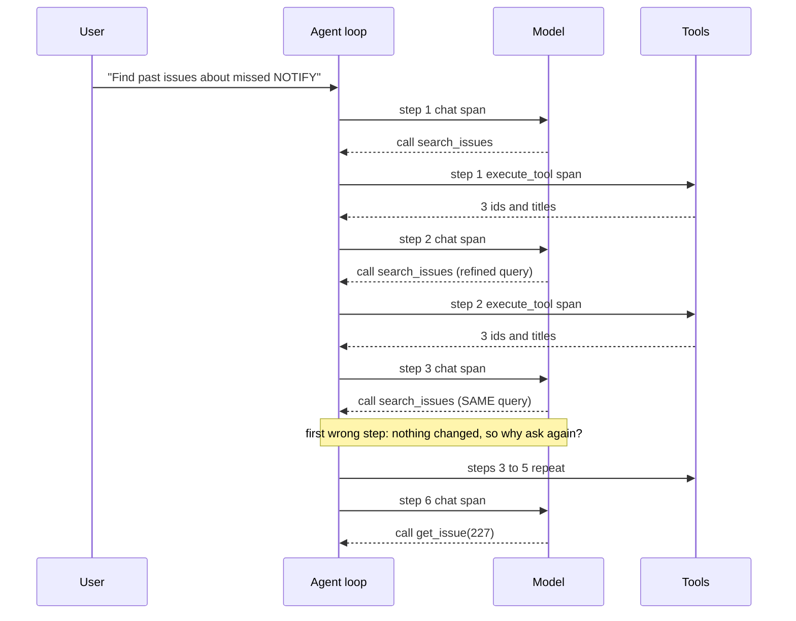
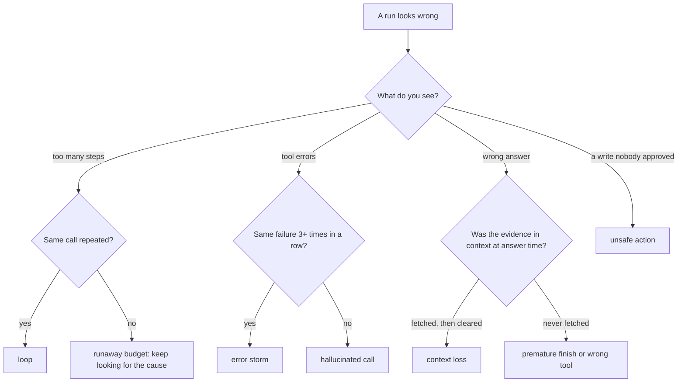
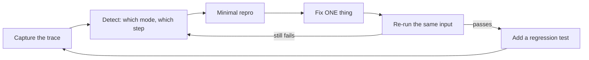

# Debugging Agents: Traces, Failure Modes and Replay

A normal bug throws an exception. An agent bug returns a confident answer after nine steps, five of which repeated the same search. The answer looks fine and the path is wrong, and that path is where the cost and the risk hide. Only the run's trace shows that, so today you build the habit and the tool: a failure catalogue, a span-reading detector and a replay you can fork.

## At a Glance

- **Time:** ~2 h core (+ optional Go Deeper) · **Depth:** working
- **Prerequisites:** [Day 42: Tracing & Observability in Depth](../../Phase_5_Evaluation_and_Observability/Day_042_tracing_observability/tracing_observability.md), [Day 44: Error Analysis](../../Phase_5_Evaluation_and_Observability/Day_044_error_analysis/error_analysis.md), [Day 54: LangGraph II](../../Phase_6_Agents/Day_054_langgraph_durability/langgraph_durability.md) (the loop from [Day 48](../../Phase_6_Agents/Day_048_first_agent/first_agent.md), clearing from [Day 49](../../Phase_6_Agents/Day_049_context_engineering/context_engineering.md))
- **You'll build:** `atlas/debug.py` (`FAILURE_MODES`, `AgentTrace`, `load_trace()`, `detect_failures()`), three broken-run fixtures with a measured fix each, a LangGraph fork, a minimal repro and regression tests
- **Stops at:** framework internals (stepping through LangGraph or SDK source) and observability platforms beyond Day 42
- **Fast path:** already read agent traces at work? Read [the failure catalogue](#name-the-parts-the-failure-catalogue) and [`detect_failures()`](#agenttrace-and-detect_failures), then do Exercise 2 (~45 min)
- **Cost:** $0 for every script here (all keyless, scripted models); ≈ $0.10 on `gpt-6-luna` if you repro each bug live (prices as of 2026-11, [verify](https://developers.openai.com/api/docs/pricing))
- **New terms:** trajectory, failure mode, loop detector, replay, minimal repro

> **Coming from Software Engineering?** Debugging an agent is debugging a distributed system with a non-deterministic service in the middle. You need what you already use there: request traces (Jaeger-style spans, one timed record per step), a failure taxonomy, replay of captured inputs, and a minimal reproducer. The mapping is close. A loop is a retry storm. Lost context is a cache that evicted the key you needed. A hallucinated argument is an unvalidated client call. The new part is that "the service" can return a different decision on the same input, so you debug from recordings and fix with code guards, not with a breakpoint.

## Right Answer, Wrong Path

Here is a Day 48-style result summary from an Orbit investigation that passed its final-answer check:

```text
AgentResult(text="Closest past report: #227.", stop_reason="done", steps=9, cost_usd=0.0021)
tools: search_issues x5 (same query), get_issue x1, get_doc_section x2, answer
```

The check passed, so nobody looked. But five of nine steps were the same search, and next week, on a harder issue, the same habit hits `max_steps` with no answer. Final-answer checks can't see this. The path, or **trajectory** (the ordered sequence of steps a run took), can.

## Reading a Flight Recording

After a plane has a problem, investigators don't ask the pilot what happened; they read the flight recorder. An agent's recorder is its spans from Day 42: one per model call and per tool call, with a duration and attributes (tool, arguments, tokens, failure). Debugging means reading that recording, finding the **first** wrong step, and asking what the model could see at that moment.

## One Run by Hand

A run is a sequence of spans. This diagram shows one traced Orbit run: each arrow pair is a span, numbered by step.



Here is the same run as a table, the way you'd print it from the spans. Tokens are what each model call sent as input:

| step | tool | args | result | input tokens |
|---|---|---|---|---|
| 1 | `search_issues` | `notify missed` | 3 ids + titles | 320 |
| 2 | `search_issues` | `postgres notify missed` | 3 ids + titles | 390 |
| 3 | `search_issues` | `postgres notify missed` | same 3 ids | 460 |
| 4 | `search_issues` | `postgres notify missed` | same 3 ids | 530 |
| 5 | `search_issues` | `postgres notify missed` | same 3 ids | 600 |
| 6 | `get_issue` | `227` | full issue text | 670 |

Step 2 is fine: refining a query is normal. Step 3 is the first wrong step: it repeats a call whose result the model already has. That's the **symptom**. The **cause** is earlier: step 2's result listed ids and titles with nothing saying "open one with `get_issue`", so the model had no next action and picked the same one again. Every bug today follows this shape: the symptom shows late, the cause sits in an earlier step's *input*.

## Name the Parts: The Failure Catalogue

A **failure mode** is a named, recurring way a run goes wrong, with a signal visible in the trace. Day 44's method (observe, name the modes, count, fix the biggest) applied to agents gives this starting catalogue:

| Mode | Trace signal | Usual cause | Fix pattern | Detector |
|---|---|---|---|---|
| `loop` | same (tool, args) 3+ times | no stop signal; result suggests no next step | loop guard + hard stop; better tool description | today |
| `wrong_tool` | a tool that can't answer the task | overlapping or vague tool descriptions | sharper descriptions | needs an expected path ([Day 59](../../Phase_6_Agents/Day_059_evaluating_agents/evaluating_agents.md)) |
| `hallucinated_call` | unknown tool, bad enum, missing id, then no recovery | the model guesses names it never saw | strict validation + error listing valid options | today |
| `error_storm` | 3+ failed calls in a row | retrying a permanent error | error kinds and `retryable` ([Day 37](../../Phase_4_Tools_and_MCP/Day_037_robust_tool_execution/robust_tool_execution.md)) | Exercise 3 |
| `context_loss` | evidence cleared or truncated before the answer | aggressive clearing or overflow ([Day 49](../../Phase_6_Agents/Day_049_context_engineering/context_engineering.md)) | pin key facts; raise `keep_last` (how many recent tool results stay uncleared) | today |
| `premature_finish` | answers without any successful tool result | the model is satisfied too early | require evidence; check it in code | Exercise 2 |
| `runaway_budget` | stopped by `max_steps` / tokens / seconds | usually a *symptom* of a loop or storm | fix the cause, keep the cap ([Day 48](../../Phase_6_Agents/Day_048_first_agent/first_agent.md)) | today |
| `unsafe_action` | side effect with no approval record | no gate on a write tool | approval node ([Day 55](../../Phase_6_Agents/Day_055_human_in_the_loop/human_in_the_loop.md)), `run_once` (Day 54) | Day 55's audit log |

Prompt injection is not on this list. It's an attack, not a bug, and [Day 69](../../Phase_8_Safety_and_Security/Day_069_prompt_injection/prompt_injection.md) owns it.

Walk from what you see to a mode:



## A Ten-Line Loop Detector

A **loop detector** flags a run that repeats the same call. The simplest version counts identical `(tool, args)` pairs. The arguments are serialised with sorted keys, so `{"a": 1, "b": 2}` and `{"b": 2, "a": 1}` count as the same call:

```python
# script_id: day_058_debugging_agents/detect_minimal
# The smallest loop detector: count identical (tool, args) pairs in a toy trace. Stdlib only.
import json
from collections import Counter

trace = [  # (step, tool, args) from the run in the table above
    (1, "search_issues", {"query": "notify missed"}),
    (2, "search_issues", {"query": "postgres notify missed"}),
    (3, "search_issues", {"query": "postgres notify missed"}),
    (4, "search_issues", {"query": "postgres notify missed"}),
    (5, "search_issues", {"query": "postgres notify missed"}),
    (6, "get_issue", {"issue_id": 227}),
]
key = lambda tool, args: (tool, json.dumps(args, sort_keys=True))
calls = Counter(key(tool, args) for _, tool, args in trace)
for (tool, args), n in calls.items():
    if n >= 3:  # one repeat can be a retry; three identical calls is a pattern
        steps = [s for s, t, a in trace if key(t, a) == (tool, args)]
        print(f"loop: {tool} x{n} (steps {steps[0]}-{steps[-1]})  args={args}")
```

```text
loop: search_issues x4 (steps 2-5)  args={"query": "postgres notify missed"}
```

Turn the knob: at `n >= 2` the output is the same here, but a real run with one legitimate retry after a timeout now raises a false alarm. At `n >= 5` this loop slips through. Check thresholds against fresh traces, not until the fixtures pass.

## Break It: Three Broken Runs

Real bugs need real recordings. The recorder below is one script, `record_runs.py`, split into blocks that share a `script_id`. It runs a compact Day 48 loop over Orbit data with a scripted "model" per bug, so runs are deterministic and keyless; each scripted model can only act on what's in its context, like a real one. The first block copies Day 42's tracing helpers with an in-memory exporter:

```python
# script_id: day_058_debugging_agents/record_runs
# Records three broken Atlas runs as span fixtures (fixtures/run_*.json). Keyless, deterministic.
# Install: uv add opentelemetry-sdk · Env: ORBIT_DATA (default datasets/orbit), FIXTURES (default
# fixtures) · Services: none. Content capture (tool args) is ON here: local debugging only, mind PII.
import json, os, re
from contextlib import contextmanager
from pathlib import Path
from typing import Any, Callable, Iterator
from opentelemetry.sdk.trace import TracerProvider
from opentelemetry.sdk.trace.export import SimpleSpanProcessor
from opentelemetry.sdk.trace.export.in_memory_span_exporter import InMemorySpanExporter

DATA_DIR = Path(os.environ.get("ORBIT_DATA", "datasets/orbit"))
FIXTURES = Path(os.environ.get("FIXTURES", "fixtures"))
provider = TracerProvider()          # local, not global: nothing leaves this process
tracer = provider.get_tracer("atlas")


def attach_memory_exporter() -> InMemorySpanExporter:   # built on Day 42
    exporter = InMemorySpanExporter()
    provider.add_span_processor(SimpleSpanProcessor(exporter))
    return exporter


@contextmanager
def step_span(name: str, kind: str, **attrs: Any) -> Iterator[Any]:   # built on Day 42
    """One timed step. kind is the GenAI operation name: invoke_agent, chat or execute_tool."""
    with tracer.start_as_current_span(name, attributes={"gen_ai.operation.name": kind, **attrs}) as span:
        yield span


def span_to_dict(s: Any) -> dict:
    """The fixture format: plain JSON, so any exporter's spans can be converted to it."""
    return {"name": s.name, "start_ns": s.start_time, "end_ns": s.end_time,
            "status": s.status.status_code.name, "attributes": dict(s.attributes or {})}
```

The span attribute names follow the OpenTelemetry GenAI conventions (`gen_ai.operation.name`, `gen_ai.tool.name`, `gen_ai.tool.call.arguments`, `gen_ai.usage.input_tokens`), which are still marked *Development* and can change. Anything Atlas-specific goes under `atlas.*`.

Next, three read-only tools (compact Days 35–37) that return Day 37's envelope. You'll flip `strict_docs` in the fix section:

```python
# script_id: day_058_debugging_agents/record_runs
# built on Days 35-37: compact read-only tools that return Day 37's envelope.
ISSUES = {r["id"]: r for r in map(json.loads, (DATA_DIR / "issues" / "issues.jsonl").open())}
DOC_IDS = sorted(p.stem for p in (DATA_DIR / "docs").glob("*.md"))


def tokens(text: str) -> int:
    return len(text) // 4                      # rough estimate; Day 4 counts exactly


def envelope_err(kind: str, message: str, hint: str | None = None) -> dict:   # built on Day 37
    return {"ok": False, "error": {"kind": kind, "message": message, "retryable": False, "hint": hint}}


def make_tools(*, strict_docs: bool = False, issues: dict | None = None) -> dict[str, Callable]:
    issues = issues or ISSUES

    def search_issues(query: str) -> dict:
        words = set(query.lower().split())
        hits = sorted(issues.values(), key=lambda r: -len(words & set(r["title"].lower().split())))
        return {"ok": True, "data": [{"id": r["id"], "title": r["title"][:80]} for r in hits[:3]]}

    def get_issue(issue_id: int) -> dict:
        r = issues[issue_id]
        text = "\n\n".join([r["body"], *(c["body"] for c in r["comments"])])
        return {"ok": True, "data": {"id": issue_id, "title": r["title"], "text": text}}

    def get_doc_section(doc_id: str) -> dict:
        path = DATA_DIR / "docs" / f"{doc_id}.md"
        if not path.exists():
            if not strict_docs:                # the bug: a bare "not found" gives no next step
                return envelope_err("not_found", f"no doc {doc_id!r}")
            return envelope_err("bad_args", f"unknown doc_id {doc_id!r}",
                                hint=f"valid doc ids: {', '.join(DOC_IDS)}")
        return {"ok": True, "data": {"doc_id": doc_id, "text": path.read_text(encoding="utf-8")[:1_500]}}

    return {"search_issues": search_issues, "get_issue": get_issue, "get_doc_section": get_doc_section}
```

Run C's bug lives in Day 49's clearing knob. This copy also returns the error codes it threw away, because a trace can't show what's gone from the context unless you log it at the moment you remove it.

```python
# script_id: day_058_debugging_agents/record_runs
CLEARED = "[cleared: {name} result, ~{n} tokens]"


def clear_old_results(context: list[dict], keep_last: int, min_tokens: int = 200) -> list[str]:
    """Day 49's clear_tool_results, compact: blank all but the last keep_last results. Returns codes lost."""
    lost: list[str] = []
    for item in [c for c in context if c["role"] == "tool"][:-keep_last]:
        if item["content"].startswith("[cleared") or tokens(item["content"]) < min_tokens:
            continue                           # already cleared, or too small to be worth it
        lost += re.findall(r"ORB-\d{4}", item["content"])    # instrument what you throw away
        item["content"] = CLEARED.format(name=item["name"], n=tokens(item["content"]))
    return sorted(set(lost))
```

The loop is Day 48's shape with a span per model call and per tool call, paired by `atlas.step`. `policy(context)` plays the model and returns `("call", tool, args)` or `("answer", text)`; `loop_guard` stays off until the fix section:

```python
# script_id: day_058_debugging_agents/record_runs
def run(policy: Callable, task: str, *, run_id: str, tools: dict | None = None, max_steps: int = 8,
        keep_last: int | None = None, loop_guard: int | None = None) -> None:
    tools, context, seen = tools or make_tools(), [{"role": "user", "content": task}], {}
    with step_span("invoke_agent atlas", "invoke_agent", **{"atlas.run_id": run_id}) as root:
        stop, answer = "max_steps", ""
        for step in range(1, max_steps + 1):
            sent = 300 + sum(tokens(c["content"]) for c in context)   # 300 ≈ instructions + tool schemas
            with step_span("chat", "chat", **{"atlas.step": step, "gen_ai.usage.input_tokens": sent}):
                action = policy(context)
            if action[0] == "answer":
                stop, answer = "done", action[1]
                break
            _, name, args = action
            key = f"{name}{json.dumps(args, sort_keys=True)}"
            seen[key] = seen.get(key, 0) + 1
            with step_span(f"execute_tool {name}", "execute_tool", **{"atlas.step": step,
                           "gen_ai.tool.name": name, "gen_ai.tool.call.arguments": json.dumps(args)}) as span:
                try:
                    env = tools[name](**args) if name in tools else envelope_err("unknown_tool", name)
                except (KeyError, TypeError) as e:          # bad id or bad arg names: still an envelope
                    env = envelope_err("bad_args", str(e))
                text = json.dumps(env)
                if loop_guard and seen[key] >= loop_guard:  # Fix A: say it in the model's own context
                    text += f"\n[loop-guard] {name} already ran {seen[key]}x with these args; open a result or answer."
                context.append({"role": "tool", "name": name, "content": text})
                lost = clear_old_results(context, keep_last) if keep_last else []
                span.set_attributes({"atlas.ok": env["ok"], "atlas.result_tokens": tokens(text),
                                     "atlas.error_kind": "" if env["ok"] else env["error"]["kind"],
                                     "atlas.cleared_codes": lost})
        root.set_attributes({"atlas.stop_reason": stop, "atlas.answer": answer, "atlas.steps": step})
```

Now the three scripted models, one bug each:

```python
# script_id: day_058_debugging_agents/record_runs
def seen_text(context: list[dict]) -> str:
    return "\n".join(c["content"] for c in context)


def policy_loop(context: list[dict]) -> tuple:
    """Run A: wants details, but nothing in its context says how to open a result, so it re-searches."""
    tool_msgs = [c for c in context if c["role"] == "tool"]
    if "[loop-guard]" not in seen_text(context):
        return ("call", "search_issues", {"query": "postgres notify missed"})
    if tool_msgs[-1]["name"] != "get_issue":
        top = json.loads(tool_msgs[-1]["content"].split("\n[loop-guard]")[0])["data"][0]["id"]
        return ("call", "get_issue", {"issue_id": top})
    return ("answer", f"Closest past report: #{json.loads(tool_msgs[-1]['content'])['data']['id']}.")


def policy_bad_args(context: list[dict]) -> tuple:
    """Run B: invents a doc id shaped like Orbit's error codes, then answers even if the call failed."""
    tool_msgs = [c for c in context if c["role"] == "tool"]
    if not tool_msgs:
        return ("call", "get_doc_section", {"doc_id": "ORB-DOC-9"})
    last = json.loads(tool_msgs[-1]["content"])
    if "broker-postgres" in ((last.get("error") or {}).get("hint") or ""):   # an actionable hint
        return ("call", "get_doc_section", {"doc_id": "broker-postgres"})
    cited = last["data"]["doc_id"] if last["ok"] else "ORB-DOC-9"
    return ("answer", f"Postgres broker setup is covered in {cited}.")


def policy_context(context: list[dict]) -> tuple:
    """Run C: reads the long issue and two docs, then diagnoses from whatever is still in context."""
    n = sum(c["role"] == "tool" for c in context)
    issue_id = int(re.search(r"#(\d+)", context[0]["content"]).group(1))
    plan = [("search_issues", {"query": "postgres pickup latency"}), ("get_issue", {"issue_id": issue_id}),
            ("get_doc_section", {"doc_id": "scaling-workers"}),
            ("get_doc_section", {"doc_id": "performance-tuning"})]
    if n < len(plan):
        return ("call", *plan[n])
    if "ORB-1001" in seen_text(context):
        return ("answer", "Listener connection resets (ORB-1001) from an idle timeout; enable TCP keepalives.")
    return ("answer", "Workers look saturated under load; scale out (see scaling-workers).")
```

The last block writes the fixtures. Run C uses Day 49's long-log issue (picked by "longest body", not a hard-coded id) and `keep_last=1`, a "cost fix" someone shipped:

```python
# script_id: day_058_debugging_agents/record_runs
LONG_ISSUE = max(ISSUES.values(), key=lambda r: len(r["body"]))["id"]
BROKEN = {  # fixture name -> (policy, task, run kwargs)
    "run_a_loop": (policy_loop, "Find past issues about missed NOTIFY events on Postgres.", {}),
    "run_b_bad_args": (policy_bad_args, "Which doc covers Postgres broker setup?", {}),
    "run_c_context_loss": (policy_context, f"Diagnose Orbit issue #{LONG_ISSUE}.", {"keep_last": 1}),
}
EXPORTER = attach_memory_exporter()


def record(name: str, policy: Callable, task: str, **kw: Any) -> list[dict]:
    """Run once and return its spans as fixture dicts."""
    EXPORTER.clear()
    run(policy, task, run_id=name, **kw)
    return [span_to_dict(s) for s in EXPORTER.get_finished_spans()]


def ensure_fixtures(out: Path = FIXTURES, force: bool = False) -> Path:
    out.mkdir(parents=True, exist_ok=True)
    for name, (policy, task, kw) in BROKEN.items():
        if force or not (out / f"{name}.json").exists():
            (out / f"{name}.json").write_text(json.dumps(record(name, policy, task, **kw), indent=1))
    return out


if __name__ == "__main__":
    for f in sorted(ensure_fixtures(force=True).glob("run_*.json")):
        spans = json.loads(f.read_text())
        root = next(s for s in spans if s["name"].startswith("invoke_agent"))["attributes"]
        print(f"{f.name:<26}{len(spans):>3} spans  stop={root['atlas.stop_reason']:<10} answer={root['atlas.answer']!r}")
```

```text
run_a_loop.json            17 spans  stop=max_steps  answer=''
run_b_bad_args.json         4 spans  stop=done       answer='Postgres broker setup is covered in ORB-DOC-9.'
run_c_context_loss.json    10 spans  stop=done       answer='Workers look saturated under load; scale out (see scaling-workers).'
```

Run A never answers. Run B cites a document that doesn't exist. Run C blames worker capacity although the logs are full of `ORB-1001` listener resets. Only Run A would trip an alert; B and C look like successes.

A 10-line excerpt of `fixtures/run_b_bad_args.json`, the failed tool span (timestamps omitted):

```text
{
 "name": "execute_tool get_doc_section",
 "status": "UNSET",
 "attributes": {
  "gen_ai.operation.name": "execute_tool",
  "atlas.step": 1,
  "gen_ai.tool.name": "get_doc_section",
  "gen_ai.tool.call.arguments": "{\"doc_id\": \"ORB-DOC-9\"}",
  "atlas.ok": false,
  "atlas.error_kind": "not_found",
```

## `AgentTrace` and `detect_failures()`

Reading JSON works for one run. For a hundred you want `atlas/debug.py`: convert spans into a typed trace, run one detector per failure mode, and print a report. The first block is the catalogue as data, so reports and docs share one source:

```python
# script_id: day_058_debugging_agents/debug
# atlas/debug.py: read an agent run as a trace and flag known failure modes.
# Install: stdlib only (fixtures come from record_runs.py) · Env: none · Services: none
from __future__ import annotations
import json
from collections import Counter
from dataclasses import dataclass


@dataclass(frozen=True)
class FailureMode:
    name: str
    signal: str      # what you look for in the trace
    cause: str       # what usually produces it
    fix: str         # the fix pattern to try first


FAILURE_MODES: dict[str, FailureMode] = {m.name: m for m in [
    FailureMode("loop", "same (tool, args) 3+ times", "no stop signal or next step", "loop guard + hard stop"),
    FailureMode("wrong_tool", "a tool that can't answer the task", "vague tool descriptions", "sharpen descriptions"),
    FailureMode("hallucinated_call", "unknown tool/id, then no recovery", "guessed names", "validate + list valid options"),
    FailureMode("error_storm", "3+ failed calls in a row", "retrying a permanent error", "error kinds + retryable"),
    FailureMode("context_loss", "evidence cleared before the answer", "aggressive clearing", "pin facts; raise keep_last"),
    FailureMode("premature_finish", "answer with no successful tool result", "stops too early", "require evidence"),
    FailureMode("runaway_budget", "stopped by a max_* limit", "a loop or storm upstream", "fix the cause; keep the cap"),
    FailureMode("unsafe_action", "side effect without approval", "no gate on writes", "approval node; run_once"),
]}
```

Next the typed trace. A `Step` is one span, and `idx` is the agent step it belongs to, so a model call and the tool call it requested share an index:

```python
# script_id: day_058_debugging_agents/debug
@dataclass
class Step:
    idx: int                  # agent step number (a chat span and its tool span share one)
    kind: str                 # "chat" or "tool"
    name: str
    args: str = ""
    ok: bool = True
    tokens: int = 0           # chat: input tokens sent · tool: result size
    ms: float = 0.0
    error_kind: str = ""
    cleared_codes: tuple[str, ...] = ()


@dataclass
class AgentTrace:
    run_id: str
    steps: list[Step]
    stop_reason: str          # Day 48's StopReason values: done, max_steps, max_tokens, ...
    total_tokens: int         # input tokens summed over model calls (what you were billed for)
    answer: str = ""


def load_trace(spans: list[dict]) -> AgentTrace:
    """Turn exported span dicts (record_runs.span_to_dict) into an AgentTrace."""
    root = next(s for s in spans if s["attributes"]["gen_ai.operation.name"] == "invoke_agent")
    steps = []
    for s in sorted(spans, key=lambda s: s["start_ns"]):
        a = s["attributes"]
        if a["gen_ai.operation.name"] not in ("chat", "execute_tool"):
            continue
        chat = a["gen_ai.operation.name"] == "chat"
        steps.append(Step(idx=a["atlas.step"], kind="chat" if chat else "tool",
                          name=a.get("gen_ai.tool.name", "model"), args=a.get("gen_ai.tool.call.arguments", ""),
                          ok=a.get("atlas.ok", True), ms=(s["end_ns"] - s["start_ns"]) / 1e6,
                          tokens=a["gen_ai.usage.input_tokens"] if chat else a.get("atlas.result_tokens", 0),
                          error_kind=a.get("atlas.error_kind", ""), cleared_codes=tuple(a.get("atlas.cleared_codes", ()))))
    r = root["attributes"]
    return AgentTrace(r["atlas.run_id"], steps, r["atlas.stop_reason"],
                      sum(st.tokens for st in steps if st.kind == "chat"), r.get("atlas.answer", ""))
```

Now one detector per mode you can see in these spans. Each returns `Failure` records with the step and the evidence, because "loop detected" without a step number sends you back to reading JSON:

```python
# script_id: day_058_debugging_agents/debug
@dataclass
class Failure:
    mode: str
    step: int
    evidence: str


def _tools(t: AgentTrace) -> list[Step]:
    return [s for s in t.steps if s.kind == "tool"]


def find_loops(t: AgentTrace, max_repeat: int = 3) -> list[Failure]:
    out = []
    for (name, args), n in Counter((s.name, s.args) for s in _tools(t)).items():
        if n >= max_repeat:
            idxs = [s.idx for s in _tools(t) if (s.name, s.args) == (name, args)]
            out.append(Failure("loop", idxs[0], f"{name}({args}) x{n} (steps {idxs[0]}-{idxs[-1]})"))
    return out


def find_hallucinated_calls(t: AgentTrace) -> list[Failure]:
    tools, out = _tools(t), []
    for i, s in enumerate(tools):
        recovered = any(x.name == s.name and x.ok for x in tools[i + 1:])
        if not s.ok and s.error_kind in ("unknown_tool", "not_found", "bad_args") and not recovered:
            out.append(Failure("hallucinated_call", s.idx, f"{s.name}({s.args}) -> {s.error_kind}, never recovered"))
    return out


def find_context_loss(t: AgentTrace) -> list[Failure]:
    out = []
    for s in _tools(t):
        missing = [c for c in s.cleared_codes if c not in t.answer]
        if missing and t.stop_reason == "done":
            out.append(Failure("context_loss", s.idx,
                               f"cleared {', '.join(missing)} after step {s.idx}; the answer never mentions it"))
    return out
```

The last block adds the budget check, the entry point and a report. `error_streak` is in the signature now because Exercise 3 adds the detector that uses it, and later days (Day 59, the R3 capstone) call this function by name:

```python
# script_id: day_058_debugging_agents/debug
def find_runaway(t: AgentTrace) -> list[Failure]:
    if not t.stop_reason.startswith("max_"):
        return []
    return [Failure("runaway_budget", t.steps[-1].idx, f"stopped by {t.stop_reason} at step {t.steps[-1].idx}")]


def detect_failures(trace: AgentTrace, *, max_repeat: int = 3, error_streak: int = 3) -> list[Failure]:
    """Known modes only. An empty list means 'none of these', not 'the run was correct'."""
    found = find_loops(trace, max_repeat) + find_hallucinated_calls(trace)
    found += find_context_loss(trace) + find_runaway(trace)
    return sorted(found, key=lambda f: f.step)


def report(t: AgentTrace) -> None:
    print(f"{t.run_id}: {len({s.idx for s in t.steps})} steps, stop={t.stop_reason}, "
          f"~{t.total_tokens:,} input tokens")
    for f in detect_failures(t) or [Failure("-", 0, "no known failure mode")]:
        print(f"  {f.mode:<18} step {f.step:<3} {f.evidence}")


if __name__ == "__main__":
    from record_runs import ensure_fixtures      # writes the fixtures if they're missing
    for path in sorted(ensure_fixtures().glob("run_*.json")):
        report(load_trace(json.loads(path.read_text())))
```

```text
run_a_loop: 8 steps, stop=max_steps, ~4,752 input tokens
  loop               step 1   search_issues({"query": "postgres notify missed"}) x8 (steps 1-8)
  runaway_budget     step 8   stopped by max_steps at step 8
run_b_bad_args: 2 steps, stop=done, ~646 input tokens
  hallucinated_call  step 1   get_doc_section({"doc_id": "ORB-DOC-9"}) -> not_found, never recovered
run_c_context_loss: 5 steps, stop=done, ~26,829 input tokens
  context_loss       step 3   cleared ORB-1001 after step 3; the answer never mentions it
```

All three bugs are found, each at a step. Run A shows the symptom-versus-cause split: `runaway_budget` at step 8 is what the user sees, `loop` from step 1 is what to fix. Run C is caught only because the clearing step logged what it removed; without `atlas.cleared_codes` its trace looks like a clean success.

## Diagnose, Then Fix One Thing at a Time

Each fix is one change from the catalogue's fix column, measured by re-running the *same* task. Change two things and you can't say which one helped or what each costs.



The three fixes:

- **Run A (loop):** on the second identical call, append a guard line to the tool result saying what happened and what to do instead; `max_steps` stays as the hard stop. A sharper tool description is the next experiment, not part of this one.
- **Run B (hallucinated call):** a strict existence check returning Day 37's envelope with `kind="bad_args"` and a hint listing valid ids. The model can't pick a real id if nobody says which exist.
- **Run C (context loss):** raise `keep_last` from 1 to 3, turning Day 49's knob back.

```python
# script_id: day_058_debugging_agents/fix_runs
# Fix each broken run with ONE change, re-run the same task, compare. Keyless.
# Needs record_runs.py and debug.py from this lesson next to it.
from debug import AgentTrace, detect_failures, load_trace
from record_runs import BROKEN, DOC_IDS, make_tools, record

FIXES = {  # one change per run
    "run_a_loop": {"loop_guard": 2},
    "run_b_bad_args": {"tools": make_tools(strict_docs=True)},
    "run_c_context_loss": {"keep_last": 3},
}
CHECKS = {  # what "correct" means for each task
    "run_a_loop": lambda t: "#" in t.answer,
    "run_b_bad_args": lambda t: any(f" {d}." in t.answer for d in DOC_IDS),
    "run_c_context_loss": lambda t: "ORB-1001" in t.answer,
}


def measure(name: str, fixed: bool) -> AgentTrace:
    policy, task, kw = BROKEN[name]
    return load_trace(record(name, policy, task, **{**kw, **(FIXES[name] if fixed else {})}))


if __name__ == "__main__":
    print(f"{'run':<20}{'version':<8}{'steps':>5}  {'stop':<10}{'input tok':>10}  {'pass':<6}failures")
    for name in BROKEN:
        for label, fixed in (("before", False), ("after", True)):
            t = measure(name, fixed)
            modes = ",".join(f.mode for f in detect_failures(t)) or "-"
            print(f"{name:<20}{label:<8}{len({s.idx for s in t.steps}):>5}  {t.stop_reason:<10}"
                  f"{t.total_tokens:>10,}  {str(CHECKS[name](t)):<6}{modes}")
```

```text
run                 version steps  stop       input tok  pass  failures
run_a_loop          before      8  max_steps      4,752  False loop,runaway_budget
run_a_loop          after       4  done          25,841  True  -
run_b_bad_args      before      2  done             646  False hallucinated_call
run_b_bad_args      after       3  done           1,797  True  -
run_c_context_loss  before      5  done          26,829  False context_loss
run_c_context_loss  after       5  done          75,487  True  -
```

The scripted models give these numbers exactly; a live model's will differ. Three readings:

- Every "after" row passes its check *and* has no known failure mode. A passing answer on a looping path is the bug this lesson opened with.
- Fixes cost tokens. Fixed Run A spends more because it finally reads the long issue; fixed Run C spends about 3× as much because the issue stays in context. A cheaper Run C fix is to pin only the facts that matter, which the replay below tests.
- The scripted models were written to obey the guard and the hint. A real model usually does, not always, so the guard sits beside a hard stop and you'd repeat this table live before calling it fixed.

## Replay and Minimal Repro

**Replay** means re-running from saved state with one thing changed. Day 54's `get_state_history` lists checkpoints newest first. Its `replay_from` re-runs from a checkpoint unchanged; to change one thing, `update_state` writes a new checkpoint instead. Replay answers what the fix table can't: "would the original run have been right if the evidence had survived?" If yes, the bug is context loss, not a weak model. Below is Run C as a two-node graph with the same model, tools and `keep_last=1`:

```python
# script_id: day_058_debugging_agents/replay_run_c
# Replay Run C in LangGraph, find the checkpoint before the bad answer, fork it with a pinned note.
# Install: uv add langgraph opentelemetry-sdk · Needs record_runs.py next to it · No API key, no services.
import json, re
from typing import TypedDict
from langgraph.checkpoint.memory import InMemorySaver
from langgraph.graph import END, START, StateGraph
from record_runs import LONG_ISSUE, clear_old_results, make_tools, policy_context

TOOLS = make_tools()


class RunState(TypedDict, total=False):
    context: list[dict]       # no reducer: each node returns the whole list (last write wins)
    action: list
    answer: str


def agent(s: RunState) -> dict:
    action = list(policy_context(s["context"]))
    return {"action": action, "answer": action[1] if action[0] == "answer" else ""}


def tools(s: RunState) -> dict:
    _, name, args = s["action"]
    ctx = [dict(c) for c in s["context"]]           # copy: never mutate a checkpointed value in place
    ctx.append({"role": "tool", "name": name, "content": json.dumps(TOOLS[name](**args))})
    clear_old_results(ctx, keep_last=1)             # the shipped "cost fix" behind the bug
    return {"context": ctx}


g = StateGraph(RunState)
g.add_node("agent", agent)
g.add_node("tools", tools)
g.add_edge(START, "agent")
g.add_edge("tools", "agent")
g.add_conditional_edges("agent", lambda s: END if s["answer"] else "tools", ["tools", END])
app = g.compile(checkpointer=InMemorySaver())
cfg = {"configurable": {"thread_id": "run-c"}, "recursion_limit": 25}   # set the limit yourself
```

Now run it, walk the history, and fork. An older checkpoint still holds the intact issue text, so the pinned note comes from the recording:

```python
# script_id: day_058_debugging_agents/replay_run_c
bad = app.invoke({"context": [{"role": "user", "content": f"Diagnose Orbit issue #{LONG_ISSUE}."}]}, cfg)
print("bad run: ", bad["answer"])

history = list(app.get_state_history(cfg))          # newest first
tool_items = lambda s: [c for c in s.values.get("context", []) if c["role"] == "tool"]
before = next(s for s in history if s.next == ("agent",) and len(tool_items(s)) == 4)
print("fork point: step", before.metadata["step"], "· cleared:",
      [c["name"] for c in tool_items(before) if c["content"].startswith("[cleared")])

# The oldest checkpoint where get_issue's result is still intact holds the evidence.
intact = next(c["content"] for s in reversed(history) for c in tool_items(s)
              if c["name"] == "get_issue" and not c["content"].startswith("[cleared"))
codes = sorted(set(re.findall(r"ORB-\d{4}", intact)))
note = {"role": "note", "content": f"Pinned from issue #{LONG_ISSUE}: error codes {codes}."}

fork_cfg = app.update_state(before.config, {"context": before.values["context"] + [note]},
                            as_node="tools")              # a NEW checkpoint; the old one is untouched
good = app.invoke(None, fork_cfg)
print("fork run:", good["answer"])
print("checkpoints:", len(history), "->", len(list(app.get_state_history(cfg))))
```

```text
bad run:  Workers look saturated under load; scale out (see scaling-workers).
fork point: step 8 · cleared: ['get_issue', 'get_doc_section']
fork run: Listener connection resets (ORB-1001) from an idle timeout; enable TCP keepalives.
checkpoints: 11 -> 13
```

The fork skipped every earlier tool call and changed one thing: with the evidence in context, the same model is right. That suggests a cheaper fix than `keep_last=3`: pin error codes into a short note when you clear a result. On a real agent, a fork re-executes nodes after the fork point, which means real model calls and, without Day 54's `run_once`, repeated side effects.

A **minimal repro** is the smallest input that still fails *for the same reason*. Shrink the issue until the `ORB-1001` line is gone and the agent is also wrong, but because the evidence was never there. So the predicate checks both halves of the bug: wrong with `keep_last=1`, right with `keep_last=3`.

```python
# script_id: day_058_debugging_agents/minimal_repro
# Shrink Run C's long issue to the smallest text that fails FOR THE SAME REASON. Keyless.
# Needs record_runs.py and debug.py next to it. Writes fixtures/run_c_minimal.json.
import json
from debug import detect_failures, load_trace
from record_runs import BROKEN, FIXTURES, ISSUES, LONG_ISSUE, make_tools, record

policy, task, _ = BROKEN["run_c_context_loss"]
full = ISSUES[LONG_ISSUE]
lines = "\n\n".join([full["body"], *(c["body"] for c in full["comments"])]).splitlines()


def run_with(text_lines: list[str], keep_last: int) -> list[dict]:
    issue = {**full, "body": "\n".join(text_lines), "comments": []}
    return record("run_c_minimal", policy, task, tools=make_tools(issues={LONG_ISSUE: issue}),
                  keep_last=keep_last)


def still_fails(text_lines: list[str]) -> bool:
    """The same bug, not any failure: wrong with keep_last=1 AND right with keep_last=3."""
    buggy, fixed = load_trace(run_with(text_lines, 1)), load_trace(run_with(text_lines, 3))
    return "ORB-1001" not in buggy.answer and "ORB-1001" in fixed.answer


assert still_fails(lines), "reproduce on the full input before you shrink it"
print(f"start: {len(lines)} lines")
while len(lines) > 1:
    half = len(lines) // 2
    smaller = next((part for part in (lines[:half], lines[half:]) if still_fails(part)), None)
    if smaller is None:
        break                                  # neither half fails alone: minimal for halving
    lines = smaller
spans = run_with(lines, 1)
print(f"minimal: {len(lines)} lines, ~{len(' '.join(lines)) // 4} tokens ->",
      [f.mode for f in detect_failures(load_trace(spans))])
FIXTURES.mkdir(parents=True, exist_ok=True)
(FIXTURES / "run_c_minimal.json").write_text(json.dumps(spans, indent=1))
```

```text
start: 864 lines
minimal: 13 lines, ~250 tokens -> ['context_loss']
```

The repro shows what the full log hid: the failure needs the error code *and* enough text to cross the `min_tokens=200` clearing threshold. A short issue with the same code never triggers it, so test fixtures need realistic sizes.

## Turn the Bugs into Tests

A fixed bug returns the next time someone edits the prompt, the tool or `keep_last`. Each fix becomes two assertions: the detector still catches the broken version, and the fixed version is clean and correct. They're keyless and fast, so they belong in Day 47's fast CI tier:

```python
# script_id: day_058_debugging_agents/test_debug
# Regression tests for the three bugs. Run: uv run pytest test_debug.py -q
# Needs record_runs.py, debug.py and fix_runs.py next to it. Keyless.
import pytest
from debug import detect_failures
from fix_runs import CHECKS, measure
from record_runs import BROKEN

EXPECTED = {"run_a_loop": "loop", "run_b_bad_args": "hallucinated_call",
            "run_c_context_loss": "context_loss"}


@pytest.mark.parametrize("name", list(BROKEN))
def test_detector_catches_the_broken_run(name: str) -> None:
    assert EXPECTED[name] in {f.mode for f in detect_failures(measure(name, fixed=False))}


@pytest.mark.parametrize("name", list(BROKEN))
def test_fixed_run_is_clean_and_correct(name: str) -> None:
    trace = measure(name, fixed=True)
    assert not detect_failures(trace), detect_failures(trace)
    assert trace.stop_reason == "done" and CHECKS[name](trace)


if __name__ == "__main__":
    raise SystemExit(pytest.main([__file__, "-q"]))
```

```text
......                                                                   [100%]
6 passed in 0.02s
```

The first test protects the detector, the second the fix; Day 59 grows this into a trajectory suite.

## Trade-offs: How Much to Record

Detectors only see what you recorded, and recording content can capture personal data.

| Strategy | You get | You pay | Use when |
|---|---|---|---|
| Record everything, content on | any run is debuggable | storage; PII lands in traces ([Day 73](../../Phase_8_Safety_and_Security/Day_073_privacy_pii/privacy_pii.md)) | local dev, staging |
| Sample (e.g. 5% of runs) | trends, rates, p95 | rare bugs go unseen | high-volume production |
| Capture on error or on a flag | the runs you need | the detector must run in-process | production default |
| Metadata only (names, sizes, codes) | loops, storms, budgets | can't see *why* a choice was made | regulated data |

Rule of thumb: always record names, sizes, error kinds and what you cleared; record content only where you'd show it to the user it came from. Don't write a detector for a mode you haven't seen (Day 44: count first).

### In production

- Alert on step-count p95 and the repeat-call rate per run (Day 42's metrics); a jump in either is a loop before users notice.
- Keep a hard cap on steps (Day 48) even after a loop fix; the guard is advice, the cap is a guarantee.
- Run `detect_failures` in-process at the end of each run and store full traces only for runs that fail it.
- Put the run id in every support ticket and log line, so "the bot said something odd" maps to one trace.

## Go Deeper (optional)

<details><summary>Go deeper: why identical calls repeat</summary>

A model picks its next action from what's in its context. If step 3's context is step 2's context plus one more identical search result, the input barely changed, so the most likely next action barely changed either. At low effort settings and with a short tool result, the model's choice is close to deterministic: same input, same output.

Toy numbers: say the model sees three options after a search (search again, open a result, answer) and, with no hint about `get_issue`, rates them 0.7 / 0.2 / 0.1. Each repeat adds another copy of the same result, which makes "search again" look even more like the pattern in its context. Nothing in the context says "stop", so the probabilities don't move toward the other two options.

That's why the effective fixes all change the *context*, not the model: a guard line in the tool result (new information), a tool description that names the next step, or a result that includes "open one with `get_issue(id)`". A prompt plea ("don't repeat yourself") is also context, but it sits far from the decision point and stays constant, so it decays as the run gets longer.

</details>

<details><summary>Go deeper: the same detectors on traces from other tools</summary>

`load_trace` is the only function that knows the span format. To run `detect_failures` on traces from another exporter, write another loader that produces the same `AgentTrace`, and keep the detectors unchanged.

Two cases you'll meet:

- **Phoenix with OpenInference auto-instrumentation** (Day 42). The LLM spans use OpenInference attribute names such as `llm.model_name`, `llm.token_count.prompt`, `llm.token_count.completion` and `openinference.span.kind`, not `gen_ai.*`. Map `llm.token_count.prompt` to `Step.tokens`. Check the names your installed instrumentor writes for tool spans before mapping them (⚠ verify against current OpenInference docs).
- **LangGraph checkpoints instead of spans.** `get_state_history` gives you every state, newest first. Walk it oldest first, and for each new tool message emit a tool `Step`. You lose durations, and you gain the full content at each step, which is often better for context bugs.

Whichever source you use, write one test per loader that loads a recorded run and asserts the same failures as the span version. That keeps the loaders honest when an exporter renames an attribute, which the GenAI conventions still can, since they're marked Development.

</details>

<details><summary>Go deeper: guards that frameworks already give you</summary>

You built a loop guard by hand so you'd see the mechanism. Frameworks ship hard caps you should still set:

- **LangGraph:** pass `recursion_limit` in the config on every call (the default is 10007). Exceeding it raises `langgraph.errors.GraphRecursionError`, which is the graph version of `runaway_budget`.
- **LangChain `create_agent` middleware:** `ModelCallLimitMiddleware(run_limit=8)` caps model calls per run, and `ToolCallLimitMiddleware(tool_name=..., run_limit=...)` caps calls to one tool (or to all tools when `tool_name` is omitted). Its `exit_behavior` defaults to `"continue"` in langchain 1.4.9, so read what that does before relying on it.
- **OpenAI Agents SDK:** `max_turns` (default 10) on the runner caps turns.

These are caps, not detectors. A capped loop still wasted the steps before the cap, and the cap doesn't tell you which mode you hit. Keep running `detect_failures` on the trace.

</details>

<details><summary>Go deeper: shrinking smarter than halving</summary>

Halving stops when neither half fails alone, which happens whenever the failure needs two separated pieces (say, an error code near the top and a config line near the bottom). The general algorithm, delta debugging (ddmin, Andreas Zeller), handles that: when halves don't work, it splits the input into 4, 8, 16 chunks and tries removing each chunk (keeping the rest), refining until no single chunk can be removed.

For agent repros, three practical tips:

- Shrink the *input* (the issue, the document, the user message) before you shrink the trajectory. Inputs are what you can put in a test fixture.
- Keep the predicate strict: same failure mode, same step type, and the fixed config passing. A looser predicate finds a smaller input that fails for a different reason.
- With a live model, run each candidate 3–5 times and require most runs to fail. A single run can fail by chance, and a repro that fails one time in five isn't a repro.

</details>

## Common Pitfalls

- **Blaming the last step.** You edit the final prompt, but the cause was an earlier step's input (a cleared or vague result). Fix: find the first step whose input was already wrong.
- **Fixing two things at once.** The run passes and you can't tell which change helped. Fix: one change, the same fixture, one new row.
- **Thresholds tuned to the fixtures.** They pass every fixture, then flag legitimate retries in production. Fix: check them on fresh traces and count false positives.
- **Span attributes missing.** GenAI content capture is off by default (Day 42). Without `gen_ai.tool.call.arguments`, `load_trace` sets every `args` to `""`, so three different searches look identical and `find_loops` reports a false loop; a span without `atlas.step` raises `KeyError: 'atlas.step'`. Fix: enable content capture locally only; always record names, sizes and error kinds.
- **A prompt plea as the fix.** "Never repeat a search" works today and regresses next month. Fix: a code guard plus a regression test.
- **Replay that re-fires side effects.** A fork calls `post_comment` again. Fix: Day 37's `MockTracker` while debugging, Day 54's `run_once` around every write.

> **Where we stop:** no stepping through LangGraph or Agents SDK source, and no tracing platform beyond Day 42; you rarely need them once your own traces are good. See the [LangGraph repo](https://github.com/langchain-ai/langgraph) if you're curious.

## Key Takeaways

- A final-answer check can pass on a broken run; the trajectory (the steps it took) is where loops, waste and risk show up.
- Read a run as a recording and find the first wrong step; the symptom shows late, and the cause is usually an earlier step's input.
- Named failure modes with trace signals let `detect_failures()` flag loops, hallucinated calls, context loss and runaway budgets at a step, with evidence; known modes only.
- Fix one thing at a time and re-run the same input, and replay from a checkpoint to test a hypothesis without re-running the whole run.
- A minimal repro must fail for the same reason, and every fixed bug becomes a keyless regression test that checks both the detector and the fix.

## Quick Reference

| API / pattern | What it does | When to use | Gotcha |
|---|---|---|---|
| `Counter((tool, json.dumps(args, sort_keys=True)))` | counts identical calls | the cheapest loop check | unsorted keys make equal calls look different |
| `load_trace(spans) -> AgentTrace` | spans to typed steps | before any detector | the only place that knows attribute names |
| `detect_failures(trace, max_repeat=3)` | list of `Failure(mode, step, evidence)` | end of each run, CI | empty means "no known mode", not "correct" |
| `clear_old_results(...)` returning lost codes | logs what clearing removed | any context editing | without it, context loss leaves no trace |
| `app.get_state_history(cfg)` | checkpoints, newest first | finding the fork point | reverse it to read in run order |
| `app.update_state(snap.config, values, as_node=...)` | writes a NEW checkpoint | forking with one change | invoke the returned config, not the old one |
| `still_fails(input)` predicate | defines "same bug" | shrinking a repro | must also check the fixed config passes |

## Exercises

1. **Warm-up.** Call `detect_failures(trace, max_repeat=2)` on all six runs (three broken, three fixed). Which verdict changes? Explain whether the new flag is a real bug or a false positive.

<details><summary>Solution</summary>

```python
# script_id: day_058_debugging_agents/solution_ex1
# Compare detector verdicts at max_repeat=3 and max_repeat=2 on broken and fixed runs. Keyless.
# Needs record_runs.py, debug.py and fix_runs.py next to it.
from debug import detect_failures
from fix_runs import measure
from record_runs import BROKEN

for name in BROKEN:
    for fixed in (False, True):
        t = measure(name, fixed)
        at3 = [f.mode for f in detect_failures(t)]
        at2 = [f.mode for f in detect_failures(t, max_repeat=2)]
        mark = "  <- changed" if at3 != at2 else ""
        print(f"{name:<20} fixed={fixed!s:<6} 3: {at3}  2: {at2}{mark}")
```

Only fixed Run A changes. The loop guard fires on the *second* identical search, so the fixed run searches twice by design, and `max_repeat=2` calls that a loop. It's a false positive with respect to your own fix: one repeat that triggers a guard isn't a bug. Keep the detector threshold above the guard's, or the two disagree on what "a loop" means.

</details>

2. **Core.** Add a `premature_finish` detector: the run answered (`stop_reason == "done"`) without a single successful tool call. Test it on a new fixture from a scripted model that answers immediately, and on Run B before and after its fix.

<details><summary>Solution</summary>

```python
# script_id: day_058_debugging_agents/solution_ex2
# premature_finish: answered without one successful tool result. Keyless.
# Needs record_runs.py, debug.py and fix_runs.py next to it.
from debug import AgentTrace, Failure, load_trace
from fix_runs import measure
from record_runs import record


def find_premature_finish(t: AgentTrace) -> list[Failure]:
    tools = [s for s in t.steps if s.kind == "tool"]
    if t.stop_reason == "done" and not any(s.ok for s in tools):
        return [Failure("premature_finish", t.steps[-1].idx,
                        f"answered after {len(tools)} tool calls, none successful")]
    return []


def lazy(context: list[dict]) -> tuple:          # answers from "knowledge", no tools
    return ("answer", "Probably a config problem; check orbit.toml.")


runs = {"run_d_lazy": load_trace(record("run_d_lazy", lazy, "Diagnose Orbit issue #227.")),
        "run_b before": measure("run_b_bad_args", fixed=False),
        "run_b after": measure("run_b_bad_args", fixed=True)}
for label, t in runs.items():
    print(f"{label:<14}", [(f.mode, f.step) for f in find_premature_finish(t)] or "clean")
```

```text
run_d_lazy     [('premature_finish', 1)]
run_b before   [('premature_finish', 2)]
run_b after    clean
```

Run B before its fix is flagged twice now (`hallucinated_call` and `premature_finish`). Modes overlap; the report should show both, and the fix for the first removes the second.

</details>

3. **Core.** Write `find_error_storm(trace, error_streak=3)`: flag `error_streak` failed tool calls in a row with a permanent Day 37 error kind (`bad_args`, `not_found`, `unknown_tool`, `permanent`). Make a fixture where a scripted model guesses a *different* bad doc id each time, so the loop detector can't catch it.

<details><summary>Solution</summary>

```python
# script_id: day_058_debugging_agents/solution_ex3
# error_storm: N permanent failures in a row, with different args each time. Keyless.
# Needs record_runs.py and debug.py next to it.
from debug import AgentTrace, Failure, detect_failures, load_trace
from record_runs import record

PERMANENT = {"bad_args", "not_found", "unknown_tool", "permanent"}


def find_error_storm(t: AgentTrace, error_streak: int = 3) -> list[Failure]:
    streak = []
    for s in (s for s in t.steps if s.kind == "tool"):
        streak = streak + [s] if (not s.ok and s.error_kind in PERMANENT) else []
        if len(streak) == error_streak:
            return [Failure("error_storm", streak[0].idx,
                            f"{error_streak} permanent errors in a row (steps {streak[0].idx}-{s.idx})")]
    return []


def guesser(context: list[dict]) -> tuple:       # a new invented id every step
    n = sum(c["role"] == "tool" for c in context)
    return ("call", "get_doc_section", {"doc_id": f"ORB-DOC-{n + 1}"}) if n < 4 else ("answer", "See the docs.")


t = load_trace(record("run_e_storm", guesser, "Which doc covers retries?"))
print("storm:", [(f.mode, f.step, f.evidence) for f in find_error_storm(t)])
print("built-in:", sorted({f.mode for f in detect_failures(t)}))   # no "loop": args differ each time
```

```text
storm: [('error_storm', 1, '3 permanent errors in a row (steps 1-3)')]
built-in: ['hallucinated_call']
```

The built-in detectors report four separate `hallucinated_call`s and miss the pattern. The streak detector names it once, at the step where it started. To wire it in, add it to `detect_failures` with `error_streak` passed through.

</details>

4. **Stretch (optional, past the stop line).** Capture one real run of your own Day 48 agent that went wrong, add it as a fourth fixture, classify it with `detect_failures` (or a new detector), fix it with one change, and show a measured before/after row.

<details><summary>Solution</summary>

```python
# script_id: day_058_debugging_agents/solution_ex4
# fragment
# Needs your Day 48 agent.py (run_agent) and OPENAI_API_KEY; a live run costs about a cent on gpt-6-luna.
# Your Day 48 spans may use different attribute names: print one span's attributes first,
# then adjust load_trace (or write load_trace_d48) so the detectors see the same fields.
import json
from agent import run_agent                       # your Day 48 module
from record_runs import EXPORTER, span_to_dict    # this lesson's exporter, or Day 42's

EXPORTER.clear()
result = run_agent("Diagnose Orbit issue #227 and cite the doc you used.")
spans = [span_to_dict(s) for s in EXPORTER.get_finished_spans()]
print(json.dumps(spans[0]["attributes"], indent=1))          # which names does your agent write?
open("fixtures/run_f_real.json", "w").write(json.dumps(spans, indent=1))
# Then: trace = load_trace(spans); print(detect_failures(trace)); fix ONE thing; re-run; record both rows.
```

Your Day 48 agent only lands in this exporter if its spans go through the same tracer provider. The simplest way is to have `agent.py` take a `tracer` argument, or to attach the in-memory exporter to the provider from Day 42's `setup_tracing()`. Repeat the live run 3–5 times before and after the fix: a single live run can pass or fail by chance.

</details>

## References & Further Reading

- [OpenTelemetry GenAI semantic conventions](https://github.com/open-telemetry/semantic-conventions-genai): the span and attribute names used in today's fixtures, and their Development status.
- [LangGraph on GitHub](https://github.com/langchain-ai/langgraph): checkpoints, `get_state_history` and `update_state`, the replay machinery used above.
- [Anthropic: Building effective agents](https://www.anthropic.com/research/building-effective-agents): why stop conditions and transparency about each step matter.
- [Anthropic: Writing effective tools for agents](https://www.anthropic.com/research/writing-tools-for-agents): tool descriptions and error messages that prevent loops and hallucinated arguments.
- [Anthropic: Effective context engineering for AI agents](https://www.anthropic.com/research/effective-context-engineering-for-ai-agents): clearing and compaction, the source of bugs like Run C.
- [Arize Phoenix](https://github.com/Arize-ai/phoenix) and [OpenInference](https://github.com/Arize-ai/openinference): the local trace viewer from Day 42, for reading these runs in a UI.

## What's Next

You can find and fix a broken run; next you prove runs stay fixed at scale. [Day 59: Evaluating Agents](../../Phase_6_Agents/Day_059_evaluating_agents/evaluating_agents.md) builds a trajectory suite that checks the path as well as the answer, turns today's loop detector into a repeated-call check (its Exercise 2), and runs in CI.
