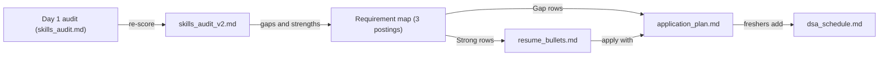
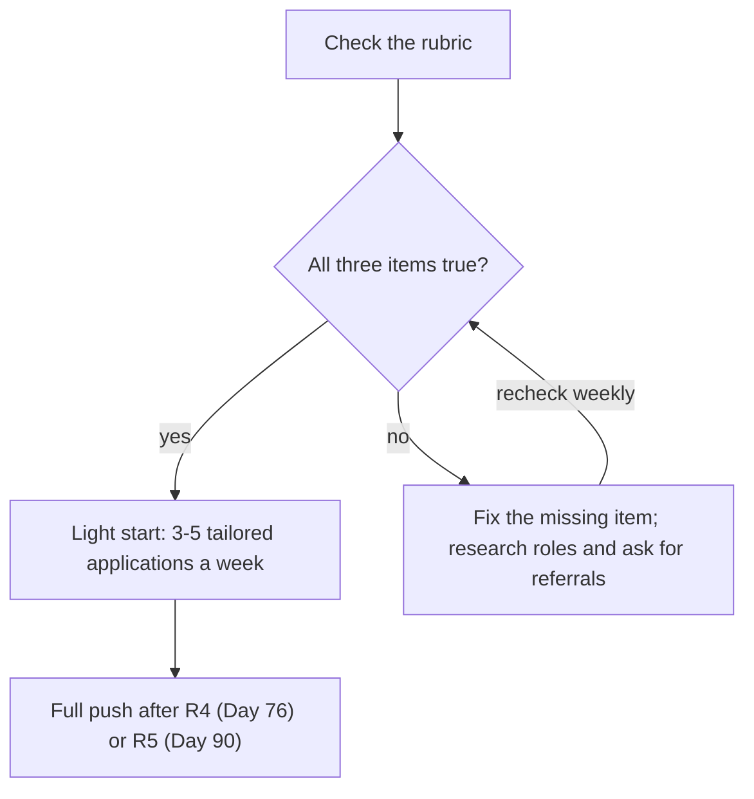
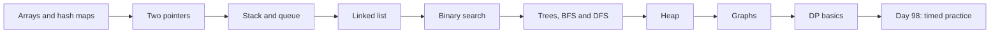

# Career Checkpoint

After 62 days you have three released projects, and most people write "built RAG chatbot using
LangChain" on a resume and stop there. Hiring teams skim for proof: numbers, what broke, what you
decided. Today you turn R1–R3 into evidence while the numbers are fresh, and freshers start the
slow part of interview prep (data structures and algorithms) now.

## At a Glance

- **Time:** ~2 h core (+ optional Go Deeper) · **Depth:** intro
- **Prerequisites:** [Day 62: Capstone R3, Part 2: Durable, Evaluated, Shippable](../Day_062_capstone_r3_ship/capstone_r3_ship.md),
  plus your `skills_audit.md` from
  [Day 1: The AI Engineer: Role, Skills & How to Use This Course](../../Phase_0_Start_Here/Day_001_ai_engineer_role/ai_engineer_role.md)
- **You'll build:** four text files in your Atlas repo: `skills_audit_v2.md`, `resume_bullets.md`,
  `application_plan.md` and `dsa_schedule.md`
- **Stops at:** interview prep (Days 97–98). No STAR stories, negotiation, system design or
  portfolio polish today.
- **Fast path:** Already keep an up-to-date resume? Read §From Project to Bullet and §Two Tracks,
  Two Resumes, then do Exercise 3 (about 30 min).
- **Cost:** $0. No API calls and no code today.
- **New terms:** requirement map, evidence bullet, application cadence, DSA schedule

> **Coming from Software Engineering?** Treat today as a retro plus a code review of your own
> profile. You re-run the baseline (the Day 1 audit), diff it against the old run, and fix the
> highest-impact gaps first, the same way you'd triage review comments. A good resume bullet reads
> like a good commit message: a verb, a scope and a measurable effect. Your production experience
> counts here: "added retries with backoff" becomes "kept the pipeline reliable under rate limits",
> which is exactly what AI teams worry about.

## You Have More Than a Certificate

A certificate says you sat through something. A release with measured numbers in its README says
you can ship. You have three, and each proves a different skill.

| Release | What it does | What it proves | Numbers in its README |
|---|---|---|---|
| [R1 Extractor (Day 22)](../../Phase_2_Building_with_LLM_APIs/Day_022_capstone_r1_extractor/capstone_r1_extractor.md) | Orbit docs and issues → typed records | Structured output, validation, an eval gate | field-level accuracy, $/1k docs, p95 latency (95% of calls were faster than this) |
| [R2 Ask (Day 34)](../../Phase_3_RAG/Day_034_capstone_r2_ask/capstone_r2_ask.md) | Chat over Orbit docs with citations and a UI | Retrieval, ranking, evals, access control | recall@5 before and after reranking, $/request, the access-control (ACL) demo, a public demo URL |
| R3 Investigator ([Day 61](../Day_061_capstone_r3_investigator/capstone_r3_investigator.md)–[62](../Day_062_capstone_r3_ship/capstone_r3_ship.md)) | New issue → cited diagnosis, with human approval | Agents, durability, trajectory evals in CI | trajectory pass rate, $/issue, p95, the crash-resume demo |

Open the three READMEs side by side. Every number you use today comes from them. If a README is
missing a number, measure it now; a gap is cheaper to fix today than in an interview.

Freshers often feel behind at this point because the job postings look long. Name the progress
first: if you scored the agents and evals groups near zero on Day 1, you have since shipped an
evaluated agent.

## A Code Review of Your Career

The plain version of today: take stock, translate what you built into the words a hiring manager
scans for, and set a pace you can keep. Each step produces the input for the next.



The Day 1 vs Day 63 diff is the heart of the review. For each group, write one line on *what
moved and why*, pointing at a file in your repo; those lines become your bullets later.

## Re-Score the Audit

Copy `skills_audit.md` to `skills_audit_v2.md`, fill in its **D63** column, and leave the **D1**
column untouched; keep the original file beside it as the frozen baseline. The **D100** column waits
for your last re-score. The audit is unchanged: the same 20 items in 8 groups, each scored 0–5 with
the Day 1 anchors, for a maximum of 100.

| Score | Meaning |
|---|---|
| 0 | Never heard of it |
| 1 | Heard the term; couldn't explain it |
| 2 | Could explain it; haven't built it |
| 3 | Built it once, by following a guide |
| 4 | Built it on my own and debugged it |
| 5 | Could teach it, including when not to use it |

One honest rule: **score what you can do without notes.** If you needed to reread Day 54 to
remember how a checkpointer resumes a run, that item is a 3, not a 4. For every 4 or 5, write the
file that proves it in the evidence column. A score you can't point at is a score you can't defend.

Read the total with the Day 1 bands: **0–30** means you are early in the material, **31–65** means
you can build with guidance, and **66–100** means you can build and debug on your own. A middle-band total is normal here, with safety and production still ahead.

Expect uneven gains:

| Group (audit items) | Likely to move by Day 63 | Why |
|---|---|---|
| APIs & prompting (1–3) | Up | You've called the API every day since Day 2 |
| Structured output (4–5) | Up | R1 shipped on it |
| Retrieval (6–8) | Up | R2 shipped on it |
| Tools & MCP (9–10) | Up | Days 35–40, and R3 uses tools |
| Evals & observability (11–13) | Up, often the biggest jump | Day 20, Phase 5, and R3's CI gate |
| Agents (14–16) | Up | Phase 6 and R3 |
| Safety (17–18) | Flat | Phase 8 hasn't started |
| Production & ops (19–20) | Mostly flat | Phase 9 hasn't started; R2's demo URL is a first step |

Flat safety and production rows are expected; they become "currently learning" lines in your plan.

## What Employers Ask For, Mapped to What You Built

On Day 1 you saw the course's job signal. It came from **320 public AI-engineer, applied-AI and
forward-deployed-engineer postings** (a forward-deployed engineer builds AI solutions with a
customer, often on site), counted on 2026-11-06. The sample leans heavily toward AI vendors, and a
keyword appearing in a posting doesn't say how much the job uses it. Read it as a signal (as of
2026-11-06) and verify it against postings in your own market.

This time, put your evidence next to each row:

| Skill (share of postings) | Your evidence so far | Status at Day 63 |
|---|---|---|
| Evals: 52% | [Day 20](../../Phase_2_Building_with_LLM_APIs/Day_020_first_eval_set/first_eval_set.md) eval set, [Day 47](../../Phase_5_Evaluation_and_Observability/Day_047_evals_in_ci/evals_in_ci.md) CI gate, R3 trajectory suite | Evidence in all three releases |
| Python: 41% | Every release | Evidence |
| Agents: 36% | R3 | Evidence |
| TypeScript / JavaScript: 32% | Primer [A13](../../Appendix_Primers/A13_typescript_for_ai_engineers.md) | A stated gap unless you already use it |
| Coding agents: 20% | `AGENTS.md` and a reviewed feature from [Day 60](../Day_060_coding_agents_skills/coding_agents_skills.md) | Evidence |
| RAG / retrieval: 17% | R2 | Evidence |
| Observability: 11% | Tracing from [Day 42](../../Phase_5_Evaluation_and_Observability/Day_042_tracing_observability/tracing_observability.md) | Evidence if your README shows a trace |
| MCP: 6% | Atlas MCP server from [Day 40](../../Phase_4_Tools_and_MCP/Day_040_mcp_servers/mcp_servers.md) | Evidence |
| LangChain / LangGraph: 6% | R3 graph | Evidence |

The top row matters most, and every release has a measured eval in its README. "I built a chatbot"
is common; "here is how I know it got better" is your strongest sentence.


## Map a Real Posting

A **requirement map** is a table that lists each line of a job description (JD) and, next to it,
the specific file or README line that proves it, plus a status. The statuses are plain:

- **Strong:** a release shows it, with a number.
- **Partial:** you've built it in a lesson, but not in a release, or without a number.
- **Gap:** not covered yet. Say which later day closes it.

Here is a worked example on a **sample** JD. It is invented for this lesson; don't treat it as a real
company's posting.

```markdown
SAMPLE JD (invented): Applied AI Engineer
- Build and ship LLM features in Python
- Design evals and use them to drive changes
- Build agents that use tools and recover from failure
- Retrieval: search quality, ranking, citations
- Instrument LLM systems (tracing, cost)
- Ship to production behind an API; on-call rotation
- Nice to have: guardrails / prompt-injection defenses, multi-agent systems, TypeScript
```

| Requirement | Evidence (file or README line) | Status | Plan if not Strong |
|---|---|---|---|
| Ship LLM features in Python | R1–R3 repos, tagged releases | Strong | |
| Evals drive changes | R2 README: recall@5 before vs after reranking | Strong | |
| Agents with tools, recovery | R3 README: crash-resume demo, trajectory pass rate | Strong | |
| Retrieval quality and citations | R2 eval table and cited answers | Strong | |
| Tracing and cost | Day 42 traces; $/issue in R3 README | Partial | Add a trace screenshot to the R3 README this week |
| Production API, on-call | Demo URL only | Gap | [Day 77](../../Phase_9_Production/Day_077_fastapi_serving/fastapi_serving.md) onward, R5 on [Day 90](../../Phase_9_Production/Day_090_capstone_r5_launch/capstone_r5_launch.md) |
| Guardrails, injection | None yet | Gap | [Day 69](../../Phase_8_Safety_and_Security/Day_069_prompt_injection/prompt_injection.md) and [Day 70](../../Phase_8_Safety_and_Security/Day_070_guardrails_moderation/guardrails_moderation.md) |
| Multi-agent | None yet | Gap | [Day 64](../../Phase_7_Multi_Agent_Systems/Day_064_multi_agent_when/multi_agent_when.md), R4 on [Day 76](../../Phase_8_Safety_and_Security/Day_076_capstone_r4_triage/capstone_r4_triage.md) |
| TypeScript | Not used | Gap | Primer A13, or name it honestly as a gap |

Most Gap rows are *ahead of you in the course*, so they read as "in progress", not "missing". A
switching engineer may already be Strong on "production API, on-call" from work history, not Atlas.

Do this for three real postings you would apply to (Exercise 2). After three, a pattern shows up:
the same two or three Gap rows repeat. Those are your top-3 gaps, and they go into the plan.

## From Project to Bullet

Most weak bullets list tools: "Built a RAG chatbot using FAISS". A strong bullet follows one
formula, like a good commit message:

**verb + what you built + stack + a number + the effect**

Compare weak and better versions for each release. **Every number below is an EXAMPLE.** Replace it
with a figure from your own README, or drop the number.

| Release | Weak | Better (EXAMPLE numbers) |
|---|---|---|
| R1 | Built an extractor using OpenAI and Pydantic | Built a typed issue extractor (Responses API, Pydantic) behind an eval gate; field accuracy rose from 82% to 94% at $0.40 per 1k docs |
| R2 | Made a RAG chatbot | Raised recall@5 from 0.71 to 0.86 on a 60-question gold set with hybrid search and reranking; enforced per-user access filters in a live demo |
| R3 | Built an AI agent | Built a LangGraph issue investigator with human approval; 38 of 40 trajectory evals pass in CI at $0.06 per issue, and runs resume after a crash |

One rule decides which numbers survive: **claim only what you can defend.** In an interview, "how
did you measure that?" is the first follow-up. For every number you should be able to say the
dataset, how many cases, what the baseline was and what you changed. If you can't, cut the number.

## Two Tracks, Two Resumes

The facts are the same for everyone; the order and framing differ, following your Day 1 track.

| | Switching roles | First role |
|---|---|---|
| Lead with | Your current domain plus the AI proof | Projects, then education |
| Top section | Summary, then experience | Projects (R1-R3), then coursework, then skills |
| Translate your past | "Added retries with backoff" becomes "kept the pipeline reliable under rate limits" | "Built a CLI" becomes "wrote tested Python tools with CI" |
| Skills line | Group by what you used on the job and in R1-R3 | Python, SQL, Git, plus the stack from R1-R3 |
| Extras | On-call, reviews, migrations | DSA practice, open-source contributions |

Two resume tops, for invented people:

```text
SWITCHING (EXAMPLE)
Backend engineer, 6 years (payments, Python). Shipped three AI projects in 2026: a typed extractor,
a cited RAG assistant with access control, and a durable issue-investigation agent gated by evals.

FIRST ROLE (EXAMPLE)
BSc Computer Science, 2026. Projects: Atlas (an AI assistant for an open-source library):
extractor, RAG assistant with a live demo, and an eval-gated agent. Practising DSA daily in Python.
```

For LinkedIn, write three lines: what you build, one proof with a number, what role you want. Pin
your R3 repo and the R2 demo. Polishing the portfolio itself belongs to
[Day 99: Building Your Portfolio](../../Phase_11_Career_Launch/Day_099_portfolio/portfolio.md).

## When to Start Applying

Waiting until you feel ready is a mistake; so is applying everywhere with one resume. Use this
rubric as a guideline, not a rule:

- three releases, each with README numbers;
- one deployed demo (R2's URL counts);
- one failure per release that you can explain: what broke, how you found it, what you changed.



A light start means researching roles, asking for referrals and sending 3 to 5 applications a
week, editing the top three bullets for each posting. Switching engineers start now, as Day 1
suggested. Freshers keep Day 1's plan of applying in earnest from about R4, and use the weeks until
then for the light version. Search for
"AI engineer", "applied AI engineer", "forward-deployed engineer" and "LLM application engineer".

## Freshers: Start the DSA Plan Now

Data structures and algorithms (DSA) rounds are common in first-role loops, and the skill compounds
slowly, which is why [Day 98: Practical Interviews: Coding, Take-Homes & DSA](../../Phase_11_Career_Launch/Day_098_practical_interviews/practical_interviews.md)
assumes you have started. (You will likely reach Day 98 before week 12; Day 98 continues from wherever you are.) Day 1 pencilled in 30 minutes a weekday; now that the schedule is
concrete, budget **45 minutes, five days a week, for two problems per session, in Python**, with a
weekly review of the ones you missed. Work through topics in this order:



| Weeks | Topic |
|---|---|
| 1 | Arrays and hash maps |
| 2 | Two pointers |
| 3 | Stack and queue |
| 4 | Linked list |
| 5 | Binary search |
| 6 | Review week: redo every miss |
| 7-8 | Trees, BFS and DFS |
| 9 | Heap |
| 10 | Graphs |
| 11 | DP (dynamic programming) basics |
| 12 | Mixed timed set |

Week 1 by day (classic problems on any practice site). Save both tables as `dsa_schedule.md`:

| Day | Two problems |
|---|---|
| Mon | Two Sum; Contains Duplicate |
| Tue | Valid Anagram; Group Anagrams |
| Wed | Top K Frequent Elements; Product of Array Except Self |
| Thu | Longest Consecutive Sequence; Best Time to Buy and Sell Stock |
| Fri | Review: redo the two you struggled with, from a blank file |

**Experienced engineers:** you likely have the fundamentals, so a two-week refresh is enough. Week 1:
arrays and hash maps, two pointers, stack, binary search. Week 2: trees, BFS and DFS, heap, graphs,
two DP problems. Here is Two Sum solved by hand, which shows the hash-map pattern behind the whole
first topic:

```text
nums = [2, 7, 11, 15], target = 9, seen = {}
2:  need 9 - 2 = 7, not in seen  -> store seen[2] = 0
7:  need 9 - 7 = 2, found in seen -> answer is [0, 1]
```

One pass: a dictionary lookup replaces the second loop.

## Your 30-Day Application Plan

Each week has four lanes. Save your version as `application_plan.md`:

| Week | Build | Apply | Learn | DSA (freshers) |
|---|---|---|---|---|
| 1 | Fill README gaps: missing numbers, a trace screenshot | Write bullets; pick 3 target postings | Day 64 onward | Week 1 topics |
| 2 | Re-measure any stale number | 3-5 tailored applications | Course days for your top-3 gaps | Week 2 topics |
| 3 | Start the next release | 3-5 applications; one referral message | Same | Week 3 topics |
| 4 | Write a short write-up of one release ([Day 99](../../Phase_11_Career_Launch/Day_099_portfolio/portfolio.md)) | 3-5 applications; review the tracking sheet | Same | Week 4 topics, review misses |

Track every application in a sheet with these columns: company, role, link, date applied, source
(referral or cold), bullets tailored, status, next action and date, and "what the posting asked
that I lacked", which feeds your next gap list.

### In production

- Keep your four files in the Atlas repo, so the history shows progress.
- Date your README numbers, and re-measure after any release that changes behaviour.
- Ship one write-up per release; Day 99 shows how.
- Avoid tool-chasing: a new framework rarely moves your odds as much as one more measured result.
- Re-score the audit again on Day 100 and compare it with today.

## Go Deeper (optional)

<details>
<summary>Go deeper: how postings get screened, and what to tailor</summary>

Some companies filter applications first with software that matches keywords, then a person skims
for proof. The two readers want different things. Software looks for the posting's own terms ("evals",
"tool use", "retrieval"); a person looks for numbers and a decision you made. Write bullets for the
person, and reuse the posting's wording where it is true for you.

This is why the plan says to edit the top three bullets per posting, not the whole resume. Pick the
three that match the posting's first three requirements, put them first, and keep the rest stable.
Do not add a skill you cannot discuss; the interview will find it.

Experts also keep a running "evidence log": dated results, links to traces and short notes on what
failed. When a posting arrives, you assemble bullets from the log in minutes.

</details>

## Common Pitfalls

- **Inflated re-score.** *Symptom:* a total of 85 and no files behind it. *Cause:* no evidence
  required. *Fix:* score without notes, and link a file for every 4 or 5.
- **Tool lists instead of outcomes.** *Symptom:* "used LangChain, FAISS". *Cause:* no number or
  decision. *Fix:* verb + number + effect.
- **Numbers you can't defend.** *Symptom:* you freeze at "how did you measure that?" *Cause:* copied
  the example numbers. *Fix:* use your own README figures, or drop the number.
- **Waiting, or spraying.** *Symptom:* zero applications, or 100 identical ones. *Cause:* waiting for certainty, or no
  tailoring. *Fix:* 3 to 5 a
  week, with the top three bullets edited for each posting.
- **Skipping DSA until invitations arrive.** *Symptom:* a coding round in two weeks and no practice.
  *Cause:* it takes months. *Fix:* schedule 45 minutes each weekday, starting now.
- **Copying the sample JD mapping.** *Symptom:* your map matches this lesson line for line. *Fix:*
  map three postings you would actually apply to.

> **Where we stop:** no interview preparation, STAR stories, negotiation or system design (see
> [Day 97](../../Phase_11_Career_Launch/Day_097_system_design_interviews/system_design_interviews.md)
> and
> [Day 98](../../Phase_11_Career_Launch/Day_098_practical_interviews/practical_interviews.md)), no
> portfolio polish ([Day 99](../../Phase_11_Career_Launch/Day_099_portfolio/portfolio.md)) and no
> salary data.

## Key Takeaways

- Your three READMEs are evidence, and every number you use on a resume comes from them.
- Re-score the same 20-item audit without notes, write one line per group on what moved, and link a
  file for every 4 or 5.
- Map real postings to your work as Strong, Partial or Gap; repeated Gaps are your top-3 plan.
- A bullet is verb + what + stack + number + effect, and you must be able to defend every number.
- Start applying lightly once the rubric holds; freshers also start a DSA schedule today.

## Quick Reference

| Item | What it is | When you use it | Gotcha |
|---|---|---|---|
| `skills_audit_v2.md` | Day 1 audit re-scored, 100 max | Today and Day 100 | Score without notes |
| Requirement map | Posting line, evidence, status | Per posting | Map your own postings |
| Evidence bullet | Verb + what + stack + number + effect | Resume, LinkedIn | Defend every number |
| Readiness rubric | 3 releases, 1 demo, 1 failure each | Deciding when to apply | A guideline, not a rule |
| Application cadence | 3-5 tailored applications a week | The 30-day plan | Edit the top 3 bullets each time |
| `dsa_schedule.md` | 45 min x 5 days, 2 problems | Freshers, from today | Review misses weekly |

## Exercises

1. **Warm-up: re-score the audit.** Copy `skills_audit.md` to `skills_audit_v2.md`, re-score all 20
   items, and compute the change per group.

<details><summary>Solution</summary>

Sample, continuing Day 1's example learner (24 at Day 1):

| Group (max) | Day 1 | Day 63 | Change | What moved |
|---|---|---|---|---|
| APIs & prompting (15) | 5 | 11 | +6 | Daily API use |
| Structured output (10) | 2 | 7 | +5 | R1 |
| Retrieval (15) | 2 | 9 | +7 | R2 |
| Tools & MCP (10) | 1 | 6 | +5 | Days 35-40 |
| Evals & observability (15) | 2 | 9 | +7 | Day 20, Day 42, CI gates |
| Agents (15) | 3 | 8 | +5 | R3 |
| Safety (10) | 2 | 3 | +1 | Not started |
| Production & ops (10) | 7 | 8 | +1 | R2 demo URL |
| **Total (100)** | **24** | **61** | **+37** | |

61 sits in the 31-65 band. Safety (30% of its maximum) and Agents (53%) are the weakest by share,
so they are the focus for the coming phases.

</details>

2. **Core: map three postings.** Collect three real postings you would apply to, tally each
   requirement as Strong, Partial or Gap, and list your top-3 gaps.

<details><summary>Solution</summary>

Sample tally (postings paraphrased):

| Requirement | Appears in | Status |
|---|---|---|
| Evals | A, B, C | Strong |
| Agents with tools | A, B | Strong |
| RAG | A, C | Strong |
| Deploy and Docker | A, B, C | Gap |
| TypeScript | B, C | Gap |
| Guardrails | B | Gap |

Top-3 gaps: (1) deployment, closed by Day 77 onward and R5; (2) TypeScript, via primer A13 or an
honest "not yet"; (3) guardrails, via Days 69-70.

</details>

3. **Core: write three evidence bullets.** Write one bullet each for R1-R3 from your own README
   numbers, for your track, then cut each to a single line.

<details><summary>Solution</summary>

| Draft | One line (EXAMPLE numbers) |
|---|---|
| I made a tool that reads issues and pulls out fields and it is pretty accurate | Built a typed issue extractor behind an eval gate; field accuracy 94% at $0.40 per 1k docs |
| I built a retrieval system for Orbit docs and improved it by adding reranking and measured it | Raised recall@5 from 0.71 to 0.86 with hybrid search and reranking (60-question gold set) |
| The agent investigates issues and can be resumed if it crashes and has tests | Built a durable LangGraph investigator; 38 of 40 trajectory evals pass in CI |

Switching track, R3: "Kept an investigation agent reliable under crashes: resumes from checkpoints
and gates merges on trajectory evals." First-role track: the same bullet under a Projects heading,
with the repo link.

</details>

4. **Stretch (past the stop line): tell the R3 story in two minutes.** Cover the problem, one
   design decision, one number and one failure, and record yourself.

<details><summary>Solution</summary>

Outline: problem (20 s) - "Maintainers lose time diagnosing new issues." Decision (40 s) - "I used a
graph with human approval before any action." Number (30 s) - "38 of 40 trajectory cases pass in
CI (EXAMPLE)." Failure (30 s) - "The agent looped on a missing tool; I added a step budget and a
test." Listen back for filler and vague claims. Day 98 builds on this.

</details>

## References & Further Reading

- [LLM evals FAQ (Hamel Husain)](https://hamel.dev/blog/posts/evals-faq/): why evals are the most
  requested skill and how practitioners approach them.
- [AGENTS.md](https://agents.md/): the convention behind the coding-agent evidence in
  [Day 60](../Day_060_coding_agents_skills/coding_agents_skills.md).
- [CS50's Introduction to Programming with Python](https://cs50.harvard.edu/python/): a free course
  if your Python needs strengthening before DSA practice.
- [The Python Tutorial](https://docs.python.org/3/tutorial/): lists, dictionaries and sets are the
  tools of the first DSA topic. Day 98 links a full DSA roadmap.

## What's Next

You have shown your work and set a plan. Phase 7 starts with several agents instead of one: continue
with [Day 64: Multi-Agent Systems: When (Not) to Use Them](../../Phase_7_Multi_Agent_Systems/Day_064_multi_agent_when/multi_agent_when.md),
where you learn when splitting work across agents helps and when it only adds cost.
