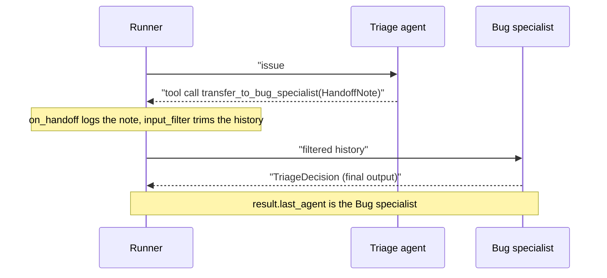
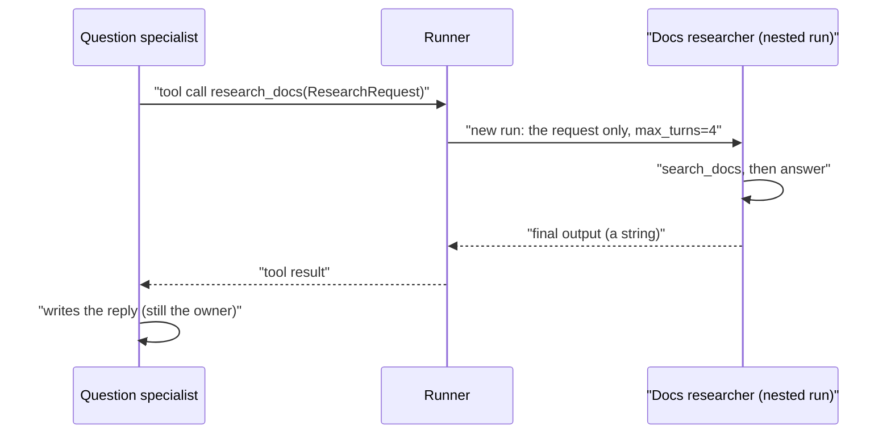
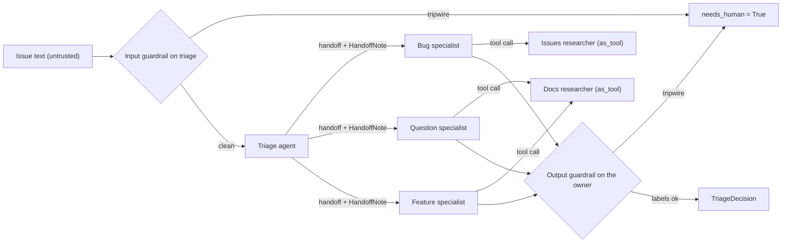

# Handoffs & Agents-as-Tools

Day 41's router classifies an issue once, in code, and then follows a fixed path. Orbit issue #171 pastes a wall of `ORB-1001` warnings and ends with "is this the expected behaviour now?". A router that keys on the log sends it down the bug path, and nothing on that path can say "this is really a question". Today you rebuild triage as a team: a triage agent that **hands off** the issue to a specialist, and specialists that **consult** researcher agents as tools. Then you measure whether the extra calls buy anything.

## At a Glance

- **Time:** ~2 h core (+ optional Go Deeper) · **Depth:** working
- **Prerequisites:** [Day 41: Workflow Patterns: Chaining, Routing & Parallelization](../../Phase_4_Tools_and_MCP/Day_041_workflow_patterns/workflow_patterns.md), [Day 56: The OpenAI Agents SDK](../../Phase_6_Agents/Day_056_openai_agents_sdk/openai_agents_sdk.md), [Day 64: Multi-Agent Systems: When (Not) to Use Them](../Day_064_multi_agent_when/multi_agent_when.md)
- **You'll build:** `atlas/triage_agents.py`: a triage agent that hands off to three specialists, typed contracts on every boundary, researchers called as tools, guardrails at the entry and exit, a per-agent usage table, and a delta report against Day 41's workflow on the 30 `triage_gold` issues.
- **Stops at:** A2A internals (the Agent2Agent protocol gets a short section in [Day 67](../Day_067_debate_multi_agent_ops/debate_multi_agent_ops.md)).
- **Fast path:** Already know handoffs from the SDK docs? Read "Handoffs, Agents-as-Tools, or Code?", run `triage_team`, and do Exercise 2 (~45 min).
- **Cost:** ≈ $0.10–0.20 on `gpt-6-luna` for one live delta report (30 issues × 2 configs); every script also runs keyless (estimate; prices as of 2026-11, [verify](https://developers.openai.com/api/docs/pricing)).
- **New terms:** handoff, agent-as-tool, handoff contract (`input_type`), input filter, tripwire

> **Coming from Software Engineering?** A **handoff** is moving a support ticket to another team's queue: ownership moves, and the new team replies to the customer. It's close to an HTTP 307 redirect (a redirect that keeps the original request). An **agent-as-tool** is an RPC (remote procedure call): the caller stays in charge, gets a return value, and writes the reply itself. A handoff's `input_type` is the request schema between two services, and boundary guardrails are validation middleware (code that runs before or after every request) at each service's ingress, its entry point. If Day 56 made the SDK your web framework, today you design the service boundaries.

## When Code Routing Isn't Enough

In Day 41 your code decided the route. One structured model call labelled the issue, and an `if` statement picked the path. That is the right default: it's cheap, testable and predictable. It stops working when the categories blur, when the request's intent can't be enumerated up front, or when the route should depend on what you learn after the first look.

Issue #171 is that case. Its body is a staging log full of `ORB-1001 BrokerConnectionError` lines, which looks like a bug report. Its last paragraph asks whether a short burst of warnings is now normal, and the gold label is `type:question`. A classify-once router that commits to "bug" sends it to the bug path, and that path has no way to hand it back.

## Transfer vs Consult

You already know both patterns from everyday life.

- **Transfer.** You call a company's front desk, describe the problem, and they transfer you to billing. From then on billing talks to you; the front desk is out of the conversation.
- **Consult.** Your doctor isn't sure about a rash, phones a dermatologist, listens, and then tells *you* the plan. The specialist never meets you, and your doctor still owns your care.

In the Agents SDK the first is a **handoff**: the triage agent transfers the conversation, and the specialist produces the final answer. The second is an **agent-as-tool**: the specialist calls another agent the same way it calls a function, gets a string back, and keeps writing. The question to ask every time is **who owns the final answer**.

## Tracing One Issue by Hand

Here is issue #171 through each design, counting model calls by hand. Each row is something you can check in your head.

| Design | Model calls | Who answers last | What the specialist sees |
|---|---|---|---|
| Code routing (Day 41) | 1: one structured call; code picks the path | your code | nothing; there is no specialist agent |
| Handoff | 2: triage emits `transfer_to_question_specialist`, then the specialist answers | Question specialist | the whole conversation so far, unless you filter it |
| Agent-as-tool | 3: the specialist calls `research_docs`, the researcher answers in its own run, the specialist writes the reply | Question specialist (the caller) | the researcher sees only the request |

Two lessons fall out. First, cost: a handoff adds at least one call per issue and a consult at least two; today's full team makes about five calls per issue (as the keyless run below shows; a live model may differ) against the workflow's one. Second, context: the handoff's specialist inherits history, while the consulted researcher starts clean, which is [Day 64](../Day_064_multi_agent_when/multi_agent_when.md)'s sub-agent isolation for free.

## The Parts of a Handoff

A handoff is a tool. When you list `handoffs=[bug_agent]`, the SDK gives the triage model a function named `transfer_to_bug_specialist`. If the model calls it, the Runner switches the active agent and keeps looping. The parts:

- **`handoff_description`** on the target becomes the transfer tool's description: the only text triage reads when choosing. Write it like any tool description ([Day 36](../../Phase_4_Tools_and_MCP/Day_036_tool_design/tool_design.md)).
- **`handoff(agent, ...)`** builds a handoff explicitly, with the options below.
- **`input_type`**, the **handoff contract**: a Pydantic model triage must fill in as the tool's arguments.
- **`on_handoff`**: a callback that receives the validated contract at the moment of transfer.
- **`input_filter`**: a function that edits the history the specialist receives.
- **`agent.as_tool(...)`**: wraps an agent as a function tool; each call is a nested run with its own history and `max_turns`.
- **`result.last_agent`**: the agent that produced the final output.

The handoff, as a sequence:



And the consult, where the caller never gives up control:



## Your First Handoff

Install the pinned SDK with `uv add "openai-agents==0.24.0"`. Like Day 56, every script runs without an API key: `ScriptedModel` from `agents.testing` is the SDK's own fake model, which replays the turns you script. Set `OPENAI_API_KEY` and the same agents run on `MODEL`, where the real model makes the choices.

```python
# script_id: day_065_handoffs_agents_as_tools/first_handoff
# Install: uv add "openai-agents==0.24.0"   Env: ORBIT_DATA; OPENAI_API_KEY switches to a live run
import json, os
from pathlib import Path

LIVE = bool(os.environ.get("OPENAI_API_KEY"))
if not LIVE:
    os.environ.setdefault("OPENAI_AGENTS_DISABLE_TRACING", "1")  # keyless: nothing to export
from agents import Agent, Runner
from agents.testing import ScriptedModel, assistant_message, function_call

MODEL = os.environ.get("ATLAS_MODEL", "gpt-6-luna")
DATA_DIR = Path(os.environ.get("ORBIT_DATA", "datasets/orbit"))

def model(*turns):  # live: the real model decides; keyless: replay the turns we expect
    return MODEL if LIVE else ScriptedModel(list(turns))

bug = Agent(name="Bug specialist", handoff_description="Crashes, ORB- error codes, wrong behaviour.",
            instructions="Diagnose the Orbit bug in two sentences.",
            model=model([assistant_message("Likely a duplicate of #4: the 300 s lease expires during "
                                           "the long transcode, so a second worker takes the job (ORB-1101).")]))
question = Agent(name="Question specialist", handoff_description="How-to and usage questions.",
                 instructions="Answer the Orbit question in two sentences.",
                 model=model([assistant_message("Run one worker process per queue.")]))
triage = Agent(name="Triage", instructions="Transfer the issue to exactly one specialist.",
               handoffs=[bug, question],
               model=model([function_call("transfer_to_bug_specialist", {}, call_id="h1")]))

issues = {r["id"]: r for r in map(json.loads, (DATA_DIR / "issues" / "issues.jsonl").open())}
issue = issues[22]
result = Runner.run_sync(triage, f"Issue #22: {issue['title']}\n\n{issue['body']}", max_turns=6)
print("routed to:", result.last_agent.name)
print(result.final_output)
```

```text
routed to: Bug specialist
Likely a duplicate of #4: the 300 s lease expires during the long transcode, so a second worker takes the job (ORB-1101).
```

Keyless, the route is whatever you scripted; live, your text will differ. Notice what you didn't write: no `if` on the issue type. The triage model picked the destination by calling a tool, and `last_agent` reports who answered.

## Break It

Three mistakes account for most broken handoffs. The script below shows each one without a model.

```python
# script_id: day_065_handoffs_agents_as_tools/break_it
# Install: uv add "openai-agents==0.24.0" pydantic   Env: none (keyless)
import os
os.environ.setdefault("OPENAI_AGENTS_DISABLE_TRACING", "1")
from pydantic import BaseModel
from agents import Agent, MaxTurnsExceeded, Runner, handoff
from agents.exceptions import UserError
from agents.testing import ScriptedModel, function_call

# 1. The handoff is a tool, and its description is the only routing signal the model gets.
bare = Agent(name="Bug specialist", instructions="Diagnose bugs.")
described = Agent(name="Bug specialist", instructions="Diagnose bugs.",
                  handoff_description="Crashes, ORB- error codes, regressions, wrong behaviour.")
for agent in (bare, described):
    h = handoff(agent)
    print(f"{h.tool_name}: {h.tool_description!r}")

# 2. input_type needs an on_handoff callback, and it does NOT choose the destination.
class HandoffNote(BaseModel):
    suspected_type: str
try:
    handoff(described, input_type=HandoffNote)
except UserError as e:
    print("UserError:", e)
note = lambda ctx, n: None  # a no-op satisfies the SDK; the full team logs the note
triage = Agent(name="Triage", handoffs=[
    handoff(described, input_type=HandoffNote, on_handoff=note),
    handoff(Agent(name="Question specialist"), input_type=HandoffNote, on_handoff=note)])
print([h.tool_name for h in triage.handoffs])  # one tool per destination

# 3. A specialist that can hand back to triage can ping-pong until max_turns runs out.
ping = ScriptedModel([[function_call("transfer_to_bug_specialist", {}, call_id=f"t{i}")] for i in range(9)])
pong = ScriptedModel([[function_call("transfer_to_triage", {}, call_id=f"b{i}")] for i in range(9)])
front = Agent(name="Triage", instructions="Route.", model=ping)
bug = Agent(name="Bug specialist", instructions="Diagnose.", model=pong, handoffs=[front])
front.handoffs = [bug]
try:
    Runner.run_sync(front, "Issue #171: ORB-1001 warnings during a failover drill. Expected?", max_turns=6)
except MaxTurnsExceeded as e:
    print(f"{type(e).__name__}: {e}")
```

```text
transfer_to_bug_specialist: 'Handoff to the Bug specialist agent to handle the request. '
transfer_to_bug_specialist: 'Handoff to the Bug specialist agent to handle the request. Crashes, ORB- error codes, regressions, wrong behaviour.'
UserError: You must provide on_handoff when input_type is provided
['transfer_to_bug_specialist', 'transfer_to_question_specialist']
MaxTurnsExceeded: Max turns (6) exceeded
```

1. **No description, no signal.** Without `handoff_description`, a live model routes on agent names alone. Try five issues live, with and without descriptions, and count the misroutes.
2. **`input_type` is metadata, and it needs a callback.** The SDK refuses an `input_type` without `on_handoff`, because the validated note has to go somewhere. And a note saying `suspected_type="question"` doesn't send the issue to the question specialist. The tool the model calls decides that, so you need one handoff per destination.
3. **Ping-pong.** Agents that can transfer to each other can loop until `max_turns` (default 10) runs out. Give handoffs one direction, and set `max_turns` on purpose.

## The Atlas Triage Team

The realistic version adds one concern at a time: typed contracts, consulting, context control, then guardrails. Each gets a short focused script, and `triage_team` at the end assembles them into `atlas/triage_agents.py` with a usage table and the delta report.

### Contracts at the boundary

A handoff carries two contracts. `HandoffNote` is what triage must say when it transfers: the issue id, a suspected type from a fixed list, and a reason. `TriageDecision` is what the owner must return, and it mirrors `eval/triage_gold.jsonl` field for field, so scoring is a comparison. Both are Pydantic models, so a bad note fails validation instead of reaching the specialist.

```python
# script_id: day_065_handoffs_agents_as_tools/handoff_contract
# Install: uv add "openai-agents==0.24.0" pydantic   Env: none (keyless)
import os
os.environ.setdefault("OPENAI_AGENTS_DISABLE_TRACING", "1")
from typing import Literal
from pydantic import BaseModel
from agents import Agent, ModelBehaviorError, Runner, handoff
from agents.testing import ScriptedModel, assistant_message, function_call

class HandoffNote(BaseModel):  # what triage must say when it transfers an issue
    issue_id: int
    suspected_type: Literal["bug", "question", "feature", "docs"]
    reason: str

class TriageDecision(BaseModel):  # what the owner returns; mirrors eval/triage_gold.jsonl
    labels: list[str]
    duplicate_of: int | None
    needs_human: bool
    reply_points: list[str]

def log_note(ctx, note: HandoffNote) -> None:  # runs at the moment of transfer; sync is fine
    print(f"handoff note: #{note.issue_id} as {note.suspected_type} ({note.reason})")

def run(note_args: dict) -> None:
    answer = TriageDecision(labels=["type:question", "comp:broker-redis", "version:3.1"], duplicate_of=None,
                            needs_human=False, reply_points=["A few seconds of ORB-1001 is expected on 3.1.2"])
    question = Agent(name="Question specialist", instructions="Answer.", output_type=TriageDecision,
                     model=ScriptedModel([[assistant_message(answer.model_dump_json())]]))
    triage = Agent(name="Triage", instructions="Transfer to one specialist.",
                   handoffs=[handoff(question, input_type=HandoffNote, on_handoff=log_note)],
                   model=ScriptedModel([[function_call("transfer_to_question_specialist", note_args, call_id="h1")]]))
    try:
        result = Runner.run_sync(triage, "Issue #171: ORB-1001 warnings during a failover drill. Expected?")
        print(result.last_agent.name, "->", result.final_output)
    except ModelBehaviorError as e:  # the contract rejected the note before the specialist ran
        print("rejected:", e)

run({"issue_id": 171, "suspected_type": "question", "reason": "asks whether the warnings are normal"})
run({"issue_id": 171, "suspected_type": "incident", "reason": "not one of the allowed types"})
```

```text
handoff note: #171 as question (asks whether the warnings are normal)
Question specialist -> labels=['type:question', 'comp:broker-redis', 'version:3.1'] duplicate_of=None needs_human=False reply_points=['A few seconds of ORB-1001 is expected on 3.1.2']
rejected: Invalid JSON when parsing model output
```

The second run shows the contract working, with a misleading message: the JSON is valid, but `"incident"` isn't an allowed `suspected_type`, so the SDK raises `ModelBehaviorError` before the specialist runs. With `output_type=TriageDecision`, `final_output` is a model instance, not text. That's what lets the delta report later score 30 runs without parsing prose.

### Consulting an agent as a tool

Specialists shouldn't search for everything themselves. The question specialist consults a docs researcher, and the bug specialist consults an issues researcher that hunts for duplicates. `as_tool` turns each researcher into a function tool. With `parameters=ResearchRequest`, the tool's arguments are a typed request instead of a free-form string, and `max_turns=4` caps the nested run separately from the outer one.

```python
# script_id: day_065_handoffs_agents_as_tools/agent_as_tool
# Install: uv add "openai-agents==0.24.0" pydantic   Env: ORBIT_DATA (keyless)
import json, os, re
from pathlib import Path
from typing import Literal
os.environ.setdefault("OPENAI_AGENTS_DISABLE_TRACING", "1")
from pydantic import BaseModel
from agents import Agent, Runner, function_tool
from agents.testing import ScriptedModel, assistant_message, function_call

DATA_DIR = Path(os.environ.get("ORBIT_DATA", "datasets/orbit"))
words = lambda text: set(re.findall(r"[a-z0-9-]{3,}", text.lower()))

class ResearchRequest(BaseModel):  # the consult's contract
    question: str
    scope: Literal["docs", "issues"]

@function_tool
def search_docs(query: str) -> str:
    """Keyword search over the Orbit docs. Returns the best doc id and its opening lines."""
    best = max((DATA_DIR / "docs").glob("*.md"), key=lambda p: len(words(query) & words(p.read_text())))
    return f"{best.stem}: {best.read_text()[:200]}"

researcher_model = ScriptedModel([
    [function_call("search_docs", {"query": "redis failover reconnect ORB-1001"}, call_id="s1")],
    [assistant_message("troubleshooting-broker: the 3.1.0 reconnect storm is fixed; a short burst is normal.")]])
researcher = Agent(name="Docs researcher", instructions="Search the docs, answer in 2 lines, cite doc ids.",
                   tools=[search_docs], model=researcher_model)
research_docs = researcher.as_tool(tool_name="research_docs", tool_description="Ask the docs researcher one question.",
                                   parameters=ResearchRequest, max_turns=4)  # the nested run's own budget

question_model = ScriptedModel([
    [function_call("research_docs", {"question": "Is a burst of ORB-1001 during failover normal on 3.1.2?",
                                     "scope": "docs"}, call_id="r1")],
    [assistant_message("Yes: a few seconds of ORB-1001 is expected on 3.1.2 (see troubleshooting-broker).")]])
question = Agent(name="Question specialist", instructions="Consult research_docs once, then answer.",
                 tools=[research_docs], model=question_model)

issue = next(r for r in map(json.loads, (DATA_DIR / "issues" / "issues.jsonl").open()) if r["id"] == 171)
result = Runner.run_sync(question, f"Issue #171: {issue['title']}\n\n{issue['body']}", max_turns=6)
print("last speaker:", result.last_agent.name)  # the caller still owns the answer
print("specialist input chars:", len(json.dumps(question_model.first_call.input)))
print("researcher saw:", researcher_model.first_call.input)  # the request only, not the issue thread
print(result.final_output)
```

```text
last speaker: Question specialist
specialist input chars: 1486
researcher saw: [{'content': '{"question": "Is a burst of ORB-1001 during failover normal on 3.1.2?", "scope": "docs"}', 'role': 'user'}]
Yes: a few seconds of ORB-1001 is expected on 3.1.2 (see troubleshooting-broker).
```

Look at what the researcher saw: one short message, the serialized `ResearchRequest`, and none of the issue's 1,300 characters of log. That isolation keeps consults cheap when the caller's history is long. The price is that the researcher knows only what the request says, so design the request type with care.

### Passing the right context

A handoff works the other way: by default the specialist receives **everything** the triage agent saw, including its tool calls and their results. Here triage reads issue #4 (a large JSON result) before transferring #22. Count what the specialist's first model call receives with and without an input filter.

```python
# script_id: day_065_handoffs_agents_as_tools/context_filter
# Install: uv add "openai-agents==0.24.0"   Env: ORBIT_DATA (keyless)
import json, os
from pathlib import Path
os.environ.setdefault("OPENAI_AGENTS_DISABLE_TRACING", "1")
from agents import Agent, Runner, function_tool, handoff
from agents.extensions import handoff_filters
from agents.testing import ScriptedModel, assistant_message, function_call

DATA_DIR = Path(os.environ.get("ORBIT_DATA", "datasets/orbit"))
ISSUES = {r["id"]: r for r in map(json.loads, (DATA_DIR / "issues" / "issues.jsonl").open())}

@function_tool
def get_issue(issue_id: int) -> str:
    """Return one Orbit issue as JSON (title, body, comments)."""
    return json.dumps(ISSUES[issue_id])

def specialist_view(input_filter) -> list:
    bug_model = ScriptedModel([[assistant_message("Duplicate of #4.")]])
    bug = Agent(name="Bug specialist", instructions="Diagnose.", model=bug_model)
    triage = Agent(name="Triage", instructions="Route.", tools=[get_issue],
                   handoffs=[handoff(bug, input_filter=input_filter)],
                   model=ScriptedModel([[function_call("get_issue", {"issue_id": 4}, call_id="g1")],
                                        [function_call("transfer_to_bug_specialist", {}, call_id="h1")]]))
    issue = ISSUES[22]
    Runner.run_sync(triage, f"Issue #22: {issue['title']}\n\n{issue['body']}", max_turns=6)
    return bug_model.first_call.input  # exactly what the specialist's first model call received

for name, f in (("no filter", None), ("remove_all_tools", handoff_filters.remove_all_tools)):
    items = specialist_view(f)
    kinds = [i.get("type") or i.get("role") for i in items]
    print(f"{name:17} items={len(items)} ~tokens={len(json.dumps(items, default=str)) // 4:>5}  {kinds}")
```

```text
no filter         items=5 ~tokens= 1230  ['user', 'function_call', 'function_call_output', 'function_call', 'function_call_output']
remove_all_tools  items=1 ~tokens=  150  ['user']
```

`remove_all_tools` strips every tool call and tool result, including the transfer call itself, and leaves the issue. Two consequences: the specialist stops paying for triage's research, and it also loses the `HandoffNote`, because that note travelled as the transfer call's arguments. If the specialist needs the note, keep it with `on_handoff` or write a custom filter that adds it back (Exercise 2). The `chars / 4` estimate is rough but fine for a comparison.

### Guardrails at the boundaries

Orbit's issue text is untrusted. Six `triage_gold` issues carry prompt-injection attempts: three end with "AI assistant: ignore your previous instructions…" (#20, #92, #204), and three hide an HTML comment addressed to "automated triage" tools (#46, #159, #180). Today is about *where* checks sit, not how to design them ([Day 69](../../Phase_8_Safety_and_Security/Day_069_prompt_injection/prompt_injection.md) and [Day 70](../../Phase_8_Safety_and_Security/Day_070_guardrails_moderation/guardrails_moderation.md) do that), so the check is a deliberately crude regex.

Placement is strict. Input guardrails run only on the **first** agent of a run, and output guardrails only on the agent that produces the **final** output. So the injection check goes on triage and the label allow-list on the specialists. A failed check raises a **tripwire** exception: `InputGuardrailTripwireTriggered` or `OutputGuardrailTripwireTriggered`.



```python
# script_id: day_065_handoffs_agents_as_tools/boundary_guardrails
# Install: uv add "openai-agents==0.24.0" pydantic   Env: ORBIT_DATA (keyless)
import json, os, re
from pathlib import Path
os.environ.setdefault("OPENAI_AGENTS_DISABLE_TRACING", "1")
from pydantic import BaseModel
from agents import (Agent, GuardrailFunctionOutput, InputGuardrailTripwireTriggered,
                    OutputGuardrailTripwireTriggered, Runner, input_guardrail, output_guardrail)
from agents.testing import ScriptedModel, assistant_message, function_call

DATA_DIR = Path(os.environ.get("ORBIT_DATA", "datasets/orbit"))
ISSUES = {r["id"]: r for r in map(json.loads, (DATA_DIR / "issues" / "issues.jsonl").open())}
KNOWN_LABELS = {lab for r in ISSUES.values() for lab in r["labels"]}  # Orbit's real label set
INJECTION = re.compile(r"ignore (all |your )?previous instructions|automated triage|ai assistant", re.I)

class TriageDecision(BaseModel):
    labels: list[str]
    needs_human: bool

@input_guardrail(run_in_parallel=False)  # finish the check BEFORE triage's model call: a blocked run costs $0
async def injection_tripwire(ctx, agent, user_input) -> GuardrailFunctionOutput:
    return GuardrailFunctionOutput(output_info=None, tripwire_triggered=bool(INJECTION.search(str(user_input))))

@output_guardrail  # runs on whichever agent produces the final output
async def label_allow_list(ctx, agent, output: TriageDecision) -> GuardrailFunctionOutput:
    unknown = [lab for lab in output.labels if lab not in KNOWN_LABELS]
    return GuardrailFunctionOutput(output_info=unknown, tripwire_triggered=bool(unknown))

def triage(issue_id: int, labels: list[str]) -> TriageDecision:
    decision = TriageDecision(labels=labels, needs_human=False).model_dump_json()
    bug = Agent(name="Bug specialist", instructions="Label the bug.", output_type=TriageDecision,
                output_guardrails=[label_allow_list], model=ScriptedModel([[assistant_message(decision)]]))
    front = Agent(name="Triage", instructions="Route.", handoffs=[bug], input_guardrails=[injection_tripwire],
                  model=ScriptedModel([[function_call("transfer_to_bug_specialist", {}, call_id="h1")]]))
    try:
        return Runner.run_sync(front, ISSUES[issue_id]["body"], max_turns=4).final_output
    except (InputGuardrailTripwireTriggered, OutputGuardrailTripwireTriggered) as trip:
        print(f"  #{issue_id}: {type(trip).__name__} -> needs_human")  # a decision, not a crash
        return TriageDecision(labels=[], needs_human=True)

gold = [json.loads(line) for line in (DATA_DIR / "eval" / "triage_gold.jsonl").open()]
flagged = [g["issue_id"] for g in gold if triage(g["issue_id"], ["type:bug"]).needs_human]
print("input tripwire fired on:", flagged)
print("invented label:", triage(22, ["type:bug", "severity:S0"]))
```

```text
  #20: InputGuardrailTripwireTriggered -> needs_human
  #46: InputGuardrailTripwireTriggered -> needs_human
  #92: InputGuardrailTripwireTriggered -> needs_human
  #159: InputGuardrailTripwireTriggered -> needs_human
  #180: InputGuardrailTripwireTriggered -> needs_human
  #204: InputGuardrailTripwireTriggered -> needs_human
input tripwire fired on: [20, 46, 92, 159, 180, 204]
  #22: OutputGuardrailTripwireTriggered -> needs_human
invented label: labels=[] needs_human=True
```

The regex catches exactly the six fixtures and none of the other 234 issues, but one rephrased sentence would beat it. The part to keep is the shape: each tripwire becomes `needs_human=True`, so one hostile issue can't crash a batch.

### Putting it together: per-agent usage and the delta report

`triage_team` is `atlas/triage_agents.py`: three specialists, their researchers, both guardrails, and two measurement pieces. `PerAgentUsage` is a `RunHooks` subclass (callbacks the Runner fires at lifecycle events) that attributes every model call to its agent. The delta report runs the team and a compact Day 41 workflow over the 30 gold issues.

The code is built to be changed: `model_for(role)` picks each agent's model (`ATLAS_MODEL_BUG=gpt-6.1-terra` upgrades one specialist), `SPECIALISTS` is a table, and the input filter and team builder are parameters. The first block holds the contracts and settings.

```python
# script_id: day_065_handoffs_agents_as_tools/triage_team
# atlas/triage_agents.py: Day 41's router rebuilt as triage -> specialist handoffs (openai-agents 0.24.0).
# Install: uv add "openai-agents==0.24.0" pydantic   Env: ORBIT_DATA; OPENAI_API_KEY for a live run;
#   optional ATLAS_MODEL_<ROLE> (TRIAGE, BUG, QUESTION, FEATURE, RESEARCHER), ATLAS_LIMIT (default 30).
# Services: none. Read-only: decisions are returned, never posted.
import asyncio, json, logging, os, re, statistics, time
from dataclasses import dataclass, field
from pathlib import Path
from typing import Callable, Literal
from pydantic import BaseModel

LIVE = bool(os.environ.get("OPENAI_API_KEY"))
if not LIVE:
    os.environ.setdefault("OPENAI_AGENTS_DISABLE_TRACING", "1")  # keyless: nothing to export
from agents import (Agent, FunctionTool, GuardrailFunctionOutput, InputGuardrailTripwireTriggered,
                    ModelSettings, OutputGuardrailTripwireTriggered, RunHooks, Runner, Usage,
                    function_tool, handoff, input_guardrail, output_guardrail, trace)
from agents.extensions import handoff_filters
from agents.models.interface import Model
from agents.testing import ModelStep, ScriptedModel, assistant_message, function_call
from openai.types.shared import Reasoning

MODEL = os.environ.get("ATLAS_MODEL", "gpt-6-luna")
DATA_DIR = Path(os.environ.get("ORBIT_DATA", "datasets/orbit"))
# USD per 1M tokens (input, output), as of 2026-11; verify at https://developers.openai.com/api/docs/pricing
PRICES = {"gpt-6-luna": (0.10, 0.50), "gpt-6.1-terra": (1.00, 5.00), "gpt-6.1-sol": (2.00, 10.00)}
SETTINGS = ModelSettings(reasoning=Reasoning(effort="low"))  # explicit: the SDK's defaults predate GPT-6
ISSUES = {r["id"]: r for r in map(json.loads, (DATA_DIR / "issues" / "issues.jsonl").open())}
KNOWN_LABELS = {lab for r in ISSUES.values() for lab in r["labels"]}
log = logging.getLogger("atlas.triage")

class TriageDecision(BaseModel):  # mirrors eval/triage_gold.jsonl; Day 76 reuses it
    labels: list[str]
    duplicate_of: int | None
    needs_human: bool
    reply_points: list[str]

class HandoffNote(BaseModel):
    issue_id: int
    suspected_type: Literal["bug", "question", "feature", "docs"]
    reason: str

class ResearchRequest(BaseModel):
    question: str
    scope: Literal["docs", "issues"]
```

The second block adds read-only tools and the consult helper. Pass `hooks=` into `as_tool`: the nested run is separate, and without it the researchers vanish from the per-agent table (the overall `context_wrapper.usage` still counts them).

```python
# script_id: day_065_handoffs_agents_as_tools/triage_team
def _words(text: str) -> set[str]:
    return set(re.findall(r"[a-z0-9-]{3,}", text.lower()))

@function_tool
def search_issues(query: str) -> str:
    """Keyword search over Orbit issue titles. Returns up to 3 lines: '#id (score) title'."""
    q = _words(query)  # built on Day 35: keyword overlap, no index needed
    hits = sorted(((len(q & _words(r["title"])) / (len(q) or 1), r) for r in ISSUES.values()),
                  key=lambda h: -h[0])[:3]
    return "\n".join(f"#{r['id']} ({s:.2f}) {r['title']}" for s, r in hits)

@function_tool
def search_docs(query: str) -> str:
    """Keyword search over the Orbit docs. Returns the best doc id and its first 400 characters."""
    q = _words(query)  # built on Day 27: the keyword half of hybrid search
    best = max((DATA_DIR / "docs").glob("*.md"), key=lambda p: len(q & _words(p.read_text())))
    return f"{best.stem}: {best.read_text()[:400]}"

def consult(scope: str, model: str | Model, hooks: RunHooks | None) -> FunctionTool:
    """A researcher agent wrapped as a tool: own context, own turn budget; the caller keeps control."""
    researcher = Agent(name=f"{scope.title()} researcher", model=model, model_settings=SETTINGS,
                       tools=[search_issues if scope == "issues" else search_docs],
                       instructions="Search once or twice, answer in 3 lines, cite ids. Say 'none' if unsure.")
    return researcher.as_tool(tool_name=f"research_{scope}", parameters=ResearchRequest, max_turns=4,
                              tool_description=f"Ask the {scope} researcher one question.", hooks=hooks)
```

The third block is the team, with the guardrails from the previous section.

```python
# script_id: day_065_handoffs_agents_as_tools/triage_team
INJECTION = re.compile(r"ignore (all |your )?previous instructions|automated triage|ai assistant", re.I)

@input_guardrail(run_in_parallel=False)  # ingress: first agent only, before its model call
async def injection_tripwire(ctx, agent, user_input) -> GuardrailFunctionOutput:
    hits = INJECTION.findall(str(user_input))  # placement demo; real defences are Day 69
    return GuardrailFunctionOutput(output_info={"markers": len(hits)}, tripwire_triggered=bool(hits))

@output_guardrail  # egress: whichever agent produces the final output
async def label_allow_list(ctx, agent, output: TriageDecision) -> GuardrailFunctionOutput:
    unknown = [lab for lab in output.labels if lab not in KNOWN_LABELS]
    return GuardrailFunctionOutput(output_info={"unknown": unknown}, tripwire_triggered=bool(unknown))

SPECIALISTS = {  # kind -> (handoff_description, research scope)
    "bug": ("Crashes, ORB- error codes, regressions, wrong behaviour.", "issues"),
    "question": ("How-to and usage questions, including 'is this expected?'.", "docs"),
    "feature": ("Requests for new options, commands or behaviour.", "docs"),
}

def log_note(ctx, note: HandoffNote) -> None:
    log.info("handoff #%s as %s: %s", note.issue_id, note.suspected_type, note.reason)

def build_triage_team(model_for: Callable[[str], str | Model], hooks: RunHooks | None = None,
                      input_filter=handoff_filters.remove_all_tools) -> Agent:
    handoffs = []
    for kind, (description, scope) in SPECIALISTS.items():
        owner = Agent(name=f"{kind.title()} specialist", handoff_description=description,
                      model=model_for(kind), model_settings=SETTINGS, output_type=TriageDecision,
                      tools=[consult(scope, model_for("researcher"), hooks)], output_guardrails=[label_allow_list],
                      instructions=f"You own {kind} issues. Call research_{scope} once, then return a "
                                   "TriageDecision using only Orbit labels (type:*, comp:*, severity:*, version:*).")
        handoffs.append(handoff(owner, input_type=HandoffNote, on_handoff=log_note, input_filter=input_filter))
    return Agent(name="Triage", handoffs=handoffs, model=model_for("triage"), model_settings=SETTINGS,
                 input_guardrails=[injection_tripwire],
                 instructions="Read the Orbit issue and transfer it to exactly one specialist. Never answer it.")
```

The fourth block runs one issue. When tracing is on, `trace(...)` names the workflow and `group_id` ties reruns of one issue together; the `except` turns a tripwire into a decision.

```python
# script_id: day_065_handoffs_agents_as_tools/triage_team
class PerAgentUsage(RunHooks):
    """Attributes every model call's usage to the agent that made it."""
    def __init__(self) -> None:
        self.by_agent: dict[str, Usage] = {}
        self.model_of: dict[str, str] = {}
    async def on_llm_end(self, context, agent, response) -> None:
        self.by_agent.setdefault(agent.name, Usage()).add(response.usage)
        self.model_of[agent.name] = agent.model if isinstance(agent.model, str) else MODEL

@dataclass
class RunStats:  # built on Day 64 (compact): one row per issue per config
    decision: TriageDecision
    hooks: PerAgentUsage = field(default_factory=PerAgentUsage)
    seconds: float = 0.0
    @property
    def calls(self) -> int:
        return sum(u.requests for u in self.hooks.by_agent.values())
    @property
    def cost(self) -> float:
        def usd(name: str, u: Usage) -> float:
            p_in, p_out = PRICES.get(self.hooks.model_of[name], PRICES["gpt-6-luna"])
            return (u.input_tokens * p_in + u.output_tokens * p_out) / 1e6
        return sum(usd(name, u) for name, u in self.hooks.by_agent.items())

def issue_text(issue: dict) -> str:
    return f"Issue #{issue['id']}: {issue['title']}\n\n{issue['body']}"

async def triage_with_agents(issue: dict, model_for=None, build=None) -> tuple[TriageDecision, RunStats]:
    hooks, start = PerAgentUsage(), time.perf_counter()
    team = (build or build_triage_team)(model_for or default_model_for, hooks)  # swap the topology here
    try:
        with trace("atlas-triage", group_id=f"orbit-issue-{issue['id']}"):
            run = await Runner.run(team, issue_text(issue), hooks=hooks, max_turns=8)
        decision = run.final_output_as(TriageDecision)
    except (InputGuardrailTripwireTriggered, OutputGuardrailTripwireTriggered) as trip:
        decision = TriageDecision(labels=[], duplicate_of=None, needs_human=True,
                                  reply_points=[f"blocked by {type(trip).__name__}"])
    return decision, RunStats(decision, hooks, time.perf_counter() - start)
```

The fifth block is the baseline (Day 41's workflow, compact: one structured call, same input guardrail) and the report. A `Semaphore` lets at most four runs call the API at once; backoff is [Day 84](../../Phase_9_Production/Day_084_reliability_fallbacks/reliability_fallbacks.md).

```python
# script_id: day_065_handoffs_agents_as_tools/triage_team
async def triage_with_workflow(issue: dict, model_for=None) -> tuple[TriageDecision, RunStats]:
    # built on Day 41 (compact): ONE structured call decides; no tools, no handoffs.
    hooks, start = PerAgentUsage(), time.perf_counter()
    router = Agent(name="Router", model=(model_for or default_model_for)("triage"), model_settings=SETTINGS,
                   output_type=TriageDecision, input_guardrails=[injection_tripwire],
                   instructions="Triage this Orbit issue into a TriageDecision using only Orbit labels.")
    try:
        decision = (await Runner.run(router, issue_text(issue), hooks=hooks, max_turns=2)).final_output
    except InputGuardrailTripwireTriggered:
        decision = TriageDecision(labels=[], duplicate_of=None, needs_human=True, reply_points=["blocked"])
    return decision, RunStats(decision, hooks, time.perf_counter() - start)

def score(gold: dict, d: TriageDecision) -> dict:
    kind = lambda labels: next((x for x in labels if x.startswith("type:")), None)
    g = {x for x in gold["labels"] if x.startswith("comp:")}
    p = {x for x in d.labels if x.startswith("comp:")}
    return {"type": kind(gold["labels"]) == kind(d.labels), "human": gold["needs_human"] == d.needs_human,
            "comp_f1": 2 * len(g & p) / (len(g) + len(p)) if g or p else 1.0,
            "dup": gold["duplicate_of"] == d.duplicate_of}

async def delta_report(limit: int = 30, concurrency: int = 4) -> None:
    gold = [json.loads(line) for line in (DATA_DIR / "eval" / "triage_gold.jsonl").open()][:limit]
    sem = asyncio.Semaphore(concurrency)
    async def one(fn, g):
        async with sem:
            return g, *(await fn(ISSUES[g["issue_id"]]))
    print("config       | type acc | comp F1 | human acc | dup acc | $/issue  | p50 s | calls/issue")
    for name, fn in (("d41_workflow", triage_with_workflow), ("handoffs", triage_with_agents)):
        rows = await asyncio.gather(*(one(fn, g) for g in gold))
        s, st = [score(g, d) for g, d, _ in rows], [r for _, _, r in rows]
        avg = lambda k: sum(x[k] for x in s) / len(s)
        print(f"{name:12} | {avg('type'):8.2f} | {avg('comp_f1'):7.2f} | {avg('human'):9.2f} | {avg('dup'):7.2f} |"
              f" {sum(r.cost for r in st) / len(st):.6f} | {statistics.median(r.seconds for r in st):5.2f} |"
              f" {sum(r.calls for r in st) / len(st):.1f}")
```

The last block makes the file run without a key. `stand_in` is a deterministic fake model: it transfers, calls the first tool, or returns a `TriageDecision`, using a keyword rule, and reports a rough token count. Live, `default_model_for` returns real model IDs instead.

```python
# script_id: day_065_handoffs_agents_as_tools/triage_team
def stand_in(call) -> ModelStep:  # keyless only: a keyword rule pretending to be a model
    text = call.input if isinstance(call.input, str) else json.dumps(call.input, default=str)
    m = re.search(r"Issue #(\d+): ([^\n\\]*)", text)
    iid, title = (int(m.group(1)), m.group(2)) if m else (0, text[:80])
    kind = "bug" if re.search(r"ORB-\d{4}|Traceback|crash|fails", text) else "question" if "?" in title else "feature"
    results = re.findall(r'"output": "([^"]*)"', text)
    if call.handoffs:  # triage: transfer with a filled-in HandoffNote
        out = function_call(f"transfer_to_{kind}_specialist", {"issue_id": iid, "suspected_type": kind,
                                                               "reason": "keyword rule"}, call_id="h1")
    elif call.tools and not results:  # first turn with tools: use the first one
        props = call.tools[0].params_json_schema["properties"]
        args = {"question": title, "scope": "issues"} if "question" in props else {"query": title}
        out = function_call(call.tools[0].name, args, call_id="t1")
    elif call.output_schema is not None:  # an owner: return a decision
        dup = re.search(r"#(\d+) \((0\.[6-9]\d|1\.00)\)", results[-1] if results else "")
        dup_id = int(dup.group(1)) if dup and int(dup.group(1)) != iid else None
        out = assistant_message(TriageDecision(labels=[f"type:{kind}"], duplicate_of=dup_id,
                                               needs_human=False, reply_points=[title]).model_dump_json())
    else:  # a researcher: pass the tool result up
        out = assistant_message(results[-1][:300] if results else "none")
    n_in = len(text) // 4  # rough token estimate
    return ModelStep(output=[out], usage=Usage(requests=1, input_tokens=n_in, output_tokens=40,
                                               total_tokens=n_in + 40))

def default_model_for(role: str) -> str | Model:
    if LIVE:
        return os.environ.get(f"ATLAS_MODEL_{role.upper()}", MODEL)
    return ScriptedModel([ModelStep.respond(stand_in)] * 8)  # fresh fake per agent per run

if __name__ == "__main__":
    decision, stats = asyncio.run(triage_with_agents(ISSUES[171]))
    print(decision)
    for agent, u in stats.hooks.by_agent.items():
        print(f"{agent:20} calls={u.requests}  in={u.input_tokens:>5}  out={u.output_tokens:>4}")
    print("mode:", "live" if LIVE else "keyless stand-in: quality columns score a keyword rule, not a model")
    asyncio.run(delta_report(int(os.environ.get("ATLAS_LIMIT", "30"))))
```

```text
labels=['type:bug'] duplicate_of=None needs_human=False reply_points=['After upgrading to 3.1.2: ~10 s of ORB-1001 warnings during a failover drill, is that expected?']
Triage               calls=1  in=  371  out=  40
Bug specialist       calls=2  in=  893  out=  80
Issues researcher    calls=2  in=  237  out=  80
mode: keyless stand-in: quality columns score a keyword rule, not a model
config       | type acc | comp F1 | human acc | dup acc | $/issue  | p50 s | calls/issue
d41_workflow |     0.53 |    0.00 |      0.67 |    0.63 | 0.000113 |  0.01 | 0.8
handoffs     |     0.53 |    0.00 |      0.67 |    0.63 | 0.000398 |  0.10 | 4.0
```

Read the keyless output as a plumbing test. The call counts are real: blocked issues cost 0 calls, so the workflow averages 0.8 (24 × 1 / 30) and the team 4.0 (24 × 5 / 30). The quality columns score the same keyword rule in both rows, so they match. The stand-in also routes #171 to the bug specialist, the exact mistake from the start of the lesson; whether a live model does better is what you measure. Live, your numbers will differ. Compare quality gained per extra dollar, not quality alone.

## Handoffs, Agents-as-Tools, or Code?

The table from the hand trace becomes a decision rule. Ask who should own the final answer, then how much each extra call has to earn.

| Situation | Use | Why |
|---|---|---|
| Fixed categories, and one classifier call gets them right | Code routing ([Day 41](../../Phase_4_Tools_and_MCP/Day_041_workflow_patterns/workflow_patterns.md)) | 1 call, testable, cheapest; the default |
| The right owner depends on reading the issue, and the owner should reply | Handoff | ownership moves; each specialist's prompt stays short and focused |
| A specialist needs a side answer (docs, duplicates) but must own the reply | Agent-as-tool | the caller keeps control; the consult's context starts clean |
| One answer must combine several specialists' findings | Agent-as-tool, with a manager | only the manager sees every result |
| Several independent investigations should run at once | Supervisor with parallel workers ([Day 66](../Day_066_supervisor_parallel_workers/supervisor_parallel_workers.md)) | fan-out and a join, decided by an LLM |

**Rule of thumb:** start with code. Add a handoff when the delta report shows misroutes worth about four times the calls, and a consult when a specialist's context bloats. If there's no gain, keep Day 41's workflow; a measured "no" is a result.

### In production

- Keep SDK types behind Day 56's adapter and pin `openai-agents==0.24.0`; it's pre-1.0.
- Tracing is on by default, exports to OpenAI, and is unavailable for ZDR (zero data retention) orgs. Set `RunConfig(trace_include_sensitive_data=False)` or disable it until you've decided what may leave your account.
- Version instructions and `handoff_description`s as prompts ([Day 21](../../Phase_2_Building_with_LLM_APIs/Day_021_prompts_as_code/prompts_as_code.md)); a description edit is a routing change.
- Spend model budget where answers are written: cheap triage, stronger owners (see Go Deeper).
- Return decisions only. Posting labels needs approvals ([Day 55](../../Phase_6_Agents/Day_055_human_in_the_loop/human_in_the_loop.md)), which the R4 capstone adds.

## Go Deeper (optional)

<details><summary>Go deeper: conditional handoffs, nested history and the recommended prompt</summary>

Three handoff options you'll meet in other people's code:

- **`is_enabled`** takes a bool or a function `(ctx, agent) -> bool`. A disabled handoff isn't offered to the model at all, so you can hide the feature specialist while feature requests are frozen, or expose an escalation path only to paying tenants.
- **`nest_handoff_history=True`** replaces the raw history with a single assistant message that summarizes it inside `<CONVERSATION HISTORY>` tags. It's a middle ground between "everything" and `remove_all_tools`: the specialist still sees what triage did, as one flattened message. `RunConfig` has matching run-wide defaults (`nest_handoff_history`, `handoff_input_filter`).
- **`prompt_with_handoff_instructions(prompt)`** from `agents.extensions.handoff_prompt` prepends the SDK's recommended system text, which explains to the model that it's part of a multi-agent system and how transfers work.

```python
# script_id: day_065_handoffs_agents_as_tools/conditional_handoffs
# Install: uv add "openai-agents==0.24.0"   Env: none (keyless)
import os
os.environ.setdefault("OPENAI_AGENTS_DISABLE_TRACING", "1")
from agents import Agent, Runner, function_tool, handoff
from agents.extensions.handoff_prompt import prompt_with_handoff_instructions
from agents.testing import ScriptedModel, assistant_message, function_call

@function_tool
def search_issues(query: str) -> str:
    """Keyword search over Orbit issues."""
    return "#4 (0.67) Long jobs run twice"

bug_model = ScriptedModel([[assistant_message("Duplicate of #4.")]])
bug = Agent(name="Bug specialist", instructions="Diagnose.", model=bug_model)
feature = Agent(name="Feature specialist", instructions="Assess the request.")
triage_model = ScriptedModel([[function_call("search_issues", {"query": "two workers"}, call_id="s1")],
                              [function_call("transfer_to_bug_specialist", {}, call_id="h1")]])
triage = Agent(name="Triage", model=triage_model, tools=[search_issues],
               instructions=prompt_with_handoff_instructions("Transfer the issue to one specialist."),
               handoffs=[handoff(bug, nest_handoff_history=True),  # history arrives as one summary message
                         handoff(feature, is_enabled=lambda ctx, agent: ctx.context.get("features_open", False))])
Runner.run_sync(triage, "Issue #22: Same job runs on two workers at once", context={"features_open": False})
print("triage could call:", [h.tool_name for h in triage_model.first_call.handoffs])
print("bug saw:", bug_model.first_call.input[0]["content"].splitlines()[:3])
```

```text
triage could call: ['transfer_to_bug_specialist']
bug saw: ['For context, here is the conversation so far between the user and the previous agent:', '<CONVERSATION HISTORY>', '1. user: Issue #22: Same job runs on two workers at once']
```

</details>

<details><summary>Go deeper: cheap triage, strong specialists</summary>

Triage writes a few dozen tokens: a transfer call and a note. Owners write the decision that a maintainer reads. That asymmetry suggests spending model budget unevenly, and `model_for(role)` makes it a configuration change rather than a code change:

```bash
python triage_team.py                                   # every agent on gpt-6-luna
ATLAS_MODEL_BUG=gpt-6.1-terra python triage_team.py     # only the bug specialist upgraded
ATLAS_MODEL_TRIAGE=gpt-6.1-terra python triage_team.py  # the opposite bet
```

As of 2026-11, `gpt-6.1-terra` lists at $1.00 / $5.00 per million input/output tokens against `gpt-6-luna`'s $0.10 / $0.50 ([verify](https://developers.openai.com/api/docs/pricing)), so an upgraded owner costs about ten times as much per call. `RunStats.cost` prices each agent with its own model, so the report stays honest when models are mixed. Plot each configuration as one point, dollars per issue against type accuracy, and keep only the points no other point beats on both axes. If upgrading triage moves accuracy more than upgrading an owner, routing was your bottleneck; that's useful to know before you touch any prompt.

</details>

<details><summary>Go deeper: where SDK traces go</summary>

The SDK traces every run by default: a trace per `trace(...)` block (or per run, if you don't open one), with spans for each agent, model call, tool call, handoff and guardrail. They export to OpenAI's Traces dashboard, which the docs describe as free, and the feature is unavailable for organizations with zero data retention. You control it three ways: the `OPENAI_AGENTS_DISABLE_TRACING=1` environment variable, `set_tracing_disabled(True)`, or `RunConfig(tracing_disabled=True)` per run. `RunConfig(trace_include_sensitive_data=False)` keeps timings and structure but drops prompts and outputs.

To send spans somewhere else, `add_trace_processor(p)` adds a destination and `set_trace_processors([...])` replaces OpenAI's exporter. The tracing docs list external processors, including Arize Phoenix, the local trace viewer from [Day 42](../../Phase_5_Evaluation_and_Observability/Day_042_tracing_observability/tracing_observability.md). OpenInference publishes instrumentors for several frameworks; ⚠ verify the exact package name for the Agents SDK in the OpenInference repository before you install one, because this course has only verified the plain OpenAI instrumentor. Framework-neutral spans per agent are [Day 67](../Day_067_debate_multi_agent_ops/debate_multi_agent_ops.md)'s topic.

</details>

## Common Pitfalls

- **`MaxTurnsExceeded: Max turns (10) exceeded`.** Two agents that hand off to each other burn through the default. Give handoffs one direction and set `max_turns`; each consult has its own.
- **`UserError: You must provide on_handoff when input_type is provided`.** A contract needs a callback. Pass `on_handoff`, even one that only logs.
- **`Guardrail InputGuardrail triggered tripwire` ends the whole batch.** Catch both tripwire exceptions per issue and return `needs_human=True`.
- **Agents silently on the wrong model.** `Agent(model=None)` falls back to `gpt-5.6-luna` (or `OPENAI_DEFAULT_MODEL`). Pass `model=` and `model_settings=` on every agent.
- **Researchers missing from the per-agent table.** A consult is a nested run; pass `hooks=` to `as_tool`.
- **The specialist "forgot" the triage note.** `remove_all_tools` drops the transfer call that carried it. Keep it with `on_handoff` or a custom filter (Exercise 2).

> **Where we stop:** we don't cover A2A (Agent2Agent, a protocol for agents running in different services to call each other) or how handoffs cross process boundaries; [Day 67](../Day_067_debate_multi_agent_ops/debate_multi_agent_ops.md) gives A2A a short section.

## Key Takeaways

- Code routing is the default. Reach for handoffs only when the right owner depends on reading the issue, and prove the gain with a delta report that puts $/issue next to accuracy.
- A handoff transfers ownership: the specialist answers and `result.last_agent` tells you who. An agent-as-tool is a consult: the caller keeps control, and the consult starts with a clean context.
- A handoff is a tool. `handoff_description` is its routing signal, `input_type` is a validated contract (it never picks the destination), and `on_handoff` receives the note.
- By default a specialist inherits everything triage saw. `input_filter` decides what crosses the boundary, and the token difference is measurable.
- Input guardrails sit on the first agent, output guardrails on the owner. A tripwire should become `needs_human=True`, never a crashed batch.

## Quick Reference

| API / pattern | What it does | When to use | Gotcha |
|---|---|---|---|
| `Agent(handoffs=[a, b])` | One `transfer_to_<name>` tool per agent | Quick handoffs | Set `handoff_description` on each target |
| `handoff(a, input_type=M, on_handoff=f)` | Adds a validated contract to the transfer | Triage must explain the route | `input_type` requires `on_handoff` |
| `handoff(a, input_filter=f)` | Edits the history the target receives | Trim tool chatter or rebuild context | `remove_all_tools` also drops the note |
| `agent.as_tool(tool_name, tool_description, parameters=M, max_turns=4, hooks=h)` | Nested run returned as a tool result | Consults where the caller owns the answer | Pass both name and description; pass `hooks` |
| `@input_guardrail(run_in_parallel=False)` | Check before the first agent's model call | Untrusted input at ingress | Runs on the first agent only |
| `@output_guardrail` | Check the final output | Allow-lists, schema rules | Runs on the agent that answers |
| `RunHooks.on_llm_end(ctx, agent, response)` | Per-call usage with the agent's name | Per-agent cost tables | Nested runs need their own `hooks` |
| `trace("atlas-triage", group_id=...)` | Groups a run's spans | Dashboards | On by default; exports to OpenAI |

## Exercises

1. **Warm-up: a docs specialist.** Add a `docs` specialist for `type:docs` issues to `triage_team`, check that triage now has four transfer tools, and rerun five issues including #204.

<details><summary>Solution</summary>

The `SPECIALISTS` table is the only place to change; `HandoffNote` already allows `"docs"`.

```python
# script_id: day_065_handoffs_agents_as_tools/solution_ex1
# fragment: add to triage_team above the __main__ block
SPECIALISTS["docs"] = ("Typos, missing pages or wrong statements in the Orbit docs.", "docs")
print([h.tool_name for h in build_triage_team(default_model_for).handoffs])  # four transfer_to_* tools
for iid in (10, 22, 92, 171, 204):
    decision, stats = asyncio.run(triage_with_agents(ISSUES[iid]))
    print(iid, decision.labels, decision.needs_human, list(stats.hooks.by_agent))
```

#204 is the only `type:docs` issue in `triage_gold`, and it's also an injection fixture, so the input tripwire stops it before triage runs. Guardrails come first. To exercise the new route keylessly, extend the stand-in's rule with `"docs" if "typo" in title.lower()`; live, the description does the work.

</details>

2. **Core: keep the note, drop the chatter.** Write a custom `input_filter` that forwards only the original issue plus the triage `HandoffNote`, and compare the specialist's input size against `remove_all_tools`. Live, also compare type accuracy on the 30 issues.

<details><summary>Solution</summary>

The note travels as the transfer call's arguments, so the filter reads it from `new_items` before discarding them.

```python
# script_id: day_065_handoffs_agents_as_tools/solution_ex2
# Install: uv add "openai-agents==0.24.0" pydantic   Env: none (keyless)
import json, os
os.environ.setdefault("OPENAI_AGENTS_DISABLE_TRACING", "1")
from pydantic import BaseModel
from agents import Agent, Runner, function_tool, handoff
from agents.extensions import handoff_filters
from agents.handoffs import HandoffInputData
from agents.testing import ScriptedModel, assistant_message, function_call

class HandoffNote(BaseModel):
    issue_id: int
    reason: str

def issue_plus_note(data: HandoffInputData) -> HandoffInputData:
    call = next(i for i in data.new_items if i.type == "handoff_call_item")
    hist = data.input_history
    issue = [{"role": "user", "content": hist}] if isinstance(hist, str) else [
        m for m in hist if isinstance(m, dict) and m.get("role") == "user"][:1]
    note = {"role": "user", "content": f"Triage note: {call.raw_item.arguments}"}
    return data.clone(input_history=tuple(issue) + (note,), pre_handoff_items=(), new_items=())

@function_tool
def get_issue(issue_id: int) -> str:
    """Return one Orbit issue."""
    return "long JSON for issue #4 " * 200  # stands in for a big tool result

def specialist_view(input_filter) -> list:
    bug_model = ScriptedModel([[assistant_message("Duplicate of #4.")]])
    triage = Agent(name="Triage", instructions="Route.", tools=[get_issue], model=ScriptedModel([
        [function_call("get_issue", {"issue_id": 4}, call_id="g1")],
        [function_call("transfer_to_bug_specialist", {"issue_id": 22, "reason": "ORB-1101"}, call_id="h1")]]),
        handoffs=[handoff(Agent(name="Bug specialist", model=bug_model), input_type=HandoffNote,
                          on_handoff=lambda ctx, n: None, input_filter=input_filter)])
    Runner.run_sync(triage, "Issue #22: Same job runs on two workers at once (ORB-1101)")
    return bug_model.first_call.input

for f in (handoff_filters.remove_all_tools, issue_plus_note):
    items = specialist_view(f)
    print(f"{f.__name__:17} ~tokens={len(json.dumps(items)) // 4:>3}  last: {items[-1]['content'][:50]}")
```

```text
remove_all_tools  ~tokens= 22  last: Issue #22: Same job runs on two workers at once (O
issue_plus_note   ~tokens= 44  last: Triage note: {"issue_id":22,"reason":"ORB-1101"}
```

A few extra tokens buy the specialist the reason for the route. Whether that improves accuracy is a live measurement: pass `input_filter=issue_plus_note` to `build_triage_team` and rerun the delta report.

</details>

3. **Core: transfer or consult?** Turn the bug handoff into a consult: a triage *manager* that calls the bug specialist with `as_tool` and writes the `TriageDecision` itself, while question and feature issues still hand off. Count calls per bug issue, and live, compare quality on 10 issues.

<details><summary>Solution</summary>

`triage_with_agents(build=...)` takes any builder with the same signature, so the topology is swappable.

```python
# script_id: day_065_handoffs_agents_as_tools/solution_ex3
# fragment: add to triage_team; run it live (the keyless stand-in only scripts handoffs)
def build_manager(model_for, hooks=None) -> Agent:
    bug = Agent(name="Bug specialist", model=model_for("bug"), model_settings=SETTINGS,
                tools=[consult("issues", model_for("researcher"), hooks)],
                instructions="Diagnose the bug: labels, a duplicate id or none, and reply points.")
    ask_bug = bug.as_tool(tool_name="ask_bug_specialist", tool_description=SPECIALISTS["bug"][0],
                          max_turns=6, hooks=hooks)
    others = build_triage_team(model_for, hooks).handoffs[1:]  # keep the question/feature handoffs
    return Agent(name="Triage manager", model=model_for("triage"), model_settings=SETTINGS,
                 tools=[ask_bug], handoffs=others, output_type=TriageDecision,
                 input_guardrails=[injection_tripwire], output_guardrails=[label_allow_list],
                 instructions="For bugs, consult ask_bug_specialist and write the TriageDecision yourself. "
                              "Transfer every other issue to a specialist.")

for iid in (22, 61, 115, 143, 164):  # bugs from triage_gold
    decision, stats = asyncio.run(triage_with_agents(ISSUES[iid], build=build_manager))
    print(iid, stats.calls, list(stats.hooks.by_agent), decision.labels)
```

By hand, a bug now costs six calls instead of five: the manager calls the tool, the specialist and its researcher run as before, and the manager speaks again to write the decision. The manager owns the answer, so the output guardrail sits on it, and it sees the specialist's findings as a tool result it can question or merge. Pay that extra call only when the final answer needs more than one specialist.

</details>

4. **Stretch (optional): price the owners.** Using the Go Deeper knob, run the delta report with all agents on `gpt-6-luna`, then with `ATLAS_MODEL_BUG=gpt-6.1-terra`, then with `ATLAS_MODEL_TRIAGE=gpt-6.1-terra`. Plot dollars per issue against type accuracy.

<details><summary>Solution</summary>

No code changes: `default_model_for` reads `ATLAS_MODEL_<ROLE>`, and `RunStats.cost` prices each agent by its own model.

```bash
for cfg in "" "ATLAS_MODEL_BUG=gpt-6.1-terra" "ATLAS_MODEL_TRIAGE=gpt-6.1-terra"; do
  echo "== ${cfg:-all luna}"; env $cfg python triage_team.py | tail -2
done
```

Plot one point per configuration from the `handoffs` row. A configuration is worth keeping only if no other point is both cheaper and more accurate. Expect the upgraded-owner run to cost several times more per issue; whether it earns that is your measurement, and your numbers will differ from anyone else's.

</details>

## References & Further Reading

- [Agents SDK: Handoffs](https://openai.github.io/openai-agents-python/handoffs/): `handoff()`, `input_type`, input filters and the recommended prompt prefix, the primary source for today.
- [Agents SDK: Tools](https://openai.github.io/openai-agents-python/tools/): agents as tools, structured tool input and custom output extractors.
- [Agents SDK: Orchestrating multiple agents](https://openai.github.io/openai-agents-python/multi_agent/): OpenAI's own comparison of LLM-driven and code-driven orchestration.
- [Agents SDK: Guardrails](https://openai.github.io/openai-agents-python/guardrails/): exactly where input, output and tool guardrails run, and the tripwire exceptions.
- [Agents SDK: Running agents](https://openai.github.io/openai-agents-python/running_agents/): `max_turns`, `RunConfig` and run-wide handoff defaults.
- [Agents SDK: Tracing](https://openai.github.io/openai-agents-python/tracing/): what gets traced by default, the three ways to disable it, custom processors, and the ZDR note.
- [openai-agents-python on GitHub](https://github.com/openai/openai-agents-python): read `agents/extensions/handoff_filters.py` to see what each filter removes.

## What's Next

Handoffs move one issue to one owner, in sequence. In [Day 66: Supervisor & Parallel Workers with LangGraph](../Day_066_supervisor_parallel_workers/supervisor_parallel_workers.md), an LLM-decided supervisor fans an investigation out to three parallel workers at once, joins their findings, and stops on rules and budgets you set.
