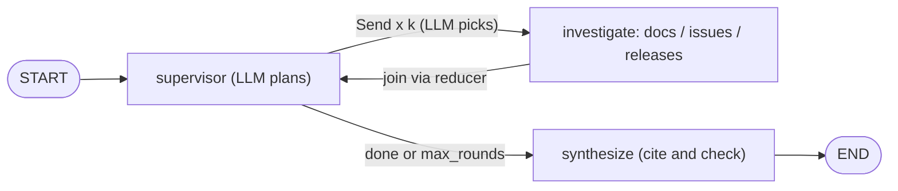
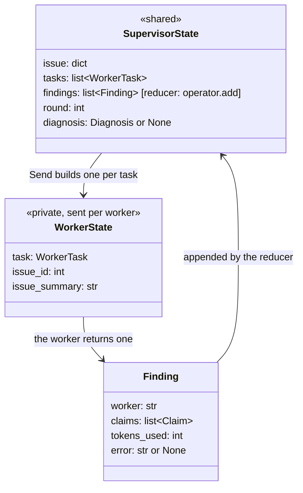
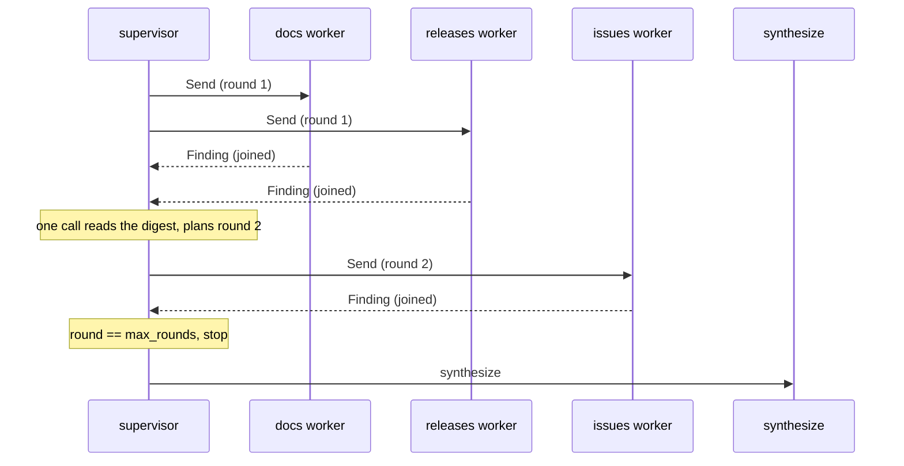
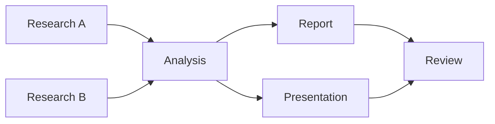

# Supervisor & Parallel Workers with LangGraph

In [Day 41](../../Phase_4_Tools_and_MCP/Day_041_workflow_patterns/workflow_patterns.md), your orchestrator–workers workflow ran every check on every issue, so "how do I set `lease_seconds`?" paid for three investigations. In [Day 64](../Day_064_multi_agent_when/multi_agent_when.md), the lead agent drove its sub-agents from a hand-rolled loop, with no graph state to inspect or resume. Today an LLM **supervisor** picks only the investigators an issue needs, runs them in parallel, joins their findings and stops once it has enough.

## At a Glance

- **Time:** ~2 h core (+ optional Go Deeper) · **Depth:** working
- **Prerequisites:** [Day 53: LangGraph I: Graphs, State & Routing](../../Phase_6_Agents/Day_053_langgraph_graphs/langgraph_graphs.md), [Day 64: Multi-Agent Systems: When (Not) to Use Them](../Day_064_multi_agent_when/multi_agent_when.md); helpful: [Day 48: Your First Agent: The Loop, Stop Conditions & Budgets](../../Phase_6_Agents/Day_048_first_agent/first_agent.md) for budgets, [Day 54: LangGraph II: Durable Execution, Checkpoints & Time Travel](../../Phase_6_Agents/Day_054_langgraph_durability/langgraph_durability.md) for the stretch, and the [Async Python II](../../Appendix_Primers/A04b_async_python_concurrency.md) primer, because node timeouts only work on `async def` nodes
- **You'll build:** `build_supervisor_graph()` for `atlas/graph.py`. An LLM supervisor sends up to three investigators (docs, issues, releases) in parallel with `Send`, joins their findings through a reducer, enforces per-worker step, token and time budgets, and synthesizes a cited `Diagnosis`. You'll compare it with a fixed fan-out on 5 Orbit issues.
- **Stops at:** distributed execution: workers on other machines, queues and job runners ([Day 78](../../Phase_9_Production/Day_078_async_jobs/async_jobs.md) covers long-running work).
- **Fast path:** Already know fan-out/fan-in and Day 53? Read "Supervisor, Workers, Send and Join" (the state design), run `fanout_basics`, then do Exercise 3 (~40 min).
- **Cost:** $0 offline: without a key every script falls back to a scripted planner and scripted workers. With a key, an estimated $0.10–0.30 on `gpt-6-luna` for all scripts (5 issues × 3 configurations × ≤2 rounds × ≤3 workers × ≤4 steps). That is an estimate from the price table, not a measurement; the scripts print your real spend (prices as of 2026-11, [verify](https://developers.openai.com/api/docs/pricing)).
- **New terms:** supervisor, `Send` (dynamic fan-out), join, superstep, stopping rule

> **Coming from Software Engineering?** This is scatter-gather, also called fork-join: `Promise.all` in JavaScript, a Go `WaitGroup`, or `make -j` running independent targets of a build DAG (a graph of tasks with arrows meaning "must finish first"). The twist, compared with a Celery or Kubernetes job dispatcher, is that an LLM decides the scatter at runtime instead of a hard-coded routing table. The reducer is the merge step of map-reduce (split the work, then combine the results). A per-worker budget is a per-request timeout plus a quota. What transfers directly: bounded concurrency, partial failure handling, and never trusting a worker name that came over the wire.

## Not Every Issue Needs Every Investigator

Take two issues from `issues.jsonl`. Issue #239 asks "SQS: do I need to set the queue's visibility timeout to match `lease_seconds`?". That is a documentation question: one look at `configuration-reference` and `broker-sqs` answers it. Issue #143 reports "3.1.0: reconnect storm after Redis failover, thousands of connections and an ORB-1001 flood take Redis down again". That one needs the docs, the release notes (was it fixed?) *and* past issues (is it a duplicate?).

A fixed fan-out, Day 41's orchestrator–workers, runs all three investigators on both. That's correct but wasteful: on a question like #239 two of the three runs add tokens and latency without adding evidence. **Day 41: code decides the fan-out. Today: an LLM decides it.**

## The Incident Commander

Picture an outage call. The incident commander (the person who coordinates responders during an outage) doesn't page every team. They send the database and network on-calls to check their systems at the same time, wait for both reports, then decide: "enough, write it up" or "one more round".

Map that onto Atlas:

- The **supervisor** is the commander: an LLM node that reads the issue plus a digest of the findings so far, and returns a plan, meaning which investigators to run, each with its own question, or "done".
- The **workers** are the responders: small agents, each with its own read-only toolset and its own budget.
- The **join** is waiting for every report before deciding. In LangGraph that's a state field with a reducer, so parallel writes are merged instead of colliding.
- A **stopping rule** ends the call: the supervisor says done, a round cap is hit, or a global fuse trips.

## Tracing the State by Hand

Before any code, trace one run of issue #143 with `max_rounds=2`. LangGraph executes in **supersteps**: one tick in which every node that is ready runs, all reading the same snapshot of state. Writes are merged at the end of the tick.

| Superstep | What ran | State after the tick |
|---|---|---|
| 1 | `supervisor` | `tasks=[docs, releases]`, `round=1`, `findings=[]` |
| 2 | `investigate` ×2, in parallel | `findings=[f_docs, f_releases]` (completion order not guaranteed) |
| 3 | `supervisor` | `tasks=[issues]` (ORB-1001 means "look for past reports"), `round=2` |
| 4 | `investigate` ×1 | `findings=[f_docs, f_releases, f_issues]` |
| 5 | `supervisor` | `round == max_rounds`, so `tasks=[]` with no model call |
| 6 | `synthesize` | `diagnosis` set, citations checked against `findings` |

Notice two things. In superstep 2 both workers write `findings` in the *same* tick, so LangGraph needs a rule for merging them. And the run ended on the round cap, not the supervisor's judgement: the cheap deterministic rule backs up the smart one.

## Supervisor, Workers, Send and Join

Recap from Day 53: state is a `TypedDict`, a node returns a *partial* update, and a field with a reducer, such as `Annotated[list[Finding], operator.add]`, appends instead of replacing.

The new piece is **`Send`**: dynamic fan-out. A conditional edge can return a list of `Send(node, arg)` objects instead of a node name. Each schedules one run of `node` in the next superstep, with `arg` as its entire input. Three `Send`s give three parallel runs of the same node with different briefs, and the supervisor picks the number at runtime.



`Send` also gives you **private state**: the worker receives only its `arg`, never the graph state. That's Day 64's sub-agent isolation, enforced by the node's input type. The docs investigator never sees the issues investigator's tool output, and the supervisor only sees claims.



Rule of thumb: a field goes in `SupervisorState` only if the supervisor or `synthesize` reads it, and in `WorkerState` only if that one worker needs it.

## Fan-Out in 20 Lines

Here's the mechanism with no model at all. Three stub workers each sleep 0.5 s, standing in for a model call. If they run in parallel, the graph takes about 0.5 s, not 1.5 s.

```python
# script_id: day_066_supervisor_parallel_workers/fanout_basics
# Fan-out in 20 lines: Send x3 to one worker node; a reducer joins the results. Offline, $0.
# Install: uv add "langgraph==1.2.20". Env: none. Services: none.
import operator
import time
from typing import Annotated, TypedDict

from langgraph.graph import END, START, StateGraph
from langgraph.types import Send


class State(TypedDict):
    workers: list[str]                               # set once by the caller
    results: Annotated[list[str], operator.add]      # the join: each worker's list is appended


def work(brief: dict) -> dict:                       # brief = the Send arg, NOT the graph state
    time.sleep(0.5)                                  # stand-in for a 0.5 s model call
    return {"results": [f"{brief['name']} done"]}


def fan_out(state: State) -> list[Send]:
    return [Send("work", {"name": w}) for w in state["workers"]]


g = StateGraph(State)
g.add_node("work", work)
g.add_conditional_edges(START, fan_out, ["work"])    # list every node a Send may target
g.add_edge("work", END)
app = g.compile()

t0 = time.perf_counter()
out = app.invoke({"workers": ["docs", "issues", "releases"], "results": []})
print(out["results"], f"{time.perf_counter() - t0:.2f} s")
```

```text
['docs done', 'issues done', 'releases done'] 0.51 s
```

Now turn the knob that matters in production. `max_concurrency` in the run config caps how many tasks run at once inside a superstep, and it applies to `Send` branches too:

```python
# script_id: day_066_supervisor_parallel_workers/fanout_basics
for cap in (1, 2, None):                             # None = no cap (the default)
    cfg = {"max_concurrency": cap} if cap else {}
    t0 = time.perf_counter()
    app.invoke({"workers": ["docs", "issues", "releases"], "results": []}, cfg)
    print(f"max_concurrency={cap}: {time.perf_counter() - t0:.2f} s")
```

```text
max_concurrency=1: 1.51 s
max_concurrency=2: 1.01 s
max_concurrency=None: 0.51 s
```

Real timings from `langgraph==1.2.20` (yours will differ slightly). With a cap of 1, "parallel" workers run one after another, and a provider rate limit has the same effect.

## Break It

Three failures you'll meet, each with its real error text.

**(a) No reducer on the join key.** Two workers write `results` in the same superstep and LangGraph refuses to guess. **(b) A supervisor that never says done** loops until the recursion fuse trips. The default `recursion_limit` is 10,007 supersteps, so without an explicit limit a stubborn LLM supervisor bills you for thousands of rounds.

```python
# script_id: day_066_supervisor_parallel_workers/break_it
# Two ways a supervisor graph breaks: no reducer on the join key, and no exit from the loop.
# Install: uv add "langgraph==1.2.20" pydantic. Env: none. Services: none.
import operator
from typing import Annotated, TypedDict

from langgraph.errors import GraphRecursionError, InvalidUpdateError
from langgraph.graph import END, START, StateGraph
from langgraph.types import Send


class NoReducer(TypedDict):
    results: list[str]                               # no reducer: one write per step, or an error

g = StateGraph(NoReducer)
g.add_node("work", lambda brief: {"results": [brief["name"]]})
g.add_conditional_edges(START, lambda s: [Send("work", {"name": n}) for n in ("docs", "issues")], ["work"])
g.add_edge("work", END)
try:
    g.compile().invoke({"results": []})
except InvalidUpdateError as e:
    print("(a)", str(e).splitlines()[0])


class Loop(TypedDict):
    round: int
    results: Annotated[list[str], operator.add]

g = StateGraph(Loop)
g.add_node("supervisor", lambda s: {"round": s["round"] + 1})     # never says "done"
g.add_node("work", lambda brief: {"results": [brief["name"]]})
g.add_edge(START, "supervisor")
g.add_conditional_edges("supervisor", lambda s: [Send("work", {"name": "docs"})], ["work"])
g.add_edge("work", "supervisor")
try:
    g.compile().invoke({"round": 0, "results": []}, {"recursion_limit": 12})
except GraphRecursionError as e:
    print("(b)", str(e).splitlines()[0])
```

```text
(a) At key 'results': Can receive only one value per step. Use an Annotated key to handle multiple values.
(b) Recursion limit of 12 reached without hitting a stop condition. You can increase the limit by setting the `recursion_limit` config key.
```

The fix for (b) is *not* a higher limit. It's a real stopping rule (`done`, `max_rounds`), with the limit kept as a fuse.

**(c) A hallucinated worker name.** A common hand-rolled version parses a JSON plan and guards against unknown workers like this:

```python
# script_id: day_066_supervisor_parallel_workers/old_guard
# fragment
# A typical hand-rolled guard (plain JSON plans). Don't copy it: it hides a bug.
for i, step in enumerate(plan["steps"]):
    dep = step.get("depends_on")                    # an index into `results`...
    if isinstance(dep, int) and 0 <= dep < len(results):
        task = f"{task}\n\nContext from step {dep}:\n{results[dep]}"
    worker_fn = workers.get(step["worker"])
    if worker_fn is None:
        continue                                    # ...but a skipped step appends nothing,
    results.append(worker_fn(task))                 # so every later index points at the wrong step
```

It doesn't crash, which is the problem. If the model invents `"kafka_expert"` at step 1, nothing is appended, so `results[2]` now holds step 3's output and every later `depends_on` feeds the wrong context. Fix it at the boundary: a `Literal` worker name becomes an `enum` in the Structured Outputs schema, so the model can't emit anything else, and Pydantic rejects anything that slips through:

```python
# script_id: day_066_supervisor_parallel_workers/break_it
from typing import Literal

from pydantic import BaseModel, ValidationError


class WorkerTask(BaseModel):
    worker: Literal["docs", "issues", "releases"]
    question: str

try:
    WorkerTask.model_validate({"worker": "kafka_expert", "question": "Is Kafka supported?"})
except ValidationError as e:
    print("(c)", e.errors()[0]["msg"])
```

```text
(c) Input should be 'docs', 'issues' or 'releases'
```

## The Atlas Investigation Supervisor

Now the real thing, one concern per block, stitched into `atlas/graph.py` (next to Day 61's `build_investigator_graph()` in your project). Every LLM call has a labelled offline stand-in, so the whole graph runs without a key.

**Block 1: config, budgets and the typed contracts.** `Finding` evolves Day 64's `SubagentReport`: a list of `Claim`s, each pinned to one `source_id`, plus an `error` slot so a failed worker still reports something.

```python
# script_id: day_066_supervisor_parallel_workers/atlas/graph
# atlas/graph.py (+= next to Day 61's build_investigator_graph): an LLM supervisor and 3 parallel investigators.
# Install: uv add "langgraph==1.2.20" "openai==3.46.0" pydantic
# Env: OPENAI_API_KEY (optional: without it a scripted planner and scripted workers run offline, $0),
#      ATLAS_MODEL, ORBIT_DATA. Services: none. Reads docs/*.md and issues/orbit.db (read-only).
import asyncio
import json
import operator
import os
import re
import sqlite3
from contextlib import closing
from dataclasses import dataclass
from functools import cache
from pathlib import Path
from typing import Annotated, Literal, TypedDict

from pydantic import BaseModel

MODEL = os.environ.get("ATLAS_MODEL", "gpt-6-luna")
DATA_DIR = Path(os.environ.get("ORBIT_DATA", "datasets/orbit"))
PRICES_PER_1M = {"input": 0.10, "output": 0.50}   # gpt-6-luna USD, as of 2026-11, verify at the pricing page
WorkerName = Literal["docs", "issues", "releases"]


@dataclass(frozen=True)
class Budget:                    # Day 48's brakes, applied per worker
    max_steps: int = 4           # model calls
    max_tokens: int = 20_000     # input + output, summed over the worker's calls
    seconds: float = 60          # wall clock, enforced by the node timeout


class WorkerTask(BaseModel):
    worker: WorkerName           # Literal -> enum in the JSON schema: no invented workers
    question: str


class Claim(BaseModel):
    text: str
    source_id: str               # "doc:error-codes", "issue:161", "release:3.1.2"
```

**Block 2: the rest of the contracts, and the two state types.** `SupervisorState` is shared; `WorkerState` is the private brief that `Send` delivers.

```python
# script_id: day_066_supervisor_parallel_workers/atlas/graph
class Finding(BaseModel):        # evolves Day 64's SubagentReport
    worker: str
    claims: list[Claim]
    tokens_used: int = 0
    error: str | None = None     # set when the worker failed or ran out of budget


class SupervisorPlan(BaseModel):
    tasks: list[WorkerTask]      # this round's investigators, each with its own question
    done: bool                   # True (with no tasks) = "the findings answer the issue"
    reason: str


class Diagnosis(BaseModel):
    summary: str
    likely_cause: str
    citations: list[str]         # source_ids, checked against the findings before we trust them
    missing_workers: list[str]   # investigators that failed: the diagnosis is partial


class SupervisorState(TypedDict):                     # shared: supervisor and synthesize read it
    issue: dict
    tasks: list[WorkerTask]                           # overwritten each round
    findings: Annotated[list[Finding], operator.add]  # the join: parallel workers append here
    round: int
    diagnosis: Diagnosis | None
    dropped_citations: int                            # citations that pointed at no finding


class WorkerState(TypedDict):                         # private: what ONE worker receives via Send
    task: WorkerTask
    issue_id: int
    issue_summary: str
```

**Block 3: three read-only toolsets.** Each investigator searches one corpus: doc sections, changelog sections (one per release), or past issues in `orbit.db`. The ranking is the keyword stand-in from Day 48, because Postgres isn't part of today; swap in Day 27's `hybrid_search()` in your project.

```python
# script_id: day_066_supervisor_parallel_workers/atlas/graph
def _db() -> sqlite3.Connection:                      # built on Day 33: read-only connection
    return sqlite3.connect(f"file:{DATA_DIR / 'issues' / 'orbit.db'}?mode=ro", uri=True)


@cache
def _sections() -> list[tuple[str, str]]:
    """(source_id, text) for every '## ' section. Changelog sections become 'release:<version>'."""
    rows = []
    for path in sorted((DATA_DIR / "docs").glob("*.md")):
        for sec in re.split(r"(?m)^## ", path.read_text(encoding="utf-8"))[1:]:
            ver = re.match(r"(\d+\.\d+\.\d+)", sec)
            sid = (f"release:{ver.group(1) if ver else 'known-issues'}" if path.stem == "changelog"
                   else f"doc:{path.stem}")
            rows.append((sid, sec))
    return rows


def _rank(rows: list[tuple[str, str]], query: str, k: int = 4) -> list[dict]:
    """Keyword stand-in for hybrid search (Day 27): count query words in each text."""
    words = set(re.findall(r"[a-z0-9_.-]{4,}", query.lower()))
    scored = sorted(((-sum(w in text.lower() for w in words), i) for i, (_, text) in enumerate(rows)))
    return [{"source_id": rows[i][0], "text": rows[i][1][:600]} for neg, i in scored[:k] if neg < 0]


def search_docs(query: str) -> list[dict]:
    return _rank([r for r in _sections() if r[0].startswith("doc:")], query)


def search_releases(query: str) -> list[dict]:
    return _rank([r for r in _sections() if r[0].startswith("release:")], query)


def search_issues(query: str) -> list[dict]:
    with closing(_db()) as db:
        rows = db.execute("SELECT id, title, state, body FROM issues").fetchall()
    return _rank([(f"issue:{i}", f"{t} [{s}]\n{b}") for i, t, s, b in rows], query)


TOOLSETS = {"docs": search_docs, "issues": search_issues, "releases": search_releases}
```

`TOOLSETS` is a plain dict on purpose: adding an investigator (Exercise 1) or injecting a fault (Exercise 3) is one assignment.

**Block 4: the worker, a compact Day 48 loop with step and token brakes.** It uses `responses.parse` with a tool *and* a `text_format`: while the model is searching, the response holds `function_call` items; when it's finished, `output_parsed` holds the claims. `previous_response_id` chains the turns, so each turn sends only the new tool results (the earlier tokens are still billed). The time brake isn't here; the node enforces it in Block 7.

```python
# script_id: day_066_supervisor_parallel_workers/atlas/graph
from openai import AsyncOpenAI

aclient = AsyncOpenAI() if os.environ.get("OPENAI_API_KEY") else None   # None -> scripted, offline
SCRIPTED_LATENCY = 0.3          # offline stand-in for one model call, so the timings mean something
WORKER_SYSTEM = ("You are one investigator on a team. Answer ONLY your question. Use your search tool "
                 "1-3 times, then return claims that each cite one source_id from your results.")


@dataclass
class CostTracker:              # built on Day 12 (compact): every model call reports here
    input_tokens: int = 0
    output_tokens: int = 0

    def add(self, usage) -> int:
        self.input_tokens, self.output_tokens = self.input_tokens + usage.input_tokens, self.output_tokens + usage.output_tokens
        return usage.input_tokens + usage.output_tokens

    @property
    def usd(self) -> float:
        return (self.input_tokens * PRICES_PER_1M["input"] + self.output_tokens * PRICES_PER_1M["output"]) / 1e6


TRACKER = CostTracker()


class ClaimList(BaseModel):
    claims: list[Claim]


def tool_spec(worker: str) -> dict:
    return {"type": "function", "name": f"search_{worker}", "strict": True,
            "description": f"Keyword search over Orbit {worker}. Returns JSON hits with source_id and text.",
            "parameters": {"type": "object", "properties": {"query": {"type": "string"}},
                           "required": ["query"], "additionalProperties": False}}


def run_search(task: WorkerTask, issue_id: int, query: str) -> list[dict]:
    hits = TOOLSETS[task.worker](query)
    return [h for h in hits if h["source_id"] != f"issue:{issue_id}"][:3]   # never cite the issue itself
```

```python
# script_id: day_066_supervisor_parallel_workers/atlas/graph
async def run_worker(task: WorkerTask, issue_id: int, summary: str, budget: Budget) -> Finding:
    """Built on Day 48 (compact): tool loop + step and token brakes. Returns claims, never raw output."""
    if aclient is None:                       # scripted: one search; the top hits become claims
        await asyncio.sleep(SCRIPTED_LATENCY)
        hits = run_search(task, issue_id, f"{task.question} {summary}")
        return Finding(worker=task.worker, claims=[Claim(text=h["text"].split("\n")[0][:160],
                                                         source_id=h["source_id"]) for h in hits])
    used, prev = 0, None
    items: list = [{"role": "user", "content": f"Issue: {summary}\n\nYour question: {task.question}"}]
    for _ in range(budget.max_steps):
        resp = await aclient.responses.parse(
            model=MODEL, instructions=WORKER_SYSTEM, input=items, previous_response_id=prev,
            tools=[tool_spec(task.worker)], text_format=ClaimList, reasoning={"effort": "low"})
        used += TRACKER.add(resp.usage)
        calls = [i for i in resp.output if i.type == "function_call"]
        if not calls:                         # finished: parsed claims (None on refusal or truncation)
            claims = resp.output_parsed.claims if resp.output_parsed else []
            return Finding(worker=task.worker, claims=claims, tokens_used=used,
                           error=None if resp.output_parsed else f"no claims ({resp.status})")
        if used >= budget.max_tokens:
            break
        prev, items = resp.id, [{"type": "function_call_output", "call_id": c.call_id,
                                 "output": json.dumps(run_search(task, issue_id, json.loads(c.arguments)["query"]))}
                                for c in calls]                     # answer every call before the next turn
    return Finding(worker=task.worker, claims=[], tokens_used=used,
                   error=f"budget: {used} tokens after {budget.max_steps} steps max")
```

**Block 5: the supervisor's planner.** It sees the issue and a *digest* of the claims, never raw tool output, so its context stays small however much the workers read. The digest is sorted by worker: parallel workers finish in any order, and a stable prompt keeps prompt-cache hits ([Day 18](../../Phase_2_Building_with_LLM_APIs/Day_018_cost_latency_caching/cost_latency_caching.md)). The scripted planner encodes three rules: docs first, releases for versioned bugs, past issues when there's an error code.

```python
# script_id: day_066_supervisor_parallel_workers/atlas/graph
SUPERVISOR_SYSTEM = (
    "You coordinate investigators for Orbit issues: docs (manuals, error codes, configuration), "
    "issues (past reports and duplicates), releases (changelog, fixed-in versions). Pick ONLY the "
    "investigators this issue still needs, each with one focused question. When the findings answer "
    "the issue, return done=true and no tasks.")


def issue_summary(issue: dict) -> str:
    return f"#{issue['id']} [{issue['type']}, v{issue['orbit_version']}] {issue['title']}\n{issue['body'][:400]}"


def claim_digest(findings: list[Finding]) -> str:
    ordered = sorted(findings, key=lambda f: f.worker)        # stable order -> stable prompt
    lines = [f"- {f.worker}: {c.text} [{c.source_id}]" for f in ordered for c in f.claims]
    lines += [f"- {f.worker}: FAILED ({f.error})" for f in ordered if f.error]
    return "\n".join(lines) or "(no findings yet)"


async def llm_plan(state: SupervisorState) -> SupervisorPlan:
    resp = await aclient.responses.parse(
        model=MODEL, instructions=SUPERVISOR_SYSTEM, text_format=SupervisorPlan, reasoning={"effort": "low"},
        input=f"Issue:\n{issue_summary(state['issue'])}\n\nFindings so far:\n{claim_digest(state['findings'])}")
    TRACKER.add(resp.usage)
    return resp.output_parsed or SupervisorPlan(tasks=[], done=True, reason=f"no plan ({resp.status})")


async def scripted_plan(state: SupervisorState) -> SupervisorPlan:
    """Offline stand-in for llm_plan: three fixed rules, so the graph runs with no key."""
    issue, ran = state["issue"], {f.worker for f in state["findings"]}
    if state["round"] == 0:
        tasks = [WorkerTask(worker="docs", question=f"What do the docs say about: {issue['title']}")]
        if issue["type"] == "bug" and issue["orbit_version"]:
            tasks.append(WorkerTask(worker="releases", question=f"Fixes or known issues near {issue['orbit_version']}?"))
        return SupervisorPlan(tasks=tasks, done=False, reason="docs first; releases for versioned bugs")
    if issue["error_codes"] and "issues" not in ran:
        return SupervisorPlan(tasks=[WorkerTask(worker="issues", question=f"Past reports of {' '.join(issue['error_codes'])}?")],
                              done=False, reason="an error code: look for past reports")
    return SupervisorPlan(tasks=[], done=True, reason="enough evidence")
```

**Block 6: synthesize, with citation validation.** The model may cite a `source_id` that no worker found. Treat that the way you'd treat an unknown foreign key: drop it and count it. `missing_workers` comes from the findings, not from the model, so a failed investigator can't be quietly forgotten.

```python
# script_id: day_066_supervisor_parallel_workers/atlas/graph
SYNTH_SYSTEM = ("Diagnose the Orbit issue using only the findings. Cite only source_ids that appear in "
                "the findings. If an investigator FAILED, say what is missing because of it.")


async def synthesize(state: SupervisorState) -> dict:
    findings = sorted(state["findings"], key=lambda f: f.worker)
    found = {c.source_id for f in findings for c in f.claims}
    failed = sorted({f.worker for f in findings if f.error})
    if aclient is None:                                   # scripted: stitch the claims together
        claims = [c for f in findings for c in f.claims]
        d = Diagnosis(summary=" | ".join(c.text for c in claims[:3]) or "no evidence found",
                      likely_cause=claims[0].text if claims else "unknown",
                      citations=[c.source_id for c in claims], missing_workers=failed)
    else:
        resp = await aclient.responses.parse(
            model=MODEL, instructions=SYNTH_SYSTEM, text_format=Diagnosis, reasoning={"effort": "low"},
            input=f"Issue:\n{issue_summary(state['issue'])}\n\nFindings:\n{claim_digest(findings)}")
        TRACKER.add(resp.usage)
        d = resp.output_parsed or Diagnosis(summary=f"synthesis failed ({resp.status})", likely_cause="unknown",
                                            citations=[], missing_workers=failed)
    valid = list(dict.fromkeys(c for c in d.citations if c in found))       # known ids, de-duplicated
    dropped = len({c for c in d.citations if c not in found})
    d = d.model_copy(update={"citations": valid, "missing_workers": sorted(set(d.missing_workers) | set(failed))})
    return {"diagnosis": d, "dropped_citations": dropped}
```

**Block 7: the graph.** Three stopping rules live here: the round cap (checked *before* paying for a planner call), the supervisor's `done`, and the `recursion_limit` fuse passed at invoke time. The worker node is `async` because node `timeout=` only works on async nodes ("sync nodes cannot be safely cancelled in-process", says the docstring). When a worker times out or raises, `error_handler` turns the failure into a `Finding` with `error` set, so the diagnosis comes back partial instead of the run crashing. The handler runs as a separate task, so it routes back with `Command(goto="supervisor")`; a plain dict would end that branch before the join.

```python
# script_id: day_066_supervisor_parallel_workers/atlas/graph
from langgraph.errors import NodeError
from langgraph.graph import END, START, StateGraph
from langgraph.types import Command, Send


def build_supervisor_graph(max_rounds: int = 2, worker_budget: Budget = Budget(), *,
                           planner=None, checkpointer=None):
    """START -> supervisor <-> investigate (parallel via Send) -> synthesize -> END."""
    plan_fn = planner or (llm_plan if aclient else scripted_plan)

    async def supervisor(state: SupervisorState) -> dict:
        if state["round"] >= max_rounds:              # stopping rule 1: hard cap, no model call
            return {"tasks": []}
        plan = await plan_fn(state)                   # stopping rule 2: the supervisor says done
        tasks = [] if plan.done else list({t.worker: t for t in plan.tasks}.values())  # one per worker
        return {"tasks": tasks, "round": state["round"] + (1 if tasks else 0)}

    def route(state: SupervisorState) -> list[Send] | str:
        if not state["tasks"]:
            return "synthesize"
        brief = {"issue_id": state["issue"]["id"], "issue_summary": issue_summary(state["issue"])}
        return [Send("investigate", {"task": t, **brief}) for t in state["tasks"]]

    async def investigate(ws: WorkerState) -> dict:
        return {"findings": [await run_worker(ws["task"], ws["issue_id"], ws["issue_summary"], worker_budget)]}

    def worker_failed(ws: WorkerState, error: NodeError) -> Command:  # timeout or exception -> partial
        # The handler runs as its own task, so it must route back to the join itself.
        return Command(goto="supervisor", update={"findings": [Finding(
            worker=ws["task"].worker, claims=[], error=f"{type(error.error).__name__}: {error.error}"[:200])]})

    g = StateGraph(SupervisorState)
    g.add_node("supervisor", supervisor)
    g.add_node("investigate", investigate, timeout=worker_budget.seconds, error_handler=worker_failed)
    g.add_node("synthesize", synthesize)
    g.add_edge(START, "supervisor")
    g.add_conditional_edges("supervisor", route, ["investigate", "synthesize"])
    g.add_edge("investigate", "supervisor")           # the join: supervisor runs once all branches finish
    g.add_edge("synthesize", END)
    return g.compile(checkpointer=checkpointer)


def initial_state(issue: dict) -> SupervisorState:
    return {"issue": issue, "tasks": [], "findings": [], "round": 0, "diagnosis": None, "dropped_citations": 0}


def load_issue(issue_id: int) -> dict:
    """One Orbit issue. Its text is untrusted input (injection defences: Day 69)."""
    with closing(_db()) as db:
        db.row_factory = sqlite3.Row
        row = db.execute("SELECT id, title, body, type, orbit_version, error_codes FROM issues WHERE id = ?",
                         (issue_id,)).fetchone()
    if row is None:
        raise LookupError(f"no issue {issue_id}")
    return {**dict(row), "error_codes": json.loads(row["error_codes"])}


if __name__ == "__main__":
    out = asyncio.run(build_supervisor_graph().ainvoke(initial_state(load_issue(143)), {"recursion_limit": 20}))
    for f in out["findings"]:
        print(f"{f.worker:>8}: {[c.source_id for c in f.claims]} tokens={f.tokens_used} error={f.error}")
    print(out["diagnosis"].model_dump_json(indent=2), f"\n${TRACKER.usd:.4f}")
```

Run `python -m atlas.graph`. Offline you get the scripted run below; with a key your ids and wording will differ.

```text
    docs: ['doc:troubleshooting-broker', 'doc:broker-redis', 'doc:deployment-kubernetes'] tokens=0 error=None
releases: ['release:3.1.0', 'release:3.1.2', 'release:3.0.3'] tokens=0 error=None
  issues: ['issue:161', 'issue:227', 'issue:164'] tokens=0 error=None
{
  "summary": "Redis reconnect storm after failover (3.1.0) | Failover and high availability | Workers",
  "likely_cause": "Redis reconnect storm after failover (3.1.0)",
  "citations": [
    "doc:troubleshooting-broker",
    "doc:broker-redis",
    "doc:deployment-kubernetes",
    "issue:161",
    "issue:227",
    "issue:164",
    "release:3.1.0",
    "release:3.1.2",
    "release:3.0.3"
  ],
  "missing_workers": []
} 
$0.0000
```

Issue text reaches every worker and is untrusted. The tools are read-only, so the blast radius is small; [Day 69: Prompt Injection: Attacks & Defenses by Design](../../Phase_8_Safety_and_Security/Day_069_prompt_injection/prompt_injection.md) shows how to fence it.

## Watching the Supersteps

Stream the run with `stream_mode="updates"` and you can check the hand trace against reality. Each chunk is `{node_name: update}`; parallel branches show up as separate chunks with the same timestamp.

```python
# script_id: day_066_supervisor_parallel_workers/superstep_trace
# Stream one run and print which node wrote what, and when. Compare it with the hand trace.
# Install: as for atlas/graph. Env: OPENAI_API_KEY optional (scripted without it), ORBIT_DATA.
import asyncio
import time

from atlas.graph import build_supervisor_graph, initial_state, load_issue


async def main(issue_id: int = 143) -> None:
    app, t0 = build_supervisor_graph(), time.perf_counter()
    async for chunk in app.astream(initial_state(load_issue(issue_id)), {"recursion_limit": 20},
                                   stream_mode="updates"):
        for node, update in chunk.items():
            if node == "supervisor":
                note = f"tasks={[t.worker for t in update['tasks']]} round={update.get('round', '-')}"
            elif node == "investigate":
                f = update["findings"][0]
                note = f"{f.worker}: {len(f.claims)} claims, error={f.error}"
            else:
                note = f"citations={update['diagnosis'].citations}"
            print(f"{time.perf_counter() - t0:5.2f} s  {node:<12} {note}")

asyncio.run(main())
```

```text
 0.00 s  supervisor   tasks=['docs', 'releases'] round=1
 0.32 s  investigate  docs: 3 claims, error=None
 0.32 s  investigate  releases: 3 claims, error=None
 0.32 s  supervisor   tasks=['issues'] round=2
 0.66 s  investigate  issues: 3 claims, error=None
 0.66 s  supervisor   tasks=[] round=-
 0.66 s  synthesize   citations=['doc:troubleshooting-broker', 'doc:broker-redis', 'doc:deployment-kubernetes', 'issue:161', 'issue:227', 'issue:164', 'release:3.1.0', 'release:3.1.2', 'release:3.0.3']
```

The timeline as a diagram: round 1 costs one worker's latency, not two.



## Budgets and Partial Results

Squeeze the time budget below one scripted model call and every worker fails, but the run doesn't:

```python
# script_id: day_066_supervisor_parallel_workers/worker_timeout
# A worker budget too small to finish: node timeouts become Finding(error=...), and the run still ends.
# Install: as for atlas/graph. Env: OPENAI_API_KEY optional (scripted without it), ORBIT_DATA.
import asyncio

from atlas.graph import Budget, build_supervisor_graph, initial_state, load_issue

app = build_supervisor_graph(worker_budget=Budget(seconds=0.1))   # scripted workers need 0.3 s
out = asyncio.run(app.ainvoke(initial_state(load_issue(143)), {"recursion_limit": 20}))
for f in out["findings"]:
    print(f"{f.worker:>8}: error={f.error}")
d = out["diagnosis"]
print("summary:", d.summary, "| missing:", d.missing_workers)
```

```text
    docs: error=NodeTimeoutError: Node 'investigate' exceeded its run timeout of 0.100s (elapsed: 0.101s).
releases: error=NodeTimeoutError: Node 'investigate' exceeded its run timeout of 0.100s (elapsed: 0.101s).
  issues: error=NodeTimeoutError: Node 'investigate' exceeded its run timeout of 0.100s (elapsed: 0.101s).
summary: no evidence found | missing: ['docs', 'issues', 'releases']
```

A timeout cancels the worker at its next `await`; a worker blocked in sync code (`time.sleep`, a sync DB driver) can't be cancelled until it yields. Per-agent dollar budgets come in Day 67.

## Measuring It: Parallel, Sequential and Fixed Fan-Out

Claims need numbers. Run the same 5 issues under three configurations: the LLM-decided supervisor, the same graph with `max_concurrency=1`, and Day 41's fixed fan-out (all three investigators, one round), implemented as a 6-line planner you pass in.

```python
# script_id: day_066_supervisor_parallel_workers/compare_runs
# 5 Orbit issues x 3 configs: LLM-decided parallel, the same capped at 1, fixed fan-out (Day 41 style).
# Install: as for atlas/graph. Env: OPENAI_API_KEY optional (scripted planner/workers without it), ORBIT_DATA
import asyncio
import time
from dataclasses import dataclass

from atlas import graph
from atlas.graph import SupervisorPlan, WorkerTask, build_supervisor_graph, initial_state, load_issue

ISSUES = [239, 143, 125, 4, 208]


async def fixed_plan(state) -> SupervisorPlan:        # code decides: every investigator, once
    if state["round"]:
        return SupervisorPlan(tasks=[], done=True, reason="fixed: one round")
    q = f"What do you find about: {state['issue']['title']}"
    return SupervisorPlan(tasks=[WorkerTask(worker=w, question=q) for w in ("docs", "issues", "releases")],
                          done=False, reason="fixed fan-out")


@dataclass
class RunStats:                                       # built on Day 64 (compact)
    label: str
    seconds: float = 0
    worker_runs: int = 0
    cited: int = 0
    dropped: int = 0
    usd: float = 0


async def run(label: str, cap: int | None = None, planner=None) -> RunStats:
    st, app = RunStats(label), build_supervisor_graph(planner=planner)
    cfg = {"recursion_limit": 20, **({"max_concurrency": cap} if cap else {})}
    graph.TRACKER = graph.CostTracker()               # fresh spend per configuration
    for issue_id in ISSUES:
        t0 = time.perf_counter()
        out = await app.ainvoke(initial_state(load_issue(issue_id)), cfg)
        st.seconds += time.perf_counter() - t0
        st.worker_runs += len(out["findings"])
        st.cited, st.dropped = st.cited + len(out["diagnosis"].citations), st.dropped + out["dropped_citations"]
    st.usd = graph.TRACKER.usd
    return st


async def main() -> None:
    rows = [await run("supervisor, parallel"), await run("supervisor, max_concurrency=1", cap=1),
            await run("fixed fan-out (all 3)", planner=fixed_plan)]
    print("config | s/issue | worker runs | $/issue | citations kept")
    for r in rows:
        kept = r.cited / max(1, r.cited + r.dropped)
        print(f"{r.label} | {r.seconds / len(ISSUES):.2f} | {r.worker_runs} | {r.usd / len(ISSUES):.4f} | {kept:.0%}")

asyncio.run(main())
```

```text
config | s/issue | worker runs | $/issue | citations kept
supervisor, parallel | 0.59 | 11 | 0.0000 | 100%
supervisor, max_concurrency=1 | 0.70 | 11 | 0.0000 | 100%
fixed fan-out (all 3) | 0.34 | 15 | 0.0000 | 100%
```

That's the offline run: real timings, scripted 0.3 s model calls and $0, so read it for shape. The supervisor ran 11 investigations instead of 15: #239 needed only the docs, and the two other questions skipped releases. Capping concurrency at 1 cost one worker's latency per extra worker. And fixed fan-out was *faster*: one round of three parallel workers beats two rounds. With a key, the supervisor's own model calls add latency and dollars that fixed fan-out never pays, so fill in the `$/issue` column before you decide.

## Supervisor, Fixed Workflow or Single Agent?

| Situation | Choose | Why |
|---|---|---|
| Every issue needs the same checks | Fixed fan-out ([Day 41](../../Phase_4_Tools_and_MCP/Day_041_workflow_patterns/workflow_patterns.md)) | No planner calls, one round, cheapest and fastest |
| Issues vary a lot; many need only one or two checks | LLM supervisor (today) | Skips investigations; pays for that with planner calls |
| Evidence from one check decides the next | Supervisor with `max_rounds` ≥ 2 | Rounds are the "look again" step |
| Small task that fits one context window | Single agent ([Day 48](../../Phase_6_Agents/Day_048_first_agent/first_agent.md)) | Day 64's measurement: multi-agent costs more unless context bloats |
| The dependency graph is known in advance | A fixed DAG of nodes | Use edges; don't make an LLM rediscover your build graph |

The last row looks like this. If research A and B always feed an analysis that feeds a report and a slide deck, wire it with plain edges; edges from a list of nodes wait for all of them:



### In production

- **Rate limits serialize "parallel" calls.** Three workers × four steps can hit a tokens-per-minute limit, and the SDK's retries then space them out. Set `config={"max_concurrency": N}` from your rate limit, and leave backoff to [Day 84](../../Phase_9_Production/Day_084_reliability_fallbacks/reliability_fallbacks.md).
- **Always pass `recursion_limit`.** The default is 10,007. Your real stopping rules are `done` and `max_rounds`; the limit is the fuse.
- **Resume a half-finished fan-out.** Compile with a checkpointer and run with a `thread_id` (Day 54). A crash in round 2 then resumes without paying for round 1 again (Exercise 4).
- **Log the plan.** `SupervisorPlan.reason` and the workers chosen per round are the cheapest trace you can add; Day 67 adds per-agent spans.
- **Prebuilt helpers exist.** `langgraph-supervisor` packages a supervisor pattern, but it is at 0.0.31 on PyPI (pre-1.0, as of 2026-11), so pin it if you use it, and learn the hand-built version first.

## Go Deeper (optional)

<details><summary>Go deeper: the wall-clock arithmetic of rounds</summary>

In words: a round takes as long as its *slowest* worker plus the supervisor's planning call, and rounds run one after another.

Toy numbers: round 1 sends docs (4 s) and releases (6 s); the supervisor plans in 2 s before and after. Round 2 sends issues (5 s). Parallel: 2 + 6 + 2 + 5 + 2 = 17 s. Sequential (`max_concurrency=1`): 2 + 4 + 6 + 2 + 5 + 2 = 21 s. Fixed fan-out in one round with no planner: max(4, 6, 5) = 6 s.

As a formula, with rounds r, workers i in round r and planner time p:

T_parallel = p + Σ_r ( max_i t_ri + p ),  T_sequential = p + Σ_r ( Σ_i t_ri + p )

Two consequences. Speed-up is capped by the number of workers per round, and it shrinks as rounds grow, because rounds are sequential by definition. And the slowest worker sets the pace, so a per-worker `timeout` is also a latency SLO (service-level objective: the latency you promise), not only a safety net.

</details>

<details><summary>Go deeper: routing with Command(goto=[Send, ...])</summary>

Instead of a separate `route()` function, a node can return `Command(update=..., goto=...)`, and `goto` accepts a list of `Send`s. The supervisor then updates state and fans out in one step. The return annotation tells LangGraph (and its graph drawing) where the node may go.

```python
# script_id: day_066_supervisor_parallel_workers/command_send
# The supervisor routes itself: Command(update=..., goto=[Send, ...]) replaces the route() function.
# Install: uv add "langgraph==1.2.20". Env: none. Services: none.
import operator
from typing import Annotated, Literal, TypedDict

from langgraph.graph import END, START, StateGraph
from langgraph.types import Command, Send


class State(TypedDict):
    round: int
    results: Annotated[list[str], operator.add]


def supervisor(state: State) -> Command[Literal["work", "__end__"]]:
    if state["round"] >= 2:
        return Command(goto=END)
    picks = ["docs", "releases"] if state["round"] == 0 else ["issues"]
    return Command(update={"round": state["round"] + 1}, goto=[Send("work", {"name": p}) for p in picks])


g = StateGraph(State)
g.add_node("supervisor", supervisor)
g.add_node("work", lambda brief: {"results": [brief["name"]]})
g.add_edge(START, "supervisor")
g.add_edge("work", "supervisor")
print(g.compile().invoke({"round": 0, "results": []}, {"recursion_limit": 10}))
```

```text
{'round': 2, 'results': ['docs', 'releases', 'issues']}
```

Which to pick? A separate router keeps the planner node pure (state in, update out) and straightforward to unit-test. `Command` is handy when the routing decision and the update are the same thing. Both compile to the same runtime behaviour.

</details>

<details><summary>Go deeper: retries, timeouts and error handlers together</summary>

`add_node` takes three related knobs: `timeout=`, `retry_policy=` and `error_handler=`. The `timeout` docstring says that when the timeout is exceeded "a `NodeTimeoutError` is raised and the retry policy (if any) decides whether to retry". `NodeTimeoutError` deliberately does *not* subclass the built-in `TimeoutError`, so the default `RetryPolicy` treats it as retryable. In the lesson graph there is no retry policy, so a timeout goes straight to `worker_failed`.

```python
# script_id: day_066_supervisor_parallel_workers/retry_then_handle
# fragment
# Inside build_supervisor_graph: retry a timed-out worker once, then fall back to the error handler.
from langgraph.types import RetryPolicy

g.add_node("investigate", investigate, timeout=worker_budget.seconds,
           retry_policy=RetryPolicy(max_attempts=2), error_handler=worker_failed)
```

Before adding retries, remember what one retry costs: a whole worker run, with every step re-billed. Retry *transient* failures (timeouts, 429s); a worker that ran out of `max_steps` will usually run out again. `RetryPolicy` defaults are `initial_interval=0.5`, `backoff_factor=2.0`, `max_attempts=3`, `jitter=True` in `langgraph==1.2.20`.

</details>

<details><summary>Go deeper: what experts also do</summary>

Anthropic's write-up of its multi-agent research system ([link](https://www.anthropic.com/research/multi-agent-research-system)) is the best public account of this pattern at scale. Three points map directly onto today's code:

- **Scale effort to the query, in the prompt.** They "embedded scaling rules in the prompts": "Simple fact-finding requires just 1 agent with 3-10 tool calls, direct comparisons might need 2-4 subagents with 10-15 calls each". Your `SUPERVISOR_SYSTEM` is where such rules belong; the `#239` case is the "1 agent" row.
- **Tokens are the cost driver.** They report multi-agent systems using "about 15× more tokens than chats". Measure `$/issue` before claiming a win.
- **Parallelism is the reason to pay.** Workers with separate context windows add capacity for parallel reasoning. If your workers mostly wait on each other, a single agent is cheaper.

Two more habits from production teams: give each worker an explicit output contract (here, `ClaimList` with `source_id`s) so the supervisor never parses prose, and cap fan-out width in code (`list({t.worker: t ...})` above) even when the prompt also asks for it.

</details>

## Common Pitfalls

- **`InvalidUpdateError: At key 'findings': Can receive only one value per step. Use an Annotated key to handle multiple values.`** Two parallel workers wrote a key without a reducer. Annotate the join field: `Annotated[list[Finding], operator.add]`.
- **`GraphRecursionError: Recursion limit of N reached without hitting a stop condition.`** The supervisor never returns done. Add `done` and `max_rounds`; don't raise the limit.
- **A `timeout=` that never fires.** Node timeouts are "supported only for async nodes; sync nodes cannot be safely cancelled in-process". Use `async def`, the async client and no blocking calls. When it fires: `NodeTimeoutError: Node 'investigate' exceeded its run timeout of 0.100s`.
- **Sending the whole `SupervisorState` through `Send`.** It defeats isolation and multiplies tokens by the number of workers. Sending too little gives a `KeyError` inside the worker. Fix: a typed `WorkerState` with exactly what the worker needs.
- **Parallel workers trigger 429s.** Cap with `config={"max_concurrency": 2}` (it limits `Send` branches too, as `fanout_basics` measured) and add backoff (Day 84).
- **A failed worker ends the run with `diagnosis=None`.** An `error_handler` that returns a plain dict runs as its own task (`__error_handler__investigate` in the stream), so the `investigate → supervisor` edge never fires. Return `Command(goto="supervisor", update=...)`.

> **Where we stop:** every worker here runs in one Python process; spreading workers across machines with queues and job runners is distributed execution, which needs durable job infrastructure first. See [Day 78: Async Jobs & Long-Running Work](../../Phase_9_Production/Day_078_async_jobs/async_jobs.md).

## Key Takeaways

- Fixed fan-out (Day 41) runs every check; an LLM supervisor runs only what the issue needs, but adds planner calls, so measure `$/issue` and latency before choosing it.
- A conditional edge that returns `[Send(node, arg), ...]` fans out at runtime; each `arg` is that worker's whole input, and a reducer on the shared `findings` key is the join that runs once every branch finishes.
- Shared state holds what the supervisor and synthesizer read; private `WorkerState` holds one brief. You can predict each superstep's state by hand, as in the trace table.
- Stop on rules, not on luck: the supervisor's `done`, a `max_rounds` cap checked before the planner call, and an explicit `recursion_limit` fuse. A missing reducer, a missing exit and an invented worker name each fail with a specific error you now recognise.
- Per-worker budgets (steps, tokens, an async node `timeout=`) plus an `error_handler` turn worker failures into a partial `Diagnosis` with `missing_workers`, instead of a crashed run.

## Quick Reference

| API / pattern | When to use | Gotcha |
|---|---|---|
| `add_conditional_edges(src, fn, ["worker", ...])` with `fn` returning `list[Send]` | LLM-decided fan-out | List every node a `Send` can target |
| `Send(node, arg)` | One worker run with a private brief | The node receives `arg`, not the graph state |
| `Annotated[list[Finding], operator.add]` | The join field | No reducer → `InvalidUpdateError` |
| `invoke/ainvoke(state, {"recursion_limit": 20})` | Every run | Default is 10,007 |
| `{"max_concurrency": N}` in the run config | Rate limits, fair sharing | Caps `Send` branches too |
| `add_node(..., timeout=s)` | Wall-clock cap per worker | Async nodes only; raises `NodeTimeoutError` |
| `add_node(..., error_handler=fn)` with `fn(state, error: NodeError)` | Turn a failure into a partial result | The handler gets the worker's `Send` arg |
| `Command(update=..., goto=[Send(...)])` | A node that routes itself | Annotate `-> Command[Literal[...]]` |
| `responses.parse(..., text_format=Plan)` | Supervisor plans and worker claims | `output_parsed` is `None` on refusal or truncation |

## Exercises

1. **Warm-up: a fourth investigator.** Add a `config` investigator that searches only `configuration-reference` and `environment-variables-2x`, and tell the supervisor about it. Which lines change, and which don't?

<details><summary>Solution</summary>

```python
# script_id: day_066_supervisor_parallel_workers/solution_ex1
# fragment
# Edits to atlas/graph.py. Four places change; the graph wiring doesn't.
WorkerName = Literal["docs", "issues", "releases", "config"]     # 1. the schema allows "config"

CONFIG_DOCS = {"doc:configuration-reference", "doc:environment-variables-2x"}


def search_config(query: str) -> list[dict]:                      # 2. a toolset scoped to two pages
    return _rank([r for r in _sections() if r[0] in CONFIG_DOCS], query)


TOOLSETS["config"] = search_config                                # 3. register it
# 4. SUPERVISOR_SYSTEM: add "config (configuration keys, defaults, 2.x environment variables)".
```

`build_supervisor_graph`, `route` and the reducer don't change: `Send` targets the same `investigate` node and the brief says which toolset to use. The `Literal` change is what lets the model choose `config` at all, because Structured Outputs only accepts enum values in the schema.

</details>

2. **Core: stop when a round adds nothing.** Wrap the planner so that, from round 2 on, the supervisor stops if the last round produced no new `source_id`. Run with `max_rounds=3` on the 5 issues and report mean rounds and worker runs.

<details><summary>Solution</summary>

```python
# script_id: day_066_supervisor_parallel_workers/solution_ex2
import asyncio

from atlas import graph
from atlas.graph import SupervisorPlan, build_supervisor_graph, initial_state, load_issue

ISSUES = [239, 143, 125, 4, 208]


def stop_when_stale(inner):
    seen: dict[int, int] = {}                          # issue id -> distinct sources at the last plan

    async def plan(state) -> SupervisorPlan:
        n = len({c.source_id for f in state["findings"] for c in f.claims})
        key = state["issue"]["id"]
        if state["round"] >= 2 and n == seen.get(key):
            return SupervisorPlan(tasks=[], done=True, reason="last round added no new sources")
        seen[key] = n
        return await inner(state)
    return plan


async def main() -> None:
    base = graph.llm_plan if graph.aclient else graph.scripted_plan
    app = build_supervisor_graph(max_rounds=3, planner=stop_when_stale(base))
    rounds = runs = 0
    for i in ISSUES:
        out = await app.ainvoke(initial_state(load_issue(i)), {"recursion_limit": 20})
        rounds, runs = rounds + out["round"], runs + len(out["findings"])
    print(f"mean rounds {rounds / len(ISSUES):.1f}, worker runs {runs}, ${graph.TRACKER.usd:.4f}")

asyncio.run(main())
```

```text
mean rounds 1.8, worker runs 11, $0.0000
```

Offline, the scripted planner already stops on its own rules, so the wrapper rarely fires. With a key, compare against `max_rounds=3` without the wrapper: a stale-round rule mostly saves the third round's worker runs.

</details>

3. **Core: graceful degradation.** Make the issues investigator raise `ConnectionError` on every second call. The graph must still return a `Diagnosis` for every issue, with `missing_workers` naming the failed investigator.

<details><summary>Solution</summary>

```python
# script_id: day_066_supervisor_parallel_workers/solution_ex3
import asyncio

from atlas import graph
from atlas.graph import build_supervisor_graph, initial_state, load_issue

real, calls = graph.TOOLSETS["issues"], {"n": 0}


def flaky_issues(query: str) -> list[dict]:
    calls["n"] += 1
    if calls["n"] % 2 == 0:
        raise ConnectionError("orbit.db unavailable (injected fault)")
    return real(query)


graph.TOOLSETS["issues"] = flaky_issues               # the dict lookup happens at call time


async def main() -> None:
    app = build_supervisor_graph()
    for i in [143, 125, 4, 208]:
        d = (await app.ainvoke(initial_state(load_issue(i)), {"recursion_limit": 20}))["diagnosis"]
        print(f"#{i}: missing={d.missing_workers} citations={len(d.citations)}")

asyncio.run(main())
```

```text
#143: missing=[] citations=9
#125: missing=['issues'] citations=3
#4: missing=[] citations=9
#208: missing=['issues'] citations=3
```

The exception escapes `run_worker`, the node fails, and `worker_failed` records a `Finding` with `error` set. With a key, a tool exception would be better caught *inside* the loop and returned to the model as Day 37's error envelope, so the worker can retry or move on; the node-level handler is the last net.

</details>

4. **Stretch: crash and resume.** Compile with `InMemorySaver` and a `thread_id`. Make the planner crash once at round 1, then resume the same thread and show that round 1's workers didn't run again.

<details><summary>Solution</summary>

```python
# script_id: day_066_supervisor_parallel_workers/solution_ex4
import asyncio

from langgraph.checkpoint.memory import InMemorySaver
from langgraph.checkpoint.serde.jsonplus import JsonPlusSerializer

from atlas import graph
from atlas.graph import build_supervisor_graph, initial_state, load_issue

armed = {"crash": True}
SAFE = [("atlas.graph", n) for n in ("WorkerTask", "Claim", "Finding", "Diagnosis")]   # types we checkpoint


async def crashing_plan(state):
    if state["round"] == 1 and armed["crash"]:
        armed["crash"] = False
        raise RuntimeError("supervisor process died (injected)")
    return await (graph.llm_plan if graph.aclient else graph.scripted_plan)(state)


async def main() -> None:
    saver = InMemorySaver(serde=JsonPlusSerializer(allowed_msgpack_modules=SAFE))
    app = build_supervisor_graph(planner=crashing_plan, checkpointer=saver)
    cfg = {"configurable": {"thread_id": "issue-143"}, "recursion_limit": 20}
    try:
        await app.ainvoke(initial_state(load_issue(143)), cfg)
    except RuntimeError as e:
        snap = app.get_state(cfg)
        print("crashed:", e, "| saved findings:", len(snap.values["findings"]), "| next:", snap.next)
    out = await app.ainvoke(None, cfg)                # None = continue this thread from its checkpoint
    print("resumed: findings", [f.worker for f in out["findings"]], "| round", out["round"])

asyncio.run(main())
```

```text
crashed: supervisor process died (injected) | saved findings: 2 | next: ('supervisor',)
resumed: findings ['docs', 'releases', 'issues'] | round 2
```

The checkpoint after superstep 2 already holds both round-1 findings, so the resume re-runs only the failed `supervisor` step. Without `allowed_msgpack_modules`, the resume still works but warns `Deserializing unregistered type atlas.graph.Finding from checkpoint. This will be blocked in a future version.` Register the Pydantic types you keep in state.

</details>

## References & Further Reading

- [LangGraph on GitHub](https://github.com/langchain-ai/langgraph): source for `Send`, `Command`, `add_node(timeout=, error_handler=)` and the error classes; read the docstrings when your installed version and the docs disagree.
- [langgraph on PyPI](https://pypi.org/project/langgraph/): versions and release dates for pinning (`1.2.20` here).
- [OpenAI: Structured Outputs](https://developers.openai.com/api/docs/guides/structured-outputs): how `text_format` turns `Literal` fields into enums, and how refusals look.
- [OpenAI: Function calling](https://developers.openai.com/api/docs/guides/function-calling): tool shapes, `call_id` and answering every call, as used in `run_worker`.
- [Anthropic: How we built our multi-agent research system](https://www.anthropic.com/research/multi-agent-research-system): effort-scaling rules, token costs and parallel sub-agents at scale.
- [langgraph-supervisor on PyPI](https://pypi.org/project/langgraph-supervisor/): the prebuilt supervisor package; check its version status before depending on it.

## What's Next

You now have a supervisor that fans out, joins and stops. But is a team of agents ever better than one strong model, and how do you run one in production without the bill surprising you? In [Day 67: Debate, Consensus & Multi-Agent Operations](../Day_067_debate_multi_agent_ops/debate_multi_agent_ops.md) you pit debating agents against a single model at matched cost, then add per-agent dollar budgets, per-agent tracing spans and process evals.
