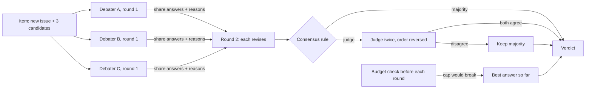
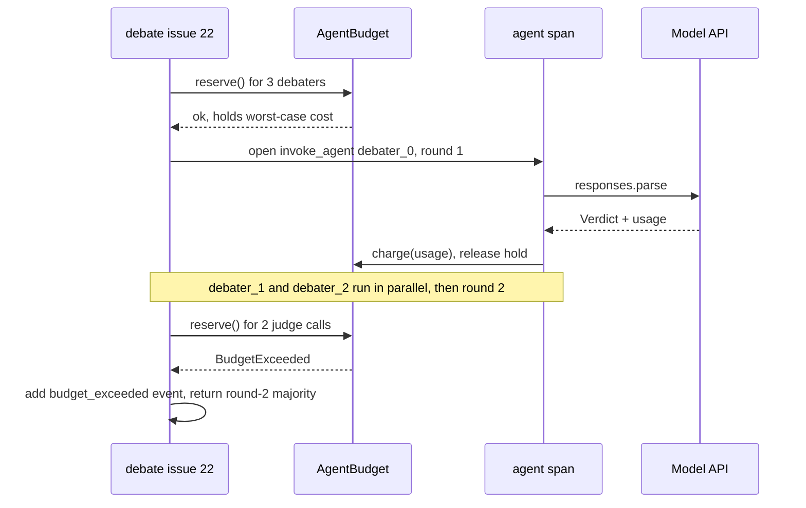
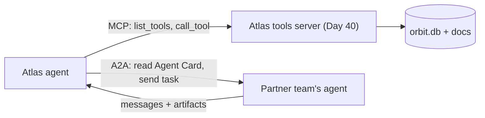

# Debate, Consensus & Multi-Agent Operations

Atlas's triage marks issue #22 as a duplicate of the wrong issue, and it does so confidently. Having three agents argue it out sounds like the fix, but it also triples the bill. Today you test whether debate beats one model that thinks harder, on Orbit's real duplicate clusters. Then you add the operations layer every multi-agent system needs: dollar budgets per agent, a hard stop, and one trace span (a timed step inside a trace) per agent per round.

## At a Glance

- **Time:** ~2 h core (+ optional Go Deeper) · **Depth:** working
- **Prerequisites:** [Day 59: Evaluating Agents](../../Phase_6_Agents/Day_059_evaluating_agents/evaluating_agents.md), [Day 66: Supervisor & Parallel Workers with LangGraph](../../Phase_7_Multi_Agent_Systems/Day_066_supervisor_parallel_workers/supervisor_parallel_workers.md). Helpful: [Day 41](../../Phase_4_Tools_and_MCP/Day_041_workflow_patterns/workflow_patterns.md) (voting, evaluator–optimizer), [Day 42](../../Phase_5_Evaluation_and_Observability/Day_042_tracing_observability/tracing_observability.md) (tracing), [Day 45](../../Phase_5_Evaluation_and_Observability/Day_045_llm_as_judge/llm_as_judge.md)–[46](../../Phase_5_Evaluation_and_Observability/Day_046_judge_validation/judge_validation.md) (judges, position bias), [Day 12](../../Phase_2_Building_with_LLM_APIs/Day_012_openai_sdk_production/openai_sdk_production.md) (cost tracking).
- **You'll build:** `atlas/debate.py` (`debate()`, `Verdict`, `DebateResult`), additions to `atlas/llm.py` (`AgentBudget`, `BudgetExceeded`, `agent_span()`), offline process tests, and a matched-cost eval of five configs on 20 Orbit duplicate decisions.
- **Stops at:** A2A protocol details (transports, auth, task lifecycle).
- **Fast path:** Already run voting and judges? Read §"The Debate Eval" and §"When Debate Pays", then do Exercise 3 (~40 min).
- **Cost:** ≈ $0.15 for the eval and ≈ $0.30 with Exercises 1–3, on `gpt-6-luna`; the stretch uses `gpt-6.1-terra` and adds roughly $0.50. These are rough estimates; prices as of 2026-11, [verify](https://developers.openai.com/api/docs/pricing). The offline scripts and tests cost $0.
- **New terms:** debate round, consensus rule, correlated errors, conformity flip, A2A (Agent2Agent protocol)

> **Coming from Software Engineering?** Debate is three PR reviewers reconciling conflicting comments before merge: each reads the diff alone, then they read each other's notes and revise. Majority voting is a quorum read (a read that needs most replicas, meaning copies of the same data on other machines, to agree). A quorum only helps when replicas fail independently; three copies of the same corrupted disk agree perfectly and are all wrong. Each debate round also costs like an N+1 query (one extra database round-trip per row): N agents times R rounds of calls, every time. Debate is different from Day 41's critic loop, where one generator is checked by one critic. Here, peers check each other.

## One Confident Wrong Answer

Start with the data. Orbit has 240 issues and 15 duplicate clusters; 37 issues carry a `duplicate_of` link to an earlier issue. A realistic duplicate check shows the model the new issue plus a few earlier *candidates*. The hard ones are near-misses: earlier issues on the same component that describe a different bug.

This module builds 20 items: 12 real duplicates (one per cluster) and 8 whose answer is `none`. Each gets three candidates: the true parent plus two near-misses, or three near-misses. A near-miss is an earlier issue sharing a `comp:*` label but outside the true cluster, picked with SQL. Save it as `orbit_dupes.py`; later scripts import it.

```python
# script_id: day_067_debate_multi_agent_ops/orbit_dupes
# orbit_dupes.py: 20 duplicate-decision items from Orbit (12 real duplicates + 8 "none").
# Install: nothing (stdlib only) · Env: ORBIT_DATA (default datasets/orbit) · Services: none
from __future__ import annotations
import os, sqlite3
from dataclasses import dataclass
from pathlib import Path

DATA_DIR = Path(os.environ.get("ORBIT_DATA", "datasets/orbit"))
DB = DATA_DIR / "issues" / "orbit.db"

@dataclass(frozen=True)
class Candidate:
    id: str
    text: str

@dataclass(frozen=True)
class DupItem:
    issue_id: int
    text: str
    candidates: tuple[Candidate, ...]
    gold: str                                  # a candidate id, or "none"

    @property
    def options(self) -> list[str]:
        return [c.id for c in self.candidates] + ["none"]

# Near-misses: EARLIER issues sharing a component label, outside the true duplicate cluster.
NEAR_MISS_SQL = """
SELECT c.id FROM issue_labels a
JOIN issue_labels b ON b.label_id = a.label_id
JOIN labels l ON l.id = a.label_id
JOIN issues c ON c.id = b.issue_id
WHERE a.issue_id = :x AND c.id < :x AND c.id != :gold
  AND (c.duplicate_of IS NULL OR c.duplicate_of != :gold)
GROUP BY c.id HAVING SUM(l.kind = 'comp') > 0
ORDER BY COUNT(*) DESC, c.id DESC LIMIT :k
"""
```

The second block turns rows into items, truncating bodies that carry long logs.

```python
# script_id: day_067_debate_multi_agent_ops/orbit_dupes
def _text(con: sqlite3.Connection, issue_id: int, limit: int = 600) -> str:
    title, body = con.execute("SELECT title, body FROM issues WHERE id = ?", (issue_id,)).fetchone()
    return f"#{issue_id} {title}\n{body[:limit]}"

def _item(con: sqlite3.Connection, x: int, gold: int | None) -> DupItem | None:
    k = 2 if gold else 3
    near = [r[0] for r in con.execute(NEAR_MISS_SQL, {"x": x, "gold": gold or -1, "k": k})]
    if len(near) < k:
        return None                            # not enough near-misses: skip this issue
    ids = sorted(near + ([gold] if gold else []))
    cands = tuple(Candidate(str(i), _text(con, i, 400)) for i in ids)
    return DupItem(x, _text(con, x), cands, str(gold) if gold else "none")

def load_items(n_dup: int = 12, n_none: int = 8) -> list[DupItem]:
    con = sqlite3.connect(f"file:{DB}?mode=ro", uri=True)      # read-only: P7 tools never write
    firsts = con.execute("SELECT MIN(id), duplicate_of FROM issues WHERE duplicate_of IS NOT NULL "
                         "GROUP BY duplicate_of ORDER BY duplicate_of").fetchall()
    roots = {g for _, g in firsts}
    singles = con.execute("SELECT id FROM issues WHERE duplicate_of IS NULL AND id >= 100 "
                          "ORDER BY id").fetchall()
    items = [it for x, g in firsts if (it := _item(con, x, g))][:n_dup]
    items += [it for (x,) in singles if x not in roots and (it := _item(con, x, None))][:n_none]
    con.close()
    return items

if __name__ == "__main__":
    items = load_items()
    print(len(items), "items,", sum(i.gold != "none" for i in items), "real duplicates")
    first = items[0]
    print(f"issue #{first.issue_id}: options={first.options} gold={first.gold}")
```

```text
20 items, 12 real duplicates
issue #22: options=['4', '15', '16', 'none'] gold=4
```

A single low-effort call can pick the near-miss: same component, similar words, different root cause, and still `confidence: high`. Issue #105 even opens with "Follow-up to #97": related, not a duplicate. That is the failure to fix.

## A Panel of Reviewers

There are two ways to review a tricky pull request. One senior reviewer takes an extra hour, or three reviewers read it separately, swap notes, and each give a final opinion. The panel catches more only when reviewers notice *different* things; three copies of one reviewer add cost and no information.

The senior reviewer is one call with higher reasoning effort ([Day 11](../../Phase_2_Building_with_LLM_APIs/Day_011_reasoning_cot/reasoning_cot.md)). The panel is **multi-agent debate**: several calls answer independently, read each other's answers and reasons, and revise. Without the exchange step it is Day 41's parallel voting, today's baseline. Day 41's evaluator–optimizer loop (one writer, one critic) is a different shape and isn't repeated here.

## Voting by Hand

Do the arithmetic before spending money. Three voters answer the same item: `['12', '12', '40']`. The majority answer is `12`.

Now suppose each voter is right 70% of the time, *independently*. The majority is right when at least two of three are right: 3 × 0.7² × 0.3 + 0.7³ = 0.441 + 0.343 = **0.784**. That is a real gain over 0.70. But if the three voters are the same model with the same prompt and the same evidence order, their mistakes are **correlated errors**: they fail on the same items together. In the extreme case they behave like one voter, and the majority is right 0.70 of the time, the same as one call at triple the price.

Debate adds a second round. A **conformity flip** is a debater changing its answer to match its peers. A good flip goes wrong → right; a bad flip goes right → wrong. You count both, because a debate that produces as many bad flips as good ones is paying for noise.

```python
# script_id: day_067_debate_multi_agent_ops/vote_by_hand
# Majority-of-3 by hand: independent vs correlated voters, then round-2 flips. Stdlib only.
from collections import Counter
from math import comb

def majority(votes: list[str]) -> str:
    return Counter(votes).most_common(1)[0][0]

def p_majority(p: float, n: int = 3) -> float:
    # P(more than half of n independent voters are right), each right with probability p
    return sum(comb(n, k) * p**k * (1 - p) ** (n - k) for k in range(n // 2 + 1, n + 1))

print("votes ['12', '12', '40'] ->", majority(["12", "12", "40"]))
p = 0.7
for rho in (0.0, 0.5, 1.0):   # rho = share of items where the 3 voters act as ONE voter
    print(f"correlation {rho:.1f}: majority accuracy {rho * p + (1 - rho) * p_majority(p):.3f}")

gold = "12"
for r1, r2 in ((["12", "40", "40"], ["12", "12", "40"]), (["12", "12", "40"], ["40", "12", "40"])):
    good = sum(a != gold and b == gold for a, b in zip(r1, r2))
    bad = sum(a == gold and b != gold for a, b in zip(r1, r2))
    print(f"{r1} -> {r2}: flips +{good} / -{bad}, majority {majority(r1)} -> {majority(r2)}")
```

```text
votes ['12', '12', '40'] -> 12
correlation 0.0: majority accuracy 0.784
correlation 0.5: majority accuracy 0.742
correlation 1.0: majority accuracy 0.700
['12', '40', '40'] -> ['12', '12', '40']: flips +1 / -0, majority 40 -> 12
['12', '12', '40'] -> ['40', '12', '40']: flips +0 / -1, majority 12 -> 40
```

The first flip example rescues the item; the second loses it. Same mechanism, opposite outcome. Diversity of evidence decides which one you get more often.

## Debaters, Rounds, Consensus and Judges

Here are the parts, named once:

- **Debater:** one cheap model call (`gpt-6-luna`, low effort) with its own instructions and evidence view.
- **Debate round:** every debater answers once. Round 1 is independent; in round 2 each sees all round-1 answers and reasons, then keeps or revises.
- **Consensus rule:** how the last round becomes one answer. *Majority* counts votes; a *judge* call picks the best-supported answer. Judges have position bias ([Day 46](../../Phase_5_Evaluation_and_Observability/Day_046_judge_validation/judge_validation.md)), so today's judge runs twice with the order reversed and counts only if both agree.
- **Verdict:** the structured answer: a candidate id or `none`, a reason, a confidence.
- **Budget check:** before each round, reserve the worst-case cost; if a cap would break, stop and return the best answer so far.



## Three Votes in 20 Lines

This is a recap of Day 41 voting, and it is the baseline debate must beat. Three independent calls see the candidates in a rotated order, and `Counter` takes the majority. The `Verdict` schema is built per item with `pydantic.create_model`, so `answer` becomes a `Literal` of that item's candidate ids plus `"none"`. Structured outputs turn the `Literal` into a JSON-schema enum ([Day 16](../../Phase_2_Building_with_LLM_APIs/Day_016_structured_outputs/structured_outputs.md)), so the model can't invent an id.

```python
# script_id: day_067_debate_multi_agent_ops/vote_minimal
# Recap of Day 41 voting: 3 independent votes + majority. The baseline debate must beat.
# Install: uv add "openai>=3.46,<4" pydantic · Env: OPENAI_API_KEY, ORBIT_DATA · Needs orbit_dupes.py
import os
from collections import Counter
from typing import Literal
from openai import BadRequestError, OpenAI
from pydantic import BaseModel, create_model
from orbit_dupes import Candidate, load_items

MODEL = os.environ.get("ATLAS_MODEL", "gpt-6-luna")
client = OpenAI()

class Verdict(BaseModel):
    answer: str
    reason: str
    confidence: Literal["low", "med", "high"]

item = load_items()[0]
ItemVerdict = create_model("ItemVerdict", __base__=Verdict, answer=(Literal[tuple(item.options)], ...))

def vote(order: list[Candidate]) -> str:
    cands = "\n\n".join(f"[{c.id}] {c.text}" for c in order)
    r = client.responses.parse(model=MODEL, reasoning={"effort": "low"}, text_format=ItemVerdict,
        instructions="Is the NEW issue a duplicate of one CANDIDATE? Answer a candidate id or none.",
        input=f"NEW:\n{item.text}\n\nCANDIDATES:\n{cands}")
    return r.output_parsed.answer if r.output_parsed else "none"   # None = refusal/incomplete

c = list(item.candidates)
votes = [vote(c[i:] + c[:i]) for i in range(3)]       # rotate the evidence order per voter
print(f"votes: {votes} -> {Counter(votes).most_common(1)[0][0]} (gold {item.gold})")
```

```text
votes: ['4', '4', '16'] -> 4 (gold 4)     <- illustrative; your votes will differ
```

## Break It

Change one thing at a time and watch what breaks.

**(a) Identical prompts.** Give all three voters the same order. On many items they agree 3/3. Agreement goes up and accuracy stays where it was, because three identical voters make one voter's mistakes three times.

**(b) Diversity through `temperature`.** The obvious fix is to raise `temperature`. On GPT-6 models, sampling knobs are allowed only with reasoning effort `"none"`; with any other effort, the latest-model guide says to remove `temperature`, `top_p` and `top_logprobs`. The API rejects the request with a 400 error (⚠ verify the exact message text when you run it). Diversity has to come from the prompts: evidence order, focus, or role.

```python
# script_id: day_067_debate_multi_agent_ops/vote_minimal
same = [vote(c) for _ in range(3)]                                   # (a) no diversity at all
print("identical prompts:", same, "agreement", max(Counter(same).values()), "/ 3")
try:                                                                 # (b) temperature + effort
    client.responses.create(model=MODEL, input="hi", reasoning={"effort": "low"}, temperature=1.2)
except BadRequestError as e:
    print("rejected:", e.status_code, str(e)[:160])
else:                                                                # the rule may change: check
    print("accepted: temperature + effort 'low' was not rejected on", MODEL)
```

```text
identical prompts: ['4', '4', '4'] agreement 3 / 3          <- illustrative
rejected: 400 ...                                           <- expected; the exact text is unverified
```

**(c) More rounds.** Each round adds N calls, so cost grows linearly. Accuracy usually flattens after round 2, once debaters converge.

**(d) A judge that always sees the same order** tends to favour whoever is first. Day 46's swap test catches it: judge twice, order reversed, and treat disagreement as "no decision".

## Budgets and Spans for Many Agents

[Day 12](../../Phase_2_Building_with_LLM_APIs/Day_012_openai_sdk_production/openai_sdk_production.md) owns the cost tracker, and [Day 66](../../Phase_7_Multi_Agent_Systems/Day_066_supervisor_parallel_workers/supervisor_parallel_workers.md) added runtime caps (steps, tokens, wall-clock). Multi-agent systems also need **dollars per agent**, to see who burns the budget, and a **hard stop** that still returns something useful.

The trap: three parallel debaters that check the budget *after* their calls return all pass, and the system overshoots. Instead, **reserve** each call's worst-case cost before launching it (`max_output_tokens` × output price, plus an input estimate), then **charge** the real cost and release the hold.

Add this to `atlas/llm.py`; Day 76 imports it from there.

```python
# script_id: day_067_debate_multi_agent_ops/atlas/llm
# atlas/llm.py: per-agent $ budgets with a hard stop, plus one OTel span per agent per round.
# add these to your atlas/llm.py from Day 12
# Install: uv add opentelemetry-sdk · Env: none · Services: none (prints one line per span)
# Compact self-contained copy of Day 12's prices and Day 42's setup_tracing so it runs on its own.
from __future__ import annotations
from collections.abc import Iterator
from contextlib import contextmanager
from dataclasses import dataclass, field
from typing import Any
from opentelemetry import trace
from opentelemetry.sdk.trace import TracerProvider
from opentelemetry.sdk.trace.export import SimpleSpanProcessor, SpanExporter, SpanExportResult

# USD per 1M tokens (input, output), standard tier, as of 2026-11; verify at the pricing page
PRICES = {"gpt-6-luna": (0.10, 0.50), "gpt-6.1-terra": (1.00, 5.00)}

def cost_usd(model: str, usage: Any) -> float:
    # Reasoning tokens are billed as output tokens; cached-input discounts are ignored here
    p_in, p_out = PRICES[model]
    return (usage.input_tokens * p_in + usage.output_tokens * p_out) / 1e6

def estimate_usd(model: str, input_tokens: int, max_output_tokens: int) -> float:
    # Worst case for one call: every allowed output token gets used
    p_in, p_out = PRICES[model]
    return (input_tokens * p_in + max_output_tokens * p_out) / 1e6

class BudgetExceeded(Exception):
    """Raised BEFORE a call that would break a per-agent or total $ cap."""
```

`AgentBudget` keeps two ledgers, `spent` and `held`. `reserve()` is synchronous, so no other asyncio task can run between the check and the hold.

```python
# script_id: day_067_debate_multi_agent_ops/atlas/llm
@dataclass
class AgentBudget:
    per_agent_usd: float
    total_usd: float
    spent: dict[str, float] = field(default_factory=dict)
    held: dict[str, float] = field(default_factory=dict)      # reserved for calls in flight

    def _committed(self, agent: str | None = None) -> float:
        if agent is None:
            return sum(self.spent.values()) + sum(self.held.values())
        return self.spent.get(agent, 0.0) + self.held.get(agent, 0.0)

    def reserve(self, agent: str, est_usd: float) -> None:
        if self._committed(agent) + est_usd > self.per_agent_usd:
            raise BudgetExceeded(f"{agent}: per-agent cap ${self.per_agent_usd:.4f} reached")
        if self._committed() + est_usd > self.total_usd:
            raise BudgetExceeded(f"{agent}: total cap ${self.total_usd:.4f} reached")
        self.held[agent] = self.held.get(agent, 0.0) + est_usd

    def release(self, agent: str, est_usd: float) -> None:
        self.held[agent] = self.held.get(agent, 0.0) - est_usd

    def charge(self, agent: str, usage: Any, model: str, est_usd: float) -> float:
        self.release(agent, est_usd)
        cost = est_usd if usage is None else cost_usd(model, usage)   # unknown usage: bill the estimate
        self.spent[agent] = self.spent.get(agent, 0.0) + cost
        return cost

    def spent_by_agent(self) -> dict[str, float]:
        return dict(sorted(self.spent.items()))
```

[Day 42](../../Phase_5_Evaluation_and_Observability/Day_042_tracing_observability/tracing_observability.md) owns tracing and [Day 65](../../Phase_7_Multi_Agent_Systems/Day_065_handoffs_agents_as_tools/handoffs_agents_as_tools.md) used the Agents SDK's built-in traces. Today's spans are plain OpenTelemetry (OTel), so any framework works. A **span** is one timed step inside a trace. `agent_span()` opens one per agent per round, tagged `gen_ai.operation.name = "invoke_agent"` and `gen_ai.agent.name`, names from the GenAI conventions (status *Development*, so they can change).

```python
# script_id: day_067_debate_multi_agent_ops/atlas/llm
class LineExporter(SpanExporter):
    """Prints one line per finished span; swap in Day 42's Phoenix exporter for a UI."""
    def export(self, spans) -> SpanExportResult:
        for s in spans:
            ms = (s.end_time - s.start_time) / 1e6
            print(f"span {s.name:<26} {ms:6.1f} ms usd={(s.attributes or {}).get('atlas.cost_usd', '-')}")
        return SpanExportResult.SUCCESS

def setup_tracing(exporter: SpanExporter | None = None) -> TracerProvider:
    provider = TracerProvider()
    provider.add_span_processor(SimpleSpanProcessor(exporter or LineExporter()))
    trace.set_tracer_provider(provider)          # global; OTel lets you set it once per process
    return provider

@contextmanager
def agent_span(name: str, round: int, **attrs: Any) -> Iterator[trace.Span]:
    # An exception inside the block is recorded on the span, then re-raised
    tracer = trace.get_tracer("atlas.debate")
    with tracer.start_as_current_span(f"invoke_agent {name}", attributes={
            "gen_ai.operation.name": "invoke_agent", "gen_ai.agent.name": name,
            "atlas.debate.round": round, **attrs}) as span:
        yield span
```

Try it offline, with fake usage and a per-agent cap that trips in round 3.

```python
# script_id: day_067_debate_multi_agent_ops/atlas/llm
if __name__ == "__main__":
    from types import SimpleNamespace as Usage          # fake usage: runs with no API key
    setup_tracing()
    budget = AgentBudget(per_agent_usd=0.002, total_usd=0.004)
    est = estimate_usd("gpt-6-luna", 2_500, 1_500)       # $0.001 worst case per call
    for rnd in (1, 2, 3):
        for agent in ("debater_0", "judge"):
            try:
                with agent_span(agent, rnd) as span:
                    budget.reserve(agent, est)
                    fake = Usage(input_tokens=2_400, output_tokens=900)
                    span.set_attribute("atlas.cost_usd", round(budget.charge(agent, fake, "gpt-6-luna", est), 6))
            except BudgetExceeded as e:
                print("BudgetExceeded:", e)
    print({a: round(v, 5) for a, v in budget.spent_by_agent().items()})
```

```text
span invoke_agent debater_0        0.1 ms usd=0.00069
span invoke_agent judge            0.0 ms usd=0.00069
span invoke_agent debater_0        0.0 ms usd=0.00069
span invoke_agent judge            0.0 ms usd=0.00069
span invoke_agent debater_0        2.6 ms usd=-
BudgetExceeded: debater_0: per-agent cap $0.0020 reached
span invoke_agent judge            0.2 ms usd=-
BudgetExceeded: judge: per-agent cap $0.0020 reached
{'debater_0': 0.00138, 'judge': 0.00138}
```

Your timings will differ. Round 3 is refused *before* any call: each agent had spent $0.00138, and one more worst-case reservation ($0.001) would pass the $0.002 cap. The refused span still ends and gets exported, with the exception recorded on it.

In a real debate the spans nest: item, then round, then agent call.



## The Debate Engine

`atlas/debate.py` never builds a client, so it is provider-agnostic. You pass an `Ask`: any object with a `model`, a worst-case `est_usd`, and an async call returning `(verdict, usage)`. The eval passes a real OpenAI `Ask`; the tests pass fakes. One engine covers every config: a single call is `n_agents=1, rounds=1`, voting is round 1, debate is round 2.

```python
# script_id: day_067_debate_multi_agent_ops/atlas/debate
# atlas/debate.py: N debaters x R rounds, majority or judge, $ budget, spans.
# Install: uv add pydantic opentelemetry-sdk · Env: none · Needs atlas/llm.py, orbit_dupes.py
from __future__ import annotations
import asyncio, time
from collections import Counter
from dataclasses import dataclass, field
from typing import Any, Literal, Protocol
from opentelemetry import trace
from pydantic import BaseModel, create_model
from atlas.llm import AgentBudget, BudgetExceeded, agent_span, cost_usd
from orbit_dupes import DupItem

class Verdict(BaseModel):
    answer: str                                   # a candidate id, or "none"
    reason: str
    confidence: Literal["low", "med", "high"]

def verdict_model(item: DupItem) -> type[Verdict]:
    # Per-item Literal -> strict JSON-schema enum: hallucinated ids become impossible
    return create_model("ItemVerdict", __base__=Verdict, answer=(Literal[tuple(item.options)], ...))

class Ask(Protocol):
    model: str
    est_usd: float                                # worst-case $ per call, reserved up front
    async def __call__(self, agent: str, instructions: str, prompt: str,
                       schema: type[Verdict]) -> tuple[Verdict, Any]: ...   # (verdict, usage)

@dataclass
class Call:
    agent: str
    round: int
    usd: float
    seconds: float
```

`DebateResult` keeps every round, so one run can be scored as several configs. A round takes as long as its slowest parallel call.

```python
# script_id: day_067_debate_multi_agent_ops/atlas/debate
@dataclass
class DebateResult:
    final: Verdict
    rounds: list[list[Verdict]]                   # rounds[r][i] = debater i in round r + 1
    calls: list[Call] = field(default_factory=list)
    stopped: str | None = None                    # BudgetExceeded message if the hard stop fired

    def majority_at(self, r: int) -> Verdict:
        return majority(self.rounds[min(r, len(self.rounds)) - 1])

    def flips(self, gold: str) -> tuple[int, int]:
        """(wrong -> right, right -> wrong) between round 1 and the last round."""
        pairs = list(zip(self.rounds[0], self.rounds[-1])) if len(self.rounds) > 1 else []
        good = sum(a.answer != gold and b.answer == gold for a, b in pairs)
        bad = sum(a.answer == gold and b.answer != gold for a, b in pairs)
        return good, bad

    def _upto(self, r: int | None) -> list[Call]:
        return [c for c in self.calls if r is None or c.round <= r]

    def usd(self, upto_round: int | None = None) -> float:
        return sum(c.usd for c in self._upto(upto_round))

    def n_calls(self, upto_round: int | None = None) -> int:
        return len(self._upto(upto_round))

    def seconds(self, upto_round: int | None = None) -> float:
        slowest: dict[int, float] = {}
        for c in self._upto(upto_round):
            slowest[c.round] = max(slowest.get(c.round, 0.0), c.seconds)
        return sum(slowest.values())

    def usage_by_agent(self) -> dict[str, float]:
        out: dict[str, float] = {}
        for c in self.calls:
            out[c.agent] = out.get(c.agent, 0.0) + c.usd
        return out
```

Next, consensus and prompts. Each debater gets a different **lens** (error codes, component, or symptoms) and a rotated candidate order: diversity is what you pay for. In round 2, peers are anonymized and debaters may switch only for evidence they missed, the main defence against conformity flips.

```python
# script_id: day_067_debate_multi_agent_ops/atlas/debate
RANK = {"low": 0, "med": 1, "high": 2}
LENSES = ["Focus on error messages and ORB-xxxx error codes.",
          "Focus on the component, version and configuration involved.",
          "Focus on the symptom and the repro steps."]
SYSTEM = ("You decide whether a NEW Orbit issue duplicates one CANDIDATE issue. A duplicate has the "
          "same root cause, not only the same component. Answer a candidate id, or none.")

def majority(votes: list[Verdict]) -> Verdict:
    if len(votes) == 1:
        return votes[0]                           # a single call keeps its own reason/confidence
    counts = Counter(v.answer for v in votes)
    # Ties: most total confidence wins, then "none" (the safe default for a duplicate check)
    best = max(counts, key=lambda a: (counts[a], sum(RANK[v.confidence] for v in votes
                                                     if v.answer == a), a == "none"))
    k = counts[best]
    conf = (min((v.confidence for v in votes if v.answer == best), key=RANK.__getitem__)
            if k == len(votes) else "med" if k > len(votes) / 2 else "low")
    return Verdict(answer=best, reason=f"{k}/{len(votes)} votes", confidence=conf)

def _cands(c: list) -> str:
    return "\n\n".join(f"[{x.id}] {x.text}" for x in c)

def debater_prompt(item: DupItem, i: int, peers: list[Verdict] | None) -> str:
    c = list(item.candidates)
    c = c[i % len(c):] + c[:i % len(c)]          # rotate candidate order per debater
    text = f"{LENSES[i % len(LENSES)]}\n\nNEW:\n{item.text}\n\nCANDIDATES:\n{_cands(c)}"
    if peers:
        notes = "\n".join(f"- {'You' if j == i else 'Reviewer ' + chr(65 + j)}: {p.answer} ({p.reason})"
                          for j, p in enumerate(peers))
        text += (f"\n\nRound-1 answers:\n{notes}\nKeep your answer unless a reviewer points to "
                 "evidence you missed. Do not change it only to agree.")
    return text

def judge_prompt(item: DupItem, finals: list[Verdict]) -> str:
    notes = "\n".join(f"- Reviewer {chr(65 + j)}: {v.answer} ({v.reason})" for j, v in enumerate(finals))
    return (f"NEW:\n{item.text}\n\nCANDIDATES:\n{_cands(list(item.candidates))}\n\n"
            f"Reviewer answers:\n{notes}\nPick the best-supported answer.")
```

`_reserve_all` is all-or-nothing, so a round never half-launches. `_call` opens the agent span, releases the hold if the call raises, and charges real usage.

```python
# script_id: day_067_debate_multi_agent_ops/atlas/debate
def _reserve_all(budget: AgentBudget | None, wants: list[tuple[str, Ask]]) -> None:
    done: list[tuple[str, Ask]] = []
    try:
        for name, ask in wants:
            if budget:
                budget.reserve(name, ask.est_usd)
                done.append((name, ask))
    except BudgetExceeded:
        for name, ask in done:
            budget.release(name, ask.est_usd)
        raise

async def _call(ask: Ask, agent: str, rnd: int, prompt: str, schema: type[Verdict],
                budget: AgentBudget | None, calls: list[Call], instructions: str = SYSTEM) -> Verdict:
    with agent_span(agent, rnd, **{"gen_ai.request.model": ask.model}) as span:
        t0 = time.perf_counter()
        try:
            verdict, use = await ask(agent, instructions, prompt, schema)
        except BaseException:
            if budget:
                budget.release(agent, ask.est_usd)   # don't leak the hold on errors
            raise
        if budget:
            cost = budget.charge(agent, use, ask.model, ask.est_usd)
        else:
            cost = cost_usd(ask.model, use) if use is not None else ask.est_usd
        span.set_attributes({"atlas.cost_usd": round(cost, 6), "atlas.answer": verdict.answer})
        calls.append(Call(agent, rnd, cost, time.perf_counter() - t0))
        return verdict
```

Finally `debate()`. The judge runs the swap test, and any `BudgetExceeded` becomes a span event plus the best answer so far.

```python
# script_id: day_067_debate_multi_agent_ops/atlas/debate
async def _judge(item: DupItem, ask: Ask, finals: list[Verdict], rnd: int, schema: type[Verdict],
                 budget: AgentBudget | None, calls: list[Call], fallback: Verdict) -> Verdict:
    _reserve_all(budget, [("judge", ask), ("judge", ask)])
    instr = "You are the judge of a review panel. " + SYSTEM
    a, b = await asyncio.gather(
        _call(ask, "judge", rnd, judge_prompt(item, finals), schema, budget, calls, instr),
        _call(ask, "judge", rnd, judge_prompt(item, finals[::-1]), schema, budget, calls, instr))
    return a if a.answer == b.answer else fallback

async def debate(item: DupItem, ask: Ask | list[Ask], n_agents: int = 3, rounds: int = 2,
                 judge: bool = False, budget: AgentBudget | None = None,
                 judge_ask: Ask | None = None) -> DebateResult:
    asks = ask if isinstance(ask, list) else [ask] * n_agents   # a list = a mixed panel
    names = [f"debater_{i}" for i in range(len(asks))]
    schema, history, calls, stopped = verdict_model(item), [], [], None
    tracer = trace.get_tracer("atlas.debate")
    with tracer.start_as_current_span(f"debate issue {item.issue_id}") as root:
        try:
            for r in range(1, rounds + 1):
                _reserve_all(budget, list(zip(names, asks)))      # before anything launches
                peers = history[-1] if history else None
                with tracer.start_as_current_span(f"round {r}"):
                    history.append(list(await asyncio.gather(*(
                        _call(a, n, r, debater_prompt(item, i, peers), schema, budget, calls)
                        for i, (n, a) in enumerate(zip(names, asks))))))
            final = majority(history[-1])
            if judge:
                final = await _judge(item, judge_ask or asks[0], history[-1], rounds + 1,
                                     schema, budget, calls, final)
        except BudgetExceeded as e:
            stopped = str(e)
            root.add_event("budget_exceeded", {"reason": stopped})
            final = majority(history[-1]) if history else Verdict(
                answer="none", reason="budget exhausted before any vote", confidence="low")
    return DebateResult(final, history, calls, stopped)
```

## Testing the Process Offline

[Day 59](../../Phase_6_Agents/Day_059_evaluating_agents/evaluating_agents.md) evaluated *how* agents worked, not only the answer. Here you check the process with no API key: `FakeAsk` returns scripted answers and fake usage, and OTel's `InMemorySpanExporter` collects spans for the asserts.

```python
# script_id: day_067_debate_multi_agent_ops/test_debate
# test_debate.py: offline process evals (flips, hard stop, judge swap, spans). No API key.
# Install: uv add pytest pydantic opentelemetry-sdk · Run: pytest test_debate.py (or python test_debate.py)
import asyncio
from dataclasses import dataclass, field
from types import SimpleNamespace
from opentelemetry.sdk.trace.export.in_memory_span_exporter import InMemorySpanExporter
from atlas.llm import AgentBudget, estimate_usd, setup_tracing
from atlas.debate import debate
from orbit_dupes import load_items

SPANS = InMemorySpanExporter()
setup_tracing(SPANS)
ITEM = load_items()[0]
WRONG = next(c.id for c in ITEM.candidates if c.id != ITEM.gold)

@dataclass
class FakeAsk:
    """Scripted panel: answers[agent][k] is that agent's k-th answer. Same shape as the real Ask."""
    answers: dict[str, list[str]]
    model: str = "gpt-6-luna"
    est_usd: float = estimate_usd("gpt-6-luna", 2_500, 1_500)
    seen: list[str] = field(default_factory=list)

    async def __call__(self, agent, instructions, prompt, schema):
        k = self.seen.count(agent)
        self.seen.append(agent)
        script = self.answers[agent]
        v = schema(answer=script[min(k, len(script) - 1)], reason="scripted", confidence="med")
        return v, SimpleNamespace(input_tokens=2_400, output_tokens=900)
```

Three tests: a good flip plus span shape, the per-agent hard stop, and the judge swap.

```python
# script_id: day_067_debate_multi_agent_ops/test_debate
def test_good_flip_and_one_span_per_agent_per_round():
    SPANS.clear()
    ask = FakeAsk({"debater_0": [ITEM.gold], "debater_1": [WRONG, ITEM.gold], "debater_2": [WRONG]})
    res = asyncio.run(debate(ITEM, ask, n_agents=3, rounds=2))
    assert res.majority_at(1).answer == WRONG and res.final.answer == ITEM.gold
    assert res.flips(ITEM.gold) == (1, 0)
    spans = [s for s in SPANS.get_finished_spans() if s.name.startswith("invoke_agent")]
    assert len(spans) == res.n_calls() == 6
    assert {(s.attributes["gen_ai.agent.name"], s.attributes["atlas.debate.round"]) for s in spans} \
        == {(f"debater_{i}", r) for i in range(3) for r in (1, 2)}

def test_per_agent_cap_returns_best_so_far():
    ask = FakeAsk({"debater_0": [ITEM.gold], "debater_1": [WRONG, ITEM.gold], "debater_2": [WRONG]})
    budget = AgentBudget(per_agent_usd=1.5 * ask.est_usd, total_usd=1.0)   # room for 1 call each
    res = asyncio.run(debate(ITEM, ask, rounds=2, budget=budget))
    assert res.stopped and "per-agent cap" in res.stopped
    assert len(res.rounds) == 1 and res.final.answer == WRONG              # round-1 majority
    assert all(v <= budget.per_agent_usd for v in budget.spent_by_agent().values())

def test_judge_swap_disagreement_keeps_majority():
    ask = FakeAsk({f"debater_{i}": [ITEM.gold] for i in range(3)} | {"judge": [WRONG, ITEM.gold]})
    res = asyncio.run(debate(ITEM, ask, rounds=2, judge=True))
    assert res.final.answer == ITEM.gold and res.n_calls() == 8

if __name__ == "__main__":
    for name, fn in list(globals().items()):
        if name.startswith("test_"):
            fn()
            print("PASS", name)
```

```text
PASS test_good_flip_and_one_span_per_agent_per_round
PASS test_per_agent_cap_returns_best_so_far
PASS test_judge_swap_disagreement_keeps_majority
```

## The Debate Eval

Now spend real tokens. The eval compares five configs on all 20 items:

| Config | What runs | Calls/item |
|---|---|---|
| A `single_low` | one call, effort `low` | 1 |
| B `single_high` | one call, effort `high` (the "senior reviewer") | 1 |
| C `vote3` | 3 debaters, round 1 only, majority | 3 |
| D `debate` | 3 debaters × 2 rounds, majority | 6 |
| E `debate_judge` | D plus two swapped judge calls | 8 |

C, D and E come from **one** debate run scored at round 1, round 2 and after the judge, which halves the bill and gives all three identical round-1 answers. The real `Ask` wraps `responses.parse`. A refusal or incomplete response (`output_parsed is None`) and truncated JSON (`ValidationError`) both count as a low-confidence `none`.

```python
# script_id: day_067_debate_multi_agent_ops/debate_eval
# debate_eval.py: matched-cost eval of 5 configs on 20 Orbit duplicate decisions.
# Install: uv add "openai>=3.46,<4" pydantic opentelemetry-sdk · Env: OPENAI_API_KEY, ORBIT_DATA
# Needs orbit_dupes.py, atlas/llm.py, atlas/debate.py · Cost ≈ $0.15 on gpt-6-luna (as of 2026-11, verify)
from __future__ import annotations
import asyncio, os, statistics
from dataclasses import dataclass
from openai import AsyncOpenAI
from opentelemetry.sdk.trace.export.in_memory_span_exporter import InMemorySpanExporter
from pydantic import ValidationError
from atlas.llm import AgentBudget, estimate_usd, setup_tracing
from atlas.debate import debate
from orbit_dupes import DupItem, load_items

MODEL = os.environ.get("ATLAS_MODEL", "gpt-6-luna")
MAX_OUT = 8_000   # caps reasoning + answer; the reasoning guide suggests ~25k headroom for hard tasks

@dataclass
class OpenAIAsk:
    client: AsyncOpenAI
    model: str = MODEL
    effort: str = "low"

    @property
    def est_usd(self) -> float:
        return estimate_usd(self.model, 3_000, MAX_OUT)   # 3k input is generous here; measure yours

    async def __call__(self, agent, instructions, prompt, schema):
        try:
            r = await self.client.responses.parse(model=self.model, instructions=instructions,
                input=prompt, text_format=schema, reasoning={"effort": self.effort},
                max_output_tokens=MAX_OUT)
        except ValidationError:                  # truncated or malformed JSON
            return schema(answer="none", reason="unparseable", confidence="low"), None
        v = r.output_parsed or schema(answer="none", reason=f"no answer ({r.status})", confidence="low")
        return v, r.usage
```

`run_item` runs three experiments and scores five configs. Eight worst-case reservations of about $0.004 fit easily in the $0.10 per-item budget; Exercise 3 makes it tight.

```python
# script_id: day_067_debate_multi_agent_ops/debate_eval
CONFIGS = ["single_low", "single_high", "vote3", "debate", "debate_judge"]

async def run_item(client: AsyncOpenAI, item: DupItem) -> dict:
    a = await debate(item, OpenAIAsk(client), n_agents=1, rounds=1)
    b = await debate(item, OpenAIAsk(client, effort="high"), n_agents=1, rounds=1)
    d = await debate(item, OpenAIAsk(client), n_agents=3, rounds=2, judge=True,
                     budget=AgentBudget(per_agent_usd=0.03, total_usd=0.10))

    def row(res, verdict, upto: int | None) -> dict:
        return {"ok": verdict.answer == item.gold, "usd": res.usd(upto),
                "calls": res.n_calls(upto), "s": res.seconds(upto)}

    return {"single_low": row(a, a.final, None), "single_high": row(b, b.final, None),
            "vote3": row(d, d.majority_at(1), 1), "debate": row(d, d.majority_at(2), 2),
            "debate_judge": row(d, d.final, None), "_runs": (a, b, d)}

async def evaluate(items: list[DupItem]) -> list[dict]:
    sem = asyncio.Semaphore(4)                   # a few items at once; backoff is Day 84's topic
    async with AsyncOpenAI() as client:
        async def one(it: DupItem) -> dict:
            async with sem:
                return await run_item(client, it)
        return list(await asyncio.gather(*(one(it) for it in items)))
```

The report ends with process asserts: one agent span per call, and no debate over budget.

```python
# script_id: day_067_debate_multi_agent_ops/debate_eval
def report(items: list[DupItem], results: list[dict], spans: InMemorySpanExporter) -> None:
    print(f"{'config':<13} {'acc':>5} {'$/item':>9} {'calls':>6} {'p50 s':>6}")
    for cfg in CONFIGS:
        rows = [r[cfg] for r in results]
        print(f"{cfg:<13} {sum(r['ok'] for r in rows) / len(rows):5.2f} "
              f"{statistics.mean(r['usd'] for r in rows):9.5f} "
              f"{statistics.mean(r['calls'] for r in rows):6.1f} {statistics.median(r['s'] for r in rows):6.1f}")
    debates = [r["_runs"][2] for r in results]
    flips = [d.flips(it.gold) for d, it in zip(debates, items)]
    print(f"round-2 flips: +{sum(f[0] for f in flips)} wrong->right, -{sum(f[1] for f in flips)} right->wrong")
    spend: dict[str, float] = {}
    for d in debates:
        for agent, v in d.usage_by_agent().items():
            spend[agent] = spend.get(agent, 0.0) + v
    print("debate spend by agent:", {a: round(v, 4) for a, v in sorted(spend.items())})
    print("hard stops:", sum(d.stopped is not None for d in debates))
    agent_spans = [s for s in spans.get_finished_spans() if s.name.startswith("invoke_agent")]
    assert len(agent_spans) == sum(run.n_calls() for r in results for run in r["_runs"])
    assert all(d.usd() <= 0.10 for d in debates), "a debate broke its total budget"

if __name__ == "__main__":
    spans = InMemorySpanExporter()
    setup_tracing(spans)                          # or Day 42's Phoenix setup to browse the trees
    items = load_items()
    report(items, asyncio.run(evaluate(items)), spans)
```

The output has this shape. The `x` values are placeholders, not measured results: accuracy needs real calls, while `test_debate.py` already checks the process offline. Run it to get yours.

```text
config          acc    $/item  calls  p50 s
single_low     x.xx   0.000xx    1.0    x.x
single_high    x.xx   0.000xx    1.0    x.x
vote3          x.xx   0.00xxx    3.0    x.x
debate         x.xx   0.00xxx    6.0    x.x
debate_judge   x.xx   0.00xxx    8.0    x.x
round-2 flips: +n wrong->right, -n right->wrong
debate spend by agent: {'debater_0': ..., 'debater_1': ..., 'debater_2': ..., 'judge': ...}
hard stops: 0
```

Read it in order (`p50 s` is the median seconds per item). `debate` minus `vote3` is the whole value of the exchange round. Then compare both with `single_high` *at similar $/item*; on 20 items, one or two items' difference is noise. Then the flips: if bad ≈ good, round 2 is a paid coin toss. Honest runs often find voting ≈ debate and one high-effort call competitive. Report what you measure.

## When Debate Pays

| Situation | Do this |
|---|---|
| Answers are checkable (an id, a label, a number) and agents can get **different** evidence or roles | Debate or vote, and measure flips |
| Same model, same evidence, no new information in round 2 | Raise effort on one call instead |
| High stakes, and single high-effort calls have plateaued on your eval | Try debate at matched cost; consider a mixed-model panel (Exercise 4) |
| Open-ended writing, with no clear right answer | Skip debate; use Day 41's evaluator–optimizer loop |
| Latency-sensitive path (chat, autocomplete) | Single call; rounds add sequential latency |

Rule of thumb: voting buys independence and debate buys information exchange. If your agents have nothing different to say, neither helps.

### In production

- Debate only uncertain items: a cheap call first, the panel only for `confidence="low"` (Exercise 2).
- Chart per-agent spend; a growing debater is usually writing long reasons nobody reads.
- Reserve before launching, every time.
- Sample traces: keep all error traces and a fraction of the rest.
- Keep the baseline in CI ([Day 47](../../Phase_5_Evaluation_and_Observability/Day_047_evals_in_ci/evals_in_ci.md)); if `single_high` catches up after a model upgrade, retire the panel.

## Agents Talking to Other Agents: A2A in Five Minutes

Today's agents all ran in one process you own. Sometimes the other agent belongs to another team or vendor, and you can't import its code.

**A2A (Agent2Agent protocol)** is an open protocol for that case, contributed by Google and now under the Linux Foundation (spec v1.0.1 as of 2026-11). An **Agent Card** describes what an agent can do and where to reach it; you send it **tasks**, and **messages** and **artifacts** flow back. The remote agent stays a black box.

The two protocols split the work. **MCP** connects an agent to tools and data ([Day 39](../../Phase_4_Tools_and_MCP/Day_039_mcp_clients/mcp_clients.md)–[40](../../Phase_4_Tools_and_MCP/Day_040_mcp_servers/mcp_servers.md)), and **A2A** connects an agent to another agent across team or vendor boundaries.



A Python SDK exists (`a2a-sdk` 1.3.0). The course doesn't use it: none of the 320 job postings in this course's 2026 sample asked for A2A. Know when it fits, and read the spec when a partner integration needs it.

## Go Deeper (optional)

<details><summary>Go deeper: the Condorcet jury theorem, and why correlation breaks it</summary>

**In words.** In 1785 Condorcet showed that if each voter is right more often than not, and voters are independent, then a bigger majority vote is more likely to be right, and it approaches certainty as the panel grows. The same maths has a dark side: if each voter is right *less* than half the time, a bigger panel makes the majority more reliably wrong.

**Toy numbers.** With p = 0.7: 1 voter gives 0.70, 3 give 0.784, 5 give 0.837 and 9 give 0.901. With p = 0.45 (a hard item where the near-miss is more tempting than the truth), the majority gets *worse* as the panel grows. Correlation shrinks the gain: if a share ρ of items behave as if the panel were one voter, accuracy is ρ·p + (1 − ρ)·P(majority).

```python
# script_id: day_067_debate_multi_agent_ops/condorcet
# Condorcet jury theorem with toy numbers, plus a simple correlation model. Stdlib only.
from math import comb

def p_majority(p: float, n: int) -> float:
    return sum(comb(n, k) * p**k * (1 - p) ** (n - k) for k in range(n // 2 + 1, n + 1))

for p in (0.7, 0.45):
    row = "  ".join(f"n={n}: {p_majority(p, n):.3f}" for n in (1, 3, 5, 9))
    print(f"p={p}: {row}")
for rho in (0.0, 0.3, 0.6, 0.9):        # share of items where the panel acts as one voter
    print(f"rho={rho}: n=9 at p=0.7 -> {rho * 0.7 + (1 - rho) * p_majority(0.7, 9):.3f}")
```

```text
p=0.7: n=1: 0.700  n=3: 0.784  n=5: 0.837  n=9: 0.901
p=0.45: n=1: 0.450  n=3: 0.425  n=5: 0.407  n=9: 0.379
rho=0.0: n=9 at p=0.7 -> 0.901
rho=0.3: n=9 at p=0.7 -> 0.841
rho=0.6: n=9 at p=0.7 -> 0.780
rho=0.9: n=9 at p=0.7 -> 0.720
```

**Formula.** P(majority right) = Σ over k from ⌊n/2⌋+1 to n of C(n, k) · pᵏ · (1 − p)ⁿ⁻ᵏ. The independence assumption is the one that fails for LLM panels: same weights, same training data, same blind spots. That's why the lesson spends its effort on *different* lenses and evidence orders, and why a mixed-model panel can beat three copies of a stronger model.

</details>

<details><summary>Go deeper: keeping debate honest (conformity, topology, judges)</summary>

**Conformity is the default.** Models tend to agree with confident peers. Three mitigations help, and you can measure each with the flip counts:

- **Anonymize peers** (done today). Labels like "Reviewer A" stop debaters deferring to a named "senior" agent.
- **Commit, then reveal.** Round 1 is independent, so every debater states a position before seeing others. Never show peers' answers in round 1.
- **Require new evidence to switch.** The round-2 prompt says so; a stricter version requires the debater to quote the sentence from the candidate that changed its mind, and you reject a switch without one.

**Topology.** Today every debater sees every peer (a fully connected panel). With more agents that grows quadratically in prompt size, and teams use sparser layouts: each debater sees only one neighbour, or a summary of the round. [Day 64](../../Phase_7_Multi_Agent_Systems/Day_064_multi_agent_when/multi_agent_when.md) owns the "which topology" decision; for debate the rule is that the exchange round must carry *new* information.

**Judges.** A judge is one more model call with its own biases. The swap test catches position bias but not verbosity bias (preferring the longest reason). If the judge doesn't beat plain majority on your eval, drop it and keep the cheaper rule. Validate any judge against labels first, as in Day 46.

**The research.** The idea of multi-round debate between LLM instances is usually credited to Du et al. (2023), "Improving Factuality and Reasoning in Language Models through Multiagent Debate". Later work has questioned how much of the gain survives against voting or stronger single models at equal compute, which is exactly why today's eval matches cost. Read papers for ideas, and trust your own matched-cost eval for decisions.

</details>

<details><summary>Go deeper: operating debate at scale</summary>

- **Gate by confidence, then by disagreement.** Run vote3 first; only when the three disagree, run round 2. Unanimous items stop at three calls. The two-stage gate often keeps most of the accuracy at a fraction of the cost; measure it on your data.
- **Tighter reservations.** Reserving `max_output_tokens` at full price is safe but pessimistic, and with a tight budget it blocks calls that would have fit. Once you have usage data, reserve at your measured p99 output tokens and keep `max_output_tokens` as the hard ceiling.
- **Budget scopes.** Today's budget is per item. In production you usually stack three: per request, per tenant per day ([Day 83](../../Phase_9_Production/Day_083_auth_multitenancy_quotas/auth_multitenancy_quotas.md)), and a global circuit breaker ([Day 84](../../Phase_9_Production/Day_084_reliability_fallbacks/reliability_fallbacks.md)). The `reserve`/`charge` pattern works at every level.
- **Attribute names drift.** The GenAI conventions are still status Development. Keep attribute names in one module, as `agent_span()` does, so a rename is a one-line change.
- **Routing.** A cheap model for debaters and a stronger one only as tie-breaker is a routing decision; [Day 85](../../Phase_9_Production/Day_085_caching_cost_scale/caching_cost_scale.md) covers routing and caching at scale.

</details>

## Common Pitfalls

- **Agreement without accuracy.** Symptom: 3/3 agreement, accuracy equal to one call. Cause: identical prompts and evidence order. Fix: vary lenses and order; report agreement and accuracy separately.
- **`temperature` rejected.** Symptom: a 400 `BadRequestError` when you add `temperature` with `reasoning={"effort": "low"}` (⚠ verify the exact message). Cause: GPT-6 models accept sampling knobs only at effort `"none"`. Fix: drop `temperature` and get diversity from prompts, or run debaters at effort `"none"` on `gpt-6-luna`, which accepts it.
- **Conformity flips.** Symptom: bad flips about as common as good flips. Fix: anonymize peers, keep round 1 independent, and tell debaters to switch only for evidence they missed.
- **Unequal-cost comparisons.** Symptom: "debate wins" with no $/item column. Fix: print $/item and compare with `single_high` at similar spend.
- **Budget overshoot.** Symptom: spend above the cap although every call checked it. Cause: parallel calls passed a check-after-return. Fix: `reserve()` the worst case before launching.
- **Hallucinated candidate ids.** Symptom: an answer like `"#41"` or an id that isn't a candidate. Fix: a per-item `Literal` via `create_model`, so the strict schema only allows real ids.

> **Where we stop:** A2A transports, auth and the task lifecycle are out of scope, because no Atlas component talks to another vendor's agent yet; the [A2A spec repository](https://github.com/a2aproject/A2A) has the details.

## Key Takeaways

- A confident single answer can still be wrong on near-miss candidates, so measure before adding agents (problem → intuition).
- Majority-of-3 at p = 0.7 gives 0.784 only when errors are independent; identical voters give 0.70 at triple the cost (worked example, parts).
- Diversity must come from prompts, evidence order and roles: `temperature` is rejected when reasoning effort isn't `"none"` (minimal code, break it).
- Reserve worst-case cost before launching parallel calls, charge real usage per agent, and on `BudgetExceeded` return the best answer so far, with one span per agent per round to prove it (realistic version).
- Compare debate against voting and a single high-effort call at matched $/item, count good and bad flips, and use debate only when agents bring different information (trade-offs).

## Quick Reference

| API / pattern | When to use | Gotcha |
|---|---|---|
| `create_model("ItemVerdict", __base__=Verdict, answer=(Literal[tuple(ids)], ...))` | Per-item answer enums | Rebuild per item; ids must be strings |
| `responses.parse(..., text_format=schema, reasoning={"effort": e}, max_output_tokens=n)` | Every debater and judge call | `output_parsed` is `None` on refusal or incomplete |
| `majority(votes)` | Vote and debate consensus | Define tie-breaks explicitly |
| Judge twice, order reversed | Judge consensus | Disagreement means "use majority" |
| `AgentBudget.reserve()` → `.charge()` | Per-agent $ caps with parallel calls | Release the hold on errors |
| `agent_span(name, round)` | One OTel span per agent per round | GenAI attribute names are status Development |
| `DebateResult.majority_at(r)`, `.usd(r)` | Score vote3 and debate from one run | Round latency = slowest call in the round |

## Exercises

1. **Warm-up: a bigger panel.** Run `debate()` with `n_agents` set to 3 and then 5 on five items. Print accuracy, $/item and calls/item for each. Does accuracy rise as fast as cost?

<details><summary>Solution</summary>

```python
# script_id: day_067_debate_multi_agent_ops/solution_ex1
# n_agents 3 -> 5 on 5 mixed items. Needs debate_eval.py, atlas/debate.py, atlas/llm.py, orbit_dupes.py.
import asyncio
from openai import AsyncOpenAI
from atlas.debate import debate
from debate_eval import OpenAIAsk
from orbit_dupes import load_items

async def main() -> None:
    items = load_items()[::4]                  # 5 items: 3 duplicates + 2 "none"
    async with AsyncOpenAI() as client:
        ask = OpenAIAsk(client)
        for n in (3, 5):
            res = [await debate(it, ask, n_agents=n, rounds=2) for it in items]
            acc = sum(r.final.answer == it.gold for r, it in zip(res, items)) / len(items)
            print(f"n_agents={n}: acc={acc:.2f} $/item={sum(r.usd() for r in res) / len(items):.5f} "
                  f"calls/item={sum(r.n_calls() for r in res) / len(items):.1f}")

asyncio.run(main())
```

Cost grows linearly: 10 calls per item instead of 6. With only three lenses, debaters 3 and 4 reuse lenses 0 and 1, so they add little new information, and accuracy usually moves less than cost.

</details>

2. **Core: a confidence gate.** Answer each item with one low-effort call. Send only the items where that call reports `confidence="low"` to a 3×2 debate. Report accuracy, $/item and how many items were debated, then compare with the `single_low` and `debate` rows of your eval.

<details><summary>Solution</summary>

```python
# script_id: day_067_debate_multi_agent_ops/solution_ex2
# Confidence gate: debate only when the single call is unsure. Needs debate_eval.py and friends.
import asyncio
from openai import AsyncOpenAI
from atlas.debate import debate
from debate_eval import OpenAIAsk
from orbit_dupes import DupItem, load_items

async def gated(item: DupItem, ask: OpenAIAsk) -> tuple[str, float, bool]:
    first = await debate(item, ask, n_agents=1, rounds=1)   # majority of 1 keeps own confidence
    if first.final.confidence != "low":
        return first.final.answer, first.usd(), False
    panel = await debate(item, ask, n_agents=3, rounds=2)
    return panel.final.answer, first.usd() + panel.usd(), True

async def main() -> None:
    items = load_items()
    async with AsyncOpenAI() as client:
        rows = [await gated(it, OpenAIAsk(client)) for it in items]
    acc = sum(a == it.gold for (a, _, _), it in zip(rows, items)) / len(items)
    print(f"gated: acc={acc:.2f} $/item={sum(r[1] for r in rows) / len(items):.5f} "
          f"debated {sum(r[2] for r in rows)}/{len(items)} items")

asyncio.run(main())
```

If the model's `confidence` tracks its errors, the gate keeps most of the debate's accuracy at close to single-call cost. If it says `high` on wrong answers, the gate debates nothing; try gating on vote3 disagreement instead.

</details>

3. **Core: starve the judge.** Offline, with `FakeAsk`: give a 3×2 debate with a judge a total budget that fits the six debater calls but not the two judge calls. Show that it returns the round-2 majority, records `budget_exceeded` on the root span, and never charges the judge.

<details><summary>Solution</summary>

```python
# script_id: day_067_debate_multi_agent_ops/solution_ex3
# Hard stop before the judge. Offline: reuses FakeAsk and the in-memory spans from test_debate.py.
import asyncio
from atlas.llm import AgentBudget
from atlas.debate import debate
from test_debate import ITEM, SPANS, WRONG, FakeAsk

ask = FakeAsk({f"debater_{i}": [ITEM.gold] for i in range(3)} | {"judge": [WRONG]})
budget = AgentBudget(per_agent_usd=1.0, total_usd=6 * ask.est_usd)   # 6 worst-case calls, not 8
SPANS.clear()
res = asyncio.run(debate(ITEM, ask, rounds=2, judge=True, budget=budget))
print("final:", res.final.answer, "| gold:", ITEM.gold, "| stopped:", res.stopped)
root = next(s for s in SPANS.get_finished_spans() if s.name.startswith("debate issue"))
print("root span events:", [(e.name, dict(e.attributes)) for e in root.events])
print("spent:", {a: round(v, 5) for a, v in budget.spent_by_agent().items()})
assert res.final.answer == ITEM.gold and "judge" not in budget.spent_by_agent()
```

```text
final: 4 | gold: 4 | stopped: judge: total cap $0.0060 reached
root span events: [('budget_exceeded', {'reason': 'judge: total cap $0.0060 reached'})]
spent: {'debater_0': 0.00138, 'debater_1': 0.00138, 'debater_2': 0.00138}
```

The judge's two reservations are all-or-nothing: the first fits, the second breaks the total cap, so both are released and no judge call is launched. The debate still returns a usable answer, and the trace says why it stopped.

</details>

4. **Stretch (optional): a mixed panel.** Compare three panels on all 20 items: 3 × `gpt-6-luna`, 2 × `gpt-6-luna` + 1 × `gpt-6.1-terra`, and a single `gpt-6.1-terra` call. Print accuracy and $/item for each. When does model diversity beat repetition? This one costs roughly $0.50, because terra is priced about 10x luna (as of 2026-11, verify).

<details><summary>Solution</summary>

```python
# script_id: day_067_debate_multi_agent_ops/solution_ex4
# Mixed panel vs same-model panel vs one stronger call. Needs debate_eval.py and friends.
import asyncio
from openai import AsyncOpenAI
from atlas.debate import debate
from debate_eval import OpenAIAsk
from orbit_dupes import load_items

async def main() -> None:
    items = load_items()
    async with AsyncOpenAI() as client:
        luna, terra = OpenAIAsk(client), OpenAIAsk(client, model="gpt-6.1-terra")
        panels = {"3x luna": {"ask": luna, "n_agents": 3, "rounds": 2},
                  "2 luna + terra": {"ask": [luna, luna, terra], "rounds": 2},
                  "1x terra": {"ask": terra, "n_agents": 1, "rounds": 1}}
        for name, kw in panels.items():
            res = [await debate(it, **kw) for it in items]
            acc = sum(r.final.answer == it.gold for r, it in zip(res, items)) / len(items)
            print(f"{name:<15} acc={acc:.2f} $/item={sum(r.usd() for r in res) / len(items):.5f}")

asyncio.run(main())
```

A list of `Ask`s is a mixed panel, and `usd()` prices each call at its own model's rate. If the mixed panel beats 3 × luna, model diversity is buying independence. If one terra call matches it for less money, the stronger single model wins.

</details>

## References & Further Reading

- [OpenAI: Structured outputs](https://developers.openai.com/api/docs/guides/structured-outputs): `responses.parse`, `text_format`, strict schemas and enums, used for every `Verdict`.
- [OpenAI: Reasoning](https://developers.openai.com/api/docs/guides/reasoning): effort values, output-token headroom and `incomplete` handling for `max_output_tokens`.
- [OpenAI: Latest model guide](https://developers.openai.com/api/docs/guides/latest-model): which GPT-6 models accept effort `none`, and why sampling parameters are rejected otherwise.
- [OpenAI: Pricing](https://developers.openai.com/api/docs/pricing): the token prices behind `PRICES`; check before quoting costs.
- [OpenTelemetry GenAI semantic conventions](https://github.com/open-telemetry/semantic-conventions-genai): `invoke_agent`, `gen_ai.agent.name` and the other attribute names (status Development).
- [Anthropic: How we built our multi-agent research system](https://www.anthropic.com/engineering/multi-agent-research-system): a practitioner account of multi-agent cost, token use and evaluation.
- [A2A specification repository](https://github.com/a2aproject/A2A) and [a2a-sdk on PyPI](https://pypi.org/project/a2a-sdk/): the protocol and its Python SDK, for when a partner integration needs them.

## What's Next

Today's agents passed issue text between each other, and that text is untrusted input. Tomorrow you map where an attacker could get in, across one agent or many, in [Day 68: Threat Modeling LLM Applications](../../Phase_8_Safety_and_Security/Day_068_threat_modeling/threat_modeling.md). `AgentBudget` and `agent_span()` return in the R4 triage pipeline ([Day 76](../../Phase_8_Safety_and_Security/Day_076_capstone_r4_triage/capstone_r4_triage.md)).
