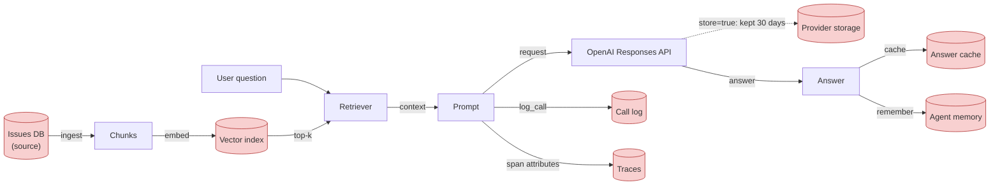
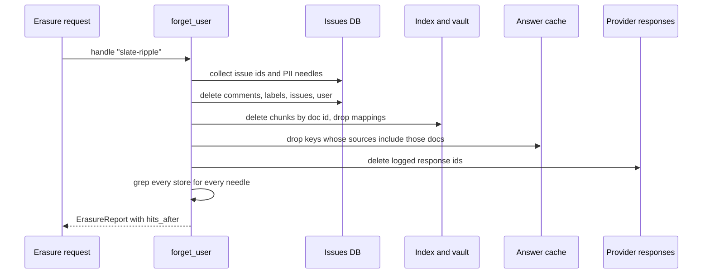
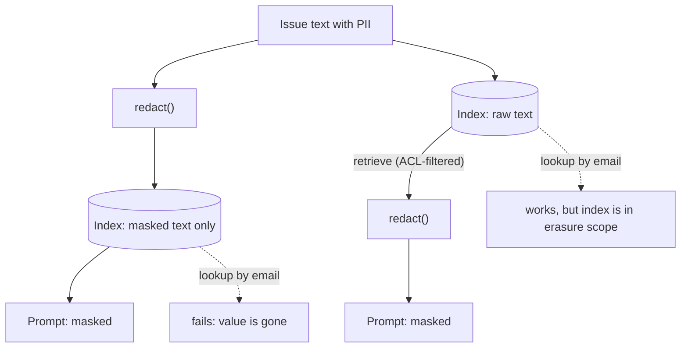

# Privacy & PII: Redaction, Retention and Erasure

Issue #170 in the Orbit tracker ends with a signature: `jane.doe@example.com`, a `555-01xx` phone number and, a few lines higher, a `sk-test-FAKE-…` payments key. Your R2 pipeline chunked and embedded it, the Day 42 trace stored the prompt, OpenAI kept the response for 30 days by default, and your call log has it too. Then an erasure request arrives. Where is all of it, and how do you prove it's gone?

## At a Glance

- **Time:** ~2 h core (+ optional Go Deeper) · **Depth:** working
- **Prerequisites:** [Day 28: Building the RAG Pipeline](../../Phase_3_RAG/Day_028_rag_pipeline/rag_pipeline.md), [Day 42: Tracing & Observability in Depth](../../Phase_5_Evaluation_and_Observability/Day_042_tracing_observability/tracing_observability.md), [Day 68: Threat Modeling LLM Applications](../../Phase_8_Safety_and_Security/Day_068_threat_modeling/threat_modeling.md), [Day 26: Vector Search with pgvector](../../Phase_3_RAG/Day_026_pgvector_search/pgvector_search.md) (deletes by doc id)
- **You'll build:** `atlas/privacy.py`, a PII-safe ingestion and logging path for R2 (`redact()`, `redact_json()`, `RedactingFilter`, PII-safe `log_call()`), plus `forget_user()`, which erases one person from every store and proves zero hits remain
- **Stops at:** legal compliance programs (DPIAs, DPOs, contracts)
- **Fast path:** Already know PII redaction? Read [Where PII Lands](#where-pii-lands), [`store=False` and Provider Retention](#storefalse-and-provider-retention) and [Erasure Across Every Store](#erasure-across-every-store), then do Exercise 3 (~45 min)
- **Cost:** ≈ $0. Every script runs offline except `store_false`, which makes two short calls on `gpt-6-luna` (well under $0.01; prices as of 2026-11, [verify](https://developers.openai.com/api/docs/pricing))
- **New terms:** PII, pseudonymization, data retention, right to erasure, zero data retention (ZDR)

> **Coming from Software Engineering?** You already know the three moves: **field-level redaction** (never write the card number to the `orders` log), **row-level security** (a query only sees rows the caller may see), and **cascading deletes** (delete the user and their rows go with them). An LLM app needs the same moves applied to stores your ORM never knew about: chunk tables, vector indexes, prompt logs, traces, answer caches, agent memory and state kept on the provider's side. Those copies are *derived* text, so no foreign key finds them: you need a map and a grep.

## One Email, Five Copies

Start by measuring the problem. The script below writes the artifacts an R2/R3-style Atlas leaves behind when it answers one question about issue #170, then greps them for the email address.

```python
# script_id: day_073_privacy_pii/find_pii_everywhere
# Install: nothing (stdlib). Env: ORBIT_DATA (default datasets/orbit). Services: none.
# Writes the artifacts an R2/R3-style Atlas leaves behind, then greps them for one email.
import json, os, tempfile
from pathlib import Path

DATA_DIR = Path(os.environ.get("ORBIT_DATA", "datasets/orbit"))
LOG_DIR = Path(tempfile.mkdtemp(prefix="atlas_artifacts_"))
NEEDLE = "jane.doe@example.com"

issues = [json.loads(line) for line in (DATA_DIR / "issues" / "issues.jsonl").open(encoding="utf-8")]
issue = next(i for i in issues if NEEDLE in i["body"])             # find fixtures by text, not id
text = f"{issue['title']}\n\n{issue['body']}"
chunks = [text[i:i + 800] for i in range(0, len(text), 700)]        # Day 25-style windows
artifacts = {
    "index/chunks.jsonl": "\n".join(json.dumps({"doc_id": f"issue-{issue['id']}", "text": c}) for c in chunks),
    "logs/calls.jsonl": json.dumps({"label": "ask", "prompt": f"Context:\n{text}\n\nQ: why ORB-1002?"}),
    "traces/spans.jsonl": json.dumps({"name": "Response", "attributes": {"input.value": text}}),
    "cache/answers.json": json.dumps({"why ORB-1002?": {"answer": "Percent-encode it.", "context": text}}),
    "provider/stored_responses.jsonl": json.dumps({"id": "resp_demo", "store": True, "input": text}),
}
for rel, content in artifacts.items():
    (LOG_DIR / rel).parent.mkdir(parents=True, exist_ok=True)
    (LOG_DIR / rel).write_text(content, encoding="utf-8")

hits = sorted(str(p.relative_to(LOG_DIR)) for p in LOG_DIR.rglob("*.json*") if NEEDLE in p.read_text(encoding="utf-8"))
print(f"issue #{issue['id']} by {issue['author']}: {NEEDLE} found in {len(hits)} artifacts")
for h in hits:
    print("  -", h)
```

```text
issue #170 by slate-ripple: jane.doe@example.com found in 5 artifacts
  - cache/answers.json
  - index/chunks.jsonl
  - logs/calls.jsonl
  - provider/stored_responses.jsonl
  - traces/spans.jsonl
```

Five copies on top of the source row, none with a foreign key back to `issues.id`. The last file is a stand-in, since you can't grep OpenAI's storage.

## Glitter Everywhere

Personal data in a pipeline behaves like spilled glitter: it sticks to everything it touches. Two strategies work, in this order:

1. **Don't spill.** Practise **data minimization** (collect and keep only the data you need), and redact before text enters a store.
2. **Know every place to vacuum.** List every store, how to delete from it, and a check that proves the delete worked.

**PII** (personally identifiable information) is any data that identifies a person directly (name, email, phone, street address) or in combination with other data. Keys and passwords aren't PII, but they leak through the same pipes, so today's layer handles both.

## Redacting One Sentence by Hand

Try four ways to remove an email from one sentence and ask of each: *can Atlas still do its job afterwards?*

```python
# script_id: day_073_privacy_pii/redaction_styles
# Install: nothing (stdlib). Env: none. Services: none.
import hashlib, re

s = "Jane Doe (jane.doe@example.com) confirmed the fix; cc jane.doe@example.com and ops@example.com."
EMAIL = re.compile(r"[\w.+-]+@[\w-]+(?:\.[\w-]+)+")
seen: dict[str, str] = {}
styles = {
    "replace": EMAIL.sub("<EMAIL>", s),
    "mask": EMAIL.sub(lambda m: m[0][0] + "*" * (len(m[0]) - 1), s),
    "hash": EMAIL.sub(lambda m: "h:" + hashlib.sha256(m[0].encode()).hexdigest()[:8], s),
    "pseudonymize": EMAIL.sub(lambda m: seen.setdefault(m[0], f"<EMAIL_{len(seen) + 1}>"), s),
}
for name, out in styles.items():
    print(f"{name:12} {out}")
print("mapping (keep it somewhere else):", {v: k for k, v in seen.items()})
```

```text
replace      Jane Doe (<EMAIL>) confirmed the fix; cc <EMAIL> and <EMAIL>.
mask         Jane Doe (j*******************) confirmed the fix; cc j******************* and o**************.
hash         Jane Doe (h:86e0b9e5) confirmed the fix; cc h:86e0b9e5 and h:af3c8254.
pseudonymize Jane Doe (<EMAIL_1>) confirmed the fix; cc <EMAIL_1> and <EMAIL_2>.
mapping (keep it somewhere else): {'<EMAIL_1>': 'jane.doe@example.com', '<EMAIL_2>': 'ops@example.com'}
```

- **Replace** is the safest, but the model can no longer tell that the first two addresses are the same person.
- **Mask** keeps the length and first letter, which leaks more than it seems and still loses identity.
- **Hash** keeps identity, but an unkeyed hash of an email can be reversed by hashing a list of likely emails (see Go Deeper).
- **Pseudonymization** replaces each value with a consistent stand-in (`<EMAIL_1>`), so "who said what" survives while the real value lives in a separate mapping. This is the default for Atlas. Notice that **"Jane Doe" survived all four**: an email regex can't see names.

## Where PII Lands

Here is the map for the whole day. Red nodes are stores that hold copies; the dashed edge is state kept on the provider's side.



The five places PII lands, and who in this course owns each:

| # | Place | What sits there | Delete by | Course link |
|---|---|---|---|---|
| 1 | Sources | issue and comment rows | `author`, issue id | [Day 33](../../Phase_3_RAG/Day_033_text_to_sql/text_to_sql.md) `orbit.db`, today |
| 2 | Chunks and embeddings | redacted or raw chunk text, vectors | `doc_id` | [Day 26](../../Phase_3_RAG/Day_026_pgvector_search/pgvector_search.md) `Index.delete()` |
| 3 | Prompts and provider storage | stored responses, Conversations | response id | today (`store=False`) |
| 4 | Logs and traces | call diary, span attributes | rarely deletable, so redact at the source | [Day 12](../../Phase_2_Building_with_LLM_APIs/Day_012_openai_sdk_production/openai_sdk_production.md), [Day 42](../../Phase_5_Evaluation_and_Observability/Day_042_tracing_observability/tracing_observability.md) |
| 5 | Caches and memory | cached answers, remembered facts | source doc ids, memory id | [Day 18](../../Phase_2_Building_with_LLM_APIs/Day_018_cost_latency_caching/cost_latency_caching.md), [Day 50](../../Phase_6_Agents/Day_050_agent_memory/agent_memory.md) |

This is threat **T09** in the [Day 68](../../Phase_8_Safety_and_Security/Day_068_threat_modeling/threat_modeling.md) register, and it maps to OWASP LLM02, Sensitive Information Disclosure. Vectors aren't readable text, but embedding-inversion research shows they can leak much of their source, so treat vectors of raw PII as PII.

## Detect and Redact with Presidio

Regexes find shapes such as emails and keys. Names, places and organizations need a model. **Presidio** is an open-source PII toolkit: its *analyzer* runs recognizers (regexes plus a spaCy named-entity model) and returns spans with scores, and its *anonymizer* rewrites those spans.

```python
# script_id: day_073_privacy_pii/presidio_basics
# Install: uv add presidio-analyzer presidio-anonymizer
#   "en_core_web_sm @ https://github.com/explosion/spacy-models/releases/download/en_core_web_sm-3.8.0/en_core_web_sm-3.8.0-py3-none-any.whl"
# Env: none. Services: none. Presidio 2.2.366 needs Python >=3.11,<3.15.
from presidio_analyzer import AnalyzerEngine
from presidio_analyzer.nlp_engine import NlpEngineProvider
from presidio_anonymizer import AnonymizerEngine

# Name the small spaCy model; a bare AnalyzerEngine() downloads the 401 MB en_core_web_lg.
nlp = NlpEngineProvider(nlp_configuration={"nlp_engine_name": "spacy",
      "models": [{"lang_code": "en", "model_name": "en_core_web_sm"}]}).create_engine()
analyzer = AnalyzerEngine(nlp_engine=nlp, supported_languages=["en"])
anonymizer = AnonymizerEngine()

text = "Contact Jane Doe at jane.doe@example.com or 212-555-0199. Card 4111 1111 1111 1111."
found = analyzer.analyze(text=text, language="en", score_threshold=0.4,   # phone scores only 0.4
                         entities=["PERSON", "EMAIL_ADDRESS", "PHONE_NUMBER", "CREDIT_CARD"])
print(anonymizer.anonymize(text=text, analyzer_results=found).text)
```

```text
Contact <PERSON> at <EMAIL_ADDRESS> or <PHONE_NUMBER>. Card <CREDIT_CARD>.
```

(Observed with Presidio 2.2.366 + `en_core_web_sm` 3.8.0.) With no `operators`, spans become `<ENTITY_TYPE>`. Offline, the email recognizer logs an SSL warning and falls back to a bundled list.

## Break It: What Presidio Misses

Now drop the entity filter and threshold to see everything Presidio redacts by default.

```python
# script_id: day_073_privacy_pii/presidio_basics
hits = analyzer.analyze(text=text, language="en")          # no entity filter: everything it knows
for r in sorted(hits, key=lambda r: (r.start, r.entity_type)):
    print(f"{r.entity_type:14} {r.score:.2f}  {text[r.start:r.end]!r}")
```

Beyond the four real hits, our run showed false ones: the phone also as `UK_NHS`, `DATE_TIME` inside the card, `URL` inside the email (Go Deeper has details). Four lessons:

- **Over-redaction:** expect hits on log timestamps and module names too; try a few Orbit log lines.
- **Misses:** there is no built-in API-key entity, so `sk-test-FAKE-…` needs your own recognizer. Treat Orbit's 7-digit `555-0148` as a miss until you see it caught.
- **Language:** `language` must be listed in `supported_languages` with a model behind it; other languages need their own setup (Go Deeper).
- **Setup:** `language=` is required; leave it out and you get a `TypeError`.

The fix is to tell Presidio what *your* data looks like: restrict `entities=` to the types you care about, set a `score_threshold`, and add pattern recognizers for your own shapes.

```python
# script_id: day_073_privacy_pii/presidio_basics
from presidio_analyzer import Pattern, PatternRecognizer
from presidio_anonymizer.entities import OperatorConfig

analyzer.registry.add_recognizer(PatternRecognizer(supported_entity="API_KEY",
    patterns=[Pattern(name="sk_key", regex=r"\bsk-[A-Za-z0-9_-]{8,}", score=0.9)]))
analyzer.registry.add_recognizer(PatternRecognizer(supported_entity="SHORT_PHONE",
    patterns=[Pattern(name="nnn_nnnn", regex=r"(?<![\w-])(?:\+?1-)?\d{3}-\d{4}(?![\w-])", score=0.6)]))
WANTED = ["PERSON", "EMAIL_ADDRESS", "PHONE_NUMBER", "API_KEY", "SHORT_PHONE"]   # not ORGANIZATION/DATE_TIME
line = "Contact Jane Doe at jane.doe@example.com or 555-0148. Key sk-test-FAKE-9f3c2a7e41b84d06, error ORB-1002 on 3.1.2."
hits = analyzer.analyze(text=line, language="en", entities=WANTED, score_threshold=0.4)
ops = {"DEFAULT": OperatorConfig("replace", {"new_value": "<PII>"}),
       "API_KEY": OperatorConfig("replace", {"new_value": "<SECRET>"})}
print(anonymizer.anonymize(text=line, analyzer_results=hits, operators=ops).text)
```

```text
Contact <PII> at <PII> or <PII>. Key <SECRET>, error ORB-1002 on 3.1.2.
```

(Expected; `Jane Doe` depends on the spaCy model, the rest on plain regexes.) Error code and version survive.

## A Redaction Layer for Atlas

Presidio is the right tool for names. For shape-based PII, Atlas uses a stdlib module that runs anywhere, tests in CI without a model, and is reused in [Day 75](../../Phase_8_Safety_and_Security/Day_075_red_teaming_ci/red_teaming_ci.md). Each block below adds one concern to `atlas/privacy.py`.

**Concern 1: recognizers and consistent pseudonyms.** `PII_RECOGNIZERS` is an ordered list; earlier entries win overlaps, which matters because a credential URL such as `redis://orbit:pw@host` contains an email-shaped substring.

```python
# script_id: day_073_privacy_pii/atlas/privacy
# atlas/privacy.py: regex-first PII layer, stdlib only (Day 75 reuses it; Presidio adds names on top).
# Install: nothing. Env: ORBIT_DATA (default datasets/orbit), ATLAS_LOG_DIR (default: a temp dir).
from __future__ import annotations
import json, logging, os, re, shutil, sqlite3, sys, tempfile
from collections import Counter
from dataclasses import dataclass, field
from math import sqrt
from pathlib import Path
from typing import Any, Callable

DATA_DIR = Path(os.environ.get("ORBIT_DATA", "datasets/orbit"))

# Order matters: earlier recognizers win overlaps (a credential URL contains an email-shaped span).
PII_RECOGNIZERS: list[tuple[str, re.Pattern[str]]] = [
    ("URL_CREDENTIALS", re.compile(r"\b[a-z][a-z0-9+.-]*://[^\s:/@]+:\S+@[\w.-]+")),
    ("API_KEY", re.compile(r"\bsk-[A-Za-z0-9_-]{8,}")),
    ("EMAIL", re.compile(r"(?<![\w.+/-])[\w.+-]+@[\w-]+(?:\.[\w-]+)+")),
    ("PHONE", re.compile(r"(?<![\w-])(?:\+?1[-. ])?(?:\(?\d{3}\)?[-. ])?\d{3}[-. ]\d{4}(?![\w-])")),
    ("ADDRESS", re.compile(r"\b\d{1,5} (?:[A-Z][a-z]+ )+(?:Street|Avenue|Road|Lane|Parkway|Way|Drive)\b")),
]

```

`redact()` skips spans that overlap an earlier match and gives equal values equal tags.

```python
# script_id: day_073_privacy_pii/atlas/privacy
@dataclass
class RedactionResult:
    text: str
    mapping: dict[str, str] = field(default_factory=dict)  # placeholder -> original; store it apart
    entities: list[str] = field(default_factory=list)

def redact(text: str, *, pseudonymize: bool = True) -> RedactionResult:
    spans: list[tuple[int, int, str]] = []
    for entity, pattern in PII_RECOGNIZERS:
        for m in pattern.finditer(text):
            if not any(m.start() < end and start < m.end() for start, end, _ in spans):
                spans.append((m.start(), m.end(), entity))
    spans.sort()
    placeholder: dict[str, str] = {}             # original value -> tag (same value, same tag)
    counts: Counter[str] = Counter()
    parts, last = [], 0
    for start, end, entity in spans:
        value = text[start:end]
        if value not in placeholder:
            counts[entity] += 1
            placeholder[value] = f"<{entity}_{counts[entity]}>" if pseudonymize else f"<{entity}>"
        parts += [text[last:start], placeholder[value]]
        last = end
    mapping = {tag: value for value, tag in placeholder.items()} if pseudonymize else {}
    return RedactionResult("".join(parts) + text[last:], mapping, [e for _, _, e in spans])

if __name__ == "__main__":
    r = redact("Jane Doe, jane.doe@example.com | 555-0148. cc jane.doe@example.com. Key: sk-test-FAKE-9f3c2a7e41b84d06")
    print(r.text)
    print(r.mapping)
```

```text
Jane Doe, <EMAIL_1> | <PHONE_1>. cc <EMAIL_1>. Key: <API_KEY_1>
{'<EMAIL_1>': 'jane.doe@example.com', '<PHONE_1>': '555-0148', '<API_KEY_1>': 'sk-test-FAKE-9f3c2a7e41b84d06'}
```

**Concern 2: measure it.** A redactor without numbers is a guess. The oracle here is independent of our regexes: the dataset README promises that every planted value uses `@example.com`-style domains, `555-01xx` phones, `sk-test-FAKE-…` keys or `FAKE` passwords. *Recall* is the share of the 10 PII fixture issues where no marker survives. *False positives* are spans flagged in issues that contain no markers at all.

```python
# script_id: day_073_privacy_pii/atlas/privacy
# The oracle is the dataset's guaranteed fake markers (README), independent of our own regexes.
MARKERS = re.compile(r"@example\.(?:com|net|org)|555-01\d\d|sk-test-FAKE|FAKE")
PII_FIXTURES = {13, 55, 67, 85, 116, 135, 170, 184, 195, 212}  # dataset README, "Built-in fixtures"

def load_issues() -> list[dict]:
    with (DATA_DIR / "issues" / "issues.jsonl").open(encoding="utf-8") as f:
        return [json.loads(line) for line in f]

def issue_text(issue: dict) -> str:
    return "\n".join([issue["title"], issue["body"], *(c["body"] for c in issue["comments"])])

def pii_report(issues: list[dict]) -> dict[str, Any]:
    fixtures = [i for i in issues if i["id"] in PII_FIXTURES]
    clean = [i for i in issues if i["id"] not in PII_FIXTURES and not MARKERS.search(issue_text(i))]
    missed = {i["id"]: MARKERS.findall(redact(issue_text(i)).text) for i in fixtures}
    flagged = [(i["id"], v) for i in clean for v in redact(issue_text(i)).mapping.values()]
    return {"recall": f"{sum(not m for m in missed.values())}/{len(fixtures)}",
            "missed": {k: v for k, v in missed.items() if v},
            "flagged_in_clean": f"{len(flagged)} spans in {len(clean)} issues", "examples": flagged[:3]}

if __name__ == "__main__":
    print(pii_report(load_issues()))
```

```text
{'recall': '10/10', 'missed': {}, 'flagged_in_clean': '1 spans in 227 issues', 'examples': [(206, '40ssw0rd-example@redis.internal.example.com')]}
```

Read the one "false positive" carefully: issue #206 holds a percent-encoded password (`p%40ssw0rd-example@…`), a real secret the oracle didn't know about. Rerun the report after every recognizer change; names aren't in this score.

**Concern 3: structured sinks.** Tool outputs are JSON, and Atlas logs and traces them. `redact_json` walks the structure and redacts values under sensitive keys. It matches keys *exactly*, because a substring match on `key` would also wipe `monkey` and `keyboard`.

```python
# script_id: day_073_privacy_pii/atlas/privacy
SENSITIVE_KEYS = {"password", "secret", "token", "api_key", "authorization", "email", "phone", "address"}

def redact_json(obj: Any) -> Any:
    """Redact values under sensitive keys in tool outputs. Exact key match, so 'monkey' survives."""
    if isinstance(obj, dict):
        return {k: "[REDACTED]" if k.lower() in SENSITIVE_KEYS else redact_json(v) for k, v in obj.items()}
    if isinstance(obj, list):
        return [redact_json(v) for v in obj]
    return obj

if __name__ == "__main__":
    dlq_job = {"id": "j_7a21c4", "job": "send_sms_reminder", "error": "ORB-1301",
               "args": {"customer_name": "John Q. Public", "phone": "555-0119",
                        "email": "jq.public@example.com", "notes": "call back on 555-0119"},
               "monkey": "not a secret"}
    print(json.dumps(redact_json(dlq_job)))
```

```text
{"id": "j_7a21c4", "job": "send_sms_reminder", "error": "ORB-1301", "args": {"customer_name": "John Q. Public", "phone": "[REDACTED]", "email": "[REDACTED]", "notes": "call back on 555-0119"}, "monkey": "not a secret"}
```

Two leaks remain: `customer_name` isn't on the key list, and `notes` hides a phone under an innocent key. Running `redact()` on string leaves too fixes the second; the first needs `PERSON` detection or a longer key list.

**Concern 4: logs and the call diary.** Redacting *after* `logger.info(...)` is too late: the handler has already written the raw line. Redact inside a `logging.Filter` attached to the **handler**. For the [Day 12](../../Phase_2_Building_with_LLM_APIs/Day_012_openai_sdk_production/openai_sdk_production.md) call diary, redact before the record exists.

```python
# script_id: day_073_privacy_pii/atlas/privacy
LOG_DIR = Path(os.environ.get("ATLAS_LOG_DIR") or tempfile.mkdtemp(prefix="atlas_logs_"))

class RedactingFilter(logging.Filter):
    """Attach to a *handler*: handler filters see every record that reaches it."""
    def filter(self, record: logging.LogRecord) -> bool:
        record.msg = redact(record.getMessage(), pseudonymize=False).text
        record.args = None              # the message is already formatted; don't format it twice
        return True

def log_call(label: str, response_id: str, prompt: str, output: str, **extra: Any) -> dict:
    """Compact Day 12 call diary, PII-safe: redact *before* the record exists."""
    record = {"label": label, "response_id": response_id,
              "prompt": redact(prompt, pseudonymize=False).text,
              "output": redact(output, pseudonymize=False).text, **extra}
    with (LOG_DIR / "calls.jsonl").open("a", encoding="utf-8") as f:
        f.write(json.dumps(record) + "\n")
    return record

if __name__ == "__main__":
    handler = logging.StreamHandler(sys.stdout)
    handler.addFilter(RedactingFilter())
    log = logging.getLogger("atlas.worker")
    log.addHandler(handler)
    log.propagate = False
    log.warning("RetryExhausted args=%s", {"customer_email": "maria.gomez@example.com", "phone": "+1-555-0187"})
    print(log_call("ask", "resp_demo_1", "Contact jane.doe@example.com about ORB-1002", "Percent-encode it."))
```

```text
RetryExhausted args={'customer_email': '<EMAIL>', 'phone': '<PHONE>'}
{'label': 'ask', 'response_id': 'resp_demo_1', 'prompt': 'Contact <EMAIL> about ORB-1002', 'output': 'Percent-encode it.'}
```

Traces follow the same rule: redact text *before* setting it as a span attribute in your Day 42 `step_span`. Some backends can hide inputs (⚠ verify current OpenInference options), but redacting at the source works everywhere, and a trace you never wrote never needs erasing.

**Concern 5: PII-safe ingestion for R2.** Mask *before* chunking and embedding, so the index never holds raw values. The pseudonym mapping goes to a separate `vault`. The `Index` below is an in-memory stand-in with the same `upsert` / `delete` / `search` surface as the [Day 26](../../Phase_3_RAG/Day_026_pgvector_search/pgvector_search.md) pgvector class, and a bag-of-words `embed()` stands in for the embedding model: the privacy logic is identical.

```python
# script_id: day_073_privacy_pii/atlas/privacy
def embed(text: str) -> Counter[str]:
    """Bag-of-words stand-in for an embedding model; the privacy logic is identical."""
    return Counter(re.findall(r"[a-z0-9_.@<>-]+", text.lower()))

def cosine(a: Counter[str], b: Counter[str]) -> float:
    dot = sum(a[t] * b[t] for t in a.keys() & b.keys())
    return dot / (sqrt(sum(v * v for v in a.values())) * sqrt(sum(v * v for v in b.values())) or 1.0)

def chunk(doc_id: str, text: str, size: int = 800, overlap: int = 100) -> list[dict]:
    """Compact Day 25 chunker: fixed windows with overlap."""
    starts = range(0, max(len(text) - overlap, 1), size - overlap)
    return [{"doc_id": doc_id, "chunk_id": f"{doc_id}#{n}", "text": text[s:s + size]} for n, s in enumerate(starts)]

class Index:
    """In-memory stand-in for Day 26's pgvector Index: same upsert / delete / search surface."""
    def __init__(self) -> None:
        self.rows: dict[str, dict] = {}
    def upsert(self, chunks: list[dict]) -> int:
        self.rows.update({c["chunk_id"]: {**c, "vec": embed(c["text"])} for c in chunks})
        return len(chunks)
    def delete(self, doc_id: str) -> int:
        doomed = [cid for cid, row in self.rows.items() if row["doc_id"] == doc_id]
        for cid in doomed:
            del self.rows[cid]
        return len(doomed)
    def search(self, query: str, k: int = 5) -> list[dict]:
        q = embed(query)
        return sorted(self.rows.values(), key=lambda r: cosine(q, r["vec"]), reverse=True)[:k]

```

`ingest_issue` is the R2 change: redact, then chunk and embed.

```python
# script_id: day_073_privacy_pii/atlas/privacy
def ingest_issue(index: Index, vault: dict[str, dict], issue: dict) -> int:
    """Mask before chunk/embed: the index never sees raw PII. The mapping goes to the vault."""
    doc_id = f"issue-{issue['id']}"
    result = redact(issue_text(issue))
    vault[doc_id] = result.mapping                  # separate store, tighter access (Go Deeper)
    index.delete(doc_id)                            # re-ingest replaces stale chunks
    return index.upsert(chunk(doc_id, result.text))

if __name__ == "__main__":
    index, vault = Index(), {}
    n = sum(ingest_issue(index, vault, i) for i in load_issues())
    leaks = sum(bool(MARKERS.search(r["text"])) for r in index.rows.values())
    print(f"{n} chunks indexed, {leaks} contain a planted marker")
    print([h["doc_id"] for h in index.search("ORB-1002 BrokerAuthError after password rotation postgres")][:3])
```

```text
679 chunks indexed, 2 contain a planted marker
['issue-170', 'issue-95', 'issue-13']
```

Retrieval still works, and the honest number is **2, not 0**. Both chunks come from issue #95, which isn't on the fixture list: its password appears as a CLI flag (`redis-cli --pass 'p@ss#w0rd-FAKE'`), a shape no recognizer covers. Fixture recall of 10/10 didn't mean the corpus was clean. That gap is why the [Day 70](../../Phase_8_Safety_and_Security/Day_070_guardrails_moderation/guardrails_moderation.md) secret-shape check exists as a second layer, and why you rerun the marker scan over the index after every recognizer change.

## `store=False` and Provider Retention

The Responses API keeps one more copy: **`store` defaults to true**, and a stored response is kept for at least 30 days so that `previous_response_id` and `retrieve` work. ([Day 8](../../Phase_2_Building_with_LLM_APIs/Day_008_messages_and_state/messages_and_state.md) pointed here.) **Data retention** is how long a system keeps data before deleting it, and for provider-side state the cheapest retention is none.

With `store=False` nothing is kept as application state, so three things change:

- There is no stored response, so `previous_response_id` and `client.responses.retrieve()` have nothing to work with. You carry the history yourself, as in Day 8.
- Reasoning items come back with an `encrypted_content` field by default. Replay every output item on the next turn and the model keeps its reasoning without OpenAI storing it.
- `safety_identifier` replaces the old `user=` field. Send a stable, keyed hash of the user, never the raw email or handle.

```python
# script_id: day_073_privacy_pii/store_false
# Install: uv add "openai>=3.46,<4". Env: OPENAI_API_KEY, ATLAS_ID_KEY (any secret string), ATLAS_MODEL (optional).
# Services: none. Two short calls on gpt-6-luna.
import hashlib, hmac, os
import openai
from openai import OpenAI

MODEL = os.environ.get("ATLAS_MODEL", "gpt-6-luna")
client = OpenAI()

def safety_id(handle: str) -> str:
    """Keyed hash: stable per user, not reversible by hashing a list of known handles."""
    return hmac.new(os.environ["ATLAS_ID_KEY"].encode(), handle.encode(), hashlib.sha256).hexdigest()[:32]

history: list = [{"role": "user", "content": "Why does ORB-1002 appear right after a password rotation?"}]
r1 = client.responses.create(model=MODEL, input=history, store=False, safety_identifier=safety_id("slate-ripple"))
history += [item.to_dict() for item in r1.output]      # keep ALL items, incl. encrypted reasoning
history.append({"role": "user", "content": "How do I percent-encode '@' in the broker URL?"})
r2 = client.responses.create(model=MODEL, input=history, store=False, safety_identifier=safety_id("slate-ripple"))
print(r2.output_text)
```

```text
Reserved characters in the password must be percent-encoded: '@' becomes %40 ...
```

(Your answer text will differ.) The second call carries context through `input`, not `previous_response_id`: that parameter chains a *stored* response, and `r1` was never stored. ⚠ Verify the error `retrieve(r1.id)` returns before coding against a status code.

What about responses you stored *before* switching? Delete them by id. That is the hook `forget_user()` uses in the next section:

```python
# script_id: day_073_privacy_pii/store_false
def delete_stored(response_ids: list[str]) -> int:
    """For responses created with store on: delete them now instead of waiting 30 days."""
    gone = 0
    for rid in response_ids:
        try:
            client.responses.delete(rid)
        except openai.NotFoundError:    # the SDK's class for HTTP 404
            pass                        # nothing left under that id: the erasure goal is met
                                        # any other APIStatusError propagates: retry or alert
        gone += 1
    return gone
```

What OpenAI keeps, per its data-controls guide (fetched 2026-11-07; retention terms change, so [verify](https://developers.openai.com/api/docs/guides/your-data) before you quote them to a customer):

| Data | Kept for | Notes |
|---|---|---|
| `/v1/responses` application state | 30 days by default or with `store=true` | `store=false`: none, except the rows below |
| Abuse-monitoring logs (most endpoints) | up to 30 days | excluded only with approved **ZDR** or Modified Abuse Monitoring |
| Background mode | about 10 minutes, for polling | even with `store=false`; [Day 78](../../Phase_9_Production/Day_078_async_jobs/async_jobs.md) adds the details |
| Prompt cache | GPU-local, gone after the 24 h expiry | encrypted key/value tensors, not text logs |
| Conversations API items | until you delete them | not ZDR-eligible |
| Files, vector stores | until you delete them | hosted `file_search` data counts too |
| Moderations | none | |
| Remote MCP servers | the third party's policy | OpenAI's controls stop at their door |

**Zero data retention (ZDR)** is an approved account setting that excludes your content from abuse-monitoring logs and forces `store` to false on every request, whatever the code says. It doesn't make Conversations, files or vector stores stateless. Per the guide's table, none of these endpoints train on your data.

## Erasure Across Every Store

The **right to erasure** is a person's legal right, under laws such as the EU's GDPR (General Data Protection Regulation), to have their personal data deleted. The engineering version: given one handle, delete every copy and *prove* it. The proof matters more than the delete; it is the step teams skip.



`Stores` bundles everything Atlas owns so `forget_user()` can't forget one. In production `delete_response` is the `delete_stored` helper above; here it records ids so the demo runs offline.

```python
# script_id: day_073_privacy_pii/atlas/privacy
@dataclass
class Stores:
    db: sqlite3.Connection
    index: Index
    vault: dict[str, dict] = field(default_factory=dict)
    cache: dict[str, dict] = field(default_factory=dict)          # query -> {"answer", "sources"}
    response_log: list[dict] = field(default_factory=list)        # {"id", "handle", "sources"}
    delete_response: Callable[[str], None] = lambda rid: None     # prod: delete_stored([rid])

@dataclass
class ErasureReport:
    handle: str
    rows: int = 0
    chunks: int = 0
    cache_keys: int = 0
    responses: int = 0
    hits_after: int = -1

```

`forget_user` first collects what must vanish, then deletes store by store.

```python
# script_id: day_073_privacy_pii/atlas/privacy
def forget_user(handle: str, stores: Stores) -> ErasureReport:
    rep, db = ErasureReport(handle), stores.db
    ids = [r[0] for r in db.execute("SELECT id FROM issues WHERE author = ?", (handle,))]
    docs = {f"issue-{i}" for i in ids}
    raw = [r[0] for r in db.execute(f"SELECT body FROM issues WHERE id IN ({','.join('?' * len(ids))})", ids)]
    needles = {handle} | {v for body in raw for v in redact(body).mapping.values()}   # what must vanish
    for sql in ("DELETE FROM comments WHERE author = ? OR issue_id IN (SELECT id FROM issues WHERE author = ?)",
                "DELETE FROM issue_labels WHERE issue_id IN (SELECT id FROM issues WHERE author = ?)",
                "DELETE FROM issues WHERE author = ?", "DELETE FROM users WHERE handle = ?"):
        rep.rows += db.execute(sql, (handle,) * sql.count("?")).rowcount
    db.commit()
    rep.chunks = sum(stores.index.delete(d) for d in docs)
    for d in docs:
        stores.vault.pop(d, None)
    stale = [q for q, v in stores.cache.items() if docs & set(v["sources"])]
    for q in stale:
        del stores.cache[q]
    rep.cache_keys = len(stale)
    for entry in [e for e in stores.response_log if e["handle"] == handle or docs & set(e["sources"])]:
        stores.delete_response(entry["id"])
        stores.response_log.remove(entry)
        rep.responses += 1
    rep.hits_after = count_hits(needles, stores)
    return rep
```

The verification greps every store, including the call log on disk. Logs and traces were redacted at the source, so there is nothing to erase there, and the grep proves it.

```python
# script_id: day_073_privacy_pii/atlas/privacy
def count_hits(needles: set[str], stores: Stores) -> int:
    """Grep every store we own for every needle. Zero is the only passing score."""
    haystacks = ["\n".join(stores.db.iterdump()), json.dumps([r["text"] for r in stores.index.rows.values()]),
                 json.dumps(stores.vault), json.dumps(stores.cache), json.dumps(stores.response_log)]
    haystacks += [p.read_text(encoding="utf-8") for p in LOG_DIR.glob("*.jsonl")]
    return sum(h.count(n) for h in haystacks for n in needles)

if __name__ == "__main__":
    tmp = Path(tempfile.mkdtemp(prefix="atlas_erasure_"))
    shutil.copy(DATA_DIR / "issues" / "orbit.db", tmp / "orbit.db")      # never mutate the dataset
    issues = load_issues()
    stores = Stores(db=sqlite3.connect(tmp / "orbit.db"), index=Index())
    for issue in issues:
        ingest_issue(stores.index, stores.vault, issue)
    target = next(i for i in issues if "jane.doe@example.com" in i["body"])   # find fixtures by text
    doc = f"issue-{target['id']}"
    stores.cache["why ORB-1002 after rotation?"] = {"answer": "Percent-encode the password.", "sources": [doc]}
    stores.response_log.append({"id": "resp_demo_1", "handle": target["author"], "sources": [doc]})
    deleted: list[str] = []
    stores.delete_response = deleted.append
    print(forget_user(target["author"], stores), "| deleted responses:", deleted)
```

```text
ErasureReport(handle='slate-ripple', rows=32, chunks=11, cache_keys=1, responses=1, hits_after=0) | deleted responses: ['resp_demo_1']
```

`slate-ripple` wrote several issues, so 32 rows and 11 chunks went; `hits_after=0` is the line you attach to the ticket. Two limits: the needles come from regexes, so "Jane Doe" isn't checked unless you add Presidio's `PERSON`; and deleting whole threads is a product decision (many trackers anonymize the author instead).

## Mask Before Embedding or After Retrieval?

Two places can hold the redaction step, and they leave different things in your stores.



```python
# script_id: day_073_privacy_pii/mask_strategies
# Install: nothing (stdlib). Env: none. Services: none. Toy data: two issues, one email each.
import re

EMAIL = re.compile(r"[\w.+-]+@[\w-]+(?:\.[\w-]+)+")
def mask(text: str) -> str:
    return EMAIL.sub("<EMAIL>", text)

docs = {"issue-170": "ORB-1002 after password rotation. Contact jane.doe@example.com",
        "issue-55": "DLQ log lines leak maria.gomez@example.com"}

def search(store: dict[str, str], query: str) -> list[str]:
    terms = set(query.lower().split())                       # exact-term lookup, like BM25's best case
    return [d for d, t in store.items() if terms & set(t.lower().split())]

strategies = {"mask-before-embed": ({d: mask(t) for d, t in docs.items()}, lambda t: t),
              "mask-after-retrieval": (dict(docs), mask)}
for name, (store, to_prompt) in strategies.items():
    held = sum(len(EMAIL.findall(t)) for t in store.values())
    hits = search(store, "jane.doe@example.com")
    print(f"{name:20} index holds {held} emails | email lookup -> {hits} | prompt gets {[to_prompt(store[h]) for h in hits]}")
```

```text
mask-before-embed    index holds 0 emails | email lookup -> [] | prompt gets []
mask-after-retrieval index holds 2 emails | email lookup -> ['issue-170'] | prompt gets ['ORB-1002 after password rotation. Contact <EMAIL>']
```

| | Mask before embedding | Mask after retrieval |
|---|---|---|
| Index holds | placeholders only | raw PII |
| Breach of the index leaks | nothing personal | everything |
| Erasure must touch the index | only to remove the doc | yes, and it must be verified |
| "Find issues from this email" | impossible (use the vault, with access control) | works, behind [Day 27](../../Phase_3_RAG/Day_027_hybrid_search/hybrid_search.md) ACL filters |
| Redaction mistakes | baked in until you re-ingest | fixable at query time |
| Use when | PII is never needed for answers (Atlas R2) | the feature *is* the lookup (support CRM) |

**Rule of thumb:** mask before embedding by default. Choose after-retrieval only when a feature needs the raw value, and then filter by authorization *before* ranking ([Day 27](../../Phase_3_RAG/Day_027_hybrid_search/hybrid_search.md), [Day 28](../../Phase_3_RAG/Day_028_rag_pipeline/rag_pipeline.md)) and mask before the prompt. Don't redact your own docs: Orbit's broker pages hold example credential URLs that Atlas must quote.

### In production

- Write a retention policy per store and enforce it with scheduled jobs.
- Sign your provider's data processing agreement (DPA) and record which endpoints and settings (`store`, ZDR, region) each feature uses.
- Run `pii_report()` and the index marker scan in CI; a recognizer change that drops recall should fail the build ([Day 75](../../Phase_8_Safety_and_Security/Day_075_red_teaming_ci/red_teaming_ci.md)).
- Keep erasure as a tested runbook with an `ErasureReport` per request; tenant isolation comes in [Day 83](../../Phase_9_Production/Day_083_auth_multitenancy_quotas/auth_multitenancy_quotas.md).
- Keep the pseudonym vault in a separate database with separate credentials.

## Go Deeper (optional)

<details><summary>Go deeper: keyed pseudonyms and a separate vault</summary>

`<EMAIL_1>` is consistent *within* one document but not across documents: issue #13's `<EMAIL_1>` and issue #170's `<EMAIL_1>` are different people. When you need to join across the corpus ("all issues from this reporter"), derive the tag from a keyed hash (HMAC) of the value. A plain SHA-256 won't do: anyone with a list of candidate emails can hash them and match. With HMAC, the key lives in your secret store and the tags are useless without it.

```python
# script_id: day_073_privacy_pii/pseudonym_vault
# Install: nothing (stdlib). Env: ATLAS_PSEUDO_KEY (secret; a demo default is used if unset). Services: none.
import hashlib, hmac, os, sqlite3, tempfile
from pathlib import Path

KEY = os.environ.get("ATLAS_PSEUDO_KEY", "demo-only-not-a-secret").encode()

def tag(entity: str, value: str) -> str:
    """Same value -> same tag across every document; irreversible without KEY."""
    return f"<{entity}_{hmac.new(KEY, value.lower().encode(), hashlib.sha256).hexdigest()[:10]}>"

vault_path = Path(tempfile.mkdtemp()) / "vault.db"         # separate DB, separate credentials in prod
vault = sqlite3.connect(vault_path)
vault.execute("CREATE TABLE IF NOT EXISTS pseudonyms (tag TEXT PRIMARY KEY, value TEXT NOT NULL)")
os.chmod(vault_path, 0o600)                                 # owner-only on disk

def pseudonymize(entity: str, value: str) -> str:
    t = tag(entity, value)
    vault.execute("INSERT OR IGNORE INTO pseudonyms VALUES (?, ?)", (t, value))
    return t

def reidentify(t: str) -> str | None:                       # only for audited, authorized callers
    row = vault.execute("SELECT value FROM pseudonyms WHERE tag = ?", (t,)).fetchone()
    return row[0] if row else None

a = pseudonymize("EMAIL", "jane.doe@example.com")
b = pseudonymize("EMAIL", "Jane.Doe@example.com")           # case-normalized: same person, same tag
print(a, a == b, reidentify(a))
vault.execute("DELETE FROM pseudonyms WHERE tag = ?", (a,))  # erasure: drop the mapping
print("after erasure:", reidentify(a))
```

```text
<EMAIL_0dc0e1c2db> True jane.doe@example.com
after erasure: None
```

(That tag comes from the demo key; yours will differ.) Deleting the mapping is sometimes called *crypto-shredding*: the tags left behind in the index can no longer be linked to the person. Under GDPR, pseudonymized data is still personal data, because re-identification remains possible for whoever holds the key (not legal advice; ask your privacy team how this applies to you).

</details>

<details><summary>Go deeper: Presidio in production</summary>

- **Pick the model on purpose.** `en_core_web_sm` (13 MB) is fast and good enough for signatures and logs; the default `en_core_web_lg` is about 401 MB and is auto-downloaded at runtime if missing, which in one observed setup shelled out to `uv pip install` into whatever environment it found. Pin the model wheel in your lockfile and bake it into the image.
- **What the default set over-matched.** In our Presidio 2.2.366 + `en_core_web_sm` run of the card-and-phone sentence, the US phone was also tagged `UK_NHS` with score 1.0, higher than the correct `PHONE_NUMBER` at 0.4; `DATE_TIME` matched digit groups inside the card number; and `URL` matched inside the email address. A wrong type can outscore the right one, so filter by `entities=` rather than trusting the top score.
- **Debug decisions.** `analyze(..., return_decision_process=True)` attaches the recognizer and reasoning behind each score, which is how you find out why a phone number came back as `UK_NHS`.
- **Allow-lists.** `analyze(..., allow_list=["ORB-1002", ...])` skips known-safe tokens. For Orbit, loading the 20 error codes and the release numbers into the allow-list removes most over-redaction in logs.
- **Other languages.** Each language needs its own NLP model in `nlp_configuration["models"]`, listed in `supported_languages`, and recognizers that declare that language. Orbit has Spanish, Portuguese, Hindi, Japanese and German issues; regex recognizers are language-neutral, so keep them as the floor (⚠ verify current model names in the Presidio installation docs).
- **Measure on your data.** Keep a small gold file (issue id, entity type, text) and track recall and false positives per entity type. The thresholds that work for support tickets won't transfer to medical notes.
- **Throughput.** NER is the slow step. Run it at ingestion (once per document) rather than on every query, and cache results by content hash.

</details>

<details><summary>Go deeper: data residency and regional endpoints</summary>

OpenAI's data-controls guide describes data residency: projects created in a region keep customer content stored there, and some regions also process requests there (with a 10% price uplift for eligible models released on or after 2026-03-05, as of 2026-11; verify on the pricing page). Its Python example selects regional processing per request by switching the base URL:

```python
# script_id: day_073_privacy_pii/regional_endpoint
# fragment: needs a key from an eligible project; region and model eligibility vary (see the guide's tables)
import os
from openai import OpenAI

MODEL = os.environ.get("ATLAS_MODEL", "gpt-6-luna")
client = OpenAI()
eu = client.with_options(base_url="https://eu.api.openai.com/v1")
resp = eu.responses.create(model=MODEL, input="Reply with OK.", store=False)
print(resp.output_text)
```

The guide adds limits worth reading before you promise anything: residency doesn't cover system data (account metadata, usage), third-party services such as remote MCP servers, or data that leaves the region because the user or your own infrastructure is elsewhere. Your own stores (index, logs, traces) need the same residency decision, and they're the part you control.

</details>

## Common Pitfalls

- **The first Presidio run stalls on a 401 MB download** (or installs into another environment). A bare `AnalyzerEngine()` fetches a missing `en_core_web_lg` at runtime. Install the model wheel and name it in `NlpEngineProvider`.
- **`TypeError` from `analyze()` about `language`**, or wrong hits on non-English text. `language` is required, and only languages listed in `supported_languages` with a configured model and recognizers work. For non-English issues, keep the language-neutral regex layer as the floor.
- **The raw line is already in the log.** Redacting after `logger.info(...)`, or filtering one logger while records come from a child, leaves PII on disk. Put `RedactingFilter` on the handler.
- **Chaining with `previous_response_id` after switching to `store=False`.** It only chains stored responses, so there is nothing to continue from (⚠ verify the exact error). Carry the history yourself and replay every output item.
- **The pseudonym mapping sits beside the data**, so re-identification is one join. Keep it in a separate store with separate credentials.
- **"Recall 10/10" read as "clean".** The fixture score said nothing about issue #95's CLI-flag password. Scan the whole index for markers, not only the fixtures.

> **Where we stop:** we cover the engineering of privacy (minimize, redact, retain less, erase and verify), not legal compliance programs such as impact assessments, data protection officer duties or contracts. Your privacy and legal teams own those; the OpenAI [data-controls guide](https://developers.openai.com/api/docs/guides/your-data) is the starting point for provider terms.

## Key Takeaways

- Personal data lands in five places in an LLM app: sources, chunks and embeddings, prompts plus provider storage, logs and traces, caches and memory. You can only erase what you have mapped.
- Pseudonymization (`<EMAIL_1>`, mapping stored apart) keeps "who said what" while removing the value; regexes never see names, so add Presidio `PERSON` where names matter.
- Presidio misses your shapes (`555-0148`, `sk-test-FAKE-…`) and over-redacts others. Restrict `entities=`, add `PatternRecognizer`s, and measure recall and false positives.
- Redact at the source: before chunking, in a handler-level `logging.Filter`, in `log_call()`, before span attributes. Mask before embedding unless a feature needs the raw value.
- `store=False` removes the 30-day stored response (carry history yourself); abuse logs and background polling still keep data briefly. Erasure is done only when `hits_after == 0`.

## Quick Reference

| API / pattern | When to use | Gotcha |
|---|---|---|
| `redact(text, pseudonymize=True)` | before any store or prompt | recognizer order decides overlaps |
| `redact_json(obj)` | tool outputs, structured logs | exact keys only; values need `redact()` too |
| `RedactingFilter` on a handler | every Python log line | set `record.args = None` after formatting |
| `AnalyzerEngine(nlp_engine=…, supported_languages=["en"])` | names, places, more entity types | name the spaCy model or it fetches `lg` |
| `analyze(text=, language=, entities=, score_threshold=, allow_list=)` | detection | `language` is required |
| `PatternRecognizer(supported_entity=, patterns=[Pattern(name, regex, score)])` | your own shapes | add with `analyzer.registry.add_recognizer()` |
| `anonymize(text=, analyzer_results=, operators={"DEFAULT": OperatorConfig("replace", {...})})` | rewriting spans | default operator gives `<ENTITY_TYPE>` |
| `responses.create(..., store=False)` | every Atlas call by default | no `previous_response_id`, no `retrieve` |
| `safety_identifier=` | abuse monitoring per end user | send a keyed hash, never the raw id |
| `client.responses.delete(response_id)` | responses stored earlier | `NotFoundError` means already gone |
| `forget_user(handle, stores)` | erasure requests | trust it only when `hits_after == 0` |

## Exercises

The solutions import from `atlas/privacy.py`; save the `atlas/privacy` blocks above as that file next to your solution.

1. **Warm-up:** add an `IPV4` recognizer to `PII_RECOGNIZERS` that rejects octets above 255, and test it on a log line that also contains a version number.

<details><summary>Solution</summary>

```python
# script_id: day_073_privacy_pii/solution_ex1
import re
from atlas.privacy import PII_RECOGNIZERS, redact

OCTET = r"(?:25[0-5]|2[0-4]\d|1?\d?\d)"
# Lookarounds on digits and dots stop matches inside versions such as 3.2.1.4 or longer numbers.
PII_RECOGNIZERS.append(("IPV4", re.compile(rf"(?<![\d.]){OCTET}(?:\.{OCTET}){{3}}(?![\d.])")))

line = "worker w-1 at 10.0.12.7 lost its lease on orbit 3.2.1; bogus 999.1.1.1"
print(redact(line).text)
```

```text
worker w-1 at <IPV4_1> lost its lease on orbit 3.2.1; bogus 999.1.1.1
```

</details>

2. **Core:** add a `CARD` recognizer that accepts spaces or dashes between digits and uses a Luhn check (the checksum real card numbers satisfy), so random 16-digit ids aren't redacted.

<details><summary>Solution</summary>

```python
# script_id: day_073_privacy_pii/solution_ex2
import re
from atlas.privacy import PII_RECOGNIZERS, redact

CANDIDATE = re.compile(r"(?<!\d)(?:\d[ -]?){12,18}\d(?!\d)")

def luhn_ok(digits: str) -> bool:
    total = 0
    for i, ch in enumerate(reversed(digits)):
        d = int(ch) * (2 if i % 2 else 1)
        total += d - 9 if d > 9 else d
    return total % 10 == 0

class LuhnCard:
    """Duck-types re.Pattern.finditer, yielding only Luhn-valid candidates."""
    def finditer(self, text: str):
        return (m for m in CANDIDATE.finditer(text) if luhn_ok(re.sub(r"\D", "", m[0])))

PII_RECOGNIZERS.insert(0, ("CARD", LuhnCard()))     # first, so PHONE can't claim part of a card
print(redact("Card 4111 1111 1111 1111 failed; trace id 1234-5678-9012-3456").text)
```

```text
Card <CARD_1> failed; trace id 1234-5678-9012-3456
```

</details>

3. **Core:** add a [Day 50](../../Phase_6_Agents/Day_050_agent_memory/agent_memory.md)-style memory store to the erasure path, seed it with a fact about the target user, and prove `hits_after == 0` across every store including memory.

<details><summary>Solution</summary>

```python
# script_id: day_073_privacy_pii/solution_ex3
import shutil, sqlite3, tempfile
from pathlib import Path
from atlas.privacy import (DATA_DIR, Index, Stores, count_hits, forget_user, ingest_issue,
                           load_issues, redact)

class MemoryStore:                                   # compact Day 50 shape: remember / forget
    def __init__(self) -> None:
        self.db = sqlite3.connect(":memory:")
        self.db.execute("CREATE TABLE memories (id INTEGER PRIMARY KEY, kind TEXT, text TEXT, source TEXT)")
    def remember(self, kind: str, text: str, source: str) -> None:
        self.db.execute("INSERT INTO memories (kind, text, source) VALUES (?, ?, ?)", (kind, text, source))
    def forget_matching(self, docs: set[str], needles: set[str]) -> int:
        rows = self.db.execute("SELECT id, text, source FROM memories").fetchall()
        doomed = [i for i, t, s in rows if s in docs or any(n in t for n in needles)]
        self.db.executemany("DELETE FROM memories WHERE id = ?", [(i,) for i in doomed])
        return len(doomed)

tmp = Path(tempfile.mkdtemp()); shutil.copy(DATA_DIR / "issues" / "orbit.db", tmp / "orbit.db")
stores, memory = Stores(db=sqlite3.connect(tmp / "orbit.db"), index=Index()), MemoryStore()
issues = load_issues()
for i in issues:
    ingest_issue(stores.index, stores.vault, i)
target = next(i for i in issues if "jane.doe@example.com" in i["body"])
handle = target["author"]
memory.remember("preference", f"{handle} wants replies at jane.doe@example.com", "chat-42")
# Collect needles BEFORE forget_user deletes the rows they come from.
mine = [i for i in issues if i["author"] == handle]
needles = {handle} | {v for i in mine for v in redact(i["body"]).mapping.values()}
docs = {f"issue-{i['id']}" for i in mine}
report = forget_user(handle, stores)
removed = memory.forget_matching(docs, needles)
left = "\n".join(t for (t,) in memory.db.execute("SELECT text FROM memories"))
report.hits_after = count_hits(needles, stores) + sum(left.count(n) for n in needles)
print(f"memories removed={removed}", report)
```

```text
memories removed=1 ErasureReport(handle='slate-ripple', rows=32, chunks=11, cache_keys=0, responses=0, hits_after=0)
```

</details>

4. **Stretch (optional):** index the 45 Orbit docs twice, raw and masked, and compare hit@5 on the first 10 retrieval queries. What does masking cost on docs, and why is the answer different for issues?

<details><summary>Solution</summary>

```python
# script_id: day_073_privacy_pii/solution_ex4
import json
from atlas.privacy import DATA_DIR, Index, chunk, redact

queries = [json.loads(line) for line in (DATA_DIR / "eval" / "retrieval_queries.jsonl").open(encoding="utf-8")][:10]
raw, masked = Index(), Index()
for path in sorted((DATA_DIR / "docs").glob("*.md")):
    text = path.read_text(encoding="utf-8")
    raw.upsert(chunk(path.stem, text))
    masked.upsert(chunk(path.stem, redact(text).text))

def hit_at_5(index: Index) -> float:
    found = [bool({h["doc_id"] for h in index.search(q["query"], k=5)} & set(q["relevant_doc_ids"])) for q in queries]
    return sum(found) / len(found)

print(f"hit@5 raw={hit_at_5(raw):.2f} masked={hit_at_5(masked):.2f}")
```

```text
hit@5 raw=0.90 masked=0.90
```

Docs hold almost no personal data, so the scores match: masking costs nothing there, and the redactor only damages example credential URLs. On issues, any query that names a person or an email loses its exact-match signal, which is the trade-off in the table above.

</details>

## References & Further Reading

- [OpenAI: Data controls in the OpenAI platform](https://developers.openai.com/api/docs/guides/your-data): the per-endpoint retention table, ZDR, Modified Abuse Monitoring and data residency. Read it before promising anything about provider storage.
- [OpenAI: Conversation state](https://developers.openai.com/api/docs/guides/conversation-state): manual history versus `previous_response_id`, and what `store` changes.
- [OpenAI: Reasoning](https://developers.openai.com/api/docs/guides/reasoning): how encrypted reasoning items let you go stateless without losing reasoning.
- [OpenAI: Background mode](https://developers.openai.com/api/docs/guides/background): why background requests keep data for about 10 minutes even with `store=false`.
- [Presidio documentation](https://microsoft.github.io/presidio/): analyzer, anonymizer, recognizers and operators.
- [Presidio installation and spaCy models](https://github.com/data-privacy-stack/presidio/blob/main/docs/installation.md): the project's new home and the model setup that avoids the surprise download.
- [OWASP Top 10 for LLM Applications 2025, source text](https://github.com/OWASP/www-project-top-10-for-large-language-model-applications/tree/main/2_0_vulns): LLM02 Sensitive Information Disclosure, with attack scenarios.

## What's Next

You've removed personal data from Atlas's stores. Tomorrow you remove excess *power*: in [Day 74: Least Privilege, Secrets & Securing MCP](../../Phase_8_Safety_and_Security/Day_074_least_privilege_mcp_security/least_privilege_mcp_security.md) you scope every credential and tool to the role that needs it, and put OAuth in front of the Atlas MCP server.
