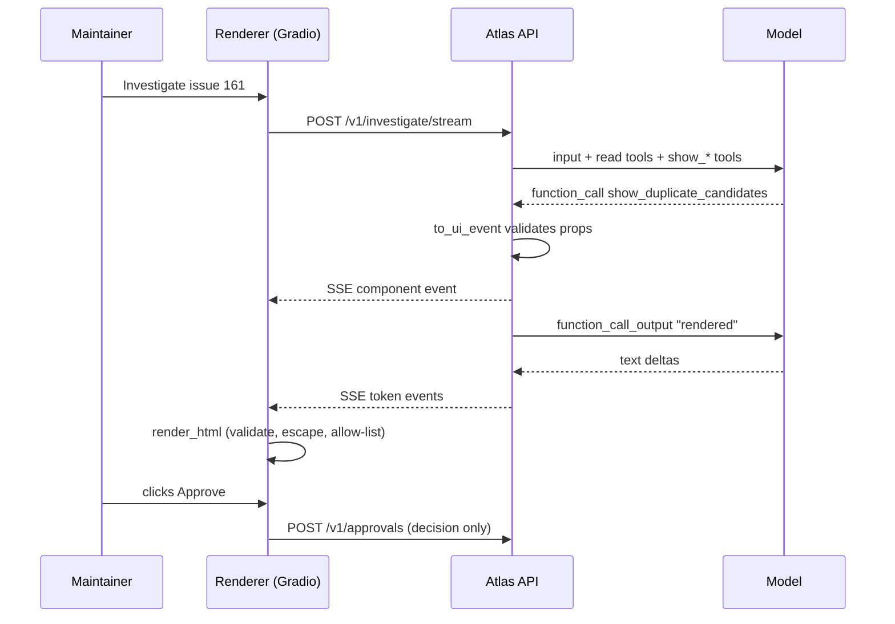
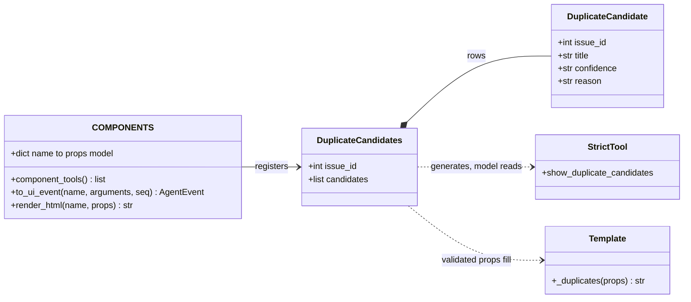
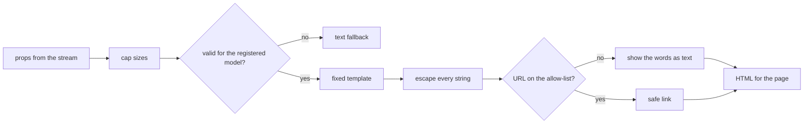
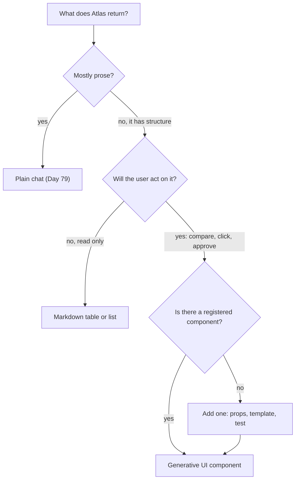

# Generative UI: Typed Components from Tool Calls

Atlas's investigator ends with a sentence like "Possible duplicates: #143, #150 and #145 (similarity high, medium, low)". A maintainer can't click it, compare the issues side by side, or approve "mark #161 as a duplicate of #143" from a paragraph. The model already knows the structure of that answer. Today it sends a typed `DuplicateCandidates` card instead of prose, and you build the backend and renderer that make that safe.

## At a Glance

- **Time:** ~2 h core (+ optional Go Deeper) · **Depth:** intro
- **Prerequisites:** [Day 77: Serving LLM Apps with FastAPI](../../Phase_9_Production/Day_077_fastapi_serving/fastapi_serving.md), [Day 79: Chat UIs & Streaming Transports](../../Phase_9_Production/Day_079_chat_uis_streaming/chat_uis_streaming.md); helpful: [Day 36: Tool Design](../../Phase_4_Tools_and_MCP/Day_036_tool_design/tool_design.md), [Day 71: Safe Output Handling](../../Phase_8_Safety_and_Security/Day_071_safe_output_handling/safe_output_handling.md)
- **You'll build:** `atlas/ui/components.py` (a registry of five typed components, strict tools generated from it, validation with a text fallback, and an escaping HTML renderer), a FastAPI endpoint that streams `component` events next to text, a Gradio view, six renderer tests, and a strict-schema lint.
- **Stops at:** a full React app, design systems, MCP Apps SDK details.
- **Fast path:** Already know server-driven UI? Read [Name the Parts](#name-the-parts), [Break It](#break-it-bad-props-and-hostile-strings) and [A Minimal Renderer](#a-minimal-renderer), then do Exercise 3 (about 45 min).
- **Cost:** ≈ $0.05 on `gpt-6-luna` for the live scripts and Exercise 3 (prices as of 2026-11, [verify](https://developers.openai.com/api/docs/pricing)). Every other script runs offline from a fixture.
- **New terms:** generative UI, component registry, typed props, UI event, fallback rendering

> **Coming from Software Engineering?** This is server-driven UI, except the server is an LLM. In server-driven UI (the pattern where the backend sends "draw a card with these fields" and the app knows how to draw cards), the client ships a fixed set of components and the server picks which ones to show. Your component registry is a design system or Storybook catalog (a browsable list of components with typed props). The tool schemas are an OpenAPI contract the model must satisfy. What's new: the producer is probabilistic and can be steered by an attacker's issue text, so every payload is validated like an untrusted request and every string is escaped like user input.

## Prose Is a Bad Interface for Structured Answers

Here is what the Day 77 investigator streams for Orbit issue #161, "Redis failover causes reconnect storm":

```text
This looks like the known 3.1.0 reconnect storm. Possible duplicates: #143 (high: same
ORB-1001 flood after failover), #150 (medium: same error code) and #145 (medium). I'd
suggest marking #161 as a duplicate of #143 and pointing the reporter at 3.1.2.
```

Everything a maintainer needs is in there, trapped in a sentence. They can't sort the candidates, open #143 in one click, or approve the suggested action. Teams end up regex-scraping numbers back out of prose the model had as structure.

**Generative UI** means the model chooses a UI component and fills in its data, and your app draws it. It still writes text when text fits. When the answer has a shape, it calls a tool such as `show_duplicate_candidates`, and the user sees a table with links and buttons.

## The Menu and the Kitchen

Think of a restaurant. The kitchen (the model) may only send dishes that are on the menu (the **component registry**). Each dish has a fixed recipe card listing its ingredients (the **typed props**: the data a component needs to draw itself). The waiter (the **renderer**: code that turns props into HTML) knows how to plate every dish on the menu, and sends back anything that isn't on it.

Work one through by hand. The model calls a tool with this JSON:

```json
{"issue_id": 7,
 "candidates": [
   {"issue_id": 3, "title": "Worker hangs on shutdown", "confidence": "high", "reason": "same stack trace"},
   {"issue_id": 5, "title": "SIGTERM ignored", "confidence": "medium", "reason": "same symptom"},
   {"issue_id": 6, "title": "Slow startup", "confidence": "low", "reason": "same component"}]}
```

Check it against the recipe card: `issue_id` is an integer, `candidates` is a list, each `confidence` is one of `high`, `medium` or `low`. It passes, so the waiter plates it:

| Issue | Title | Confidence | Why |
|---|---|---|---|
| #3 | Worker hangs on shutdown | high | same stack trace |
| #5 | SIGTERM ignored | medium | same symptom |
| #6 | Slow startup | low | same component |

If `confidence` had been `"very high"` or `candidates` had been a sentence, the check fails and the user gets plain text instead. That's the whole idea. The rest of the day is making each step real and safe.

## Name the Parts

- **Component:** a reusable piece of UI, such as a card, table or diff view. Atlas has five: `IssueCard`, `CitationList`, `DuplicateCandidates`, `ConfigDiff` and `ApprovalRequest`.
- **Typed props:** a Pydantic model per component. It is the recipe card: it validates what the model sent, and it generates the tool schema the model sees.
- **Component registry:** `COMPONENTS`, a dict from component name to props model. Tools, validation and templates are all derived from it, so the three can't drift apart.
- **UI event:** an `AgentEvent(type="component", data={"name", "version", "props"})` on the [Day 77](../../Phase_9_Production/Day_077_fastapi_serving/fastapi_serving.md) SSE envelope. It travels in the same stream as `token` events, so text and cards interleave.
- **Fallback rendering:** when props fail validation, or the component is unknown, the user sees readable text and you log a miss. A broken card never becomes a broken page.

Here is one full turn, from the model's tool call to the maintainer pressing Approve:



Generative UI is a spectrum of how much the model decides:

| Who decides the markup | Example | Use it? |
|---|---|---|
| **You** own fixed components; the model picks one and fills props | today's registry | yes: this is the safe default |
| The model composes a layout from your catalog (a tree of known components) | dashboards built from cards and charts | sometimes, once the simple version works |
| The model writes HTML or JavaScript | "generate a page for this answer" | no: that is a cross-site scripting (XSS) hole with extra steps |

## Minimal Code: One Component

The smallest version: one props model, one strict tool generated from it, one forced call. `pydantic_responses_function_tool` (in the OpenAI SDK) turns a Pydantic model into a flat Responses tool with `strict: True`, `additionalProperties: false` and every field in `required`, the shape [Day 36](../../Phase_4_Tools_and_MCP/Day_036_tool_design/tool_design.md) taught you to write by hand.

```python
# script_id: day_080_generative_ui/first_component
# Install: uv add "openai>=3.46" pydantic   Env: OPENAI_API_KEY, ATLAS_MODEL, ORBIT_DATA
import json
import os
from pathlib import Path
from typing import Literal

from openai import OpenAI, pydantic_responses_function_tool
from pydantic import BaseModel

MODEL = os.environ.get("ATLAS_MODEL", "gpt-6-luna")
DATA_DIR = Path(os.environ.get("ORBIT_DATA", "datasets/orbit"))

class IssueCard(BaseModel):
    """One Orbit issue: number, title, state, labels and link."""
    issue_id: int
    title: str
    state: Literal["open", "closed"]
    labels: list[str]
    url: str

issue = next(i for i in map(json.loads, (DATA_DIR / "issues/issues.jsonl").open()) if i["id"] == 143)
tool = pydantic_responses_function_tool(IssueCard, name="show_issue_card", description=IssueCard.__doc__)
resp = OpenAI().responses.create(
    model=MODEL, tools=[tool], tool_choice={"type": "function", "name": "show_issue_card"},
    input=f"Show this issue as a card. Its URL is https://issues.orbit.example/143\n{json.dumps(issue)[:3000]}")
call = next(i for i in resp.output if i.type == "function_call")   # forced, so it's there
print(repr(IssueCard.model_validate_json(call.arguments)))           # arguments is a JSON string
```

```text
IssueCard(issue_id=143, title='3.1.0: reconnect storm after Redis failover, thousands of connections and an ORB-1001 flood take Redis down again', state='closed', labels=['type:bug', 'comp:broker-redis', 'severity:S1', 'version:3.1'], url='https://issues.orbit.example/143')
```

(Your output will differ; the model may trim the title.) `tool_choice` forces the call for a predictable demo. In the real loop, leave it on `"auto"`.

Strict mode gives you a strong guarantee: the arguments match the schema's *shape*. It does not make them *true* (the model can still invent issue #9999), and it does not make them *safe to put in HTML*. The next section breaks both.

## Break It: Bad Props and Hostile Strings

Two things go wrong. First, props arrive with the wrong shape. With `strict: True` that's rare, but it happens: someone turns strict off, you swap in an open-weight model (Day 91) that ignores strict schemas, or an old client replays a cached event. Second, props arrive with the *right* shape and a hostile value. Strangers write issue titles, and Orbit's issues already include prompt-injection fixtures ([Day 69](../../Phase_8_Safety_and_Security/Day_069_prompt_injection/prompt_injection.md)). `` is a valid `str`. This script needs no key; the "model output" is hand-written JSON.

```python
# script_id: day_080_generative_ui/break_it
# Install: uv add pydantic   No key needed: the "model output" below is hand-written.
import html
from typing import Literal
from urllib.parse import urlsplit

from pydantic import BaseModel, ValidationError

class IssueCard(BaseModel):              # same props model as first_component
    issue_id: int
    title: str
    state: Literal["open", "closed"]
    labels: list[str]
    url: str

bad = ('{"issue_id": 143, "title": "Reconnect storm", "state": "closed", '
       '"labels": "bug", "url": "https://issues.orbit.example/143"}')
try:
    IssueCard.model_validate_json(bad)
except ValidationError as exc:
    print(exc)                           # this is what you log; the user gets the text fallback

hostile = IssueCard(issue_id=999, title="", state="open",
                    labels=["type:bug"], url="javascript:alert(document.cookie)")
print("naive:  ", f'<a href="{hostile.url}">{hostile.title}</a>')
print("escaped:", html.escape(hostile.title, quote=True))
print("url ok? ", urlsplit(hostile.url).scheme == "https")
```

```text
1 validation error for IssueCard
labels
  Input should be a valid array [type=list_type, input_value='bug', input_type=str]
    For further information visit https://errors.pydantic.dev/2.14/v/list_type
naive:   <a href="javascript:alert(document.cookie)"></a>
escaped: &lt;img src=x onerror=alert(1)&gt;
url ok?  False
```

(`model_validate_json` says "valid array"; validating a Python dict says "valid list".) The "naive" line is the bug the old version of this lesson shipped. In a browser, that `` fails to load, `onerror` runs the attacker's script with the maintainer's session, and clicking the link runs another. Validation can't stop either: both values are valid strings.

Three rules make a hostile title render as inert text. Every renderer you write today follows them:

1. **Escape every string at the template boundary.** `html.escape(value, quote=True)` turns `<`, `>`, `&` and quotes into entities, so the browser shows them instead of parsing them.
2. **The model never chooses tags or attributes.** Templates are fixed code you wrote. The model fills values into slots; it can't add an `onerror` or a `<script>`.
3. **URLs must pass an allow-list.** `https` only, exact host match, no `user@host` tricks (the [Day 71](../../Phase_8_Safety_and_Security/Day_071_safe_output_handling/safe_output_handling.md) rule). Anything else is shown as words, not a link. Better still, build URLs yourself from ids, so the model never supplies one.

Count validation failures per component, like tool errors: a rise after a prompt change means the model and the registry disagree.

## The Registry: One Contract, Three Consumers

Hand-maintained lists of tools, component mappings and templates drift: map a tool called `search_web` while defining `search_products`, and the component never appears, with no error. The fix is one source of truth: each component is a Pydantic model, and everything else is generated from `COMPONENTS`:



The props models come first. Each docstring matters: it becomes part of the tool description the model reads when deciding which card fits.

```python
# script_id: day_080_generative_ui/components
# Install: uv add "openai>=3.46" pydantic   No key needed: this file validates and renders only.
# Becomes atlas/ui/components.py in R5. stream_app, gradio_view and test_renderer import it.
import html
import json
import logging
import re
from collections.abc import Callable
from typing import Literal
from urllib.parse import urlsplit

from openai import pydantic_responses_function_tool
from pydantic import BaseModel, Field, ValidationError

log = logging.getLogger("atlas.ui")

class AgentEvent(BaseModel):            # compact copy of Day 77's envelope (atlas/api/events.py)
    seq: int = 0
    type: Literal["status", "token", "tool_call", "tool_result", "citation", "component",
                  "final", "error", "cancelled", "done"]
    data: dict = Field(default_factory=dict)

class IssueCard(BaseModel):
    """One Orbit issue: number, title, state, labels and link."""
    issue_id: int
    title: str
    state: Literal["open", "closed"]
    labels: list[str]
    url: str

class Citation(BaseModel):              # compact copy of Day 15 / Day 28
    doc_id: str
    quote: str

class CitationList(BaseModel):
    """The Orbit docs an answer relied on, each with the passage quoted."""
    citations: list[Citation]
```

```python
# script_id: day_080_generative_ui/components
class DuplicateCandidate(BaseModel):
    issue_id: int
    title: str
    confidence: Literal["high", "medium", "low"]
    reason: str

class DuplicateCandidates(BaseModel):
    """Earlier issues that may describe the same problem as issue_id, best match first."""
    issue_id: int
    candidates: list[DuplicateCandidate]

class ConfigDiff(BaseModel):
    """A before/after config change, such as orbit.ini (2.x) to orbit.toml (3.x)."""
    before: str
    after: str
    notes: list[str]

class ApprovalArgs(BaseModel):          # typed, not `dict`: strict tools need closed objects
    issue_id: int
    value: str                          # the label, the duplicate's number, or the reply text

class ApprovalRequest(BaseModel):
    """Ask a maintainer to approve one write action. Showing it never executes anything."""
    action: Literal["add_label", "mark_duplicate", "post_reply"]
    args: ApprovalArgs
    risk: Literal["low", "high"]

VERSION = 1                             # bump when a props model changes shape (see the Stretch)
COMPONENTS: dict[str, type[BaseModel]] = {
    m.__name__: m for m in (IssueCard, CitationList, DuplicateCandidates, ConfigDiff, ApprovalRequest)}
```

Notice `ApprovalArgs`. A field typed `args: dict` generates `{"type": "object", "additionalProperties": true}`, but strict mode requires `additionalProperties: false` on every object. The SDK still sends `"strict": true`, so the API rejects the request. A typed model per action fixes it, and the lint below catches it offline.

Now generate the tools from the registry, and add the guard that turns a tool call into a UI event:

```python
# script_id: day_080_generative_ui/components
def tool_name(component: str) -> str:
    """IssueCard -> show_issue_card. Derived, so tools and registry can't drift apart."""
    return "show_" + re.sub(r"(?<!^)(?=[A-Z])", "_", component).lower()

TOOL_TO_COMPONENT = {tool_name(n): n for n in COMPONENTS}

def component_tools() -> list[dict]:
    """One strict function tool per registered component, built from its props model."""
    return [pydantic_responses_function_tool(m, name=tool_name(n), description=f"Display a {n}. {m.__doc__}")
            for n, m in COMPONENTS.items()]

MAX_ROWS, MAX_CHARS = 10, 800           # a card is not a data dump

def _cap(value):
    """Truncate long strings and lists before validation, so one runaway call can't flood the page."""
    if isinstance(value, str):
        return value if len(value) <= MAX_CHARS else value[:MAX_CHARS] + "…"
    if isinstance(value, list):
        return [_cap(v) for v in value[:MAX_ROWS]]
    if isinstance(value, dict):
        return {k: _cap(v) for k, v in value.items()}
    return value

def fallback_markdown(component: str, arguments: str) -> str:
    """Plain text any client can show. The client still renders it through its safe sink (Day 79)."""
    try:
        fields = json.loads(arguments)
    except json.JSONDecodeError:
        fields = None
    lines = [f"- {k}: {str(v)[:200]}" for k, v in fields.items()] if isinstance(fields, dict) else []
    return f"(Couldn't draw the {component} card, showing plain text.)\n" + "\n".join(lines[:MAX_ROWS])
```

```python
# script_id: day_080_generative_ui/components
def to_ui_event(name: str, arguments: str, seq: int = 0) -> AgentEvent:
    """Tool call -> validated `component` event, or a `token` event carrying a text fallback."""
    component = TOOL_TO_COMPONENT.get(name, name)        # accepts show_issue_card or IssueCard
    model = COMPONENTS.get(component)
    try:
        if model is None:
            raise KeyError(f"unknown component {component!r}")
        props = model.model_validate(_cap(json.loads(arguments)))
    except (KeyError, json.JSONDecodeError, ValidationError) as exc:
        log.warning("component miss %s: %s", component, exc)   # count these: it's an eval signal
        return AgentEvent(seq=seq, type="token", data={
            "text": fallback_markdown(component, arguments), "fallback": True,
            "reason": type(exc).__name__})
    return AgentEvent(seq=seq, type="component",
                      data={"name": component, "version": VERSION, "props": props.model_dump()})
```

The fallback is a `token` event on purpose. A client that has never heard of components (an old mobile build, a CLI, the [Day 79](../../Phase_9_Production/Day_079_chat_uis_streaming/chat_uis_streaming.md) chat) already knows how to show tokens, so a miss degrades to text everywhere. Caps run *before* validation: a 50-row candidate list becomes 10 rows rather than an error, because a slightly long answer is still a useful answer.

Last, a lint that lists every generated object strict mode would refuse. It needs no key, so a careless `dict` fails CI, not a live request:

```python
# script_id: day_080_generative_ui/strict_lint
# Install: uv add pydantic "openai>=3.46"   No key needed. Needs components.py next to this file.
from openai import pydantic_responses_function_tool
from pydantic import BaseModel

from components import component_tools

def open_objects(schema: dict, path: str = "$") -> list[str]:
    """Paths of object schemas without additionalProperties: false (strict mode refuses them)."""
    found = [path] if schema.get("type") == "object" and schema.get("additionalProperties") is not False else []
    for key, sub in schema.get("properties", {}).items():
        found += open_objects(sub, f"{path}.{key}")
    for key, sub in schema.get("$defs", {}).items():
        found += open_objects(sub, f"$defs.{key}")
    if isinstance(schema.get("items"), dict):
        found += open_objects(schema["items"], f"{path}[]")
    for sub in schema.get("anyOf", []):
        found += open_objects(sub, path)
    return found

class LooseApproval(BaseModel):         # the mistake ApprovalArgs avoids
    action: str
    args: dict

loose = pydantic_responses_function_tool(LooseApproval, name="show_loose_approval")
for tool in [*component_tools(), loose]:
    problems = open_objects(tool["parameters"])
    print(f"{tool['name']:<28} {'OPEN: ' + ', '.join(problems) if problems else 'ok'}")
```

```text
show_issue_card              ok
show_citation_list           ok
show_duplicate_candidates    ok
show_config_diff             ok
show_approval_request        ok
show_loose_approval          OPEN: $.args
```

## Streaming Components over SSE

The endpoint is the Day 77 `/v1/investigate/stream`, with two changes. The `show_*` tools from the registry join the read-only tools, and the loop treats them differently: instead of running anything, it validates the arguments, emits a `component` event, and answers the call with `"rendered"`.

That answer matters. The Responses API needs a `function_call_output` for **every** call, matched by `call_id`, before the next request. The old version of this lesson emitted the component and stopped, so the model never added its sentence after the card.

The first block loads issues and defines a keyword search, a stand-in for R2's hybrid search:

```python
# script_id: day_080_generative_ui/stream_app
# Install: uv add fastapi uvicorn "openai>=3.46" pydantic   Env: OPENAI_API_KEY, ATLAS_MODEL, ORBIT_DATA
# No key? It replays a fixture (ATLAS_OFFLINE=1 forces that). Needs components.py next to it.
# Run: uv run python stream_app.py          (serves on :8000)
#      uv run python stream_app.py --print  (prints one SSE transcript and exits)
import json
import os
import re
import sys
from collections.abc import AsyncGenerator, AsyncIterable, Callable
from functools import cache
from pathlib import Path
from typing import Literal

from fastapi import FastAPI
from fastapi.sse import EventSourceResponse, ServerSentEvent
from openai import AsyncOpenAI
from pydantic import BaseModel

from components import TOOL_TO_COMPONENT, AgentEvent, ApprovalArgs, component_tools, to_ui_event

MODEL = os.environ.get("ATLAS_MODEL", "gpt-6-luna")
DATA_DIR = Path(os.environ.get("ORBIT_DATA", "datasets/orbit"))
RULES = ("You are Atlas, assistant to Orbit's maintainers. Investigate the issue with the tools. "
         "When the answer has structure (duplicates, a config change, a proposed write action), "
         "show it with the matching show_* tool, then add one or two plain sentences.")

@cache
def load_issues() -> dict[int, dict]:
    lines = (DATA_DIR / "issues" / "issues.jsonl").read_text(encoding="utf-8").splitlines()
    return {d["id"]: d for d in map(json.loads, lines)}

def search_issues(query: str, k: int = 5) -> list[dict]:
    """Keyword-overlap stand-in for R2's hybrid search (Day 27), over issue titles."""
    terms = set(re.findall(r"[a-z0-9-]{3,}", query.lower()))
    ranked = sorted(load_issues().values(), key=lambda i: -sum(t in i["title"].lower() for t in terms))
    return [{"id": i["id"], "title": i["title"], "state": i["state"]} for i in ranked[:k]]
```

```python
# script_id: day_080_generative_ui/stream_app
def _tool(name: str, description: str, prop: str, typ: str) -> dict:
    return {"type": "function", "name": name, "description": description, "strict": True,
            "parameters": {"type": "object", "properties": {prop: {"type": typ}},
                           "required": [prop], "additionalProperties": False}}

READ_TOOLS = [_tool("get_issue", "Fetch an Orbit issue by number.", "issue_id", "integer"),
              _tool("search_issues", "Find Orbit issues whose titles match a query.", "query", "string")]
TOOLS = READ_TOOLS + component_tools()          # the registry generates the UI tools

def run_tool(name: str, args: dict) -> str:     # read-only, so safe to run on untrusted issue text
    if name == "get_issue":
        issue = load_issues().get(args["issue_id"], {})
        return json.dumps({k: issue.get(k) for k in ("id", "title", "state", "labels", "body")})[:4000]
    return json.dumps(search_issues(args["query"]))
```

The loop is the Day 48 loop, streamed. Text deltas become `token` events as they arrive. The full list of output items, including any tool calls, comes on the final `response.completed` event:

```python
# script_id: day_080_generative_ui/stream_app
async def investigate(client, issue_id: int, max_steps: int = 6) -> AsyncGenerator[AgentEvent, None]:
    """Compact Day 48 loop: text streams as `token` events, show_* calls become `component` events."""
    items: list = [{"role": "user", "content": f"Investigate Orbit issue #{issue_id}."}]
    for _ in range(max_steps):
        output = None
        stream = await client.responses.create(model=MODEL, instructions=RULES, input=items,
                                               tools=TOOLS, stream=True)
        async for ev in stream:
            if ev.type == "response.output_text.delta":
                yield AgentEvent(type="token", data={"text": ev.delta})
            elif ev.type == "response.completed":
                output = ev.response.output
        if output is None:                      # failed or incomplete: say so, don't hang
            yield AgentEvent(type="error", data={"code": "model_stream_ended"})
            return
        items += output
        calls = [i for i in output if i.type == "function_call"]
        if not calls:
            return
        for call in calls:                      # answer EVERY call, or the next request is rejected
            if call.name in TOOL_TO_COMPONENT:
                event = to_ui_event(call.name, call.arguments)
                yield event
                result = "rendered" if event.type == "component" else "not rendered: props invalid"
            else:
                yield AgentEvent(type="tool_call", data={"name": call.name})
                result = run_tool(call.name, json.loads(call.arguments))
            items.append({"type": "function_call_output", "call_id": call.call_id, "output": result})
    yield AgentEvent(type="error", data={"code": "max_steps"})
```

To run this with no key, `ReplayClient` stands in for `AsyncOpenAI`. It has the same `responses.create(..., stream=True)` call and yields events with the same `type`, `delta` and `response.output` attributes. The fixture is hand-written to match those shapes; it is not a recording of a live run.

```python
# script_id: day_080_generative_ui/stream_app
from types import SimpleNamespace as NS

FIXTURE = [   # (text the model streams, [(tool name, arguments)]) per model turn
    ("", [("search_issues", {"query": "redis failover reconnect storm ORB-1001"})]),
    ("", [("show_duplicate_candidates", {"issue_id": 161, "candidates": [
        {"issue_id": 143, "title": "3.1.0: reconnect storm after Redis failover", "confidence": "high",
         "reason": "Same 3.1.0 failover and ORB-1001 flood"},
        {"issue_id": 150, "title": "ORB-1001 spam after Redis primary switch", "confidence": "medium",
         "reason": "Same error code, less detail"}]}),
          ("show_approval_request", {"action": "mark_duplicate", "args": {"issue_id": 161, "value": "143"},
                                     "risk": "low"})]),
    ("#161 matches #143, fixed in 3.1.2. Upgrading stops the storm.", []),
]

class ReplayClient:
    """Offline stand-in for AsyncOpenAI: `client.responses.create(...)` replays FIXTURE turns."""
    def __init__(self, turns: list) -> None:
        self.responses, self._turns = self, iter(turns)   # so client.responses.create works

    async def create(self, **_: object):
        text, calls = next(self._turns)
        output = [NS(type="function_call", name=n, arguments=json.dumps(a), call_id=f"call_{n}")
                  for n, a in calls]

        async def events():
            for word in text.split():
                yield NS(type="response.output_text.delta", delta=word + " ")
            yield NS(type="response.completed", response=NS(output=output))
        return events()
```

Finally the app. It stamps sequence ids and adds a `done` event; in R5, Day 77's `sse_stream` does this plus deadlines and disconnect handling. The `/v1/approvals` route only *records* a decision. Executing it, with permission checks and idempotency, belongs to [Day 55](../../Phase_6_Agents/Day_055_human_in_the_loop/human_in_the_loop.md) and [Day 76](../../Phase_8_Safety_and_Security/Day_076_capstone_r4_triage/capstone_r4_triage.md).

```python
# script_id: day_080_generative_ui/stream_app
class InvestigateRequest(BaseModel):
    issue_id: int

class Decision(BaseModel):
    decision: Literal["approve", "reject"]
    action: str
    args: ApprovalArgs

DECISIONS: list[Decision] = []                  # recorded only; executing is Day 55 / Day 76's job

def create_app(get_client: Callable[[], object]) -> FastAPI:
    app = FastAPI()

    @app.post("/v1/investigate/stream", response_class=EventSourceResponse)
    async def investigate_stream(req: InvestigateRequest) -> AsyncIterable[ServerSentEvent]:
        seq = 0
        async for e in investigate(get_client(), req.issue_id):
            seq += 1
            yield ServerSentEvent(id=str(seq), event=e.type, data=e.data)
        yield ServerSentEvent(id=str(seq + 1), event="done", data={})

    @app.post("/v1/approvals", status_code=202)
    async def approvals(d: Decision) -> dict:
        DECISIONS.append(d)
        return {"status": "recorded"}
    return app

if __name__ == "__main__":
    offline = os.environ.get("ATLAS_OFFLINE") == "1" or "OPENAI_API_KEY" not in os.environ
    shared = None if offline else AsyncOpenAI()  # one client for the process, reused per request
    app = create_app(lambda: ReplayClient(FIXTURE) if offline else shared)
    if "--print" in sys.argv:
        from fastapi.testclient import TestClient
        with TestClient(app).stream("POST", "/v1/investigate/stream", json={"issue_id": 161}) as r:
            print("\n".join(line for line in r.iter_lines() if line.startswith(("event", "data"))))
    else:
        import uvicorn
        uvicorn.run(app, port=8000)
```

```text
event: tool_call
data: {"name": "search_issues"}
event: component
data: {"name": "DuplicateCandidates", "version": 1, "props": {"issue_id": 161, "candidates": [...]}}
event: component
data: {"name": "ApprovalRequest", "version": 1, "props": {"action": "mark_duplicate", ...}}
event: token
data: {"text": "#161 "}
...
event: done
data: {}
```

(Shortened; live, your text and candidates will differ.) Text and cards share one ordered stream, so the client draws them in the model's order.

## A Minimal Renderer

The renderer is where XSS is stopped. It re-validates props even though the server already did, because the wire is a trust boundary: a stale cache or a second producer can put anything on it. Every failure ends in text, never raw HTML.



First the helpers: a compact copy of Day 71's URL check, an escape function, and link builders. Issue and doc links are built from ids, so the model never supplies those URLs at all:

```python
# script_id: day_080_generative_ui/components
ALLOWED_HOSTS = frozenset({"docs.orbit.example", "issues.orbit.example"})
ISSUES_URL, DOCS_URL = "https://issues.orbit.example/", "https://docs.orbit.example/"

def is_allowed_url(url: str) -> bool:
    """Compact Day 71 rule: https only, exact host match, no user@host tricks."""
    try:
        parts = urlsplit(url.strip())
        parts.port                                    # raises ValueError on a malformed port
    except ValueError:
        return False
    return parts.scheme == "https" and parts.hostname in ALLOWED_HOSTS and parts.username is None

def esc(value: object) -> str:
    return html.escape(str(value), quote=True)        # quote=True makes it safe inside attributes

def link(url: str, text: str) -> str:
    """A link only if the URL passes the allow-list; otherwise the words, as plain text."""
    if not is_allowed_url(url):
        return esc(text)
    return f'<a href="{esc(url)}" rel="noopener noreferrer nofollow">{esc(text)}</a>'

def _issue(n: int) -> str:
    return link(f"{ISSUES_URL}{n}", f"#{n}")          # n is a validated int, not model text

def _doc(doc_id: str) -> str:
    return link(DOCS_URL + doc_id, doc_id) if re.fullmatch(r"[a-z0-9-]+", doc_id) else esc(doc_id)
```

One template per component. Each is ordinary code: it decides every tag and attribute, and only escaped values go into the slots:

```python
# script_id: day_080_generative_ui/components
def _issue_card(p: IssueCard) -> str:
    labels = " ".join(f'<span class="label">{esc(x)}</span>' for x in p.labels)
    return f"<h3>{_issue(p.issue_id)} {link(p.url, p.title)}</h3><p>{esc(p.state)} {labels}</p>"

def _citations(p: CitationList) -> str:
    return "<ol>" + "".join(f"<li>{_doc(c.doc_id)}: {esc(c.quote)}</li>" for c in p.citations) + "</ol>"

def _duplicates(p: DuplicateCandidates) -> str:
    rows = "".join(f"<tr><td>{_issue(c.issue_id)}</td><td>{esc(c.title)}</td>"
                   f"<td>{esc(c.confidence)}</td><td>{esc(c.reason)}</td></tr>" for c in p.candidates)
    return (f"<h3>Possible duplicates of {_issue(p.issue_id)}</h3><table><tr><th>Issue</th>"
            f"<th>Title</th><th>Confidence</th><th>Why</th></tr>{rows}</table>")

def _config_diff(p: ConfigDiff) -> str:
    notes = "".join(f"<li>{esc(n)}</li>" for n in p.notes)
    return f"<pre>{esc(p.before)}</pre><p>becomes</p><pre>{esc(p.after)}</pre><ul>{notes}</ul>"

def _approval(p: ApprovalRequest) -> str:
    # Inert buttons: no inline handlers. The host wires them to POST /v1/approvals.
    return (f"<p>Atlas asks to <b>{esc(p.action)}</b> on {_issue(p.args.issue_id)}: "
            f"{esc(p.args.value)} (risk: {esc(p.risk)})</p>"
            '<button type="button" data-decision="approve">Approve</button>'
            '<button type="button" data-decision="reject">Reject</button>')

TEMPLATES: dict[str, Callable[..., str]] = {
    "IssueCard": _issue_card, "CitationList": _citations, "DuplicateCandidates": _duplicates,
    "ConfigDiff": _config_diff, "ApprovalRequest": _approval}
```

```python
# script_id: day_080_generative_ui/components
def render_html(name: str, props: dict) -> str:
    """Validate again (never trust the wire), then fill a fixed template. Failures render as text."""
    model, template = COMPONENTS.get(name), TEMPLATES.get(name)
    try:
        if model is None or template is None:
            raise KeyError(name)
        body = template(model.model_validate(_cap(props)))
    except (KeyError, ValidationError):
        return f'<div class="atlas-fallback">{esc(f"[{name}: this card cannot be displayed]")}</div>'
    return f'<div class="atlas-card" data-component="{esc(name)}">{body}</div>'

if __name__ == "__main__":
    tool = component_tools()[2]
    print(tool["name"], tool["strict"], sorted(tool["parameters"]["properties"]))
    args = json.dumps({"issue_id": 161, "candidates": [
        {"issue_id": 143, "title": "3.1.0: reconnect storm after Redis failover",
         "confidence": "high", "reason": "Same ORB-1001 flood after failover"}]})
    event = to_ui_event("show_duplicate_candidates", args, seq=1)
    print(event.type, event.data["name"])
    print(render_html(event.data["name"], event.data["props"])[:160], "...")
    print(to_ui_event("show_issue_card", '{"issue_id": 1, "labels": "bug"}').data["text"])
```

```text
show_duplicate_candidates True ['candidates', 'issue_id']
component DuplicateCandidates
<div class="atlas-card" data-component="DuplicateCandidates"><h3>Possible duplicates of <a href="https://issues.orbit.example/161" rel="noopener noreferrer nofo ...
(Couldn't draw the IssueCard card, showing plain text.)
- issue_id: 1
- labels: bug
```

(The `component miss` warning with the full `ValidationError` goes to stderr, which is where your logs pick it up.)

Six tests pin the three rules down, so a template that forgets to escape fails CI before a maintainer sees it.

```python
# script_id: day_080_generative_ui/test_renderer
# Install: uv add pytest pydantic "openai>=3.46"   Run: uv run pytest test_renderer.py -q
import json

import pytest

from components import render_html, to_ui_event

HOSTILE = ""
CARD = {"issue_id": 999, "title": HOSTILE, "state": "open", "labels": ["type:bug"],
        "url": "https://issues.orbit.example/999"}

def test_strings_are_escaped() -> None:
    page = render_html("IssueCard", CARD)
    assert " None:
    page = render_html("IssueCard", {**CARD, "url": "javascript:alert(document.cookie)"})
    assert "javascript:" not in page

def test_unknown_component_falls_back() -> None:
    assert "atlas-fallback" in render_html("ShellCommand", {"cmd": "rm -rf /"})
    assert to_ui_event("show_shell_command", "{}").type == "token"

def test_bad_types_fall_back() -> None:
    event = to_ui_event("show_issue_card", json.dumps({**CARD, "labels": "bug"}))
    assert event.type == "token" and event.data["fallback"] is True

def test_oversize_props_are_capped() -> None:
    rows = [{"issue_id": i, "title": "x" * 5000, "confidence": "low", "reason": "r"} for i in range(50)]
    props = to_ui_event("show_duplicate_candidates", json.dumps({"issue_id": 1, "candidates": rows})).data["props"]
    assert len(props["candidates"]) == 10 and len(props["candidates"][0]["title"]) == 801

def test_valid_card_renders() -> None:
    page = render_html("IssueCard", {**CARD, "title": "Reconnect storm"})
    assert '<a href="https://issues.orbit.example/999"' in page and "Reconnect storm" in page

if __name__ == "__main__":
    raise SystemExit(pytest.main([__file__, "-q"]))
```

```text
......                                                                   [100%]
6 passed in 0.05s
```

### Showing it in Gradio

`gr.HTML` puts its value into the page with the browser's `innerHTML`. Gradio's own source notes that `<script>` tags inserted that way don't execute, but event-handler attributes such as `onerror` do fire, which is exactly the payload above. So `gr.HTML` is a raw sink: give it only `render_html` output, never model text. For the approval buttons, use real `gr.Button` components wired to Python. The HTML buttons from `_approval` are for hosts that attach their own listener (see Go Deeper).

```python
# script_id: day_080_generative_ui/gradio_view
# Install: uv add gradio pydantic "openai>=3.46"   Env: API_URL (default http://127.0.0.1:8000)
# Needs: stream_app.py running in another terminal, components.py next to this file.
import html
import json
import os
import urllib.request

import gradio as gr

from components import render_html

API_URL = os.environ.get("API_URL", "http://127.0.0.1:8000")

def post(path: str, body: dict) -> urllib.request.Request:
    return urllib.request.Request(API_URL + path, data=json.dumps(body).encode(),
                                  headers={"Content-Type": "application/json"})

def iter_sse(path: str, body: dict):
    """Compact Day 79 SSE reader: yields (event, data) pairs."""
    with urllib.request.urlopen(post(path, body), timeout=120) as resp:
        event, data = "message", []
        for raw in resp:
            line = raw.decode("utf-8").rstrip("\r\n")
            if line.startswith("event:"):
                event = line[6:].strip()
            elif line.startswith("data:"):
                data.append(line[5:].strip())
            elif not line and data:
                yield event, json.loads("\n".join(data))
                event, data = "message", []
```

```python
# script_id: day_080_generative_ui/gradio_view
def investigate(issue_id: float):
    text, cards, pending = "", [], None
    for event, data in iter_sse("/v1/investigate/stream", {"issue_id": int(issue_id)}):
        if event == "token":
            text += data["text"]
        elif event == "component":
            cards.append(render_html(data["name"], data["props"]))   # re-validates and escapes
            pending = data["props"] if data["name"] == "ApprovalRequest" else pending
        page = "".join(cards) + f'<p style="white-space: pre-wrap">{html.escape(text)}</p>'
        yield page, pending, gr.update(visible=pending is not None)

def decide(decision: str, pending: dict | None) -> str:
    if not pending:
        return "Nothing to approve."
    body = {"decision": decision, "action": pending["action"], "args": pending["args"]}
    try:
        urllib.request.urlopen(post("/v1/approvals", body), timeout=10)
    except OSError as exc:
        return f"Couldn't reach the approvals API: {exc}"
    return f"Recorded: {decision} {pending['action']} (the API executes it, not this page)."

with gr.Blocks(title="Atlas: generative UI") as demo:
    issue = gr.Number(value=161, label="Issue #", precision=0)
    go, view, pending = gr.Button("Investigate"), gr.HTML(), gr.State(None)
    with gr.Row(visible=False) as approval_row:
        approve, reject = gr.Button("Approve", variant="primary"), gr.Button("Reject")
    status = gr.Markdown()
    go.click(investigate, inputs=issue, outputs=[view, pending, approval_row])
    approve.click(lambda p: decide("approve", p), inputs=pending, outputs=status)
    reject.click(lambda p: decide("reject", p), inputs=pending, outputs=status)

if __name__ == "__main__":
    demo.launch()
```

Run `stream_app.py` and `gradio_view.py` in two terminals and press Investigate. Offline, you get the duplicates table, the approval request with its buttons, and the closing text.

## Beyond Your Own App: MCP Apps and ChatKit

So far you own both ends. Two standards let *other* hosts draw UI for your agent:

- **MCP Apps** is a **Stable** MCP extension for interactive UI shown inline in hosts. Your [Day 40](../../Phase_4_Tools_and_MCP/Day_040_mcp_servers/mcp_servers.md) server ships the UI and the host (a chat client or IDE) displays it in an isolated frame. This course hasn't verified its SDK, so check the resource format and sandbox rules in the spec (⚠ verify against current docs).
- **ChatKit** is OpenAI's embeddable chat UI. It is **still available** through the custom-server integration with the ChatKit Python SDK. What shuts down on 2026-11-30 is Agent Builder, and with it the hosted ChatKit workflows built on Agent Builder.

Both keep today's rules: the producer is untrusted, props are validated, strings are escaped, and the model never authors markup. Go Deeper compares all four ways to put cards in front of users.

## Trade-offs: Components or Plain Chat?

Components cost something: a props model, a template, tests, and a version to keep compatible. Use them where the user *acts* on structure.



### In production

- **Version components.** Old clients stay installed for months. Send `version` on every event, and make the renderer show a text fallback for versions it doesn't know (the Stretch exercise).
- **Measure use.** Log which components render, which fail validation, and which get clicked. A card nobody uses is a card to delete.
- **Accessibility.** Tables need header cells, buttons need text labels, and every card needs a sensible text version for screen readers and for the fallback.
- **Evaluate the choice.** "Did the model pick `DuplicateCandidates` when, and only when, a duplicate exists?" is a [Day 59](../../Phase_6_Agents/Day_059_evaluating_agents/evaluating_agents.md)-style trajectory check (Exercise 3).
- **Keep actions behind the API.** A button posts a decision; the server re-checks permissions and executes it idempotently.

### Commit it to R5

| Block(s) | R5 file |
|---|---|
| `components` (models, registry, tools, `to_ui_event`, renderer) | `atlas/ui/components.py` |
| `stream_app` loop changes + `/v1/approvals` stub | merge into `atlas/api/app.py` and `atlas/services.py` (Day 77) |
| `gradio_view` | merge into `atlas/ui/app.py` (Day 79) |
| `test_renderer` | `tests/test_components.py` |

## Go Deeper (optional)

<details><summary>Go deeper: who renders the UI (four options compared)</summary>

| Option | Who draws the UI | Fits when | Watch out for |
|---|---|---|---|
| Your own registry + renderer (today) | you, in your app | you own the product surface and want full control | you maintain every template |
| MCP Apps | the host, from UI your MCP server ships | you want Atlas cards inside other people's MCP hosts | host support varies; ⚠ verify the spec |
| ChatKit | OpenAI's embeddable widget, your server | you want a polished chat UI fast and you're on OpenAI | the hosted Agent Builder path is gone |
| React + a TypeScript AI SDK (such as Vercel's) | your frontend, in TypeScript | your product is a web app with a JS team | different language: see the [A13 primer](../../Appendix_Primers/A13_typescript_for_ai_engineers.md) |

Pick by who owns the screen. If it's your product, keep your own registry. If Atlas should appear inside someone else's MCP host, MCP Apps is the standard route. If you want a ready-made chat surface on OpenAI, ChatKit saves frontend work. If you have a JavaScript team, a TypeScript SDK fits their stack. The registry idea carries over to all of them: one typed contract per component.

</details>

<details><summary>Go deeper: a browser renderer that stays safe (read, don't write)</summary>

If your frontend is JavaScript, you can render from props in the browser instead of sending HTML. The same three rules apply, and the DOM gives you a tool that makes rule 1 automatic: `textContent` sets text, never markup. This is "read, don't write" code; it shows the shape, and the [A13 primer](../../Appendix_Primers/A13_typescript_for_ai_engineers.md) covers the language.

```javascript
// Render DuplicateCandidates from validated props. textContent never parses HTML.
function renderDuplicates(props, root) {
  const table = document.createElement("table");
  for (const c of props.candidates.slice(0, 10)) {          // cap rows on the client too
    const row = table.insertRow();
    const link = document.createElement("a");
    link.href = `https://issues.orbit.example/${Number(c.issue_id)}`;  // built from an id
    link.textContent = `#${Number(c.issue_id)}`;
    row.insertCell().append(link);
    for (const v of [c.title, c.confidence, c.reason]) row.insertCell().textContent = String(v);
  }
  root.replaceChildren(table);
}
// One delegated listener for every Approve/Reject button; the server decides what happens.
document.addEventListener("click", (e) => {
  const d = e.target.closest("[data-decision]")?.dataset.decision;
  if (d) fetch("/v1/approvals", {method: "POST", headers: {"Content-Type": "application/json"},
                                 body: JSON.stringify({decision: d, ...window.pendingApproval})});
});
```

Two habits carry over from Python. Never use `innerHTML` with anything that came from the model, and never build a URL from a model-supplied string when an id will do. If you must accept a URL, run the same allow-list check on the client that the server runs.

</details>

<details><summary>Go deeper: showing a card while its props are still streaming</summary>

Today's loop emits a component only when the whole tool call is finished (on `response.completed`). For big cards that can feel slow. The Responses stream gives you earlier signals:

- `response.output_item.added` fires when the model *starts* an output item. If the item is a `function_call` whose name is a `show_*` tool, you already know which card is coming. Emit `AgentEvent(type="status", data={"state": "drawing", "component": "DuplicateCandidates"})` and let the client show a skeleton (a grey placeholder in the card's shape).
- `response.function_call_arguments.delta` streams the argument JSON in pieces, and `.done` marks the end.

Resist rendering from the deltas. Half a JSON object can't be validated, a half-received string may end in the middle of an entity or a URL, and a card that changes shape as it streams is harder to read than one that appears once. A good middle ground: skeleton on `added`, full validation and render on `done`, and only for cards whose props are small. Check the event fields against the [streaming guide](https://developers.openai.com/api/docs/guides/streaming-responses) before you depend on them.

</details>

<details><summary>Go deeper: letting the model compose a layout</summary>

The middle of the spectrum is a layout model that holds a list of known components, for example `Layout(title: str, children: list[IssueCard | DuplicateCandidates | ConfigDiff])`. The model can then answer "compare these three issues and show the config fix" with one call that places several cards.

What changes:

- **Tag each child.** Add a `kind: Literal["IssueCard"]` field to each model, so the union is unambiguous and the renderer can dispatch on it.
- **Cap depth and count.** Allow one level of children and at most a handful of them. Nested layouts make schemas large and give a confused model room to produce something unreadable.
- **Check strict-mode limits.** Structured outputs have documented limits on schema size and nesting. Read them in the [structured outputs guide](https://developers.openai.com/api/docs/guides/structured-outputs) before you design a big union.
- **Evaluate layouts, not only components.** "Did it include the right cards, in a sensible order?" is a judge question (Day 45), not a string match.

Most teams never need this. Start with one card per tool call; move to layouts when users ask for comparisons the single cards can't express.

</details>

## Common Pitfalls

- **Rendering model-authored HTML.** Symptom: a title of `` pops an alert. Cause: unescaped props, or the model chose tags, attributes or URLs. Fix: fixed templates, `html.escape(..., quote=True)`, allow-listed URLs, `test_renderer`.
- **Crashing on bad props.** Symptom: `pydantic_core._pydantic_core.ValidationError: 1 validation error for IssueCard labels Input should be a valid list` reaches the user as a 500. Cause: no fallback. Fix: `to_ui_event` catches it, streams text, and logs the miss.
- **The component never appears.** Symptom: the model calls `show_dupes` and nothing renders, with no error. Cause: hand-maintained names drifted. Fix: generate tools *from* the registry.
- **The model stops after the card.** Symptom: the card shows but the closing sentence never comes, or the next request is rejected. Cause: no `function_call_output` was sent for the `show_*` call. Fix: answer every call by `call_id`, with `"rendered"` or the validation problem.
- **Strict tool rejected.** Symptom: the request fails when a component has a field like `args: dict`. Cause: the generated schema has `additionalProperties: true`, which strict mode doesn't accept, and the SDK sends it anyway. Fix: a typed model per action, like `ApprovalArgs`, and `strict_lint` in CI.
- **Trusting `gr.HTML`.** Symptom: cards are safe but the closing text isn't. Cause: model text went into `gr.HTML` (`innerHTML`). Fix: escape it, or use Day 79's `safe_markdown`.

> **Where we stop:** we don't build a React app, a design system, or an MCP Apps UI resource; those depend on frontend stacks and an extension SDK outside this course. Start with the [MCP extensions overview](https://modelcontextprotocol.io/docs/extensions/overview) and the [A13 primer](../../Appendix_Primers/A13_typescript_for_ai_engineers.md).

## Key Takeaways

- Prose hides structure the model already has; when users must compare, click or approve, send a typed component instead of a paragraph.
- A component registry of Pydantic props models is the single contract: strict tools for the model, validation for the backend, and templates for the renderer are all generated from it.
- Strict mode guarantees shape, not truth or safety, so validate on both ends and fall back to text (a `token` event) whenever validation fails or the component is unknown.
- Components travel as `component` events in the same SSE stream as text, and every `show_*` call gets a `function_call_output` so the model can continue.
- Hostile strings stay inert because of three rules: escape every string, never let the model choose tags or attributes, and allow-list every URL (or build it from an id).

## Quick Reference

| API / pattern | When to use | Gotcha |
|---|---|---|
| `pydantic_responses_function_tool(Model, name=, description=)` | build a strict tool from a props model | open `dict` fields produce `additionalProperties: true` |
| `tool_choice={"type": "function", "name": ...}` | force one card in a demo or test | leave `"auto"` in the real loop |
| `Model.model_validate_json(call.arguments)` | validate one call's arguments | `arguments` is a JSON string, not a dict |
| `to_ui_event(name, arguments, seq)` | tool call → `component` or text fallback | log every miss; it's an eval signal |
| `{"type": "function_call_output", "call_id": ..., "output": "rendered"}` | answer a `show_*` call | missing it breaks the next request |
| `render_html(name, props)` | props → HTML for a raw sink | re-validate; the wire is a trust boundary |
| `html.escape(s, quote=True)` | every string into HTML | `quote=True` matters inside attributes |
| `gr.HTML(value)` | show rendered cards in Gradio | it is `innerHTML`: `onerror` fires, so escape first |

## Exercises

1. **Warm-up: an `ErrorCodeCard`.** Add `ErrorCodeCard(code, name, meaning, doc_id)` for Orbit's ORB codes: a props model, a template, a registry entry, and a check that `component_tools()` now includes `show_error_code_card`.

<details><summary>Solution</summary>

```python
# script_id: day_080_generative_ui/solution_ex1
# Needs components.py from this lesson next to it. No key needed.
from pydantic import BaseModel

import components as ui

class ErrorCodeCard(BaseModel):
    """One Orbit error code (ORB-xxxx): its name, what it means, and the doc that explains it."""
    code: str
    name: str
    meaning: str
    doc_id: str

def _error_code(p: ErrorCodeCard) -> str:
    return f"<h3>{ui.esc(p.code)} {ui.esc(p.name)}</h3><p>{ui.esc(p.meaning)}</p><p>{ui._doc(p.doc_id)}</p>"

# In R5, add these to the dicts in components.py; here we register at runtime.
ui.COMPONENTS["ErrorCodeCard"] = ErrorCodeCard
ui.TEMPLATES["ErrorCodeCard"] = _error_code
ui.TOOL_TO_COMPONENT[ui.tool_name("ErrorCodeCard")] = "ErrorCodeCard"

args = ('{"code": "ORB-1001", "name": "BrokerConnectionError", "meaning": "The broker is '
        'unreachable. A flood right after a Redis failover on 3.1.0 is fixed in 3.1.2.", "doc_id": "error-codes"}')
event = ui.to_ui_event("show_error_code_card", args)
print(ui.component_tools()[-1]["name"], event.type)
print(ui.render_html("ErrorCodeCard", event.data["props"]))
```

The point: adding a component is four small edits in one file, and the tool appears automatically because it is generated from the registry.

</details>

2. **Core: degrade gracefully.** When a component's props fail validation once, ask the model to retry without telling the user. On the second failure, emit a `status` event `"showing plain text"`, show the fallback, and tell the model not to call that tool again.

<details><summary>Solution</summary>

```python
# script_id: day_080_generative_ui/solution_ex2
# Needs components.py. Replace the `if call.name in TOOL_TO_COMPONENT:` branch in investigate() with
# `events, result = handle_component_call(call.name, call.arguments, misses)` and yield the events.
from collections import Counter

from components import AgentEvent, to_ui_event

def handle_component_call(name: str, arguments: str, misses: Counter) -> tuple[list[AgentEvent], str]:
    """Returns (events to stream to the user, function_call_output for the model)."""
    event = to_ui_event(name, arguments)
    if event.type == "component":
        return [event], "rendered"
    misses[name] += 1
    if misses[name] < 2:        # first miss: the user sees nothing yet; the model gets a second try
        return [], "not rendered: arguments did not match the schema; call again with every field"
    status = AgentEvent(type="status", data={"state": "showing plain text", "component": name})
    return [status, event], "rendered as plain text; do not call this tool again in this answer"

misses: Counter = Counter()     # one per investigate() run
for attempt in ('{"issue_id": 1, "labels": "bug"}', '{"issue_id": 1}'):
    events, output = handle_component_call("show_issue_card", attempt, misses)
    print([e.type for e in events], "->", output)
```

```text
[] -> not rendered: arguments did not match the schema; call again with every field
['status', 'token'] -> rendered as plain text; do not call this tool again in this answer
```

</details>

3. **Core: evaluate the choice.** Using `eval/triage_gold.jsonl`, take 5 issues with a `duplicate_of` and 5 without. Run the loop and record whether the model called `show_duplicate_candidates`. Report precision and recall, and print the misses.

<details><summary>Solution</summary>

```python
# script_id: day_080_generative_ui/solution_ex3
# Needs components.py and stream_app.py. Env: OPENAI_API_KEY, ATLAS_MODEL, ORBIT_DATA.
# About 30 short calls on gpt-6-luna (as of 2026-11, verify at the pricing page).
import json

from openai import OpenAI

from components import component_tools
from stream_app import DATA_DIR, MODEL, READ_TOOLS, RULES, run_tool

client = OpenAI()
gold = [json.loads(line) for line in (DATA_DIR / "eval" / "triage_gold.jsonl").open()]
cases = [g for g in gold if g["duplicate_of"]][:5] + [g for g in gold if not g["duplicate_of"]][:5]

def shows_duplicates(issue_id: int, max_steps: int = 4) -> bool:
    items: list = [{"role": "user", "content": f"Investigate Orbit issue #{issue_id}."}]
    for _ in range(max_steps):
        resp = client.responses.create(model=MODEL, instructions=RULES, input=items,
                                       tools=READ_TOOLS + component_tools())
        calls = [i for i in resp.output if i.type == "function_call"]
        if any(c.name == "show_duplicate_candidates" for c in calls):
            return True
        if not calls:
            return False
        items += resp.output
        for c in calls:
            out = "rendered" if c.name.startswith("show_") else run_tool(c.name, json.loads(c.arguments))
            items.append({"type": "function_call_output", "call_id": c.call_id, "output": out})
    return False

results = [(g["issue_id"], g["duplicate_of"] is not None, shows_duplicates(g["issue_id"])) for g in cases]
tp = sum(exp and got for _, exp, got in results)
fp = sum(got and not exp for _, exp, got in results)
print(f"precision {tp / max(tp + fp, 1):.2f}  recall {tp / 5:.2f}")
print("misses:", [r for r in results if r[1] != r[2]])
```

A false positive (a card for an issue with no duplicate) is usually worse than a miss: it invites a maintainer to close a real bug. Tighten the `DuplicateCandidates` docstring and re-run before touching anything else.

</details>

4. **Stretch (optional): contract evolution.** Give each component a `schema_version`. Create an `IssueCardV2` with an `assignee`, and make an old client that only knows `IssueCard` v1 show a safe "update Atlas" fallback for v2 instead of guessing.

<details><summary>Solution</summary>

```python
# script_id: day_080_generative_ui/solution_ex4
# Needs components.py. No key needed.
from typing import ClassVar

import components as ui

class IssueCardV2(ui.IssueCard):
    """IssueCard plus the maintainer it's assigned to."""
    schema_version: ClassVar[int] = 2      # ClassVar: not a prop, not in the tool schema
    assignee: str | None

def component_event(name: str, model: type, props: dict) -> dict:
    """Server side: every event says which version of the contract it follows."""
    return {"name": name, "version": getattr(model, "schema_version", 1), "props": props}

CLIENT_SUPPORTS = {"IssueCard": {1}}       # what this (old) client build can draw

def render_versioned(data: dict) -> str:
    name, version = data.get("name", "?"), data.get("version")
    if version not in CLIENT_SUPPORTS.get(name, set()):
        note = f"[{name} v{version}: update Atlas to see this card]"
        return f'<div class="atlas-fallback">{ui.esc(note)}</div>'
    return ui.render_html(name, data["props"])

props = {"issue_id": 209, "title": "Dashboard OIDC login loops behind nginx", "state": "open",
         "labels": ["type:bug"], "url": "https://issues.orbit.example/209", "assignee": "devon-li"}
print(render_versioned(component_event("IssueCard", ui.IssueCard, props))[:90], "...")
print(render_versioned(component_event("IssueCard", IssueCardV2, props)))
```

```text
<div class="atlas-card" data-component="IssueCard"><h3><a href="https://issues.orbit.examp ...
<div class="atlas-fallback">[IssueCard v2: update Atlas to see this card]</div>
```

The v1 client ignores the extra `assignee` field (Pydantic drops unknown keys by default), but an explicit version lets it refuse changes it can't safely interpret, such as a renamed or retyped field.

</details>

## References & Further Reading

- [OpenAI: Function calling](https://developers.openai.com/api/docs/guides/function-calling): tool shapes, `call_id`, `function_call_output`, `tool_choice` and strict mode.
- [OpenAI: Streaming responses](https://developers.openai.com/api/docs/guides/streaming-responses): the typed events behind `token` and `component` events.
- [OpenAI: Structured outputs](https://developers.openai.com/api/docs/guides/structured-outputs): which JSON Schema features strict mode supports, and its size limits.
- [MCP extensions overview](https://modelcontextprotocol.io/docs/extensions/overview): where MCP Apps (Stable) is described alongside the other extensions.
- [OpenAI: ChatKit](https://developers.openai.com/api/docs/guides/chatkit): the embeddable chat UI, its custom-server path, and the Agent Builder shutdown note.
- [OWASP Top 10 for LLM Applications 2025](https://github.com/OWASP/www-project-top-10-for-large-language-model-applications/tree/main/2_0_vulns): LLM05 Improper Output Handling is the risk today's renderer defends against.
- [FastAPI: Server-sent events](https://raw.githubusercontent.com/fastapi/fastapi/master/docs/en/docs/tutorial/server-sent-events.md): the native `EventSourceResponse` the stream uses.

## What's Next

Atlas can now answer with text and with cards. Tomorrow it gets a voice: in [Day 81: Voice & Realtime Agents](../../Phase_9_Production/Day_081_voice_realtime/voice_realtime.md) an on-call engineer asks about lease expiry out loud, and the same `AgentEvent` stream drives speech instead of a screen.
