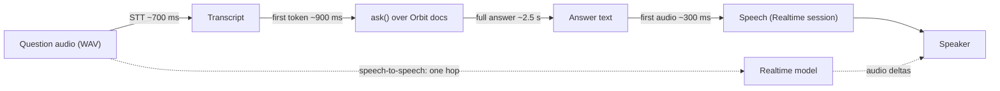
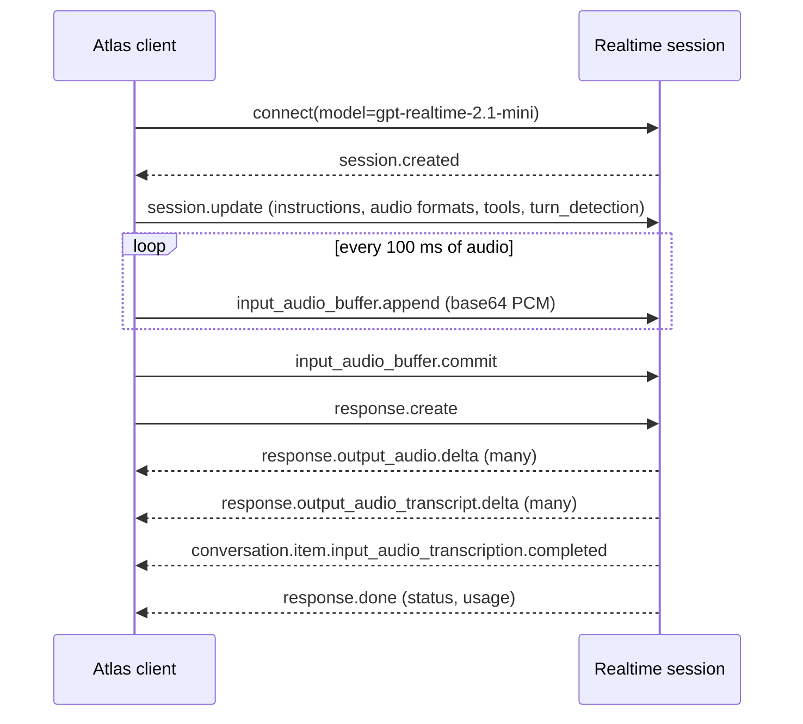
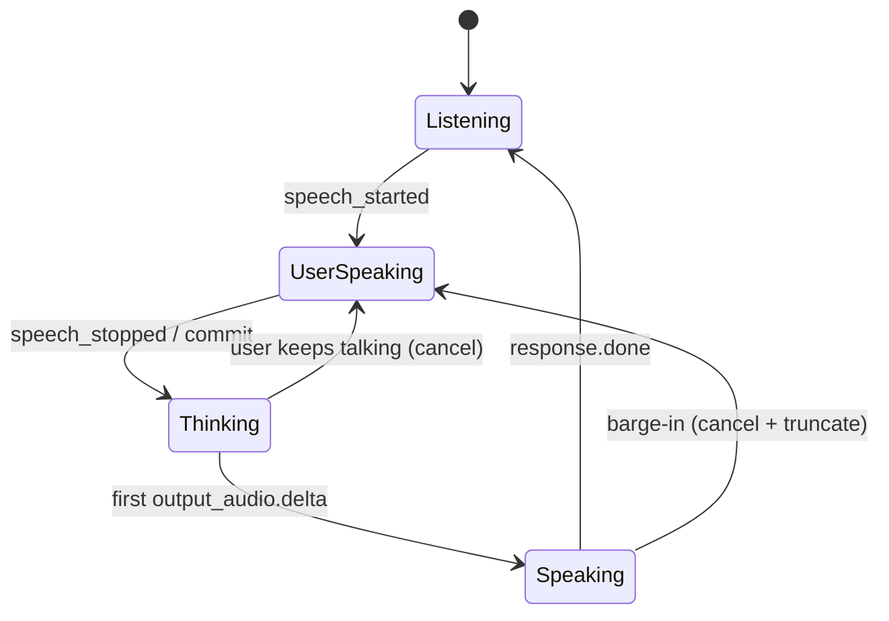

# Voice & Realtime Agents

An Orbit maintainer is on call and driving. They want to ask Atlas "why are jobs running twice after the 3.2 upgrade?" without touching a screen. If you wire transcription, the answer and speech together the obvious way, Atlas stays silent for five or six seconds before it speaks, and people on a call start saying "hello?" after about two. Voice is the same Atlas you already built, with a much tighter latency budget. Today you build both voice architectures, measure them, and learn when to pick each one.

## At a Glance

- **Time:** ~2 h core (+ optional Go Deeper) · **Depth:** intro
- **Prerequisites:** [Day 14: Multimodal Inputs: Images, Files & Audio](../../Phase_2_Building_with_LLM_APIs/Day_014_multimodal_inputs/multimodal_inputs.md), [Day 77: Serving LLM Apps with FastAPI](../Day_077_fastapi_serving/fastapi_serving.md), [Day 79: Chat UIs & Streaming Transports](../Day_079_chat_uis_streaming/chat_uis_streaming.md)
- **You'll build:** `atlas/voice.py`, a voice assistant over R2 that answers spoken Orbit questions two ways (chained and speech-to-speech), reports per-stage latency against a budget, and calls one read-only tool. It runs on **audio files**, so you don't need a microphone.
- **Stops at:** signal processing, telephony/SIP, custom VAD, WebRTC internals
- **Fast path:** Already know streaming and WebSockets? Read "Name the Parts" and "Speech-to-Speech with the Realtime API", then do Exercise 3 (~45 min)
- **Cost:** ≈ $0.20 for the whole day: transcription $0.0045/min, `gpt-realtime-2.1-mini` audio $10 in / $20 out per 1M tokens, `gpt-6-luna` for text (prices as of 2026-11, [verify](https://developers.openai.com/api/docs/pricing)). The latency math, fixtures and event replay cost $0.
- **New terms:** chained voice pipeline, speech-to-speech (Realtime session), VAD / turn detection, barge-in, latency budget

> **Coming from Software Engineering?** A chained voice pipeline is three services in a row: speech-to-text, your API, text-to-speech. Each has its own p95 (the latency 95% of requests beat), and latencies add up hop by hop, so you budget them like any request path. Speech-to-speech is one long-lived, stateful WebSocket session with an event protocol, closer to a game server than to REST. Barge-in is cancelling an in-flight request because the user changed their mind, and then telling the server how much of the response the user actually received. Latency budgets per hop, backpressure and streaming all transfer directly.

## Two Seconds of Silence

Here is the naive version. Record the question, send the whole file to transcription, send the whole transcript to `ask()`, wait for the whole answer, send the whole answer to a speech model, wait for the whole audio file, then play it. Every stage waits for the previous stage to finish completely. On a call that feels broken: the user hears nothing until the last stage is done.

The fix isn't a faster model. The fix is to stop waiting for "complete" at every hop, or to remove hops.

## Interpreters vs a Bilingual Colleague

Think of two ways to talk to someone who doesn't share your language.

- **A relay of interpreters (chained).** One person writes down what you said, a second person thinks of the answer, and a third reads it aloud. You can inspect every handoff, swap any person, and keep the written notes. But each handoff costs time.
- **A bilingual colleague (speech-to-speech).** One person listens and talks back directly. They're faster and sound more natural, and you can interrupt them mid-sentence. You see less of what happened inside their head.

Now do the arithmetic with toy numbers. Suppose transcription takes 700 ms, the model's first token arrives after 900 ms, the full answer takes 2.5 s, and speaking the full answer takes 1.2 s to generate (300 ms until the first audio).

```python
# script_id: day_081_voice_realtime/latency_budget
# Toy latency budget for one voice turn. Stdlib only; the numbers are illustrative, not measured.
STAGES_MS = {"stt": 700, "llm_first_token": 900, "llm_full": 2500,
             "tts_full": 1200, "tts_first_audio": 300}
FIRST_SENTENCE_MS = 400   # time from first token until the first sentence is complete


def wait_for_everything(s: dict[str, int]) -> int:
    # Each stage waits for the previous one to finish completely.
    return s["stt"] + s["llm_first_token"] + s["llm_full"] + s["tts_full"]


def stream_each_stage(s: dict[str, int]) -> int:
    # Start speaking as soon as the first sentence of text exists.
    return s["stt"] + s["llm_first_token"] + FIRST_SENTENCE_MS + s["tts_first_audio"]


for name, fn in [("wait for everything", wait_for_everything), ("stream each stage", stream_each_stage)]:
    ms = fn(STAGES_MS)
    print(f"{name:20} first audio after {ms:5,} ms  {'OK' if ms <= 2000 else 'over a 2 s budget'}")
```

```text
wait for everything  first audio after 5,300 ms  over a 2 s budget
stream each stage    first audio after 2,300 ms  over a 2 s budget
```

Streaming each stage cuts the silence by more than half but is still over a 2-second budget, because you pay transcription and the model's first token in series. Speech-to-speech removes the transcription hop and the separate speech hop entirely, which is why it exists.

## Name the Parts

- **STT (speech-to-text):** transcription. Atlas uses `gpt-transcribe` for files, the same call as [Day 14](../../Phase_2_Building_with_LLM_APIs/Day_014_multimodal_inputs/multimodal_inputs.md).
- **TTS (text-to-speech):** turning text into audio. Today the course does this inside a Realtime session (see "Speaking the Answer").
- **Chained voice pipeline:** STT → your normal text agent → TTS. Your `ask()` from [Day 28](../../Phase_3_RAG/Day_028_rag_pipeline/rag_pipeline.md) runs unchanged in the middle.
- **Speech-to-speech (a Realtime session):** one model hears audio and produces audio, over a WebSocket that stays open for the whole conversation. Client and server exchange JSON **events**.
- **Turn:** one user utterance plus Atlas's reply. **VAD (voice activity detection):** deciding when the speaker has finished, so the turn can start. **Barge-in:** the user speaks while Atlas is still talking, and Atlas stops.
- **PCM (raw uncompressed audio samples):** the Realtime API takes `audio/pcm` at 24 kHz, 16-bit, mono. That is 48,000 bytes per second, or 48 bytes per millisecond.
- **Latency budget:** the maximum time you allow per stage, and in total until the first audio plays.



There is a third, newer architecture: **GPT-Live** (`gpt-live-1`), a full-duplex voice model that delegates hard work to a backend you provide. It is priced per minute and has its own API surface; this lesson describes it only (⚠ verify against the [voice agents guide](https://developers.openai.com/api/docs/guides/voice-agents) before you build on it).

## Making Audio Fixtures (No Microphone)

Recorded fixtures make voice code testable: the same three questions, every run. You'll use three gold questions about leases, an error code and Kubernetes shutdown. The script below uses your operating system's speech engine, so it costs nothing and needs no key.

```python
# script_id: day_081_voice_realtime/make_audio_fixtures
# Turn 3 qa_gold questions into WAV fixtures (PCM16, 24 kHz, mono): no microphone needed.
# Install: nothing (stdlib). Needs an OS speech engine: macOS `say` or Linux `espeak-ng`.
# No engine? Use speak() from atlas_voice.py ("Speaking the Answer"), which uses the Realtime API.
import array, json, os, shutil, subprocess, wave
from pathlib import Path

DATA_DIR = Path(os.environ.get("ORBIT_DATA", "datasets/orbit"))
OUT, RATE = Path("audio"), 24_000            # the Realtime API's audio/pcm rate
QUESTIONS = {"q1": "qa-001", "q2": "qa-004", "q3": "qa-024"}


def resample(pcm: bytes, src: int) -> bytes:
    # Nearest-sample resampling: fine for speech fixtures, not for music.
    a = array.array("h", pcm)
    return array.array("h", (a[min(i * src // RATE, len(a) - 1)] for i in range(len(a) * RATE // src))).tobytes()


def synthesize(text: str, path: Path) -> None:
    if shutil.which("say"):                  # macOS can write 24 kHz PCM16 directly
        subprocess.run(["say", "-o", str(path), "--file-format=WAVE", "--data-format=LEI16@24000", text], check=True)
    elif shutil.which("espeak-ng"):          # writes 22,050 Hz, so resample afterwards
        subprocess.run(["espeak-ng", "-w", str(path), text], check=True)
    else:
        raise SystemExit("No speech engine found: install espeak-ng or use speak() from atlas_voice.py")
    with wave.open(str(path), "rb") as w:
        rate, pcm = w.getframerate(), w.readframes(w.getnframes())
    with wave.open(str(path), "wb") as w:    # rewrite as mono PCM16 at 24 kHz
        w.setnchannels(1); w.setsampwidth(2); w.setframerate(RATE)
        w.writeframes(resample(pcm, rate) if rate != RATE else pcm)


rows = {}
for line in (DATA_DIR / "eval" / "qa_gold.jsonl").read_text(encoding="utf-8").splitlines():
    if line.strip():
        row = json.loads(line)
        rows[row["id"]] = row["question"]
OUT.mkdir(exist_ok=True)
for name, qid in QUESTIONS.items():
    path = OUT / f"{name}.wav"
    synthesize(rows[qid].replace("_", " "), path)   # say "lease seconds", as a person would
    with wave.open(str(path), "rb") as w:
        print(f"wrote {path} ({w.getnframes() / w.getframerate():.1f} s) <- {rows[qid]}")
```

```text
wrote audio/q1.wav (5.3 s) <- What are the default values of lease_seconds and heartbeat_seconds in orbit.toml?
wrote audio/q2.wav (3.1 s) <- What does ORB-1202 mean and how should I fix it?
wrote audio/q3.wav (4.6 s) <- How should I set terminationGracePeriodSeconds for Orbit workers on Kubernetes?
```

(Durations depend on your speech engine; your numbers will differ.) The `.replace("_", " ")` is deliberate: a person says "lease seconds", not "lease underscore seconds", and you'll see transcription hints put the underscore back.

## Minimal Chained Turn

First the smallest chain that works: audio in, text answer out, with timings.

```python
# script_id: day_081_voice_realtime/first_voice_turn
# Minimal chained turn: WAV -> transcript -> grounded text answer, with stage timings.
# Install: uv add "openai>=3.46,<4"   Env: OPENAI_API_KEY, ATLAS_MODEL, ORBIT_DATA. Input: audio/q1.wav
import os, time
from pathlib import Path
from openai import OpenAI

client = OpenAI()
MODEL = os.environ.get("ATLAS_MODEL", "gpt-6-luna")
DATA_DIR = Path(os.environ.get("ORBIT_DATA", "datasets/orbit"))
DOC = (DATA_DIR / "docs" / "configuration-reference.md").read_text(encoding="utf-8")

t0 = time.perf_counter()
with open("audio/q1.wav", "rb") as f:
    heard = client.audio.transcriptions.create(model="gpt-transcribe", file=f, languages=["en"],
                                               keywords=["Orbit", "orbit.toml", "lease_seconds", "heartbeat_seconds"]).text
t1 = time.perf_counter()
resp = client.responses.create(model=MODEL, reasoning={"effort": "none"},
                               instructions="Answer in at most 2 short spoken sentences, using only the doc.",
                               input=f"Doc:\n{DOC}\n\nQuestion: {heard}")
t2 = time.perf_counter()
print(f"heard : {heard}\nanswer: {resp.output_text}\nstt {t1 - t0:.1f} s | llm {t2 - t1:.1f} s")
```

```text
heard : What are the default values of lease_seconds and heartbeat_seconds in orbit.toml?
answer: In the worker section, lease_seconds defaults to 300 and heartbeat_seconds to 30.
stt 0.8 s | llm 1.6 s
```

(Your numbers will differ.) Two voice-specific choices are already in there: `reasoning={"effort": "none"}`, because every reasoning token is silence on a call, and instructions that ask for spoken sentences instead of markdown, because bullet points and code fences sound terrible read aloud.

## Break It: Where the Seconds Go

Three experiments, each changing one thing.

1. **Drop the hints.** Transcription models are good at English and weak at your jargon. Without `keywords`, "lease_seconds" tends to come back as "lease seconds" and "ORB-1202" as "orb twelve oh two" or "orbit 1202" (illustrative; your transcript will differ). Your retriever then misses the error-code page. `keywords` takes literal terms; a keyword containing `<`, `>` or a newline gets the whole request rejected.
2. **Send a huge file.** Transcription accepts files up to 25 MB. Check the size before you upload, so you fail fast with a clear message instead of a 400 after a slow upload.
3. **Wait for the full answer.** The chained turn above waits for `resp.output_text` before it could speak. Measure the first token separately and the gap becomes visible (`ask()` below does).

```python
# script_id: day_081_voice_realtime/break_it
# Same audio, with and without transcription hints; plus a size guard. Stage timings printed.
# Install: uv add "openai>=3.46,<4"   Env: OPENAI_API_KEY. Input: audio/q2.wav
import time
from pathlib import Path
from openai import OpenAI

client = OpenAI()
MAX_UPLOAD_BYTES = 25 * 1024 * 1024          # the transcription endpoint's file limit


def transcribe(path: Path, keywords: list[str]) -> str:
    if path.stat().st_size > MAX_UPLOAD_BYTES:
        raise ValueError(f"{path} is {path.stat().st_size:,} bytes; split it below 25 MB first")
    with path.open("rb") as f:
        kwargs = {"keywords": keywords} if keywords else {}
        return client.audio.transcriptions.create(model="gpt-transcribe", file=f, languages=["en"], **kwargs).text


for hints in ([], ["Orbit", "ORB-1202", "PayloadTooLarge", "max_payload_kb"]):
    t0 = time.perf_counter()
    text = transcribe(Path("audio/q2.wav"), hints)
    print(f"{len(hints)} hints, {time.perf_counter() - t0:.1f} s: {text}")
```

```text
0 hints, 0.7 s: What does orb twelve oh two mean and how should I fix it?
4 hints, 0.7 s: What does ORB-1202 mean and how should I fix it?
```

(Illustrative; your transcript will differ.) Hints cost nothing in latency and fix the term your retriever depends on. Exercise 1 builds the hint list from the Orbit docs instead of by hand.

## Speaking the Answer

The classic speech endpoint is on its way out, and you shouldn't build new code on it:

```python
# script_id: day_081_voice_realtime/retiring_speech_api
# fragment
# RETIRING PATH: tts-1, tts-1-hd and gpt-4o-mini-tts shut down 2027-01-06 (as of 2026-11, verify at
# https://developers.openai.com/api/docs/deprecations). Shown so you recognise it in older code.
with client.audio.speech.with_streaming_response.create(
        model="gpt-4o-mini-tts", voice="marin", input="Lease seconds defaults to 300.") as r:
    r.stream_to_file("answer.mp3")
```

The replacement is a Realtime model, `gpt-realtime-2.1-mini`, which isn't accepted at the old speech endpoint. So the course's chained pipeline does its TTS step inside a short Realtime session. That is also your first look at the event protocol, so the next section can build on it.

Here is the start of `atlas/voice.py`: constants, audio helpers, the turn record and the budget check.

```python
# script_id: day_081_voice_realtime/atlas_voice
# atlas/voice.py: Atlas's voice channel, chained and speech-to-speech (Day 81).
# Install: uv add "openai[realtime]>=3.46,<4"   (the extra adds websockets)
# Env: OPENAI_API_KEY, ATLAS_MODEL (gpt-6-luna), ATLAS_REALTIME_MODEL, ORBIT_DATA
# Inputs: audio/q1-q3.wav from make_audio_fixtures.py. Writes audio/*_chained.wav and *_s2s.wav.
from __future__ import annotations

import asyncio, base64, json, os, re, time, wave
from collections.abc import Iterator
from dataclasses import dataclass, field
from pathlib import Path

from openai import AsyncOpenAI, OpenAI

MODEL = os.environ.get("ATLAS_MODEL", "gpt-6-luna")
REALTIME_MODEL = os.environ.get("ATLAS_REALTIME_MODEL", "gpt-realtime-2.1-mini")
STT_MODEL = "gpt-transcribe"                 # files; live sessions use gpt-live-transcribe
DATA_DIR = Path(os.environ.get("ORBIT_DATA", "datasets/orbit"))
RATE = 24_000                                # audio/pcm: 24 kHz, 16-bit, mono
BYTES_PER_MS = RATE * 2 // 1000              # 48 bytes of PCM16 per millisecond
KEYWORDS = ["Orbit", "orbit.toml", "lease_seconds", "heartbeat_seconds", "ORB-1101", "ORB-1202"]


def read_pcm(wav: Path) -> bytes:
    with wave.open(str(wav), "rb") as w:
        got = (w.getframerate(), w.getsampwidth(), w.getnchannels())
        if got != (RATE, 2, 1):              # wrong format = chipmunk or garbled audio
            raise ValueError(f"{wav}: need (24000 Hz, 2 bytes, 1 channel), got {got}")
        return w.readframes(w.getnframes())


def pcm_chunks(wav: Path, ms: int = 100) -> Iterator[str]:
    """Yield base64 chunks of `ms` milliseconds, the way a live mic would deliver them."""
    pcm, step = read_pcm(wav), ms * BYTES_PER_MS
    for i in range(0, len(pcm), step):
        yield base64.b64encode(pcm[i:i + step]).decode()


def write_wav(pcm: bytes, path: Path, rate: int = RATE) -> Path:
    path.parent.mkdir(parents=True, exist_ok=True)
    with wave.open(str(path), "wb") as w:
        w.setnchannels(1); w.setsampwidth(2); w.setframerate(rate); w.writeframes(pcm)
    return path
```

```python
# script_id: day_081_voice_realtime/atlas_voice
# USD per 1M tokens, as of 2026-11; verify at https://developers.openai.com/api/docs/pricing
PRICES = {"rt_audio_in": 10.0, "rt_audio_out": 20.0, "rt_text_in": 0.60, "rt_text_out": 2.40,
          "llm_in": 0.10, "llm_out": 0.50}
STT_PER_MIN = 0.0045                         # gpt-transcribe, per audio minute (same caveat)


@dataclass
class VoiceTurn:
    transcript: str
    answer: str
    audio_out: Path | None
    timings_ms: dict[str, float] = field(default_factory=dict)
    cost_usd: float = 0.0


@dataclass(frozen=True)
class LatencyBudget:
    stt_ms: float = 1000
    llm_first_token_ms: float = 1000
    first_audio_ms: float = 2000             # from "user stopped talking" to "Atlas starts talking"


def check_budget(t: VoiceTurn, b: LatencyBudget) -> list[str]:
    limits = {"stt": b.stt_ms, "llm_first_token": b.llm_first_token_ms, "first_audio": b.first_audio_ms}
    return [f"{k} {t.timings_ms[k]:,.0f} ms > {v:,.0f} ms"
            for k, v in limits.items() if t.timings_ms.get(k, 0) > v]


def realtime_cost(usage) -> float:
    """Price one Realtime response from response.done usage (cached-token discounts ignored)."""
    if usage is None:
        return 0.0
    i, o = usage.input_token_details, usage.output_token_details
    return ((i.audio_tokens or 0) * PRICES["rt_audio_in"] + (i.text_tokens or 0) * PRICES["rt_text_in"]
            + (o.audio_tokens or 0) * PRICES["rt_audio_out"] + (o.text_tokens or 0) * PRICES["rt_text_out"]) / 1e6
```

Now `speak()`. It opens a session that outputs audio, asks for a response that reads the text aloud, and collects `response.output_audio.delta` events (base64 PCM) until `response.done`. `conversation: "none"` makes it an out-of-band response that isn't added to the session's history.

```python
# script_id: day_081_voice_realtime/atlas_voice
client, aclient = OpenAI(), AsyncOpenAI()
AUDIO_FORMAT = {"type": "audio/pcm", "rate": RATE}
READ_ALOUD = "Read the user's text aloud exactly as written. Do not add, drop or change words."


async def speak_async(text: str, out: Path, *, voice: str = "marin") -> tuple[Path, float, float]:
    """Return (wav path, ms until the first audio chunk, cost in USD)."""
    audio, said, t0, first, cost = bytearray(), [], time.perf_counter(), 0.0, 0.0
    async with aclient.realtime.connect(model=REALTIME_MODEL) as conn:
        await conn.session.update(session={"type": "realtime", "output_modalities": ["audio"],
                                           "audio": {"output": {"format": AUDIO_FORMAT, "voice": voice}}})
        await conn.response.create(response={"conversation": "none", "instructions": READ_ALOUD, "input": [
            {"type": "message", "role": "user", "content": [{"type": "input_text", "text": text}]}]})
        async for ev in conn:
            if ev.type == "response.output_audio.delta":
                first = first or (time.perf_counter() - t0) * 1000
                audio += base64.b64decode(ev.delta)
            elif ev.type == "response.output_audio_transcript.delta":
                said.append(ev.delta)        # the model's own text of what it spoke
            elif ev.type == "error":         # errors arrive as events, not exceptions
                raise RuntimeError(f"realtime error: {ev.error.message}")
            elif ev.type == "response.done":
                cost = realtime_cost(ev.response.usage)
                break
    words = lambda s: re.findall(r"[a-z0-9_]+", s.lower())
    if words("".join(said)) != words(text):  # read-aloud is an instruction, not a guarantee
        print(f"warning: spoke {''.join(said)!r}, expected {text!r}")
    return write_wav(bytes(audio), out), first, cost


def speak(text: str, out: Path, *, voice: str = "marin") -> Path:
    """Sync wrapper for scripts. Inside a running event loop, await speak_async() instead."""
    return asyncio.run(speak_async(text, out, voice=voice))[0]
```

A speech-to-speech model is still a model: "exactly as written" is an instruction, not a guarantee. The docs name Realtime models as the TTS replacement but don't promise verbatim reading, so `speak_async()` compares the model's own transcript of what it said with your text and warns on any difference.

Next come the chained pieces. First a small BM25-style keyword retriever (BM25 is the classic keyword-ranking formula from [Day 27](../../Phase_3_RAG/Day_027_hybrid_search/hybrid_search.md)), standing in for R2's hybrid search so this file stays self-contained:

```python
# script_id: day_081_voice_realtime/atlas_voice
import math
from collections import Counter

DOCS = {p.stem: p.read_text(encoding="utf-8") for p in sorted((DATA_DIR / "docs").glob("*.md"))}
TOKEN = re.compile(r"[a-z0-9_]+(?:[.-][a-z0-9_]+)*")       # keeps orbit.toml, ORB-1202, lease_seconds
STOP = set("what which when where does how should could would mean the and are for with "
           "this that from your can fix a an of in on to is it i my".split())


def _terms(doc: str) -> Counter:                            # words in headings count 5x
    heads = " ".join(line for line in doc.splitlines() if line.startswith("#"))
    boost = Counter({w: 4 * c for w, c in Counter(TOKEN.findall(heads.lower())).items()})
    return Counter(TOKEN.findall(doc.lower())) + boost


TF = {n: _terms(d) for n, d in DOCS.items()}
DF = Counter(w for tf in TF.values() for w in tf)
AVG_LEN = sum(sum(tf.values()) for tf in TF.values()) / len(TF)


def retrieve(question: str, k: int = 2) -> list[str]:
    def score(name: str) -> float:
        tf, norm = TF[name], 1.2 * (0.25 + 0.75 * sum(TF[name].values()) / AVG_LEN)
        return sum(math.log(1 + (len(TF) - DF[w] + 0.5) / (DF[w] + 0.5)) * tf[w] * 2.2 / (tf[w] + norm)
                   for w in set(TOKEN.findall(question.lower())) - STOP if w in tf)
    return sorted(DOCS, key=score, reverse=True)[:k]
```

Then a compact `transcribe()` (from Day 14) and a streaming `ask()` that records time to first token ([Day 13](../../Phase_2_Building_with_LLM_APIs/Day_013_streaming/streaming.md) covers the stream events):

```python
# script_id: day_081_voice_realtime/atlas_voice
VOICE_RULES = ("You are Atlas, a voice assistant for Orbit maintainers. Answer in at most 3 short spoken "
               "sentences: no markdown, lists or code. Name the doc page you used, "
               "for example 'see the leases and heartbeats page'.")


def transcribe(audio: Path) -> str:          # compact copy of Day 14's helper
    with audio.open("rb") as f:
        return client.audio.transcriptions.create(model=STT_MODEL, file=f, keywords=KEYWORDS,
                                                  languages=["en"]).text


def ask(question: str) -> tuple[str, float, float]:     # stand-in for Day 28's ask()
    """Return (answer, ms until the first text token, cost in USD)."""
    context = "\n\n".join(f"[page: {n}]\n{DOCS[n][:6000]}" for n in retrieve(question))
    t0, first, parts = time.perf_counter(), 0.0, []
    with client.responses.stream(model=MODEL, instructions=VOICE_RULES, reasoning={"effort": "none"},
                                 input=f"{context}\n\nQuestion: {question}") as stream:
        for ev in stream:
            if ev.type == "response.output_text.delta":
                first = first or (time.perf_counter() - t0) * 1000
                parts.append(ev.delta)
        u = stream.get_final_response().usage
    return "".join(parts), first, (u.input_tokens * PRICES["llm_in"] + u.output_tokens * PRICES["llm_out"]) / 1e6
```

`voice_turn()` chains them and times every stage from the moment the user stopped talking:

```python
# script_id: day_081_voice_realtime/atlas_voice
def voice_turn(audio_in: Path) -> VoiceTurn:
    """Chained turn: transcribe -> ask -> speak. Waits for the full answer before speaking."""
    t0 = time.perf_counter()
    heard = transcribe(audio_in)
    stt_ms = (time.perf_counter() - t0) * 1000
    answer, ttft_ms, llm_cost = ask(heard)
    llm_ms = (time.perf_counter() - t0) * 1000 - stt_ms
    out, speak_first_ms, tts_cost = asyncio.run(
        speak_async(answer, audio_in.with_name(f"{audio_in.stem}_chained.wav")))
    minutes = len(read_pcm(audio_in)) / BYTES_PER_MS / 60_000
    timings = {"stt": stt_ms, "llm_first_token": ttft_ms, "llm_total": llm_ms,
               "first_audio": stt_ms + llm_ms + speak_first_ms}
    return VoiceTurn(heard, answer, out, timings, minutes * STT_PER_MIN + llm_cost + tts_cost)
```

`speak_first_ms` includes opening the WebSocket. A production chained pipeline keeps that session open between turns; Exercise 2 removes the other big cost, waiting for the full answer.

## Speech-to-Speech with the Realtime API

Now the bilingual colleague. One session hears the question audio and answers in audio. The protocol is a conversation of events over a WebSocket:



Four rules shape the code:

- `session.update` takes `session={"type": "realtime", ...}`. Audio settings sit under `session.audio.input` and `session.audio.output`. The voice (`marin` or `cedar` are the recommended ones) can't change after the first audio.
- `output_modalities` is **either** `["audio"]` **or** `["text"]`. You get text alongside audio by reading the transcript deltas.
- Errors arrive as `error` **events**, not Python exceptions. A loop that only waits for `response.done` hangs forever after a bad request.
- `turn_detection: None` means **you** decide when the user has finished, by calling `input_audio_buffer.commit()`. That's right for files, which have no live silence to detect. "Turn-Taking and Interruption" covers the automatic modes.

The session config and the turn itself:

```python
# script_id: day_081_voice_realtime/atlas_voice
def s2s_session(tools: list[dict]) -> dict:
    return {"type": "realtime", "instructions": VOICE_RULES, "output_modalities": ["audio"], "tools": tools,
            "audio": {"input": {"format": AUDIO_FORMAT, "turn_detection": None,      # manual commit
                                "transcription": {"model": "gpt-live-transcribe"}},  # a text log of the user
                      "output": {"format": AUDIO_FORMAT, "voice": "marin"}}}


async def realtime_turn(audio_in: Path, *, tools: list[dict] = ()) -> VoiceTurn:
    audio, said, heard, cost, first = bytearray(), [], None, 0.0, 0.0
    tool_pending = done = False
    async with asyncio.timeout(90), aclient.realtime.connect(model=REALTIME_MODEL) as conn:
        await conn.session.update(session=s2s_session(list(tools)))
        for chunk in pcm_chunks(audio_in):
            await conn.input_audio_buffer.append(audio=chunk)
        await conn.input_audio_buffer.commit()   # "the user has finished speaking"
        t_end = time.perf_counter()
        await conn.response.create()
        async for ev in conn:
            if ev.type == "response.output_audio.delta":
                first = first or (time.perf_counter() - t_end) * 1000
                audio += base64.b64decode(ev.delta)
            elif ev.type == "response.output_audio_transcript.delta":
                said.append(ev.delta)
            elif ev.type == "conversation.item.input_audio_transcription.completed":
                heard = ev.transcript
            elif ev.type == "conversation.item.input_audio_transcription.failed":
                heard = ""
            elif ev.type == "response.function_call_arguments.done":
                await run_tool(conn, ev)             # defined in "Tools in a Voice Agent"
                tool_pending = True
            elif ev.type == "error":
                raise RuntimeError(f"realtime error: {ev.error.message}")
            elif ev.type == "response.done":
                cost += realtime_cost(ev.response.usage)
                if tool_pending:                     # tool output is in; ask the model to continue
                    tool_pending = False
                    await conn.response.create()
                else:
                    done = True
            if done and heard is not None:           # the user transcript can arrive after response.done
                break
    out = write_wav(bytes(audio), audio_in.with_name(f"{audio_in.stem}_s2s.wav"))
    return VoiceTurn(heard or "", "".join(said), out, {"first_audio": first}, cost)
```

The `asyncio.timeout(90)` is a backstop: if an event you wait for never comes, the caller gets `TimeoutError` instead of a hung process.

**No API key?** The latency and cost logic doesn't need one. Replay a recorded turn instead. The log below is hand-written in the shape of real server events, with toy token counts:

```python
# script_id: day_081_voice_realtime/replay_events
# Replay a recorded speech-to-speech turn offline: first-audio latency, transcripts, cost.
# Stdlib only, no key. Event shapes match the Realtime API; timings and token counts are toy values.
import base64

AUDIO_200MS = base64.b64encode(bytes(48 * 200)).decode()   # 200 ms of silent PCM16 at 24 kHz
LOG = [  # (ms since input_audio_buffer.commit, event)
    (0, {"type": "input_audio_buffer.committed"}),
    (610, {"type": "response.output_audio.delta", "delta": AUDIO_200MS}),
    (612, {"type": "response.output_audio_transcript.delta", "delta": "Lease seconds defaults to 300 "}),
    (690, {"type": "conversation.item.input_audio_transcription.completed",
           "transcript": "What are the default values of lease seconds and heartbeat seconds in orbit.toml?"}),
    (700, {"type": "response.output_audio.delta", "delta": AUDIO_200MS}),
    (705, {"type": "response.output_audio_transcript.delta", "delta": "and heartbeat seconds to 30."}),
    (880, {"type": "response.done", "response": {"status": "completed", "usage": {
        "input_token_details": {"audio_tokens": 120, "text_tokens": 300},
        "output_token_details": {"audio_tokens": 240, "text_tokens": 30}}}}),
]
PRICE = {"audio_in": 10.0, "text_in": 0.60, "audio_out": 20.0, "text_out": 2.40}  # $/1M, as of 2026-11, verify

first = next(t for t, e in LOG if e["type"] == "response.output_audio.delta")
heard = next(e["transcript"] for _, e in LOG if e["type"].endswith("transcription.completed"))
said = "".join(e["delta"] for _, e in LOG if e["type"] == "response.output_audio_transcript.delta")
audio_ms = sum(len(base64.b64decode(e["delta"])) for _, e in LOG if e["type"] == "response.output_audio.delta") // 48
usage = next(e["response"]["usage"] for _, e in LOG if e["type"] == "response.done")
i, o = usage["input_token_details"], usage["output_token_details"]
cost = (i["audio_tokens"] * PRICE["audio_in"] + i["text_tokens"] * PRICE["text_in"]
        + o["audio_tokens"] * PRICE["audio_out"] + o["text_tokens"] * PRICE["text_out"]) / 1e6
print(f"heard: {heard}\nsaid : {said}\nfirst audio {first} ms (budget 2,000: {'OK' if first <= 2000 else 'OVER'}) "
      f"| {audio_ms} ms of audio | ${cost:.5f}")
```

```text
heard: What are the default values of lease seconds and heartbeat seconds in orbit.toml?
said : Lease seconds defaults to 300 and heartbeat seconds to 30.
first audio 610 ms (budget 2,000: OK) | 400 ms of audio | $0.00625
```

Notice that the user's transcript arrived *after* Atlas started speaking. Input transcription runs alongside the response; it is a log for you, not an input the model waits for.

## Turn-Taking and Interruption

On a live call nobody presses "commit". The session decides when the user has finished, using **turn detection**:

- `{"type": "server_vad"}` treats a stretch of silence as the end of a turn (knobs: `threshold`, `silence_duration_ms`, `prefix_padding_ms`).
- `{"type": "semantic_vad"}` also uses the meaning of what was said, so "my workers are, um..." doesn't end the turn mid-thought (knob: `eagerness`: `low`, `medium`, `high` or `auto`).
- Both accept `create_response` (start answering automatically) and `interrupt_response` (stop talking when the user starts).



**Barge-in** has two halves. First, stop generating: `response.cancel`. Second, fix the record: the server generated more audio than the user heard, because audio arrives faster than it plays. `conversation.item.truncate(item_id, content_index, audio_end_ms)` cuts the assistant's message at the point playback stopped, so the model doesn't believe it said things nobody heard (it also deletes the unheard part of the server's transcript). With `interrupt_response: true` the server cancels for you when it detects speech. Over a WebSocket, as here, only your client knows how much audio it played. Over WebRTC the server manages an output audio buffer: it clears it when VAD hears the user interrupt, and reports `output_audio_buffer.started`, `.stopped` and `.cleared` events.

The demo below fakes a user who listens to 1.5 s of the q1 answer and then asks q3:

```python
# script_id: day_081_voice_realtime/barge_in_demo
# Barge-in with files: ask q1, "hear" 1.5 s of the answer, interrupt with q3.
# Install: uv add "openai[realtime]>=3.46,<4"   Env: OPENAI_API_KEY. Inputs: audio/q1.wav, audio/q3.wav
import asyncio, base64, os, time, wave
from pathlib import Path
from openai import AsyncOpenAI

REALTIME_MODEL = os.environ.get("ATLAS_REALTIME_MODEL", "gpt-realtime-2.1-mini")
FMT, BYTES_PER_MS, HEARD_MS = {"type": "audio/pcm", "rate": 24_000}, 48, 1500
SESSION = {"type": "realtime", "output_modalities": ["audio"],
           "audio": {"input": {"format": FMT, "turn_detection": None}, "output": {"format": FMT, "voice": "marin"}}}


async def ask_turn(conn, wav: Path) -> None:
    with wave.open(str(wav), "rb") as w:
        pcm = w.readframes(w.getnframes())
    for i in range(0, len(pcm), 100 * BYTES_PER_MS):
        await conn.input_audio_buffer.append(audio=base64.b64encode(pcm[i:i + 100 * BYTES_PER_MS]).decode())
    await conn.input_audio_buffer.commit()
    await conn.response.create()


async def main() -> None:
    t0, received, item_id, interrupted, asked_q3 = time.perf_counter(), 0, "", False, False
    log = lambda msg: print(f"{(time.perf_counter() - t0) * 1000:6.0f} ms  {msg}")
    async with asyncio.timeout(90), AsyncOpenAI().realtime.connect(model=REALTIME_MODEL) as conn:
        await conn.session.update(session=SESSION)
        await ask_turn(conn, Path("audio/q1.wav")); log("asked q1")
        async for ev in conn:
            if ev.type == "response.output_audio.delta" and not asked_q3:
                item_id, received = ev.item_id, received + len(base64.b64decode(ev.delta))
                if not interrupted and received >= HEARD_MS * BYTES_PER_MS:
                    interrupted = True; log(f"user talks over Atlas at {HEARD_MS} ms -> response.cancel")
                    await conn.response.cancel()
            elif ev.type == "response.done":
                log(f"response.done status={ev.response.status}")
                if not interrupted or asked_q3:
                    break
                await conn.conversation.item.truncate(item_id=item_id, content_index=0, audio_end_ms=HEARD_MS)
                await ask_turn(conn, Path("audio/q3.wav")); asked_q3 = True; log("asked q3")
            elif ev.type in ("conversation.item.truncated", "error"):
                log(ev.type if ev.type != "error" else f"error: {ev.error.message}")


asyncio.run(main())
```

```text
     0 ms  asked q1
   840 ms  user talks over Atlas at 1500 ms -> response.cancel
   910 ms  response.done status=cancelled
   960 ms  conversation.item.truncated
  1180 ms  asked q3
  2950 ms  response.done status=completed
```

(Your numbers will differ.) If the first answer finishes generating before the cancel lands, you'll see `status=completed` and possibly an `error` event for the cancel. The truncate still matters, because the user only heard 1.5 s of it.

## Tools in a Voice Agent

Tools work the same way as in [Day 35](../../Phase_4_Tools_and_MCP/Day_035_function_calling/function_calling.md), with events instead of response objects: the model emits `response.function_call_arguments.done` (with `name`, `arguments` and `call_id`), you run the tool, add a `function_call_output` item, and send `response.create` so the model continues. `realtime_turn()` above already has that loop; here are the tool and its runner.

```python
# script_id: day_081_voice_realtime/atlas_voice
DOCS_SEARCH_TOOL = {"type": "function", "name": "docs_search",
                    "description": "Search the Orbit docs (read-only). Returns page names and excerpts.",
                    "parameters": {"type": "object", "properties": {"query": {"type": "string"}},
                                   "required": ["query"]}}


def docs_search(query: str) -> str:
    return json.dumps([{"page": n, "excerpt": DOCS[n][:1500]} for n in retrieve(query)])


READ_ONLY_TOOLS = {"docs_search": docs_search}   # side-effecting tools never go in this dict


async def run_tool(conn, ev) -> None:
    fn = READ_ONLY_TOOLS.get(ev.name)
    try:
        output = fn(**json.loads(ev.arguments)) if fn else json.dumps({"error": f"unknown tool {ev.name}"})
    except Exception as exc:                     # the model hears the error and can recover
        output = json.dumps({"error": str(exc)})
    await conn.conversation.item.create(item={"type": "function_call_output", "call_id": ev.call_id,
                                              "output": output})
```

Two voice-specific rules:

- **Speak citations as page names.** "See the error codes page" works aloud; a URL or `[3]` doesn't. `VOICE_RULES` asks for this, and Exercise 3 checks it.
- **Keep side effects behind confirmation.** Speech recognition mishears, and "close it" can be the wrong issue. A voice agent may *propose* "Close ORB issue 412?", but the action runs only after an explicit spoken "yes" **and** the approval flow from [Day 55](../../Phase_6_Agents/Day_055_human_in_the_loop/human_in_the_loop.md). That is why `READ_ONLY_TOOLS` holds only read tools.

Finally, the demo entry point for `atlas/voice.py`:

```python
# script_id: day_081_voice_realtime/atlas_voice
if __name__ == "__main__":
    wav, budget = Path("audio/q1.wav"), LatencyBudget()
    chained = voice_turn(wav)
    s2s = asyncio.run(realtime_turn(wav, tools=[DOCS_SEARCH_TOOL]))
    print(f"heard  : {chained.transcript}\nchained: {chained.answer}\ns2s    : {s2s.answer}\n")
    for name, t in (("chained", chained), ("speech-to-speech", s2s)):
        stages = " | ".join(f"{k} {v:,.0f}" for k, v in t.timings_ms.items())
        verdict = check_budget(t, budget) or "within budget"
        print(f"{name:16} {stages} ms | ${t.cost_usd:.4f} | {verdict} | {t.audio_out}")
```

```text
heard  : What are the default values of lease_seconds and heartbeat_seconds in orbit.toml?
chained: In the worker section, lease_seconds defaults to 300 and heartbeat_seconds to 30. See the configuration reference page.
s2s    : Lease seconds defaults to 300 and heartbeat seconds to 30, per the configuration reference page.

chained          stt 780 | llm_first_token 640 | llm_total 1,420 | first_audio 3,050 ms | $0.0021 | ['first_audio 3,050 ms > 2,000 ms'] | audio/q1_chained.wav
speech-to-speech first_audio 720 ms | $0.0094 | within budget | audio/q1_s2s.wav
```

(Your numbers will differ; run it a few times.) The shape is the lesson: speech-to-speech wins on latency, chained wins on cost per turn and on what you can see.

## Trade-offs: Chained or Speech-to-Speech?

| Need | Chained (STT → `ask()` → speech) | Speech-to-speech (Realtime) |
|---|---|---|
| First-audio latency | adds up per hop; streaming helps | lowest, one hop |
| Cost per turn | cheapest (file STT + `gpt-6-luna` text) | audio tokens are pricier |
| Model choice | any text model, your full R2 pipeline | Realtime models only |
| Control and debugging | every hop is text you can log, test and eval | events and audio; transcripts are a side log |
| Natural conversation | turn-by-turn, interruption is harder | VAD, barge-in, tone of voice |
| Best for Atlas | voicemail-style questions, summaries, async answers | the on-call, hands-free conversation |

Rule of thumb: start chained when correctness and cost matter more than feel, and move the conversation layer to speech-to-speech when users are talking live. Many teams do both: speech-to-speech in front, with tools that call the same `ask()`.

### In production

- **Never ship your API key to a browser.** Mint a short-lived key on your server with `client.realtime.client_secrets.create(...)` and let the browser connect over WebRTC (the browser standard for live audio and video calls). Go Deeper shows the route.
- **Sessions end at 60 minutes.** Plan to reconnect and re-send the session config and any context you need.
- **Recording is personal data.** Ask for consent, keep audio only as long as you need it, and redact transcripts like any other PII ([Day 73](../../Phase_8_Safety_and_Security/Day_073_privacy_pii/privacy_pii.md)).
- **Evaluate voice through transcripts.** Log the user and assistant transcripts per turn and run your [Day 45](../../Phase_5_Evaluation_and_Observability/Day_045_llm_as_judge/llm_as_judge.md) judges on them; track first-audio p95 like any latency SLO ([Day 42](../../Phase_5_Evaluation_and_Observability/Day_042_tracing_observability/tracing_observability.md)).
- **Watch the clock per hop.** Put `timings_ms` into your traces so a slow stage shows up before users hang up.

### Commit it to R5

| Block | R5 path |
|---|---|
| `atlas_voice` | `atlas/voice.py` |
| `make_audio_fixtures` | `scripts/make_audio_fixtures.py` (fixtures in `tests/fixtures/audio/`) |
| `replay_events` | `tests/test_voice_latency.py` (turn the prints into asserts) |
| `voice_session_route` (Go Deeper, optional) | `atlas/api/voice.py`, included by Day 77's `create_app` as `/v1/voice/session` |

## Go Deeper (optional)

<details><summary>Go deeper: browser voice with ephemeral keys and WebRTC</summary>

A browser can't hold your API key, and a server relaying every audio frame adds a hop. The standard pattern is a short-lived **client secret**: your server (which knows the user and their tenant) mints one with the session config baked in, and the browser uses it to open a WebRTC call to `/v1/realtime/calls`. Audio then flows browser ↔ OpenAI directly, and your server is out of the media path.

```python
# script_id: day_081_voice_realtime/voice_session_route
# atlas/api/voice.py: mint a short-lived Realtime key for a browser client.
# Install: uv add "openai>=3.46,<4" fastapi uvicorn   Env: OPENAI_API_KEY, ATLAS_REALTIME_MODEL
# Run: uvicorn voice_session_route:app --port 8000   (put Day 83's auth in front before exposing it)
import os

from fastapi import FastAPI
from openai import OpenAI

REALTIME_MODEL = os.environ.get("ATLAS_REALTIME_MODEL", "gpt-realtime-2.1-mini")
app, client = FastAPI(), OpenAI()


@app.post("/v1/voice/session")
def voice_session() -> dict:
    secret = client.realtime.client_secrets.create(
        expires_after={"anchor": "created_at", "seconds": 600},   # allowed range 10-7200 s, default 600
        session={"type": "realtime", "model": REALTIME_MODEL,
                 "instructions": "You are Atlas, a voice assistant for Orbit maintainers.",
                 "audio": {"output": {"voice": "marin"}}})
    return {"client_secret": secret.value, "expires_at": secret.expires_at}
```

The browser side (getting the microphone with `getUserMedia`, creating an `RTCPeerConnection`, posting its SDP offer with the ephemeral key, and sending events over a data channel) is plain WebRTC. Follow the browser example in the [realtime conversations guide](https://developers.openai.com/api/docs/guides/realtime-conversations) rather than copying code from memory; this course doesn't reproduce it (⚠ verify). Tools still run on your side: the browser forwards `response.function_call_arguments.done` events to your API, which runs the read-only tool and returns the output.

</details>

<details><summary>Go deeper: what a second of audio costs, and how to measure it</summary>

Bytes first. PCM16 at 24 kHz mono is 24,000 samples × 2 bytes = 48,000 bytes per second. Base64 adds a third, so each second on the WebSocket is about 64 KB of JSON payload. A 5-second question is about 240 KB raw, 320 KB on the wire.

Tokens next. Realtime prices audio per 1M audio tokens ($10 in / $20 out on `gpt-realtime-2.1-mini`, as of 2026-11, [verify](https://developers.openai.com/api/docs/pricing)), but this course doesn't quote an audio-tokens-per-second rate, because it isn't in the verified docs and it can change per model. Measure instead: every `response.done` carries `usage.input_token_details.audio_tokens` and `usage.output_token_details.audio_tokens`. Divide by the seconds of audio you sent and received, across your three fixtures, and you have your own rate. `realtime_cost()` already uses those fields.

Two things grow the bill quietly. First, the conversation is re-read on every turn, so a long call pays for its history again and again (cached input tokens are cheaper; `realtime_cost()` ignores that discount, so it slightly overestimates). Second, the input transcription (`gpt-live-transcribe`, $0.017/min as of 2026-11) is priced per minute on top of the session's token costs (⚠ verify on the pricing page).

</details>

<details><summary>Go deeper: tuning turn detection, and the other voice surfaces</summary>

`server_vad` fields: `threshold` (how loud counts as speech; raise it in noisy rooms), `prefix_padding_ms` (audio kept from before speech started, so the first syllable isn't clipped), `silence_duration_ms` (how long a pause ends the turn; shorter is snappier but cuts off slow speakers) and `idle_timeout_ms` (have the model prompt the user after a long silence; `server_vad` only). `semantic_vad` replaces the silence timer with a judgement about whether the sentence sounds finished; `eagerness: "low"` waits longer, `"high"` jumps in sooner. Tune with recorded calls, not by feel: replay the same 20 turns and count cut-offs and long gaps.

Other surfaces you'll meet:

- **OpenAI Agents SDK voice and realtime agents.** The SDK from [Day 56](../../Phase_6_Agents/Day_056_openai_agents_sdk/openai_agents_sdk.md) ships `agents.realtime` (with `RealtimeAgent` and `RealtimeRunner`) and `agents.voice` modules that wrap this protocol with handoffs and guardrails. Check the SDK docs for the current runner API before you use it (⚠ verify).
- **GPT-Live** (`gpt-live-1`): full-duplex voice, priced per minute ($0.05/min plus backend usage, as of 2026-11), with your backend handling the hard work. See the [voice agents guide](https://developers.openai.com/api/docs/guides/voice-agents) (⚠ verify before building).
- **Telephony.** Phone calls arrive over SIP (the signalling protocol for phone calls) or as 8 kHz G.711 audio (`audio/pcmu`, `audio/pcma` are valid Realtime formats). Carrier integration is out of scope for this course.

</details>

## Common Pitfalls

- **Chipmunk, slowed or garbled audio.** The WAV isn't 24 kHz, 16-bit, mono, but you sent it as `audio/pcm` at 24 kHz. `read_pcm()` refuses anything else with `ValueError: ... need (24000 Hz, 2 bytes, 1 channel), got (22050, 2, 1)`. Convert fixtures once, at creation.
- **Asking for both modalities.** `output_modalities=["audio", "text"]` isn't a valid combination: pick `["audio"]` and read `response.output_audio_transcript.delta` for the text.
- **The event loop hangs forever.** Realtime errors are `error` events, not exceptions, and the user transcript can arrive after `response.done`. Always handle `error`, break on `response.done`, and wrap the session in `asyncio.timeout(...)`.
- **The whole transcription request is rejected.** A `keywords` entry contains `<`, `>` or a newline. Word timestamps and diarization exist only on deprecated transcription models (shutting down 2027-02-26), so don't build features on them.
- **Building on retired surfaces.** `tts-1`, `gpt-4o-mini-tts` (shut down 2027-01-06), `gpt-realtime`/`gpt-realtime-mini` (2027-01-20), `client.beta.realtime` and the `OpenAI-Beta: realtime=v1` header (removed) → use `client.realtime` with `gpt-realtime-2.1-mini`.
- **API key in the browser.** Anyone can read it from dev tools. Mint an ephemeral client secret per session on your server instead.

> **Where we stop:** no signal processing, telephony/SIP, custom VAD or WebRTC internals; those are specialist areas, and the [voice agents guide](https://developers.openai.com/api/docs/guides/voice-agents) is the place to continue.

## Key Takeaways

- A chained voice turn's latencies **add up**: waiting for every stage to finish turns a 2-second budget into 5+ seconds of silence, so stream each hop or remove hops.
- **Speech-to-speech** is one stateful Realtime session over a WebSocket: `session.update` → `input_audio_buffer.append`/`commit` → `response.create` → audio and transcript deltas → `response.done`, with errors as events.
- **Turn detection** decides when the user finished (manual commit for files, `server_vad` or `semantic_vad` live); **barge-in** is `response.cancel` plus `conversation.item.truncate` at the point playback stopped.
- Voice tools follow the Day 35 loop through events (`function_call_arguments.done` → `function_call_output` → `response.create`); keep them read-only and put side effects behind spoken confirmation plus approval.
- Choose **chained** for cost, control and text-based evals, **speech-to-speech** for live, interruptible conversation; speak through Realtime models, because the classic TTS models shut down 2027-01-06.

## Quick Reference

| API / pattern | When to use | Gotcha |
|---|---|---|
| `client.audio.transcriptions.create(model="gpt-transcribe", file=f, keywords=[...], languages=["en"])` | file STT in a chained turn | ≤25 MB; no `<`, `>` or newlines in keywords |
| `client.realtime.connect(model=REALTIME_MODEL)` | open a Realtime session (`openai[realtime]`) | 60-min cap; use `AsyncOpenAI` |
| `conn.session.update(session={"type": "realtime", ...})` | instructions, audio formats, voice, tools, VAD | `output_modalities` is `["audio"]` or `["text"]` |
| `conn.input_audio_buffer.append(audio=b64)` / `.commit()` | stream audio in; end a manual turn | PCM16, 24 kHz, mono |
| `conn.response.create(response={"conversation": "none", ...})` | out-of-band speech (TTS step) | read-aloud is an instruction, not a guarantee |
| `conn.response.cancel()` + `conn.conversation.item.truncate(item_id=, content_index=0, audio_end_ms=)` | barge-in | truncate to what was **played**, not received |
| `response.function_call_arguments.done` → `conversation.item.create(item={"type": "function_call_output", ...})` → `response.create()` | tools in voice | send `response.create` again or the model stays silent |
| `client.realtime.client_secrets.create(session=..., expires_after=...)` | browser / WebRTC clients | never send the real API key to a client |

## Exercises

1. **Warm-up.** Build the transcription hint list from `docs/error-codes.md` (every `ORB-` code plus the CamelCase error names) instead of by hand, and compare the q2 transcript with and without it.

<details><summary>Solution</summary>

```python
# script_id: day_081_voice_realtime/solution_ex1
# Hints from the docs, not by hand. Env: OPENAI_API_KEY, ORBIT_DATA. Input: audio/q2.wav
import os, re
from pathlib import Path
from openai import OpenAI

DATA_DIR = Path(os.environ.get("ORBIT_DATA", "datasets/orbit"))
client = OpenAI()
doc = (DATA_DIR / "docs" / "error-codes.md").read_text(encoding="utf-8")
codes = sorted(set(re.findall(r"ORB-\d{4}", doc)))
names = sorted(set(re.findall(r"\b[A-Z][a-z]+(?:[A-Z][a-z]+)+\b", doc)))   # PayloadTooLarge, LeaseExpired
hints = ["Orbit", *codes, *names][:40]       # keep hints focused; a huge list dilutes them
assert not any(c in h for h in hints for c in "<>\n"), "these characters reject the whole request"


def heard(keywords: list[str]) -> str:
    with open("audio/q2.wav", "rb") as f:
        kwargs = {"keywords": keywords} if keywords else {}
        return client.audio.transcriptions.create(model="gpt-transcribe", file=f, languages=["en"], **kwargs).text


print(f"{len(hints)} hints, e.g. {hints[:5]}")
print("without:", heard([]))
print("with   :", heard(hints))
```

</details>

2. **Core.** Speak the first sentence as soon as it is complete: stream the text, split on the first `.`, `!` or `?`, start `speak_async()` for that sentence while the rest streams, and compare first-audio latency with `voice_turn()`.

<details><summary>Solution</summary>

```python
# script_id: day_081_voice_realtime/solution_ex2
# Speak sentence one while the rest of the answer streams. Needs atlas_voice.py alongside.
import asyncio, re, time
from pathlib import Path
from atlas_voice import DOCS, MODEL, VOICE_RULES, aclient, retrieve, speak_async, transcribe, voice_turn

SENTENCE = re.compile(r"^(.+?[.!?])\s")


async def early_first_audio(wav: Path) -> float:
    t0 = time.perf_counter()
    heard = transcribe(wav)
    context = "\n\n".join(f"[page: {n}]\n{DOCS[n][:6000]}" for n in retrieve(heard))
    text, task, t_sentence = "", None, 0.0
    async with aclient.responses.stream(model=MODEL, instructions=VOICE_RULES, reasoning={"effort": "none"},
                                        input=f"{context}\n\nQuestion: {heard}") as stream:
        async for ev in stream:
            if ev.type == "response.output_text.delta":
                text += ev.delta
                if task is None and (m := SENTENCE.match(text)):
                    t_sentence = (time.perf_counter() - t0) * 1000
                    task = asyncio.create_task(speak_async(m.group(1), wav.with_name(f"{wav.stem}_first.wav")))
    if task is None:                              # one-sentence answer: speak it all
        t_sentence = (time.perf_counter() - t0) * 1000
        task = asyncio.create_task(speak_async(text, wav.with_name(f"{wav.stem}_first.wav")))
    _, speak_first_ms, _ = await task
    return t_sentence + speak_first_ms


wav = Path("audio/q1.wav")
before = voice_turn(wav).timings_ms["first_audio"]
after = asyncio.run(early_first_audio(wav))
print(f"first audio: wait-for-all {before:,.0f} ms -> first-sentence {after:,.0f} ms")
```

The rest of the answer would be spoken by a second `speak_async()` call queued behind the first; in a live app you'd keep one session open and send each sentence as it completes.

</details>

3. **Core.** Run all three fixtures through `voice_turn()` and `realtime_turn(..., tools=[DOCS_SEARCH_TOOL])`. Print a table of first-audio ms, $ per turn, and whether the spoken answer names a real doc page.

<details><summary>Solution</summary>

```python
# script_id: day_081_voice_realtime/solution_ex3
# Chained vs speech-to-speech (with the docs_search tool) on all fixtures. Needs atlas_voice.py.
import asyncio
from pathlib import Path
from atlas_voice import DOCS, DOCS_SEARCH_TOOL, realtime_turn, voice_turn


def names_a_page(answer: str) -> bool:
    spoken = answer.lower().replace("-", " ")
    return any(page.replace("-", " ") in spoken for page in DOCS)


print("| fixture | path | first audio ms | $ / turn | cites page |")
print("|---|---|---|---|---|")
for wav in sorted(Path("audio").glob("q[1-3].wav")):
    chained = voice_turn(wav)
    s2s = asyncio.run(realtime_turn(wav, tools=[DOCS_SEARCH_TOOL]))
    for name, t in (("chained", chained), ("s2s + tool", s2s)):
        print(f"| {wav.stem} | {name} | {t.timings_ms['first_audio']:,.0f} | {t.cost_usd:.4f} "
              f"| {'yes' if names_a_page(t.answer) else 'no'} |")
```

Expect speech-to-speech to win first audio on every row and chained to win cost. When the model calls `docs_search`, the first audio of the s2s path gets later; that's the price of grounding, and a reason to keep tools fast.

</details>

4. **Stretch (optional).** Talk to Atlas from a browser microphone: serve the Go Deeper `/v1/voice/session` route, and build a page that fetches the ephemeral key and opens a WebRTC call. Alternatively, rebuild `realtime_turn()` with the Agents SDK's realtime agents.

<details><summary>Solution</summary>

Outline (the browser code comes from the official example, not from memory):

1. Run `voice_session_route` behind Day 83-style auth; confirm `POST /v1/voice/session` returns `client_secret` and `expires_at`.
2. Start from the browser WebRTC example in the [realtime conversations guide](https://developers.openai.com/api/docs/guides/realtime-conversations): microphone track in, remote audio track out, a data channel for events.
3. Replace the guide's key fetch with a call to your route, so the real key never leaves the server.
4. Forward `response.function_call_arguments.done` events from the data channel to an Atlas endpoint that runs `docs_search` and returns the output as a `function_call_output` item.
5. Measure first-audio latency by ear with a stopwatch app, and compare with Exercise 3. Live VAD (`semantic_vad`) replaces manual commits here.

For the Agents SDK path, check the `agents.realtime` docs for the current session runner first (⚠ verify); keep `docs_search` as its only tool.

</details>

## References & Further Reading

- [OpenAI: Voice agents](https://developers.openai.com/api/docs/guides/voice-agents): the official comparison of GPT-Live, Realtime speech-to-speech and chained pipelines.
- [OpenAI: Realtime conversations](https://developers.openai.com/api/docs/guides/realtime-conversations): `session.update`, events, voices, VAD, and the browser WebRTC example.
- [OpenAI: Speech to text](https://developers.openai.com/api/docs/guides/speech-to-text): `gpt-transcribe`, `keywords`, `languages` and file limits.
- [OpenAI: Text to speech](https://developers.openai.com/api/docs/guides/text-to-speech): the Speech API and its deprecation notice; read it before touching older TTS code.
- [OpenAI: Deprecations](https://developers.openai.com/api/docs/deprecations): shutdown dates for TTS, older realtime and transcription models.
- [OpenAI: Pricing](https://developers.openai.com/api/docs/pricing): current audio, transcription and Realtime prices.

## What's Next

Atlas now answers over HTTP, in a chat UI, with typed components and by voice, all on one codebase. In [Day 82: Containerize & Deploy with CI/CD](../Day_082_containerize_deploy/containerize_deploy.md) you package it into a reproducible image and ship it through an eval-gated pipeline to staging.
