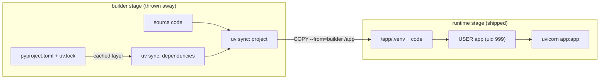
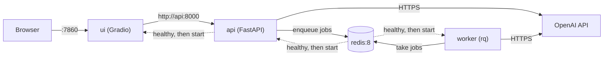
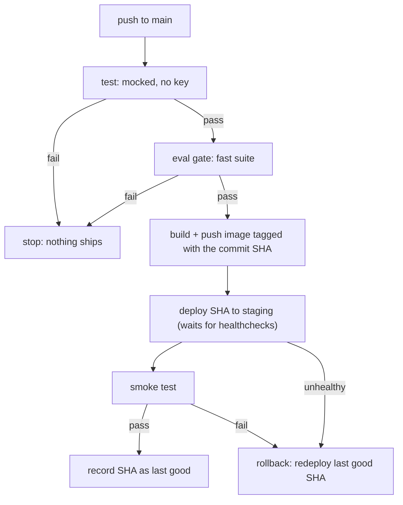

# Containerize & Deploy with CI/CD

"Works on my machine" now means four processes, two services and an API key. The Day 79 UI points at `localhost`, the worker isn't running, and last week someone deployed a prompt change that dropped citation accuracy 12 points because nothing ran the evals. Today Atlas gets a reproducible image, a one-command stack and a pipeline that refuses to deploy a regression.

## At a Glance

- **Time:** ~2 h core (+ optional Go Deeper) · **Depth:** working
- **Prerequisites:** [Day 19: Testing LLM Code](../../Phase_2_Building_with_LLM_APIs/Day_019_testing_llm_code/testing_llm_code.md), [Day 47: Evals in CI: Regression Gates at Scale](../../Phase_5_Evaluation_and_Observability/Day_047_evals_in_ci/evals_in_ci.md), [Day 77: Serving LLM Apps with FastAPI](../../Phase_9_Production/Day_077_fastapi_serving/fastapi_serving.md), [Day 78: Async Jobs & Long-Running Work](../../Phase_9_Production/Day_078_async_jobs/async_jobs.md), [Day 79: Chat UIs & Streaming Transports](../../Phase_9_Production/Day_079_chat_uis_streaming/chat_uis_streaming.md); primer [Docker & compose](../../Appendix_Primers/A08_docker_compose.md)
- **You'll build:** an R5 staging environment: a multi-stage, non-root image; a compose stack (API, worker, UI, Redis) with healthchecks; fail-fast settings; and a GitHub Actions pipeline that runs tests, an eval gate, a SHA-tagged image push, a staging deploy, a smoke test and an automatic rollback.
- **Stops at:** Kubernetes, Terraform and other infrastructure-as-code, and autoscaling internals.
- **Fast path:** Already ship containers with CI? Read "CI/CD with an Eval Gate" and do Exercise 3 (~40 min).
- **Cost:** $0 locally; $0–5 on a platform. The eval step costs about $0.02 per run on `gpt-6-luna` (prices as of 2026-11, [verify](https://developers.openai.com/api/docs/pricing)).
- **New terms:** multi-stage build, non-root container, healthcheck (`service_healthy`), eval-gated deploy pipeline, immutable image tag + rollback

> **Coming from Software Engineering?** This is standard containerized deployment: a Dockerfile, compose, health checks, environment config and a CI/CD pipeline. On every platform it's the same workflow with different service names. Three things are new for AI apps. Images bloat fast, because one ML dependency (PyTorch, `torch`) can add gigabytes. The pipeline needs a *quality* gate (evals) next to the unit tests, and that gate costs money and can flake. And readiness probes must never call the model, or a provider 429 takes every instance out of rotation at once.

## Four Processes and an API Key

Here is the R5 stack so far, and how you start it today:

1. `redis-server` (Day 78), started first or the others crash.
2. `uvicorn app:app` for the API (Day 77).
3. `rq worker atlas-reports --with-scheduler` for jobs (RQ, the Redis Queue library, from Day 78).
4. `python atlas_ui.py` for the Gradio chat (Day 79), which reads `ATLAS_API_URL` and quietly falls back to `http://localhost:8000`.

Each one needs `OPENAI_API_KEY` in *your* shell, the start order lives in your head, and nothing stops a prompt regression from going live. You need a package that runs the same everywhere, a written start plan, and a checklist that runs before every release.

## Lunchboxes and Picnic Plans

A **container image** is a lunchbox packed the same way every time: the code, the Python version and the exact libraries, sealed. A **container** is one running copy of that image (the recipe versus the meal). **Compose** is the picnic plan: who comes, in what order, and how you know each one has arrived. **CI/CD** (continuous integration / continuous delivery) is the checklist that runs before every delivery, and refuses to deliver if a check fails.

Before writing any YAML, plan it on paper. For each service, write what it waits for and how you'd know it's ready:

| Service | Starts after | "Ready" signal | If it dies |
|---|---|---|---|
| redis | nothing | `redis-cli ping` answers `PONG` | restart; data survives on a volume |
| api | redis is ready | `GET /readyz` returns 200 | restart |
| worker | redis is ready | the process stays up | restart |
| ui | api is ready | port 7860 answers | restart |

Check it: if Redis takes 5 seconds to load, everyone downstream waits, so nobody hits "connection refused" on boot. This table becomes `compose.yaml` almost line for line.

## A First Dockerfile

Start with the API alone. This compact app is Day 77's `create_app` with the model swapped for an offline keyword stand-in, so you can containerize it with no key. Two additions matter today: `/healthz` reports which release is running, and settings come from `config.py` (next sections).

```python
# script_id: day_082_containerize_deploy/app
# Compact Atlas API to containerize (built on Day 77; see ../Day_077_fastapi_serving/fastapi_serving.md).
# Install: uv add fastapi uvicorn     Env: ATLAS_ENV, ATLAS_RELEASE, ORBIT_DATA (see config.py)
# Run: uv run uvicorn app:app --port 8000     No API key: ask() is an offline stand-in for R2's ask().
import re
from collections.abc import AsyncIterator
from contextlib import asynccontextmanager

from fastapi import FastAPI, HTTPException, Request
from pydantic import BaseModel, Field

from config import Settings

class AskRequest(BaseModel):
    question: str = Field(max_length=2000)
    top_k: int = 3

def keyword_ask(settings: Settings, question: str, top_k: int) -> dict:
    """Rank Orbit docs by shared words and cite the best ones (Day 77's stand-in shape)."""
    words = {w for w in re.findall(r"[a-z0-9]+", question.lower()) if len(w) > 3}
    scored = []
    for path in sorted((settings.data_dir / "docs").glob("*.md")):
        text = path.read_text(encoding="utf-8").lower()
        scored.append((sum(text.count(w) for w in words), path.stem))
    hits = [doc for score, doc in sorted(scored, reverse=True)[:top_k] if score > 0]
    return {"answer": f"See {', '.join(hits)}." if hits else "I don't know.", "citations": hits}
```

```python
# script_id: day_082_containerize_deploy/app
def create_app(settings: Settings | None = None) -> FastAPI:
    settings = settings or Settings.from_env()     # fail fast, before the port opens

    @asynccontextmanager
    async def lifespan(app: FastAPI) -> AsyncIterator[None]:
        app.state.settings = settings              # Day 77 also builds AsyncOpenAI here
        yield

    app = FastAPI(title="Atlas API", version=settings.release, lifespan=lifespan)

    @app.get("/healthz")
    async def healthz() -> dict:                   # liveness, plus "what is deployed?"
        return {"status": "ok", "env": settings.env, "release": settings.release}

    @app.get("/readyz")
    async def readyz(request: Request) -> dict:    # local dependencies only; never the model
        checks = {"settings": hasattr(request.app.state, "settings"),
                  "docs": any((settings.data_dir / "docs").glob("*.md"))}
        if not all(checks.values()):
            raise HTTPException(status_code=503, detail=checks)
        return {"status": "ready", "checks": checks}

    @app.post("/v1/ask")
    def ask(body: AskRequest) -> dict:             # plain def: file reads run in the threadpool
        return keyword_ask(settings, body.question, body.top_k)

    return app

app = create_app()          # `uvicorn app:app` imports this

if __name__ == "__main__":
    import uvicorn
    uvicorn.run(app, host="127.0.0.1", port=8000)
```

Now the image. This is uv's official pattern (the [uv Docker guide](https://raw.githubusercontent.com/astral-sh/uv/main/docs/guides/integration/docker.md)), and it assumes a uv project with `pyproject.toml` and `uv.lock`. Non-Python files in this lesson start with a `# file:` comment that names their path in the repo.

```dockerfile
# file: Dockerfile  (first version: single stage)
FROM python:3.12-slim
COPY --from=ghcr.io/astral-sh/uv:0.13.7 /uv /uvx /bin/
ENV UV_NO_DEV=1 UV_COMPILE_BYTECODE=1 UV_LINK_MODE=copy
WORKDIR /app
# Dependencies first: this layer is reused until uv.lock changes
RUN --mount=type=cache,target=/root/.cache/uv \
    --mount=type=bind,source=uv.lock,target=uv.lock \
    --mount=type=bind,source=pyproject.toml,target=pyproject.toml \
    uv sync --frozen --no-install-project
COPY . /app
RUN --mount=type=cache,target=/root/.cache/uv uv sync --locked
ENV PATH="/app/.venv/bin:$PATH"
RUN useradd --create-home app
USER app
CMD ["uvicorn", "app:app", "--host", "0.0.0.0", "--port", "8000"]
```

The `--mount=type=cache` keeps uv's download cache between builds, and the two `bind` mounts show `uv.lock` and `pyproject.toml` to that one step without copying them into a layer. The first `uv sync` installs only dependencies, so editing `app.py` doesn't reinstall FastAPI. And `--host 0.0.0.0` is required: inside a container, `127.0.0.1` is the container itself, unreachable from your machine.

```bash
docker build -t atlas:dev .
docker run --rm -p 8000:8000 --env-file .env atlas:dev
curl -s localhost:8000/healthz      # in a second terminal
```

```text
{"status":"ok","env":"dev","release":"dev"}
```

## Break It: Bloat, Root and Baked Secrets

Here is the Dockerfile most teams write first. It works, and it has three expensive problems:

```dockerfile
# file: Dockerfile.naive  (don't ship this)
FROM python:3.12
WORKDIR /app
COPY . .
RUN pip install fastapi uvicorn openai sentence-transformers
ENV OPENAI_API_KEY=sk-proj-not-a-real-key
HEALTHCHECK CMD curl -f http://localhost:8000/healthz || exit 1
CMD ["uvicorn", "app:app", "--host", "0.0.0.0", "--port", "8000"]
```

- **Bloat.** `sentence-transformers` (a local reranker) pulls in `torch` and, on Linux, GPU libraries. Every deploy moves gigabytes.
- **A baked secret.** `ENV` lives in the image metadata, readable by anyone who can pull it, forever. `ARG` values show up in history too.
- **Root.** With no `USER` line the process runs as root, the all-powerful account, so a bug in a tool gets root inside the container. A **non-root container** runs as an ordinary user with no such power.

`docker history` shows the cost of each layer and the command that made it:

```bash
docker build -f Dockerfile.naive -t atlas:naive .
docker image ls atlas
docker history --no-trunc --format '{{.Size}}  {{.CreatedBy}}' atlas:naive | head -5
docker run --rm atlas:naive whoami
```

```text
REPOSITORY   TAG     SIZE
atlas        naive   9.12GB
atlas        dev     312MB
0B      HEALTHCHECK &{["CMD-SHELL" "curl -f http://localhost:8000/healthz || exit 1"] ...}
0B      ENV OPENAI_API_KEY=sk-proj-not-a-real-key
6.85GB  RUN /bin/sh -c pip install fastapi uvicorn openai sentence-transformers
root
```

(Illustrative; your numbers will differ by platform and versions.) The healthcheck works only because full `python:3.12` ships curl; on `-slim` it fails forever with `/bin/sh: 1: curl: not found`.

You can catch this before building. This stdlib linter runs in CI on every push:

```python
# script_id: day_082_containerize_deploy/dockerfile_lint
# Static checks for the mistakes above. Stdlib only, no Docker needed.
# Run: python dockerfile_lint.py Dockerfile     (no argument: lint the naive example below)
import re
import sys
from pathlib import Path

SECRET_NAME = re.compile(r"^(ENV|ARG)\s+\S*(KEY|TOKEN|SECRET|PASSWORD)", re.I)
HEAVY = ("torch", "sentence-transformers", "transformers", "tensorflow")
NAIVE = """FROM python:3.12
COPY . .
RUN pip install fastapi uvicorn openai sentence-transformers
ENV OPENAI_API_KEY=sk-proj-not-a-real-key
HEALTHCHECK CMD curl -f http://localhost:8000/healthz || exit 1
"""

def lint(text: str) -> list[str]:
    found = []
    for n, raw in enumerate(text.splitlines(), 1):
        line = raw.strip()
        word = line.split(maxsplit=1)[0].upper() if line and not line.startswith("#") else ""
        if SECRET_NAME.match(line):
            found.append(f"line {n}: secret-like {word} is baked into the image: {line.split('=')[0]}")
        if word == "HEALTHCHECK" and "curl" in line:
            found.append(f"line {n}: curl healthcheck (python:*-slim has no curl)")
        if word == "RUN" and any(h in line for h in HEAVY):
            found.append(f"line {n}: heavy ML dependency in the API image")
    if not any(ln.strip().upper().startswith("USER ") for ln in text.splitlines()):
        found.append("no USER instruction: the container runs as root")
    return found

if __name__ == "__main__":
    path = Path(sys.argv[1]) if len(sys.argv) > 1 else None
    problems = lint(path.read_text(encoding="utf-8") if path else NAIVE)
    print("\n".join(problems) or "no problems found")
    sys.exit(1 if problems and path else 0)    # a real file with problems fails the CI step
```

```text
line 3: heavy ML dependency in the API image
line 4: secret-like ENV is baked into the image: ENV OPENAI_API_KEY
line 5: curl healthcheck (python:*-slim has no curl)
no USER instruction: the container runs as root
```

A linter reads the recipe; an audit reads the built image. This one uses the Docker SDK for Python to list the biggest layers and flag secret-looking build commands without printing their values:

```python
# script_id: day_082_containerize_deploy/image_report
# Size and layer audit of a built image. Needs a running Docker daemon.
# Install: uv add --dev docker     Run: python image_report.py atlas:dev
import re
import sys

import docker
from docker.errors import DockerException, ImageNotFound

# python:* base images set `ENV GPG_KEY <public key id>` (docker-library/python Dockerfile; it verifies
# the Python download), so it is excluded: it is not a secret
SECRETISH = re.compile(r"(?<!GPG_)(KEY|TOKEN|SECRET|PASSWORD)\S*=\S+|sk-[A-Za-z0-9_-]{8,}", re.I)

def report(tag: str) -> int:
    image = docker.from_env().images.get(tag)
    print(f"{tag}: {image.attrs['Size'] / 1e6:.0f} MB")
    layers = image.history()                       # newest first; each has CreatedBy and Size
    for layer in sorted(layers, key=lambda h: h["Size"], reverse=True)[:3]:
        print(f"  {layer['Size'] / 1e6:9.1f} MB  {layer['CreatedBy'][:60]}")
    leaks = [SECRETISH.sub(lambda m: m.group(0)[:4] + "***", h["CreatedBy"])
             for h in layers if SECRETISH.search(h["CreatedBy"])]
    for leak in leaks:
        print(f"  LEAK: {leak[:80]}")
    return 1 if leaks else 0

if __name__ == "__main__":
    try:
        sys.exit(report(sys.argv[1] if len(sys.argv) > 1 else "atlas:dev"))
    except ImageNotFound as err:
        sys.exit(f"no such image: {err}")
    except DockerException as err:
        sys.exit(f"Docker isn't reachable ({type(err).__name__}); start Docker first")
```

```text
atlas:naive: 9120 MB
     6850.0 MB  RUN /bin/sh -c pip install fastapi uvicorn openai sentence-tr
     1050.3 MB  RUN /bin/sh -c set -eux;  apt-get update;  apt-get install -y
      ...
  LEAK: ENV OPENAI_API_KEY=***
```

(Illustrative; your numbers will differ.) If a real key lands in an image, deleting the tag isn't enough: rotate the key, because every pulled copy still has it.

## Multi-Stage, Non-Root, Small

A **multi-stage build** uses two images in one Dockerfile: a *builder* stage that has the tools (uv, caches, compilers if a wheel needs building), and a *runtime* stage that receives only the results. The builder is thrown away, so nothing it needed ships to production.



This follows uv's own multi-stage example ([`multistage.Dockerfile`](https://github.com/astral-sh/uv-docker-example/blob/main/multistage.Dockerfile)):

```dockerfile
# file: Dockerfile
FROM python:3.12-slim AS builder
COPY --from=ghcr.io/astral-sh/uv:0.13.7 /uv /uvx /bin/
# UV_PYTHON_DOWNLOADS=0: use the image's Python, so both stages share one interpreter path
ENV UV_NO_DEV=1 UV_COMPILE_BYTECODE=1 UV_LINK_MODE=copy UV_PYTHON_DOWNLOADS=0
WORKDIR /app
RUN --mount=type=cache,target=/root/.cache/uv \
    --mount=type=bind,source=uv.lock,target=uv.lock \
    --mount=type=bind,source=pyproject.toml,target=pyproject.toml \
    uv sync --locked --no-install-project
COPY . /app
RUN --mount=type=cache,target=/root/.cache/uv uv sync --locked

FROM python:3.12-slim
RUN groupadd --system --gid 999 app \
 && useradd --system --gid 999 --uid 999 --create-home app
COPY --from=builder --chown=app:app /app /app
RUN mkdir -p /app/logs && chown app:app /app/logs
# The release is a build argument: not a secret, and visible on /healthz
ARG ATLAS_RELEASE=dev
ENV PATH="/app/.venv/bin:$PATH" PYTHONUNBUFFERED=1 ATLAS_RELEASE=${ATLAS_RELEASE}
USER app
WORKDIR /app
EXPOSE 8000
CMD ["uvicorn", "app:app", "--host", "0.0.0.0", "--port", "8000"]
```

Three details make or break it:

- **Same paths in both stages.** Venv scripts have the interpreter path baked into their first line, so build at `/app/.venv`, copy to `/app/.venv`, on the *same* base image, or you get `exec /app/.venv/bin/uvicorn: no such file or directory`.
- **A `.dockerignore`.** Otherwise `COPY . /app` ships your local `.venv` (built for your OS) and your `.env` with real keys.
- **No heavy ML dependencies in the API image.** Use the managed reranker from [Day 31](../../Phase_3_RAG/Day_031_reranking_contextual_retrieval/reranking_contextual_retrieval.md), or give the model its own image (see Go Deeper).

```text
# file: .dockerignore
.venv
.env
.env.*
!.env.example
.git
logs/
__pycache__/
*.pyc
.pytest_cache/
tests/
```

With `.git` ignored, the image can't see its commit, so the release comes in as a build argument: `docker build --build-arg ATLAS_RELEASE=$(git rev-parse --short HEAD) -t atlas:dev .`. Then run `python dockerfile_lint.py Dockerfile` and `python image_report.py atlas:dev` again:

```text
no problems found
atlas:dev: 241 MB
       94.6 MB  RUN /bin/sh -c set -eux;  savedAptMark="$(apt-mark showmanual)"
       71.2 MB  COPY /app /app # buildkit
```

(Illustrative; your numbers will differ.) Most of the win is dropping `torch` and the full base image; multi-stage removes uv and build tools, which matters most when a wheel needs compilers.

## Config and Secrets

The rule teams follow ("config in the environment", from the twelve-factor app): *the same image* goes to dev, staging and prod; only environment variables differ. The naive version scatters `os.environ.get("X", "localhost")` across files, so staging boots with a missing variable and fails on the first real request. Instead, read everything once at startup and refuse to start, listing *every* problem so one redeploy fixes them all:

```python
# script_id: day_082_containerize_deploy/config
# Atlas settings: every knob from the environment, checked once at startup (extends Day 12's MODEL/DATA_DIR).
# Install: stdlib only.   Env: ATLAS_* below; OPENAI_API_KEY is checked for presence, never stored.
from __future__ import annotations

import os
from collections.abc import Mapping
from dataclasses import dataclass
from pathlib import Path
from typing import Literal

DEPLOYED_REQUIRED = ("ATLAS_RELEASE", "ATLAS_REDIS_URL", "OPENAI_API_KEY")

class ConfigError(RuntimeError):
    """Startup configuration is invalid; the message lists every problem found."""

def _split(value: str) -> tuple[str, ...]:
    return tuple(part.strip() for part in value.split(",") if part.strip())

@dataclass(frozen=True)
class Settings:
    env: Literal["dev", "staging", "prod"]
    release: str
    model: str
    fallback_models: tuple[str, ...]
    embed_model: str
    data_dir: Path
    redis_url: str
    database_url: str | None
    api_url: str
    allowed_origins: tuple[str, ...]
```

```python
# script_id: day_082_containerize_deploy/config
    # (the same class continues: the constructor reads every setting from the environment)
    @classmethod
    def from_env(cls, environ: Mapping[str, str] | None = None) -> Settings:
        e = os.environ if environ is None else environ
        env = e.get("ATLAS_ENV", "dev")
        problems: list[str] = []
        if env not in ("dev", "staging", "prod"):
            problems.append(f"ATLAS_ENV must be dev, staging or prod, not {env!r}")
        if env != "dev":                           # deployed environments get no silent defaults
            missing = [k for k in DEPLOYED_REQUIRED if not e.get(k)]
            if missing:
                problems.append("missing " + ", ".join(missing))
        origins = _split(e.get("ATLAS_ALLOWED_ORIGINS", "http://localhost:7860"))
        if env == "prod" and "*" in origins:
            problems.append("ATLAS_ALLOWED_ORIGINS='*' is not allowed in prod")
        if problems:
            raise ConfigError(f"ATLAS_ENV={env}: " + "; ".join(problems))
        return cls(
            env=env,  # type: ignore[arg-type]  (validated above)
            release=e.get("ATLAS_RELEASE", "dev"),
            model=e.get("ATLAS_MODEL", "gpt-6-luna"),
            fallback_models=_split(e.get("ATLAS_FALLBACK_MODELS", "gpt-6.1-terra")),
            embed_model=e.get("ATLAS_EMBED_MODEL", "text-embedding-3-small"),
            data_dir=Path(e.get("ORBIT_DATA", "datasets/orbit")),
            redis_url=e.get("ATLAS_REDIS_URL", "redis://localhost:6379/0"),
            database_url=e.get("ATLAS_DATABASE_URL") or None,
            api_url=e.get("ATLAS_API_URL", "http://localhost:8000"),
            allowed_origins=origins,
        )

if __name__ == "__main__":
    print(Settings.from_env().release, Settings.from_env().model)     # your shell: dev defaults
    try:
        Settings.from_env({"ATLAS_ENV": "staging", "ATLAS_RELEASE": "3f2c1ab"})
    except ConfigError as err:
        print(f"ConfigError: {err}")
```

```text
dev gpt-6-luna
ConfigError: ATLAS_ENV=staging: missing ATLAS_REDIS_URL, OPENAI_API_KEY
```

`Settings` does *not* hold the API key: the OpenAI client reads `OPENAI_API_KEY` itself, so the key never sits in an object that might get logged. Where secrets live:

| Where | How the secret gets in | Never |
|---|---|---|
| Your laptop | `.env` (git-ignored), from the committed `.env.example` | commit `.env` |
| Container | `docker run --env-file` or compose `env_file:` at *run* time | `ENV`/`ARG` in the Dockerfile |
| CI | GitHub Actions secrets, exposed to one job via `env:` | `echo` them in logs |
| Platform | the platform's secret store or dashboard | values in `render.yaml`-style files |

Use separate keys and separate OpenAI projects for staging and prod, so a leaked staging key can't spend the prod budget ([Day 74](../../Phase_8_Safety_and_Security/Day_074_least_privilege_mcp_security/least_privilege_mcp_security.md) covers least privilege).

```text
# file: .env.example   (committed; copy to .env and fill in; .env stays git-ignored)
ATLAS_ENV=dev
# ATLAS_RELEASE is not set here: the image build sets it, and a value in this file would override it
ATLAS_MODEL=gpt-6-luna
ATLAS_FALLBACK_MODELS=gpt-6.1-terra
ATLAS_REDIS_URL=redis://localhost:6379/0
ATLAS_API_URL=http://localhost:8000
ATLAS_ALLOWED_ORIGINS=http://localhost:7860
OPENAI_API_KEY=
```

Config needs tests, because a broken default only shows up after a deploy. These run in the mocked test job ([Day 19](../../Phase_2_Building_with_LLM_APIs/Day_019_testing_llm_code/testing_llm_code.md)) with no key:

```python
# script_id: day_082_containerize_deploy/test_deploy
# Install: uv add --dev pytest   (TestClient needs httpx2, which openai 3.x installs)
# Run: uv run pytest test_deploy.py -q     No key, no network.
import os

import pytest
from fastapi.testclient import TestClient

from app import create_app
from config import ConfigError, Settings

DATA = os.environ.get("ORBIT_DATA", "datasets/orbit")

def test_staging_lists_every_missing_var() -> None:
    with pytest.raises(ConfigError) as err:
        Settings.from_env({"ATLAS_ENV": "staging"})
    assert "missing ATLAS_RELEASE, ATLAS_REDIS_URL, OPENAI_API_KEY" in str(err.value)

def test_prod_rejects_wildcard_origins() -> None:
    env = {"ATLAS_ENV": "prod", "ATLAS_RELEASE": "3f2c1ab", "ATLAS_REDIS_URL": "redis://r:6379/0",
           "OPENAI_API_KEY": "test-not-a-key", "ATLAS_ALLOWED_ORIGINS": "*"}
    with pytest.raises(ConfigError, match="not allowed in prod"):
        Settings.from_env(env)

def test_healthz_reports_the_release() -> None:
    settings = Settings.from_env({"ATLAS_RELEASE": "3f2c1ab", "ORBIT_DATA": DATA})
    with TestClient(create_app(settings)) as client:      # `with` runs the lifespan
        assert client.get("/healthz").json()["release"] == "3f2c1ab"
        assert client.get("/readyz").status_code == 200

if __name__ == "__main__":
    raise SystemExit(pytest.main([__file__, "-q"]))
```

```text
...                                                                      [100%]
3 passed in 0.41s
```

## The Whole Stack in Compose

Now turn the paper table into `compose.yaml`. One image serves three roles (API, worker, UI) with different start commands, so CI builds and tests one artifact.



```yaml
# file: compose.yaml
x-atlas: &atlas                       # shared by api, worker and ui: one image, three commands
  image: ${ATLAS_IMAGE:-atlas}:${ATLAS_TAG:-dev}
  env_file: ${ATLAS_ENV_FILE:-.env}   # secrets are read at run time, never baked in
  environment:
    ATLAS_ENV: ${ATLAS_ENV:-dev}
    ATLAS_REDIS_URL: redis://redis:6379/0   # the service name, not localhost
    ATLAS_API_URL: http://api:8000
    GRADIO_SERVER_NAME: 0.0.0.0             # the UI must listen beyond its own container
  restart: unless-stopped

services:
  redis:
    image: redis:8
    healthcheck:
      test: ["CMD", "redis-cli", "ping"]
      interval: 5s
      timeout: 3s
      retries: 5
    volumes: [redis-data:/data]
    restart: unless-stopped

  api:
    <<: *atlas
    build: { context: ., args: { ATLAS_RELEASE: "${ATLAS_TAG:-dev}" } }
    ports: ["127.0.0.1:8000:8000"]      # localhost only: staging has no auth until Day 83
    volumes: [atlas-logs:/app/logs]
    depends_on:
      redis: { condition: service_healthy }
    healthcheck:                         # slim has no curl, so probe with Python
      test: ["CMD", "python", "-c", "import urllib.request; urllib.request.urlopen('http://localhost:8000/readyz', timeout=3)"]
      interval: 10s
      timeout: 5s
      retries: 3
      start_period: 20s

  worker:
    <<: *atlas
    command: ["rq", "worker", "atlas-reports", "--url", "redis://redis:6379/0", "--with-scheduler"]
    depends_on:
      redis: { condition: service_healthy }

  ui:
    <<: *atlas
    command: ["python", "atlas_ui.py"]  # Day 79's Gradio app
    ports: ["127.0.0.1:7860:7860"]
    depends_on:
      api: { condition: service_healthy }

volumes:
  redis-data:
  atlas-logs:
```

A **healthcheck** is a command Docker runs inside the container on a timer to ask "are you OK?"; the container is `healthy` once it exits 0. `depends_on: condition: service_healthy` waits for the dependency's *healthcheck*, not its process. The API probe hits `/readyz`; on a 503, `urlopen` raises and the container stays "unhealthy". Redis keeps data on a named volume, so `docker compose down` (without `-v`) loses no queued jobs. The worker and UI files come from [Day 78](../../Phase_9_Production/Day_078_async_jobs/async_jobs.md) and [Day 79](../../Phase_9_Production/Day_079_chat_uis_streaming/chat_uis_streaming.md); copy them next to `app.py`.

```bash
cp .env.example .env              # then fill in OPENAI_API_KEY
docker compose up --build --wait  # --wait returns once every healthcheck passes
docker compose ps
```

```text
NAME            SERVICE   STATUS
atlas-api-1     api       Up 31 seconds (healthy)
atlas-redis-1   redis     Up 37 seconds (healthy)
atlas-ui-1      ui        Up 9 seconds
atlas-worker-1  worker    Up 31 seconds
```

This same stack, started with `ATLAS_ENV=staging` on a spare machine or a small VM, is your free staging environment. The pipeline below deploys to it.

## CI/CD with an Eval Gate

A **deploy pipeline with an eval gate** puts your eval suite between "the tests pass" and "the image ships". Unit tests prove the code works; evals prove the *answers* still do. The hook's prompt change passed every unit test.



Use an **immutable image tag**: the commit SHA (`ghcr.io/<owner>/atlas:3f2c1ab…`), never `latest`, so "what's running?" has an exact answer. **Rollback** then means redeploying the last tag that passed its smoke test. The registry is GHCR (GitHub Container Registry), which the built-in `GITHUB_TOKEN` can push to. The deploy job runs on a [self-hosted runner](https://docs.github.com/en/actions/hosting-your-own-runners/managing-self-hosted-runners/about-self-hosted-runners) installed on the staging machine, labelled `staging`. GitHub recommends self-hosted runners only for private repositories, because a public repo's fork could otherwise run code on your box.

```yaml
# file: .github/workflows/deploy.yml
name: deploy
on:
  pull_request:
  push:
    branches: [main]
permissions:
  contents: read
defaults:
  run:
    shell: bash                       # ${VAR,,} below lowercases; GHCR names must be lowercase
concurrency:
  group: deploy-${{ github.ref }}     # one deploy at a time per branch
  cancel-in-progress: false

jobs:
  test:                               # Day 19: mocked tests and the Dockerfile linter, no key
    runs-on: ubuntu-latest
    steps:
      - uses: actions/checkout@v7
      - uses: astral-sh/setup-uv@v10.3.3        # pin a full version: there is no @v10 tag
        with: { enable-cache: true }
      - run: uv sync --locked --all-extras --dev
      - run: uv run pytest -m "not eval and not live" -q
      - run: uv run python scripts/dockerfile_lint.py Dockerfile

  eval:                               # Day 47's fast suite is the quality gate
    needs: test
    # Fork PRs get no secrets: skip (shown as "skipped", never as a green pass)
    if: github.event_name == 'push' || github.event.pull_request.head.repo.full_name == github.repository
    runs-on: ubuntu-latest
    env:
      OPENAI_API_KEY: ${{ secrets.OPENAI_API_KEY }}
      ATLAS_MODEL: gpt-6-luna
    steps:
      - uses: actions/checkout@v7
      - uses: astral-sh/setup-uv@v10.3.3
        with: { enable-cache: true }
      - run: uv sync --locked --all-extras --dev
      - run: uv run pytest -m eval -q             # a regression fails here; nothing below runs

  build:
    needs: eval
    if: github.event_name == 'push'               # PRs never publish images
    runs-on: ubuntu-latest
    permissions: { contents: read, packages: write }
    steps:
      - uses: actions/checkout@v7
      - run: |
          IMAGE="ghcr.io/${GITHUB_REPOSITORY_OWNER,,}/atlas:${GITHUB_SHA}"
          echo "${{ secrets.GITHUB_TOKEN }}" | docker login ghcr.io -u "${{ github.actor }}" --password-stdin
          docker build --build-arg ATLAS_RELEASE="${GITHUB_SHA}" -t "$IMAGE" .
          docker push "$IMAGE"

  deploy-staging:
    needs: build
    runs-on: [self-hosted, staging]
    environment: staging                          # protection rules + staging-only secrets
    permissions: { contents: read, packages: read }
    env:
      ATLAS_ENV: staging
      ATLAS_ENV_FILE: /etc/atlas/staging.env      # secrets live on the host, outside the checkout
      ATLAS_RELEASES_FILE: /var/lib/atlas/releases
    steps:
      - uses: actions/checkout@v7
      - run: |
          echo "ATLAS_IMAGE=ghcr.io/${GITHUB_REPOSITORY_OWNER,,}/atlas" >> "$GITHUB_ENV"
          echo "${{ secrets.GITHUB_TOKEN }}" | docker login ghcr.io -u "${{ github.actor }}" --password-stdin
      - run: python3 scripts/deploy.py deploy "$GITHUB_SHA"
      - run: python3 scripts/smoke_test.py http://localhost:8000
      - run: python3 scripts/deploy.py mark-good "$GITHUB_SHA"
      - if: failure()                             # deploy or smoke failed: put the last good SHA back
        run: python3 scripts/deploy.py rollback
```

An `if:` without a status function implies "and my needed jobs succeeded", so a failed eval skips everything after it. The env file and release log sit outside the workspace because `actions/checkout` deletes untracked files. `environment: staging` lets you add [protection rules](https://docs.github.com/en/actions/how-tos/deploy/configure-and-manage-deployments/manage-environments) such as required reviewers; use them for prod.

The smoke test sends three requests to the live deploy. Its canary question must return a citation, which catches an Atlas that boots fine but answers "I don't know" to everything.

```python
# script_id: day_082_containerize_deploy/smoke_test
# Post-deploy smoke test: three requests, exit code 1 on any failure. Stdlib only.
# Run: python smoke_test.py http://localhost:8000     Env: ATLAS_SMOKE_KEY (optional bearer token)
# Needs the API running (compose stack or a deploy); without one it reports FAILED, by design.
import json
import os
import sys
import urllib.request

CANARY = "How do I configure the Redis broker?"

def _call(url: str, payload: dict | None, api_key: str | None) -> dict:
    data = json.dumps(payload).encode() if payload is not None else None
    req = urllib.request.Request(url, data=data, headers={"Content-Type": "application/json"})
    if api_key:
        req.add_header("Authorization", f"Bearer {api_key}")
    with urllib.request.urlopen(req, timeout=30) as resp:    # raises HTTPError on 4xx/5xx
        return json.load(resp)

def smoke(base_url: str, *, api_key: str | None = None) -> bool:
    base = base_url.rstrip("/")
    try:
        health = _call(f"{base}/healthz", None, api_key)
        _call(f"{base}/readyz", None, api_key)
        body = _call(f"{base}/v1/ask", {"question": CANARY}, api_key)
    except OSError as err:                  # URLError, HTTPError and timeouts are all OSErrors
        print(f"smoke FAILED: {err}")
        return False
    nested = body.get("answer")             # R5's AskResponse nests citations under "answer"
    cites = body.get("citations") or (nested.get("citations") if isinstance(nested, dict) else None)
    if not cites:
        print(f"smoke FAILED: canary answer has no citations: {body}")
        return False
    print(f"smoke OK release={health.get('release', '?')[:7]} citations={len(cites)}")
    return True

if __name__ == "__main__":
    url = sys.argv[1] if len(sys.argv) > 1 else os.environ.get("ATLAS_API_URL", "http://localhost:8000")
    sys.exit(0 if smoke(url, api_key=os.environ.get("ATLAS_SMOKE_KEY")) else 1)
```

```text
smoke OK release=3f2c1ab citations=3
```

The deploy script is rollback as code: it pulls *before* touching running containers, fails if `up --wait` sees an unhealthy service, and records SHAs that passed their smoke test:

```python
# script_id: day_082_containerize_deploy/deploy
# Deploy, record and roll back releases on a compose host. Stdlib only.
# Run: python deploy.py deploy <sha> | mark-good <sha> | rollback | status   (--dry-run: print commands)
# Needs Docker + compose.yaml in the working dir, and `docker login ghcr.io` for private images.
import os
import subprocess
import sys
from pathlib import Path

HISTORY = Path(os.environ.get("ATLAS_RELEASES_FILE", ".atlas-releases"))   # one good SHA per line
DRY_RUN = "--dry-run" in sys.argv

def compose(*args: str, tag: str) -> None:
    print(f"$ ATLAS_TAG={tag[:12]} docker compose {' '.join(args)}")
    if not DRY_RUN:
        subprocess.run(["docker", "compose", *args], check=True, env={**os.environ, "ATLAS_TAG": tag})

def deploy(sha: str) -> None:
    compose("pull", "api", "worker", "ui", tag=sha)   # fail on a missing image before stopping anything
    compose("up", "-d", "--wait", tag=sha)            # non-zero exit if a healthcheck never passes

def good_releases() -> list[str]:
    return HISTORY.read_text().split() if HISTORY.exists() else []

def mark_good(sha: str) -> None:
    HISTORY.parent.mkdir(parents=True, exist_ok=True)
    with HISTORY.open("a") as f:
        f.write(sha + "\n")
    print(f"recorded {sha[:12]} as last good")

def rollback() -> None:
    good = good_releases()
    if not good:
        sys.exit("rollback: no known-good release recorded; fix forward instead")
    print(f"rolling back to {good[-1][:12]}")
    deploy(good[-1])

if __name__ == "__main__":
    args = [a for a in sys.argv[1:] if a != "--dry-run"]
    action = args[0] if args else "status"
    if action == "deploy":
        deploy(args[1])
    elif action == "mark-good":
        mark_good(args[1])
    elif action == "rollback":
        rollback()
    else:
        print(f"known-good releases: {good_releases()[-5:] or 'none yet'}")
```

```text
$ ATLAS_TAG=9b81e07c44d2 docker compose pull api worker ui
$ ATLAS_TAG=9b81e07c44d2 docker compose up -d --wait
container atlas-api-1 is unhealthy
rolling back to 3f2c1ab0d9e1
$ ATLAS_TAG=3f2c1ab0d9e1 docker compose pull api worker ui
$ ATLAS_TAG=3f2c1ab0d9e1 docker compose up -d --wait
```

(Illustrative: a release whose `/readyz` never passed, then the rollback.) Rollback redeploys code, not data, so migrations must stay backward compatible.

## Choosing a Managed Platform

A managed platform runs your image for you. Every platform asks for the same six things, under different names:

| What it needs | Atlas value |
|---|---|
| Image reference | `ghcr.io/<owner>/atlas:<sha>` (private images need registry credentials on the platform) |
| Port | `8000`; Cloud Run sends requests to `--port` (default 8080) and sets `PORT` to match |
| Health path | `/readyz` |
| Start command per service | `uvicorn app:app …`, `rq worker atlas-reports …`, `python atlas_ui.py` |
| Env vars and secrets | the platform's secret store; never in the repo |
| Deploy trigger | a CLI or API call from the `deploy-staging` job, in place of `deploy.py` |

Free tiers change often; this table holds only verified facts:

| Option | Fits Atlas? | Free path (as of 2026-11, verify) |
|---|---|---|
| Local staging (compose on a spare machine or VM) | Everything, exactly as above | $0 on your own hardware |
| Google Cloud Run | API and UI as request-driven services; the RQ worker needs Cloud Run's separate worker pools (not covered) | Monthly free tier of 180,000 vCPU-seconds, 360,000 GiB-seconds and 2M requests; needs a billing account ([pricing](https://cloud.google.com/run/pricing)) |
| Fly.io | Long-running machines, so all four services | No free tier; a $1 trial credit for 7 days, and trial machines stop after 5 minutes |
| Render, Railway | Web services, workers and managed Redis-compatible stores | Not verified at writing time: check each one's current pricing page before you plan on it (⚠ verify) |
| Hugging Face Spaces | The UI only, not the API stack | CPU Gradio Spaces need PRO ($9/month); free accounts get up to 2 ZeroGPU Gradio Spaces; free hardware sleeps when idle |

The course default is the first row: the same stack with `ATLAS_ENV=staging`, deployed by the workflow above. Go Deeper walks through a managed Cloud Run deploy.

## Trade-offs and Rollbacks

| Option | Pick it when | Cost you take on |
|---|---|---|
| Managed platform | A small team, standard web plus worker shape | Platform limits, and pricing changes outside your control |
| Compose on one VM | Free or cheap staging, full control, one machine is enough | You patch the OS; a redeploy briefly restarts containers |
| Kubernetes | Many services, autoscaling, a platform team exists | Real operational load; out of scope for this course |

### In production

- Never deploy `latest`. Deploy SHA tags, and pin bases and tools (`uv:0.13.7`, `redis:8`, `setup-uv@v10.3.3`).
- Run migrations before the code that needs them, and keep them backward compatible so rollback stays safe.
- Budget the eval step: Day 47's ~30 fast cases × (~5,000 tokens in + ~400 out, answer plus judge) on `gpt-6-luna` at $0.10/$0.50 per 1M (as of 2026-11, [verify](https://developers.openai.com/api/docs/pricing)) ≈ $0.02 per run, times every push.
- Keep staging and prod apart: separate keys, OpenAI projects, Redis and env files. Put required reviewers on the `prod` environment.
- Staging is private until auth lands in [Day 83](../../Phase_9_Production/Day_083_auth_multitenancy_quotas/auth_multitenancy_quotas.md): bind to localhost, use a VPN, or at least require a shared secret header. Full integration on staging comes in [Day 89](../../Phase_9_Production/Day_089_capstone_r5_integrate/capstone_r5_integrate.md).

### Commit it to R5

| Block | R5 path |
|---|---|
| `config` | extends `atlas/config.py`: add `Settings` below the existing constants (keep `MODEL`, `DATA_DIR`, `EMBED_MODEL`) |
| `app` (`/healthz` release field, `create_app(settings)`) | merge into `atlas/api/app.py` |
| `test_deploy` | `tests/test_config.py` |
| `dockerfile_lint`, `image_report`, `smoke_test`, `deploy` | `scripts/*.py` |
| `Dockerfile`, `.dockerignore`, `compose.yaml`, `.env.example` | repo root |
| `deploy.yml` | `.github/workflows/deploy.yml` |

In R5, `app.py` imports `from atlas.config import Settings`, and the `CMD` becomes `uvicorn atlas.api.app:app`.

## Go Deeper (optional)

<details><summary>Go deeper: keeping ML weights out of the API image</summary>

An API image that imports `torch` pays for it on every deploy: a push and pull of gigabytes, slower cold starts, and a bigger attack surface. Three patterns keep it out:

1. **Use a managed model.** A hosted reranker or embedding endpoint (Day 31) turns a gigabyte dependency into one HTTP call. This is the default for Atlas.
2. **Give the model its own image.** Build `atlas-rerank` from a separate Dockerfile with its own `pyproject.toml`, serve it behind a small HTTP endpoint, and add it to compose as a fourth Python service. The API image stays small and redeploys fast; the model image changes rarely and can run on different hardware.
3. **Mount weights, don't bake them.** Download model files to a volume at startup or during provisioning instead of in a `RUN` layer. Image layers are immutable, so baked weights get re-pushed whenever a layer below them changes.

On Linux, the default PyPI `torch` wheel includes GPU libraries. If you do need CPU-only torch in an image, configure uv to use PyTorch's CPU package index; follow uv's PyTorch integration guide for the exact settings (⚠ verify against current docs), since the configuration keys have changed across uv releases.

</details>

<details><summary>Go deeper: build-time secrets and reproducible images</summary>

Sometimes the *build* needs a secret, such as a token for a private package index. `ARG` and `ENV` both leave it in the image history. BuildKit's secret mounts (`RUN --mount=type=secret,id=…`) expose a file to one `RUN` step only, and it never lands in a layer. Check Docker's build-secrets documentation for the current flags before you use it.

Reproducibility goes one step further than version tags. A tag like `python:3.12-slim` moves when Debian ships a patch, which is usually what you want for security fixes, but it means two builds a week apart can differ. The uv guide shows pinning by digest (`ghcr.io/astral-sh/uv@sha256:…`); the same works for base images. Teams commonly pin digests and let a bot such as Dependabot or Renovate open PRs to bump them, so updates go through the same tests and eval gate as code.

Finally, `uv.lock` plus `uv sync --locked` already makes Python dependencies reproducible. `--locked` fails the build if `pyproject.toml` and the lockfile disagree, so a forgotten `uv lock` can't slip a different dependency set into production.

</details>

<details><summary>Go deeper: zero-downtime on a single host</summary>

`docker compose up -d` recreates a changed container: the old one stops, then the new one starts and warms up. For staging, a few seconds of 502s is fine. For a single-VM production setup, the usual pattern is two API replicas behind a reverse proxy (Caddy, nginx or Traefik): start the new replica, wait for its `/readyz`, switch traffic, then stop the old one. That's blue-green deployment (two identical environments, one live) in miniature.

Two AI-specific details matter here. Long SSE streams (Day 77) are cut when their container stops, so give the old container a grace period (compose `stop_grace_period`) so in-flight answers can finish. And RQ workers should finish the current job before exiting; RQ handles a warm shutdown on SIGTERM, so a long enough grace period lets a report job complete instead of retrying from scratch.

Managed platforms do this rolling swap for you, gated on your health path, which is one of the strongest reasons to use one in production. Day 87 builds on it with canaries: sending 5% of traffic to the new release before everyone gets it.

</details>

<details><summary>Go deeper: a worked managed deploy on Cloud Run</summary>

Render's blueprint docs couldn't be verified for this edition, so this walkthrough uses Google Cloud Run (docs checked 2026-11-07). It deploys the API from the same SHA-tagged image; the worker and Redis stay on your compose host.

Two facts from the docs shape it. Cloud Run pulls **public** GHCR images directly; a private GHCR image needs an Artifact Registry remote repository in front of it ([supported registries](https://cloud.google.com/run/docs/deploying)). And the container must listen on `0.0.0.0` on the port Cloud Run sends requests to ([container contract](https://cloud.google.com/run/docs/container-contract)), which our `CMD` already does on 8000. A public image is safe here only because no secret is baked in.

```bash
# file: scripts/deploy_cloudrun.sh   (needs the gcloud CLI, logged in, with a project set)
SHA="$1"                                             # the commit SHA that passed the eval gate
IMAGE="ghcr.io/<owner>/atlas:${SHA}"                 # lowercase owner; public package
# One time: put the key in Secret Manager ("-" reads it from stdin, so it never hits a file)
# printf %s "$OPENAI_API_KEY" | gcloud secrets create openai-api-key --data-file=-
gcloud run deploy atlas-api-staging \
  --image "$IMAGE" \
  --region us-central1 \
  --port 8000 \
  --set-env-vars "ATLAS_ENV=staging,ATLAS_REDIS_URL=redis://<redis-host>:6379/0" \
  --set-secrets "OPENAI_API_KEY=openai-api-key:latest" \
  --startup-probe "httpGet.path=/readyz" \
  --no-allow-unauthenticated
```

`ATLAS_RELEASE` comes from the image's build argument, so `/healthz` still reports the SHA. The service's identity needs the Secret Manager Secret Accessor role (`roles/secretmanager.secretAccessor`) to read the key. The startup probe on `/readyz` keeps a broken revision from taking traffic. `--no-allow-unauthenticated` keeps staging private until Day 83. The stand-in API never connects to Redis at boot, but R5's real API does, so the Redis URL must be reachable from Cloud Run (its Direct VPC egress reaches private networks).

The smoke test already sends a bearer token, which is how Cloud Run authenticates callers to a private service:

```bash
ATLAS_SMOKE_KEY="$(gcloud auth print-identity-token)" \
  python3 scripts/smoke_test.py https://<service-url-printed-by-deploy>
```

Your account needs the Cloud Run Invoker role. Rollback is the same command with the last good SHA from `deploy.py status`. You can also move traffic back to an earlier revision without redeploying: `gcloud run services update-traffic atlas-api-staging --to-revisions=<revision-name>=100`. In CI, this script replaces `deploy.py` in the `deploy-staging` job on `ubuntu-latest`, after a Google Cloud login step (Google's `google-github-actions/auth` action; pin the version from its README).

</details>

## Common Pitfalls

- **The healthcheck never passes.** *Symptom:* the API stays `(unhealthy)`; `docker inspect` shows `/bin/sh: 1: curl: not found`. *Cause:* `python:3.12-slim` has no curl. *Fix:* a Python `urllib` probe.
- **The UI can't reach the API inside compose.** *Symptom:* `Connection refused` to `localhost:8000` from the UI container. *Cause:* inside a container, `localhost` is that container. *Fix:* `ATLAS_API_URL=http://api:8000` (the service name).
- **`Unable to resolve action astral-sh/setup-uv@v10`.** *Cause:* from v8 on, setup-uv publishes only full versions, with no floating major tag. *Fix:* pin `@v10.3.3` or the commit SHA from its README.
- **`docker build` or `push` rejects the image name.** *Symptom:* an `invalid reference format` error saying the repository name must be lowercase. *Cause:* your GitHub owner name has capitals. *Fix:* lowercase it with `${GITHUB_REPOSITORY_OWNER,,}` under `shell: bash`.
- **TLS failures calling OpenAI from a minimal image.** *Symptom:* `openai.APIConnectionError: Connection error.` caused by `CERTIFICATE_VERIFY_FAILED`. *Cause:* openai 3.x uses httpx2, which trusts the OS certificate store; distroless or hardened bases may ship none. *Fix:* install `ca-certificates` or set `SSL_CERT_FILE` (official `python:*-slim` includes them).
- **The eval job fails on every fork PR.** *Cause:* fork PRs get no repository secrets, so `OPENAI_API_KEY` is empty. *Fix:* the `if:` above skips forks visibly; never use triggers that hand secrets to fork code.

> **Where we stop:** one host or one managed platform, deployed by one pipeline; Kubernetes, Terraform and autoscaling are their own disciplines and need a platform team's tooling, and safer rollouts with canaries come in [Day 87](../../Phase_9_Production/Day_087_shipping_changes_safely/shipping_changes_safely.md).

## Key Takeaways

- Without an image, a written start order and a pipeline, "deploy" means four hand-started processes, a key in your shell and no gate between a prompt regression and users.
- A container image is a sealed, repeatable package. Build it multi-stage on `python:3.12-slim` with uv's locked sync, run it as a non-root user, keep `torch`-sized dependencies out of the API image, and keep secrets out of `ENV`/`ARG`, where `docker history` shows them to anyone.
- Compose turns the start plan into config: healthchecks (Python `urllib`, not curl), `depends_on: condition: service_healthy`, service names instead of `localhost`, and one image with three commands.
- Load all config from the environment once, with a frozen `Settings` that fails fast and lists every missing variable; the same image then runs in dev, staging and prod, and `/healthz` reports the release that's live.
- The pipeline runs mocked tests, then the eval gate, then builds an immutable SHA-tagged image, deploys it, smoke-tests it and rolls back to the last good SHA on failure. Pick a platform from the table, or run the same stack as free local staging.

## Quick Reference

| API / pattern | When to use | Gotcha |
|---|---|---|
| `COPY --from=ghcr.io/astral-sh/uv:0.13.7 /uv /uvx /bin/` | Install uv in a build stage | Pin the version; `latest` makes builds drift |
| `uv sync --locked --no-install-project`, then `uv sync --locked` | Cache dependencies separately from code | Bind-mount `uv.lock` and `pyproject.toml` for the first sync |
| `FROM … AS builder` + `COPY --from=builder --chown=app:app /app /app` | Ship results, not tools | Same base image and same `/app/.venv` path in both stages |
| `docker history --no-trunc <image>` | Audit what's baked in | A leaked key needs rotating, not only deleting |
| `depends_on: {redis: {condition: service_healthy}}` | Start order with readiness | Needs a `healthcheck` on the dependency |
| `docker compose up -d --wait` | Deploy and fail on unhealthy services | Pull first, so a missing tag fails before anything stops |
| `Settings.from_env()` | One startup check for all config | Don't store the API key in it |
| `ghcr.io/<owner>/atlas:${GITHUB_SHA}` | Immutable deploys and rollbacks | Owner must be lowercase; needs `packages: write` |
| `if: failure()` step | Automatic rollback | Rolls back code, not data or migrations |

## Exercises

1. **Warm-up: know what's deployed.** Build with `--build-arg ATLAS_RELEASE=$(git rev-parse --short HEAD)` and extend the smoke test so it fails when `/healthz` reports a different release than the one you meant to deploy.

<details><summary>Solution</summary>

This version runs offline: it serves `app.py` on a background thread and smokes it twice, once with the right release and once with a wrong one.

```python
# script_id: day_082_containerize_deploy/solution_ex1
# Needs app.py, config.py and smoke_test.py from this lesson in the same folder. No key, no Docker.
import json
import os
import threading
import time
import urllib.request

import uvicorn

from app import create_app
from config import Settings
from smoke_test import smoke

def smoke_release(base_url: str, expected: str) -> bool:
    with urllib.request.urlopen(f"{base_url}/healthz", timeout=5) as resp:
        release = json.load(resp)["release"]
    if release != expected:
        print(f"smoke FAILED: release {release!r} is live, expected {expected!r}")
        return False
    return smoke(base_url)

if __name__ == "__main__":
    settings = Settings.from_env({"ATLAS_RELEASE": "3f2c1ab",
                                  "ORBIT_DATA": os.environ.get("ORBIT_DATA", "datasets/orbit")})
    server = uvicorn.Server(uvicorn.Config(create_app(settings), port=8765, log_level="warning"))
    threading.Thread(target=server.run, daemon=True).start()
    while not server.started:
        time.sleep(0.05)
    base = "http://127.0.0.1:8765"
    ok = smoke_release(base, "3f2c1ab") and not smoke_release(base, "0000000")
    server.should_exit = True
    print("warm-up OK" if ok else "warm-up FAILED")
```

In the workflow, pass `"${GITHUB_SHA}"` as the expected release.

</details>

2. **Core: shrink the image.** Starting from `Dockerfile.naive`, apply multi-stage, a `.dockerignore`, no dev dependencies and no `torch`, and report before/after size and the three biggest layers.

<details><summary>Solution</summary>

```bash
docker build -f Dockerfile.naive -t atlas:naive .
docker build --build-arg ATLAS_RELEASE=$(git rev-parse --short HEAD) -t atlas:dev .
python image_report.py atlas:naive
python image_report.py atlas:dev
python dockerfile_lint.py Dockerfile        # exit code 0 = clean
```

Expect gigabytes for the naive image and a few hundred MB for the multi-stage one. Most of the saving comes from dropping `sentence-transformers` (and so `torch`) and the full base image. If yours is still large, the biggest-layer list tells you why: usually a missing `.dockerignore` entry (a local `.venv` or data dump) or a dev dependency that `UV_NO_DEV=1` should have excluded.

</details>

3. **Core: prove both safety nets.** (a) On a branch, remove "cite the docs you used" from the `ask` prompt and push: show the pipeline stopping at the eval job with nothing built. (b) Make the smoke test fail on staging and show the rollback step redeploying the previous SHA.

<details><summary>Solution</summary>

For (a), reproduce locally first with `ATLAS_MODEL=gpt-6-luna uv run pytest -m eval -q`: the citation cases from Day 47's fast suite fail. In Actions, `test` is green, `eval` is red, and `build` and `deploy-staging` show as skipped. For (b), rehearse the rollback offline with `deploy.py` in dry-run mode:

```python
# script_id: day_082_containerize_deploy/solution_ex3
# Needs deploy.py and smoke_test.py from this lesson in the same folder. No Docker: dry run.
import tempfile
from pathlib import Path

import deploy
from smoke_test import smoke

deploy.DRY_RUN = True                                # print compose commands, run nothing
deploy.HISTORY = Path(tempfile.mkdtemp()) / "releases"

deploy.mark_good("3f2c1ab0d9e1")                     # yesterday's release passed its smoke test
deploy.deploy("9b81e07c44d2")                        # today's release goes out...
if not smoke("http://127.0.0.1:9"):                  # ...and nothing answers (port 9 is closed)
    deploy.rollback()
assert deploy.good_releases() == ["3f2c1ab0d9e1"]    # the bad SHA was never recorded
print("rollback rehearsal OK")
```

On real staging, point the canary at a question with no matching docs (or empty the docs volume) and push: the smoke step fails, the `if: failure()` step runs, and `curl localhost:8000/healthz` shows the previous release.

</details>

4. **Stretch (optional): port it.** Deploy the same image to a second option from the platform table and compare cold start time, what you had to change, and the price (verify the free tier on the day you try).

<details><summary>Solution</summary>

Change only the `deploy-staging` job: replace the self-hosted runner and `deploy.py` with the platform's CLI or API call, using the image reference, port, health path and secrets from the platform contract table. For Cloud Run, the Go Deeper walkthrough gives the full command. Measure cold start with `time python smoke_test.py <url>` after the service has scaled to zero or slept. Record the result as a table (platform, cold start, monthly cost at your traffic, what changed). Typical findings: request-driven platforms scale to zero and cold-start slower; the worker is the piece that doesn't fit every platform; and nothing in the image changed, which is the point of building one portable artifact.

</details>

## References & Further Reading

- [uv: Using uv in Docker](https://raw.githubusercontent.com/astral-sh/uv/main/docs/guides/integration/docker.md): the official Dockerfile patterns, cache mounts, `--locked` and non-editable installs.
- [uv-docker-example: multistage.Dockerfile](https://github.com/astral-sh/uv-docker-example/blob/main/multistage.Dockerfile): the complete multi-stage, non-root example this lesson follows.
- [Docker: Multi-stage builds](https://docs.docker.com/build/building/multi-stage/): how `FROM … AS` and `COPY --from` work.
- [Docker: `docker image history`](https://docs.docker.com/reference/cli/docker/image/history/): the flags for auditing layers.
- [Compose file reference: services](https://docs.docker.com/reference/compose-file/services/): `healthcheck`, `depends_on` conditions and `restart`.
- [GitHub: Working with the Container registry](https://docs.github.com/en/packages/working-with-a-github-packages-registry/working-with-the-container-registry): GHCR login, push and `GITHUB_TOKEN` permissions.
- [GitHub: Managing environments for deployment](https://docs.github.com/en/actions/how-tos/deploy/configure-and-manage-deployments/manage-environments): protection rules and environment secrets for staging and prod.
- [Cloud Run: `gcloud run deploy`](https://cloud.google.com/sdk/gcloud/reference/run/deploy): every flag used in the Go Deeper walkthrough (`--port`, `--set-secrets`, `--startup-probe`).
- [setup-uv README](https://raw.githubusercontent.com/astral-sh/setup-uv/main/README.md): current version and SHA pin for the Actions step.

## What's Next

Staging is up, but anyone who finds the URL gets the same access, and one shared key pays for everyone. In [Day 83: Auth, Multi-Tenancy & Usage Quotas](../../Phase_9_Production/Day_083_auth_multitenancy_quotas/auth_multitenancy_quotas.md) you give each company its own API keys, keep Acme's runbooks out of Zephyr's answers, and cap what the public demo key can spend.
