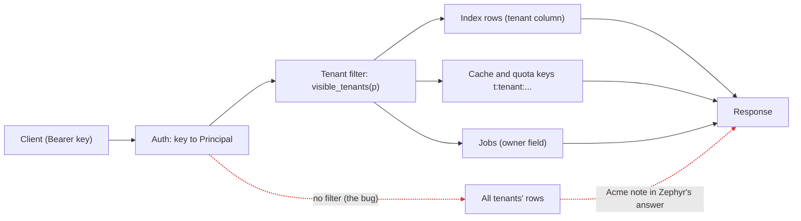
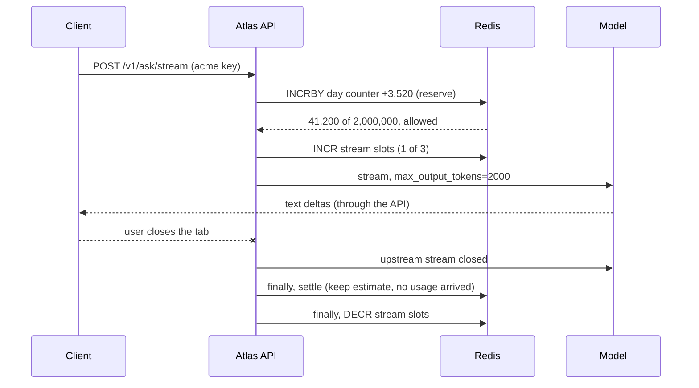
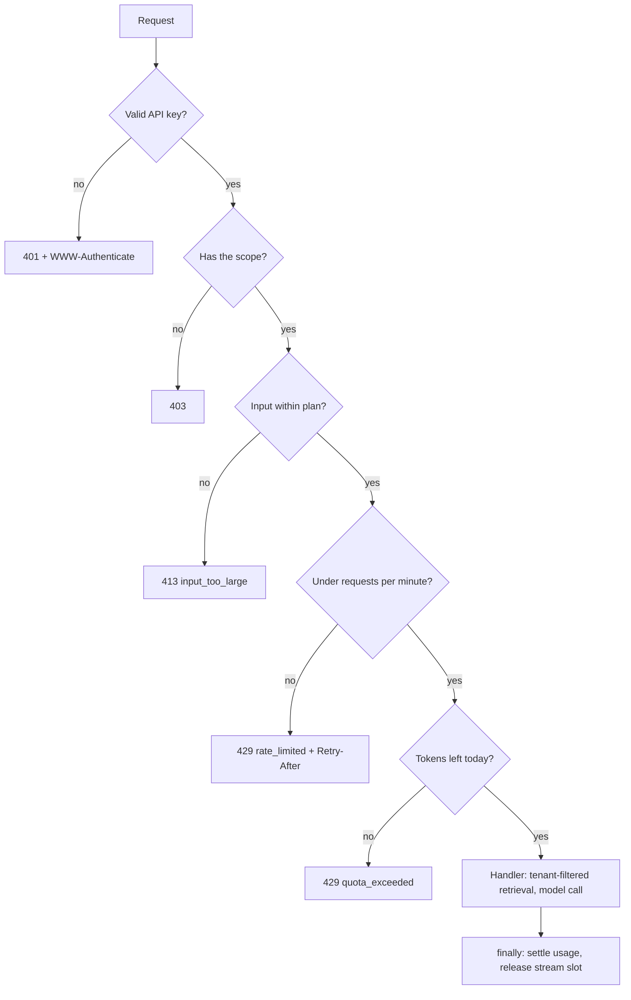

# Auth, Multi-Tenancy & Usage Quotas

Atlas is opening to companies that run Orbit. Acme and Zephyr each upload private runbooks, and a public demo key sits on the launch page. In the first test, a Zephyr user asks "what lease_seconds do we use?" and gets Acme's answer, and a script on the demo key burns $40 overnight with 50,000-character questions. Today you answer three questions for every request: who is calling, what may they see, and how much may they spend.

## At a Glance

- **Time:** ~2 h core (+ optional Go Deeper) · **Depth:** working
- **Prerequisites:** [Day 27: Hybrid Search: Keywords + Vectors](../../Phase_3_RAG/Day_027_hybrid_search/hybrid_search.md) (ACL filters), [Day 73: Privacy & PII: Redaction, Retention and Erasure](../../Phase_8_Safety_and_Security/Day_073_privacy_pii/privacy_pii.md), [Day 77: Serving LLM Apps with FastAPI](../../Phase_9_Production/Day_077_fastapi_serving/fastapi_serving.md), [Day 78: Async Jobs & Long-Running Work](../../Phase_9_Production/Day_078_async_jobs/async_jobs.md) (Redis); primer [HTTP, JSON & APIs](../../Appendix_Primers/A05_http_json_apis.md)
- **You'll build:** API-key auth that turns a request into a `Principal`, tenant-scoped retrieval and job lookups, per-tenant rate limits and daily token quotas in Redis, and a test suite that proves one tenant can't see another's data.
- **Stops at:** identity providers (OAuth/OIDC sign-in, SSO, SCIM user provisioning) and billing systems.
- **Fast path:** Already run a multi-tenant SaaS API? Read "Break It: Leaks Through Derived Stores" and "The Tenant-Keying Checklist", run `test_isolation.py`, then do Exercise 3 (~40 min).
- **Cost:** $0. Everything runs on a fake model and in-process fakeredis. An optional live run is under $0.01 on `gpt-6-luna` (prices as of 2026-11, [verify](https://developers.openai.com/api/docs/pricing)).
- **New terms:** API key auth (hash at rest), principal & scopes, tenant isolation, rate limit vs token quota, denial of wallet

> **Coming from Software Engineering?** This is standard SaaS multi-tenancy: a `tenant_id` on every row, per-key rate limits like the Stripe or GitHub APIs, and `401` vs `403` vs `404` chosen on purpose. Three things are new for AI. First, the unit of cost is the token, not the request, and one request can cost 1,000× another. Second, data leaks through *derived* stores that teams forget to key: embeddings, semantic caches, traces and conversation ids. Third, row-level security (the database filtering rows by who is asking) maps to "filter by authorization, then rank", which you met in [Day 27](../../Phase_3_RAG/Day_027_hybrid_search/hybrid_search.md) and [Day 28](../../Phase_3_RAG/Day_028_rag_pipeline/rag_pipeline.md).

## Two Customers, One Index, One Bill

Atlas's index held Orbit's public docs plus both private runbooks, and `search()` ranked them together. Zephyr's question matched Acme's note best, so Acme's `lease_seconds = 900` went into Zephyr's prompt and came back as the answer. Nobody hacked anything; the code never asked whose data it was reading.

The bill came from the demo key. A 50,000-character question is about 12,500 tokens; with a few hundred output tokens, a call costs roughly $0.0014 on `gpt-6-luna` ($0.10 per 1M input, $0.50 per 1M output, as of 2026-11, [verify](https://developers.openai.com/api/docs/pricing)). $40 is about 28,000 calls, roughly one a second through a night. Nothing crashed, so nobody noticed.

Both failures share one root cause: the API knew *that* a request arrived, not *who* sent it or *what* and *how much* they could use.

## Front Doors, Mailboxes and Meters

Think of an apartment building:

- **Front-door key** per tenant: the API key. Lose one, and you change that lock only.
- **Mailboxes:** each flat's mail goes only to that flat. That's **tenant isolation**: every store Atlas touches is keyed by tenant.
- **Water meter with a cap:** usage is metered and limited. That's the **quota**.

A **tenant** is one customer organisation whose data must stay separate. A **principal** is the authenticated caller and what it may do. A **scope** is a named permission like `triage:write`.

Trace one request by hand. Zephyr sends `Authorization: Bearer atk_…`:

1. The key's hash matches a row → principal `zephyr`, plan `team`, scopes `{ask, reports}`.
2. Retrieval may read tenants `("public", "zephyr")`, so Acme's runbook is never a candidate.
3. Rate limit: counter `t:zephyr:rpm:<minute>` goes to 7 of 300.
4. Token quota: reserve the worst case, call the model, then settle to the real usage.

Now the meter, with toy numbers. The demo plan allows 2,000 tokens a day (toy value), and Atlas reserves `input + max_output_tokens` (300) before each call:

| Request | Input | Reserved | Real usage | Day total after settle |
|---|---|---|---|---|
| 1 | 40 | 340 | 160 | 160 |
| 2 | 900 | 1,200 | 1,050 | 1,210 |
| 3 | 600 | 900 | – | rejected: 1,210 + 900 > 2,000 |

Request 3 is refused before spending anything.

## API Keys Done Right

A naive version stores keys in plain text and compares with `==`: a database dump leaks every key, and `==` can stop at the first wrong character. Here is the correct shape.

```python
# script_id: day_083_auth_multitenancy_quotas/api_keys
# API keys in 20 lines: issue, store only a hash, verify. Stdlib only: no install, no key.
import hashlib
import hmac
import secrets

def issue_key() -> tuple[str, str]:
    raw = "atk_" + secrets.token_urlsafe(32)                 # 32 random bytes: unguessable
    return raw, hashlib.sha256(raw.encode()).hexdigest()     # show raw ONCE; store only the hash

def verify(raw: str, stored_hash: str) -> bool:
    candidate = hashlib.sha256(raw.encode()).hexdigest()
    return hmac.compare_digest(candidate, stored_hash)       # constant-time comparison

raw, stored = issue_key()
print("give the customer (once):", raw[:10] + "…")           # never log a full key
print("store in the database:   ", stored[:16] + "…")
print("verify(correct):", verify(raw, stored))
print("verify(wrong):  ", verify(raw + "x", stored))
```

```text
give the customer (once): atk_Qm3v9Z…
store in the database:    5f1c0d2e9a7b44c1…
verify(correct): True
verify(wrong):   False
```

(Your values will differ.) Three rules make this safe:

- **`secrets`, not `random`:** it uses the OS's cryptographic randomness.
- **SHA-256 is fine for keys, not passwords.** A 256-bit random key can't be guessed from its hash. Short, guessable passwords need a slow hash such as argon2 or bcrypt.
- **`hmac.compare_digest`** takes the same time wherever the strings differ, so timing reveals nothing.

The realistic version stores keys in SQLite with a public `key_id`: the raw key is `atk_<key_id>_<secret>`. The `key_id` is safe to log, and it lets you fetch one row, then compare hashes.

```python
# script_id: day_083_auth_multitenancy_quotas/auth
# Becomes atlas/api/auth.py in R5. Install: uv add "fastapi>=0.162"   No key; SQLite file only.
import hashlib
import hmac
import secrets
import sqlite3
import time
from contextlib import closing
from dataclasses import dataclass
from typing import Annotated, Literal

from fastapi import Depends, HTTPException, Request
from fastapi.security import HTTPAuthorizationCredentials, HTTPBearer

Plan = Literal["demo", "free", "team"]

@dataclass(frozen=True)
class Principal:
    """Who is calling and what they may do. Code below takes this, never the raw key."""
    tenant_id: str
    key_id: str
    plan: Plan
    scopes: frozenset[str]

def hash_key(raw: str) -> str:
    # fine for 256-bit random keys; human passwords need a slow hash (argon2/bcrypt)
    return hashlib.sha256(raw.encode()).hexdigest()
```

```python
# script_id: day_083_auth_multitenancy_quotas/auth
class KeyStore:
    """API keys in SQLite. Raw format atk_<key_id>_<secret>; only the hash is stored."""
    def __init__(self, path: str = "keys.db") -> None:
        self.path = path
        with closing(sqlite3.connect(path)) as db, db:      # closing() closes; `db` commits
            db.execute("CREATE TABLE IF NOT EXISTS keys (key_id TEXT PRIMARY KEY, tenant_id TEXT,"
                       " plan TEXT, scopes TEXT, key_hash TEXT, created REAL, revoked REAL)")

    def issue(self, tenant_id: str, plan: Plan, scopes: set[str]) -> str:
        key_id = secrets.token_hex(4)                        # public half: safe in logs
        raw = f"atk_{key_id}_{secrets.token_urlsafe(32)}"
        with closing(sqlite3.connect(self.path)) as db, db:
            db.execute("INSERT INTO keys VALUES (?, ?, ?, ?, ?, ?, NULL)",
                       (key_id, tenant_id, plan, " ".join(sorted(scopes)), hash_key(raw), time.time()))
        return raw                                           # the only time anyone sees it

    def lookup(self, raw: str) -> Principal | None:
        parts = raw.split("_", 2)
        if len(parts) != 3 or parts[0] != "atk":
            return None
        with closing(sqlite3.connect(self.path)) as db:
            row = db.execute("SELECT tenant_id, plan, scopes, key_hash FROM keys"
                             " WHERE key_id = ? AND revoked IS NULL", (parts[1],)).fetchone()
        if row is None or not hmac.compare_digest(row[3], hash_key(raw)):
            return None
        return Principal(row[0], parts[1], row[1], frozenset(row[2].split()))

    def revoke(self, key_id: str) -> None:
        with closing(sqlite3.connect(self.path)) as db, db:
            db.execute("UPDATE keys SET revoked = ? WHERE key_id = ?", (time.time(), key_id))
```

A FastAPI dependency turns the header into a `Principal`. `HTTPBearer(auto_error=False)` parses `Authorization: Bearer …` and returns `None` instead of raising, so you send one 401 for "missing" and "wrong", with the `WWW-Authenticate: Bearer` header clients expect.

```python
# script_id: day_083_auth_multitenancy_quotas/auth
_bearer = HTTPBearer(auto_error=False)

def require_principal(request: Request,
                      creds: Annotated[HTTPAuthorizationCredentials | None, Depends(_bearer)]) -> Principal:
    store: KeyStore = request.app.state.keys
    principal = store.lookup(creds.credentials) if creds else None
    if principal is None:
        raise HTTPException(401, "invalid or missing API key", headers={"WWW-Authenticate": "Bearer"})
    request.state.principal = principal          # logs/traces get tenant_id + key_id, never the key
    return principal

def require_scope(scope: str):
    """Dependency factory: Depends(require_scope("triage:write"))."""
    def check(p: Annotated[Principal, Depends(require_principal)]) -> Principal:
        if scope not in p.scopes:
            raise HTTPException(403, f"key lacks scope {scope!r}")
        return p
    return check

if __name__ == "__main__":
    import os
    import tempfile
    store = KeyStore(os.path.join(tempfile.mkdtemp(), "keys.db"))
    raw = store.issue("acme", "team", {"ask", "reports"})
    p = store.lookup(raw)
    print(p)
    store.revoke(p.key_id)
    print("after revoke:", store.lookup(raw))
```

```text
Principal(tenant_id='acme', key_id='9f3a1c2e', plan='team', scopes=frozenset({'ask', 'reports'}))
after revoke: None
```

**401** means "I don't know who you are" (fix your key). **403** means "I know you, and you may not do this" (a demo key calling `/v1/reports`: upgrade or ask an admin).

## Break It: Leaks Through Derived Stores

Reproduce the leak. The toy index holds Orbit's public docs plus two inline runbook notes, and each row carries its owner. The fix is the [Day 27](../../Phase_3_RAG/Day_027_hybrid_search/hybrid_search.md) rule: filter *before* ranking, never after.

```python
# script_id: day_083_auth_multitenancy_quotas/tenancy
# Becomes atlas/tenancy.py in R5. Install: uv add "fastapi>=0.162"   Env: ORBIT_DATA (docs/*.md)
import os
import re
from dataclasses import dataclass
from pathlib import Path

from fastapi import HTTPException

from auth import Principal

PUBLIC_TENANT = "public"                     # Orbit's own docs: every tenant may read them
DATA_DIR = Path(os.environ.get("ORBIT_DATA", "datasets/orbit"))

def tenant_key(p: Principal, *parts: str) -> str:
    """The ONE way to build a storage key: t:<tenant>:... Grep for 't:' to find every bypass."""
    return ":".join(["t", p.tenant_id, *parts])

def visible_tenants(p: Principal) -> tuple[str, ...]:
    # demo keys read public docs only; company keys read public docs plus their own
    return (PUBLIC_TENANT,) if p.plan == "demo" else (PUBLIC_TENANT, p.tenant_id)

def assert_owner(p: Principal, owner_tenant: str) -> None:
    if owner_tenant != p.tenant_id:
        # 404, not 403: a 403 confirms the id exists, which leaks another customer's activity
        raise HTTPException(404, "not found")
```

```python
# script_id: day_083_auth_multitenancy_quotas/tenancy
@dataclass(frozen=True)
class Doc:
    doc_id: str
    tenant: str                              # every row carries its owner
    text: str

TENANT_NOTES = [                             # inline toy data: two customers' private runbooks
    Doc("acme/runbook", "acme", "Acme runbook: we use lease_seconds = 900 for the nightly ETL queue."),
    Doc("zephyr/runbook", "zephyr", "Zephyr runbook: lease_seconds = 120, heartbeat_seconds = 30."),
]

def load_corpus() -> list[Doc]:
    docs = sorted((DATA_DIR / "docs").glob("*.md"))
    return [Doc(f"docs/{p.stem}", PUBLIC_TENANT, p.read_text(encoding="utf-8")) for p in docs] + TENANT_NOTES

def _score(question: str, text: str) -> float:
    # toy keyword overlap, normalised by length; Day 27's hybrid search in real life
    q, words = set(re.findall(r"\w+", question.lower())), re.findall(r"\w+", text.lower())
    return len(q & set(words)) / (1 + len(words)) ** 0.5

def search(corpus: list[Doc], question: str, tenants: tuple[str, ...], k: int = 3) -> list[Doc]:
    allowed = [d for d in corpus if d.tenant in tenants]       # filter FIRST...
    return sorted(allowed, key=lambda d: _score(question, d.text), reverse=True)[:k]   # ...then rank
```

```python
# script_id: day_083_auth_multitenancy_quotas/tenancy
if __name__ == "__main__":
    corpus = load_corpus()
    zephyr = Principal("zephyr", "k_z", "team", frozenset({"ask"}))
    q = "what lease_seconds do we use?"
    everyone = tuple({d.tenant for d in corpus})
    top = search(corpus, q, everyone)                          # the launch-test bug: no filter
    print("BROKEN, no filter:      ", [d.doc_id for d in top])
    print("BROKEN, filter after k: ", [d.doc_id for d in top if d.tenant in visible_tenants(zephyr)])
    print("FIXED, filter first:    ", [d.doc_id for d in search(corpus, q, visible_tenants(zephyr))])
    try:
        assert_owner(zephyr, owner_tenant="acme")              # zephyr fetches an Acme job id
    except HTTPException as e:
        print("foreign job id ->", e.status_code, e.detail)
```

```text
BROKEN, no filter:       ['acme/runbook', 'zephyr/runbook', 'docs/broker-sqs']
BROKEN, filter after k:  ['zephyr/runbook', 'docs/broker-sqs']
FIXED, filter first:     ['zephyr/runbook', 'docs/broker-sqs', 'docs/scaling-workers']
foreign job id -> 404 not found
```

With no filter, Acme's note ranks first and the model answers 900. Filtering *after* top-k hides the leak but returns fewer results, because foreign rows used up Zephyr's slots; with many tenants, a customer can get zero. Filtering first is safe and complete.

If Zephyr replays an Acme job id, the answer is `404`, the same as for an id that never existed. A `403` would confirm the id is real, and "this exists" is already a leak.



## The Tenant-Keying Checklist

The index is one store of many. Anything derived from a tenant's content can leak. Walk this table for every new feature.

| Store | Key or filter | Leak if you forget | Owner day |
|---|---|---|---|
| Index rows (vectors + text) | `tenant` column, filtered before ranking | another tenant's chunks in the prompt | [D27](../../Phase_3_RAG/Day_027_hybrid_search/hybrid_search.md) |
| Semantic / response cache | `tenant_key(p, "cache", …)` | Zephyr gets Acme's cached answer | [D85](../../Phase_9_Production/Day_085_caching_cost_scale/caching_cost_scale.md) |
| Jobs and results | owner field + `assert_owner` → 404 | report download by guessed id | [D78](../../Phase_9_Production/Day_078_async_jobs/async_jobs.md) |
| Traces | `atlas.tenant_id` attribute; content capture off | support staff read prompts in the trace UI | [D42](../../Phase_5_Evaluation_and_Observability/Day_042_tracing_observability/tracing_observability.md), [D73](../../Phase_8_Safety_and_Security/Day_073_privacy_pii/privacy_pii.md) |
| Logs | `tenant_id`, `key_id`, token counts; never content or keys | prompts in a shared log index | [D73](../../Phase_8_Safety_and_Security/Day_073_privacy_pii/privacy_pii.md) |
| Eval and feedback datasets | tenant tag; opt-in before reuse | one customer's data in another's evals | [D86](../../Phase_9_Production/Day_086_monitoring_feedback/monitoring_feedback.md) |
| Conversation ids, `previous_response_id` | store the owner per id; check on reuse | a replayed id continues someone else's chat | [D8](../../Phase_2_Building_with_LLM_APIs/Day_008_messages_and_state/messages_and_state.md) |
| Uploaded files | per-tenant prefix or bucket | path guessing | this day |
| Rate-limit and quota counters | `t:<tenant>:rpm:…`, `t:<tenant>:tokens:…` | one tenant exhausts another's budget | this day |
| Provider account | separate keys/projects per environment | staging traffic on the prod bill | Go Deeper |

Two habits make it enforceable: build every key through `tenant_key()`, so one grep finds the exceptions, and test that no Redis key bypasses it (below).

## Scopes and Plans

After authentication, **scopes** decide which endpoints you may call and the **plan** decides how much you may use:

| Tenant | Plan | Scopes | Why |
|---|---|---|---|
| `orbit-maintainers` | team | `ask`, `investigate`, `reports`, `triage:write` | the only callers that may propose label changes |
| `acme`, `zephyr` | team | `ask`, `investigate`, `reports` | paying companies: read and investigate, no writes to Orbit's tracker |
| `demo` | demo | `ask` | public key on the launch page: shared by everyone, tightest caps |

Keep plans in one table: a pricing change is a one-line diff.

```python
# script_id: day_083_auth_multitenancy_quotas/quotas
# Becomes atlas/quotas.py in R5. Install: uv add "redis>=8.1" tiktoken   (tests/demos: uv add fakeredis)
# Env: ATLAS_REDIS_URL (default redis://localhost:6379/0; "fake://" = in-process fakeredis, no Docker).
# Services: Redis 7+ (EXPIRE ... NX), e.g. the redis:8 compose.yaml from Day 78.
# Redis 6 rejects nx= ("wrong number of arguments for 'expire'"): drop nx=True there; re-setting the TTL is harmless.
import os
import time
from contextlib import asynccontextmanager
from dataclasses import dataclass
from datetime import UTC, datetime, timedelta
from typing import Literal

import tiktoken
from redis.asyncio import Redis

from auth import Plan, Principal
from tenancy import tenant_key

REDIS_URL = os.environ.get("ATLAS_REDIS_URL", "redis://localhost:6379/0")
_enc = tiktoken.get_encoding("o200k_base")

def count_tokens(text: str) -> int:          # compact copy of Day 4: approximate for GPT-6 models
    return len(_enc.encode(text))

def get_redis(url: str = REDIS_URL) -> Redis:
    """Async client: these calls run on every request, so they mustn't block the event loop."""
    if url.startswith("fake://"):
        import fakeredis
        return fakeredis.FakeAsyncRedis(decode_responses=True)    # fresh in-process store
    return Redis.from_url(url, decode_responses=True)

@dataclass(frozen=True)
class PlanLimits:
    rpm: int                  # requests per minute, per tenant
    tokens_per_day: int       # input + output, per tenant, per UTC day
    max_input_tokens: int     # one question
    max_output_tokens: int    # clamp; reasoning tokens count against it too
    max_streams: int          # concurrent SSE streams
    effort: str               # reasoning-effort ceiling for the plan

PLANS: dict[Plan, PlanLimits] = {             # illustrative: derive yours from cost per tenant
    "demo": PlanLimits(10, 50_000, 500, 300, 1, "none"),
    "free": PlanLimits(60, 200_000, 2_000, 800, 2, "low"),
    "team": PlanLimits(300, 2_000_000, 8_000, 2_000, 3, "medium"),
}
```

`effort` is in the plan because reasoning tokens bill as output: `"max"` effort multiplies cost without a longer question.

## Per-Tenant Rate Limits in Redis

A **rate limit** caps requests per window; a **token quota** caps tokens per day. The first stops floods of cheap calls, the second a few huge ones.

In-process counters break with two replicas, because each counts separately. Redis gives every replica one shared, atomic counter. The simplest correct design is a **fixed window**: count requests per clock minute in `t:<tenant>:rpm:<minute>`. `INCR` adds 1 atomically, and `EXPIRE … NX` sets the time-to-live once, so old windows delete themselves.

```python
# script_id: day_083_auth_multitenancy_quotas/quotas
Code = Literal["rate_limited", "quota_exceeded", "too_many_streams", "input_too_large"]

class QuotaExceeded(Exception):
    def __init__(self, code: Code, retry_after_s: int = 0) -> None:
        super().__init__(code)
        self.code, self.retry_after_s = code, retry_after_s

@dataclass(frozen=True)
class Decision:
    allowed: bool
    remaining: int
    retry_after_s: int        # integer SECONDS until the window resets, never a timestamp

class RateLimiter:
    """Fixed window: one counter per (key, clock minute), shared by every replica."""
    def __init__(self, redis: Redis) -> None:
        self.r = redis

    async def hit(self, key: str, limit: int, window_s: int = 60) -> Decision:
        now = int(time.time())
        bucket = f"{key}:{now // window_s}"
        async with self.r.pipeline(transaction=True) as pipe:     # MULTI/EXEC: both or neither
            pipe.incr(bucket)
            pipe.expire(bucket, window_s, nx=True)                # TTL set once, by the first hit
            count, _ = await pipe.execute()
        if count > limit:
            return Decision(False, 0, window_s - now % window_s)
        return Decision(True, limit - count, 0)
```

`INCR` returns the new count atomically, so two replicas can't both see "59" and both admit a 60th call. Rejected calls still increment the counter, which is harmless: it expires with the minute.

The API then returns `429` with `Retry-After: 17`: *seconds* until the window resets. HTTP allows seconds or an HTTP date, never a Unix timestamp; a client that reads `1793712000` as seconds waits 56 years.

## Token Quotas: Reserve, Then Settle

You only know the real token count *after* the model answers, but must decide *before* calling it. So **reserve** the worst case, then **settle** to the real number:

- **Estimate:** input tokens + retrieved context + the plan's `max_output_tokens`. The output clamp makes this a true upper bound for output.
- **Reserve:** `INCRBY` the day counter. If the total goes over the plan, `DECRBY` it back and reject with `quota_exceeded`.
- **Settle:** after the call, add `actual - reserved` (usually negative). Do this in `finally`, so errors and cancelled streams settle too.

```python
# script_id: day_083_auth_multitenancy_quotas/quotas
@dataclass(frozen=True)
class Reservation:
    key: str
    reserved: int

def _day_key(p: Principal) -> str:
    return tenant_key(p, "tokens", datetime.now(UTC).strftime("%Y-%m-%d"))

def _seconds_to_utc_midnight() -> int:
    now = datetime.now(UTC)
    midnight = (now + timedelta(days=1)).replace(hour=0, minute=0, second=0, microsecond=0)
    return int((midnight - now).total_seconds()) + 1

class TokenQuota:
    """Daily token budget per tenant: reserve the worst case, settle to real usage."""
    def __init__(self, redis: Redis) -> None:
        self.r = redis

    async def reserve(self, p: Principal, est: int) -> Reservation:
        key = _day_key(p)
        used = await self.r.incrby(key, est)             # atomic across replicas
        await self.r.expire(key, 2 * 86_400, nx=True)    # day keys clean themselves up
        if used > PLANS[p.plan].tokens_per_day:
            await self.r.decrby(key, est)                # rejected calls cost nothing
            raise QuotaExceeded("quota_exceeded", _seconds_to_utc_midnight())
        return Reservation(key, est)

    async def settle(self, res: Reservation, actual: int) -> None:
        if actual != res.reserved:
            await self.r.incrby(res.key, actual - res.reserved)

    async def remaining(self, p: Principal) -> int:
        return PLANS[p.plan].tokens_per_day - int(await self.r.get(_day_key(p)) or 0)
```

The same class owns stream slots: each SSE stream ([Day 77](../../Phase_9_Production/Day_077_fastapi_serving/fastapi_serving.md)) holds a live model call, so plans cap how many run at once. The slot key's TTL exceeds Day 77's longest stream deadline (120 s), so a crashed replica's slots free themselves.

```python
# script_id: day_083_auth_multitenancy_quotas/quotas
    async def acquire_stream(self, p: Principal) -> str:
        key = tenant_key(p, "streams")
        n = await self.r.incr(key)
        await self.r.expire(key, 300)                    # > the longest stream deadline
        if n > PLANS[p.plan].max_streams:
            await self.r.decr(key)
            raise QuotaExceeded("too_many_streams", retry_after_s=5)
        return key

    async def release_stream(self, key: str) -> None:
        if await self.r.decr(key) < 0:                   # key expired mid-stream: don't go negative
            await self.r.set(key, 0)

    @asynccontextmanager
    async def stream_slot(self, p: Principal):
        """For workers and WebSockets. HTTP routes acquire in a dependency instead (see below)."""
        key = await self.acquire_stream(p)
        try:
            yield
        finally:
            await self.release_stream(key)
```



Run both mechanisms against fakeredis: 70 calls on the free plan's 60 rpm, then demo-plan traffic.

```python
# script_id: day_083_auth_multitenancy_quotas/quota_demo
# Run: python quota_demo.py   (fakeredis by default; ATLAS_REDIS_URL=redis://... for real Redis)
import asyncio
import os

from auth import Principal
from quotas import PLANS, QuotaExceeded, RateLimiter, TokenQuota, count_tokens, get_redis
from tenancy import tenant_key

async def main() -> None:
    r = get_redis(os.environ.get("ATLAS_REDIS_URL", "fake://"))
    zephyr = Principal("zephyr", "k_z", "free", frozenset({"ask"}))
    limiter = RateLimiter(r)
    hits = [await limiter.hit(tenant_key(zephyr, "rpm"), PLANS["free"].rpm) for _ in range(70)]
    no = [d for d in hits if not d.allowed]
    print(f"70 calls: {70 - len(no)} allowed, {len(no)} rejected, Retry-After: {no[0].retry_after_s} s")

    demo, limits = Principal("demo", "k_d", "demo", frozenset({"ask"})), PLANS["demo"]
    quota = TokenQuota(r)
    for question, real_out in [("How do I retry a failed job?", 120), ("What is a lease?", 80)]:
        n_in = count_tokens(question)
        res = await quota.reserve(demo, n_in + limits.max_output_tokens)    # worst case
        await quota.settle(res, n_in + real_out)                            # after the call
        print(f"reserved {res.reserved}, settled {n_in + real_out}, left {await quota.remaining(demo)}")

    huge = "Why does my worker stop? " * 2_000                              # 50,000 characters
    print(f"50k-char question: {count_tokens(huge)} tokens > max_input {limits.max_input_tokens}")
    try:
        while True:
            await quota.reserve(demo, 5_000)
    except QuotaExceeded as e:
        print(f"budget exhausted -> {e.code}, Retry-After: {e.retry_after_s} s")
    await r.aclose()

asyncio.run(main())
```

```text
70 calls: 60 allowed, 10 rejected, Retry-After: 17 s
reserved 308, settled 128, left 49872
reserved 305, settled 85, left 49787
50k-char question: 12001 tokens > max_input 500
budget exhausted -> quota_exceeded, Retry-After: 30113 s
```

(`Retry-After` values depend on the clock.) Why `429` and not `402 Payment Required` for an empty budget? HTTP reserves 402 "for future use", so clients handle it inconsistently, while every retrying client understands a `429` with an `error` code and `Retry-After`.

## Wiring It Into the API

Run the checks cheapest first: a missing key costs nothing, a Redis round trip a millisecond, a model call money.



One FastAPI trap: an SSE route's generator starts *after* `200` and the headers are sent, so an exception inside it can't become a 429. The client sees a 200 with an empty body (verified on FastAPI 0.162). Every check that can say no therefore goes in a **dependency**, which runs first; the generator only settles and releases, in `finally`.

The app is a compact stand-in for Day 77's, with the model behind an `LLM` seam. `FakeLLM` (the [Day 19](../../Phase_2_Building_with_LLM_APIs/Day_019_testing_llm_code/testing_llm_code.md) pattern) needs no key; `ATLAS_LLM=openai` switches to the real Responses API.

```python
# script_id: day_083_auth_multitenancy_quotas/app
# Compact stand-in for Day 77's app with auth + quotas. Becomes atlas/api/app.py wiring in R5.
# Install: uv add "fastapi>=0.162" uvicorn "redis>=8.1" tiktoken "openai>=3.46"  (+ fakeredis)
# Env: ATLAS_REDIS_URL, ATLAS_KEYS_DB (default keys.db), ATLAS_LLM=fake|openai, OPENAI_API_KEY
# Run: uv run python app.py   (port 8000)
import os
import uuid
from collections.abc import AsyncIterable, AsyncIterator, Callable
from contextlib import asynccontextmanager
from dataclasses import dataclass
from typing import Annotated, Protocol

import anyio
from fastapi import Depends, FastAPI, HTTPException, Request
from fastapi.responses import JSONResponse
from fastapi.sse import EventSourceResponse, ServerSentEvent
from pydantic import BaseModel, Field

from auth import KeyStore, Principal, require_scope
from quotas import PLANS, QuotaExceeded, RateLimiter, Reservation, TokenQuota, count_tokens, get_redis
from tenancy import Doc, assert_owner, load_corpus, search, tenant_key, visible_tenants

MODEL = os.environ.get("ATLAS_MODEL", "gpt-6-luna")
Event = tuple[str, str | int]                 # ("delta", text) ... then ("usage", total_tokens)

class LLM(Protocol):
    def stream(self, question: str, docs: list[Doc], max_output_tokens: int,
               effort: str) -> AsyncIterator[Event]: ...
```

```python
# script_id: day_083_auth_multitenancy_quotas/app
class FakeLLM:
    """No key, fixed output; records the caps it was given so tests can check them."""
    def __init__(self) -> None:
        self.calls: list[dict] = []

    async def stream(self, question: str, docs: list[Doc], max_output_tokens: int,
                     effort: str) -> AsyncIterator[Event]:
        self.calls.append({"max_output_tokens": max_output_tokens, "effort": effort})
        text = f"[{docs[0].doc_id}] {docs[0].text[:80]}" if docs else "No sources found."
        for word in text.split(" "):
            yield "delta", word + " "
        yield "usage", count_tokens(question) + sum(count_tokens(d.text[:2000]) for d in docs) + count_tokens(text)

class OpenAILLM:
    def __init__(self) -> None:
        from openai import AsyncOpenAI
        self.client = AsyncOpenAI(timeout=60.0, max_retries=2)

    async def stream(self, question: str, docs: list[Doc], max_output_tokens: int,
                     effort: str) -> AsyncIterator[Event]:
        sources = "\n\n".join(f"[{d.doc_id}] {d.text[:2000]}" for d in docs)   # caps context cost
        events = await self.client.responses.create(
            model=MODEL, instructions="Answer only from the sources and cite [doc_id].",
            input=f"Sources:\n{sources}\n\nQuestion: {question}", stream=True, store=False,
            max_output_tokens=max_output_tokens, reasoning={"effort": effort})
        async for ev in events:
            if ev.type == "response.output_text.delta":
                yield "delta", ev.delta
            elif ev.type == "response.completed" and ev.response.usage:
                yield "usage", ev.response.usage.total_tokens
```

`store=False` keeps tenant prompts out of provider storage ([Day 73](../../Phase_8_Safety_and_Security/Day_073_privacy_pii/privacy_pii.md)). The admission dependency runs the diagram's checks in order:

```python
# script_id: day_083_auth_multitenancy_quotas/app
CONTEXT_TOKENS = 1_500        # retrieved sources: 3 docs x ~2,000 chars, truncated in the prompt

class AskRequest(BaseModel):
    question: str = Field(min_length=1, max_length=100_000)   # coarse body guard; plans cap tokens
    max_output_tokens: int | None = Field(default=None, ge=1)

@dataclass
class Admission:
    principal: Principal
    reservation: Reservation
    max_output_tokens: int
    stream_key: str | None = None

def admit(scope: str, *, stream: bool = False) -> Callable:
    """Every check that can say no, cheapest first, BEFORE the handler (and before SSE sends 200)."""
    async def _admit(request: Request, body: AskRequest,
                     p: Annotated[Principal, Depends(require_scope(scope))]) -> Admission:
        s, limits = request.app.state, PLANS[p.plan]
        n_in = count_tokens(body.question)
        if n_in > limits.max_input_tokens:                            # free: no Redis, no model
            raise QuotaExceeded("input_too_large")
        request.state.rate = await s.limiter.hit(tenant_key(p, "rpm"), limits.rpm)
        if not request.state.rate.allowed:
            raise QuotaExceeded("rate_limited", request.state.rate.retry_after_s)
        out = min(body.max_output_tokens or limits.max_output_tokens, limits.max_output_tokens)
        adm = Admission(p, await s.quota.reserve(p, n_in + CONTEXT_TOKENS + out), out)
        if stream:
            try:
                adm.stream_key = await s.quota.acquire_stream(p)
            except QuotaExceeded:
                await s.quota.settle(adm.reservation, 0)                # hand the tokens back
                raise
        return adm
    return _admit
```

The handler retrieves only inside the caller's tenants and **always** settles. Starlette cancels a disconnected stream with an anyio cancel scope, which also cancels the `await`s in your `finally`; a shielded scope lets cleanup finish.

```python
# script_id: day_083_auth_multitenancy_quotas/app
async def _run(request: Request, adm: Admission, question: str) -> AsyncIterator[Event]:
    s, p = request.app.state, adm.principal
    docs = search(s.corpus, question, visible_tenants(p))           # tenant filter before ranking
    used = adm.reservation.reserved             # no usage yet (crash, cancel): keep the estimate
    try:
        async for kind, value in s.llm.stream(question, docs, adm.max_output_tokens,
                                              PLANS[p.plan].effort):
            if kind == "usage":
                used = int(value)
            yield kind, value
        yield "sources", ",".join(d.doc_id for d in docs)
    finally:
        with anyio.CancelScope(shield=True):    # cleanup must finish even when cancelled
            await s.quota.settle(adm.reservation, used)
            if adm.stream_key:
                await s.quota.release_stream(adm.stream_key)

def create_app(keys: KeyStore | None = None, llm: LLM | None = None,
               redis_factory: Callable = get_redis) -> FastAPI:
    @asynccontextmanager
    async def lifespan(app: FastAPI) -> AsyncIterator[None]:
        app.state.keys = keys or KeyStore(os.environ.get("ATLAS_KEYS_DB", "keys.db"))
        app.state.llm = llm or (OpenAILLM() if os.environ.get("ATLAS_LLM") == "openai" else FakeLLM())
        app.state.redis = redis_factory()
        app.state.limiter, app.state.quota = RateLimiter(app.state.redis), TokenQuota(app.state.redis)
        app.state.corpus = load_corpus()
        yield
        await app.state.redis.aclose()

    app = FastAPI(title="Atlas: auth + quotas", lifespan=lifespan)

    @app.exception_handler(QuotaExceeded)
    async def on_quota(request: Request, exc: QuotaExceeded) -> JSONResponse:
        headers = {"Retry-After": str(exc.retry_after_s)} if exc.retry_after_s else {}
        return JSONResponse({"error": exc.code, "retry_after_s": exc.retry_after_s},
                            status_code=413 if exc.code == "input_too_large" else 429, headers=headers)

    add_routes(app)
    return app
```

```python
# script_id: day_083_auth_multitenancy_quotas/app
def add_routes(app: FastAPI) -> None:
    @app.post("/v1/ask")
    async def ask(body: AskRequest, request: Request,
                  adm: Annotated[Admission, Depends(admit("ask"))]) -> dict:
        parts, sources = [], ""
        async for kind, value in _run(request, adm, body.question):
            parts += [value] if kind == "delta" else []
            sources = value if kind == "sources" else sources
        return {"answer": "".join(parts).strip(), "sources": sources.split(",")}

    @app.post("/v1/ask/stream", response_class=EventSourceResponse)
    async def ask_stream(body: AskRequest, request: Request,
                         adm: Annotated[Admission, Depends(admit("ask", stream=True))]
                         ) -> AsyncIterable[ServerSentEvent]:
        async for kind, value in _run(request, adm, body.question):
            if kind != "usage":                  # usage is for the meter, not the client
                yield ServerSentEvent(raw_data=str(value), event=kind)

    @app.post("/v1/reports", status_code=202)
    async def create_report(request: Request,
                            p: Annotated[Principal, Depends(require_scope("reports"))]) -> dict:
        job_id = uuid.uuid4().hex                # Day 78 enqueues the real job; we record the owner
        await request.app.state.redis.hset(f"job:{job_id}",
                                           mapping={"tenant": p.tenant_id, "status": "queued"})
        return {"job_id": job_id}

    @app.get("/v1/reports/{job_id}")
    async def get_report(job_id: str, request: Request,
                         p: Annotated[Principal, Depends(require_scope("reports"))]) -> dict:
        job = await request.app.state.redis.hgetall(f"job:{job_id}")
        if not job:
            raise HTTPException(404, "not found")
        assert_owner(p, job["tenant"])           # same 404 as "never existed"
        return {"job_id": job_id, "status": job["status"]}

if __name__ == "__main__":
    import uvicorn
    uvicorn.run(create_app(), port=8000)
```

Job records skip the `t:` prefix because RQ's ids are global (Day 78); each record carries its owner, checked by `assert_owner`.

The curl transcript, in-process (TestClient, fakeredis, fake model):

```python
# script_id: day_083_auth_multitenancy_quotas/walkthrough
# Run: python walkthrough.py   (in-process: TestClient + fakeredis + FakeLLM; no key, no Docker)
import tempfile
from pathlib import Path

from fastapi.testclient import TestClient

from app import create_app
from auth import KeyStore
from quotas import get_redis

keys = KeyStore(str(Path(tempfile.mkdtemp()) / "keys.db"))
acme = keys.issue("acme", "team", {"ask", "reports"})
zephyr = keys.issue("zephyr", "team", {"ask", "reports"})
demo = keys.issue("demo", "demo", {"ask"})
def h(key: str) -> dict:
    return {"Authorization": f"Bearer {key}"}
Q = {"question": "what lease_seconds do we use?"}

with TestClient(create_app(keys, redis_factory=lambda: get_redis("fake://"))) as c:
    r = c.post("/v1/ask", json=Q)
    print("no key       ", r.status_code, r.json(), r.headers.get("www-authenticate"))
    for name, key in [("acme", acme), ("zephyr", zephyr)]:
        print(f"{name:<13}", 200, c.post("/v1/ask", json=Q, headers=h(key)).json()["sources"])
    r = c.post("/v1/ask", json={"question": "Why does my worker stop? " * 2_000}, headers=h(demo))
    print("demo, 50k    ", r.status_code, r.json())
    rs = [c.post("/v1/ask", json=Q, headers=h(demo)) for _ in range(11)]
    print("demo x11     ", [x.status_code for x in rs][-3:], rs[-1].json(), "Retry-After:", rs[-1].headers.get("retry-after"))
    print("demo reports ", c.post("/v1/reports", headers=h(demo)).status_code)
    job = c.post("/v1/reports", headers=h(acme)).json()["job_id"]
    print("acme job     ", c.get(f"/v1/reports/{job}", headers=h(acme)).status_code,
          "| zephyr reads it:", c.get(f"/v1/reports/{job}", headers=h(zephyr)).status_code)
```

```text
no key        401 {'detail': 'invalid or missing API key'} Bearer
acme          200 ['acme/runbook', 'docs/broker-sqs', 'docs/scaling-workers']
zephyr        200 ['zephyr/runbook', 'docs/broker-sqs', 'docs/scaling-workers']
demo, 50k     413 {'error': 'input_too_large', 'retry_after_s': 0}
demo x11      [200, 200, 429] {'error': 'rate_limited', 'retry_after_s': 17} Retry-After: 17
demo reports  403
acme job      200 | zephyr reads it: 404
```

(Your `Retry-After` will differ; across a minute boundary the 11th call may pass.) Each line is one rule: 401, tenant-filtered sources, 413 before spend, 429 with seconds, 403 for scope, 404 for a foreign id.

## Stopping Cost Attacks

**Denial of wallet** is an attack that runs up your bill instead of crashing your service: OWASP's LLM Top 10 (2025) item **LLM10 Unbounded Consumption**, T11 in your [Day 68](../../Phase_8_Safety_and_Security/Day_068_threat_modeling/threat_modeling.md) register. Each attack has a cap:

| Attack | What it exploits | Cap in Atlas |
|---|---|---|
| Huge inputs (50k-char questions) | input tokens are billed | `max_input_tokens` → 413 before Redis or the model |
| "Write 10,000 words" | output is the expensive side | `max_output_tokens` clamped by plan |
| Asking for maximum effort | reasoning tokens bill as output | `effort` fixed by plan |
| Many parallel streams | each stream is a live model call | `max_streams` → 429 `too_many_streams` |
| Runaway agent loops | one request, many model calls | step and token budgets per run ([Day 48](../../Phase_6_Agents/Day_048_first_agent/first_agent.md)) |
| Unauthenticated streaming | an open `/stream` is free compute for anyone | every route depends on `require_scope` |
| Cache-busting (random suffixes) | every variant misses the cache | the token quota still applies; cache keys in [Day 85](../../Phase_9_Production/Day_085_caching_cost_scale/caching_cost_scale.md) |

All public visitors share the `demo` tenant, so one script can drain everyone's demo budget: add a per-IP limit for demo traffic (see Common Pitfalls for proxies).

## Proving Isolation with Tests

Run every entry point as each tenant, assert that no foreign data comes back, and scan Redis for keys that bypass `tenant_key()`. One fakeredis `FakeServer` backs both the app's async client and the test's sync client.

```python
# script_id: day_083_auth_multitenancy_quotas/test_isolation
# Install: uv add --dev pytest fakeredis   Run: uv run pytest test_isolation.py -q   (no key, no Docker)
import tempfile
from pathlib import Path

import fakeredis
import pytest
from fastapi.testclient import TestClient

from app import FakeLLM, create_app
from auth import KeyStore

ASK = {"question": "what lease_seconds do we use?"}

def hdr(key: str) -> dict:
    return {"Authorization": f"Bearer {key}"}

@pytest.fixture
def env():
    keys = KeyStore(str(Path(tempfile.mkdtemp()) / "keys.db"))
    raw = {t: keys.issue(t, "team", {"ask", "reports"}) for t in ("acme", "zephyr")}
    raw["demo"] = keys.issue("demo", "demo", {"ask"})
    server, llm = fakeredis.FakeServer(), FakeLLM()
    app = create_app(keys, llm, lambda: fakeredis.FakeAsyncRedis(server=server, decode_responses=True))
    with TestClient(app) as client:
        yield client, raw, llm, fakeredis.FakeRedis(server=server, decode_responses=True)

@pytest.mark.parametrize("headers", [{}, {"Authorization": "Bearer atk_nope_x"}, {"Authorization": "Basic x"}])
def test_missing_or_bad_key_is_401(env, headers):
    r = env[0].post("/v1/ask", json=ASK, headers=headers)
    assert r.status_code == 401 and r.headers["www-authenticate"] == "Bearer"
```

```python
# script_id: day_083_auth_multitenancy_quotas/test_isolation
@pytest.mark.parametrize("me,other", [("acme", "zephyr"), ("zephyr", "acme")])
@pytest.mark.parametrize("path", ["/v1/ask", "/v1/ask/stream"])
def test_answers_never_include_other_tenants(env, me, other, path):
    client, raw, *_ = env
    body = client.post(path, json=ASK, headers=hdr(raw[me])).text
    assert f"{me}/runbook" in body and f"{other}/" not in body

@pytest.mark.parametrize("owner,intruder", [("acme", "zephyr"), ("zephyr", "acme")])
def test_foreign_job_is_404_like_a_missing_one(env, owner, intruder):
    client, raw, *_ = env
    job = client.post("/v1/reports", headers=hdr(raw[owner])).json()["job_id"]
    assert client.get(f"/v1/reports/{job}", headers=hdr(raw[owner])).status_code == 200
    foreign = client.get(f"/v1/reports/{job}", headers=hdr(raw[intruder]))
    missing = client.get("/v1/reports/does-not-exist", headers=hdr(raw[intruder]))
    assert foreign.status_code == missing.status_code == 404 and foreign.json() == missing.json()

def test_demo_has_no_reports_scope(env):
    assert env[0].post("/v1/reports", headers=hdr(env[1]["demo"])).status_code == 403

def test_every_redis_key_is_tenant_scoped(env):
    client, raw, _, r = env
    client.post("/v1/ask", json=ASK, headers=hdr(raw["acme"]))
    client.post("/v1/reports", headers=hdr(raw["zephyr"]))
    assert r.keys() and all(k.startswith(("t:", "job:")) for k in r.keys())

if __name__ == "__main__":
    raise SystemExit(pytest.main([__file__, "-q"]))
```

```text
...........                                                              [100%]
11 passed in 0.4s
```

## Trade-offs and When NOT to Build This Yourself

| Choice | Use it when | Avoid it when |
|---|---|---|
| API keys (this lesson) | machine-to-machine calls: scripts, backends, CI | people sign in through a browser |
| OAuth/OIDC via an identity provider | human sign-in, SSO, per-user audit | you'd hand-roll token validation |
| Fixed-window limit | most APIs: simple, one key per minute | bursts at the window edge matter (see Go Deeper) |
| Token quota with reserve/settle | any LLM endpoint where cost varies by request | flat-cost endpoints (a plain rate limit is enough) |

Rule of thumb: keys and quotas live in your app, because only it knows tenants and tokens; human identity belongs to an identity provider.

### In production

- Show what's left in headers and a usage page (Exercise 1): surprising quotas become support tickets.
- Reconcile daily: per-tenant summed `usage` vs the provider's usage export. A gap means a path that skips settling.
- Decide what a Redis outage does: fail closed for `demo`, open with a local fallback for paying tenants (Go Deeper).
- Rotate keys without downtime: two active keys, then revoke the old one (Exercise 2).
- Log `tenant_id`, `key_id`, plan and token counts, never content or keys. Per-tenant dashboards come in [Day 86](../../Phase_9_Production/Day_086_monitoring_feedback/monitoring_feedback.md).

### Commit it to R5

| Lesson block | R5 file |
|---|---|
| `auth` | `atlas/api/auth.py` |
| `tenancy` (minus the `__main__` demo) | `atlas/tenancy.py`; `search()` filtering moves into `Index.search()` |
| `quotas` | `atlas/quotas.py` |
| `app` (`admit`, `_run`, exception handler, report routes) | merged into `atlas/api/app.py` from Day 77 |
| `test_isolation` | `tests/test_isolation.py` |

The lesson's scripts import each other as plain modules (`from auth import Principal`). In R5, change those to package paths such as `from atlas.api.auth import Principal`.

## Go Deeper (optional)

<details><summary>Go deeper: fixed vs sliding windows (under the hood)</summary>

**In words.** A fixed window resets at each clock minute. A client can send 60 requests at 12:00:59 and 60 more at 12:01:00: 120 requests in two seconds, all allowed. A sliding window counts the last 60 seconds from *now*, so that burst gets cut off at 60.

**Toy numbers.** Limit 60/min. The previous minute had 50 requests, and we are 15 s into the current minute with 20 so far. A *sliding-window counter* estimates the last 60 s as `50 × (45/60) + 20 = 57.5`, so the next call is allowed and three more would be refused.

**Formula.** `estimate = prev_count × (1 − elapsed / window) + curr_count`. It needs two counters per key, assumes the previous minute's requests were spread evenly, and is usually close enough.

**Exact sliding log.** Store each request's timestamp in a Redis sorted set: remove entries older than the window, count, and add the new one only if the count is under the limit. Count-then-add must be one atomic step (a Lua script), or a rejected request extends its own ban. The old version of this lesson added before checking. The Stretch exercise builds the correct one. It costs one sorted-set entry per request, so keep it for low limits like the demo key.

</details>

<details><summary>Go deeper: fail open or fail closed when Redis is down</summary>

If Redis is unreachable, `RateLimiter.hit` raises `redis.exceptions.ConnectionError`. You have to choose a behaviour:

- **Fail closed** (reject with 503): safe for cost, and right for the public demo key, where an outage shouldn't become a free-for-all.
- **Fail open** (allow): right for paying tenants, where an internal outage shouldn't break their product. Pair it with a small per-process fallback limit, so one replica can't be flooded.

```python
# script_id: day_083_auth_multitenancy_quotas/fail_policy
# fragment
# Wraps RateLimiter.hit; local_hits is a per-process dict, reset each minute by the caller.
from redis.exceptions import ConnectionError as RedisDown

async def hit_with_policy(limiter, p, limits, local_hits: dict[str, int]) -> Decision:
    try:
        return await limiter.hit(tenant_key(p, "rpm"), limits.rpm)
    except RedisDown:
        if p.plan == "demo":
            raise HTTPException(503, "rate limiter unavailable", headers={"Retry-After": "5"})
        local_hits[p.tenant_id] = local_hits.get(p.tenant_id, 0) + 1
        allowed = local_hits[p.tenant_id] <= limits.rpm        # per replica: looser, never unlimited
        return Decision(allowed, max(0, limits.rpm - local_hits[p.tenant_id]), 0 if allowed else 60)
```

The token quota needs the same decision. Most teams fail open on quota for paying tenants and reconcile against the provider's usage export afterwards.

</details>

<details><summary>Go deeper: provider-side separation, WebSockets and workers</summary>

**Provider accounts.** Your tenants all share *your* provider limits. One tenant's burst can use up the organisation-wide rate limit for everyone, which is one more reason to cap per tenant on your side. Use separate provider keys (and projects, if your provider offers them) for dev, staging and prod, so a load test can't eat production's limits or hide in its bill. OpenAI's rate-limits guide describes how its limits are scoped and reported (⚠ verify the current project and budget controls in its docs before relying on them).

**WebSockets.** A WebSocket is an entry point too, and the browser WebSocket API can't set an `Authorization` header. A common pattern: the page calls an authenticated HTTP endpoint to get a short-lived, single-use ticket, then passes it on the WebSocket URL. The server checks it during the handshake and closes with code 1008 (policy violation) if it's invalid. This differs from Day 79's rule that a token goes in the first message and never the URL: a ticket that lives 30 seconds and works once is not a long-lived JWT, so a leak into logs or history is tolerable, while a long-lived token still belongs in the first message. Then use `TokenQuota.stream_slot(p)` around the conversation.

**Gateway limits.** A cloud API gateway or proxy can drop coarse per-IP floods before they reach your app, but it can't see tenants or tokens, so it complements the in-app limits rather than replacing them.

**The shared demo tenant.** Every public visitor uses the `demo` tenant, so add a per-IP limit for demo traffic only, keyed on the client address your own load balancer reports. Anyone can send `X-Forwarded-For`, so trust it only from your proxy.

**Workers.** Background jobs ([Day 78](../../Phase_9_Production/Day_078_async_jobs/async_jobs.md)) run outside the request, so pass the `Principal` (or its `tenant_id` and plan) in the job payload, and reserve tokens when you enqueue, not when the worker starts. Otherwise a tenant can queue 1,000 reports that each pass the check on their own.

</details>

## Common Pitfalls

- **`Retry-After: 1793712000`, and clients hang.** That's an epoch timestamp; HTTP expects delay seconds. Send `window_s - now % window_s`.
- **Rejected calls extend the ban.** A sliding log that adds before checking locks a flooding client out forever. Check and add atomically (Lua), or `INCR` and compare in a fixed window.
- **Everyone shares one limit behind a proxy.** `request.client.host` is the load balancer's IP. Key by tenant or key; trust `X-Forwarded-For` only from your own proxy.
- **`403 {"detail": "Not authenticated"}` for a missing key.** Older FastAPI returned 403 from `HTTPBearer`; 0.162 returns 401 with `WWW-Authenticate: Bearer` (verified). With `auto_error=False` and your own 401, the version doesn't matter.
- **Quota drifts to "exhausted".** Errors and cancelled streams never settled. Settle in `finally` in a shielded cancel scope, and put a TTL on day keys.
- **A 429 arrives as `200` with an empty body.** It was raised inside the SSE generator. Move rejecting checks into a dependency.

> **Where we stop:** no human sign-in (OAuth/OIDC, SSO, SCIM) or billing system; use an identity provider and your payment provider's metering. Orbit's `docs/dashboard-auth-oidc.md` shows OIDC, and [Day 74](../../Phase_8_Safety_and_Security/Day_074_least_privilege_mcp_security/least_privilege_mcp_security.md) covers OAuth for MCP.

## Key Takeaways

- A dependency turns an API key into a `Principal` (tenant, plan, scopes). Store only the key's hash, compare in constant time; 401 for bad keys, 403 for missing scopes.
- Tenant isolation keys every store by tenant: index rows, caches, jobs, traces, logs, datasets, conversation ids, counters. Filter *before* ranking.
- A foreign tenant's job id returns 404, like a missing one, because 403 confirms the id exists.
- Rate limits cap requests per minute; token quotas cap tokens per day. Reserve the worst case, settle in `finally`, and reply `429` with `Retry-After` in seconds.
- Denial of wallet (OWASP LLM10) is stopped by caps: input size, output clamp, effort per plan, stream slots, agent budgets, auth on every mounted route. In SSE routes, rejecting checks run in a dependency.

## Quick Reference

| API / pattern | When to use | Gotcha |
|---|---|---|
| `secrets.token_urlsafe(32)` | generating API keys | never `random`; show the raw key once |
| `hashlib.sha256` + `hmac.compare_digest` | storing and checking keys | passwords need argon2/bcrypt instead |
| `HTTPBearer(auto_error=False)` | parsing `Authorization: Bearer` | raise your own 401 + `WWW-Authenticate: Bearer` |
| `Depends(require_scope("x"))` | per-route permissions | 401 = who are you, 403 = not allowed |
| `tenant_key(p, *parts)` | every Redis/cache key | job records use an owner field instead |
| `search(..., visible_tenants(p))` | retrieval | filter before top-k, never after |
| `assert_owner(p, owner)` | reading by id | raises 404, not 403 |
| `pipeline(): INCR` + `EXPIRE nx=True` | fixed-window rate limit | `nx=` needs Redis 7+ |
| `reserve` → call → `settle` in `finally` | token quotas | shield the cleanup from cancellation |

## Exercises

1. **Warm-up: quota UX.** Add a middleware that sets `X-RateLimit-Remaining` and `X-Tokens-Remaining` on authenticated responses. Hint: read `request.state.rate` and `request.state.principal`.

<details><summary>Solution</summary>

```python
# script_id: day_083_auth_multitenancy_quotas/solution_ex1
# Run: python solution_ex1.py   (uses the lesson's app.py, auth.py, quotas.py, tenancy.py)
import tempfile
from pathlib import Path

from fastapi import FastAPI, Request
from fastapi.testclient import TestClient

from app import create_app
from auth import KeyStore
from quotas import get_redis

def add_quota_headers(app: FastAPI) -> FastAPI:
    @app.middleware("http")
    async def quota_headers(request: Request, call_next):
        response = await call_next(request)              # dependencies have run by now
        rate = getattr(request.state, "rate", None)
        if rate is not None:
            response.headers["X-RateLimit-Remaining"] = str(rate.remaining)
        p = getattr(request.state, "principal", None)
        if p is not None:
            response.headers["X-Tokens-Remaining"] = str(await request.app.state.quota.remaining(p))
        return response
    return app

keys = KeyStore(str(Path(tempfile.mkdtemp()) / "keys.db"))
demo = {"Authorization": f"Bearer {keys.issue('demo', 'demo', {'ask'})}"}
app = add_quota_headers(create_app(keys, redis_factory=lambda: get_redis("fake://")))
with TestClient(app) as c:
    for _ in range(2):
        r = c.post("/v1/ask", json={"question": "What is a lease?"}, headers=demo)
        print(r.status_code, r.headers["x-ratelimit-remaining"], r.headers["x-tokens-remaining"])
```

```text
200 9 48431
200 8 46862
```

</details>

2. **Core: key rotation.** Give Acme a second key, prove both work, revoke the old one, and prove it gets 401 while the new one gets 200.

<details><summary>Solution</summary>

```python
# script_id: day_083_auth_multitenancy_quotas/solution_ex2
# Run: python solution_ex2.py   Rotation = issue new, deploy it, then revoke old. No downtime.
import tempfile
from pathlib import Path

from fastapi.testclient import TestClient

from app import create_app
from auth import KeyStore
from quotas import get_redis

keys = KeyStore(str(Path(tempfile.mkdtemp()) / "keys.db"))
old = keys.issue("acme", "team", {"ask"})
new = keys.issue("acme", "team", {"ask"})              # step 1: second key, same tenant
q = {"question": "How do leases work?"}

def codes(c: TestClient) -> list[int]:
    return [c.post("/v1/ask", json=q, headers={"Authorization": f"Bearer {k}"}).status_code
            for k in (old, new)]

with TestClient(create_app(keys, redis_factory=lambda: get_redis("fake://"))) as c:
    print("old, new before revoke:", codes(c))
    keys.revoke(keys.lookup(old).key_id)               # step 2: revoke by public key_id
    after = codes(c)
    print("old, new after revoke: ", after)
    assert after == [401, 200]
```

```text
old, new before revoke: [200, 200]
old, new after revoke:  [401, 200]
```

</details>

3. **Core: cost attacks as tests.** Add tests to the isolation suite: a 50k-character question gets 413 before Redis or the model is touched; `max_output_tokens=50_000` on the demo key reaches the model as 300 with effort `"none"`; a 4th concurrent stream on a team key gets 429 `too_many_streams` and gives its reservation back.

<details><summary>Solution</summary>

```python
# script_id: day_083_auth_multitenancy_quotas/solution_ex3
# Run: uv run pytest solution_ex3.py -q   (reuses the env fixture from test_isolation.py)
import pytest

from test_isolation import ASK, env, hdr  # noqa: F401  (env is a pytest fixture)

def test_huge_input_is_413_before_any_spend(env):
    client, raw, llm, r = env
    resp = client.post("/v1/ask", json={"question": "Why does my worker stop? " * 2_000},
                       headers=hdr(raw["acme"]))
    assert resp.status_code == 413 and resp.json()["error"] == "input_too_large"
    assert llm.calls == [] and r.keys("t:acme:*") == []        # no counter, no model call

def test_output_and_effort_are_clamped_by_plan(env):
    client, raw, llm, _ = env
    client.post("/v1/ask", json={**ASK, "max_output_tokens": 50_000}, headers=hdr(raw["demo"]))
    assert llm.calls[-1] == {"max_output_tokens": 300, "effort": "none"}

def test_fourth_stream_is_429_and_refunds(env):
    client, raw, llm, r = env
    r.set("t:acme:streams", 3)                                 # three streams already open
    resp = client.post("/v1/ask/stream", json=ASK, headers=hdr(raw["acme"]))
    assert resp.status_code == 429 and resp.json()["error"] == "too_many_streams"
    assert r.get("t:acme:streams") == "3" and llm.calls == []
    day_keys = r.keys("t:acme:tokens:*")
    assert all(r.get(k) == "0" for k in day_keys)              # reservation handed back

if __name__ == "__main__":
    raise SystemExit(pytest.main([__file__, "-q"]))
```

```text
...                                                                      [100%]
3 passed in 0.1s
```

</details>

4. **Stretch (optional): an exact sliding window.** Implement `SlidingLimiter.hit()` with a Redis sorted set, made atomic by a Lua script (`register_script`). Rejected calls must not be recorded.

<details><summary>Solution</summary>

```python
# script_id: day_083_auth_multitenancy_quotas/solution_ex4
# Install: uv add "fakeredis[lua]" (or real Redis 7+)   Run: python solution_ex4.py
import asyncio
import math
import time
import uuid

from quotas import Decision, get_redis

LUA = """
local key, now, window, limit = KEYS[1], tonumber(ARGV[1]), tonumber(ARGV[2]), tonumber(ARGV[3])
redis.call('ZREMRANGEBYSCORE', key, 0, now - window)
local count = redis.call('ZCARD', key)
if count >= limit then                       -- check BEFORE adding: rejected calls leave no trace
  local oldest = redis.call('ZRANGE', key, 0, 0, 'WITHSCORES')
  return {0, tonumber(oldest[2]) + window - now}
end
redis.call('ZADD', key, now, ARGV[4])
redis.call('PEXPIRE', key, window)
return {1, limit - count - 1}
"""

class SlidingLimiter:
    def __init__(self, redis) -> None:
        self.script = redis.register_script(LUA)

    async def hit(self, key: str, limit: int, window_s: int = 60) -> Decision:
        now_ms = int(time.time() * 1000)
        ok, n = await self.script(keys=[key], args=[now_ms, window_s * 1000, limit, uuid.uuid4().hex])
        return Decision(True, n, 0) if ok else Decision(False, 0, math.ceil(n / 1000))

async def main() -> None:
    limiter = SlidingLimiter(get_redis("fake://"))
    results = [await limiter.hit("t:demo:sliding", limit=10) for _ in range(15)]
    print("allowed:", sum(d.allowed for d in results), "| last:", results[-1])

asyncio.run(main())
```

```text
allowed: 10 | last: Decision(allowed=False, remaining=0, retry_after_s=60)
```

The fixed window would have allowed 10 more calls one second later if the burst straddled a minute boundary; the sliding window refuses them until the oldest entry ages out.

</details>

## References & Further Reading

- [FastAPI: Security, first steps](https://raw.githubusercontent.com/fastapi/fastapi/master/docs/en/docs/tutorial/security/first-steps.md): how FastAPI's security schemes plug into dependencies.
- [FastAPI: Dependencies](https://raw.githubusercontent.com/fastapi/fastapi/master/docs/en/docs/tutorial/dependencies/index.md): the `Depends` model that `require_principal` and `admit` build on.
- [FastAPI: Handling errors](https://raw.githubusercontent.com/fastapi/fastapi/master/docs/en/docs/tutorial/handling-errors.md): `HTTPException` headers and custom exception handlers like `QuotaExceeded`.
- [OWASP LLM10: Unbounded Consumption](https://raw.githubusercontent.com/OWASP/www-project-top-10-for-large-language-model-applications/main/2_0_vulns/LLM10_UnboundedConsumption.md): the threat this lesson's caps address, with more attack variants.
- [OWASP Top 10 for LLM Applications 2025 (source)](https://github.com/OWASP/www-project-top-10-for-large-language-model-applications/tree/main/2_0_vulns): the full list, for mapping against your Day 68 register.
- [OpenAI: Rate limits guide](https://developers.openai.com/api/docs/guides/rate-limits): how provider-side limits work, which your per-tenant limits sit under.
- [fakeredis](https://github.com/cunla/fakeredis): the in-process Redis used in this lesson's tests, including Lua support.

## What's Next

Atlas now knows who is calling, what they may see and how much they may spend. But at 14:02 on launch day the provider starts returning 503s, and every tenant's requests fail together. In [Day 84: Reliability: Backoff, Fallbacks & LLM Gateways](../../Phase_9_Production/Day_084_reliability_fallbacks/reliability_fallbacks.md), you add retries with backoff, circuit breakers and model fallbacks, and your quota settle path has to survive them.
