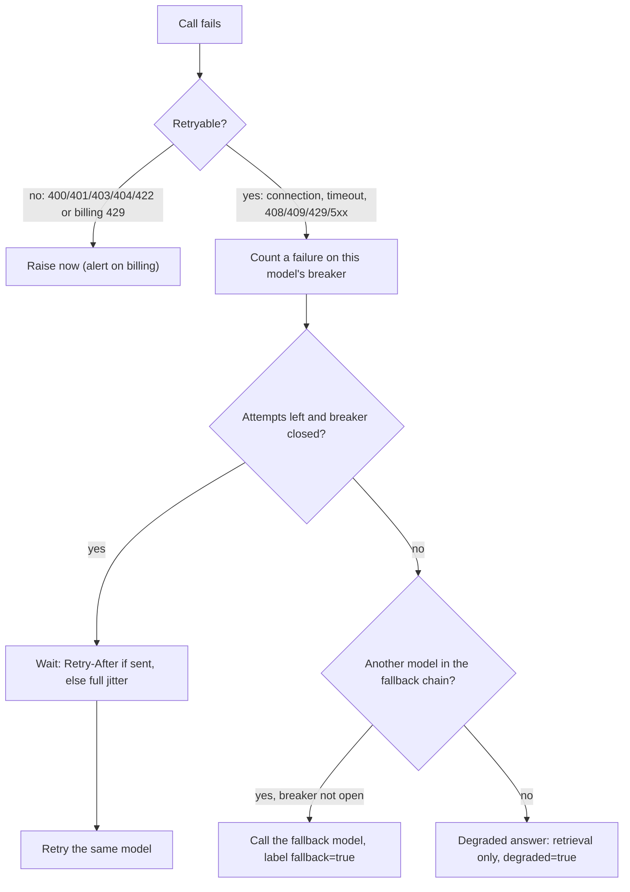
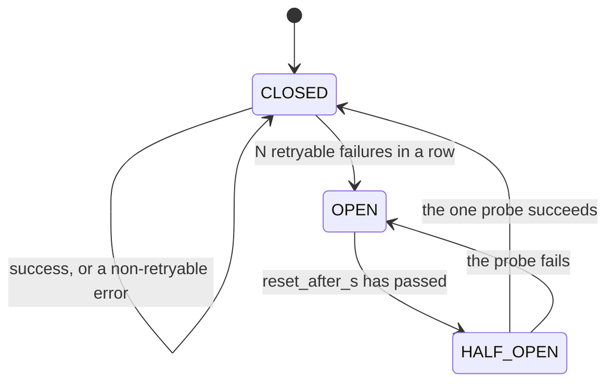
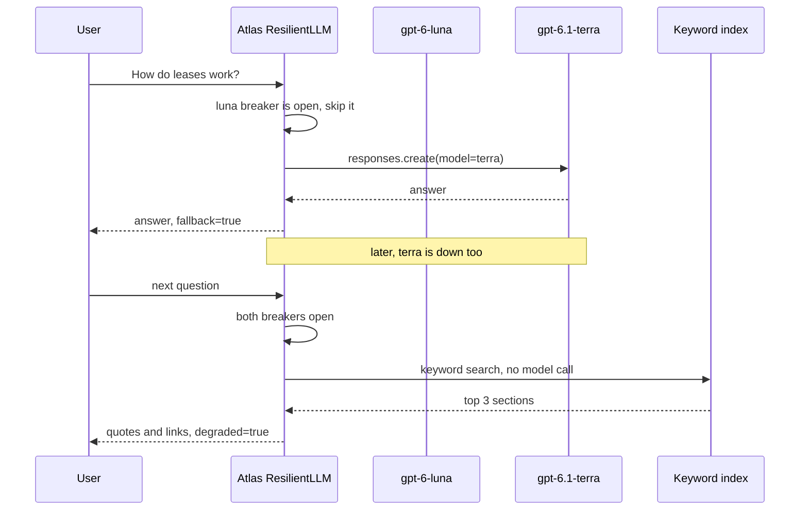

# Reliability: Backoff, Fallbacks & LLM Gateways

At 14:02 the provider starts returning 503s for the model Atlas uses. Every request retries 3 times inside the SDK, then your wrapper retries 3 more, so each user waits about 40 seconds, upstream traffic is 16× normal, and the outage lasts longer for everyone. Providers will have bad hours. Today Atlas learns to bend instead of break.

## At a Glance

- **Time:** ~2 h core (+ optional Go Deeper) · **Depth:** working
- **Prerequisites:** [Day 17: Handling Semantic Failures: Validate, Re-ask, Bound](../../Phase_2_Building_with_LLM_APIs/Day_017_semantic_failures/semantic_failures.md), [Day 77: Serving LLM Apps with FastAPI](../Day_077_fastapi_serving/fastapi_serving.md), [Day 82: Containerize & Deploy with CI/CD](../Day_082_containerize_deploy/containerize_deploy.md) (for `Settings.fallback_models`), primer [A10: Backend & production vocabulary](../../Appendix_Primers/A10_backend_production_vocabulary.md)
- **You'll build:** `atlas/resilience.py`: a resilient async client (full-jitter backoff, per-model circuit breakers, token buckets, same-provider fallbacks, a retrieval-only degraded mode), a seeded chaos test and six pytest cases
- **Stops at:** SRE theory, multi-region failover, service meshes
- **Fast path:** Already run Resilience4j or Polly in production? Read §"Fallbacks and Degraded Modes" and §"Chaos Testing", then do Exercise 3 (~45 min)
- **Cost:** $0 offline; ≈ $0.05 for the live smoke test and Exercise 3 on `gpt-6-luna` plus a few `gpt-6.1-terra` calls (prices as of 2026-11, [verify](https://developers.openai.com/api/docs/pricing))
- **New terms:** full-jitter backoff, circuit breaker, client-side rate limiting (token bucket), fallback chain & degraded mode, LLM gateway

> **Coming from Software Engineering?** You know these patterns from Hystrix or Resilience4j (Java resilience libraries): exponential backoff with jitter, one breaker per dependency, a bulkhead (a cap on concurrent calls so one slow dependency can't eat every worker) and a fallback. All of that transfers. Three things are new. Limits come in tokens per minute *and* requests per minute, and one request can be 100 tokens or 100,000, so counting requests alone isn't enough. A fallback model is a *different program*, with different quality, price and prompt sensitivity, so it needs its own eval. And a duplicate call that succeeds is billed twice.

## Retries Can Make Outages Worse

The SDK from [Day 12](../../Phase_2_Building_with_LLM_APIs/Day_012_openai_sdk_production/openai_sdk_production.md) already retries failed calls. Suppose someone raised `max_retries` to 3 (4 attempts per call) and wrapped the call in a loop that also tries 4 times. One user question now causes 4 × 4 = **16** upstream requests. With both layers' waits plus slow failures, the user waits about 40 seconds for an error.

Every client does the same at once, so a service 20% over capacity gets 16× the traffic and stays overloaded longer. This is a **retry storm**: retry code turning a five-minute blip into an hour-long incident.

The fix has five parts: one retry layer that respects the server's hints, random spread in the waits, a fuse that stops calling a dead model, a second model to fall back to, and a useful answer when every model is down.

## Fuses and Torches

Think of a fuse box. When a circuit keeps shorting, the fuse trips so the house doesn't burn, and you try again later. Meanwhile you light the room with a torch. The fuse is a **circuit breaker** (stop calling a failing service for a while). The torch is a **degraded mode** (a lower-quality answer that needs no model, such as relevant doc links).

By hand: ten users ask Atlas a question while `gpt-6-luna` is down. The policy allows 4 attempts per model, with full-jitter waits averaging 0.25 s, 0.5 s and 1 s. The breaker trips after 3 failures.

| | Without a breaker | With a breaker (trips at 3) |
|---|---|---|
| Calls to the dead model | 10 × 4 = **40** | **3** (all during user 1) |
| User 1 waits | ~1.75 s backoff + 4 failed calls, then an error | ~0.75 s backoff + 3 failed calls, then the fallback answers |
| Users 2–10 wait | the same, each | almost nothing: the open breaker skips to the fallback |
| Users answered | 0 | 10 |

## Name the Parts: the Failure Map

Sort errors into three bins before writing retry code: retry, never retry, fall back. (`Retry-After` is the response header where the server says how long to wait.) The [error-codes guide](https://developers.openai.com/api/docs/guides/error-codes) adds a `code` to each status that separates look-alikes.

| Error | Example `code` | Retry? | Why |
|---|---|---|---|
| `APIConnectionError`, `APITimeoutError` | – | yes | The network or server hiccuped |
| 408, 409 | – | yes | Request or lock timeout |
| 429 `RateLimitError` | `slow_down`, or "rate limit reached" | yes, after `Retry-After` | Too fast; waiting fixes it |
| 429 billing | `credit_balance_exhausted`, `organization_spend_limit_exceeded` (type `insufficient_quota`) | **never** | Money, not load: alert a human |
| 500, 503 `InternalServerError` | `server_is_overloaded` | yes, then fall back | The model is struggling; another may not be |
| 400, 401, 403, 404, 422 | `invalid_value` | **never** | Your request or key is wrong every time |

What the SDK already does (openai 3.46): it retries connection errors, 408, 409, 429 and 5xx twice, waiting 0.5–8 s, honours `retry-after-ms`/`retry-after` up to two minutes, and never retries a stream you've started reading. Its jitter only shaves 0–25% off each wait, and it decides on the status code (plus an `x-should-retry` header when the server sends one), never on the error `code`, so it can retry billing 429s too.

Five terms for the rest of the day:

- **Full-jitter backoff:** wait a random time between 0 and an exponentially growing ceiling. *Jitter* is the random spread that keeps clients from retrying in sync.
- **Thundering herd:** many clients retrying at the same instant.
- **Circuit breaker:** stop calling a failing model for a while, then let one probe test it.
- **Token bucket:** a counter refilled at a fixed rate that each call spends from; used for client-side rate limiting.
- **Gateway:** a proxy that routes, retries and meters calls to model providers.



## Minimal Code: Backoff That Respects the Server

Wait a random time between 0 and `base × 2^(attempt-1)`, capped. If the server sent `Retry-After`, treat it as a minimum plus a little spread. Always bound the attempts.

```python
# script_id: day_084_reliability_fallbacks/backoff_first
# Install: nothing (stdlib only). Env: none. Services: none.
import random
import time


def backoff_s(attempt: int, base: float = 0.5, cap: float = 8.0, retry_after: float | None = None) -> float:
    if retry_after is not None:                       # the server knows its own load: wait at least that
        return retry_after + random.uniform(0, base)  # plus a little spread so clients don't sync up
    return random.uniform(0, min(cap, base * 2 ** (attempt - 1)))   # full jitter


def flaky_call(attempt: int) -> str:                  # fails twice; the 2nd failure carries a server hint
    if attempt == 1:
        raise ConnectionError("connection reset by peer")
    if attempt == 2:
        raise RuntimeError("429 slow_down, retry-after=1.5")
    return "ok"


random.seed(7)
for attempt in range(1, 5):                           # bounded: never retry forever
    try:
        print(f"attempt {attempt}: {flaky_call(attempt)}")
        break
    except Exception as exc:
        wait = backoff_s(attempt, retry_after=1.5 if "retry-after" in str(exc) else None)
        print(f"attempt {attempt}: {exc} -> sleeping {wait:.2f}s")
        time.sleep(wait)
```

Expected output (your numbers will differ if you change the seed):

```text
attempt 1: connection reset by peer -> sleeping 0.16s
attempt 2: 429 slow_down, retry-after=1.5 -> sleeping 1.58s
attempt 3: ok
```

In real code this loop replaces the SDK's, so build the client with `max_retries=0`.

## Break It: Stacked Retries and Synchronised Clients

**Knob 1: leave the SDK's retries on.** This script makes no network calls. An `httpx2.MockTransport` (the SDK's HTTP layer since openai 3.0) answers every request with a 503, and we count how many requests reach it.

```python
# script_id: day_084_reliability_fallbacks/stacked_retries
# Install: uv add "openai>=3.46,<4"   Env: none (fake key)   Services: none
# Offline: httpx2.MockTransport plays an overloaded API, so nothing leaves your machine.
import httpx2
import openai
from openai import OpenAI

calls = 0


def always_503(request: httpx2.Request) -> httpx2.Response:
    global calls
    calls += 1
    return httpx2.Response(503, headers={"retry-after-ms": "1"},       # tiny hint keeps the demo fast
                           json={"error": {"message": "The requested model is temporarily overloaded.",
                                           "type": "service_unavailable_error", "code": "server_is_overloaded"}})


def my_retry_loop(client: OpenAI, attempts: int = 4) -> openai.APIStatusError:
    for _ in range(attempts):                        # "our" retries, stacked on top of the SDK's
        try:
            client.responses.create(model="gpt-6-luna", input="hi")
        except openai.InternalServerError as exc:
            last = exc
    return last


for sdk_retries in (3, 0):
    calls = 0
    client = OpenAI(api_key="sk-test", max_retries=sdk_retries,
                    http_client=openai.DefaultHttpxClient(transport=httpx2.MockTransport(always_503)))
    err = my_retry_loop(client)
    print(f"SDK max_retries={sdk_retries}: 4 wrapper attempts -> {calls} upstream calls (code={err.code})")
```

```text
SDK max_retries=3: 4 wrapper attempts -> 16 upstream calls (code=server_is_overloaded)
SDK max_retries=0: 4 wrapper attempts -> 4 upstream calls (code=server_is_overloaded)
```

Retries multiply. Keep one layer, yours, because only it knows about breakers, fallbacks and budgets.

**Knob 2: drop the jitter.** Fifty Atlas workers hit the same 503 at the same moment. With fixed exponential waits they all come back at 0.5 s, then 1.5 s, then 3.5 s: three spikes of 50 requests.

```python
# script_id: day_084_reliability_fallbacks/herd_simulation
# Install: nothing (stdlib only). Simulates 50 clients that all fail at t=0.
import random
from collections import Counter

CLIENTS, ATTEMPTS, BASE, CAP, BIN = 50, 3, 0.5, 8.0, 0.5


def retry_times(jitter: bool, rng: random.Random) -> list[float]:
    t, times = 0.0, []
    for attempt in range(1, ATTEMPTS + 1):
        ceiling = min(CAP, BASE * 2 ** (attempt - 1))
        t += rng.uniform(0, ceiling) if jitter else ceiling
        times.append(t)
    return times


def histogram(jitter: bool) -> None:
    rng = random.Random(42)
    bins = Counter(int(t / BIN) for _ in range(CLIENTS) for t in retry_times(jitter, rng))
    print("full jitter" if jitter else "no jitter (fixed exponential)")
    for b in range(8):                                        # 0-4 s in half-second bins
        n = bins.get(b, 0)
        print(f"  {b * BIN:3.1f}-{(b + 1) * BIN:3.1f}s {n:3d} {'#' * (n // 2)}")


histogram(jitter=False)
histogram(jitter=True)
```

```text
no jitter (fixed exponential)
  0.0-0.5s   0
  0.5-1.0s  50 #########################
  1.0-1.5s   0
  1.5-2.0s  50 #########################
  2.0-2.5s   0
  2.5-3.0s   0
  3.0-3.5s   0
  3.5-4.0s  50 #########################
full jitter
  0.0-0.5s  70 ###################################
  0.5-1.0s  29 ##############
  1.0-1.5s  23 ###########
  1.5-2.0s   9 ####
  2.0-2.5s  13 ######
  2.5-3.0s   6 ###
  3.0-3.5s   0
  3.5-4.0s   0
```

No jitter is a thundering herd; full jitter is a stream a recovering service can absorb.

## Circuit Breakers

Now build `atlas/resilience.py`, one concern per block; all blocks share one `script_id` and stitch into one file. The first block holds settings and the failure map as code. The rule that matters most: **only retryable failures count against a model.** A 400 means your request is wrong; a breaker that trips on it takes a healthy model out of service.

```python
# script_id: day_084_reliability_fallbacks/atlas_resilience
# atlas/resilience.py: retries, breakers, rate limits, fallbacks and chaos tools (Day 84).
# Install: uv add "openai>=3.46,<4" pydantic    Env (optional): ATLAS_MODEL, ATLAS_FALLBACK_MODELS, ORBIT_DATA
# Services: none. Every demo in this file runs offline against FakeAsyncClient (defined below).
from __future__ import annotations

import asyncio
import email.utils
import enum
import json
import os
import random
import re
import time
from collections import Counter
from dataclasses import dataclass
from pathlib import Path
from types import SimpleNamespace
from typing import Any, Callable, Sequence

import httpx2
import openai
from pydantic import BaseModel

MODEL = os.environ.get("ATLAS_MODEL", "gpt-6-luna")
# Day 82's Settings.fallback_models reads this env var: comma-separated, same provider by default
FALLBACK_MODELS = tuple(m for m in os.environ.get("ATLAS_FALLBACK_MODELS", "gpt-6.1-terra").split(",") if m)
DATA_DIR = Path(os.environ.get("ORBIT_DATA", "datasets/orbit"))
# 429s about money, not load (error-codes guide): retrying can't fix them
BILLING_CODES = {"insufficient_quota", "credit_balance_exhausted", "organization_spend_limit_exceeded",
                 "project_spend_limit_exceeded", "organization_usage_limit_exceeded"}


@dataclass(frozen=True)
class RetryPolicy:
    max_attempts: int = 4          # per model, counting the first try
    base_s: float = 0.5
    cap_s: float = 8.0
    honor_retry_after: bool = True
    max_wait_s: float = 20.0       # longest single sleep a user-facing call accepts; beyond it, fall back
```

The second block classifies errors, reads the server's hint and computes the wait. `fake_error()` builds the exception the SDK would raise, so tests exercise the real classification code.

```python
# script_id: day_084_reliability_fallbacks/atlas_resilience
def is_retryable(exc: BaseException) -> bool:
    if isinstance(exc, (openai.APIConnectionError, TimeoutError)):   # APITimeoutError is a subclass
        return True
    if isinstance(exc, openai.APIStatusError):
        if exc.code in BILLING_CODES or exc.type == "insufficient_quota":
            return False                                             # billing: alert, don't retry
        return exc.status_code in (408, 409, 429) or exc.status_code >= 500
    return False


def retry_after_s(exc: BaseException) -> float | None:
    """The server's wait hint in seconds: retry-after-ms, then retry-after (seconds or an HTTP date)."""
    if not isinstance(exc, openai.APIStatusError):
        return None
    headers = exc.response.headers
    for name, scale in (("retry-after-ms", 0.001), ("retry-after", 1.0)):
        try:
            return max(0.0, float(headers[name]) * scale)
        except (KeyError, ValueError):
            continue
    try:
        return max(0.0, email.utils.parsedate_to_datetime(headers["retry-after"]).timestamp() - time.time())
    except (KeyError, TypeError, ValueError):
        return None


def backoff_s(attempt: int, policy: RetryPolicy, retry_after: float | None = None) -> float:
    if retry_after is not None and policy.honor_retry_after:
        return retry_after + random.uniform(0, policy.base_s)       # a minimum, plus a little spread
    return random.uniform(0, min(policy.cap_s, policy.base_s * 2 ** (attempt - 1)))   # full jitter


def fake_error(status: int, code: str, *, retry_after: str | None = None,
               type_: str = "rate_limit_error") -> openai.APIStatusError:
    """The exception the SDK would raise for this status, for tests and chaos runs."""
    cls = {400: openai.BadRequestError, 429: openai.RateLimitError}.get(
        status, openai.InternalServerError if status >= 500 else openai.APIStatusError)
    request = httpx2.Request("POST", "https://api.openai.com/v1/responses")
    response = httpx2.Response(status, headers={"retry-after": retry_after} if retry_after else {}, request=request)
    return cls(f"Error code: {status} - {code}", response=response, body={"code": code, "type": type_})


if __name__ == "__main__":
    random.seed(0)
    for label, exc in [("429 slow_down", fake_error(429, "slow_down", retry_after="2")),
                       ("429 billing", fake_error(429, "credit_balance_exhausted", type_="insufficient_quota")),
                       ("503 overloaded", fake_error(503, "server_is_overloaded")),
                       ("400 bad request", fake_error(400, "invalid_value"))]:
        hint, ok = retry_after_s(exc), is_retryable(exc)
        wait = f"{backoff_s(1, RetryPolicy(), hint):.2f}s" if ok else "-"
        print(f"{label:16} retry={ok!s:5} hint={hint} wait={wait}")
```

```text
429 slow_down    retry=True  hint=2.0 wait=2.42s
429 billing      retry=False hint=None wait=-
503 overloaded   retry=True  hint=None wait=0.38s
400 bad request  retry=False hint=None wait=-
```

The breaker has three states. **Closed**: calls flow and failures are counted. After `failure_threshold` retryable failures in a row it goes **open**: calls to that model are skipped instantly. After `reset_after_s` it goes **half-open** and lets *exactly one* probe through; success closes it, failure re-opens it. If every waiting request probed at once, a recovering model would get the stampede the breaker exists to prevent.



```python
# script_id: day_084_reliability_fallbacks/atlas_resilience
class CircuitState(enum.Enum):
    CLOSED = "closed"
    OPEN = "open"
    HALF_OPEN = "half_open"


class CircuitBreaker:
    """Per-model fuse. Methods never await, so under asyncio each call is atomic (add a Lock for threads)."""

    def __init__(self, name: str, failure_threshold: int = 5, reset_after_s: float = 30.0,
                 clock: Callable[[], float] = time.monotonic) -> None:
        self.name, self.failure_threshold, self.reset_after_s, self.clock = name, failure_threshold, reset_after_s, clock
        self.state, self.failures, self.opened_at = CircuitState.CLOSED, 0, 0.0
        self._probe_at: float | None = None          # when the half-open probe went out

    def allow(self) -> bool:
        if self.state is CircuitState.OPEN and self.clock() - self.opened_at >= self.reset_after_s:
            self._set_state(CircuitState.HALF_OPEN)
        if self.state is CircuitState.HALF_OPEN:
            # one probe at a time; a probe lost to a crash or cancel expires after reset_after_s
            if self._probe_at is not None and self.clock() - self._probe_at < self.reset_after_s:
                return False
            self._probe_at = self.clock()
            return True
        return self.state is CircuitState.CLOSED

    def record_success(self) -> None:
        self.failures, self._probe_at = 0, None
        if self.state is not CircuitState.CLOSED:
            self._set_state(CircuitState.CLOSED)

    def record_failure(self) -> None:                # call it ONLY for retryable failures
        self.failures, self._probe_at = self.failures + 1, None
        if self.state is CircuitState.HALF_OPEN or self.failures >= self.failure_threshold:
            self.opened_at = self.clock()
            if self.state is not CircuitState.OPEN:
                self._set_state(CircuitState.OPEN)

    def _set_state(self, new: CircuitState) -> None:   # one place to hook logs and metrics (Exercise 1)
        self.state = new
```

Watch it with a fake clock: a call every 5 s against a model that is dead until t = 45 s.

```python
# script_id: day_084_reliability_fallbacks/atlas_resilience
if __name__ == "__main__":
    now = [0.0]
    breaker = CircuitBreaker("gpt-6-luna", failure_threshold=3, reset_after_s=30, clock=lambda: now[0])
    for call in range(1, 11):
        now[0] += 5
        if not breaker.allow():
            result = "skipped"
        elif now[0] < 45:
            breaker.record_failure(); result = "sent, failed"
        else:
            breaker.record_success(); result = "sent, ok"
        print(f"t={now[0]:>3.0f}s call {call:>2}: {result:13} -> {breaker.state.value}")
```

```text
t=  5s call  1: sent, failed  -> closed
t= 10s call  2: sent, failed  -> closed
t= 15s call  3: sent, failed  -> open
t= 20s call  4: skipped       -> open
t= 25s call  5: skipped       -> open
t= 30s call  6: skipped       -> open
t= 35s call  7: skipped       -> open
t= 40s call  8: skipped       -> open
t= 45s call  9: sent, ok      -> closed
t= 50s call 10: sent, ok      -> closed
```

Four calls reached the model instead of ten, and the breaker noticed the recovery by itself.

## Staying Under the Limits

Most 429s are self-inflicted. OpenAI meters requests per minute (RPM) and tokens per minute (TPM), among others, and you hit [whichever runs out first](https://developers.openai.com/api/docs/guides/rate-limits). So Atlas keeps **two** token buckets: RPM charges 1 per call; TPM charges estimated input tokens plus `max_output_tokens`. The estimate is rough; [Day 4](../../Phase_1_How_LLMs_Work/Day_004_tokens/tokens.md)'s `count_tokens()` is closer.

A token bucket is a jar that refills at a steady rate up to a maximum. Each call takes some out; if the jar is short, the call waits. Capacity sets the burst size; the refill rate sets the long-run average. It's the outbound twin of [Day 83](../Day_083_auth_multitenancy_quotas/auth_multitenancy_quotas.md)'s `RateLimiter`: that one protects you from tenants, this one protects the provider (and your bill) from you.

```python
# script_id: day_084_reliability_fallbacks/atlas_resilience
class TokenBucket:
    """Refills at rate_per_s up to capacity; each call spends from it. One for RPM, one for TPM."""

    def __init__(self, rate_per_s: float, capacity: float) -> None:
        self.rate, self.capacity = rate_per_s, capacity
        self.tokens, self.updated = capacity, time.monotonic()
        self._lock = asyncio.Lock()                  # waiters queue in order instead of racing

    def _refill(self) -> None:
        now = time.monotonic()
        self.tokens = min(self.capacity, self.tokens + (now - self.updated) * self.rate)
        self.updated = now

    async def acquire(self, amount: float = 1) -> None:
        if amount > self.capacity:
            raise ValueError(f"call needs {amount:.0f} but the bucket only holds {self.capacity:.0f}")
        async with self._lock:
            self._refill()
            while self.tokens < amount:
                await asyncio.sleep((amount - self.tokens) / self.rate)
                self._refill()
            self.tokens -= amount


def estimate_tokens(kwargs: dict[str, Any]) -> int:
    """Rough TPM charge: ~4 characters per input token plus the whole output ceiling."""
    text = json.dumps(kwargs.get("input", "")) + str(kwargs.get("instructions") or "")
    return len(text) // 4 + int(kwargs.get("max_output_tokens") or 1_000)


if __name__ == "__main__":
    async def burst_demo() -> None:
        lines = (DATA_DIR / "eval" / "qa_gold.jsonl").read_text(encoding="utf-8").splitlines()
        questions = [json.loads(line)["question"] for line in lines]
        rpm = TokenBucket(rate_per_s=600 / 60, capacity=5)           # 600 RPM, bursts of 5
        tpm = TokenBucket(rate_per_s=120_000 / 60, capacity=2_000)   # 120K TPM
        start = time.monotonic()

        async def send(q: str) -> None:
            await rpm.acquire(1)
            await tpm.acquire(estimate_tokens({"input": q, "max_output_tokens": 300}))

        await asyncio.gather(*(send(q) for q in questions))
        print(f"{len(questions)} questions released in {time.monotonic() - start:.1f}s, paced under both limits")

    asyncio.run(burst_demo())
```

```text
30 questions released in 3.8s, paced under both limits
```

Watch **concurrency**: five [Day 78](../Day_078_async_jobs/async_jobs.md) workers, each with a bucket set to your full TPM, send 5× your limit. Give each `limit ÷ N`, or share one bucket in Redis.

## Fallbacks and Degraded Modes

When the primary's breaker is open or its attempts run out, try the next model in `Settings.fallback_models`. Default to **the same provider** (same SDK, request shapes and structured-output behaviour), so the fallback is config, not a new code path. Cross-provider fallback covers a whole-provider outage, but prompts, tools and schemas behave differently there, so add it only after an eval.

A fallback model is a different program. `gpt-6.1-terra` costs about 10× `gpt-6-luna` per token ($1.00 vs $0.10 per 1M input, $5.00 vs $0.50 output, as of 2026-11, [verify](https://developers.openai.com/api/docs/pricing)), so count fallback calls against [Day 83](../Day_083_auth_multitenancy_quotas/auth_multitenancy_quotas.md) quotas. It also answers differently, so it must pass the [Day 47](../../Phase_5_Evaluation_and_Observability/Day_047_evals_in_ci/evals_in_ci.md) gate: an unevaluated fallback is an untested code path that only runs during incidents.

When every model is down, answer *something*. For `ask`, that's a retrieval-only answer: the most relevant doc sections with quotes, flagged `degraded=true`. Keyword search ([Day 27](../../Phase_3_RAG/Day_027_hybrid_search/hybrid_search.md)) needs no model call, so it keeps working; vector search needs a query embedding from the same provider. Other degraded modes: queue the work ([Day 78](../Day_078_async_jobs/async_jobs.md), Exercise 4) or serve a cached answer ([Day 85](../Day_085_caching_cost_scale/caching_cost_scale.md)).



Every response carries a `CallMeta` (model, attempts, fallback, degraded); log it for [Day 86](../Day_086_monitoring_feedback/monitoring_feedback.md)'s alerts. The next block holds per-model state and two hooks that Exercise 2 overrides. The client is injected: the real async client (`max_retries=0`) in production, a fake in tests.

```python
# script_id: day_084_reliability_fallbacks/atlas_resilience
@dataclass
class CallMeta:
    model: str
    attempts: int
    fallback: bool
    degraded: bool
    latency_ms: float


class AllModelsUnavailable(RuntimeError):
    """Every model was skipped (open breaker) or ran out of attempts: switch to a degraded mode."""

    def __init__(self, models: Sequence[str], attempts: int) -> None:
        super().__init__(f"no model available after {attempts} attempts: {', '.join(models)}")
        self.attempts = attempts


class _ModelPool:
    """Per-model breakers, rate limits and counters, plus the hooks subclasses override."""

    def __init__(self, client: Any, models: Sequence[str], *, policy: RetryPolicy | None = None,
                 rpm: TokenBucket | None = None, tpm: TokenBucket | None = None,
                 failure_threshold: int = 5, reset_after_s: float = 30.0) -> None:
        self._api = client                   # the real async client (max_retries=0) in prod, a fake in tests
        self.models, self.policy = list(models), policy or RetryPolicy()
        self.rpm, self.tpm = rpm, tpm
        self.breakers = {m: CircuitBreaker(m, failure_threshold, reset_after_s) for m in self.models}
        self.upstream_calls = self.retries = 0

    async def _throttle(self, kwargs: dict[str, Any]) -> None:
        if self.rpm:
            await self.rpm.acquire(1)
        if self.tpm:
            await self.tpm.acquire(estimate_tokens(kwargs))

    async def _call_upstream(self, model: str, kwargs: dict[str, Any], is_retry: bool) -> Any:
        self.upstream_calls += 1
        self.retries += is_retry
        return await self._api.responses.create(model=model, **kwargs)

    def _allow_retry(self) -> bool:          # hook: a retry budget plugs in here (Exercise 2)
        return True
```

The loop walks the models in order, asks the breaker before every attempt, and moves on as soon as the breaker opens or the server wants a longer wait than a user should sit through.

```python
# script_id: day_084_reliability_fallbacks/atlas_resilience
class ResilientLLM(_ModelPool):
    async def create(self, **kwargs: Any) -> tuple[Any, CallMeta]:
        """responses.create with retries, breakers and fallbacks. Not for streams (see Pitfalls)."""
        start, attempts, last = time.perf_counter(), 0, None
        for i, model in enumerate(self.models):
            breaker = self.breakers[model]
            for attempt in range(1, self.policy.max_attempts + 1):
                # check the budget BEFORE allow(): allow() may hand out the single half-open probe
                if (attempt > 1 and not self._allow_retry()) or not breaker.allow():
                    break                                       # open fuse or no budget: next model
                await self._throttle(kwargs)
                attempts += 1
                try:
                    resp = await self._call_upstream(model, kwargs, is_retry=attempt > 1)
                except Exception as exc:
                    if not is_retryable(exc):
                        breaker.record_success()                # the server answered; the request is the problem
                        raise
                    breaker.record_failure()
                    last = exc
                    wait = backoff_s(attempt, self.policy, retry_after_s(exc))
                    if (breaker.state is CircuitState.OPEN or attempt == self.policy.max_attempts
                            or wait > self.policy.max_wait_s):
                        break                                   # don't sleep for nothing: next model now
                    await asyncio.sleep(wait)
                    continue
                breaker.record_success()
                ms = round((time.perf_counter() - start) * 1000, 1)
                return resp, CallMeta(model, attempts, fallback=i > 0, degraded=False, latency_ms=ms)
        raise AllModelsUnavailable(self.models, attempts) from last
```

To test without an API key, add a seeded `FaultInjector` (a fault plan such as "30% of calls get a 429") and a `FakeAsyncClient` with the same `responses.create` shape. The seed makes runs repeatable, so a chaos result is a test, not an anecdote.

```python
# script_id: day_084_reliability_fallbacks/atlas_resilience
class FaultInjector:
    """Seeded fault plan, e.g. {"429": 0.3, "503": 0.2, "timeout": 0.1}. Models in `down` always 503."""
    CODES = {"429": "slow_down", "503": "server_is_overloaded", "500": "server_error", "400": "invalid_value"}

    def __init__(self, rates: dict[str, float], *, seed: int = 0, down: set[str] = frozenset()) -> None:
        self.rates, self.down, self.rng = rates, set(down), random.Random(seed)

    def pick(self, model: str) -> BaseException | None:
        if model in self.down:
            return fake_error(503, "server_is_overloaded", type_="service_unavailable_error")
        roll = self.rng.random()
        for kind, rate in self.rates.items():
            if roll < rate:
                if kind == "timeout":
                    return openai.APITimeoutError(request=httpx2.Request("POST", "https://api.openai.com/v1/responses"))
                return fake_error(int(kind), self.CODES.get(kind, "error"), retry_after="0.05" if kind == "429" else None)
            roll -= rate
        return None


class FakeAsyncClient:
    """Same call shape as the async OpenAI client's responses.create, offline; counts calls per model."""

    def __init__(self, faults: FaultInjector, latency_s: float = 0.01) -> None:
        self.faults, self.latency_s, self.calls = faults, latency_s, Counter()
        self.responses = self                          # so callers write fake.responses.create(...)

    async def create(self, *, model: str, **kwargs: Any) -> SimpleNamespace:
        self.calls[model] += 1
        fault = self.faults.pick(model)
        await asyncio.sleep(self.latency_s * (10 if isinstance(fault, openai.APITimeoutError) else 1))
        if fault:
            raise fault
        return SimpleNamespace(model=model, output_text=f"[{model}] answer to: {str(kwargs.get('input'))[:40]}")


if __name__ == "__main__":
    async def fallback_demo() -> None:
        fake = FakeAsyncClient(FaultInjector({"429": 0.3}, seed=3, down={MODEL}))
        llm = ResilientLLM(fake, [MODEL, *FALLBACK_MODELS], policy=RetryPolicy(base_s=0.01, cap_s=0.1),
                           failure_threshold=3)
        for q in ["How do leases work?", "What does ORB-1301 mean?", "How do I tune heartbeat_seconds?"]:
            _, meta = await llm.create(input=q, max_output_tokens=300)
            print(f"{meta.model:14} attempts={meta.attempts} fallback={meta.fallback} "
                  f"luna_breaker={llm.breakers[MODEL].state.value} upstream={dict(fake.calls)}")

    asyncio.run(fallback_demo())
```

```text
gpt-6.1-terra  attempts=5 fallback=True luna_breaker=open upstream={'gpt-6-luna': 3, 'gpt-6.1-terra': 2}
gpt-6.1-terra  attempts=1 fallback=True luna_breaker=open upstream={'gpt-6-luna': 3, 'gpt-6.1-terra': 3}
gpt-6.1-terra  attempts=1 fallback=True luna_breaker=open upstream={'gpt-6-luna': 3, 'gpt-6.1-terra': 4}
```

The first request paid for discovering the outage (three failed calls to luna); later requests skipped luna.

```python
# script_id: day_084_reliability_fallbacks/atlas_resilience
class Citation(BaseModel):            # compact copies of Day 15's schemas; R5 imports atlas.schemas
    doc_id: str
    quote: str


class Answer(BaseModel):
    text: str
    citations: list[Citation]
    degraded: bool = False            # new today: tells the UI to show a "limited answer" banner


class DocChunk(BaseModel):
    id: str
    doc_id: str
    section: str
    applies_to: str
    text: str


STOP = {"the", "and", "how", "what", "does", "for", "with", "when", "which", "can", "you", "are", "orbit"}


def terms(text: str) -> set[str]:
    return {w for w in re.findall(r"[a-z0-9_]+(?:[.-][a-z0-9_]+)*", text.lower()) if len(w) >= 3} - STOP


def load_chunks(data_dir: Path = DATA_DIR) -> list[DocChunk]:
    """One chunk per '## ' section of each Orbit doc (Day 25 chunks better; this is enough to cite)."""
    chunks = []
    for path in sorted((data_dir / "docs").glob("*.md")):
        _, front, body = path.read_text(encoding="utf-8").split("---\n", 2)
        meta = dict(line.split(": ", 1) for line in front.strip().splitlines() if ": " in line)
        for n, part in enumerate(body.split("\n## ")):
            title, _, text = part.strip().partition("\n")
            chunks.append(DocChunk(id=f"{meta['id']}#{n}", doc_id=meta["id"], section=title.strip("# \n"),
                                   applies_to=meta.get("applies_to", ""), text=text.strip()))
    return chunks


def keyword_search(question: str, chunks: list[DocChunk], k: int = 3) -> list[DocChunk]:
    """Term overlap needs no model call, so it still works when every provider is down."""
    q = terms(question)

    def score(c: DocChunk) -> int:               # a match in the doc id or heading counts double
        return 2 * len(q & terms(c.doc_id.replace("-", " ") + " " + c.section)) + len(q & terms(c.text))

    return sorted(chunks, key=score, reverse=True)[:k]
```

```python
# script_id: day_084_reliability_fallbacks/atlas_resilience
def degraded_answer(question: str, hits: list[DocChunk]) -> Answer:
    """Retrieval-only answer: no generation, only quotes and links the user can check."""
    hits = [h for h in hits if terms(question) & terms(h.section + " " + h.text)]
    if not hits:
        return Answer(text="Atlas can't reach its language models right now. Please try again in a few minutes.",
                      citations=[], degraded=True)
    def first_paragraph(text: str) -> str:      # skip tables, code and headings
        prose = (p for p in text.split("\n\n") if p.strip() and p.lstrip()[0] not in "|`#-*>")
        return next(prose, text).replace("\n", " ")[:160]

    cites = [Citation(doc_id=h.doc_id, quote=first_paragraph(h.text)) for h in hits]
    lines = [f"- {h.doc_id} > {h.section}: {c.quote}" for h, c in zip(hits, cites)]
    return Answer(text="Atlas can't generate an answer right now. The most relevant Orbit docs:\n" + "\n".join(lines),
                  citations=cites, degraded=True)


async def resilient_ask(llm: ResilientLLM, question: str, chunks: list[DocChunk]) -> tuple[Answer, CallMeta]:
    """Compact stand-in for Day 28's ask(): a model answer if possible, retrieval-only if not."""
    start = time.perf_counter()
    try:
        resp, meta = await llm.create(input=question, max_output_tokens=300)
        return Answer(text=resp.output_text, citations=[]), meta
    except AllModelsUnavailable as exc:
        ms = round((time.perf_counter() - start) * 1000, 1)
        meta = CallMeta("none", exc.attempts, fallback=True, degraded=True, latency_ms=ms)
        return degraded_answer(question, keyword_search(question, chunks)), meta


if __name__ == "__main__":
    async def degraded_demo() -> None:
        fake = FakeAsyncClient(FaultInjector({}, down={MODEL, *FALLBACK_MODELS}))
        llm = ResilientLLM(fake, [MODEL, *FALLBACK_MODELS], policy=RetryPolicy(base_s=0.01, cap_s=0.1))
        answer, meta = await resilient_ask(llm, "How do leases and heartbeats work?", load_chunks())
        print(meta)
        print(answer.text)

    asyncio.run(degraded_demo())
```

```text
CallMeta(model='none', attempts=8, fallback=True, degraded=True, latency_ms=159.7)
Atlas can't generate an answer right now. The most relevant Orbit docs:
- leases-and-heartbeats > Heartbeat loss: ORB-1102: If the broker stops receiving a worker's heartbeats, Orbit records **ORB-1102 WorkerHeartbeatLost** and the dashboard marks the worker as lost. Its jobs are red
- leases-and-heartbeats > Leases and heartbeats: Leases let Orbit recover jobs from workers that crash, freeze or lose the network. They are also the main reason a job can **run twice**.
- leases-and-heartbeats > Heartbeats: A fixed deadline would force you to set the lease longer than your slowest job. Heartbeats avoid that. Every `heartbeat_seconds`, the worker supervisor renews t
```

Streams and the Flex tier need extra care; see Go Deeper.

## Chaos Testing

A resilience layer that has never seen a failure is a hypothesis. **Chaos testing** injects failures on purpose and measures what users would see. Run five seeded scenarios over the 30 `qa_gold` questions and report the share answered by a model, p95 latency (the time 95% of requests beat), upstream calls, and the fallback and degraded shares. Waits are scaled down (`base_s=0.02`) so the run takes seconds.

```python
# script_id: day_084_reliability_fallbacks/chaos_test
# Install: uv add "openai>=3.46,<4" pydantic    Env: ORBIT_DATA (optional)    Services: none
# Save the atlas_resilience blocks as atlas_resilience.py next to this file (R5: atlas/resilience.py).
import asyncio
import json
import statistics

from atlas_resilience import (DATA_DIR, FALLBACK_MODELS, MODEL, FakeAsyncClient, FaultInjector,
                              ResilientLLM, RetryPolicy, load_chunks, resilient_ask)

SCENARIOS = {                                   # name -> (fault rates, models that are hard-down)
    "429s 30% + retry-after": ({"429": 0.3}, set()),
    "503s 20%": ({"503": 0.2}, set()),
    "timeouts 10%": ({"timeout": 0.1}, set()),
    "primary hard-down": ({}, {MODEL}),
    "everything down": ({}, {MODEL, *FALLBACK_MODELS}),
}
FAST = RetryPolicy(base_s=0.02, cap_s=0.2)      # production shape, scaled to run in seconds


async def run(rates: dict, down: set, questions: list[str], chunks: list) -> dict:
    fake = FakeAsyncClient(FaultInjector(rates, seed=7, down=down))
    llm = ResilientLLM(fake, [MODEL, *FALLBACK_MODELS], policy=FAST, failure_threshold=5, reset_after_s=0.5)
    metas = [(await resilient_ask(llm, q, chunks))[1] for q in questions]
    n = len(metas)
    return {"ok": sum(not m.degraded for m in metas) / n,
            "p95": statistics.quantiles([m.latency_ms for m in metas], n=20)[-1],
            "upstream": sum(fake.calls.values()),
            "fallback": sum(m.fallback and not m.degraded for m in metas) / n,
            "degraded": sum(m.degraded for m in metas) / n}


async def main() -> None:
    lines = (DATA_DIR / "eval" / "qa_gold.jsonl").read_text(encoding="utf-8").splitlines()
    questions, chunks = [json.loads(line)["question"] for line in lines], load_chunks()
    print(f"{'scenario':24} {'model ok':>8} {'p95 ms':>7} {'upstream':>8} {'fallback':>8} {'degraded':>8}")
    for name, (rates, down) in SCENARIOS.items():
        r = await run(rates, down, questions, chunks)
        print(f"{name:24} {r['ok']:8.0%} {r['p95']:7.0f} {r['upstream']:8d} {r['fallback']:8.0%} {r['degraded']:8.0%}")


if __name__ == "__main__":
    asyncio.run(main())
```

Expected output (your numbers will differ slightly; the fault pattern is seeded, the timings are not):

```text
scenario                 model ok  p95 ms upstream fallback degraded
429s 30% + retry-after       100%     224       48       0%       0%
503s 20%                     100%      71       43       0%       0%
timeouts 10%                 100%     259       38       0%       0%
primary hard-down            100%      62       35     100%       0%
everything down                0%     122       10       0%     100%
```

Read the last two rows. With the primary down, terra answered every request. With everything down, users got degraded answers in about a tenth of a second, and the provider saw 10 calls instead of 30 × 8 = 240. Lock these in with unit tests:

```python
# script_id: day_084_reliability_fallbacks/test_resilience
# Install: uv add pytest "openai>=3.46,<4" pydantic    Run: pytest test_resilience.py -q
# Imports atlas_resilience.py from the same folder (R5: from atlas.resilience import ...).
import asyncio

import openai
import pytest

from atlas_resilience import (AllModelsUnavailable, CircuitBreaker, CircuitState, FakeAsyncClient,
                              FaultInjector, ResilientLLM, RetryPolicy, backoff_s, degraded_answer,
                              fake_error, keyword_search, load_chunks, retry_after_s)

FAST = RetryPolicy(max_attempts=3, base_s=0.001, cap_s=0.01)


def make(rates: dict | None = None, down: set = frozenset()) -> tuple[FakeAsyncClient, ResilientLLM]:
    fake = FakeAsyncClient(FaultInjector(rates or {}, down=set(down)), latency_s=0)
    return fake, ResilientLLM(fake, ["primary", "backup"], policy=FAST, failure_threshold=3)


def test_breaker_opens_and_stops_traffic():
    fake, llm = make(down={"primary"})
    for _ in range(5):
        asyncio.run(llm.create(input="q"))
    assert llm.breakers["primary"].state is CircuitState.OPEN
    assert fake.calls["primary"] == 3              # all three during request 1; later requests skip it


def test_half_open_allows_exactly_one_probe():
    now = [0.0]
    breaker = CircuitBreaker("m", failure_threshold=1, reset_after_s=10, clock=lambda: now[0])
    breaker.allow(); breaker.record_failure()
    now[0] = 10
    assert [breaker.allow() for _ in range(3)] == [True, False, False]


def test_no_retry_and_no_breaker_trip_on_400():
    fake, llm = make(rates={"400": 1.0})
    with pytest.raises(openai.BadRequestError):
        asyncio.run(llm.create(input="q"))
    assert fake.calls == {"primary": 1} and llm.breakers["primary"].state is CircuitState.CLOSED


def test_retry_after_is_honoured():
    exc = fake_error(429, "slow_down", retry_after="2")
    assert retry_after_s(exc) == 2.0
    assert 2.0 <= backoff_s(1, FAST, retry_after_s(exc)) <= 2.0 + FAST.base_s


def test_fallback_is_used_and_labelled():
    _, llm = make(down={"primary"})
    _, meta = asyncio.run(llm.create(input="q"))
    assert meta.model == "backup" and meta.fallback and not meta.degraded


def test_degraded_when_everything_is_down():
    _, llm = make(down={"primary", "backup"})
    with pytest.raises(AllModelsUnavailable):
        asyncio.run(llm.create(input="q"))
    answer = degraded_answer("How do leases work?", keyword_search("How do leases work?", load_chunks()))
    assert answer.degraded and answer.citations


if __name__ == "__main__":
    raise SystemExit(pytest.main([__file__, "-q", "-p", "no:cacheprovider"]))
```

```text
......                                                                   [100%]
6 passed
```

Finally, one short live run proves the wiring. It's the only code today that needs `OPENAI_API_KEY`.

```python
# script_id: day_084_reliability_fallbacks/live_smoke
# Install: uv add "openai>=3.46,<4" pydantic    Env: OPENAI_API_KEY, ATLAS_MODEL, ATLAS_FALLBACK_MODELS (optional)
# Cost: one short call, well under $0.001 on gpt-6-luna (as of 2026-11, verify at the pricing page).
import asyncio

from openai import AsyncOpenAI

from atlas_resilience import FALLBACK_MODELS, MODEL, ResilientLLM, TokenBucket


async def main() -> None:
    # max_retries=0: ResilientLLM owns retries. timeout=30: a user-facing call shouldn't wait the default 600 s.
    async with AsyncOpenAI(max_retries=0, timeout=30.0) as client:
        llm = ResilientLLM(client, [MODEL, *FALLBACK_MODELS],
                           rpm=TokenBucket(rate_per_s=500 / 60, capacity=10),       # example limits: use yours
                           tpm=TokenBucket(rate_per_s=200_000 / 60, capacity=20_000))
        resp, meta = await llm.create(input="In one sentence, why do job queues use leases?",
                                      max_output_tokens=200, reasoning={"effort": "none"})
        print(resp.output_text)
        print(meta)


asyncio.run(main())
```

```text
A lease lets a worker claim a job for a limited time, so if the worker dies the job is released and retried.
CallMeta(model='gpt-6-luna', attempts=1, fallback=False, degraded=False, latency_ms=812.4)
```

## Gateways: Buy Some of This

An **LLM gateway** moves some of this into a proxy that every service calls instead of the provider. It centralises what's painful to repeat: keys, per-team spend caps, routing, fallbacks, logs and cost reports. LiteLLM is a popular open-source option (an embeddable `Router` or a deployable proxy). Like your own code, **probe it before trusting it**. This probe runs offline: the primary is a closed port, the backup is mocked.

```python
# script_id: day_084_reliability_fallbacks/gateway_litellm
# Install: uv add "litellm==1.108.1" mcp   Pin it: 1.82.7 and 1.82.8 were compromised on PyPI. Commit uv.lock.
# (In our 1.108.1 test the Responses path imported `mcp`, hence the extra package.)
# Env: none. Services: none. Offline: the primary is a closed port, the backup is mocked.
import sys

try:
    from litellm import Router
except ImportError:
    print("litellm is not installed: uv add 'litellm==1.108.1' mcp")
    sys.exit(0)

router = Router(
    model_list=[
        {"model_name": "primary", "litellm_params": {"model": "openai/gpt-6-luna", "api_key": "sk-test",
                                                     "api_base": "http://127.0.0.1:9/v1"}},   # nothing listens
        {"model_name": "backup", "litellm_params": {"model": "openai/gpt-6.1-terra", "api_key": "sk-test",
                                                    "mock_response": "answer from backup"}},
    ],
    fallbacks=[{"primary": ["backup"]}], num_retries=0, timeout=5)

for name in ("backup", "primary"):
    try:
        print(f"router.responses(model={name!r}) -> {router.responses(model=name, input='hi').output_text}")
    except Exception as exc:
        print(f"router.responses(model={name!r}) -> no fallback: {type(exc).__name__}")
```

```text
router.responses(model='backup') -> answer from backup
router.responses(model='primary') -> no fallback: InternalServerError
```

In our offline test with litellm 1.108.1, `fallbacks` did **not** fire for `router.responses()` when the primary was unreachable, while the same Router's chat-style `completion()` did fall back (⚠ verify on the version you pin). Gateways also see every key and prompt, and litellm 1.82.7 and 1.82.8 on PyPI [were compromised](https://github.com/BerriAI/litellm/issues/24518) in March 2026, so pin exact versions and commit the lockfile. Rule of thumb: one service on one provider keeps resilience in process (build-vs-buy table in Go Deeper).

## Trade-offs and When Not to Retry

| Situation | Do this | Not this |
|---|---|---|
| Tool call with side effects | Retry only with an idempotency key (a unique ID that makes a repeated request a no-op, [Day 54](../../Phase_6_Agents/Day_054_langgraph_durability/langgraph_durability.md)) | Blind retries that post twice |
| Many clients in an incident | A retry budget (Exercise 2) | Every client retrying 4 times |
| `Retry-After` longer than a user will wait | Fall back now (`max_wait_s`) | Sleep 60 s inside a request |
| Batch or background jobs | Longer waits, queue it ([Day 78](../Day_078_async_jobs/async_jobs.md)) | User-facing limits on overnight work |
| Several hops (API → agent → model) | Pass the remaining deadline down | A fixed 30 s timeout at every layer |

### In production

- Alert on `breaker_opened` events and on the fallback and degraded shares, not on single errors ([Day 86](../Day_086_monitoring_feedback/monitoring_feedback.md)).
- Keep a "provider degraded" runbook entry: status page, breaker states, fallback cost, kill switch ([Day 88](../Day_088_operating_ai_systems/operating_ai_systems.md)).
- Run the chaos test in CI, and a live chaos drill on staging before launch ([Day 90](../Day_090_capstone_r5_launch/capstone_r5_launch.md)).
- Put every fallback model in the Day 47 suite, and re-run it when the chain changes.

### Commit it to R5

| Block | R5 path |
|---|---|
| `atlas_resilience` | `atlas/resilience.py` (wrap Day 77's services with `ResilientLLM`; build the client with `max_retries=0`) |
| `test_resilience` | `tests/test_resilience.py` (import from `atlas.resilience`) |
| `chaos_test` | `scripts/chaos_test.py` (Day 90's chaos drill builds on it) |
| `gateway_litellm` | optional: `scripts/gateway_probe.py`, only if you adopt a gateway |

## Go Deeper (optional)

<details><summary>Go deeper: why full jitter beats "exponential plus a little jitter"</summary>

**In words.** A recovering service cares about how many retries land in the same instant. Spreading retries evenly across the whole waiting window gives the lowest peak.

**Toy numbers.** Four clients fail together; the ceiling for attempt 1 is 1 s. With no jitter all four return at exactly 1.0 s: a peak of 4. With the SDK's style (shave 0–25% off), they land somewhere in 0.75–1.0 s, a window a quarter of the size, so about four times as dense as full jitter. With full jitter they land anywhere in 0–1 s.

**Formula.** Full jitter waits `U(0, min(cap, base · 2^(n−1)))` before attempt n+1. Its average wait is half the ceiling, versus 0.875 of the ceiling for the 0–25% style, so it also returns sooner on average. The [AWS Architecture Blog article](https://aws.amazon.com/blogs/architecture/exponential-backoff-and-jitter/) simulates full, equal and decorrelated jitter against a contended resource; read it for the curves. The one exception: when the server sends `Retry-After`, it knows its own recovery time better than any formula, so honour it as a minimum.

</details>

<details><summary>Go deeper: read the rate-limit headers before you hit the wall</summary>

Every response can carry your remaining budget in headers. The [rate-limits guide](https://developers.openai.com/api/docs/guides/rate-limits) documents `x-ratelimit-limit-requests`, `x-ratelimit-limit-tokens`, `x-ratelimit-remaining-requests`, `x-ratelimit-remaining-tokens`, `x-ratelimit-reset-requests` and `x-ratelimit-reset-tokens` (plus project-token variants). `with_raw_response` gives you the headers and the parsed object together. This runs offline against a mock transport:

```python
# script_id: day_084_reliability_fallbacks/ratelimit_headers
# Install: uv add "openai>=3.46,<4"    Env: none    Offline: httpx2.MockTransport plays the API.
import re

import httpx2
import openai
from openai import OpenAI

HEADERS = {"x-ratelimit-limit-tokens": "150000", "x-ratelimit-remaining-tokens": "12000",
           "x-ratelimit-remaining-requests": "59", "x-ratelimit-reset-tokens": "6m0s"}


def fake_api(request: httpx2.Request) -> httpx2.Response:
    return httpx2.Response(200, headers=HEADERS, json={"id": "resp_1", "object": "response",
                                                      "model": "gpt-6-luna", "status": "completed", "output": []})


def seconds(duration: str) -> float:            # "6m0s" -> 360.0, "1s" -> 1.0, "20ms" -> 0.02
    units = {"h": 3600, "m": 60, "s": 1, "ms": 0.001}
    return sum(float(n) * units[u] for n, u in re.findall(r"([\d.]+)(ms|h|m|s)", duration))


client = OpenAI(api_key="sk-test", max_retries=0,
                http_client=openai.DefaultHttpxClient(transport=httpx2.MockTransport(fake_api)))
raw = client.responses.with_raw_response.create(model="gpt-6-luna", input="hi")
resp = raw.parse()                               # the usual Response object
left = int(raw.headers["x-ratelimit-remaining-tokens"]) / int(raw.headers["x-ratelimit-limit-tokens"])
print(f"{resp.id}: {left:.0%} of TPM left, resets in {seconds(raw.headers['x-ratelimit-reset-tokens']):.0f}s")
if left < 0.10:
    print("under 10% left: slow the TPM bucket before the 429 arrives")
```

```text
resp_1: 8% of TPM left, resets in 360s
under 10% left: slow the TPM bucket before the 429 arrives
```

A simple adaptive policy: when remaining tokens drop under 10%, halve the TPM bucket's `rate` until the reset time passes. On errors, the same headers are on `exc.response.headers`.

</details>

<details><summary>Go deeper: tenacity instead of a hand-rolled loop</summary>

If you'd rather not own a retry loop, [tenacity](https://github.com/jd/tenacity) is the standard Python library. Its `wait_random_exponential` is full jitter, but it doesn't read `Retry-After`, so pass a custom wait that prefers the server's hint. Reuse `is_retryable` so the failure map stays in one place. Breakers and fallbacks are still yours: tenacity retries one call.

```python
# script_id: day_084_reliability_fallbacks/tenacity_retry
# Install: uv add tenacity "openai>=3.46,<4" pydantic    Env: none    Offline: a fake flaky call.
from tenacity import RetryCallState, retry, retry_if_exception, stop_after_attempt, wait_random_exponential

from atlas_resilience import fake_error, is_retryable, retry_after_s

jitter = wait_random_exponential(multiplier=0.5, max=8)       # tenacity's full-jitter wait


def server_first(state: RetryCallState) -> float:
    """Honour Retry-After when the server sends it; otherwise full jitter."""
    hint = retry_after_s(state.outcome.exception()) if state.outcome else None
    return hint if hint is not None else jitter(state)


failures = iter([fake_error(429, "slow_down", retry_after="0.2"), fake_error(503, "server_is_overloaded")])


@retry(retry=retry_if_exception(is_retryable), wait=server_first, stop=stop_after_attempt(4), reraise=True)
def ask(question: str) -> str:                 # real code: call the model and return output_text
    err = next(failures, None)
    if err:
        raise err
    return f"answer to {question!r}"


print(ask("How do leases work?"), "| attempts:", ask.statistics["attempt_number"])
```

```text
answer to 'How do leases work?' | attempts: 3
```

`reraise=True` re-raises the last real exception; without it you get `tenacity.RetryError`, which hides the status code your logs need.

</details>

<details><summary>Go deeper: what experts also do</summary>

- **Hedged requests.** For latency-critical calls, send a second request to the fallback if the first hasn't answered within your p95, and take whichever finishes first. It cuts tail latency at the cost of paying for some duplicates. Only do it for read-only calls.
- **Adaptive concurrency.** Instead of fixed bucket rates, shrink concurrency when latency or 429s rise and grow it slowly when they fall (the TCP congestion-control idea applied to API calls).
- **Ramp gradually.** The rate-limits guide warns that a `slow_down` 429 can arrive even within your RPM and TPM limits if traffic rises too fast, and suggests growing by no more than 50% every 15 minutes once you pass 1M input tokens per minute. Launches and backfills should ramp, not jump.
- **Per-tenant breakers.** One tenant's huge prompts can trip a model-wide breaker. Large deployments key breakers by (model, tenant tier) so a noisy neighbour can't take the model away from everyone.

</details>


<details><summary>Go deeper: streams, the Flex tier and labelling</summary>

- **Streams fall back only before the first token.** The SDK never retries a stream once you start reading it, and neither should you: re-running it repeats text the user already saw. Wrap stream *creation* in the same breaker and fallback logic, and once the first event has arrived, stop. If the stream dies mid-answer, send [Day 77](../Day_077_fastapi_serving/fastapi_serving.md)'s `error` event and let the user retry, or resume a background run ([Day 78](../Day_078_async_jobs/async_jobs.md)).
- **Flex is a tier, not a model.** `service_tier="flex"` gives Batch prices on synchronous calls, but expect `429 Resource Unavailable`, which isn't billed. The [flex guide](https://developers.openai.com/api/docs/guides/flex-processing) says to retry with backoff, or retry on the standard tier with `service_tier="auto"`. In `ResilientLLM` terms, the standard tier is the first fallback for a Flex call, before any other model. Raise the timeout too (the guide suggests 900 s).
- **Label everything.** `fallback` and `degraded` belong in the API response and in logs. Silent degradation looks like a quality regression to users and like nothing at all to dashboards.

</details>

<details><summary>Go deeper: gateways, build vs buy</summary>

| Concern | In-process (`ResilientLLM`) | Gateway (LiteLLM-class) |
|---|---|---|
| Retries, breakers, same-provider fallback | yes, you control and test it | yes, configured; probe it |
| Keys and spend caps across many services | no | yes, its main value |
| Cross-provider fallback | possible, but prompts and schemas differ | config, but still needs an eval first |
| Degraded modes (retrieval-only, queue it) | yes, it knows your product | no, it only sees requests |
| New failure point and supply-chain risk | none | yes: run it redundantly, pin it |

LiteLLM's Router takes other resilience knobs worth reading about once you adopt it: `allowed_fails` and `cooldown_time` (its breaker), `retry_policy`, and `context_window_fallbacks` / `content_policy_fallbacks` (fall back on a specific error class). Its bundled cost map knows `gpt-6-luna` but not `gpt-6.1-terra`, so cost reports show the fallback as unknown unless you register a price. To put the LiteLLM *proxy* in front of Atlas you'd point the SDK's `base_url` at it ([Day 12](../../Phase_2_Building_with_LLM_APIs/Day_012_openai_sdk_production/openai_sdk_production.md) introduces `base_url`); confirm the proxy serves `/v1/responses` on your version before you rely on it (⚠ verify).

</details>

## Common Pitfalls

- **Retries stacking.** Upstream traffic is many times your request rate during an incident. Cause: SDK retries under your own loop. Fix: `max_retries=0` on any client your wrapper owns.
- **Retrying billing 429s.** `RateLimitError` with `code` `credit_balance_exhausted` or `organization_spend_limit_exceeded` (type `insufficient_quota`) never recovers. Cause: retrying on status alone, as the SDK does. Fix: check `exc.code`/`exc.type` and page a human.
- **Breaker opens on user errors.** A burst of `BadRequestError: Error code: 400` takes a healthy model out of service. Fix: call `record_failure()` only when `is_retryable(exc)` is true.
- **Half-open stampede.** The recovering model gets every queued request at once and falls over again. Fix: one probe, and expire a lost probe.
- **Silent mid-stream retry.** The user sees half an answer twice. Fix: fall back only before the first token; after that, send an `error` event ([Day 77](../Day_077_fastapi_serving/fastapi_serving.md)).
- **Unevaluated fallback.** It passes chaos tests and fails users. Fix: run it through the Day 47 suite (Exercise 3).

> **Where we stop:** SRE theory (error budgets, load shedding at the edge), multi-region failover and service meshes are out of scope. SLOs and a staging chaos drill come in [Day 90](../Day_090_capstone_r5_launch/capstone_r5_launch.md), and the AWS jitter article in References is the best short read on the theory.

## Key Takeaways

- Retries multiply across layers (4 SDK attempts × 4 wrapper attempts = 16 calls): keep one retry layer and set `max_retries=0` on the client it wraps.
- Classify before retrying: connection errors, timeouts, 408/409, rate-limit 429s and 5xx are retryable; other 4xx and billing 429s never are. Honour `Retry-After` as a minimum, else use full jitter.
- A per-model circuit breaker counts only retryable failures, opens after N, and lets exactly one half-open probe through; it turned 40 calls to a dead model into 3.
- Token buckets for RPM *and* TPM keep you under limits you'd otherwise discover as 429s; share or divide them across workers.
- Fall back to an evaluated same-provider model, then to a labelled degraded mode, and prove it with a seeded chaos test.

## Quick Reference

| API / pattern | When to use | Gotcha |
|---|---|---|
| `AsyncOpenAI(max_retries=0, timeout=30.0)` | Any client wrapped by your own retry layer | Defaults are 2 retries and a 600 s timeout |
| `is_retryable(exc)` | Before every retry and every breaker update | The SDK retries billing 429s; check `exc.code` |
| `retry_after_s(exc)` | Reading the server's wait hint | A minimum, not an exact time; add jitter |
| `CircuitBreaker.allow()` | One breaker per model | Check budgets first; it hands out the probe |
| `TokenBucket(rate_per_s, capacity)` | Pacing RPM and TPM | Capacity must be ≥ the biggest single request |
| `ResilientLLM.create(**kwargs)` | Non-streaming calls with fallbacks | Returns `(response, CallMeta)`; log the meta |
| `degraded_answer(question, hits)` | `AllModelsUnavailable` on read endpoints | Keyword search works offline; vector search may not |
| LiteLLM `Router(model_list, fallbacks=...)` | Shared keys, spend caps, many services | Pin the version; probe that fallbacks fire on the endpoint you use |

## Exercises

1. **Warm-up.** Log each breaker state change as one JSON event (`event`, `model`, `from`, `failures`) with `event` set to `breaker_opened`, `breaker_half_opened` or `breaker_closed`. Day 86's alerts read these.

<details><summary>Solution</summary>

```python
# script_id: day_084_reliability_fallbacks/solution_ex1
# Install: as atlas_resilience. Runs offline with a fake clock.
import json
import logging
import sys

from atlas_resilience import CircuitBreaker, CircuitState

logging.basicConfig(stream=sys.stdout, level=logging.INFO, format="%(message)s")
log = logging.getLogger("atlas.resilience")
EVENTS = {CircuitState.OPEN: "breaker_opened", CircuitState.HALF_OPEN: "breaker_half_opened",
          CircuitState.CLOSED: "breaker_closed"}


class LoggedBreaker(CircuitBreaker):
    def _set_state(self, new: CircuitState) -> None:
        old = self.state
        super()._set_state(new)
        log.info(json.dumps({"event": EVENTS[new], "model": self.name, "from": old.value,
                             "failures": self.failures}))


now = [0.0]
breaker = LoggedBreaker("gpt-6-luna", failure_threshold=2, reset_after_s=30, clock=lambda: now[0])
for t, ok in [(1, False), (2, False), (40, True)]:      # two failures open it; a later probe closes it
    now[0] = t
    if breaker.allow():
        breaker.record_success() if ok else breaker.record_failure()
# Wire it in: llm.breakers = {m: LoggedBreaker(m) for m in llm.models}
```

```text
{"event": "breaker_opened", "model": "gpt-6-luna", "from": "closed", "failures": 2}
{"event": "breaker_half_opened", "model": "gpt-6-luna", "from": "open", "failures": 2}
{"event": "breaker_closed", "model": "gpt-6-luna", "from": "half_open", "failures": 0}
```

</details>

2. **Core.** Add a retry budget: in any 60 s window, retries may be at most 10% of upstream calls (floor of 3). Compare upstream calls, retries and degraded answers with and without it in the 503 scenario.

<details><summary>Solution</summary>

```python
# script_id: day_084_reliability_fallbacks/solution_ex2
import asyncio
import json
import time
from collections import deque

from atlas_resilience import (DATA_DIR, FALLBACK_MODELS, MODEL, AllModelsUnavailable, FakeAsyncClient,
                              FaultInjector, ResilientLLM, RetryPolicy)


class BudgetedLLM(ResilientLLM):
    def __init__(self, *args, ratio: float = 0.1, window_s: float = 60.0, floor: int = 3, **kwargs) -> None:
        super().__init__(*args, **kwargs)
        self.ratio, self.window_s, self.floor = ratio, window_s, floor
        self.recent: deque[tuple[float, bool]] = deque()        # (when, was_retry)

    async def _call_upstream(self, model, kwargs, is_retry):
        self.recent.append((time.monotonic(), is_retry))
        return await super()._call_upstream(model, kwargs, is_retry)

    def _allow_retry(self) -> bool:
        while self.recent and self.recent[0][0] < time.monotonic() - self.window_s:
            self.recent.popleft()
        retries = sum(was_retry for _, was_retry in self.recent)
        return retries < max(self.floor, self.ratio * len(self.recent))


async def main() -> None:
    lines = (DATA_DIR / "eval" / "qa_gold.jsonl").read_text(encoding="utf-8").splitlines()
    for cls in (ResilientLLM, BudgetedLLM):
        fake = FakeAsyncClient(FaultInjector({"503": 0.2}, seed=7), latency_s=0)
        llm, degraded = cls(fake, [MODEL, *FALLBACK_MODELS], policy=RetryPolicy(base_s=0.001, cap_s=0.01)), 0
        for line in lines:
            try:
                await llm.create(input=json.loads(line)["question"])
            except AllModelsUnavailable:
                degraded += 1
        print(f"{cls.__name__:12} upstream={llm.upstream_calls} retries={llm.retries} degraded={degraded}")

asyncio.run(main())
```

```text
ResilientLLM upstream=43 retries=13 degraded=0
BudgetedLLM  upstream=41 retries=4 degraded=2
```

The budget cut retries from 13 to 4. The price: once it's spent, requests fall back or degrade sooner (2 degraded answers here).

</details>

3. **Core.** Fallbacks need evals. Score the primary and each fallback on `qa_gold` with the same grounded prompt, and tabulate the quality delta. (R5 uses Day 47's fast suite instead.)

<details><summary>Solution</summary>

```python
# script_id: day_084_reliability_fallbacks/solution_ex3
# Install: uv add "openai>=3.46,<4" pydantic   Env: OPENAI_API_KEY   Cost: ≈ $0.05 (as of 2026-11, verify)
import asyncio
import json
import re

from openai import AsyncOpenAI

from atlas_resilience import DATA_DIR, FALLBACK_MODELS, MODEL, ResilientLLM, load_chunks

CHUNKS = load_chunks()


def facts(text: str) -> set[str]:               # ORB codes, versions/numbers, snake_case settings
    return set(re.findall(r"ORB-\d+|\d+(?:\.\d+)*|[a-z]+_[a-z_]+", text))


async def score(llm: ResilientLLM, rows: list[dict]) -> float:
    total = 0.0
    for row in rows:
        docs = "\n\n".join(c.text for c in CHUNKS if c.doc_id in row["citations"])[:6000]
        resp, _ = await llm.create(instructions="Answer briefly from these Orbit docs:\n\n" + docs,
                                   input=row["question"], max_output_tokens=300, reasoning={"effort": "none"})
        want = facts(row["answer"])
        total += len(want & facts(resp.output_text)) / len(want) if want else 1.0
    return total / len(rows)


async def main() -> None:
    rows = [json.loads(x) for x in (DATA_DIR / "eval" / "qa_gold.jsonl").read_text(encoding="utf-8").splitlines()]
    async with AsyncOpenAI(max_retries=0, timeout=30.0) as client:
        print("| model | fact recall | delta vs primary |\n|---|---|---|")
        base = None
        for model in (MODEL, *FALLBACK_MODELS):
            s = await score(ResilientLLM(client, [model]), rows)   # one model each: no silent fallback
            base = s if base is None else base
            print(f"| {model} | {s:.0%} | {s - base:+.0%} |")

asyncio.run(main())
```

Your table will show different numbers. If a fallback scores well below the primary, either fix its prompt or accept the gap knowingly and say so in the runbook.

</details>

4. **Stretch (optional).** Degrade by endpoint: when every model is down, `POST /v1/investigate` returns `202 Accepted` with a job id and status URL (queue it, as in Day 78) instead of a retrieval-only answer.

<details><summary>Solution</summary>

```python
# script_id: day_084_reliability_fallbacks/solution_ex4
# Install: uv add fastapi httpx "openai>=3.46,<4" pydantic   Env: none   Offline: all models fake-down.
import uuid

from fastapi import FastAPI
from fastapi.responses import JSONResponse
from fastapi.testclient import TestClient
from pydantic import BaseModel

from atlas_resilience import (FALLBACK_MODELS, MODEL, AllModelsUnavailable, FakeAsyncClient,
                              FaultInjector, ResilientLLM, RetryPolicy)

JOBS: dict[str, str] = {}                     # stand-in for Day 78's RQ queue (enqueue -> job id)


class InvestigateRequest(BaseModel):
    question: str


def create_app(llm: ResilientLLM) -> FastAPI:
    app = FastAPI()

    @app.post("/v1/investigate")
    async def investigate(req: InvestigateRequest):
        try:
            resp, meta = await llm.create(input=req.question, max_output_tokens=500)
        except AllModelsUnavailable:           # investigations can wait; `ask` degrades to retrieval instead
            job_id = uuid.uuid4().hex[:12]
            JOBS[job_id] = req.question
            return JSONResponse({"job_id": job_id, "status_url": f"/v1/reports/{job_id}", "degraded": True},
                                status_code=202, headers={"Retry-After": "60"})
        return {"answer": resp.output_text, "model": meta.model, "fallback": meta.fallback}

    return app


down = FakeAsyncClient(FaultInjector({}, down={MODEL, *FALLBACK_MODELS}), latency_s=0)
app = create_app(ResilientLLM(down, [MODEL, *FALLBACK_MODELS], policy=RetryPolicy(base_s=0.001, cap_s=0.01)))
r = TestClient(app).post("/v1/investigate", json={"question": "Why do ORB-1101 jobs run twice?"})
print(r.status_code, r.json())
```

```text
202 {'job_id': '48409317ebca', 'status_url': '/v1/reports/48409317ebca', 'degraded': True}  (your job id will differ)
```

</details>

## References & Further Reading

- [OpenAI: Error codes](https://developers.openai.com/api/docs/guides/error-codes): every status and `code`, including the billing 429s you must not retry.
- [OpenAI: Rate limits](https://developers.openai.com/api/docs/guides/rate-limits): RPM/TPM, `x-ratelimit-*` headers, `Retry-After`, and nested retry loops.
- [OpenAI: Flex processing](https://developers.openai.com/api/docs/guides/flex-processing): the cheap tier's `429 Resource Unavailable` and how to handle it.
- [openai-python: httpx2 migration](https://github.com/openai/openai-python/blob/main/httpx2.md): custom HTTP clients and mock transports in SDK 3.x.
- [AWS Architecture Blog: Exponential Backoff and Jitter](https://aws.amazon.com/blogs/architecture/exponential-backoff-and-jitter/): the classic jitter simulation.
- [tenacity](https://github.com/jd/tenacity): the standard Python retry library, if you'd rather not own the loop.
- [LiteLLM issue #24518](https://github.com/BerriAI/litellm/issues/24518): the 2026-03 supply-chain compromise, and why gateways must be pinned.

## What's Next

Atlas now survives a bad hour at the provider, but every answer still costs a full model call, even for a question asked five minutes ago. [Day 85: Caching & Cost Optimization at Scale](../Day_085_caching_cost_scale/caching_cost_scale.md) adds a semantic cache and model routing, and shows when a cached answer beats today's degraded mode.
