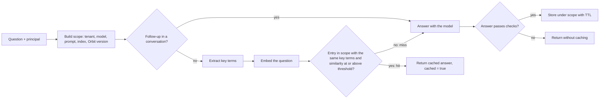
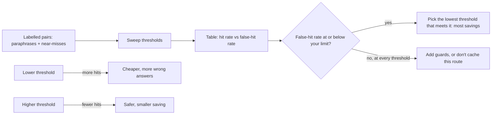
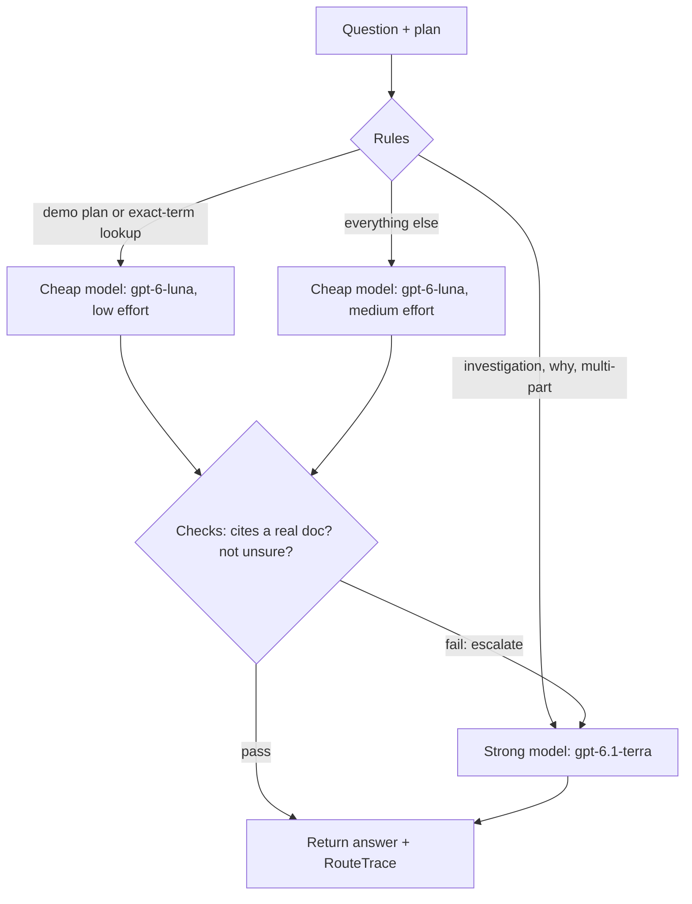

# Caching & Cost Optimization at Scale

After launch, Atlas answers about 4,000 questions a day across tenants. A replay of one day shows that many of them rephrase a question answered an hour earlier, and that the "why are jobs running twice?" kind often fail on the cheap model and get asked again. At this volume, small savings per request add up. Today you cut cost with two levers, a semantic cache and a model router, and you measure what each one saves and what it risks.

## At a Glance

- **Time:** ~2 h core (+ optional Go Deeper) · **Depth:** working
- **Prerequisites:** [Day 18: Cost & Latency Engineering: Caching, Batch & Budgets](../../Phase_2_Building_with_LLM_APIs/Day_018_cost_latency_caching/cost_latency_caching.md), [Day 78: Async Jobs & Long-Running Work](../Day_078_async_jobs/async_jobs.md), [Day 83: Auth, Multi-Tenancy & Usage Quotas](../Day_083_auth_multitenancy_quotas/auth_multitenancy_quotas.md), plus [Day 23: Embeddings & Semantic Similarity](../../Phase_3_RAG/Day_023_embeddings/embeddings.md) for cosine similarity
- **You'll build:** `atlas/cache.py` (a tenant-safe semantic cache with an exact-term guard and a measured threshold), `atlas/model_router.py` (cheap-first routing with escalation), and a per-tenant cost report with one budget alert
- **Stops at:** custom cache infrastructure, learned routers, distillation ([Day 96](../../Phase_10_Open_Models_and_Fine_Tuning/Day_096_evaluating_distilling_small_models/evaluating_distilling_small_models.md))
- **Fast path:** Already run caches and load balancers in production? Read §"Measuring the Threshold" and §"Measuring the Router", then do Exercise 2 (~40 min)
- **Cost:** free offline (every table computes with stand-ins); a live `router_eval` run ≈ $0.30 on `gpt-6-luna` + `gpt-6.1-terra`, mostly the all-strong baseline (prices as of 2026-11, [verify](https://developers.openai.com/api/docs/pricing))
- **New terms:** semantic cache, similarity threshold & false-hit rate, cache scope / invalidation, model routing, escalation

> **Coming from Software Engineering?** A semantic cache is cache-aside (check the cache, on a miss compute and store) with *fuzzy* keys: two requests share an entry when their meaning is close, not when their bytes are equal. That makes *correctness* the hard part, not speed: a cache hit can be confidently wrong. Model routing is a smart load balancer that sends simple work to small instances and retries hard work on big ones, like running batch jobs on cheap spot instances and falling back to on-demand. What transfers: TTLs, invalidation, cache-key design, and "measure the hit rate before you brag about it".

## Where the Money Goes at Scale

First, look at the bill by route and tenant. Three lines from a day of Atlas call logs (the format your [Day 12](../../Phase_2_Building_with_LLM_APIs/Day_012_openai_sdk_production/openai_sdk_production.md) `log_call()` writes, trimmed):

```text
{"tenant": "acme", "route": "ask", "model": "gpt-6-luna", "input_tokens": 2400, "cached_tokens": 1100, "output_tokens": 300}
{"tenant": "acme", "route": "ask", "model": "gpt-6-luna", "input_tokens": 2350, "cached_tokens": 1100, "output_tokens": 280}
{"tenant": "zephyr", "route": "investigate", "model": "gpt-6.1-terra", "input_tokens": 9000, "cached_tokens": 1100, "output_tokens": 1200}
```

Work one request out by hand with list prices (USD per 1M tokens, as of 2026-11, [verify](https://developers.openai.com/api/docs/pricing)): `gpt-6-luna` is $0.10 input, $0.01 cached input, $0.50 output; `gpt-6.1-terra` is $1.00, $0.05 and $5.00.

- The first `ask` on Luna: 1,300 × $0.10 + 1,100 × $0.01 + 300 × $0.50, all ÷ 1M ≈ **$0.00029**.
- The same request on Terra: 1,300 × $1.00 + 1,100 × $0.05 + 300 × $5.00 ≈ **$0.0029**, ten times more.
- The `investigate` call: 7,900 × $1.00 + 1,100 × $0.05 + 1,200 × $5.00 ≈ **$0.014**.

The model choice dominates the price, so routing matters; the second line nearly repeats the first, so caching matters. The `cached_tokens` column is **provider prompt caching**, lever zero, on since [Day 18](../../Phase_2_Building_with_LLM_APIs/Day_018_cost_latency_caching/cost_latency_caching.md): it bills a repeated prompt *prefix* at 0.1× input (0.05× on `gpt-6.1-terra`), but you still pay for the rest of the prompt and every output token. Today's levers remove whole calls, or make them cheaper.

## A Binder of Past Answers

Picture a help desk with a binder of past answers. Before answering, you flip through it: has someone asked *the same thing*? If so, you read out the old answer. That's fast and free. The danger is the page that *looks* right: "error 1101" and "error 1102" look almost identical and need different pages.

A **semantic cache** is that binder. It stores (question, answer) pairs and returns a stored answer when a new question is close enough in meaning. "Close enough" uses an **embedding** (a list of numbers that captures meaning, from [Day 23](../../Phase_3_RAG/Day_023_embeddings/embeddings.md)) and **cosine similarity** (how closely two embeddings point the same way; 1 means identical).

Here's a tiny worked example with 2-D unit vectors you can check in your head. Cosine of unit vectors is `x1·x2 + y1·y2`:

| Question | Vector | Cosine with stored A | ≥ 0.90? | Right answer? |
|---|---|---|---|---|
| A (stored): "fix ORB-1101 LeaseExpired" | (0.60, 0.80) | 1.00 | — | — |
| B: "how to fix ORB-1101 lease expiry" | (0.80, 0.60) | 0.48 + 0.48 = **0.96** | hit | yes |
| C: "fix ORB-1102 heartbeat lost" | (0.28, 0.96) | 0.168 + 0.768 = **0.94** | hit | **no, wrong page** |
| D: "cron time zone" | (1.00, 0.00) | 0.60 | miss | yes |

C is a **false hit**: the cache returns an answer to a different question. Raising the threshold to 0.95 fixes C and keeps B, but real data has many more pairs, and you can't tune by eye. You'll measure it.

## Name the Parts

- **Similarity threshold:** the minimum cosine for a hit. Higher means fewer hits and fewer false hits.
- **False-hit rate:** the share of look-alike-but-different questions that hit; each is a wrong answer served with confidence.
- **Cache scope:** the key parts that must match *exactly* (tenant, model, prompt version, index version, Orbit version). Similarity applies only inside one scope.
- **TTL and invalidation:** entries expire after a time-to-live, and you drop them early when something they depend on changes.



## A Minimal Semantic Cache

The smallest real version: embed with `text-embedding-3-small`, keep vectors in a list, compare with a dot product (OpenAI embeddings are unit length, so the dot product *is* the cosine).

```python
# script_id: day_085_caching_cost_scale/first_semantic_cache
# A semantic cache in ~20 lines. Install: uv add "openai>=3.46,<4" numpy
# Env: OPENAI_API_KEY, ATLAS_EMBED_MODEL (default text-embedding-3-small). Cost: < $0.0001
import os

import numpy as np
from openai import OpenAI

EMBED_MODEL = os.environ.get("ATLAS_EMBED_MODEL", "text-embedding-3-small")
client = OpenAI()


def openai_embed(texts: list[str]) -> np.ndarray:
    resp = client.embeddings.create(model=EMBED_MODEL, input=texts)
    return np.array([d.embedding for d in resp.data], dtype=np.float32)   # already unit length


if __name__ == "__main__":
    cache: list[tuple[np.ndarray, str]] = []                 # (question vector, answer)
    for q in ["How do I fix ORB-1101 errors?", "What's the fix for ORB-1101 errors?",
              "How do I fix ORB-1102 errors?"]:
        v = openai_embed([q])[0]
        sims = [float(vec @ v) for vec, _ in cache]
        if sims and max(sims) >= 0.90:
            print(f"{q:38} hit {max(sims):.2f} -> {cache[sims.index(max(sims))][1]}")
        else:
            cache.append((v, f"answer to {q!r}"))           # a real app calls the model here
            print(f"{q:38} miss (answered and stored)")
```

Expected shape (illustrative; your similarities will differ):

```text
How do I fix ORB-1101 errors?          miss (answered and stored)
What's the fix for ORB-1101 errors?    hit 0.xx -> answer to 'How do I fix ORB-1101 errors?'
How do I fix ORB-1102 errors?          hit 0.xx -> answer to 'How do I fix ORB-1101 errors?'
```

If the third line says `hit`, you've reproduced today's bug. If not, lower the threshold a little: at some point the paraphrase and the near-miss both pass, because they differ by one character.

## Break It: Near-Misses and Versions

Embeddings see "ORB-1101" and "ORB-1102" as nearly the same text. The same goes for "retries in 2.x" vs "in 3.x", or `lease_seconds` vs `heartbeat_seconds`. Similarity alone can't separate them, so add an **exact-term guard**: pull out the tokens that must match exactly (Orbit error codes, versions, `orbit.toml` keys) and only allow a hit when both questions have the same set.

The production cache starts with its types. Everything is injectable (the embedder, the term extractor, the clock) so you can test it offline and swap parts later.

```python
# script_id: day_085_caching_cost_scale/atlas_cache
# atlas/cache.py: a tenant-scoped semantic cache with an exact-term guard.
# Install: uv add numpy pydantic
# Env: none. Runs offline with hashed_embed (a stand-in); pass a real embedder in production.
from __future__ import annotations

import hashlib
import re
import time
from dataclasses import dataclass
from typing import Callable, Literal

import numpy as np
from pydantic import BaseModel, Field

Embedder = Callable[[list[str]], np.ndarray]        # texts -> (n, dim) unit vectors


class Citation(BaseModel):                          # compact copies of Day 15 / Day 28
    doc_id: str
    quote: str


class Answer(BaseModel):
    text: str
    citations: list[Citation] = Field(default_factory=list)


@dataclass
class CacheHit:
    answer: Answer
    similarity: float
    source_query: str
    cached_at: float


@dataclass
class _Entry:
    scope: str
    query: str
    terms: frozenset[str]
    vec: np.ndarray
    answer: Answer
    cached_at: float
```

Next, the guard and an offline embedder. `hashed_embed` is *not* a semantic model: it hashes words and three-letter chunks into a vector, so it sees spelling overlap. That's enough to reproduce near-misses and to run every table in this lesson without a key.

```python
# script_id: day_085_caching_cost_scale/atlas_cache
TERM_RE = re.compile(
    r"ORB-\d{4}"                          # Orbit error codes
    r"|\b\d+\.(?:\d+|x)(?:\.\d+)?\b"      # versions: 2.x, 3.2.1
    r"|\b[a-z]+(?:_[a-z]+)+\b",           # config keys: lease_seconds, ORBIT_LEASE
    re.IGNORECASE)


def key_terms(text: str) -> frozenset[str]:
    """The exact tokens that must match before two questions may share an answer."""
    return frozenset(t.lower() for t in TERM_RE.findall(text))


def detect_version(question: str) -> str:          # compact copy of Day 44
    m = re.search(r"\b([23])\.(?:\d+|x)\b", question)
    return f"{m.group(1)}.x" if m else "3.x"       # Orbit 3.2.1 is current


def hashed_embed(texts: list[str], dim: int = 512) -> np.ndarray:
    """Offline stand-in for an embedding model: hashed words + character trigrams.
    It measures spelling overlap, not meaning. Use it for demos and tests only."""
    out = np.zeros((len(texts), dim), dtype=np.float32)
    for i, text in enumerate(texts):
        t = text.lower()
        feats = re.findall(r"[a-z0-9_.-]+", t) + [t[j:j + 3] for j in range(len(t) - 2)]
        for f in feats:
            h = hashlib.blake2b(f.encode(), digest_size=4).digest()
            out[i, int.from_bytes(h, "little") % dim] += 1.0
    return out / np.maximum(np.linalg.norm(out, axis=1, keepdims=True), 1e-9)
```

Now the cache itself. The guard filters candidates *before* the similarity check, so a near-miss can't win just by being the closest entry.

```python
# script_id: day_085_caching_cost_scale/atlas_cache
class SemanticCache:
    """In-memory cache-aside store for one process, tests and demos (Redis: see Go Deeper)."""

    def __init__(self, embed: Embedder, *, threshold: float = 0.95, ttl_s: int = 86_400,
                 terms: Callable[[str], frozenset[str]] | None = key_terms) -> None:
        self.embed, self.threshold, self.ttl_s, self.terms = embed, threshold, ttl_s, terms
        self.clock: Callable[[], float] = time.time       # swap in tests to fast-forward
        self._entries: list[_Entry] = []

    def lookup(self, scope: str, query: str) -> CacheHit | None:
        now = self.clock()
        want = self.terms(query) if self.terms else None
        cands = [e for e in self._entries if e.scope == scope and now - e.cached_at < self.ttl_s
                 and (want is None or e.terms == want)]               # exact-term guard
        if not cands:
            return None
        sims = np.stack([e.vec for e in cands]) @ self.embed([query])[0]   # dot = cosine
        best = int(np.argmax(sims))
        if sims[best] < self.threshold:
            return None
        e = cands[best]
        return CacheHit(e.answer, float(sims[best]), e.query, e.cached_at)

    def store(self, scope: str, query: str, answer: Answer) -> None:
        terms = self.terms(query) if self.terms else frozenset()
        vec = self.embed([query])[0]
        self._entries.append(_Entry(scope, query, terms, vec, answer, self.clock()))

    def invalidate(self, prefix: str) -> int:
        """Drop every entry whose scope starts with prefix. Returns how many were dropped."""
        keep = [e for e in self._entries if not e.scope.startswith(prefix)]
        dropped, self._entries = len(self._entries) - len(keep), keep
        return dropped
```

Break it on purpose: run the same three questions with the guard off, then on.

```python
# script_id: day_085_caching_cost_scale/atlas_cache
if __name__ == "__main__":
    fix = Answer(text="ORB-1101 LeaseExpired: let heartbeats renew the lease, or raise lease_seconds.",
                 citations=[Citation(doc_id="error-codes", quote="A job outlived its lease")])
    for guard in (None, key_terms):
        cache = SemanticCache(hashed_embed, threshold=0.70, terms=guard)   # demo value
        cache.store("demo", "How do I fix ORB-1101 errors?", fix)
        cache.store("demo", "How do I configure retries in Orbit 3.x?", fix)
        print("guard on" if guard else "guard off")
        for q in ["How can I fix ORB-1101 errors?", "How do I fix ORB-1102 errors?",
                  "How do I configure retries in Orbit 2.x?"]:
            hit = cache.lookup("demo", q)
            print(f"  {q:42} " + (f"hit {hit.similarity:.2f} <- {hit.source_query}" if hit else "miss"))
```

```text
guard off
  How can I fix ORB-1101 errors?             hit 0.84 <- How do I fix ORB-1101 errors?
  How do I fix ORB-1102 errors?              hit 0.90 <- How do I fix ORB-1101 errors?
  How do I configure retries in Orbit 2.x?   hit 0.89 <- How do I configure retries in Orbit 3.x?
guard on
  How can I fix ORB-1101 errors?             hit 0.84 <- How do I fix ORB-1101 errors?
  How do I fix ORB-1102 errors?              miss
  How do I configure retries in Orbit 2.x?   miss
```

Without the guard, the ORB-1102 and 2.x questions get answers written for ORB-1101 and 3.x. With it, they miss and go to the model. (The demo uses 0.70 to make the bug visible; the next section picks a real threshold from data.)

## Measuring the Threshold

"Use 0.95" is a guess. The right threshold depends on your embedder and your questions, so measure it. Build labelled pairs: **paraphrases** that *should* hit (taken from `eval/qa_gold.jsonl`, rephrased the way a user would) and **near-misses** that must *not* hit (taken from `docs/error-codes.md` and `docs/configuration-reference.md`). Then sweep thresholds and count.

```python
# script_id: day_085_caching_cost_scale/threshold_sweep
# Hit rate vs false-hit rate across thresholds, on 30 labelled Orbit pairs.
# Install: uv add numpy pydantic   Env: ORBIT_DATA (default datasets/orbit)
# Offline by default; with OPENAI_API_KEY set it uses real embeddings (first_semantic_cache.py).
import json
import os
from dataclasses import dataclass
from pathlib import Path

from atlas_cache import SemanticCache, hashed_embed, key_terms

DATA_DIR = Path(os.environ.get("ORBIT_DATA", "datasets/orbit"))
GOLD = {r["id"]: r["question"] for r in map(json.loads, (DATA_DIR / "eval/qa_gold.jsonl").open())}


@dataclass(frozen=True)
class CachePair:
    a: str
    b: str
    should_hit: bool


PARAPHRASES = {   # qa_gold id -> how a user might ask the same thing an hour later
    "qa-001": "What do lease_seconds and heartbeat_seconds default to in orbit.toml?",
    "qa-002": "Which release fixed the Redis reconnect storm after failover?",
    "qa-004": "ORB-1202: what does it mean and how do I fix it?",
    "qa-005": "What delays come before the first three retries with exponential backoff?",
    "qa-011": "Postgres broker pickup latency is stuck near 5 seconds, why?",
    "qa-012": "Is there a safe prefetch value for Orbit 3.2.x?",
    "qa-013": "Do Flows work with the SQS broker?",
    "qa-015": "What time zone are Orbit cron expressions evaluated in?",
    "qa-016": "How long are dead-lettered jobs kept by Orbit?",
    "qa-018": "Is there a Prometheus /metrics endpoint in Orbit?",
    "qa-021": "For how long does Orbit remember an idempotency key?",
    "qa-023": "Why not use orbit doctor as a Kubernetes liveness probe?",
    "qa-025": "What's the way to stop an Orbit worker on Windows?",
    "qa-026": "Can the dashboard run several replicas in token mode?",
    "qa-029": "How often did workers send heartbeats in Orbit 2.x?",
}
```

```python
# script_id: day_085_caching_cost_scale/threshold_sweep
NEAR_MISSES = [   # look alike, need different answers; the last four have no exact term
    ("How do I fix ORB-1101?", "How do I fix ORB-1102?"),
    ("What does ORB-1001 mean?", "What does ORB-1002 mean?"),
    ("What does ORB-1201 mean?", "What does ORB-1202 mean?"),
    ("Why am I seeing ORB-1701?", "Why am I seeing ORB-1702?"),
    ("How do I configure retries in Orbit 2.x?", "How do I configure retries in Orbit 3.x?"),
    ("How often do workers send heartbeats in 2.x?", "How often do workers send heartbeats in 3.x?"),
    ("What is the default lease_seconds?", "What is the default heartbeat_seconds?"),
    ("What is the default max_attempts?", "What is the default max_delay_seconds?"),
    ("Is prefetch above 100 safe on 3.2.x?", "Is prefetch above 100 safe on 3.1.x?"),
    ("What does ttl_days control?", "What does max_payload_kb control?"),
    ("How do I set oidc_issuer?", "How do I set oidc_client_id?"),
    ("How do I stop an Orbit worker on Windows?", "How do I stop an Orbit worker on Kubernetes?"),
    ("Does the Redis broker support priorities?", "Does the SQS broker support priorities?"),
    ("How long does Orbit keep dead-lettered jobs?", "How long does Orbit keep job results?"),
    ("How do I enable tracing?", "How do I enable metrics?"),
]
CACHE_PAIRS = ([CachePair(GOLD[i], p, True) for i, p in PARAPHRASES.items()]
               + [CachePair(a, b, False) for a, b in NEAR_MISSES])


@dataclass(frozen=True)
class CacheReport:
    threshold: float
    hit_rate: float          # paraphrases that hit: higher saves more
    false_hit_rate: float    # near-misses that hit: each one is a wrong answer


def sweep_thresholds(cache: SemanticCache, pairs: list[CachePair],
                     thresholds: list[float]) -> list[CacheReport]:
    sims = (cache.embed([p.a for p in pairs]) * cache.embed([p.b for p in pairs])).sum(axis=1)
    same = [cache.terms is None or cache.terms(p.a) == cache.terms(p.b) for p in pairs]
    pos = [i for i, p in enumerate(pairs) if p.should_hit]
    neg = [i for i, p in enumerate(pairs) if not p.should_hit]
    reports = []
    for t in thresholds:                       # embed once, reuse the similarities per threshold
        hit = [bool(sims[i] >= t and same[i]) for i in range(len(pairs))]
        reports.append(CacheReport(t, sum(hit[i] for i in pos) / len(pos),
                                   sum(hit[i] for i in neg) / len(neg)))
    return reports


if __name__ == "__main__":
    embed = hashed_embed
    if os.environ.get("OPENAI_API_KEY"):
        from first_semantic_cache import openai_embed as embed
    grid = [x / 100 for x in range(50, 100, 5)]
    for terms in (None, key_terms):
        print("guard on" if terms else "guard off", "\nthreshold  hit_rate  false_hit_rate")
        for r in sweep_thresholds(SemanticCache(embed, terms=terms), CACHE_PAIRS, grid):
            print(f"  {r.threshold:.2f}     {r.hit_rate:6.0%}    {r.false_hit_rate:8.0%}")
```

Measured with the offline stand-in (a real embedder shifts every number; re-run with your key):

```text
guard off
threshold  hit_rate  false_hit_rate
  0.50       100%        100%
  0.55       100%         93%
  0.60       100%         93%
  0.65        93%         93%
  0.70        87%         93%
  0.75        73%         67%
  0.80        47%         60%
  0.85        40%         47%
  0.90        27%         20%
  0.95         7%          0%
guard on
threshold  hit_rate  false_hit_rate
  0.50       100%         27%
  0.55       100%         27%
  0.60       100%         27%
  0.65        93%         27%
  0.70        87%         27%
  0.75        73%         13%
  0.80        47%         13%
  0.85        40%          7%
  0.90        27%          0%
  0.95         7%          0%
```



Read it like an error budget: decide how many wrong answers you can tolerate (for Orbit support, zero on the near-miss set), then take the lowest threshold that meets it: the most safe savings. The guard removes every near-miss that differs by a code, version or key. What's left are look-alikes with no exact term (Redis vs SQS), and only the threshold stops those; with this stand-in that means 0.90 and a modest hit rate. Thirty pairs is a small sample (one pair moves a rate by about 7 points), so treat the numbers as directional ([A12: Eval Metrics Basics](../../Appendix_Primers/A12_eval_metrics_basics.md)) and grow the set from real traffic.

## Tenant-Safe and Fresh

A cache key that ignores the tenant leaks data: Acme's private runbook answer gets served to Zephyr. [Day 83](../Day_083_auth_multitenancy_quotas/auth_multitenancy_quotas.md) owns tenant keying, so reuse its `tenant_key()` and put every input that changes the right answer into the **scope**:

```python
# script_id: day_085_caching_cost_scale/atlas_cache
@dataclass(frozen=True)
class Principal:                                   # compact copy of Day 83
    tenant_id: str
    key_id: str
    plan: Literal["demo", "free", "team"]
    scopes: frozenset[str]


def tenant_key(p: Principal, *parts: str) -> str:  # Day 83: every key starts with the tenant
    return ":".join(["t", p.tenant_id, *parts])


def cache_scope(p: Principal, *, model: str, prompt_version: str, index_version: str) -> str:
    """Everything that changes the right answer goes here, and must match exactly."""
    return tenant_key(p, "cache", f"idx={index_version}", f"prompt={prompt_version}", f"model={model}")


def cached_ask(cache: SemanticCache, scope: str, question: str, ask: Callable[[str], Answer],
               *, history_len: int = 0) -> tuple[Answer, CacheHit | None]:
    if history_len:                                # follow-ups depend on the conversation
        return ask(question), None
    scope = f"{scope}:orbit={detect_version(question)}"
    if hit := cache.lookup(scope, question):
        return hit.answer, hit
    answer = ask(question)
    if answer.citations:                           # never cache "I don't know" or uncited text
        cache.store(scope, question, answer)
    return answer, None
```

```python
# script_id: day_085_caching_cost_scale/atlas_cache
if __name__ == "__main__":
    calls: list[str] = []
    def ask(q: str) -> Answer:                     # stand-in for Day 28's ask(): counts real calls
        calls.append(q)
        return Answer(text=f"answer v{len(calls)}", citations=[Citation(doc_id="error-codes", quote="...")])
    acme = Principal("acme", "k1", "team", frozenset({"ask"}))
    zephyr = Principal("zephyr", "k2", "team", frozenset({"ask"}))
    cache = SemanticCache(hashed_embed, threshold=0.70)     # demo value; yours comes from the sweep
    v1 = dict(model="gpt-6-luna", prompt_version="ask-v4", index_version="2026-11-01")
    for who, q, idx in [(acme, "How do I fix ORB-1101 errors?", v1),
                        (acme, "How can I fix ORB-1101 errors?", v1),
                        (zephyr, "How can I fix ORB-1101 errors?", v1),
                        (acme, "How can I fix ORB-1101 errors?", {**v1, "index_version": "2026-11-08"})]:
        answer, hit = cached_ask(cache, cache_scope(who, **idx), q, ask)
        print(f"{who.tenant_id:6} idx={idx['index_version']}  {'hit ' if hit else 'miss'}  {answer.text}")
    print("erasure for acme dropped", cache.invalidate("t:acme:"), "entries")
```

```text
acme   idx=2026-11-01  miss  answer v1
acme   idx=2026-11-01  hit   answer v1
zephyr idx=2026-11-01  miss  answer v2
acme   idx=2026-11-08  miss  answer v3
erasure for acme dropped 2 entries
```

Zephyr misses because the scope differs, and so does Acme after the index rebuild: a version bump makes old entries unreachable at once. Keep the trailing colon in `"t:acme:"`, or the prefix also matches a tenant called `acme-labs`. For several API replicas and workers, the same design runs on Redis with `redisvl` (Go Deeper).

**Invalidation triggers** (what must change the scope or drop entries):

- the docs change: bump the index version (zero-downtime index migrations are [Day 88](../Day_088_operating_ai_systems/operating_ai_systems.md));
- a new model or prompt version ships ([Day 87](../Day_087_shipping_changes_safely/shipping_changes_safely.md) rolls these out);
- a tenant's erasure request ([Day 73](../../Phase_8_Safety_and_Security/Day_073_privacy_pii/privacy_pii.md)): `invalidate("t:<tenant>:")`;
- a cached answer gets a thumbs-down ([Day 86](../Day_086_monitoring_feedback/monitoring_feedback.md));
- the TTL expires (the backstop).

**Never cache** side-effecting agent steps (a cached "ticket filed" files nothing), answers built from one user's private context, or follow-ups.

## Routing with Escalation

The second lever: don't pay Terra prices for Luna questions. **Model routing** picks the cheapest adequate model per request; **escalation** retries on a stronger model when the cheap answer fails a check:

1. Rules first: the demo plan always gets the cheap model; investigations, "why" and multi-part questions go to the strong one; exact-term lookups get the cheap model at low reasoning effort ([Day 6](../../Phase_1_How_LLMs_Work/Day_006_sampling_reasoning_effort/sampling_reasoning_effort.md)).
2. Check the cheap answer with code ([Day 44](../../Phase_5_Evaluation_and_Observability/Day_044_error_analysis/error_analysis.md)-style): does it cite a real doc, and is it not "I don't know"?
3. If a check fails, escalate once, and count *both* calls in cost and latency.



```python
# script_id: day_085_caching_cost_scale/atlas_router
# atlas/model_router.py: cheapest adequate model first, escalate when a check fails.
# Install: uv add numpy pydantic   Env: ATLAS_MODEL, ATLAS_STRONG_MODEL, ORBIT_DATA
from __future__ import annotations

import hashlib
import os
import re
from dataclasses import dataclass, field
from pathlib import Path
from typing import Callable

from atlas_cache import Answer, Citation, key_terms

CHEAP = os.environ.get("ATLAS_MODEL", "gpt-6-luna")
STRONG = os.environ.get("ATLAS_STRONG_MODEL", "gpt-6.1-terra")
DATA_DIR = Path(os.environ.get("ORBIT_DATA", "datasets/orbit"))
# USD per 1M tokens: (input, cached input, output). As of 2026-11; verify at the pricing page.
PRICES = {"gpt-6-luna": (0.10, 0.01, 0.50), "gpt-6.1-terra": (1.00, 0.05, 5.00)}
HARD = re.compile(r"\b(why|investigate|debug|root cause|compare|migrat\w*|upgrad\w*|in what order)\b", re.I)


@dataclass(frozen=True)
class RouteDecision:
    model: str
    effort: str           # reasoning effort (Day 6): a second, finer cost knob
    reason: str


def choose_model(question: str, *, plan: str = "free") -> RouteDecision:
    if plan == "demo":                              # public demo tenant: cheap only
        return RouteDecision(CHEAP, "low", "demo plan")
    if len(question) > 1_500 or HARD.search(question) or question.count("?") > 1:
        return RouteDecision(STRONG, "medium", "investigation / multi-part")
    if key_terms(question):
        return RouteDecision(CHEAP, "low", "exact-term lookup")
    return RouteDecision(CHEAP, "medium", "default")
```

The escalation check is deliberately cheap: plain code, no extra model call. A [Day 45](../../Phase_5_Evaluation_and_Observability/Day_045_llm_as_judge/llm_as_judge.md) judge can be a third check for high-stakes routes, at the price of one more call per answer.

```python
# script_id: day_085_caching_cost_scale/atlas_router
KNOWN_DOCS = {p.stem for p in (DATA_DIR / "docs").glob("*.md")}
UNSURE = re.compile(r"\b(i don't know|not sure|cannot find|no information)\b", re.I)


def needs_escalation(answer: Answer) -> str | None:
    """Day 44-style checks. Returns a reason to escalate, or None if the answer may ship."""
    if UNSURE.search(answer.text):
        return "model unsure"
    if not answer.citations:
        return "no citation"
    unknown = [c.doc_id for c in answer.citations if c.doc_id not in KNOWN_DOCS]
    return f"cites unknown doc {unknown[0]!r}" if unknown else None


@dataclass
class CallResult:
    answer: Answer
    input_tokens: int
    output_tokens: int
    cached_tokens: int = 0
    seconds: float = 0.0


ModelCall = Callable[[str, RouteDecision], CallResult]     # plug in any provider


def cost_usd(model: str, input_tokens: int, output_tokens: int, cached_tokens: int = 0) -> float:
    if model not in PRICES:
        raise KeyError(f"no price for {model!r}: add it to PRICES from the pricing page")
    p_in, p_cached, p_out = PRICES[model]
    return ((input_tokens - cached_tokens) * p_in + cached_tokens * p_cached + output_tokens * p_out) / 1e6
```

```python
# script_id: day_085_caching_cost_scale/atlas_router
@dataclass
class RouteTrace:
    decisions: list[RouteDecision] = field(default_factory=list)
    escalated: bool = False
    cost_usd: float = 0.0
    latency_s: float = 0.0


def run_once(call: ModelCall, question: str, d: RouteDecision, trace: RouteTrace) -> Answer:
    r = call(question, d)
    trace.decisions.append(d)
    trace.cost_usd += cost_usd(d.model, r.input_tokens, r.output_tokens, r.cached_tokens)
    trace.latency_s += r.seconds                    # escalation is sequential: the user waits for both
    return r.answer


def answer_routed(question: str, *, plan: str = "free", call: ModelCall) -> tuple[Answer, RouteTrace]:
    trace = RouteTrace()
    first = choose_model(question, plan=plan)
    answer = run_once(call, question, first, trace)
    reason = needs_escalation(answer)
    if reason and first.model != STRONG and plan != "demo":
        trace.escalated = True
        answer = run_once(call, question, RouteDecision(STRONG, "medium", f"escalated: {reason}"), trace)
    return answer, trace
```

To compute tables without a key, the router script also carries a simulator with canned pass/fail behaviour. It's labelled as fake on purpose: it lets you test the *plumbing*, not the models. It also includes confidently wrong answers (a real doc, the wrong one), which no cheap check catches.

```python
# script_id: day_085_caching_cost_scale/atlas_router
class SimulatedModels:
    """Offline ModelCall with canned behaviour (NOT real model quality). The cheap model
    fails multi-doc questions about half the time; the strong model rarely fails."""

    def __init__(self, gold: dict[str, list[str]]) -> None:
        self.gold = gold                            # question -> cited doc ids from qa_gold

    def __call__(self, question: str, d: RouteDecision) -> CallResult:
        docs = self.gold.get(question, ["faq"])
        roll = int(hashlib.sha256(f"{d.model}|{question}".encode()).hexdigest(), 16) % 100
        unsure = (55 if len(docs) > 1 else 15) if d.model == CHEAP else 4
        if roll < unsure:
            answer = Answer(text="I don't know.")
        elif roll < unsure + 8:                     # confidently wrong: real doc, wrong one
            answer = Answer(text="(simulated)", citations=[Citation(doc_id="glossary", quote="...")])
        else:
            answer = Answer(text="(simulated)", citations=[Citation(doc_id=docs[0], quote="...")])
        out = 250 if d.effort == "low" else 450     # reasoning tokens bill as output
        secs = (0.8 if d.model == CHEAP else 2.2) + out / 300
        return CallResult(answer, input_tokens=2_400, output_tokens=out, cached_tokens=1_100, seconds=secs)
```

The real `ModelCall` asks for a structured `Answer` ([Day 16](../../Phase_2_Building_with_LLM_APIs/Day_016_structured_outputs/structured_outputs.md)) with the model and effort the router chose. The retriever here is a keyword-overlap stand-in; plug in your [Day 28](../../Phase_3_RAG/Day_028_rag_pipeline/rag_pipeline.md) index.

```python
# script_id: day_085_caching_cost_scale/openai_answerer
# Real ModelCall for the router. Install: uv add "openai>=3.46,<4" pydantic numpy
# Env: OPENAI_API_KEY, ORBIT_DATA. Cost: one Responses call per answer.
import re
import time

from openai import OpenAI

from atlas_cache import Answer
from atlas_router import DATA_DIR, CallResult, RouteDecision

client = OpenAI()
DOCS = {p.stem: p.read_text(encoding="utf-8") for p in (DATA_DIR / "docs").glob("*.md")}
WORDS = {d: set(re.findall(r"[a-z0-9_]+", t.lower())) for d, t in DOCS.items()}
INSTRUCTIONS = ("Answer the question about Orbit using only the docs provided. Cite each doc id "
                "you used with a short exact quote. If the docs don't answer it, say \"I don't know\" "
                "and cite nothing.")


def retrieve(question: str, k: int = 3) -> list[str]:      # stand-in for Day 28's retriever
    q = set(re.findall(r"[a-z0-9_]+", question.lower()))
    return sorted(DOCS, key=lambda d: -len(q & WORDS[d]))[:k]


def openai_call(question: str, d: RouteDecision) -> CallResult:
    context = "\n\n".join(f'<doc id="{i}">\n{DOCS[i][:6000]}\n</doc>' for i in retrieve(question))
    start = time.monotonic()
    r = client.responses.parse(model=d.model, reasoning={"effort": d.effort}, instructions=INSTRUCTIONS,
                               input=f"{context}\n\nQuestion: {question}", text_format=Answer,
                               max_output_tokens=25_000)
    u = r.usage
    return CallResult(answer=r.output_parsed or Answer(text="I don't know"),   # None on refusal
                      input_tokens=u.input_tokens, output_tokens=u.output_tokens,
                      cached_tokens=u.input_tokens_details.cached_tokens,
                      seconds=time.monotonic() - start)
```

## Measuring the Router

A router that "saves money" while quality drops is a regression with a nice dashboard, so report pass rate next to dollars. Compare all-cheap, all-strong and the router on the 30 `qa_gold` questions.

```python
# script_id: day_085_caching_cost_scale/router_eval
# all-cheap vs all-strong vs router on eval/qa_gold.jsonl. Install: uv add numpy pydantic
# Offline: simulated models (plumbing check). With OPENAI_API_KEY: real calls (≈ $0.30, as of 2026-11).
import json
import os

import numpy as np

from atlas_router import (CHEAP, DATA_DIR, STRONG, RouteDecision, RouteTrace, SimulatedModels,
                          answer_routed, run_once)

cases = [json.loads(line) for line in (DATA_DIR / "eval/qa_gold.jsonl").open()]
if os.environ.get("OPENAI_API_KEY"):
    from openai_answerer import openai_call as call
else:
    call = SimulatedModels({c["question"]: c["citations"] for c in cases})


def passed(case: dict, answer) -> bool:     # code check; add a Day 45 judge for live runs
    return any(c.doc_id in case["citations"] for c in answer.citations)


def run(strategy: str) -> dict:
    results = []
    for case in cases:
        if strategy == "router":
            answer, trace = answer_routed(case["question"], call=call)
        else:
            trace, model = RouteTrace(), CHEAP if strategy == "all-cheap" else STRONG
            answer = run_once(call, case["question"], RouteDecision(model, "medium", strategy), trace)
        results.append((passed(case, answer), trace))
    traces = [t for _, t in results]
    return {"strategy": strategy, "pass": np.mean([p for p, _ in results]),
            "usd": np.mean([t.cost_usd for t in traces]),
            "p95": np.percentile([t.latency_s for t in traces], 95),
            "esc": np.mean([t.escalated for t in traces])}


if __name__ == "__main__":
    print(f"{'strategy':10} {'pass':>5} {'$/request':>10} {'p95 s':>6} {'escalated':>9}")
    for r in map(run, ["all-cheap", "all-strong", "router"]):
        print(f"{r['strategy']:10} {r['pass']:5.0%} {r['usd']:10.5f} {r['p95']:6.1f} {r['esc']:9.0%}")
```

Offline, with the simulator (these numbers test the plumbing; yours, with real models, will differ):

```text
strategy    pass  $/request  p95 s escalated
all-cheap    50%    0.00037    2.3        0%
all-strong   93%    0.00360    3.7        0%
router       90%    0.00198    6.0       33%
```

How to read it:

- **Pass rate vs all-strong.** The router should land close. The misses that remain are "confidently wrong" answers that pass every cheap check; a judge on high-stakes routes is the fix.
- **$/request and p95** (the latency 95% of requests beat). An escalation pays for both calls and waits for both, so p95 rises. If latency matters more than cost on a route, send it straight to the strong model.
- **Escalation rate.** Above roughly 40%, the rules send the wrong traffic to the cheap model and you pay twice.

Effort is a second knob inside one model (reasoning tokens bill as output); measure it the same way. Rolling out a router change with a canary is [Day 87](../Day_087_shipping_changes_safely/shipping_changes_safely.md).

## Cost Reports and One Budget Guard

Savings you can't attribute aren't savings you can defend. Group the call log by tenant, route and model, and credit each lever separately: prompt caching from `cached_tokens`, the semantic cache from hits, routing from what cheap calls would have cost on the strong model.

```python
# script_id: day_085_caching_cost_scale/cost_report
# Per-tenant / route / model cost from a JSONL call log, savings per lever, one budget guard.
# Install: uv add numpy pydantic   Run: python cost_report.py [calls.jsonl]
import json
import random
import sys
from collections import defaultdict
from pathlib import Path

from atlas_router import CHEAP, PRICES, STRONG, cost_usd


def synthetic_log(path: Path, n: int = 4_000, seed: int = 85) -> Path:
    """One FAKE day shaped like Atlas traffic. Point the report at your real log instead."""
    rng = random.Random(seed)
    with path.open("w") as f:
        for _ in range(n):
            tenant = rng.choices(["acme", "zephyr", "demo"], [5, 3, 2])[0]
            route = "ask" if tenant == "demo" else rng.choices(["ask", "investigate"], [9, 1])[0]
            model = STRONG if route == "investigate" or rng.random() < 0.12 else CHEAP
            hit = route == "ask" and rng.random() < 0.3              # semantic-cache hit: no call
            tin = 0 if hit else rng.randint(1_500, 4_000) * (3 if route == "investigate" else 1)
            f.write(json.dumps({"tenant": tenant, "route": route, "model": model, "semantic_hit": hit,
                                "input_tokens": tin, "cached_tokens": int(tin * rng.uniform(0.3, 0.6)),
                                "output_tokens": 0 if hit else rng.randint(150, 900)}) + "\n")
    return path


def row_cost(r: dict) -> float:
    return cost_usd(r["model"], r["input_tokens"], r["output_tokens"], r["cached_tokens"])
```

```python
# script_id: day_085_caching_cost_scale/cost_report
def cost_report(log_path: Path, by: tuple[str, ...] = ("tenant", "route", "model")) -> list[dict]:
    groups: dict[tuple, dict] = defaultdict(lambda: {"requests": 0, "semantic_hits": 0, "cost_usd": 0.0})
    for r in map(json.loads, log_path.open()):
        g = groups[tuple(r[k] for k in by)]
        g["requests"] += 1
        g["semantic_hits"] += r["semantic_hit"]
        g["cost_usd"] += row_cost(r)
    return sorted(({**dict(zip(by, k)), **v} for k, v in groups.items()), key=lambda x: -x["cost_usd"])


def savings_by_lever(log_path: Path) -> dict[str, float]:
    rows = [json.loads(line) for line in log_path.open()]
    misses = [r for r in rows if r["route"] == "ask" and not r["semantic_hit"]]
    avg_ask = sum(map(row_cost, misses)) / len(misses)               # what a hit would have cost
    return {"provider prompt caching": sum(r["cached_tokens"] * (PRICES[r["model"]][0] - PRICES[r["model"]][1])
                                           for r in rows) / 1e6,
            "semantic cache": sum(r["semantic_hit"] for r in rows) * avg_ask,
            "routing (vs all-strong)": sum(cost_usd(STRONG, r["input_tokens"], r["output_tokens"],
                                                    r["cached_tokens"]) - row_cost(r)
                                           for r in rows if r["model"] == CHEAP)}


DAILY_BUDGET_USD = {"acme": 3.20, "zephyr": 2.50, "demo": 0.80}      # caps you set per tenant


def budget_alerts(log_path: Path, warn_at: float = 0.8) -> list[str]:
    alerts = []
    for r in cost_report(log_path, by=("tenant",)):
        cap = DAILY_BUDGET_USD.get(r["tenant"])
        if cap and r["cost_usd"] >= warn_at * cap:
            alerts.append(f"ALERT {r['tenant']}: ${r['cost_usd']:.2f} spent = {r['cost_usd'] / cap:.0%} of ${cap:.2f}/day")
    return alerts


if __name__ == "__main__":
    log = Path(sys.argv[1]) if len(sys.argv) > 1 else synthetic_log(Path("calls_synthetic.jsonl"))
    for r in cost_report(log, by=("tenant", "route")):
        print(f"{r['tenant']:7} {r['route']:12} {r['requests']:5} req  {r['semantic_hits']:4} hits  ${r['cost_usd']:.3f}")
    for lever, usd in savings_by_lever(log).items():
        print(f"saved by {lever:24} ${usd:.3f}")
    print(*budget_alerts(log) or ["no tenant over 80% of budget"], sep="\n")
```

```text
acme    investigate    191 req     0 hits  $1.459
acme    ask           1859 req   545 hits  $1.172
zephyr  investigate    136 req     0 hits  $1.008
zephyr  ask           1014 req   322 hits  $0.635
demo    ask            800 req   237 hits  $0.522
saved by provider prompt caching  $1.773
saved by semantic cache           $1.001
saved by routing (vs all-strong)  $8.390
ALERT acme: $2.63 spent = 82% of $3.20/day
```

Each lever is credited against a different counterfactual, so report them side by side, never as one "we saved X%". Run the guard on a schedule (a [Day 78](../Day_078_async_jobs/async_jobs.md) job); alert routing and dashboards belong to [Day 86](../Day_086_monitoring_feedback/monitoring_feedback.md). Offline work, such as warming the cache with public FAQ answers, goes through Batch or Flex at 50% of the standard price (as of 2026-11, [verify](https://developers.openai.com/api/docs/pricing); mechanics in [Day 18](../../Phase_2_Building_with_LLM_APIs/Day_018_cost_latency_caching/cost_latency_caching.md)).

## Trade-offs and When Not to Cache

| Lever | What it saves | Main risk | Effort |
|---|---|---|---|
| Provider prompt caching (D18) | Repeated prefixes (0.1×; 0.05× on Terra) | Low | Low: stable content first |
| Exact cache (normalised question hash) | Whole calls, identical questions | Stale answers | Low |
| Semantic cache | Whole calls, paraphrases | **Wrong answers**, cross-tenant leaks | Medium: guard, scope, sweep |
| Routing + escalation | Price per call | Unseen quality drops, double latency | Medium: rules, checks, evals |
| Batch / Flex | 50% on offline work | 24 h delay (Batch), 429s (Flex) | Low |

Don't semantic-cache when the repeat rate is low (measure it first), when answers are high-stakes (security advice, anything with legal weight), or when docs change faster than your invalidation can follow.

### In production

- **Cache poisoning:** one bad answer, once cached, is served to everyone in the tenant. Only store answers that passed checks, and evict on the first thumbs-down.
- **Monitor false hits:** log `cached=true` and the similarity on every response, and watch thumbs-down rates for cached vs fresh answers ([Day 86](../Day_086_monitoring_feedback/monitoring_feedback.md)).
- **Tell users:** show "answered from cache" with a fresh-answer option (Exercise 1). In a provider outage ([Day 84](../Day_084_reliability_fallbacks/reliability_fallbacks.md)), a labelled cache hit beats an error.
- **The next lever:** when one route is high-volume and stable, distilling it into a small model is [Day 96](../../Phase_10_Open_Models_and_Fine_Tuning/Day_096_evaluating_distilling_small_models/evaluating_distilling_small_models.md).

### Commit it to R5

| Block | R5 path |
|---|---|
| `atlas_cache` | `atlas/cache.py` (drop the copied `Principal`/`tenant_key`/`Answer`; import from `atlas/tenancy.py` and `atlas/schemas.py`) |
| `redis_cache` | `atlas/cache_redis.py` |
| `atlas_router` | `atlas/model_router.py` (move `SimulatedModels` to `tests/fakes.py`) |
| `openai_answerer` | `atlas/model_router.py` (`openai_call`, with your real retriever) |
| `threshold_sweep`, `router_eval` | `atlas/evals/cache_sweep.py`, `atlas/evals/router_eval.py` |
| `cost_report` | `scripts/cost_report.py` |

## Go Deeper (optional)

<details><summary>Go deeper: the same cache on Redis with redisvl</summary>

The in-memory cache lives in one process. With several API replicas and workers ([Day 78](../Day_078_async_jobs/async_jobs.md)), put the cache in Redis. `redisvl` 0.31 ships a `SemanticCache` with TTLs and tag filters. Two details to watch: it takes a **distance** threshold (cosine distance = 1 − similarity, so lower is stricter), and it needs an explicit vectorizer, because its default pulls in a local Hugging Face model.

```python
# script_id: day_085_caching_cost_scale/redis_cache
# The cache on Redis, shared by every API process and worker. Install: uv add "redisvl==0.31.*" numpy pydantic
# Needs Redis 8+ (built-in vector search): docker run -d --name redis -p 6379:6379 redis:8
# Env: REDIS_URL (default redis://localhost:6379)
import hashlib
import os

from redis.exceptions import ConnectionError as RedisDown
from redisvl.extensions.cache.llm import SemanticCache as RedisSemanticCache
from redisvl.query.filter import Tag
from redisvl.utils.vectorize import CustomVectorizer

from atlas_cache import Answer, Citation, hashed_embed, key_terms

SIM_THRESHOLD = 0.90        # from the sweep (guard on, zero false hits), as a similarity


def make_cache(embed_one=lambda t: hashed_embed([t])[0].tolist()) -> RedisSemanticCache:
    return RedisSemanticCache(                     # connects and creates the index right here
        name="atlas_cache", vectorizer=CustomVectorizer(embed=embed_one),
        distance_threshold=1 - SIM_THRESHOLD, ttl=86_400,
        redis_url=os.environ.get("REDIS_URL", "redis://localhost:6379"),
        filterable_fields=[{"name": "scope", "type": "tag"}, {"name": "terms", "type": "tag"}])


def terms_tag(q: str) -> str:                       # the exact-term guard as one tag value
    return hashlib.sha1("|".join(sorted(key_terms(q))).encode()).hexdigest()[:16]


def lookup(cache: RedisSemanticCache, scope: str, q: str) -> Answer | None:
    hits = cache.check(prompt=q, filter_expression=(Tag("scope") == scope) & (Tag("terms") == terms_tag(q)))
    return Answer.model_validate_json(hits[0]["response"]) if hits else None   # [] on a miss


def store(cache: RedisSemanticCache, scope: str, q: str, answer: Answer) -> None:
    cache.store(prompt=q, response=answer.model_dump_json(), filters={"scope": scope, "terms": terms_tag(q)})


if __name__ == "__main__":
    try:
        cache = make_cache()
    except RedisDown as e:                         # e names the host and says "Connection refused"
        raise SystemExit(f"Redis isn't reachable ({e}). Start it: docker run -d -p 6379:6379 redis:8")
    acme, zephyr = "t:acme:cache:idx=2026-11-01", "t:zephyr:cache:idx=2026-11-01"
    store(cache, acme, "How do I fix ORB-1101 errors?",
          Answer(text="Raise lease_seconds...", citations=[Citation(doc_id="error-codes", quote="...")]))
    print("acme  :", lookup(cache, acme, "How can I fix ORB-1101 errors?"))     # Answer(...)
    print("zephyr:", lookup(cache, zephyr, "How can I fix ORB-1101 errors?"))   # None
    cache.clear()
```

For production, wrap `openai_embed` from the first script as `embed_one=lambda t: openai_embed([t])[0].tolist()` (and re-run the sweep, because the threshold belongs to the embedder). One embedding model per cache: mixing models or `dimensions=` settings breaks every comparison.

</details>

<details><summary>Go deeper: similarity, distance, and why near-misses score high</summary>

**In words.** An embedding model maps text to a direction in space. Two questions that use almost the same words and structure point in almost the same direction, whether or not the one differing token changes the meaning. "ORB-1101" vs "ORB-1102" differs by one character out of thirty; the model has little reason to push them apart, because during training most one-character differences *don't* matter.

**Toy numbers.** Say a question's vector is mostly "how do I fix … errors" plus a small "which code" part. Write it as `0.98 × shared + 0.20 × code`, with the two parts at right angles. Two questions with different codes share the first part fully and the second part not at all: cosine ≈ 0.98 × 0.98 ≈ 0.96, above most thresholds. Two true paraphrases with the same code but different wording might share less of the "shared" part, say 0.93. So the near-miss can score *higher* than the paraphrase. No threshold separates them; only the guard does.

**Formula.** cos(a, b) = (a · b) / (‖a‖ ‖b‖). For unit vectors, it's the dot product. Redis (and `redisvl`) report **cosine distance** = 1 − cos(a, b), from 0 (same direction) to 2 (opposite). So a similarity threshold of 0.92 becomes `distance_threshold=0.08`. Passing 0.92 as a distance would accept almost anything.

**Picking a threshold with more care.** With thirty pairs, the false-hit rate of 0% has a wide uncertainty: a rough "rule of three" says that zero failures in *n* trials is consistent with a true rate up to about 3/*n*, so 3/15 = 20% on fifteen near-misses. That's why the guard matters more than the decimal places, and why you should grow the pair set from real traffic (the queries users rephrase after a thumbs-down are gold).

</details>

<details><summary>Go deeper: stampedes, warming, and per-tenant isolation</summary>

**Cache stampede.** When a popular question misses (after a deploy bumps the scope, say), a hundred concurrent requests all miss together and all call the model. The usual fix is single-flight: the first request takes a short lock (`SET lock:<scope>:<hash> 1 NX EX 30` in Redis, the same atomic primitive as Day 78's idempotency gate) and computes; the others wait briefly and re-check the cache. For a semantic cache, lock on the *exact* normalised question; fuzzy locks are rarely worth it.

**Warming with Batch.** After an index or prompt bump, every entry is unreachable, so the first hour after a deploy is expensive. A nightly (or post-deploy) job can take the top public questions from yesterday's log, submit them through Batch (`client.batches.create(..., endpoint="/v1/responses", completion_window="24h")`, as in Day 18), and, when the batch completes, run each answer through `needs_escalation()` before `cache.store()`. Match results by `custom_id`, because output order isn't input order. Only warm the public tenant's scope this way; private-tenant answers depend on private context.

**Isolation levels.** A tag filter on `scope` is a *logical* boundary: one bug in how you build the filter and tenants share entries. For tenants with contractual isolation, give each its own cache (`name=f"atlas_cache_{tenant}"` in `redisvl`) so a lookup physically can't see another tenant's vectors, and erasure becomes dropping one index. The cost is one index per tenant, which is fine for dozens of tenants and painful for thousands.

**Exact cache first.** Put a plain hash lookup on the normalised question (lower-case, collapsed whitespace) in front of the semantic cache. It catches retries and double-clicks for free, without an embedding call.

</details>

<details><summary>Go deeper: beyond rules, toward cascades and learned routers</summary>

Today's router is a rule list plus one escalation. Teams that outgrow it usually go in one of three directions:

- **Cascades with confidence:** try the cheap model, accept its answer only if a confidence signal is high (agreement between two cheap samples, a judge score, a calibrated classifier), otherwise escalate. Same shape as today's code; a better `needs_escalation()`.
- **Learned routers:** a small classifier trained on logged (question, which model passed) pairs predicts the cheapest adequate model up front, saving the wasted cheap call. You need a few thousand labelled examples, and the labels come for free from a period of running both models on a sample of traffic.
- **Gateway routing:** gateways such as LiteLLM can route and fall back between deployments by config ([Day 84](../Day_084_reliability_fallbacks/reliability_fallbacks.md)). They handle *availability*; quality-based routing still needs your own checks.

Whatever you choose, keep today's evaluation table as the contract: pass rate, $/request, p95 and escalation rate against the two single-model baselines.

</details>

## Common Pitfalls

- **Near-miss false hits** ("fix ORB-1102" gets the ORB-1101 answer). Similarity can't separate one-token differences: add the exact-term guard, put the Orbit version in the scope, and measure the false-hit rate.
- **The key ignores the tenant, prompt or conversation.** Acme's answer reaches Zephyr, or "and on 2.x?" gets another question's answer. Scope by tenant, model, prompt and index version; skip the cache when `history_len > 0`.
- **Distance vs similarity.** `redisvl`'s `distance_threshold` is cosine *distance* (1 − similarity, lower is stricter, default 0.1). Passing a similarity of 0.92 there accepts nearly everything.
- **Stale answers after a docs update.** Put the index version in the scope (Day 88 bumps it) and keep a TTL as a backstop.
- **Mixing embedders:** `ValueError: matmul: Input operand 1 has a mismatch in its core dimension 0 ... (size 1536 is different from 512)`. Use one embedding model and `dimensions=` per cache; rebuild when you change it.
- **The router "saves money" while quality drops.** Report pass rate next to $/request. Over ~40% escalations means the rules are wrong; an empty `KNOWN_DOCS` (wrong `ORBIT_DATA`) makes everything escalate.

> **Where we stop:** we don't build custom cache infrastructure (our own vector index, eviction policies, distributed invalidation), train learned routers, or distil models; the [redisvl README](https://github.com/redis/redis-vl-python) covers its cache options, and distillation is [Day 96](../../Phase_10_Open_Models_and_Fine_Tuning/Day_096_evaluating_distilling_small_models/evaluating_distilling_small_models.md).

## Key Takeaways

- The model choice dominates the bill and repeats are common: prompt caching (Day 18) is lever zero; a semantic cache and routing remove or cheapen whole calls.
- A semantic cache is cache-aside with fuzzy keys, and a hit can be confidently wrong: ORB-1101 and ORB-1102 score almost the same, so an exact-term guard and a version-aware scope are required.
- Pick the threshold from a measured sweep of hit rate vs false-hit rate for *your* embedder; `redisvl` wants the cosine distance (1 − similarity).
- Scope entries by tenant, model, prompt and index version; skip follow-ups and side effects; invalidate on changes, erasure and thumbs-down.
- Route cheap-first, escalate once when a code check fails, and judge the router by pass rate, $/request, p95 and escalation rate against both baselines, crediting savings per lever.

## Quick Reference

| API / pattern | When to use | Gotcha |
|---|---|---|
| `client.embeddings.create(model="text-embedding-3-small", input=[...])` | Embedding questions for the cache | Vectors are unit length; one model and `dimensions=` per cache |
| `SemanticCache(embed, threshold=, ttl_s=, terms=key_terms)` | In-process cache, tests | Threshold is a similarity; pick it from the sweep |
| `cache_scope(p, model=, prompt_version=, index_version=)` | Building the exact-match part of the key | Invalidate with a trailing colon: `"t:acme:"` |
| `sweep_thresholds(cache, CACHE_PAIRS, grid)` | Choosing the threshold | 30 pairs is directional; grow it from traffic |
| `redisvl` `SemanticCache(..., distance_threshold=1 - sim, filterable_fields=[...])` | Shared cache across processes (Go Deeper) | Takes a distance; connects on construction; pass `vectorizer=` |
| `choose_model(q, plan=)` → `RouteDecision` | Cheap-first routing | Demo plan never escalates |
| `answer_routed(q, call=...)` → `(Answer, RouteTrace)` | Routing + one escalation | Escalation pays for both calls and waits for both |
| `cost_report(log, by=(...))`, `budget_alerts(log)` | Attributing spend, one guard | Credit savings per lever; don't sum them |

## Exercises

1. **Warm-up.** Make cached answers honest in the UI: return `cached` and `similarity` with every answer and render a footer such as "answered from cache (similarity 0.83, 12 min old)".

<details><summary>Solution</summary>

```python
# script_id: day_085_caching_cost_scale/solution_ex1
import time

from pydantic import BaseModel

from atlas_cache import Answer, CacheHit, Citation, SemanticCache, cached_ask, hashed_embed


class CachedAskResponse(BaseModel):     # add these fields to Day 77's AskResponse
    answer: Answer
    cached: bool = False
    similarity: float | None = None
    cached_age_s: int | None = None


def to_response(answer: Answer, hit: CacheHit | None) -> CachedAskResponse:
    if hit is None:
        return CachedAskResponse(answer=answer)
    return CachedAskResponse(answer=answer, cached=True, similarity=round(hit.similarity, 3),
                             cached_age_s=int(time.time() - hit.cached_at))


def footer(r: CachedAskResponse) -> str:
    if not r.cached:
        return "fresh answer"
    return f"answered from cache (similarity {r.similarity:.2f}, {r.cached_age_s // 60} min old)"


if __name__ == "__main__":
    cache = SemanticCache(hashed_embed, threshold=0.70)
    ask = lambda q: Answer(text="Raise lease_seconds.", citations=[Citation(doc_id="error-codes", quote="...")])
    for q in ["How do I fix ORB-1101 errors?", "How can I fix ORB-1101 errors?"]:
        print(footer(to_response(*cached_ask(cache, "t:acme:cache", q, ask))))
```

A "fresh answer" button in the UI sends a flag that skips `cache.lookup()` and overwrites the entry.

</details>

2. **Core.** Negations slip past the guard: "Which brokers support Flows?" and "Which brokers don't support Flows?" need opposite answers. Add 10 negation near-miss pairs, re-run the sweep, then extend the guard so negated and plain questions never share an entry.

<details><summary>Solution</summary>

```python
# script_id: day_085_caching_cost_scale/solution_ex2
import re

from atlas_cache import SemanticCache, hashed_embed, key_terms
from threshold_sweep import CACHE_PAIRS, CachePair, sweep_thresholds

NEGATIONS = [
    ("Which brokers support Flows?", "Which brokers don't support Flows?"),
    ("Which errors count as a failed attempt?", "Which errors don't count as a failed attempt?"),
    ("Which jobs should be idempotent?", "Which jobs don't need to be idempotent?"),
    ("What prefetch values are safe on 3.2.x?", "What prefetch values are not safe on 3.2.x?"),
    ("Which config keys can env vars override?", "Which config keys can't env vars override?"),
    ("What does orbit migrate-config copy?", "What does orbit migrate-config not copy?"),
    ("Which metrics are aggregated per worker?", "Which metrics are not aggregated per worker?"),
    ("When is a missed cron tick run?", "When is a missed cron tick never run?"),
    ("Which steps stop when a flow fails?", "Which steps don't stop when a flow fails?"),
    ("Can I run the dashboard with OIDC?", "Can I run the dashboard without OIDC?"),
]
NEG_RE = re.compile(r"\b(?:not|no|never|without)\b|n't\b", re.IGNORECASE)


def key_terms_neg(text: str) -> frozenset[str]:
    return key_terms(text) | ({"<negated>"} if NEG_RE.search(text) else frozenset())


pairs = CACHE_PAIRS + [CachePair(a, b, False) for a, b in NEGATIONS]
for name, terms in [("key_terms", key_terms), ("key_terms_neg", key_terms_neg)]:
    for r in sweep_thresholds(SemanticCache(hashed_embed, terms=terms), pairs, [0.6, 0.7, 0.8]):
        print(f"{name:14} t={r.threshold:.2f} hit={r.hit_rate:4.0%} false_hit={r.false_hit_rate:4.0%}")
```

```text
key_terms      t=0.60 hit=100% false_hit= 56%
key_terms      t=0.70 hit= 87% false_hit= 52%
key_terms      t=0.80 hit= 47% false_hit= 44%
key_terms_neg  t=0.60 hit=100% false_hit= 16%
key_terms_neg  t=0.70 hit= 87% false_hit= 16%
key_terms_neg  t=0.80 hit= 47% false_hit=  8%
```

The negation pairs share almost every word, so they score high. The threshold you picked earlier was right only for the pairs you'd measured: the data decides, so keep adding the failure types you find.

</details>

3. **Core.** `eval/retrieval_queries.jsonl` labels 16 queries `kind="exact_term"`. Measure how many `choose_model()` routes as exact-term lookups, add patterns (CLI commands, HTTP headers, error class names, `[section]` names), and measure again, including non-exact queries caught by mistake.

<details><summary>Solution</summary>

```python
# script_id: day_085_caching_cost_scale/solution_ex3
import json
import re

from atlas_router import CHEAP, DATA_DIR, RouteDecision, choose_model

rows = [json.loads(line) for line in (DATA_DIR / "eval/retrieval_queries.jsonl").open()]
EXTRA = re.compile(r"\borbit [a-z]+(?:-[a-z]+)*|\bX-[A-Za-z-]+|\b[A-Z][a-z]+(?:[A-Z][a-z]+)+\b|\[[a-z]+\]")


def choose_model_v2(q: str, *, plan: str = "free") -> RouteDecision:
    d = choose_model(q, plan=plan)
    if d.reason == "default" and EXTRA.search(q):
        return RouteDecision(CHEAP, "low", "exact-term lookup")
    return d


for name, fn in [("choose_model", choose_model), ("choose_model_v2", choose_model_v2)]:
    hits = {k: 0 for k in ("exact_term", "semantic", "multi_hop")}
    for r in rows:
        hits[r["kind"]] += fn(r["query"]).reason == "exact-term lookup"
    totals = {k: sum(r["kind"] == k for r in rows) for k in hits}
    print(name, {k: f"{hits[k]}/{totals[k]}" for k in hits})
```

```text
choose_model {'exact_term': '14/16', 'semantic': '0/14', 'multi_hop': '4/10'}
choose_model_v2 {'exact_term': '15/16', 'semantic': '0/14', 'multi_hop': '5/10'}
```

Catching more exact-term queries is cheap, but every non-exact query the patterns grab now runs at low effort. Check those few by hand, or run them through `router_eval` before you keep the rule.

</details>

4. **Stretch (optional, needs Redis 8).** Run the 15 paraphrase pairs through the in-memory and `redisvl` caches and compare hits and median lookup latency. Hits should agree; if not, check the distance conversion.

<details><summary>Solution</summary>

```python
# script_id: day_085_caching_cost_scale/solution_ex4
# Needs: docker run -d -p 6379:6379 redis:8
import statistics
import time

from atlas_cache import Answer, Citation, SemanticCache, hashed_embed
from redis_cache import SIM_THRESHOLD, lookup, make_cache, store
from threshold_sweep import CACHE_PAIRS

pairs = [p for p in CACHE_PAIRS if p.should_hit]
ans = Answer(text="...", citations=[Citation(doc_id="faq", quote="...")])
mem, red = SemanticCache(hashed_embed, threshold=SIM_THRESHOLD), make_cache()
scope = "t:bench:cache:idx=1"
for p in pairs:
    mem.store(scope, p.a, ans)
    store(red, scope, p.a, ans)


def bench(fn) -> tuple[int, float]:
    hits, times = 0, []
    for p in pairs:
        t0 = time.perf_counter()
        hits += fn(p.b) is not None
        times.append((time.perf_counter() - t0) * 1000)
    return hits, statistics.median(times)


for name, fn in [("in-memory", lambda q: mem.lookup(scope, q)), ("redisvl", lambda q: lookup(red, scope, q))]:
    h, ms = bench(fn)
    print(f"{name:10} hits {h}/{len(pairs)}  median {ms:.2f} ms")
red.clear()
```

Expect Redis to be slower per lookup (a network round trip) and the same on hits. You pay that latency for one cache shared by every replica, with TTLs that Redis enforces.

</details>

## References & Further Reading

- [OpenAI: Prompt caching](https://developers.openai.com/api/docs/guides/prompt-caching): lever zero: prefix rules, TTLs, read/write multipliers.
- [OpenAI: Pricing](https://developers.openai.com/api/docs/pricing): the source for every price here; check before quoting.
- [OpenAI: Embeddings](https://developers.openai.com/api/docs/guides/embeddings): models, `dimensions=`, and why dot = cosine.
- [OpenAI: Batch](https://developers.openai.com/api/docs/guides/batch) and [Flex processing](https://developers.openai.com/api/docs/guides/flex-processing): 50%-off paths for offline work.
- [redisvl](https://github.com/redis/redis-vl-python): `SemanticCache`, vectorizers and filter expressions.
- [OpenAI: gpt-6-luna](https://developers.openai.com/api/docs/models/gpt-6-luna): effort values and limits for the router's cheap side.

## What's Next

You can now cut cost with a measured cache and a router, and say which lever saved what. But stale cached answers or a router quietly dropping quality only show up if you watch production. In [Day 86: Monitoring, Online Evals & Feedback Loops](../Day_086_monitoring_feedback/monitoring_feedback.md) you add online checks, thumbs-up/down feedback (including on cached answers) and the alerts that tell you when something drifts.
