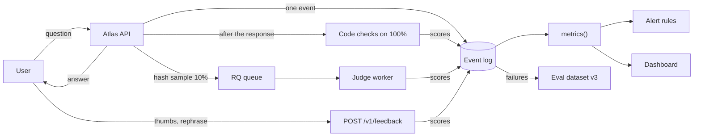
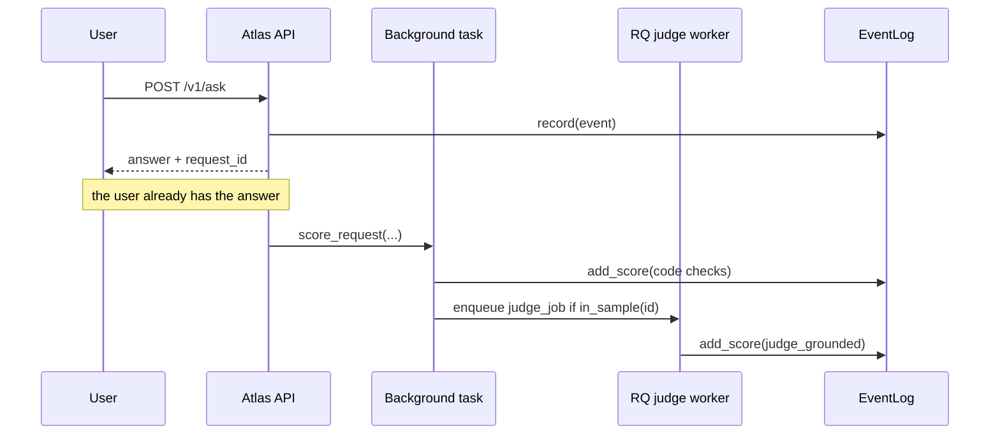
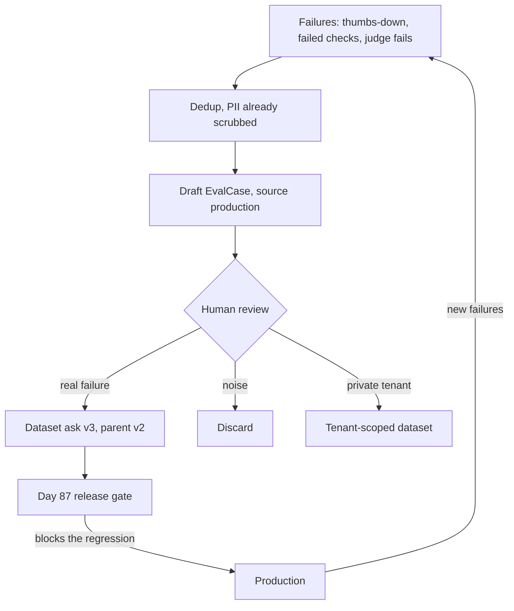

# Monitoring, Online Evals & Feedback Loops

Two weeks after launch, Orbit 3.2.1 shipped rewritten pages for configuration, workers and memory troubleshooting, and a botched re-index dropped all three from Atlas's index. Answers about `prefetch` memory growth now cite the old 2.x page or say "I don't know". Latency and error rate look perfect and nothing alerts; only a slow rise in thumbs-down hints at it. Today you build the instruments that notice, and the loop that turns each miss into a test.

## At a Glance

- **Time:** ~2 h core (+ optional Go Deeper) · **Depth:** working
- **Prerequisites:** [Day 42: Tracing & Observability in Depth](../../Phase_5_Evaluation_and_Observability/Day_042_tracing_observability/tracing_observability.md), [Day 43: Building Eval Datasets](../../Phase_5_Evaluation_and_Observability/Day_043_eval_datasets/eval_datasets.md), [Day 45: LLM-as-Judge](../../Phase_5_Evaluation_and_Observability/Day_045_llm_as_judge/llm_as_judge.md), [Day 47: Evals in CI](../../Phase_5_Evaluation_and_Observability/Day_047_evals_in_ci/evals_in_ci.md), [Day 78: Async Jobs & Long-Running Work](../Day_078_async_jobs/async_jobs.md), [Day 82: Containerize & Deploy with CI/CD](../Day_082_containerize_deploy/containerize_deploy.md), [Day 83: Auth, Multi-Tenancy & Usage Quotas](../Day_083_auth_multitenancy_quotas/auth_multitenancy_quotas.md); primer [A12: Eval metrics basics](../../Appendix_Primers/A12_eval_metrics_basics.md)
- **You'll build:** `atlas/monitoring.py` (request events, metrics, online checks, sampled judging, alert rules), `atlas/feedback.py` (`POST /v1/feedback` plus the feedback → dataset loop), `scripts/replay_traffic.py`, and a Gradio monitoring dashboard
- **Stops at:** building an observability vendor, Prometheus/Grafana operations, tail sampling
- **Fast path:** Already run SLO-based alerting? Read §"Alerts People Don't Ignore" and §"Something to Measure", then do Exercise 2 (~40 min)
- **Cost:** free offline (a stub API and a fake judge stand in). Live: ≈ $0.25 for 2 × 200 replayed answers (~4.5K input / 300 output tokens each) plus 10% judged, on `gpt-6-luna` (prices as of 2026-11, [verify](https://developers.openai.com/api/docs/pricing))
- **New terms:** online evals (reference-free), sampled judging, explicit vs implicit feedback, symptom-based alert (window, min samples, baseline), feedback → dataset loop

> **Coming from Software Engineering?** RED metrics (rate, errors, duration) and SLO-based alerting from Prometheus and Grafana transfer directly. Two axes are new. Tokens and dollars per request are metered like a cloud bill, so they become first-class metrics. And *quality* has no status code: a wrong answer returns 200 in 1.2 s. You measure it the way synthetic monitoring or a canary checker does: sample live traffic and grade it. The feedback → dataset loop is the AI version of turning every production bug into a regression test.

## Green Dashboards, Wrong Answers

During the stale-index week, Atlas's [Day 42](../../Phase_5_Evaluation_and_Observability/Day_042_tracing_observability/tracing_observability.md) dashboard showed p95 latency 2.9 s, error rate 0.5% and flat cost per request. Every number was green, yet roughly one answer in eight was wrong, because the pages it needed weren't in the index. Status codes and timers tell you whether the system *responded*, not whether the response was *right*. To see quality drift you need signals about the answers themselves.

## Smoke Detectors, Tastings and a Suggestion Box

Think of a restaurant. The smoke detector (errors and latency) catches fires, but it can't tell you the soup is bland. So the chef also tastes a few dishes every night (online evals), and there's a suggestion box by the door (feedback). Every complaint that turns out to be real becomes a recipe test for the next menu (the dataset loop).

Try it by hand. In the last 5 minutes Atlas served 20 requests. Three failed a citation check. Eight users clicked a rating, and 2 of those were thumbs-down.

| Signal | Count | Rate | Normal (baseline) |
|---|---|---|---|
| Failed an online check | 3 of 20 | 15% | 1% |
| Thumbs-down | 2 of 8 rated | 25% | 5% |
| Server errors | 0 of 20 | 0% | 0.5% |

Both quality rates are far above normal while errors look fine. Is that enough to wake someone up? Three failures could be bad luck: with only 20 requests, an observed 15% is consistent with a true rate anywhere from about 5% to 36% (see [A12](../../Appendix_Primers/A12_eval_metrics_basics.md) and Go Deeper). That's why every alert rule you'll write has a **minimum sample count** and compares with a **baseline** instead of a guessed constant.

## Name the Parts

- **Event:** one structured row per request: tenant, route, status, latency, time to first token (TTFT), tokens, dollars, and flags (cached, fallback, degraded). A **metric** is a number computed over a window of events, such as p95 latency (95% of requests are faster than this; p50 is the median). An **SLI** (service-level indicator) is a metric you make promises about.
- **Online evals:** grading live traffic without a reference answer. Cheap code checks run on 100% of requests. An LLM judge runs on a fixed **sample** (here 10%), off the request path, in a background worker (the RQ job queue from [Day 78](../Day_078_async_jobs/async_jobs.md)).
- **Feedback:** *explicit* (thumbs up or down) and *implicit* (the user rephrases the same question within two minutes), always linked to a request id.
- **Symptom-based alert:** a rule on something users feel (errors, slowness, wrong answers, spend), with a window, a minimum sample count and a baseline. Noisy rules cause **alert fatigue**: so many alerts that people stop reading them.
- **Feedback → dataset loop:** confirmed failures become reviewed eval cases that gate the next release.



## One Event per Request

Start with the smallest thing that works: FastAPI middleware that writes one SQLite row per request, on the compact app shape from [Day 77](../Day_077_fastapi_serving/fastapi_serving.md).

```python
# script_id: day_086_monitoring_feedback/first_event_log
# One structured event per request, written by FastAPI middleware into SQLite.
# Install: uv add fastapi httpx   Env: none   Services: none (TestClient runs the app in-process)
import sqlite3
import time
import uuid

from fastapi import FastAPI, Request
from fastapi.testclient import TestClient

db = sqlite3.connect("events_demo.db", check_same_thread=False)
db.execute("CREATE TABLE IF NOT EXISTS events (request_id, ts, route, status, latency_ms)")
app = FastAPI()

@app.middleware("http")
async def record_event(request: Request, call_next):
    rid, t0 = request.headers.get("x-request-id") or uuid.uuid4().hex[:12], time.perf_counter()
    response = await call_next(request)
    latency_ms = round((time.perf_counter() - t0) * 1000, 1)
    db.execute("INSERT INTO events VALUES (?, ?, ?, ?, ?)",
               (rid, time.time(), request.url.path, response.status_code, latency_ms))
    db.commit()
    response.headers["x-request-id"] = rid      # the client quotes it when it sends feedback
    return response

@app.post("/v1/ask")
def ask(body: dict) -> dict:
    return {"answer": "Keep [worker] prefetch at 100 or below.", "citations": ["troubleshooting-memory"]}

TestClient(app).post("/v1/ask", json={"question": "Safe prefetch on 3.2.1?"})
print(db.execute("SELECT * FROM events ORDER BY ts DESC LIMIT 1").fetchone())
```

```text
('5f0c2e9a41b7', 1762514410.38, '/v1/ask', 200, 2.4)     # your numbers will differ
```

The `x-request-id` header matters most: it's the key that later joins scores, feedback and traces to this row. Now the realistic version. `RequestEvent` carries the fields later days need ([Day 87](../Day_087_shipping_changes_safely/shipping_changes_safely.md) sets `variant` during a canary), and `EventLog` stores scores that arrive after the response.

```python
# script_id: day_086_monitoring_feedback/atlas_monitoring
# atlas/monitoring.py: one event per request, scores, metrics, online checks, sampling, alerts.
# Install: uv add pydantic   Env: ATLAS_LOG_DIR (default logs), ORBIT_DATA   Services: none (SQLite)
# Builds on Day 42's latency summary. At scale, the same two tables live in Postgres.
from __future__ import annotations

import functools
import hashlib
import math
import os
import re
import sqlite3
import threading
import time
from dataclasses import asdict, dataclass, fields
from pathlib import Path
from typing import Callable, Literal

LOG_DIR = Path(os.environ.get("ATLAS_LOG_DIR", "logs"))
DATA_DIR = Path(os.environ.get("ORBIT_DATA", "datasets/orbit"))
Source = Literal["code", "judge", "user"]


@dataclass(kw_only=True)
class RequestEvent:
    request_id: str
    ts: float
    tenant_id: str
    route: str
    model: str
    variant: str = "control"        # Day 87 sets this during a canary
    status: int
    latency_ms: float
    ttft_ms: float | None = None
    input_tokens: int = 0
    output_tokens: int = 0
    cost_usd: float = 0.0
    cached: bool = False            # Day 85 semantic-cache hit
    fallback: bool = False          # Day 84 CallMeta flags
    degraded: bool = False
    citations: int = 0


@dataclass(frozen=True)
class Score:
    request_id: str
    name: str
    passed: bool
    source: Source
```

```python
# script_id: day_086_monitoring_feedback/atlas_monitoring
COLS = [f.name for f in fields(RequestEvent)]


class EventLog:
    """Append-only SQLite log: one row per request, plus scores that arrive later."""

    def __init__(self, path: Path = LOG_DIR / "atlas_events.db") -> None:
        path.parent.mkdir(parents=True, exist_ok=True)
        self.db = sqlite3.connect(path, check_same_thread=False, timeout=5)
        self.db.execute("PRAGMA journal_mode=WAL")       # readers don't block the writer
        self.db.execute("PRAGMA synchronous=NORMAL")     # safe with WAL, far fewer fsyncs
        self.lock = threading.Lock()                     # one writer at a time
        self.write(f"CREATE TABLE IF NOT EXISTS events ({', '.join(COLS)}, PRIMARY KEY (request_id))")
        self.write("CREATE TABLE IF NOT EXISTS scores (request_id, name, passed, source, ts)")
        self.write("CREATE INDEX IF NOT EXISTS events_ts ON events (ts)")

    def write(self, sql: str, params: tuple | list = ()) -> None:
        with self.lock, self.db:                         # `with db` commits, or rolls back
            self.db.execute(sql, params)

    def record(self, e: RequestEvent) -> None:
        self.write(f"INSERT OR REPLACE INTO events VALUES ({', '.join('?' * len(COLS))})",
                   list(asdict(e).values()))

    def add_score(self, request_id: str, name: str, passed: bool, source: Source) -> None:
        self.write("INSERT INTO scores VALUES (?, ?, ?, ?, ?)",
                   (request_id, name, int(passed), source, time.time()))

    def get(self, request_id: str) -> RequestEvent | None:
        row = self.db.execute("SELECT * FROM events WHERE request_id = ?", (request_id,)).fetchone()
        return RequestEvent(**dict(zip(COLS, row))) if row else None

    def window(self, minutes: int, now: float | None = None, **filters: str) -> list[RequestEvent]:
        """Events in (now - minutes, now], optionally filtered, e.g. tenant_id="acme"."""
        assert set(filters) <= set(COLS), f"unknown filter: {set(filters) - set(COLS)}"
        now = time.time() if now is None else now
        sql = "SELECT * FROM events WHERE ts > ? AND ts <= ?" + "".join(f" AND {k} = ?" for k in filters)
        rows = self.db.execute(sql, [now - minutes * 60, now, *filters.values()])
        return [RequestEvent(**dict(zip(COLS, r))) for r in rows]

    def scores(self, events: list[RequestEvent]) -> list[Score]:
        ids, out = [e.request_id for e in events], []
        for i in range(0, len(ids), 900):                # stay under SQLite's variable limit
            chunk = ids[i:i + 900]
            sql = f"SELECT request_id, name, passed, source FROM scores WHERE request_id IN ({','.join('?' * len(chunk))})"
            out += [Score(r, n, bool(p), s) for r, n, p, s in self.db.execute(sql, chunk)]
        return out
```

Two production details. WAL (write-ahead logging) mode lets the dashboard read while the API writes; without it, a second writer soon gets `sqlite3.OperationalError: database is locked`. The lock keeps one writer per process. Several API processes should write to Postgres instead.

## Metrics That Matter

`metrics()` turns a window of events and their scores into the numbers you alert on. Cost was computed per event from separate input and output prices, because output tokens cost 5× more on `gpt-6-luna`.

```python
# script_id: day_086_monitoring_feedback/atlas_monitoring
def pct(values: list[float], q: float) -> float:
    """Nearest-rank percentile: q% of values are at or below the result."""
    if not values:
        return math.nan
    s = sorted(values)
    return s[max(0, math.ceil(q / 100 * len(s)) - 1)]


def rate(flags: list[bool]) -> float:
    return sum(flags) / len(flags) if flags else math.nan


def metrics(events: list[RequestEvent], scores: list[Score] = ()) -> dict[str, float]:
    """RED metrics, tokens and dollars, and quality, for one window of events."""
    ok = [e for e in events if e.status < 500]          # 4xx is the caller's problem, not an outage
    lat = [e.latency_ms for e in ok]
    m = {"n": len(events), "error_rate": rate([e.status >= 500 for e in events]),
         "p50_ms": pct(lat, 50), "p95_ms": pct(lat, 95), "mean_ms": sum(lat) / len(lat) if lat else math.nan,
         "ttft_p95_ms": pct([e.ttft_ms for e in ok if e.ttft_ms is not None], 95),
         "usd_total": sum(e.cost_usd for e in events),
         "usd_per_req": sum(e.cost_usd for e in events) / len(events) if events else math.nan,
         "cache_hit": rate([bool(e.cached) for e in ok]), "fallback": rate([bool(e.fallback) for e in ok]),
         "degraded": rate([bool(e.degraded) for e in ok]), "citation_rate": rate([e.citations > 0 for e in ok])}
    code: dict[str, bool] = {}                          # a request passes only if every check passed
    for s in scores:
        if s.source == "code":
            code[s.request_id] = code.get(s.request_id, True) and s.passed
    judge = [s.passed for s in scores if s.source == "judge"]
    thumbs_down = [not s.passed for s in scores if s.source == "user" and s.name == "thumbs"]
    return m | {"n_checked": len(code), "online_pass_rate": rate(list(code.values())),
                "n_judged": len(judge), "judge_pass_rate": rate(judge),
                "n_rated": len(thumbs_down), "thumbs_down_rate": rate(thumbs_down)}
```

Break it: averages hide tails. Ninety requests at 0.8 s and ten at 6 s average 1.3 s, which looks healthy, but the p95 is 6 s: one user in ten waits that long. Alert on percentiles, never on the mean. The demo at the end of this script prints exactly that.

## Online Evals Without Answer Keys

Offline evals ([Day 47](../../Phase_5_Evaluation_and_Observability/Day_047_evals_in_ci/evals_in_ci.md)) compare answers with gold labels. Live traffic has no gold labels, so online evals ask questions you can answer from the request alone:

- Does every citation name a real doc, and one that retrieval returned? (compact [Day 44](../../Phase_5_Evaluation_and_Observability/Day_044_error_analysis/error_analysis.md) checks)
- Does the answer talk about the right version? Orbit 3.2.1 is current, so a 2.x answer to a 3.x question fails.
- Did Atlas say "I don't know"? One abstention is fine; a jump in the abstain rate after a docs release is the stale-index smell.
- Does the output contain an email address or a key? (compact [Day 73](../../Phase_8_Safety_and_Security/Day_073_privacy_pii/privacy_pii.md) scrub)

```python
# script_id: day_086_monitoring_feedback/atlas_monitoring
CURRENT_MAJOR = "3"                                   # Orbit 3.2.1 is current
EMAIL = re.compile(r"[\w.+-]+@[\w-]+\.[\w.-]+")
SECRET = re.compile(r"\b(?:sk|atk)[-_][A-Za-z0-9_-]{12,}")   # OpenAI-style and Atlas (Day 83) keys


@dataclass
class Answer:                                         # compact Day 28 Answer
    text: str
    citations: list[str]


@dataclass(frozen=True)
class CheckResult:
    name: str
    passed: bool


@functools.cache
def corpus_ids() -> frozenset[str]:
    return frozenset(p.stem for p in (DATA_DIR / "docs").glob("*.md"))


def majors(text: str) -> set[str]:
    """Major versions named like "2.x" or "3.2.1" (not "0.5 s", not the "2.x" inside "3.2.x")."""
    return set(re.findall(r"(?<![\d.])([1-9])\.(?:x\b|\d+\.(?:\d+|x\b))", text))


def scrub(text: str) -> str:                          # compact Day 73 regex scrub
    return SECRET.sub("[SECRET]", EMAIL.sub("[EMAIL]", text))


def run_online_checks(event: RequestEvent, answer: Answer, hits: list[str],
                      question: str = "") -> list[CheckResult]:
    """Reference-free: no gold answer needed, so these run on 100% of traffic.
    `event` is there so you can vary checks by route or tenant."""
    return [
        CheckResult("cites_existing_doc", set(answer.citations) <= corpus_ids()),
        CheckResult("cites_retrieved", set(answer.citations) <= set(hits)),
        CheckResult("version_matches", majors(answer.text) <= majors(question) | {CURRENT_MAJOR}),
        CheckResult("answered", "i don't know" not in answer.text.lower()),
        CheckResult("no_pii", scrub(answer.text) == answer.text),
    ]
```

The judge is slower and costs money, so it grades a sample. Pick the sample by hashing the request id instead of calling `random()`. Then the same request is always in or out, so a retry or a second worker never judges it twice.

```python
# script_id: day_086_monitoring_feedback/atlas_monitoring
Judge = Callable[[str, Answer], "bool | None"]


def in_sample(request_id: str, rate: float = 0.1) -> bool:
    """Deterministic: the same request id is in or out on every run, in every process."""
    h = int.from_bytes(hashlib.sha256(request_id.encode()).digest()[:8], "big")
    return h < rate * 2**64


def score_request(log: EventLog, event: RequestEvent, answer: Answer, hits: list[str],
                  question: str = "", judge: Judge | None = None, rate: float = 0.1) -> None:
    """Runs after the response is sent: FastAPI BackgroundTasks here, an RQ worker at scale."""
    for c in run_online_checks(event, answer, hits, question):
        log.add_score(event.request_id, c.name, c.passed, "code")
    if judge is not None and in_sample(event.request_id, rate):
        verdict = judge(question, answer)             # None: the judge refused or broke, so no score
        if verdict is not None:
            log.add_score(event.request_id, "judge_grounded", verdict, "judge")
```



In production the judge job runs on the [Day 78](../Day_078_async_jobs/async_jobs.md) RQ worker. Use the judge prompt you validated against human labels on [Day 46](../../Phase_5_Evaluation_and_Observability/Day_046_judge_validation/judge_validation.md); an unvalidated judge on live traffic produces confident noise.

```python
# script_id: day_086_monitoring_feedback/online_judge
# atlas/jobs.py addition: a sampled, validated judge that runs in an RQ worker, never inline.
# Install: uv add "openai>=3.46,<4" "rq>=3.0" redis pydantic
# Env: OPENAI_API_KEY, ATLAS_JUDGE_MODEL, REDIS_URL, ORBIT_DATA
# Services: Redis + `rq worker judge --url $REDIS_URL --with-scheduler` (Day 78). ≈ $0.0003 per judgment.
import os
from typing import Literal

from openai import OpenAI
from pydantic import BaseModel
from redis import Redis
from rq import Queue, Retry

from atlas_monitoring import DATA_DIR, Answer, EventLog, in_sample   # atlas.monitoring in R5

JUDGE_MODEL = os.environ.get("ATLAS_JUDGE_MODEL", "gpt-6-luna")
JUDGE_PROMPT = """You grade one answer from Atlas, an assistant for Orbit (current version 3.2.1).
Fail it if it relies on Orbit 2.x behaviour for a 3.x question, if the passages don't support
its claims, or if it answers a different question. Otherwise pass. Reason briefly first."""
client = OpenAI()


class Verdict(BaseModel):
    reasoning: str
    verdict: Literal["pass", "fail"]


def judge_job(request_id: str, question: str, text: str, citations: list[str]) -> None:
    """Runs in the worker process and writes its score back to the event log."""
    docs = [DATA_DIR / "docs" / f"{d}.md" for d in citations]
    passages = "\n\n".join(p.read_text()[:3000] for p in docs if p.exists()) or "(none cited)"
    r = client.responses.parse(model=JUDGE_MODEL, instructions=JUDGE_PROMPT, text_format=Verdict,
                               input=f"Question: {question}\n\nAnswer: {text}\n\nPassages:\n{passages}")
    if r.output_parsed is not None:                   # None = refusal: record nothing
        EventLog().add_score(request_id, "judge_grounded", r.output_parsed.verdict == "pass", "judge")


def maybe_enqueue_judge(q: Queue, request_id: str, question: str, answer: Answer, rate: float = 0.1) -> bool:
    if not in_sample(request_id, rate):
        return False
    q.enqueue(judge_job, request_id, question, answer.text, answer.citations,
              job_timeout=60, result_ttl=600, retry=Retry(max=2, interval=[10, 30]))
    return True


if __name__ == "__main__":
    q = Queue("judge", connection=Redis.from_url(os.environ.get("REDIS_URL", "redis://localhost:6379/0")))
    stale = Answer("On Orbit 2.x, set ORBIT_PREFETCH in the environment.", ["environment-variables-2x"])
    print("enqueued:", maybe_enqueue_judge(q, "demo-1", "What prefetch value is safe on Orbit 3.2.x?", stale, rate=1.0))
```

This script needs a key and Redis, so the offline stub below uses a fake judge with the same `(question, answer) -> bool | None` shape.

## Capturing Feedback

Feedback is only useful when it points at a request. The API returns `request_id`, and the UI sends it back with the rating. Two safety rules from [Day 83](../Day_083_auth_multitenancy_quotas/auth_multitenancy_quotas.md) apply: check that the caller owns the request (return 404 for someone else's id, so you don't confirm it exists), and scrub free-text comments on write.

```python
# script_id: day_086_monitoring_feedback/feedback
# atlas/feedback.py: thumbs tied to a request id, owner-checked, plus policy-controlled content capture.
# Install: uv add fastapi pydantic   Env: ATLAS_LOG_DIR   Services: none
from __future__ import annotations

import json
import time
from dataclasses import dataclass
from typing import Callable, Literal

from fastapi import APIRouter, Depends, HTTPException
from pydantic import BaseModel, Field

from atlas_monitoring import Answer, EventLog, scrub    # atlas.monitoring in R5


class Feedback(BaseModel):
    request_id: str = Field(max_length=64)
    rating: Literal["up", "down"]
    reason: Literal["wrong", "unhelpful", "unsafe", "other"] | None = None
    comment: str | None = Field(default=None, max_length=1000)


@dataclass(frozen=True)
class Principal:                  # compact Day 83 Principal: only the field used here
    tenant_id: str


def assert_owner(p: Principal, owner_tenant: str) -> None:         # Day 83
    if owner_tenant != p.tenant_id:
        raise HTTPException(404, "not found")   # 404, not 403: a 403 confirms the id exists


def feedback_router(log: EventLog, current: Callable[..., Principal]) -> APIRouter:
    log.write("CREATE TABLE IF NOT EXISTS feedback (request_id, ts, rating, reason, comment)")
    log.write("CREATE TABLE IF NOT EXISTS content (request_id PRIMARY KEY, user_id, question, answer, citations)")
    router = APIRouter()

    @router.post("/v1/feedback", status_code=204)
    def give_feedback(fb: Feedback, p: Principal = Depends(current)) -> None:
        event = log.get(fb.request_id)
        if event is None:
            raise HTTPException(404, "not found")
        assert_owner(p, event.tenant_id)
        comment = scrub(fb.comment) if fb.comment else None          # scrub on write (Day 73)
        log.write("INSERT INTO feedback VALUES (?, ?, ?, ?, ?)",
                  (fb.request_id, time.time(), fb.rating, fb.reason, comment))
        log.add_score(fb.request_id, "thumbs", fb.rating == "up", "user")

    return router
```

```python
# script_id: day_086_monitoring_feedback/feedback
def store_content(log: EventLog, request_id: str, user_id: str, question: str, answer: Answer,
                  capture: bool = True) -> None:
    """Keep question/answer text only where policy allows (Day 73), scrubbed before it's stored."""
    if capture:
        log.write("INSERT OR REPLACE INTO content VALUES (?, ?, ?, ?, ?)",
                  (request_id, user_id, scrub(question), scrub(answer.text), json.dumps(answer.citations)))


def content_for(log: EventLog, request_id: str) -> dict | None:
    row = log.db.execute("SELECT c.*, e.tenant_id, e.ts FROM content c JOIN events e USING (request_id) "
                         "WHERE c.request_id = ?", (request_id,)).fetchone()
    keys = ["request_id", "user_id", "question", "answer", "citations", "tenant_id", "ts"]
    return dict(zip(keys, row)) if row else None
```

Content capture (storing question and answer text) is a privacy decision: [Day 73](../../Phase_8_Safety_and_Security/Day_073_privacy_pii/privacy_pii.md) keeps it off by default for real users. Here `capture` is a parameter, so a tenant without consent still gets events and scores, only no text. In the [Day 79](../Day_079_chat_uis_streaming/chat_uis_streaming.md) chat UI, Gradio's `chatbot.like(...)` event passes a `gr.LikeData` with `.index` and `.liked`; the dashboard script includes a handler that posts it to this route. A thumbs-down on a cached answer ([Day 85](../Day_085_caching_cost_scale/caching_cost_scale.md)) should also flag that cache entry for re-checking. Remember that feedback improves your datasets and prompts, not the model: no weights change.

## Alerts People Don't Ignore

A good alert fires on a **symptom** users feel, waits for enough samples, and compares with normal. Each `AlertRule` has a window (how far back to look), `min_samples` (stay quiet below this), an optional `baseline_days` (compare with the same window N days ago, so daily traffic patterns cancel out) and a severity: `page` wakes someone, `ticket` waits for working hours.

```python
# script_id: day_086_monitoring_feedback/atlas_monitoring
@dataclass(frozen=True)
class AlertRule:
    name: str
    metric: str
    op: Literal[">", "<"]
    threshold: float                   # absolute, or a multiple of the baseline when baseline_days is set
    window_min: int
    min_samples: int
    severity: Literal["page", "ticket"]
    baseline_days: int | None = None   # compare with the same window N days earlier


@dataclass(frozen=True)
class Alert:
    rule: str
    severity: str
    value: float
    limit: float
    n: int
    ts: float


SAMPLES = {"online_pass_rate": "n_checked", "judge_pass_rate": "n_judged", "thumbs_down_rate": "n_rated"}


def window_metrics(log: EventLog, minutes: int, end: float) -> dict[str, float]:
    ev = log.window(minutes, now=end)
    m = metrics(ev, log.scores(ev))
    return m | {"usd_per_hour": m["usd_total"] * 60 / minutes}


def evaluate_alerts(log: EventLog, rules: list[AlertRule], now: float | None = None) -> list[Alert]:
    now, fired = time.time() if now is None else now, []
    for r in rules:
        cur, count = window_metrics(log, r.window_min, now), SAMPLES.get(r.metric, "n")
        if cur[count] < r.min_samples:
            continue                                   # too little data to judge: stay quiet
        limit = r.threshold
        if r.baseline_days:
            base = window_metrics(log, r.window_min, now - r.baseline_days * 86400)
            if base[count] < r.min_samples:
                continue                               # no trustworthy baseline yet
            limit = r.threshold * base[r.metric]
        value = cur[r.metric]
        if (value > limit) if r.op == ">" else (value < limit):
            fired.append(Alert(r.name, r.severity, round(value, 4), round(limit, 4), int(cur[count]), now))
    return fired
```

```python
# script_id: day_086_monitoring_feedback/atlas_monitoring
RULES = [
    AlertRule("availability", "error_rate", ">", 0.02, 5, 50, "page"),
    AlertRule("latency_p95", "p95_ms", ">", 1.5, 15, 50, "page", baseline_days=1),
    AlertRule("spend", "usd_per_hour", ">", 1.00, 60, 20, "ticket"),
    AlertRule("online_quality", "online_pass_rate", "<", 0.95, 30, 100, "page", baseline_days=1),
    AlertRule("judge_quality", "judge_pass_rate", "<", 0.9, 60, 20, "ticket", baseline_days=1),
    AlertRule("thumbs_down", "thumbs_down_rate", ">", 2.0, 60, 30, "ticket", baseline_days=1),
]

if __name__ == "__main__":                    # the by-hand example: 20 requests, 3 bad, 2 thumbs-down
    import tempfile
    log, now = EventLog(Path(tempfile.mkdtemp()) / "demo.db"), time.time()
    q = "What prefetch value is safe on Orbit 3.2.x?"
    for i in range(20):
        e = RequestEvent(request_id=f"r{i:02}", ts=now - 60 + i, tenant_id="acme", route="/v1/ask",
                         model="gpt-6-luna", status=200, latency_ms=900 + 30 * i, citations=1)
        log.record(e)
        stale = i in (4, 11, 17)
        text = "On Orbit 2.x, set ORBIT_PREFETCH." if stale else "On 3.2.1 keep prefetch at 100 or below."
        score_request(log, e, Answer(text, ["troubleshooting-memory"]), ["troubleshooting-memory"], q)
        if i in (0, 4, 7, 9, 13, 15, 17, 19):
            log.add_score(e.request_id, "thumbs", i not in (4, 17), "user")
    m = window_metrics(log, 5, now)
    print({k: round(m[k], 3) for k in ("n", "online_pass_rate", "n_rated", "thumbs_down_rate")})
    slow = [800.0] * 90 + [6000.0] * 10
    print(f"mean {sum(slow) / len(slow):.0f} ms vs p95 {pct(slow, 95):.0f} ms")
    print("sample:", sum(in_sample(f"req-{i}") for i in range(1000)), "of 1000; stable:", in_sample("r04") == in_sample("r04"))
    print("alerts:", evaluate_alerts(log, RULES, now) or "none (n=20 is below every min_samples)")
```

```text
{'n': 20, 'online_pass_rate': 0.85, 'n_rated': 8, 'thumbs_down_rate': 0.25}
mean 1320 ms vs p95 6000 ms
sample: 93 of 1000; stable: True
alerts: none (n=20 is below every min_samples)
# your numbers will differ
```

The rates look alarming, yet nothing fires. That's the point: three failures on a quiet tenant at 3 a.m. shouldn't wake anyone. Delivery here is the return value. Print it, or post it to a webhook only behind an explicit opt-in flag, so a demo never pages a real person.

## Something to Measure: the Traffic Replay

Alerts need traffic. `replay_traffic()` sends a seeded mix of Orbit questions (half from `eval/qa_gold.jsonl`, 30% from `eval/retrieval_queries.jsonl`, the rest issue titles) as the tenants `acme`, `zephyr` and `demo`, at a target rate. Days 87, 88 and 90 reuse it, so its signature stays stable. Offline, it drives a stub API in-process: the same event log, checks and feedback route, with fake retrieval and a fake judge. `scenario="stale_index"` drops three docs from the stub's index, like the botched re-index in the hook.

```python
# script_id: day_086_monitoring_feedback/stub_api
# An offline stand-in for the Day 77 Atlas API: fake retrieval and answers, real logging and scoring.
# Install: uv add fastapi httpx uvicorn pydantic   Env: ORBIT_DATA, ATLAS_LOG_DIR, ATLAS_SCENARIO
# Serve it over HTTP: ATLAS_SCENARIO=stale_index python stub_api.py --serve   (port 8000)
from __future__ import annotations

import hashlib
import json
import os
import random
import sys
import time
from typing import Callable

from fastapi import BackgroundTasks, Depends, FastAPI, Header, HTTPException

from atlas_monitoring import DATA_DIR, Answer, EventLog, RequestEvent, corpus_ids, score_request
from feedback import Principal, feedback_router, store_content

STALE_DOCS = {"configuration-reference", "concepts-workers", "troubleshooting-memory"}
KEYS = {"key-acme": "acme", "key-zephyr": "zephyr", "key-demo": "demo"}   # toy keys; Day 83 stores hashes
PRICE_IN, PRICE_OUT = 0.10, 0.50    # gpt-6-luna USD per 1M tokens, as of 2026-11; verify at the pricing page


def current_principal(authorization: str = Header("")) -> Principal:
    tenant = KEYS.get(authorization.removeprefix("Bearer "))
    if tenant is None:
        raise HTTPException(401, "invalid API key")
    return Principal(tenant)


def _load_gold() -> dict[str, list[str]]:
    gold = {}
    for name, q, docs in (("qa_gold", "question", "citations"), ("retrieval_queries", "query", "relevant_doc_ids")):
        for line in (DATA_DIR / f"eval/{name}.jsonl").read_text().splitlines():
            if line.strip():
                row = json.loads(line)
                gold[row[q]] = row[docs]
    return gold


GOLD = _load_gold()


def fake_retrieve(question: str) -> list[str]:
    """Gold docs for known questions, two hash-picked docs for anything else."""
    if question in GOLD:
        return list(GOLD[question])
    docs, h = sorted(corpus_ids()), int(hashlib.sha256(question.encode()).hexdigest(), 16)
    return sorted({docs[h % len(docs)], docs[(h // 7) % len(docs)]})
```

```python
# script_id: day_086_monitoring_feedback/stub_api
def fake_answer(question: str, needed: list[str], scenario: str, rng: random.Random) -> tuple[Answer, list[str]]:
    hits = [d for d in needed if not (scenario == "stale_index" and d in STALE_DOCS)]
    if hits == needed:
        return Answer(f"Per the {needed[0]} page (Orbit 3.2.1): ...", needed), hits
    roll = rng.random()                         # three ways a stale index shows up
    if roll < 0.5:                              # answers from the old 2.x page
        old = "environment-variables-2x"
        return Answer("On Orbit 2.x, set ORBIT_PREFETCH in the environment.", [old]), hits + [old]
    if roll < 0.8:
        return Answer("I don't know: the docs I found don't cover this.", []), hits
    return Answer("Keep [worker] prefetch at 100 or below.", needed), hits    # cites pages it never retrieved


def fake_judge(question: str, answer: Answer) -> bool:
    """Stand-in for online_judge: fails 2.x answers, plus ~3% seeded disagreement."""
    noise = int(hashlib.sha256((question + answer.text).encode()).hexdigest(), 16) % 100 < 3
    return ("2.x" not in answer.text) != noise
```

```python
# script_id: day_086_monitoring_feedback/stub_api
def create_stub_app(log: EventLog, scenario: str = "baseline", clock: Callable[[], float] = time.time,
                    seed: int = 0, judge: Callable = fake_judge) -> FastAPI:
    app, rng = FastAPI(title=f"Atlas stub ({scenario})"), random.Random(seed)

    @app.post("/v1/ask")
    def ask(body: dict, bg: BackgroundTasks, p: Principal = Depends(current_principal),
            x_user_id: str = Header("anon")) -> dict:
        question, rid = str(body.get("question", "")), f"{rng.getrandbits(64):016x}"
        answer, hits = fake_answer(question, fake_retrieve(question), scenario, rng)
        latency = rng.lognormvariate(7.0, 0.6)                 # median ~1.1 s, p95 ~2.9 s
        tin, tout = rng.randint(3500, 5500), rng.randint(150, 450)
        e = RequestEvent(request_id=rid, ts=clock(), tenant_id=p.tenant_id, route="/v1/ask",
                         model="gpt-6-luna", status=500 if rng.random() < 0.005 else 200,
                         latency_ms=round(latency, 1), ttft_ms=round(latency * 0.3, 1),
                         input_tokens=tin, output_tokens=tout, citations=len(answer.citations),
                         cost_usd=(tin * PRICE_IN + tout * PRICE_OUT) / 1e6)
        log.record(e)       # the real app records in middleware; the stub logs its simulated latency
        if e.status == 500:
            raise HTTPException(500, "upstream error")
        store_content(log, rid, x_user_id, question, answer)
        bg.add_task(score_request, log, e, answer, hits, question, judge)    # after the response
        return {"request_id": rid, "answer": answer.text, "citations": answer.citations}

    app.include_router(feedback_router(log, current_principal))
    return app


if __name__ == "__main__":
    app = create_stub_app(EventLog(), os.environ.get("ATLAS_SCENARIO", "baseline"))
    if "--serve" in sys.argv:
        import uvicorn
        uvicorn.run(app, port=8000)
    else:
        from fastapi.testclient import TestClient
        tc, acme, zephyr = TestClient(app), {"authorization": "Bearer key-acme"}, {"authorization": "Bearer key-zephyr"}
        r = tc.post("/v1/ask", json={"question": "What prefetch value is safe on Orbit 3.2.x?"}, headers=acme).json()
        print(r)
        down = {"request_id": r["request_id"], "rating": "down", "reason": "wrong"}
        print("zephyr rates acme's answer:", tc.post("/v1/feedback", json=down, headers=zephyr).status_code)
        print("acme rates its own answer:", tc.post("/v1/feedback", json=down, headers=acme).status_code)
```

```text
{'request_id': '629f6fbed82c07cd', 'answer': 'Per the troubleshooting-memory page (Orbit 3.2.1): ...', 'citations': ['troubleshooting-memory', 'concepts-workers', 'configuration-reference']}
zephyr rates acme's answer: 404
acme rates its own answer: 204
# your numbers will differ
```

Now the replay client. It speaks plain HTTP through the stdlib, and every moving part (`send`, `sleep`, `on_result`) is a parameter, so the same function drives a live server, the in-process stub, or a test.

```python
# script_id: day_086_monitoring_feedback/replay_traffic
# scripts/replay_traffic.py: replay a seeded mix of Orbit questions against an Atlas API.
# Install: none for live runs (stdlib); offline mode needs fastapi httpx   Env: ORBIT_DATA
# Live:    ATLAS_REPLAY_KEYS='{"acme": "...", "zephyr": "...", "demo": "..."}' python replay_traffic.py --url http://localhost:8000
# Offline: python replay_traffic.py   (in-process stub API; no key, no services). Reused on Days 87, 88, 90.
from __future__ import annotations

import json
import math
import os
import random
import sys
import time
import urllib.error
import urllib.request
from concurrent.futures import ThreadPoolExecutor
from dataclasses import dataclass
from pathlib import Path
from typing import Callable

DATA_DIR = Path(os.environ.get("ORBIT_DATA", "datasets/orbit"))
Send = Callable[[str, dict, dict], tuple[int, dict]]        # (path, json body, headers) -> (status, body)


@dataclass
class ReplayReport:
    sent: int
    ok: int
    errors: int
    p50_ms: float
    p95_ms: float


def _jsonl(path: Path) -> list[dict]:
    return [json.loads(line) for line in path.read_text().splitlines() if line.strip()]


def build_workload(n: int, seed: int = 0) -> list[str]:
    rng = random.Random(seed)
    pools = [[r["question"] for r in _jsonl(DATA_DIR / "eval/qa_gold.jsonl")],
             [r["query"] for r in _jsonl(DATA_DIR / "eval/retrieval_queries.jsonl")],
             [r["title"] for r in _jsonl(DATA_DIR / "issues/issues.jsonl")]]
    return [rng.choice(rng.choices(pools, weights=[0.5, 0.3, 0.2])[0]) for _ in range(n)]
```

```python
# script_id: day_086_monitoring_feedback/replay_traffic
def http_send(base_url: str, timeout: float = 30) -> Send:
    def send(path: str, body: dict, headers: dict) -> tuple[int, dict]:
        req = urllib.request.Request(base_url.rstrip("/") + path, json.dumps(body).encode(),
                                     {"content-type": "application/json", **headers})
        try:
            with urllib.request.urlopen(req, timeout=timeout) as r:
                raw = r.read()
                return r.status, json.loads(raw) if raw else {}
        except urllib.error.HTTPError as e:
            return e.code, {}
        except OSError:                                   # refused, reset, timed out
            return 599, {}
    return send


def replay_traffic(base_url: str, *, keys: dict[str, str], n: int, rps: float, seed: int = 0,
                   send: Send | None = None, sleep: Callable[[float], None] = time.sleep, workers: int = 8,
                   on_result: Callable[[str, str, str, int, dict], None] | None = None) -> ReplayReport:
    """keys maps tenant -> API key. Requests go out at `rps`, as one of 20 users per tenant."""
    send, rng = send or http_send(base_url), random.Random(seed)
    plan = [(q, rng.choice(sorted(keys)), f"user-{rng.randrange(20)}") for q in build_workload(n, seed)]
    lat: list[float] = []
    statuses: list[int] = []

    def one(q: str, tenant: str, user: str) -> None:
        t0 = time.perf_counter()
        status, body = send("/v1/ask", {"question": q}, {"authorization": f"Bearer {keys[tenant]}", "x-user-id": user})
        lat.append((time.perf_counter() - t0) * 1000)
        statuses.append(status)
        if on_result:
            on_result(q, tenant, user, status, body)

    with ThreadPoolExecutor(workers) as pool:
        futures = []
        for job in plan:
            futures.append(pool.submit(one, *job))
            if workers == 1:
                futures[-1].result()              # serial mode keeps a simulated clock in step
            sleep(1 / rps)
        for f in futures:
            f.result()                            # surface exceptions from worker threads
    ok, s = sum(200 <= c < 300 for c in statuses), sorted(lat)
    p = lambda q: round(s[max(0, math.ceil(q / 100 * len(s)) - 1)], 1) if s else math.nan
    return ReplayReport(len(plan), ok, len(plan) - ok, p(50), p(95))
```

The offline demo replays a healthy hour yesterday and the stale-index hour today, with simulated people: 30% rate an answer, bad answers get a thumbs-down 60% of the time (good ones 4%), and some users rephrase after a bad answer. A `VirtualClock` makes an hour of traffic replay in seconds.

```python
# script_id: day_086_monitoring_feedback/replay_traffic
class VirtualClock:
    def __init__(self, t: float) -> None:
        self.t = t

    def now(self) -> float:
        return self.t

    def sleep(self, dt: float) -> None:
        self.t += dt


def offline_demo(path: Path, *, n: int = 300, rps: float = 0.1, seed: int = 0,
                 on_tick: Callable | None = None) -> tuple:
    """Returns (log, {scenario: (end_ts, ReplayReport)}). on_tick(log, now) runs after each stale request."""
    from fastapi.testclient import TestClient
    from atlas_monitoring import EventLog
    from stub_api import KEYS, create_stub_app
    for suffix in ("", "-wal", "-shm"):
        Path(f"{path}{suffix}").unlink(missing_ok=True)
    log, rng, end, phases = EventLog(path), random.Random(seed), time.time(), {}
    keys = {tenant: key for key, tenant in KEYS.items()}
    for i, (scenario, offset) in enumerate((("baseline", 86400), ("stale_index", 0))):
        clock = VirtualClock(end - offset - n / rps)
        tc = TestClient(create_stub_app(log, scenario, clock.now, seed=seed + i))
        send = lambda p, b, h: (lambda r: (r.status_code, r.json() if r.content else {}))(tc.post(p, json=b, headers=h))

        def people(q: str, tenant: str, user: str, status: int, body: dict) -> None:
            if status != 200:
                return
            h, bad = {"authorization": f"Bearer {keys[tenant]}", "x-user-id": user}, any(
                s in body["answer"] for s in ("2.x", "don't know"))
            if rng.random() < 0.3:
                down = rng.random() < (0.6 if bad else 0.04)
                send("/v1/feedback", {"request_id": body["request_id"], "rating": "down" if down else "up"}, h)
            if bad and rng.random() < 0.3:        # implicit signal: ask again 40 s later
                clock.sleep(40)
                send("/v1/ask", {"question": "In other words: " + q}, h)

        def tick(dt: float) -> None:
            clock.sleep(dt)
            if on_tick and scenario == "stale_index":
                on_tick(log, clock.now())

        report = replay_traffic("in-process", keys=keys, n=n, rps=rps, seed=seed + i, send=send,
                                sleep=tick, workers=1, on_result=people)
        phases[scenario] = (clock.now(), report)
    return log, phases
```

```python
# script_id: day_086_monitoring_feedback/replay_traffic
if __name__ == "__main__":
    if "--url" in sys.argv:
        url = sys.argv[sys.argv.index("--url") + 1]
        print(replay_traffic(url, keys=json.loads(os.environ["ATLAS_REPLAY_KEYS"]), n=200, rps=2.0))
        sys.exit()
    from atlas_monitoring import LOG_DIR, RULES, evaluate_alerts, window_metrics
    log, phases = offline_demo(LOG_DIR / "atlas_events.db")
    rows = {name: window_metrics(log, 90, end) for name, (end, _) in phases.items()}
    print(f"{'metric':<18}{'baseline':>10}{'stale_index':>13}")
    for k in ("n", "p50_ms", "p95_ms", "error_rate", "usd_per_req", "citation_rate",
              "online_pass_rate", "judge_pass_rate", "thumbs_down_rate"):
        print(f"{k:<18}{rows['baseline'][k]:>10.4g}{rows['stale_index'][k]:>13.4g}")
    print("replay:", phases["stale_index"][1])
    for a in evaluate_alerts(log, RULES, now=phases["stale_index"][0]):
        print(f"ALERT [{a.severity}] {a.rule}: {a.value} vs limit {a.limit} (n={a.n})")
```

Run `python replay_traffic.py` (no key needed):

```text
metric              baseline  stale_index
n                        300          312
p50_ms                  1119         1163
p95_ms                  3224         2561
error_rate                 0     0.003205
usd_per_req        0.0005999    0.0005998
citation_rate              1       0.9678
online_pass_rate           1       0.8778
judge_pass_rate            1       0.9706
thumbs_down_rate     0.04819      0.08696
replay: ReplayReport(sent=300, ok=300, errors=0, p50_ms=3.3, p95_ms=4.7)
ALERT [page] online_quality: 0.8938 vs limit 0.95 (n=160)
# your numbers will differ
```

Read the table. Latency, errors and cost barely move (the p95 gap is noise between two random hours). The online pass rate falls from 100% to about 88%, and `online_quality` pages. Thumbs-down nearly doubles but sits just under its 2× limit on ~90 ratings. The judge saw only ~30 sampled answers and catches one failure mode (2.x answers), so it stays quiet. Cheap checks on every request detect first; users and the judge confirm later, and Exercise 2 measures how much later. Offline, the replay's own `p50_ms`/`p95_ms` are in-process timings, and the stub's simulated latency lives in the event log. With `--url`, the report measures real client-side latency.

## From Failures to Test Cases

Each production failure is a free test case, if you handle it carefully. Select thumbs-down ∪ failed checks ∪ judge fails, deduplicate (compact [Day 43](../../Phase_5_Evaluation_and_Observability/Day_043_eval_datasets/eval_datasets.md) normalisation), and write *draft* `EvalCase`s with `source="production"` to a review file. Text was scrubbed when it was stored. A person confirms each draft and fills in `must_cite`, and only reviewed cases go into `ask` v3, whose manifest names v2 as its parent. Cases from paying tenants stay in tenant-scoped datasets, because their questions can carry private details. v3 is the dataset that [Day 87](../Day_087_shipping_changes_safely/shipping_changes_safely.md)'s release gate runs on.



```python
# script_id: day_086_monitoring_feedback/feedback_to_dataset
# atlas/feedback.py addition: failures -> deduplicated draft eval cases -> human review -> dataset v3.
# Install: uv add pydantic fastapi httpx   Env: ORBIT_DATA, ATLAS_LOG_DIR   Services: none
from __future__ import annotations

import hashlib
import json
import re
import time
from pathlib import Path
from typing import Literal

from pydantic import BaseModel, Field

from atlas_monitoring import LOG_DIR, EventLog
from feedback import content_for

SHARED_TENANTS = {"demo", "orbit-maintainers"}       # everyone else's cases stay tenant-scoped


class EvalCase(BaseModel):                           # compact Day 43 schema
    id: str
    input: str
    must_cite: list[str] = Field(default_factory=list)
    tags: list[str] = Field(default_factory=list)
    tenant: str = "demo"
    source: Literal["seed", "synthetic", "production"] = "seed"
    status: Literal["draft", "reviewed"] = "draft"


def failures(log: EventLog, since: float) -> dict[str, set[str]]:
    """request_id -> why it was picked: a thumbs-down, a failed code check or a judge fail."""
    rows = log.db.execute("SELECT s.request_id, s.source || ':' || s.name FROM scores s JOIN events e "
                          "USING (request_id) WHERE e.ts >= ? AND s.passed = 0", (since,))
    out: dict[str, set[str]] = {}
    for rid, why in rows:
        out.setdefault(rid, set()).add(why)
    return out


def dedup_key(question: str) -> str:                 # compact Day 43 normalisation
    return " ".join(re.findall(r"[a-z0-9.\-]+", question.lower().removeprefix("in other words: ")))


def feedback_to_cases(log: EventLog, since: float) -> list[EvalCase]:
    cases: dict[tuple[str, str], EvalCase] = {}
    for rid, why in failures(log, since).items():
        c = content_for(log, rid)
        if c is None:                                # content capture was off for this request
            continue
        key = (c["tenant_id"], dedup_key(c["question"]))
        digest = hashlib.sha256("|".join(key).encode()).hexdigest()[:8]
        case = cases.setdefault(key, EvalCase(id=f"prod-{digest}", input=c["question"],
                                              tenant=c["tenant_id"], source="production"))
        case.tags = sorted(set(case.tags) | why)
    return list(cases.values())
```

```python
# script_id: day_086_monitoring_feedback/feedback_to_dataset
def save_dataset(name: str, version: str, cases: list[EvalCase], parent: str | None,
                 root: Path = Path("evals")) -> dict:
    """Compact Day 43 save: parent cases + reviewed new ones, with a manifest naming the parent."""
    def read(v: str) -> list[EvalCase]:
        f = root / name / v / "cases.jsonl"
        return [EvalCase.model_validate_json(x) for x in f.read_text().splitlines()] if f.exists() else []
    merged = {c.id: c for c in (read(parent) if parent else []) + [c for c in cases if c.status == "reviewed"]}
    body = "".join(c.model_dump_json() + "\n" for c in merged.values())
    out = root / name / version
    out.mkdir(parents=True, exist_ok=True)
    (out / "cases.jsonl").write_text(body)
    manifest = {"name": name, "version": version, "parent": parent, "count": len(merged),
                "sha256": hashlib.sha256(body.encode()).hexdigest()[:12], "created": time.strftime("%Y-%m-%d")}
    (out / "manifest.json").write_text(json.dumps(manifest, indent=2))
    return manifest


if __name__ == "__main__":
    from replay_traffic import offline_demo
    from stub_api import fake_retrieve
    log, phases = offline_demo(LOG_DIR / "atlas_events.db")
    drafts = feedback_to_cases(log, since=phases["stale_index"][0] - 3 * 3600)
    review = Path("review/ask_v3_candidates.jsonl")
    review.parent.mkdir(exist_ok=True)
    review.write_text("".join(c.model_dump_json() + "\n" for c in drafts))
    shared = [c for c in drafts if c.tenant in SHARED_TENANTS]
    print(f"{len(drafts)} drafts ({len(shared)} shareable) -> {review}")
    print(next((c for c in shared if "code:version_matches" in c.tags), shared[0]).model_dump_json())
    # SIMULATED REVIEW. A person does this: keep real failures, fill must_cite, flip the status.
    for c in shared[:10]:
        if any(t.startswith(("code:", "judge:")) for t in c.tags):
            c.must_cite, c.status = fake_retrieve(c.input.removeprefix("In other words: ")), "reviewed"
    print(save_dataset("ask", "v3", shared, parent="v2"))
```

```text
30 drafts (10 shareable) -> review/ask_v3_candidates.jsonl
{"id":"prod-59f20f33","input":"How do I stop an Orbit worker on Windows?","must_cite":[],"tags":["code:answered","code:cites_retrieved","code:version_matches"],"tenant":"demo","source":"production","status":"draft"}
{'name': 'ask', 'version': 'v3', 'parent': 'v2', 'count': 9, 'sha256': '40c6187eae8e', 'created': '2026-11-07'}
# your numbers will differ
```

The parent `v2` doesn't exist offline, so v3 holds only the new cases; in your repo it extends Day 43's v2. Notice that thumbs-down alone also flags a few good answers: that's why a person reviews every draft.

## A Dashboard You'll Actually Open

A dashboard earns its keep when it answers three questions: is it broken, for whom, and can I see an example? This one has tiles for six SLIs, a per-5-minute trend of rates, and the 10 worst requests by failed checks. The tenant dropdown matters, because a regression that only hits `acme` disappears in the global average.

```python
# script_id: day_086_monitoring_feedback/dashboard
# atlas/ui/dashboard.py: a Gradio Blocks dashboard over the event log, plus a like-button handler.
# Install: uv add "gradio>=6.31,<7" pandas   Env: ATLAS_LOG_DIR   Services: none
# Run: python dashboard.py --serve   (without --serve: builds the UI, prints a text report, exits)
from __future__ import annotations

import json
import math
import sys
import urllib.request
from pathlib import Path

import gradio as gr
import pandas as pd

from atlas_monitoring import LOG_DIR, EventLog, RequestEvent, Score, metrics

TILES = ["n", "p95_ms", "error_rate", "usd_per_req", "online_pass_rate", "thumbs_down_rate"]


def trend_frame(ev: list[RequestEvent], sc: list[Score]) -> pd.DataFrame:
    by_id: dict[str, list[Score]] = {}
    for s in sc:
        by_id.setdefault(s.request_id, []).append(s)
    t0, buckets = min((e.ts for e in ev), default=0.0), {}
    for e in ev:
        buckets.setdefault(int((e.ts - t0) // 300) * 5, []).append(e)
    rows = []
    for minute, es in sorted(buckets.items()):
        m = metrics(es, [s for e in es for s in by_id.get(e.request_id, [])])
        rows += [{"minute": minute, "series": k, "value": m[k]} for k in ("online_pass_rate", "citation_rate", "error_rate")]
    return pd.DataFrame(rows, columns=["minute", "series", "value"]).dropna()


def worst_frame(ev: list[RequestEvent], sc: list[Score], k: int = 10) -> pd.DataFrame:
    failed: dict[str, list[str]] = {}
    for s in sc:
        if not s.passed:
            failed.setdefault(s.request_id, []).append(f"{s.source}:{s.name}")
    worst = sorted(ev, key=lambda e: (-len(failed.get(e.request_id, [])), -e.latency_ms))[:k]
    return pd.DataFrame([{"request_id": e.request_id, "tenant": e.tenant_id, "latency_ms": e.latency_ms,
                          "failed": ", ".join(failed.get(e.request_id, []))} for e in worst])
```

```python
# script_id: day_086_monitoring_feedback/dashboard
def snapshot(log: EventLog, minutes: float, tenant: str, now: float | None = None) -> list:
    ev = log.window(int(minutes), now, **({} if tenant == "all" else {"tenant_id": tenant}))
    sc = log.scores(ev)
    m = metrics(ev, sc)
    tiles = [None if math.isnan(m.get(k, math.nan)) else round(m[k], 4) for k in TILES]
    return [*tiles, trend_frame(ev, sc), worst_frame(ev, sc)]


def build_dashboard(log: EventLog, now: float | None = None) -> gr.Blocks:
    with gr.Blocks(title="Atlas monitoring") as demo:
        with gr.Row():
            tenant = gr.Dropdown(["all", "acme", "zephyr", "demo"], value="all", label="Tenant")
            minutes = gr.Slider(15, 1440, value=60, step=15, label="Window (minutes)")
        with gr.Row():
            tiles = [gr.Number(label=k) for k in TILES]
        trend = gr.LinePlot(x="minute", y="value", color="series", title="Rates per 5-minute bucket")
        worst = gr.Dataframe(label="Worst 10 requests: search the request id in your traces (Day 42)")
        for event in (demo.load, gr.Timer(30).tick, tenant.change, minutes.change):
            event(lambda mins, t: snapshot(log, mins, t, now), [minutes, tenant], [*tiles, trend, worst])
    return demo


def make_like_handler(api_url: str, api_key: str):
    """For the Day 79 chat UI: chatbot.like(handler, [request_ids]), where request_ids is a
    gr.State dict {message index: request id} that your chat function fills in."""
    def handler(like: gr.LikeData, request_ids: dict) -> None:
        idx = like.index if isinstance(like.index, int) else like.index[0]
        if request_ids.get(idx) is None or not isinstance(like.liked, bool):
            return                                     # unknown message, or a non-thumbs reaction
        body = {"request_id": request_ids[idx], "rating": "up" if like.liked else "down"}
        req = urllib.request.Request(f"{api_url}/v1/feedback", json.dumps(body).encode(),
                                     {"content-type": "application/json", "authorization": f"Bearer {api_key}"})
        urllib.request.urlopen(req, timeout=10).close()
    return handler


if __name__ == "__main__":
    path, now = LOG_DIR / "atlas_events.db", None
    if "--demo" in sys.argv or not path.exists():      # no real log yet: fill one with the replay
        from replay_traffic import offline_demo
        _, phases = offline_demo(path)
        now = phases["stale_index"][0]
    log = EventLog(path)
    demo = build_dashboard(log, now)
    if "--serve" in sys.argv:
        demo.launch()
    else:
        *tiles, trend, worst = snapshot(log, 60, "all", now)
        print(dict(zip(TILES, tiles)))
        print(worst.head(5).to_string(index=False))
```

```text
{'n': 268, 'p95_ms': 2457.5, 'error_rate': 0.0037, 'usd_per_req': 0.0006, 'online_pass_rate': 0.8727, 'thumbs_down_rate': 0.1081}
      request_id tenant  latency_ms                            failed
eed175405631ca9f   demo      1267.1 code:version_matches, user:thumbs
68d52eb618ede6c3   demo      1188.7 code:version_matches, user:thumbs
0d589a58c842c19a   acme       811.1 code:version_matches, user:thumbs
e0463f9f83a81a4e zephyr       471.2 code:version_matches, user:thumbs
2af346e9a3706225   demo      2624.0                     code:answered
# your numbers will differ
```

Without `--serve` it prints the same numbers as a text report, which is also your fallback when the UI is down. With `--serve`, open the printed local URL.

## Trade-offs: Sampling, Cost and Detection Speed

The judge sample rate trades money for detection speed. Assume Atlas's ~4,000 requests a day ([Day 85](../Day_085_caching_cost_scale/caching_cost_scale.md)), a busy hour of 6 requests a minute, and ≈ $0.0003 per judgment on `gpt-6-luna` (~2.6K input / 100 output tokens; as of 2026-11, [verify](https://developers.openai.com/api/docs/pricing)):

| Judge sample | Judgments per day | Judge cost per day | Time to 20 judged in a busy hour |
|---|---|---|---|
| 1% | 40 | ≈ $0.01 | ~5.5 h |
| 10% | 400 | ≈ $0.12 | ~33 min |
| 100% | 4,000 | ≈ $1.20 | ~3 min |

Rule of thumb: run code checks on everything, and size the judge sample so its rule reaches `min_samples` within the detection time you can live with. Raise the rate temporarily during a rollout ([Day 87](../Day_087_shipping_changes_safely/shipping_changes_safely.md)). When NOT to build all this: an internal tool with 50 questions a day is better served by a person reading every conversation weekly. And don't write baseline rules before you have a week of baseline.

### In production

- Keep content capture off by default for real users ([Day 73](../../Phase_8_Safety_and_Security/Day_073_privacy_pii/privacy_pii.md)). Events, scores and alerts need no text.
- Give each tenant its own view and alert routing ([Day 83](../Day_083_auth_multitenancy_quotas/auth_multitenancy_quotas.md)), and never show one tenant's examples to another.
- Vendor tools (Phoenix, Langfuse, LangSmith) give you trace UIs and annotation queues. Keep this event log anyway as the source of truth for alerts and datasets.
- Keep label cardinality low (the number of distinct values per field): tenant, route, model and variant are fine; user ids and question text never become metric labels.
- Set and document a retention period per table: events longest, captured content shortest, versioned datasets kept.

### Commit it to R5

| Block(s) | R5 file |
|---|---|
| `atlas_monitoring` | `atlas/monitoring.py` |
| `online_judge` | `atlas/jobs.py` (add `judge_job`, `maybe_enqueue_judge`) |
| `feedback`, `feedback_to_dataset` | `atlas/feedback.py` (main block → `scripts/build_dataset.py`) |
| `replay_traffic` | `scripts/replay_traffic.py` |
| `stub_api` | `tests/stub_api.py` |
| `dashboard` | `atlas/ui/dashboard.py` |

## Go Deeper (optional)

<details><summary>Go deeper: how many samples before a drop is real?</summary>

In words: a rate measured on a few requests is fuzzy, and the fuzz shrinks with the square root of the sample size. With toy numbers: 3 bad answers out of 20 gives a 95% interval of roughly 5% to 36%, while 30 out of 200 narrows it to roughly 11% to 21%. To tell a regression from noise, the bad rate must clear the baseline's fuzz.

The formula below is the standard one-sided sample-size estimate for a proportion. It asks: how many samples until a true bad rate `p1` is distinguishable from baseline `p0` with 5% false alarms and 80% detection? Big drops need few samples; subtle ones need many. That's why `online_quality` (a big, cheap signal on 100% of traffic) fires long before the judge rule.

```python
# script_id: day_086_monitoring_feedback/detection_math
# How many samples before a quality drop is real? Wilson interval + a sample-size estimate.
# Install: none (stdlib)
import math


def wilson(k: int, n: int, z: float = 1.96) -> tuple[float, float]:
    """95% interval for a rate seen as k out of n; behaves well for small n and rates near 0."""
    p, z2 = k / n, z * z
    centre = (p + z2 / (2 * n)) / (1 + z2 / n)
    half = z * math.sqrt(p * (1 - p) / n + z2 / (4 * n * n)) / (1 + z2 / n)
    return round(centre - half, 3), round(centre + half, 3)


def samples_needed(p0: float, p1: float, z_alpha: float = 1.645, z_power: float = 0.84) -> int:
    """n to tell a bad rate p1 from baseline p0: 5% false alarms, 80% detection, one-sided."""
    num = z_alpha * math.sqrt(p0 * (1 - p0)) + z_power * math.sqrt(p1 * (1 - p1))
    return math.ceil((num / (p1 - p0)) ** 2)


print("3 bad of 20:", wilson(3, 20), "| 30 bad of 200:", wilson(30, 200))
for p0, p1 in [(0.01, 0.12), (0.01, 0.03), (0.05, 0.10)]:
    print(f"bad rate {p0:.0%} -> {p1:.0%}: ~{samples_needed(p0, p1)} samples")
```

```text
3 bad of 20: (0.052, 0.36) | 30 bad of 200: (0.107, 0.206)
bad rate 1% -> 12%: ~16 samples
bad rate 1% -> 3%: ~236 samples
bad rate 5% -> 10%: ~150 samples
```

The last line is the thumbs-down case: a doubling from 5% to 10% needs well over 100 ratings, which at a 30% rating rate is hundreds of requests. Explicit feedback is valuable for *what* is wrong, and slow for *when*.

</details>

<details><summary>Go deeper: burn-rate alerts on an SLO</summary>

An SLO (service-level objective) is a target for an SLI over a period, such as "99% of answers pass online checks over 30 days". The 1% you're allowed to fail is the **error budget**. A burn-rate alert asks how fast you're spending it: a bad rate of 12% against a 1% budget is a burn rate of 12, which would use up a month's budget in about 2.5 days.

Teams pair a short window with a long one. The short window makes the alert fire fast; the long window keeps it from firing on a brief blip. Page only when both windows burn fast; open a ticket for slow burns. The Google SRE books describe this pattern in detail (⚠ verify the exact window and multiplier recommendations there before copying them). In `AlertRule` terms, a burn-rate rule is two rules on the same metric with different windows, combined with AND. You set real SLOs for Atlas on [Day 90](../Day_090_capstone_r5_launch/capstone_r5_launch.md).

</details>

<details><summary>Go deeper: DIY event log vs an observability platform</summary>

You built the event log by hand so every part is visible. In practice teams pair it with a platform:

- **Phoenix** (local, open source): `phoenix serve` gives you a UI and an OTLP endpoint on `http://localhost:6006`. `register(project_name=..., auto_instrument=True)` from `phoenix.otel` traces `responses.create`, using OpenInference attributes (`llm.model_name`, `llm.token_count.*`) rather than `gen_ai.*`.
- **Langfuse** (OTel-based) and **LangSmith** (`@traceable`, `wrap_openai`) add hosted dashboards, annotation queues and dataset tooling.
- **OpenTelemetry GenAI semantic conventions** define attribute names like `gen_ai.request.model` and `gen_ai.usage.input_tokens`. They're still marked *Development*, so names can change; pin your instrumentation versions.

What stays yours either way: the definition of "good" (your checks and judge), the alert rules and their thresholds, and the path from failures to reviewed dataset cases. Platforms store and display; they don't know that a 2.x answer to a 3.x question is wrong. Exercise 4 sends today's events to Phoenix as spans so you can compare the two views.

</details>

## Common Pitfalls

- **Alerting on averages.** Mean latency looks fine while p95 doubles, because a slow tail hides in the mean. Alert on percentiles.
- **Alerts that fire on 3 requests at 3 a.m.** A fixed threshold with no minimum pages on noise, and soon nobody reads the pages. Add `min_samples` and a window, and compare with a baseline instead of a guess.
- **Judging on the request path.** Users wait seconds longer and you pay for every request. Run the judge in a background worker on a sample.
- **Random sampling that changes on every run.** `random() < 0.1` judges a retried request twice and a re-run differently. Hash the request id with `in_sample()`.
- **PII or tenant secrets copied into the eval set.** Production text flows straight into a shared dataset. Scrub on write ([Day 73](../../Phase_8_Safety_and_Security/Day_073_privacy_pii/privacy_pii.md)), review every draft, and keep tenant-private cases in tenant-scoped datasets.
- **`sqlite3.OperationalError: database is locked`.** Several writers share a SQLite file without WAL. Turn on `PRAGMA journal_mode=WAL` and keep one writer per process, or move to Postgres.

> **Where we stop:** we don't build an observability vendor, run Prometheus/Grafana, or tail-sample traces, because the event log, checks and alert rules are the part only you can define; for platform depth see the Phoenix and OpenTelemetry links below, and for incident response see [Day 88](../Day_088_operating_ai_systems/operating_ai_systems.md).

## Key Takeaways

- Latency and error metrics can stay green while answers go wrong: quality needs its own signals.
- Record one structured event per request, keyed by a request id that scores, feedback and traces share, and alert on percentiles rather than means.
- Online evals are reference-free: code checks on 100% of traffic, a validated judge on a hash-based sample, both after the response is sent.
- An alert people trust fires on a symptom, waits for `min_samples` over a window, and compares with a baseline; severity decides page or ticket.
- Every confirmed failure becomes a scrubbed, reviewed, versioned eval case (`ask` v3), so the next release is gated on what broke in production.

## Quick Reference

| API / pattern | What it does | When to use | Gotcha |
|---|---|---|---|
| `EventLog.record(RequestEvent(...))` | one row per request | every request, in middleware | WAL mode, one writer |
| `metrics(events, scores)` | RED, $, quality rates | dashboards, alerts | percentiles, not means |
| `run_online_checks(event, answer, hits)` | reference-free checks | 100% of traffic, after the response | an abstention can be correct |
| `in_sample(request_id, 0.1)` | deterministic sample | choosing what to judge | never `random()` |
| `AlertRule(..., min_samples, baseline_days)` | symptom-based rule | availability, p95, $, quality | no baseline, no alert |
| `POST /v1/feedback` | thumbs tied to a request | chat UI like button | `assert_owner`, scrub comments |
| `feedback_to_cases(log, since)` | failures → draft cases | weekly, or after an incident | drafts need human review |
| `replay_traffic(url, keys=, n=, rps=)` | seeded load with real questions | staging, canaries, drills | offline timings are in-process |

## Exercises

1. **Warm-up.** Add a `thumbs_down_rate` tile per tenant to the dashboard. Which tenant looks worst during the stale-index hour, and how many ratings is that based on?

<details><summary>Solution</summary>

```python
# script_id: day_086_monitoring_feedback/solution_ex1
# Per-tenant thumbs-down tiles. Put the Row inside build_dashboard and add the tiles to its outputs.
import gradio as gr

from atlas_monitoring import LOG_DIR, EventLog, metrics
from replay_traffic import offline_demo

TENANTS = ("acme", "zephyr", "demo")


def thumbs_by_tenant(log: EventLog, minutes: int, now: float | None = None) -> list[tuple[float | None, int]]:
    out = []
    for t in TENANTS:
        ev = log.window(minutes, now, tenant_id=t)
        m = metrics(ev, log.scores(ev))
        out.append((round(m["thumbs_down_rate"], 3) if m["n_rated"] else None, m["n_rated"]))
    return out


log, phases = offline_demo(LOG_DIR / "atlas_events.db")
now = phases["stale_index"][0]
with gr.Blocks() as demo:
    with gr.Row():
        tiles = [gr.Number(label=f"thumbs_down_rate · {t}") for t in TENANTS]
    demo.load(lambda: [rate for rate, _ in thumbs_by_tenant(log, 60, now)], None, tiles)
for t, (rate, n) in zip(TENANTS, thumbs_by_tenant(log, 60, now)):
    print(f"{t:<7} thumbs_down_rate={rate} from {n} ratings")
```

```text
acme    thumbs_down_rate=0.087 from 23 ratings
zephyr  thumbs_down_rate=0.091 from 33 ratings
demo    thumbs_down_rate=0.083 from 36 ratings
# your numbers will differ
```

With only 23 to 36 ratings per tenant, the differences between tenants are mostly noise (see Go Deeper). Show the count next to the rate so nobody overreacts.

</details>

2. **Core.** Replay the `stale_index` scenario and report the time-to-detect for each alert rule. Which signals catch silent quality drift, and what sets the delay?

<details><summary>Solution</summary>

```python
# script_id: day_086_monitoring_feedback/solution_ex2
# Time-to-detect per rule: evaluate every rule once per simulated minute of the incident.
from atlas_monitoring import LOG_DIR, RULES, evaluate_alerts
from replay_traffic import offline_demo

first: dict[str, float] = {}
state = {"start": None, "last": 0.0}


def tick(log, now: float) -> None:
    state["start"] = state["start"] or now
    if now - state["last"] < 60:
        return
    state["last"] = now
    for a in evaluate_alerts(log, RULES, now):
        first.setdefault(a.rule, (now - state["start"]) / 60)


offline_demo(LOG_DIR / "atlas_events.db", on_tick=tick)
for r in RULES:
    when = f"{first[r.name]:.0f} min" if r.name in first else "never fired"
    print(f"{r.name:<15} {when:<12} (window {r.window_min} min, min_samples {r.min_samples})")
```

```text
availability    never fired  (window 5 min, min_samples 50)
latency_p95     never fired  (window 15 min, min_samples 50)
spend           never fired  (window 60 min, min_samples 20)
online_quality  19 min       (window 30 min, min_samples 100)
judge_quality   never fired  (window 60 min, min_samples 20)
thumbs_down     23 min       (window 60 min, min_samples 30)
# your numbers will differ
```

The 100% code checks page first. Their delay is mostly `min_samples`: 100 checked requests at 6 a minute take about 17 minutes. Thumbs-down crosses its limit at minute 23 but is back under it by the end of the hour (the main replay shows no thumbs alert), which is what a noisy signal near its threshold looks like. The judge never fires on a 10% sample. Lowering `min_samples` detects sooner and pages more often on noise.

</details>

3. **Core.** Add the implicit signal: the same user asks a near-identical question within 2 minutes. Record it as a `rephrased` score on the *earlier* request, and compare its volume with explicit thumbs-down on both replays.

<details><summary>Solution</summary>

```python
# script_id: day_086_monitoring_feedback/solution_ex3
# Implicit feedback: a quick, near-identical re-ask marks the earlier answer as unhelpful.
import re

from atlas_monitoring import LOG_DIR, EventLog, metrics
from replay_traffic import offline_demo


def terms(q: str) -> set[str]:
    return set(re.findall(r"[a-z0-9.\-]{3,}", q.lower())) - {"other", "words"}


def mark_rephrases(log: EventLog, start: float, end: float, within_s: float = 120, overlap: float = 0.6) -> int:
    rows = log.db.execute("SELECT c.request_id, e.tenant_id, c.user_id, c.question, e.ts FROM content c JOIN events e "
                          "USING (request_id) WHERE e.ts BETWEEN ? AND ? ORDER BY e.tenant_id, c.user_id, e.ts",
                          (start, end)).fetchall()
    flagged = 0
    for prev, cur in zip(rows, rows[1:]):
        a, b = terms(prev[3]), terms(cur[3])
        if prev[1:3] == cur[1:3] and cur[4] - prev[4] <= within_s and a and len(a & b) / len(a | b) >= overlap:
            log.add_score(prev[0], "rephrased", False, "user")
            flagged += 1
    return flagged


log, phases = offline_demo(LOG_DIR / "atlas_events.db")
for name, (end, _) in phases.items():
    ev = log.window(90, now=end)
    n = mark_rephrases(log, end - 90 * 60, end)
    m = metrics(ev, log.scores(ev))
    downs = round(m["thumbs_down_rate"] * m["n_rated"])
    print(f"{name:<12} requests={len(ev)} rephrased={n} thumbs_down={downs} of {m['n_rated']} rated")
```

```text
baseline     requests=300 rephrased=0 thumbs_down=4 of 83 rated
stale_index  requests=312 rephrased=11 thumbs_down=8 of 92 rated
# your numbers will differ
```

The rephrase signal needs no click, so it covers users who never rate. It's also noisier (people rephrase for many reasons), so treat it as a ticket-level signal and as a selector for review, not as a page.

</details>

4. **Stretch (optional).** Send the replayed events to a local Phoenix as OpenTelemetry spans and rebuild the "worst requests" view there. What does the platform give you, and what still has to come from your own checks?

<details><summary>Solution</summary>

```python
# script_id: day_086_monitoring_feedback/solution_ex4
# Events -> OTel spans in local Phoenix. Install: uv add arize-phoenix arize-phoenix-otel
# Services: `phoenix serve` (UI and OTLP/HTTP on http://localhost:6006). Exits cleanly if it isn't running.
import urllib.request

from opentelemetry import trace
from phoenix.otel import register

from atlas_monitoring import LOG_DIR
from replay_traffic import offline_demo

try:
    urllib.request.urlopen("http://localhost:6006", timeout=2).close()
except OSError:
    print("Phoenix isn't running: start it with `phoenix serve`, then re-run.")
    raise SystemExit(0)
provider = register(project_name="atlas-monitoring", endpoint="http://localhost:6006/v1/traces",
                    protocol="http/protobuf", batch=True)
tracer = trace.get_tracer("atlas.monitoring")
log, phases = offline_demo(LOG_DIR / "atlas_events.db")
events = log.window(90, now=phases["stale_index"][0])
failed: dict[str, list[str]] = {}
for s in log.scores(events):
    if not s.passed:
        failed.setdefault(s.request_id, []).append(s.name)
for e in events:
    start = int(e.ts * 1e9)
    span = tracer.start_span(f"chat {e.model}", kind=trace.SpanKind.CLIENT, start_time=start, attributes={
        "gen_ai.operation.name": "chat", "gen_ai.provider.name": "openai", "gen_ai.request.model": e.model,
        "gen_ai.usage.input_tokens": e.input_tokens, "gen_ai.usage.output_tokens": e.output_tokens,
        "atlas.request_id": e.request_id, "atlas.tenant_id": e.tenant_id,
        "atlas.failed_checks": ",".join(failed.get(e.request_id, [])) or "none"})
    span.end(end_time=start + int(e.latency_ms * 1e6))
provider.force_flush()
print(f"sent {len(events)} spans to project atlas-monitoring; filter on atlas.failed_checks in the UI")
```

Phoenix gives you storage, search and a span timeline for free. It doesn't know which answers are wrong: `atlas.failed_checks` comes from your checks. Filter syntax varies between Phoenix versions (⚠ verify in your UI). Spans are verified here; OTel *metrics* support differs by platform, so check the platform docs before exporting metrics.

</details>

## References & Further Reading

- [OpenAI: Evaluation best practices](https://developers.openai.com/api/docs/guides/evaluation-best-practices): the official guide to designing evals, including evaluating on production data.
- [Google SRE book (table of contents)](https://sre.google/sre-book/table-of-contents/): read "Monitoring Distributed Systems" and "Practical Alerting" for symptom-based alerting and the four golden signals.
- [Arize Phoenix](https://github.com/Arize-ai/phoenix): the local tracing and eval UI used on Day 42 and in Exercise 4.
- [OpenTelemetry GenAI semantic conventions](https://github.com/open-telemetry/semantic-conventions-genai): the standard attribute names for LLM spans (status: Development).
- [Langfuse Python SDK](https://github.com/langfuse/langfuse-python): an OTel-based platform with traces, scores and datasets, worth comparing with the DIY log.
- [RQ 3.0 changes](https://raw.githubusercontent.com/rq/rq/master/CHANGES.md): what changed in the queue that runs the judge worker.

## What's Next

The stale index is fixed and dataset v3 now holds the cases that caught it. In [Day 87: Shipping Changes Safely](../Day_087_shipping_changes_safely/shipping_changes_safely.md) you ship the next change, the `ask` prompt v3 → v4, behind a flag and a canary, and let these metrics and the v3 gate decide whether it rolls forward or back.
