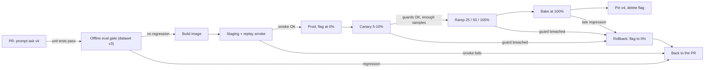
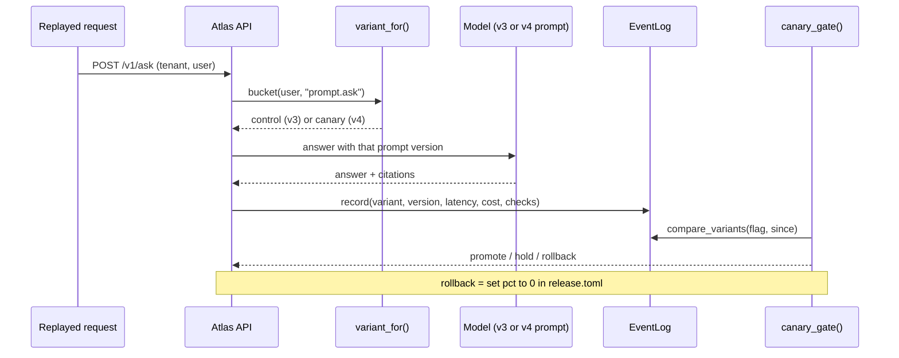
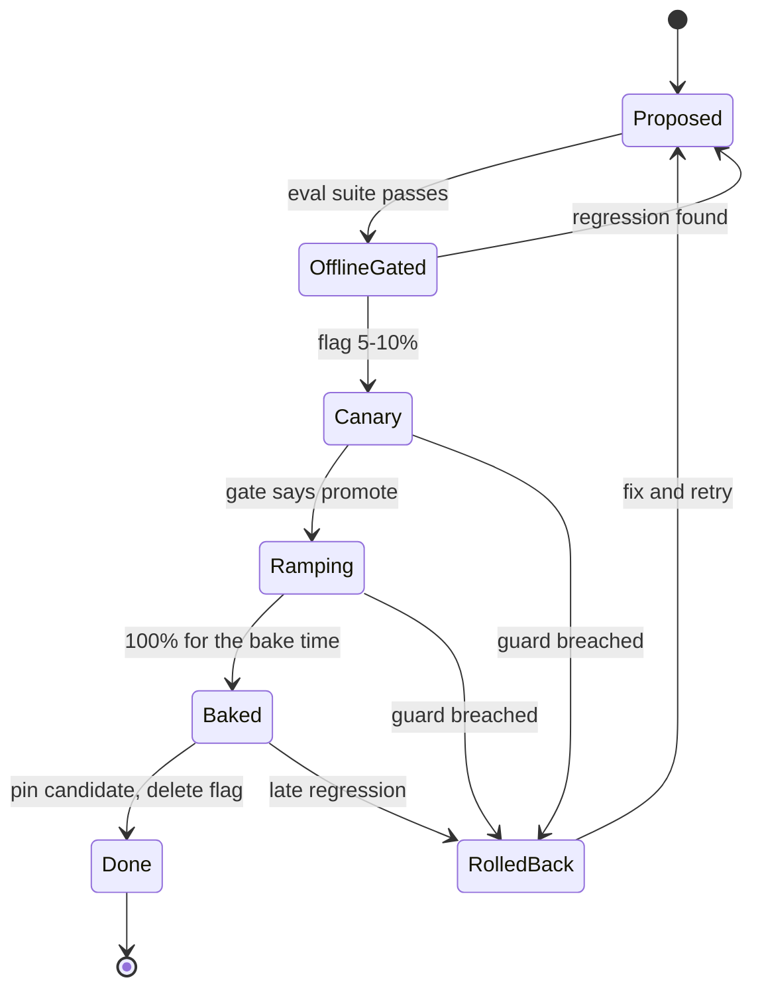

# Shipping Changes Safely

Prompt `ask` v4 ("be concise, cite at most 2 docs") passed the offline gate and shipped to every user at once. Multi-hop answers quietly lost a citation they needed, thumbs-down doubled, and rolling back took a 20-minute redeploy. Prompt and model changes are deploys. Today they get the same safety rails as code: flags, canaries, gates and a rollback you can do in seconds.

## At a Glance

- **Time:** ~2 h core (+ optional Go Deeper) · **Depth:** working
- **Prerequisites:** [Day 21: Prompts as Code & Model Migrations](../../Phase_2_Building_with_LLM_APIs/Day_021_prompts_as_code/prompts_as_code.md), [Day 47: Evals in CI: Regression Gates at Scale](../../Phase_5_Evaluation_and_Observability/Day_047_evals_in_ci/evals_in_ci.md), [Day 86: Monitoring, Online Evals & Feedback Loops](../Day_086_monitoring_feedback/monitoring_feedback.md)
- **You'll build:** a gated release of the `ask` prompt change: `release.toml` + `atlas/flags.py` (sticky bucketing, hot reload, canary metrics, a promote / hold / rollback gate) fed by replayed traffic, plus a `MIGRATION_PLAYBOOK.md` for model swaps
- **Stops at:** experimentation statistics, flag-service products, multi-armed bandits
- **Fast path:** Already run canaries for code? Read §6 (the canary gate) and §9 (the migration playbook), then do Exercise 2 (~40 min)
- **Cost:** $0 with the seeded stub (the default). With `ATLAS_LIVE=1`: ≈ $0.20–0.30 for two replays plus one offline suite on `gpt-6-luna` and `gpt-6.1-terra` (prices as of 2026-11, [verify](https://developers.openai.com/api/docs/pricing))
- **New terms:** release config & feature flags, deterministic bucketing, canary with guard metrics, shadow traffic, migration playbook

> **Coming from Software Engineering?** This is config management, feature flags and canary deploys, applied to prompts and models. The mapping is direct: source files → prompt files, unit tests → eval sets, feature flags → prompt/model experiments, staging → a staging prompt version, CI/CD → an eval gate on every change. Three things are new. The "binary" is probabilistic, so the same input can pass or fail. Regressions show up in quality metrics (citations, judge scores), not in crashes or 500s. And a model swap changes cost, latency and your tokens-per-minute capacity all at once.

## A Prompt Change Is a Deploy

Three things went wrong with v4. Everyone got it at once, so there was no baseline. Nothing crashed; a quality metric drifted for a day. And rollback needed a redeploy, because the prompt version was baked into the image. Software delivery has a fix for each. A **feature flag** (a switch read at runtime that picks a code or config path) fixes rollback. A **canary** (a small slice of real traffic gets the new version first) gives you a baseline and limits the blast radius. **Guard metrics** with a gate turn "looks a bit worse" into a decision.

## Test Kitchen, One Table, Whole Room

Think of a restaurant's new recipe: test kitchen (offline evals), one table (canary), sometimes a secret staff tasting (shadow traffic), then the whole room, old recipe card at hand (rollback).

A worked example by hand. Atlas serves 200 requests in an hour with a 10% canary, so about 20 go to v4 and 180 stay on v3. Citations are complete on 17 of the 20 canary answers (85%) and on 171 of the 180 control answers (95%). Is v4 ten points worse?

Maybe. One unlucky question moves a 20-request canary by 5 points. The rule of thumb: **don't decide on fewer than about 50 canary requests per guard metric**, and treat "hold, collect more" as a valid outcome. The first Go Deeper block shows the maths behind that rule.

## How a Company Ships a Change

This is the whole pipeline for a prompt or model change. Each arrow is a gate, and every stage has a way back.



You already own the left half: mocked unit tests ([Day 19](../../Phase_2_Building_with_LLM_APIs/Day_019_testing_llm_code/testing_llm_code.md)), the offline gate on dataset v3 ([Day 47](../../Phase_5_Evaluation_and_Observability/Day_047_evals_in_ci/evals_in_ci.md), [Day 86](../Day_086_monitoring_feedback/monitoring_feedback.md)) and the image ([Day 82](../Day_082_containerize_deploy/containerize_deploy.md)). Today adds the right half: shipping dark at 0%, the canary, the ramp, the **bake time** (how long a stage runs before you move on) and the clean-up. Offline evals only cover the questions you wrote down; canaries catch real traffic's new phrasings.

## Flags in 20 Lines

A release config is a small, version-controlled file naming the live prompt and model versions and the running canaries. Changing it is a reviewed one-line PR; the app re-reads it at runtime.

```toml
# file: release.toml
[prompts]
ask = "v3"                 # what everyone runs (the pin)

[models]
ask = "gpt-6-luna"

[[canaries]]
flag = "prompt.ask"        # "<prompt|model>.<name>"
control = "v3"             # must equal the pin above
candidate = "v4"
pct = 10                   # share of units that get the candidate
unit = "user"              # bucket by user: sticky for a whole chat
```

**Deterministic bucketing** means hashing a stable id into a number from 0 to 99. The same user always lands in the same bucket, on every process and every machine. If the bucket is below `pct`, that user gets the candidate.

```python
# script_id: day_087_shipping_changes_safely/first_flag
# Sticky bucketing + a TOML release config. Stdlib only (Python 3.11+ for tomllib).
import hashlib
import tomllib

release = tomllib.loads(
    '[prompts]\nask = "v3"\n'
    '[[canaries]]\nflag = "prompt.ask"\ncontrol = "v3"\ncandidate = "v4"\npct = 10\n'
)


def bucket(unit_id: str, flag: str) -> int:
    digest = hashlib.sha256(f"{flag}:{unit_id}".encode()).hexdigest()
    return int(digest[:8], 16) % 100          # 0-99, identical in every process


canary = release["canaries"][0]
for user in ["acme-u1", "acme-u3", "zephyr-u1", "zephyr-u9", "demo-u2", "orbit-maintainers-u2"]:
    b = bucket(user, canary["flag"])
    version = canary["candidate"] if b < canary["pct"] else canary["control"]
    print(f"{user:22} bucket={b:2}  ask -> {version}")
```

```text
acme-u1                bucket=60  ask -> v3
acme-u3                bucket= 4  ask -> v4
zephyr-u1              bucket=44  ask -> v3
zephyr-u9              bucket= 8  ask -> v4
demo-u2                bucket=49  ask -> v3
orbit-maintainers-u2   bucket=27  ask -> v3
```

The flag name goes into the hash, so each experiment picks a different 10% of users. And `pct` is a threshold, so ramping from 10 to 25 keeps everyone who already had v4: nobody flips back mid-rollout.

## Break It: Bucketing Mistakes

Three bucketing mistakes show up in almost every first flag system. This script prints each.

```python
# script_id: day_087_shipping_changes_safely/bucketing_mistakes
# Three ways to break bucketing, printed as tables. Stdlib only.
import hashlib
import random
import subprocess
import sys


def bucket(unit_id: str, flag: str = "") -> int:
    return int(hashlib.sha256(f"{flag}:{unit_id}".encode()).hexdigest()[:8], 16) % 100


# 1. Random per request: one user's chat flips between prompts mid-conversation.
rng = random.Random(7)
print("1. random per request, acme-u1's 6 turns:",
      ["v4" if rng.random() < 0.5 else "v3" for _ in range(6)])

# 2. Bucket by tenant: at 10% you get all of one tenant or none of it.
mix = {"acme": 0.40, "zephyr": 0.25, "demo": 0.20, "orbit-maintainers": 0.15}
for pct in (10, 30):
    inside = [t for t in mix if bucket(t, "prompt.ask") < pct]
    share = sum(mix[t] for t in inside)
    print(f"2. by tenant at {pct}%: canary = {inside}, real traffic share = {share:.0%}")

# 3. Same hash for every flag: the same users land in every experiment.
users = [f"u{i}" for i in range(10_000)]
a = {u for u in users if bucket(u) < 10}
b_same = {u for u in users if bucket(u) < 10}
b_salted = {u for u in users if bucket(u, "model.investigate") < 10}
print(f"3. overlap with an unsalted second flag: {len(a & b_same) / len(a):.0%}, "
      f"salted: {len(a & b_salted) / len(a):.0%}")

# Bonus: built-in hash() is randomized per process (PYTHONHASHSEED), so it is not sticky.
for _ in range(2):
    out = subprocess.run([sys.executable, "-c", "print(hash('acme-u1') % 100)"],
                         capture_output=True, text=True).stdout.strip()
    print("hash('acme-u1') % 100 in a fresh process:", out)
```

```text
1. random per request, acme-u1's 6 turns: ['v4', 'v4', 'v3', 'v4', 'v3', 'v4']
2. by tenant at 10%: canary = ['orbit-maintainers'], real traffic share = 15%
2. by tenant at 30%: canary = ['acme', 'demo', 'orbit-maintainers'], real traffic share = 75%
3. overlap with an unsalted second flag: 100%, salted: 9%
hash('acme-u1') % 100 in a fresh process: 26
hash('acme-u1') % 100 in a fresh process: 73
```

The `hash()` lines differ on every run (your numbers will differ), which is exactly the bug.

Choosing the **unit** is the real decision:

| Unit | Sticky for | Use when | Watch out for |
|---|---|---|---|
| `user` (default) | a whole chat | chat routes, anything with history | anonymous traffic has no user id |
| `tenant` | a whole company | a tenant asked to opt in, or contract-bound behaviour | one big tenant swamps the canary |
| `request` | nothing | stateless single-shot routes (`/v1/triage`) | same user sees both versions |

## Canary on Replayed Traffic

Now the realistic version. The staging API reads the flag on every request, records which variant served it, and the gate compares the two variants. Traffic comes from [Day 86](../Day_086_monitoring_feedback/monitoring_feedback.md)'s replay of `eval/qa_gold.jsonl`. Replay gives you gold citations, so you can measure **citation rate** (did the answer cite every doc it needed?), which live traffic can't give you.



The module is long, so it comes in blocks under one `script_id`. Outputs come from the seeded stub; with `ATLAS_LIVE=1` your numbers will differ. Block 1 is the config: Pydantic models that reject a bad file, and a loader.

```python
# script_id: day_087_shipping_changes_safely/atlas_release
# atlas/flags.py plus compact stand-ins for Days 21, 83 and 86, so this file runs on its own.
# Install: uv add "pydantic>=2"    Env: ORBIT_DATA (default datasets/orbit)
# Default: a seeded stub model, no key needed. ATLAS_LIVE=1 uses live_answer.py + OPENAI_API_KEY.
from __future__ import annotations

import hashlib
import importlib
import json
import math
import os
import random
import time
import tomllib
import uuid
from dataclasses import dataclass, field
from pathlib import Path
from typing import Callable, Literal

from pydantic import BaseModel, Field, model_validator

DATA_DIR = Path(os.environ.get("ORBIT_DATA", "datasets/orbit"))


class Canary(BaseModel):
    flag: str                                # "<prompt|model>.<name>", e.g. "prompt.ask"
    control: str
    candidate: str
    pct: int = Field(ge=0, le=100)
    unit: Literal["tenant", "user", "request"] = "user"


class ReleaseConfig(BaseModel):
    prompts: dict[str, str]
    models: dict[str, str]
    canaries: list[Canary] = Field(default_factory=list)

    @model_validator(mode="after")
    def control_is_the_pin(self) -> ReleaseConfig:
        for c in self.canaries:              # a canary compares against what everyone else runs
            kind, name = c.flag.split(".", 1)
            pinned = {"prompt": self.prompts, "model": self.models}.get(kind, {}).get(name)
            if pinned != c.control:
                raise ValueError(f"{c.flag}: control {c.control!r} is not the pinned {pinned!r}")
        return self


def load_release(path: Path = Path("release.toml")) -> ReleaseConfig:
    with path.open("rb") as f:               # tomllib only reads binary files
        return ReleaseConfig.model_validate(tomllib.load(f))
```

Block 2 adds hot reload. The app re-reads the file when its bytes change, so a flag flip takes effect within seconds, with no redeploy. If an edit is broken, the watcher keeps serving the last good config and records the error for an alert.

```python
# script_id: day_087_shipping_changes_safely/atlas_release
class ReleaseWatcher:
    """Re-reads release.toml when its bytes change; a bad edit keeps the last good config."""

    def __init__(self, path: Path, min_interval_s: float = 2.0) -> None:
        self.path, self.min_interval_s = path, min_interval_s
        self.cfg = load_release(path)        # fail fast at boot: there is no last-good yet
        self._digest = hashlib.sha256(path.read_bytes()).hexdigest()
        self._checked = time.monotonic()
        self.last_error: str | None = None

    def get(self) -> ReleaseConfig:
        if time.monotonic() - self._checked < self.min_interval_s:
            return self.cfg                  # cheap path for most requests
        self._checked = time.monotonic()
        raw = self.path.read_bytes()
        digest = hashlib.sha256(raw).hexdigest()
        if digest != self._digest:
            try:
                self.cfg = ReleaseConfig.model_validate(tomllib.loads(raw.decode()))
                self._digest, self.last_error = digest, None
            except ValueError as e:          # TOMLDecodeError and ValidationError are ValueErrors
                self.last_error = f"{type(e).__name__}: {e}".splitlines()[0]
        return self.cfg


# Compact Day 21 registry: in Atlas, load_prompt() reads versioned files under atlas/prompts/.
PROMPTS = {
    ("ask", "v3"): "Answer from the Orbit docs. Cite every doc you used by its slug.",
    ("ask", "v4"): "Be concise. Answer from the Orbit docs and cite at most 2 docs by slug.",
}


def load_prompt(name: str, version: str) -> str:
    if (name, version) not in PROMPTS:
        raise KeyError(f"prompt {name}@{version} is not in the registry")
    return PROMPTS[(name, version)]
```

Block 3 is the flag logic from the 20-line version, now typed and generic over prompts and models. `resolve()` returns the version to use and which variant the caller is in.

```python
# script_id: day_087_shipping_changes_safely/atlas_release
@dataclass(frozen=True)
class Principal:                             # compact Day 83 Principal
    tenant_id: str
    key_id: str
    plan: Literal["demo", "free", "team"] = "team"
    scopes: frozenset[str] = frozenset({"ask"})


def bucket(unit_id: str, flag: str) -> int:
    """0-99, stable across processes and machines (built-in hash() is not)."""
    return int(hashlib.sha256(f"{flag}:{unit_id}".encode()).hexdigest()[:8], 16) % 100


def variant_for(p: Principal, canary: Canary, *,
                user_id: str | None = None) -> Literal["control", "canary"]:
    unit_id = {"tenant": p.tenant_id, "user": user_id or p.key_id,
               "request": uuid.uuid4().hex}[canary.unit]
    return "canary" if bucket(unit_id, canary.flag) < canary.pct else "control"


def resolve(kind: Literal["prompt", "model"], name: str, p: Principal, cfg: ReleaseConfig,
            *, user_id: str | None = None) -> tuple[str, str]:
    for c in cfg.canaries:
        if c.flag == f"{kind}.{name}":
            v = variant_for(p, c, user_id=user_id)
            return (c.candidate if v == "canary" else c.control), v
    return {"prompt": cfg.prompts, "model": cfg.models}[kind][name], "control"


def resolve_prompt(name: str, p: Principal, cfg: ReleaseConfig, *,
                   user_id: str | None = None) -> tuple[str, str]:
    return resolve("prompt", name, p, cfg, user_id=user_id)
```

Block 4 is the request path. Every request records its variant, prompt version and model in the event log, which is the one field Day 86's `RequestEvent` didn't need. The stub model is seeded so that v4's "cite at most 2" drops citations on multi-hop questions, the same way the real incident did. `make_answer_fn()` is the seam: swap in the live model with one env var.

```python
# script_id: day_087_shipping_changes_safely/atlas_release
# $ per 1M tokens (input, output), as of 2026-11-06; verify at https://developers.openai.com/api/docs/pricing
PRICES = {"gpt-6-luna": (0.10, 0.50), "gpt-6.1-terra": (1.00, 5.00)}
DOC_SLUGS = {p.stem for p in (DATA_DIR / "docs").glob("*.md")}
GOLD = {c["question"]: c for c in map(json.loads, (DATA_DIR / "eval/qa_gold.jsonl").open())}
_rng = random.Random(87)


def retrieve(question: str) -> str:
    """Stand-in for Day 28 retrieval: the gold docs, so the canary measures the prompt only."""
    slugs = GOLD.get(question, {}).get("citations", [])
    return "\n\n".join(f"[{s}]\n{(DATA_DIR / 'docs' / f'{s}.md').read_text()[:3000]}" for s in slugs)


def stub_answer(question: str, prompt_text: str, model: str, context: str) -> dict:
    cites = list(GOLD[question]["citations"]) if question in GOLD else ["faq"]
    concise = "at most 2" in prompt_text
    if concise:
        cites = cites[:2]                    # the bug: 3-doc answers lose one
        if len(cites) == 2 and _rng.random() < 0.3:
            cites = cites[:1]                # "be concise" trims a needed citation
    elif len(cites) > 1 and model == "gpt-6-luna" and _rng.random() < 0.04:
        cites = cites[:-1]                   # v3 is good, not perfect
    if _rng.random() < 0.01:
        raise TimeoutError("stub provider timeout")
    return {"answer": "(stub)", "citations": cites, "input_tokens": 1800,
            "output_tokens": 180 if concise else 320,
            "latency_ms": max(50.0, _rng.gauss(650 if concise else 900, 120))}


def make_answer_fn() -> Callable[[str, str, str, str], dict]:
    if os.environ.get("ATLAS_LIVE") == "1":
        # Imported by name so the stub path never loads the OpenAI client.
        return importlib.import_module("live_answer").live_answer
    return stub_answer
```

The live seam is one small file. It uses `responses.parse` so the citations come back as a typed list, and it raises on a refusal or truncated output so the request counts as an error in the canary stats.

```python
# script_id: day_087_shipping_changes_safely/live_answer
# Real model call, used by atlas_release when ATLAS_LIVE=1.
# Install: uv add openai pydantic    Env: OPENAI_API_KEY
import time

from openai import OpenAI
from pydantic import BaseModel

client = OpenAI()          # created on first import, which only happens with ATLAS_LIVE=1


class CitedAnswer(BaseModel):
    answer: str
    citations: list[str]   # doc slugs, e.g. "configuration-reference"


def live_answer(question: str, prompt_text: str, model: str, context: str) -> dict:
    t0 = time.perf_counter()
    resp = client.responses.parse(
        model=model, instructions=prompt_text,
        input=f"Docs:\n{context}\n\nQuestion: {question}", text_format=CitedAnswer)
    if resp.output_parsed is None:       # refusal or no final text: count it as an error
        raise RuntimeError(f"no parsed answer (status={resp.status})")
    return {"answer": resp.output_parsed.answer, "citations": resp.output_parsed.citations,
            "input_tokens": resp.usage.input_tokens, "output_tokens": resp.usage.output_tokens,
            "latency_ms": (time.perf_counter() - t0) * 1000}
```

```python
# script_id: day_087_shipping_changes_safely/atlas_release
@dataclass
class RequestEvent:                          # compact Day 86 RequestEvent + release fields
    request_id: str
    ts: float
    tenant_id: str
    flag: str
    variant: str
    prompt_version: str
    model: str
    latency_ms: float
    cost_usd: float
    error: bool
    passed: bool                             # online check: cites at least one real doc
    citations_ok: bool | None = None         # replay only: cited every gold doc


class EventLog:                              # in-memory stand-in for Day 86's SQLite EventLog
    def __init__(self) -> None:
        self.events: list[RequestEvent] = []

    def record(self, e: RequestEvent) -> None:
        self.events.append(e)

    def window(self, since: float, **filters: str) -> list[RequestEvent]:
        return [e for e in self.events
                if e.ts >= since and all(getattr(e, k) == v for k, v in filters.items())]
```

```python
# script_id: day_087_shipping_changes_safely/atlas_release
def handle_ask(question: str, p: Principal, cfg: ReleaseConfig, log: EventLog,
               answer_fn: Callable[..., dict], *, user_id: str | None = None) -> dict:
    version, variant = resolve_prompt("ask", p, cfg, user_id=user_id)
    model, t0 = cfg.models["ask"], time.perf_counter()
    try:
        res, err = answer_fn(question, load_prompt("ask", version), model, retrieve(question)), False
    except Exception:                        # a canary that errors must show up, not vanish
        res, err = {"answer": "", "citations": [], "input_tokens": 0, "output_tokens": 0}, True
    cited, gold = set(res["citations"]), GOLD.get(question)
    price_in, price_out = PRICES.get(model, (0.0, 0.0))
    rid = uuid.uuid4().hex[:12]
    log.record(RequestEvent(
        request_id=rid, ts=time.time(), tenant_id=p.tenant_id, flag="prompt.ask",
        variant=variant, prompt_version=version, model=model,
        latency_ms=res.get("latency_ms") or (time.perf_counter() - t0) * 1000,
        cost_usd=(res["input_tokens"] * price_in + res["output_tokens"] * price_out) / 1e6,
        error=err, passed=not err and bool(cited & DOC_SLUGS),
        citations_ok=None if gold is None else set(gold["citations"]) <= cited))
    return {**res, "prompt_version": version, "variant": variant, "request_id": rid}


TENANT_MIX = {"acme": 0.40, "zephyr": 0.25, "demo": 0.20, "orbit-maintainers": 0.15}


def replay_traffic(handler: Callable[[str, Principal, str], dict], n: int = 200,
                   users_per_tenant: int = 40, seed: int = 0) -> int:
    """Compact Day 86 replay: qa_gold questions from simulated users across tenants."""
    rng, questions = random.Random(seed), list(GOLD)
    for _ in range(n):
        tenant = rng.choices(list(TENANT_MIX), weights=list(TENANT_MIX.values()))[0]
        handler(rng.choice(questions), Principal(tenant, key_id=f"key-{tenant}"),
                f"{tenant}-u{rng.randint(1, users_per_tenant)}")
    return n
```

Block 5 turns events into one stats row per variant. These are the **guard metrics**: the numbers that must not get worse for a release to go ahead.

```python
# script_id: day_087_shipping_changes_safely/atlas_release
@dataclass
class VariantStats:
    n: int
    pass_rate: float
    citation_rate: float
    p95_ms: float
    cost_per_request: float
    error_rate: float


def _rate(flags: list[bool]) -> float:
    return sum(flags) / len(flags) if flags else math.nan


def _p95(xs: list[float]) -> float:
    xs = sorted(xs)
    return xs[max(0, math.ceil(0.95 * len(xs)) - 1)] if xs else math.nan


def compare_variants(log: EventLog, flag: str, since: float) -> dict[str, VariantStats]:
    out = {}
    for variant in ("control", "canary"):
        ev = log.window(since, flag=flag, variant=variant)
        out[variant] = VariantStats(
            n=len(ev),
            pass_rate=_rate([e.passed for e in ev]),
            citation_rate=_rate([e.citations_ok for e in ev if e.citations_ok is not None]),
            p95_ms=_p95([e.latency_ms for e in ev if not e.error]),
            cost_per_request=sum(e.cost_usd for e in ev) / len(ev) if ev else math.nan,
            error_rate=_rate([e.error for e in ev]))
    return out
```

Block 6 is the gate. A `Guard` names a metric, how much worse it may get, and how many canary samples it needs before it may decide. Rates compare in absolute points; latency and cost compare relative to control.

```python
# script_id: day_087_shipping_changes_safely/atlas_release
LOWER_IS_BETTER = {"p95_ms", "cost_per_request", "error_rate"}


@dataclass
class Guard:
    metric: str
    max_drop: float          # rates: points (0.05 = 5 pts); p95/cost: relative (0.2 = +20%)
    min_samples: int = 50


@dataclass
class GateDecision:
    action: Literal["promote", "hold", "rollback"]
    reasons: list[str] = field(default_factory=list)

    def __str__(self) -> str:
        return f"{self.action.upper()}: " + "; ".join(self.reasons or ["all guards within limits"])


def canary_gate(stats: dict[str, VariantStats], guards: list[Guard]) -> GateDecision:
    ctl, can = stats["control"], stats["canary"]
    n = min(ctl.n, can.n)                    # at 100% there is no control left to compare with
    breached, waiting = [], []
    for g in guards:
        a, b = getattr(ctl, g.metric), getattr(can, g.metric)
        if g.metric.endswith("_rate"):       # absolute points
            worse = (b - a) if g.metric in LOWER_IS_BETTER else (a - b)
            label = f"{g.metric} {(b - a) * 100:+.1f} pts"
        else:                                # relative change vs control
            worse = (b - a) / a if a else 0.0
            label = f"{g.metric} {worse * 100:+.0f}%"
        if math.isnan(worse) or n < g.min_samples:
            if not math.isnan(worse) and worse > g.max_drop:
                waiting.append(f"{label} (n={n} < {g.min_samples})")
        elif worse > g.max_drop:
            breached.append(f"{label} (limit {g.max_drop:g}, n={n})")
    if breached:
        return GateDecision("rollback", breached)
    if n < max(g.min_samples for g in guards):
        return GateDecision("hold", waiting or [f"not enough samples (n={n})"])
    return GateDecision("promote")
```

Block 7 runs the story: replay 200 requests, gate, replay 1,000 more, gate again.

```python
# script_id: day_087_shipping_changes_safely/atlas_release
GUARDS = [Guard("pass_rate", 0.03), Guard("citation_rate", 0.05), Guard("p95_ms", 0.20),
          Guard("cost_per_request", 0.25), Guard("error_rate", 0.02)]
RELEASE_TOML = """[prompts]
ask = "v3"
[models]
ask = "gpt-6-luna"
[[canaries]]
flag = "prompt.ask"
control = "v3"
candidate = "v4"
pct = 10
unit = "user"
"""


def print_stats(stats: dict[str, VariantStats]) -> None:
    print(f"{'variant':8} {'n':>5} {'pass':>6} {'cites':>6} {'p95 ms':>7} {'$/req':>9} {'errors':>6}")
    for name, s in stats.items():
        print(f"{name:8} {s.n:5} {s.pass_rate:6.1%} {s.citation_rate:6.1%} {s.p95_ms:7.0f} "
              f"{s.cost_per_request:9.6f} {s.error_rate:6.1%}")


if __name__ == "__main__":
    path = Path("demo_release.toml")         # a demo file, so a real release.toml is never clobbered
    path.write_text(RELEASE_TOML)
    watcher, log, answer_fn = ReleaseWatcher(path), EventLog(), make_answer_fn()
    start = time.time()
    for label, n in [("after 200 requests", 200), ("after 1,200 requests", 1000)]:
        replay_traffic(lambda q, p, u: handle_ask(q, p, watcher.get(), log, answer_fn, user_id=u),
                       n=n, seed=len(log.events))
        print(f"--- {label}")
        stats = compare_variants(log, "prompt.ask", since=start)
        print_stats(stats)
        print(canary_gate(stats, GUARDS))
```

```text
--- after 200 requests
variant      n   pass  cites  p95 ms     $/req errors
control    178  99.4%  95.5%    1094  0.000338   0.6%
canary      22  95.5%  63.6%     731  0.000258   4.5%
HOLD: pass_rate -4.0 pts (n=22 < 50); citation_rate -31.9 pts (n=22 < 50); error_rate +4.0 pts (n=22 < 50)
--- after 1,200 requests
variant      n   pass  cites  p95 ms     $/req errors
control   1079  98.7%  96.7%    1103  0.000336   1.3%
canary     121  98.3%  78.5%     817  0.000266   1.7%
ROLLBACK: citation_rate -18.2 pts (limit 0.05, n=121)
```

In the second table v4 is cheaper and faster, and its online pass rate is unchanged, because every answer still cites a real doc. A dashboard of cost, latency and errors would have promoted it. Only the citation guard on replayed gold questions catches the regression, so the guard set must include a quality metric matched to what the change could break.

The same module serves HTTP. This is the [Day 77](../Day_077_fastapi_serving/fastapi_serving.md) app reduced to one route that reads the flag on every request.

```python
# script_id: day_087_shipping_changes_safely/release_api
# The Day 77 app, reduced to one flag-aware route. Needs atlas_release.py beside it.
# Install: uv add fastapi uvicorn httpx (httpx only for TestClient)
# Run: python release_api.py (in-process demo)  or  uvicorn release_api:app --port 8000
from collections.abc import AsyncIterator
from contextlib import asynccontextmanager
from pathlib import Path

from fastapi import FastAPI, Header
from pydantic import BaseModel

from atlas_release import (GOLD, RELEASE_TOML, EventLog, Principal, ReleaseWatcher,
                           handle_ask, make_answer_fn)


class AskRequest(BaseModel):
    question: str


class AskResponse(BaseModel):
    answer: str
    citations: list[str]
    prompt_version: str
    variant: str


def create_app(release_path: Path = Path("release.toml")) -> FastAPI:
    @asynccontextmanager
    async def lifespan(app: FastAPI) -> AsyncIterator[None]:
        app.state.release = ReleaseWatcher(release_path)   # a bad file fails the boot
        app.state.log, app.state.answer_fn = EventLog(), make_answer_fn()
        yield

    app = FastAPI(lifespan=lifespan)

    @app.post("/v1/ask", response_model=AskResponse)
    def ask(req: AskRequest, x_tenant: str = Header(), x_user: str = Header()) -> dict:
        # Stand-in for Day 83's require_principal: never trust tenant headers in production.
        p, s = Principal(tenant_id=x_tenant, key_id=f"key-{x_tenant}"), app.state
        return handle_ask(req.question, p, s.release.get(), s.log, s.answer_fn, user_id=x_user)

    return app


app = create_app()
```

```python
# script_id: day_087_shipping_changes_safely/release_api
if __name__ == "__main__":
    from fastapi.testclient import TestClient

    demo = Path("demo_release.toml")
    demo.write_text(RELEASE_TOML)
    question = next(q for q, c in GOLD.items() if c["id"] == "qa-012")   # needs 3 docs
    with TestClient(create_app(demo)) as http:
        for tenant, user in [("acme", "acme-u1"), ("acme", "acme-u3"), ("zephyr", "zephyr-u9"),
                             ("acme", "acme-u3")]:
            body = http.post("/v1/ask", json={"question": question},
                             headers={"x-tenant": tenant, "x-user": user}).json()
            print(f"{user:10} {body['variant']:8} {body['prompt_version']}  cites={body['citations']}")
```

```text
acme-u1    control  v3  cites=['troubleshooting-memory', 'concepts-workers', 'configuration-reference']
acme-u3    canary   v4  cites=['troubleshooting-memory']
zephyr-u9  canary   v4  cites=['troubleshooting-memory', 'concepts-workers']
acme-u3    canary   v4  cites=['troubleshooting-memory', 'concepts-workers']
```

`acme-u3` gets v4 on both calls: sticky bucketing works through the API, and that user's v4 answer has lost a doc it needed.

## Rollback in Seconds

You want two rollback paths. **Flip the flag**: set `pct = 0` and every replica picks it up on its next reload check, in seconds, with no build. **Redeploy the previous image** ([Day 82](../Day_082_containerize_deploy/containerize_deploy.md)) for a bad *code* change, or when the flag system itself is broken.

Two habits make rollback safe. Keep last-good versions loadable: v3 stays in the registry until v4 has baked. And scope caches by version: [Day 85](../Day_085_caching_cost_scale/caching_cost_scale.md)'s cache key must include the prompt version and model, or v3 users get v4's cached answers after the rollback.

```python
# script_id: day_087_shipping_changes_safely/rollback
# Roll back by flipping the flag (no redeploy), log the decision, and survive a bad edit.
# Needs atlas_release.py beside it. Stdlib + pydantic.
import hashlib
import json
import re
import tempfile
import time
from pathlib import Path

from atlas_release import RELEASE_TOML, EventLog, Principal, ReleaseWatcher, handle_ask, stub_answer


def set_canary_pct(path: Path, pct: int | str) -> None:
    """Demo edit (one canary in the file). In a team: a reviewed PR or Day 88's ops CLI."""
    path.write_text(re.sub(r"(?m)^pct = .*$", f"pct = {pct}", path.read_text(), count=1))


def log_release(log_path: Path, action: str, flag: str, reason: str, actor: str) -> None:
    entry = {"ts": time.strftime("%Y-%m-%dT%H:%M:%SZ", time.gmtime()), "action": action,
             "flag": flag, "reason": reason, "actor": actor}
    with log_path.open("a") as f:            # append-only: the audit trail for every flip
        f.write(json.dumps(entry) + "\n")


def cache_key(tenant_id: str, prompt_version: str, model: str, question: str) -> str:
    """Day 85's cache scope plus release fields, so a rollback never serves v4's answers."""
    raw = f"{tenant_id}|ask|{prompt_version}|{model}|{question.strip().lower()}"
    return hashlib.sha256(raw.encode()).hexdigest()[:12]
```

```python
# script_id: day_087_shipping_changes_safely/rollback
def canary_share(watcher: ReleaseWatcher, n: int = 200) -> float:
    log, p = EventLog(), Principal("acme", "key-acme")
    for i in range(n):
        handle_ask("How long does Orbit keep dead-lettered jobs?", p, watcher.get(), log,
                   stub_answer, user_id=f"acme-u{i}")
    return sum(e.variant == "canary" for e in log.events) / n


if __name__ == "__main__":
    tmp = Path(tempfile.mkdtemp())
    path, release_log = tmp / "release.toml", tmp / "release_log.jsonl"
    path.write_text(RELEASE_TOML)
    watcher = ReleaseWatcher(path, min_interval_s=0)   # check on every request for the demo
    print(f"before:         canary share {canary_share(watcher):.0%}")
    t0 = time.perf_counter()
    set_canary_pct(path, 0)
    log_release(release_log, "rollback", "prompt.ask", "citation_rate guard breached", "oncall")
    print(f"after flip:     canary share {canary_share(watcher):.0%} "
          f"({(time.perf_counter() - t0) * 1000:.0f} ms, no redeploy)")
    set_canary_pct(path, "ten")                       # a fat-fingered hand edit
    print(f"after bad edit: canary share {canary_share(watcher):.0%} | {watcher.last_error}")
    print("release log:", release_log.read_text().strip())
    k3, k4 = (cache_key("acme", v, "gpt-6-luna", "DLQ retention?") for v in ("v3", "v4"))
    print(f"cache keys: v3={k3} v4={k4} (a rollback can't hit v4's entries)")
```

```text
before:         canary share 10%
after flip:     canary share 0% (49 ms, no redeploy)
after bad edit: canary share 0% | TOMLDecodeError: Invalid value (at line 9, column 7)
release log: {"ts": "2026-11-07T04:38:05Z", "action": "rollback", "flag": "prompt.ask", "reason": "citation_rate guard breached", "actor": "oncall"}
cache keys: v3=7e96deac31b9 v4=e235ac306fa3 (a rollback can't hit v4's entries)
```

The bad edit didn't take Atlas down: the watcher kept the last good config (0%) and recorded the error. Alert on `last_error`, and validate `release.toml` in CI.



## Shadow Traffic and A/B Tests

A canary shows the candidate to real users. Two other tools work differently.

**Shadow traffic** means a copy of some requests also goes to the candidate, but users only ever see the control answer. You compare the two answers offline, for example with [Day 45](../../Phase_5_Evaluation_and_Observability/Day_045_llm_as_judge/llm_as_judge.md)'s pairwise judge. It is the safest way to try a risky change on real phrasing. It comes with three costs:

- **Money.** Every shadowed request is paid for twice, up to 2× spend at 100% shadow. Sample 5–10%.
- **Side effects.** The candidate must never label an issue, post a comment or send an email. Shadow runs get read-only tools only, because side effects must never run twice ([Day 54](../../Phase_6_Agents/Day_054_langgraph_durability/langgraph_durability.md), [Day 76](../../Phase_8_Safety_and_Security/Day_076_capstone_r4_triage/capstone_r4_triage.md)).
- **Quotas.** Shadow calls must not count against the tenant's quota ([Day 83](../Day_083_auth_multitenancy_quotas/auth_multitenancy_quotas.md)). Give them their own budget.

Run shadow work in the background ([Day 78](../Day_078_async_jobs/async_jobs.md)).

```python
# script_id: day_087_shipping_changes_safely/shadow_compare
# Shadow traffic: ~10% of requests are also answered by the candidate in the background.
# Install: uv add "rq>=3.0" redis   Env: REDIS_URL (optional; unset = run shadow jobs inline)
# With Redis: run `rq worker shadow --url $REDIS_URL` from this file's folder (it imports
# shadow_compare and atlas_release by name); the jobs run there instead.
import os
import uuid
from collections import Counter

from atlas_release import GOLD, bucket, load_prompt, retrieve, stub_answer

READ_ONLY_TOOLS = {"search_docs", "get_issue"}     # never label_issue, post_comment, ...


def pairwise(question: str, a: list[str], b: list[str]) -> str:
    """Code stand-in for Day 45's compare(): the answer covering more gold docs wins."""
    gold = set(GOLD[question]["citations"])
    sa, sb = len(gold & set(a)), len(gold & set(b))
    return "tie" if sa == sb else ("control" if sa > sb else "candidate")


def shadow_job(question: str, candidate: str, control_cites: list[str], tools: list[str]) -> str:
    if set(tools) - READ_ONLY_TOOLS:
        raise PermissionError(f"shadow runs may not use {sorted(set(tools) - READ_ONLY_TOOLS)}")
    try:
        cand = stub_answer(question, load_prompt("ask", candidate), "gpt-6-luna", retrieve(question))
    except TimeoutError:
        return "error"                              # shadow failures never reach the user
    return pairwise(question, control_cites, cand["citations"])


def get_queue():
    if not os.environ.get("REDIS_URL"):
        return None
    from redis import Redis
    from rq import Queue
    return Queue("shadow", connection=Redis.from_url(os.environ["REDIS_URL"]))
```

```python
# script_id: day_087_shipping_changes_safely/shadow_compare
if __name__ == "__main__":
    queue, tally, shadowed = get_queue(), Counter(), 0
    questions = list(GOLD) * 10                     # 300 requests
    for q in questions:
        try:                                        # the user-facing answer
            control = stub_answer(q, load_prompt("ask", "v3"), "gpt-6-luna", retrieve(q))
        except TimeoutError:
            continue
        if bucket(uuid.uuid4().hex, "shadow.ask") >= 10:
            continue                                # ~90% are never shadowed
        shadowed += 1
        args = (q, "v4", control["citations"], ["search_docs"])
        if queue is not None:
            # By dotted name: RQ refuses functions from __main__, and the worker imports this file.
            queue.enqueue("shadow_compare.shadow_job", *args, job_timeout=60, result_ttl=3600)
        else:
            tally[shadow_job(*args)] += 1
    print(f"shadowed {shadowed}/{len(questions)} requests "
          f"(extra model spend ≈ {shadowed / len(questions):.0%})")
    print("verdicts:", dict(tally) or "enqueued; read results from the worker")
    try:
        shadow_job(questions[0], "v4", [], ["search_docs", "post_comment"])
    except PermissionError as e:
        print("PermissionError:", e)
```

```text
shadowed 23/300 requests (extra model spend ≈ 8%)
verdicts: {'control': 8, 'tie': 15}
PermissionError: shadow runs may not use ['post_comment']
```

Output from the inline path (no `REDIS_URL`); with a worker, verdicts land in each job's result. Sampling uses random ids (your numbers will differ).

An **A/B test** is a controlled comparison of two variants on one success metric, such as thumbs-up rate or task success. It looks like a canary at 50%, but the question differs. A canary asks "is the candidate safe?" and stops early on harm. An A/B test asks "which is better?", so you fix the metric and duration up front, size it with a sample-size calculator, and don't stop the moment the chart looks good ("peeking" inflates false wins). The statistics are past today's stop line.

| | Canary | Shadow | A/B test |
|---|---|---|---|
| Users see the candidate? | yes, a few | no | yes, half |
| Answers | "is it safe?" | "how does it behave on real input?" | "which is better?" |
| Extra cost | none | up to 2× on the sampled share | none |
| Speed | hours to a day | hours | days to weeks |
| Detects | regressions in guards | output differences, crashes, cost | small quality differences |
| Risk | small blast radius | side effects if tools aren't read-only | half the users get the worse one |

Rule of thumb: canary every change, shadow the risky ones (a new model, a new agent loop), and A/B test only to choose between two safe options.

## The Model-Migration Playbook at Scale

[Day 21](../../Phase_2_Building_with_LLM_APIs/Day_021_prompts_as_code/prompts_as_code.md) was the drill: one prompt, one model swap, one eval diff. At scale, a model change touches every route, the judges, the fallbacks and the budget. A **migration playbook** is the written, phase-by-phase procedure with exit criteria, so the next migration doesn't depend on who remembers what.

A real case: OpenAI's deprecations page lists the `gpt-4o` family (and `gpt-4.1`, `gpt-4.1-mini`) as shutting down on 2027-01-14, with `gpt-6-luna` as the replacement (as of 2026-11, [verify](https://developers.openai.com/api/docs/deprecations)). GA models get at least 6 months' notice ([Day 7](../../Phase_1_How_LLMs_Work/Day_007_choosing_a_model/choosing_a_model.md)). A team with that model in twelve places, two judges and a fallback chain must find every use, prove the replacement, check budget and rate limits, then move traffic without an outage.

Today's drill moves the `investigate` route from `gpt-6-luna` to `gpt-6.1-terra` behind a `model.investigate` flag. Step one is the offline gate: run the suite on both models and diff.

```python
# script_id: day_087_shipping_changes_safely/migrate_model_gate
# Offline gate for a model swap: run the suite on control and candidate, diff, write a checklist.
# Needs atlas_release.py beside it. ATLAS_LIVE=1 makes ~60 real calls (see Cost).
# The qa_gold suite stands in for investigate's Day 59 trajectory suite here.
import os
from pathlib import Path

from atlas_release import GOLD, PRICES, _p95, load_prompt, make_answer_fn, retrieve


def run_suite(model: str, answer_fn) -> dict[str, float]:
    rows = [answer_fn(q, load_prompt("ask", "v3"), model, retrieve(q)) for q in GOLD]
    p_in, p_out = PRICES[model]
    return {"citation_rate": sum(set(c["citations"]) <= set(r["citations"])
                                 for c, r in zip(GOLD.values(), rows)) / len(rows),
            "p95_ms": _p95([r.get("latency_ms", 0.0) for r in rows]),
            "cost_per_request": sum(r["input_tokens"] * p_in + r["output_tokens"] * p_out
                                    for r in rows) / len(rows) / 1e6,
            "tokens_per_request": sum(r["input_tokens"] + r["output_tokens"] for r in rows) / len(rows)}


if __name__ == "__main__":
    fn = make_answer_fn()
    base, cand = run_suite("gpt-6-luna", fn), run_suite("gpt-6.1-terra", fn)
    print(f"{'metric':20} {'luna':>10} {'terra':>10}")
    for k in base:
        print(f"{k:20} {base[k]:10.4g} {cand[k]:10.4g}")
    peak_rpm = int(os.environ.get("ATLAS_PEAK_RPM", "120"))          # your traffic, not a fact
    tpm_limit = int(os.environ.get("ATLAS_TPM_LIMIT", "2000000"))    # read yours from Day 84
    tpm = cand["tokens_per_request"] * peak_rpm
    checks = {"offline evals: no citation drop": cand["citation_rate"] >= base["citation_rate"],
              f"capacity: {tpm:,.0f} TPM at peak <= 70% of limit": tpm <= 0.7 * tpm_limit,
              f"budget: ${cand['cost_per_request']:.4f}/request signed off": False}  # a human ticks this
    Path("migration_checklist.md").write_text(
        "\n".join(f"- [{'x' if ok else ' '}] {name}" for name, ok in checks.items()) + "\n")
    print(Path("migration_checklist.md").read_text())
```

```text
metric                     luna      terra
citation_rate            0.9667          1
p95_ms                     1191       1045
cost_per_request        0.00034     0.0034
tokens_per_request         2120       2120
- [x] offline evals: no citation drop
- [x] capacity: 254,400 TPM at peak <= 70% of limit
- [ ] budget: $0.0034/request signed off
```

Terra cites better and costs about ten times more per request. A person decides that trade-off with the number in front of them, so the budget box stays unticked.

The playbook itself is a file in the repo. Copy this template and fill it in per migration:

```markdown
<!-- file: MIGRATION_PLAYBOOK.md -->
# Model migration: <route(s)> <old model> -> <new model>
Owner: <name> · Deadline: <provider shutdown date> · Flag: model.<route>

## 1. Inventory (exit: every use listed)
- [ ] grep for ATLAS_*MODEL, hard-coded IDs, judges, fallbacks, routers
- [ ] embeddings listed separately (index migrations: Day 88)

## 2. Offline evals (exit: no guard regression on dataset v3)
- [ ] suite run on old vs new; diff table attached
- [ ] judge model changing? re-validate against human labels (Day 46)

## 3. Prompt adjustments (exit: re-run 2 passes)
## 4. Capacity and cost (exit: TPM at peak <= 70% of limit; $/request signed off)
- [ ] limiter and fallbacks updated (Day 84); load test (Day 90)

## 5. Shadow (exit: no side effects; verdicts reviewed)
## 6. Canary -> ramp -> bake (exit: gate promotes at every stage; bake >= 1 business day)
## 7. Clean up (exit: old ID gone from code, config, judges, fallbacks)
- [ ] release log entry; flag deleted; old prompt versions archived
```

## Trade-offs and When Not to Use It

| Choice | Fast | Covers | Cost | Use when |
|---|---|---|---|---|
| Flag flip | seconds | prompt/model/config changes | none | any change behind a flag |
| Redeploy previous image | minutes | code, dependencies, the flag system itself | build + deploy | the change wasn't behind a flag |
| Canary | hours | regressions on real traffic | none | every prompt or model change |
| Shadow | hours | behaviour on real input, without user exposure | up to 2× on the sample | risky changes, new models |
| A/B test | days+ | small quality differences | none | choosing between two safe options |

Skip all this for a single-user prompt.

### In production

- **Flag hygiene.** Every flag gets an owner and a removal date; delete it after the bake.
- **Audit every flip.** The release log (who, what, why, when) is the first thing you read in an incident.
- **CI checks the config.** Parse `release.toml` and confirm every referenced prompt version exists in the registry and every model ID is current (Day 88 scans deprecations).
- **Per-tenant opt-outs.** Some contracts say "no experiments". Add an exclusion list checked before bucketing.
- **Flag services.** Hosted flag products and the OpenFeature standard add UIs and SDKs (⚠ verify before choosing); the gate logic stays yours.

### Commit it to R5

| Block | R5 path |
|---|---|
| `atlas_release` (config, watcher, bucketing, stats, gate) | `atlas/flags.py` (stand-ins → their owner modules) |
| `release_api` route | `atlas/api/app.py` (Day 77's `create_app` reads the flag) |
| `rollback` helpers | `atlas/flags.py` (`log_release`) + cache key in `atlas/cache.py` |
| `release.toml`, `MIGRATION_PLAYBOOK.md` | repo root |

## Go Deeper (optional)

<details><summary>Go deeper: under the hood, is 17/20 vs 171/180 a real drop?</summary>

**Words first.** If v3 and v4 were equally good, how often would random luck alone give a 20-request canary a 10-point lower score? If that happens often, the drop isn't evidence yet.

**Toy numbers.** Pool both groups: 188 of 200 passed, so 94%. With a true 94% rate, a 20-request sample has a standard error of about 5 points. A 10-point gap is only about two of those, which luck produces fairly often. At 100 canary requests the same gap is about four standard errors, which luck almost never produces.

**Formula.** The two-proportion z-test: `z = (p1 - p2) / sqrt(p * (1 - p) * (1/n1 + 1/n2))`, where `p` is the pooled rate. The two-sided p-value is the chance of a gap at least this large if the variants were equal.

```python
# script_id: day_087_shipping_changes_safely/two_proportion_z
# Two-proportion z-test on canary vs control pass counts. Stdlib only.
import math


def two_proportion_z(x1: int, n1: int, x2: int, n2: int) -> tuple[float, float]:
    p = (x1 + x2) / (n1 + n2)                          # pooled rate under "no difference"
    se = math.sqrt(p * (1 - p) * (1 / n1 + 1 / n2))
    z = (x1 / n1 - x2 / n2) / se
    return z, math.erfc(abs(z) / math.sqrt(2))       # two-sided p-value


for x1, n1, x2, n2 in [(17, 20, 171, 180), (85, 100, 855, 900)]:
    z, p = two_proportion_z(x1, n1, x2, n2)
    print(f"canary {x1}/{n1} vs control {x2}/{n2}: z = {z:+.2f}, p = {p:.4f}")
```

```text
canary 17/20 vs control 171/180: z = -1.79, p = 0.0740
canary 85/100 vs control 855/900: z = -3.99, p = 0.0001
```

At n = 20 the p-value is about 0.07: suggestive, not conclusive. And the normal approximation is shaky when fewer than about 5 failures are expected. At n = 100 it is decisive. That is where the `min_samples = 50` rule of thumb comes from: below it, small-sample noise and real regressions look alike. Real experimentation platforms add corrections for many metrics and for repeated looks. That is past today's stop line.

</details>

<details><summary>Go deeper: ramp schedules, bake time and what experts also do</summary>

**Ramp schedules.** A common shape is 1–5% → 25% → 50% → 100%. The first stage catches crashes and gross regressions; later stages catch rarer slices. Each step needs enough samples for the gate, so low-traffic routes move more slowly. That is a reason to replay traffic on staging first.

**Bake time.** Hold each stage long enough to cover the traffic cycle that matters: at least a few hours, and a full business day before 100% if usage differs by time zone. Atlas's tenants are in different regions, so a 2 a.m. canary only sees one of them.

**Compare like with like.** If the canary happens to get more `demo` traffic (short questions) than control, it looks better than it is. Slice the stats by tenant and route, and check the canary/control mix matches. Bucketing by user, not tenant, usually keeps the mix balanced.

**Automatic rollback.** Once you trust the gate, let it act: a `rollback` decision sets `pct = 0` and pages the owner. Keep `promote` manual until the gate has a track record.

**Multi-armed bandits** shift traffic toward the better variant as evidence comes in. They suit many cheap variants (ad copy) more than safety-critical prompt changes, and are past today's stop line.

**Further reading:** Martin Fowler's [Feature Toggles (aka Feature Flags)](https://martinfowler.com/articles/feature-toggles.html) sorts flags into release, experiment and ops toggles. The Google SRE Workbook chapter [Canarying Releases](https://sre.google/workbook/canarying-releases/) covers canary sizing, duration and metric choice.

</details>

## Common Pitfalls

- **Users flip variants between processes.** `hash(user_id)` is randomized per process (`PYTHONHASHSEED`). Fix: `hashlib.sha256`, as in `bucket()`.
- **Promoting on 20 requests.** Fix: `min_samples` on every guard; `hold` is a normal outcome.
- **Canary and control see different traffic.** Tenant bucketing compared Acme's questions with everyone else's. Fix: bucket by user and slice stats by tenant and route.
- **Shadow calls post comments or burn quota.** Fix: read-only tools only (the `PermissionError` above), a separate quota bucket, sampling.
- **The migration inflated its own scores.** The judge changed with the answer model and was more lenient. Fix: keep the old judge, or re-validate the new one against human labels ([Day 46](../../Phase_5_Evaluation_and_Observability/Day_046_judge_validation/judge_validation.md)).
- **A hand edit stops every request:** `tomllib.TOMLDecodeError: Invalid value (at line 9, column 7)`. Fix: validate `release.toml` in CI and keep the last good config (`ReleaseWatcher`). And open it in binary mode, or you get ``TypeError: File must be opened in binary mode, e.g. use `open('foo.toml', 'rb')` ``.

> **Where we stop:** we don't cover experimentation statistics, flag-service products or multi-armed bandits. They matter when you run many experiments at once; the Go Deeper section names where to read further, and [Day 88](../Day_088_operating_ai_systems/operating_ai_systems.md) adds kill switches and index migrations.

## Key Takeaways

- A prompt or model change is a deploy: give it a flag, a canary, a gate and a rollback, because its regressions show up as quality drift, not crashes.
- Deterministic bucketing (`sha256(flag:unit) % 100 < pct`) keeps each user on one variant for the whole rollout; `hash()`, per-request randomness and tenant-level buckets each break that.
- A canary gate compares control and canary on guard metrics, including a quality metric matched to the change, and waits for `min_samples` before it may promote or roll back.
- Flipping `pct` to 0 in a hot-reloaded release config rolls back in seconds; keep the old version loadable, scope caches by version, and log every flip.
- Shadow traffic and A/B tests answer different questions from a canary; a model migration at scale follows a playbook with exit criteria from inventory to clean-up.

## Quick Reference

| API / pattern | When to use | Gotcha |
|---|---|---|
| `release.toml` + `tomllib.load(f)` | pin prompt/model versions, declare canaries | open in `"rb"`; validate in CI |
| `bucket(unit_id, flag)` | sticky assignment, 0–99 | include the flag name; never `hash()` |
| `Canary(unit="user")` | chat routes | `tenant` swamps the canary; `request` isn't sticky |
| `ReleaseWatcher.get()` | hot reload without redeploy | keep last good on parse errors; alert on `last_error` |
| `compare_variants(log, flag, since)` | per-variant guard metrics | replay gives citation rate; live traffic doesn't |
| `canary_gate(stats, guards)` | promote / hold / rollback | rates in points, latency/cost relative |
| Shadow via RQ | risky changes, no user exposure | read-only tools, separate quota, ≤10% sample |
| `MIGRATION_PLAYBOOK.md` | provider deprecations, model upgrades | re-validate judges if the judge model changes |

## Exercises

1. **Warm-up.** Add a maintainer-only preview route that forces a variant with an `x-atlas-variant` header, so maintainers can try the canary by hand. Forced requests must not pollute the canary metrics.

<details><summary>Solution</summary>

```python
# script_id: day_087_shipping_changes_safely/solution_ex1
# Run: python solution_ex1.py   (needs atlas_release.py and release_api.py beside it)
from pathlib import Path

from fastapi import Header, HTTPException
from fastapi.testclient import TestClient

from atlas_release import RELEASE_TOML, EventLog, Principal, ReleaseConfig, handle_ask
from release_api import AskRequest, AskResponse, create_app


def forced(cfg: ReleaseConfig, flag: str, variant: str) -> ReleaseConfig:
    pct = 100 if variant == "canary" else 0
    canaries = [c.model_copy(update={"pct": pct}) if c.flag == flag else c for c in cfg.canaries]
    return cfg.model_copy(update={"canaries": canaries})


demo = Path("demo_release.toml")
demo.write_text(RELEASE_TOML)
app, preview_log = create_app(demo), EventLog()        # separate log: never in canary stats


@app.post("/v1/ask/preview", response_model=AskResponse)
def preview(req: AskRequest, x_tenant: str = Header(), x_atlas_variant: str = Header()) -> dict:
    if x_tenant != "orbit-maintainers" or x_atlas_variant not in {"control", "canary"}:
        raise HTTPException(403, "preview is for maintainers, variant control|canary")
    cfg = forced(app.state.release.get(), "prompt.ask", x_atlas_variant)
    return handle_ask(req.question, Principal(x_tenant, "key-maint"), cfg, preview_log,
                      app.state.answer_fn, user_id="preview")


if __name__ == "__main__":
    with TestClient(app) as http:
        for v in ("control", "canary"):
            r = http.post("/v1/ask/preview", json={"question": "What prefetch value is safe on Orbit 3.2.x?"},
                          headers={"x-tenant": "orbit-maintainers", "x-atlas-variant": v})
            print(v, r.status_code, r.json()["prompt_version"])
        print(http.post("/v1/ask/preview", json={"question": "hi"},
                        headers={"x-tenant": "acme", "x-atlas-variant": "canary"}).status_code)
```

```text
control 200 v3
canary 200 v4
403
```

</details>

2. **Core.** Write the guard set for a *model* change and run it on the luna → terra drill. A model swap moves more metrics than a prompt change: add a TPM-headroom guard and an absolute $/request budget instead of a relative cost guard. Then note in two lines which playbook steps change if the model being replaced is `EMBED_MODEL`.

<details><summary>Solution</summary>

```python
# script_id: day_087_shipping_changes_safely/solution_ex2
# Run: python solution_ex2.py   (needs atlas_release.py and migrate_model_gate.py beside it)
from atlas_release import GateDecision, make_answer_fn
from migrate_model_gate import run_suite


def model_gate(base: dict, cand: dict, *, max_cost: float, peak_rpm: int,
               tpm_limit: int, max_cite_drop: float = 0.0) -> GateDecision:
    reasons = []
    if base["citation_rate"] - cand["citation_rate"] > max_cite_drop:
        reasons.append(f"citation_rate {(cand['citation_rate'] - base['citation_rate']) * 100:+.1f} pts")
    if cand["p95_ms"] > 1.2 * base["p95_ms"]:
        reasons.append(f"p95 {cand['p95_ms']:.0f} ms > 120% of {base['p95_ms']:.0f} ms")
    if cand["cost_per_request"] > max_cost:          # absolute budget: a model swap may cost 10x
        reasons.append(f"${cand['cost_per_request']:.4f}/request > budget ${max_cost:.4f}")
    tpm = cand["tokens_per_request"] * peak_rpm
    if tpm > 0.7 * tpm_limit:                       # keep 30% headroom for retries and bursts
        reasons.append(f"{tpm:,.0f} TPM > 70% of {tpm_limit:,}")
    return GateDecision("rollback" if reasons else "promote", reasons)


fn = make_answer_fn()
base, cand = run_suite("gpt-6-luna", fn), run_suite("gpt-6.1-terra", fn)
print(model_gate(base, cand, max_cost=0.005, peak_rpm=120, tpm_limit=2_000_000))
print(model_gate(base, cand, max_cost=0.002, peak_rpm=700, tpm_limit=2_000_000))
```

```text
PROMOTE: all guards within limits
ROLLBACK: $0.0034/request > budget $0.0020; 1,484,000 TPM > 70% of 2,000,000
```

For `EMBED_MODEL`, steps 1, 4 and 7 stay the same, but steps 2 and 5–6 change shape: you can't canary a query embedding against an index built with another model, so Day 88's dual-write, backfill, parity check and cutover replace the per-request canary, and the offline gate is retrieval recall (Day 29), not answer quality.

</details>

3. **Core.** Automate progressive delivery: ramp `pct` through 5 → 25 → 50 → 100, replaying a fixed number of requests per stage as the bake, and stop at the first `rollback`. A `hold` extends the bake once.

<details><summary>Solution</summary>

```python
# script_id: day_087_shipping_changes_safely/solution_ex3
# Run: python solution_ex3.py   (needs atlas_release.py and rollback.py beside it)
import time
from pathlib import Path

from atlas_release import (GUARDS, RELEASE_TOML, EventLog, ReleaseWatcher, canary_gate,
                           compare_variants, handle_ask, make_answer_fn, replay_traffic)
from rollback import set_canary_pct


def ramp(path: Path, stages=(5, 25, 50, 100), bake_requests: int = 600) -> str:
    watcher, fn = ReleaseWatcher(path, min_interval_s=0), make_answer_fn()
    for pct in stages:
        set_canary_pct(path, pct)
        log, since = EventLog(), time.time()          # fresh window per stage
        for attempt in range(2):                      # second pass = extended bake on HOLD
            replay_traffic(lambda q, p, u: handle_ask(q, p, watcher.get(), log, fn, user_id=u),
                           n=bake_requests, seed=pct * 10 + attempt)
            decision = canary_gate(compare_variants(log, "prompt.ask", since), GUARDS)
            if decision.action != "hold":
                break
        print(f"{pct:3}% -> {decision}")
        if decision.action != "promote":
            set_canary_pct(path, 0)                   # stop and roll back on rollback or a second hold
            return f"stopped at {pct}%"
    return "ramped to 100%: bake, then pin the candidate and delete the flag"


demo = Path("demo_release.toml")
demo.write_text(RELEASE_TOML)
print(ramp(demo))
```

```text
  5% -> ROLLBACK: citation_rate -18.0 pts (limit 0.05, n=61)
stopped at 5%
```

At 100% there is no control group left, so the gate holds; in practice teams stop the automated ramp at 50% and bake 100% with the online alerts from Day 86 instead. With v4's citation bug the ramp stops at 5%, as soon as the canary has enough samples.

</details>

4. **Stretch (past the stop line, uses Go Deeper).** Put a 95% bootstrap confidence interval on the canary-minus-control citation rate from the `atlas_release` replay. Does the interval exclude zero at 200 requests? At 1,200?

<details><summary>Solution</summary>

```python
# script_id: day_087_shipping_changes_safely/solution_ex4
# Run: python solution_ex4.py   (needs atlas_release.py beside it)
import random
import time
from pathlib import Path

from atlas_release import RELEASE_TOML, EventLog, ReleaseWatcher, handle_ask, replay_traffic, stub_answer


def bootstrap_diff(a: list[bool], b: list[bool], iters: int = 2000, seed: int = 0) -> tuple[float, float]:
    rng, diffs = random.Random(seed), []
    for _ in range(iters):                            # resample each group with replacement
        ra = [rng.choice(a) for _ in a]
        rb = [rng.choice(b) for _ in b]
        diffs.append(sum(rb) / len(rb) - sum(ra) / len(ra))
    diffs.sort()
    return diffs[int(0.025 * iters)], diffs[int(0.975 * iters)]


demo = Path("demo_release.toml")
demo.write_text(RELEASE_TOML)
watcher, log, start = ReleaseWatcher(demo), EventLog(), time.time()
for n in (200, 1000):
    replay_traffic(lambda q, p, u: handle_ask(q, p, watcher.get(), log, stub_answer, user_id=u),
                   n=n, seed=len(log.events))
    ev = log.window(start)
    ctl = [bool(e.citations_ok) for e in ev if e.variant == "control"]
    can = [bool(e.citations_ok) for e in ev if e.variant == "canary"]
    lo, hi = bootstrap_diff(ctl, can)
    print(f"n_canary={len(can):4}: diff 95% CI [{lo * 100:+.1f}, {hi * 100:+.1f}] pts")
```

```text
n_canary=  22: diff 95% CI [-52.9, -13.1] pts
n_canary= 121: diff 95% CI [-26.2, -11.2] pts
```

Both intervals sit below zero because the stub's bug is large. The gate still holds at n = 22: `min_samples` is a policy that protects you on the smaller, more common regressions, where a 22-request interval crosses zero. A wide interval that crosses zero is the statistical version of `hold`.

</details>

## References & Further Reading

- [OpenAI: Deprecations](https://developers.openai.com/api/docs/deprecations): shutdown dates and named replacements; the input to step 1 of every migration playbook.
- [OpenAI: Text generation](https://developers.openai.com/api/docs/guides/text): the guidance on pinning model snapshots in production.
- [OpenAI: gpt-6-luna](https://developers.openai.com/api/docs/models/gpt-6-luna) and [gpt-6.1-terra](https://developers.openai.com/api/docs/models/gpt-6.1-terra): the two models in today's drill, with limits and prices.
- [OpenAI: Pricing](https://developers.openai.com/api/docs/pricing): check $/request guards against current prices before every migration.
- [RQ changelog](https://raw.githubusercontent.com/rq/rq/master/CHANGES.md): RQ 3.0 behaviour for the shadow-job queue.
- [FastAPI: Lifespan events](https://raw.githubusercontent.com/fastapi/fastapi/master/docs/en/docs/advanced/events.md): where `release_api` loads the release config once at boot.
- [Martin Fowler: Feature Toggles (aka Feature Flags)](https://martinfowler.com/articles/feature-toggles.html): release, experiment and ops toggles, and flag hygiene.
- [Google SRE Workbook: Canarying Releases](https://sre.google/workbook/canarying-releases/): canary size, duration and metrics.

## What's Next

You can now ship a prompt or model change behind a flag, watch it on a canary and roll it back in seconds. In [Day 88: Operating AI Systems: Incidents, Runbooks & Migrations](../Day_088_operating_ai_systems/operating_ai_systems.md) you run the incident side: a 02:10 page, kill switches that act faster than a flag flip, and a zero-downtime re-embedding of the index.
