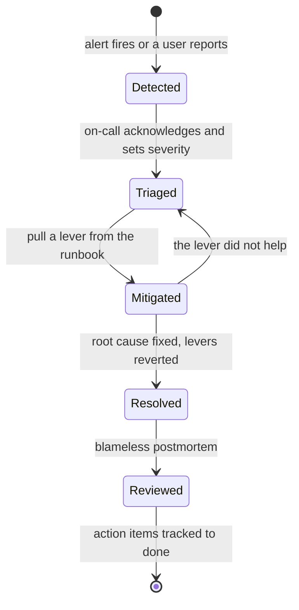
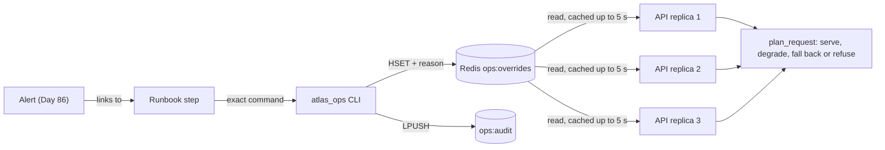
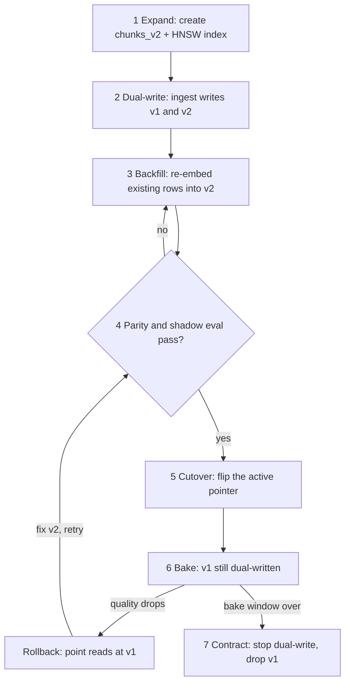

# Operating AI Systems: Incidents, Runbooks & Migrations

At 02:10 an alert fires: "online pass rate −15 pts (n=180)". The engineer on call is on their first rotation. They open the dashboard, see nothing red, and three hours later find that a half-finished re-embedding job left a third of the docs missing from the index. Today you build the answer to "what pages you, and what do you do?", because operations is where users decide whether to trust an AI product.

## At a Glance

- **Time:** ~2 h core (+ optional Go Deeper) · **Depth:** working
- **Prerequisites:** [Day 84: Reliability: Backoff, Fallbacks & LLM Gateways](../Day_084_reliability_fallbacks/reliability_fallbacks.md), [Day 85: Caching & Cost Optimization at Scale](../Day_085_caching_cost_scale/caching_cost_scale.md), [Day 86: Monitoring, Online Evals & Feedback Loops](../Day_086_monitoring_feedback/monitoring_feedback.md), [Day 87: Shipping Changes Safely](../Day_087_shipping_changes_safely/shipping_changes_safely.md), plus [Day 26: Vector Search with pgvector](../../Phase_3_RAG/Day_026_pgvector_search/pgvector_search.md) and [Day 29: Evaluating Retrieval](../../Phase_3_RAG/Day_029_retrieval_evaluation/retrieval_evaluation.md)
- **You'll build:** `atlas/ops.py` and an audited `atlas_ops` CLI whose kill switches reach every replica within 5 s, two runbooks, a timed game-day drill, a zero-downtime re-embed from `text-embedding-3-small` to `text-embedding-3-large` (1,024 dims), and a CI deprecation check
- **Stops at:** general SRE: paging tools, incident-commander training, multi-region disaster recovery
- **Fast path:** On call for web services already? Read "The AI Incident Catalogue" and "Game Day", then do Exercise 2 (~40 min)
- **Cost:** $0 as written (every script runs offline). A real re-embed of the 45 Orbit docs costs under $0.01 at $0.13 per 1M tokens; drills against live staging ≈ $0.20 (prices as of 2026-11, [verify](https://developers.openai.com/api/docs/pricing))
- **New terms:** incident catalogue & severity, runbook + kill switch, game day / postmortem, dual-write → backfill → cutover, deprecation as planned work

> **Coming from Software Engineering?** Severity levels, incident commanders, runbooks, blameless postmortems and expand/contract migrations (add the column, write both, backfill, switch reads, drop the old) all transfer. Three things are new. "Degraded" often means *quality*, not availability: every request returns 200 and the answers are wrong. Mitigations are model, prompt and index switches, not restarts. And your key dependency, the model provider, can't be fixed, only routed around. An index migration is a blue/green deploy of your data (run the new version beside the old one, then switch traffic).

## 02:10, Pass Rate Down

The alert said *what* moved but linked to nothing, so the on-call engineer started from a blank page. Nothing was red, because a missing document raises no error: retrieval returns fewer chunks and the model answers anyway. Nothing could pin the last good index either.

Each failure has a fix, and together they are today's lesson: a **catalogue** of AI incidents with their signals and first levers; **kill switches** every replica obeys; **runbooks** with exact commands, rehearsed in **game days**; a **migration discipline**, so a half-built index can't serve traffic; and **deprecation checks**, so a model shutdown becomes a ticket instead of an incident.

## The Pilot's Checklist

In an emergency a pilot doesn't improvise: they run the checklist for that failure, because under stress people skip steps. And an airline never swaps an engine type mid-flight; the new engine is fitted and tested on the ground first.

Try the checklist habit by hand. For each report, name the type, the confirming signal, who is affected (the **blast radius**) and the first move:

| Report | Type | Confirming signal | Blast radius | First lever |
|---|---|---|---|---|
| "Answers hang, logs full of provider 503s" | provider outage | breaker open, fallback share up | everyone | force the fallback model |
| "Atlas cites 3.1 docs for 3.2.1 questions" | quality regression | online pass rate down | anyone asking about 3.2.1 | pin the previous index or prompt |
| "Acme's bill is 8× yesterday's" | cost spike | tenant tokens-per-hour alert | one tenant, and your margin | cap the tenant |
| "Triage labelled a docs typo S1 and closed issues" | injection attempt | guardrail hits up, odd tool calls | whatever the agent can touch | approval-only mode |

Every first lever is **fast and reversible**; root-causing comes later, once users are protected.

## Name the Parts: The Incident Lifecycle

An **incident** is an unplanned event that hurts users and needs a coordinated response. Whoever is **on call** this week (the person who answers alerts) owns it. For big ones, an **incident commander (IC)** coordinates and communicates while others investigate, because nobody can debug and write status updates at once. The work always runs in this order:



The key move is **mitigate first, debug later**: mitigation stops the harm (switch to the fallback model); resolution removes the cause (the provider recovers, you revert). **Severity** sets how loud the response is; write the guide down so nobody argues about it at 02:10:

| Severity | Atlas example | Response |
|---|---|---|
| SEV1 | all tenants hurt: errors above 5%, cross-tenant data, an injection taking actions | page now, name an IC, update the status page |
| SEV2 | one route, tenant or topic degraded; pass rate down 10+ points | page the on-call |
| SEV3 | cost or quality drift, no user impact yet | ticket for the next working day |

**MTTD** (mean time to detect) runs from the fault to the first alert; **MTTR** (mean time to recover) from the fault to users being fine again. One drill gives one sample of each, which beats guessing.

## The AI Incident Catalogue

Most AI incidents fall into four types, and the levers already exist from earlier days:

| Incident | Detection signal | First mitigation | Owner mechanism | Then investigate |
|---|---|---|---|---|
| **Provider outage** | error rate, breaker open, fallback share up | `fallback force`, then `degrade on` | fallbacks ([Day 84](../Day_084_reliability_fallbacks/reliability_fallbacks.md)) | which models and regions |
| **Quality regression** | online pass rate down, thumbs-down up, **zero-chunk** share up | `index use v1` or roll back the last flag | online evals ([Day 86](../Day_086_monitoring_feedback/monitoring_feedback.md)), flags ([Day 87](../Day_087_shipping_changes_safely/shipping_changes_safely.md)) | what changed in 24 h: index, prompt, model, docs |
| **Cost spike** | one tenant far above its token baseline; cache hits down | `tenant cap acme 50000`, `route disable investigate` | quotas ([Day 83](../Day_083_auth_multitenancy_quotas/auth_multitenancy_quotas.md)), cache ([Day 85](../Day_085_caching_cost_scale/caching_cost_scale.md)) | loop caps ([Day 48](../../Phase_6_Agents/Day_048_first_agent/first_agent.md)), cache keys |
| **Injection attempt** | guardrail hits up, odd tool calls | `approvals on`, quarantine the source issue | guardrails ([Day 70](../../Phase_8_Safety_and_Security/Day_070_guardrails_moderation/guardrails_moderation.md)), approvals ([Day 76](../../Phase_8_Safety_and_Security/Day_076_capstone_r4_triage/capstone_r4_triage.md)) | what the agent touched ([Day 69](../../Phase_8_Safety_and_Security/Day_069_prompt_injection/prompt_injection.md)) |

Watch the zero-retrieval signal. When the vector store is down or a table is half-filled, many RAG stacks catch the error, return no chunks and let the model answer from memory: no 5xx, nothing in the logs. Alert on the share of requests with zero chunks.

## Kill Switches Every Replica Sees

A **kill switch** is a setting that turns a risky feature off (or a safer one on) instantly, without a deploy. The naive version is an environment variable: edit it in one container and one replica obeys while three keep calling the dead provider. Instead, keep levers in a shared store that every replica reads through a short local cache:

```python
# script_id: day_088_operating_ai_systems/first_kill_switch
# A kill switch every replica reads: one shared hash plus a short local cache.
# Install: none (stdlib). In production, replace MemoryHash() with redis.Redis.from_url(url, decode_responses=True).
import time


class MemoryHash(dict):                       # stands in for Redis: the same hset/hgetall calls
    def hset(self, name: str, key: str, value: str) -> None: self.setdefault(name, {})[key] = value
    def hgetall(self, name: str) -> dict[str, str]: return dict(self.get(name, {}))


store, _cache = MemoryHash(), {"at": float("-inf"), "value": {}}


def overrides(max_age_s: float = 5.0) -> dict[str, str]:
    if time.monotonic() - _cache["at"] >= max_age_s:     # at most one store read per replica every 5 s
        _cache.update(at=time.monotonic(), value=store.hgetall("ops:overrides"))
    return _cache["value"]


store.hset("ops:overrides", "degraded", "retrieval_only")
store.hset("ops:overrides", "degraded_reason", "provider 503s")
print(f"degraded={overrides()['degraded']} (set by you: {overrides()['degraded_reason']!r})")
```

```text
degraded=retrieval_only (set by you: 'provider 503s')
```

The cache age is the knob: at 5 s a change reaches every replica within 5 seconds, and 20 replicas make 4 store reads per second in total. At 300 s your kill switch takes five minutes to work. Here is how a change travels:



The realistic version is `atlas/ops.py`. Block 1 types the overrides. Parsing is forgiving (a typo in Redis must never take the API down); writing, further down, is strict.

```python
# script_id: day_088_operating_ai_systems/atlas_ops
# atlas/ops.py (blocks 1-4) + scripts/atlas_ops.py (blocks 5-6): every operational lever, audited.
# Install: uv add redis     Env: REDIS_URL (unset = in-process store, for this demo), ATLAS_OPERATOR
# Services: in real use, Day 78's Redis. Every API replica and every operator must use the same one.
from __future__ import annotations

import argparse
import json
import os
import shlex
import sys
import time
from dataclasses import dataclass, field
from datetime import datetime, timezone
from typing import Literal

OVERRIDES_KEY, AUDIT_KEY = "ops:overrides", "ops:audit"
Degraded = Literal["off", "retrieval_only", "queue"]
ALLOWED = {"degraded": {"off", "retrieval_only", "queue"}, "force_fallback": {"1"}, "approval_only": {"1"}}


@dataclass(frozen=True)
class Overrides:
    degraded: Degraded = "off"                      # retrieval_only = cited links, no generation (Day 84)
    force_fallback: bool = False                    # skip the primary model even if its breaker is closed
    disabled_routes: frozenset[str] = frozenset()   # e.g. {"investigate"}
    index_version: str | None = None                # None = whatever the index DB marks active
    tenant_caps: dict[str, int] = field(default_factory=dict)   # temporary tokens-per-hour caps
    approval_only: bool = False                     # every tool side effect waits for a human

    @classmethod
    def from_hash(cls, h: dict[str, str]) -> Overrides:
        caps = {k.removeprefix("tenant_cap:"): int(v) for k, v in h.items() if k.startswith("tenant_cap:")}
        degraded = h.get("degraded", "off")
        return cls(degraded=degraded if degraded in ALLOWED["degraded"] else "off",
                   force_fallback=h.get("force_fallback") == "1",
                   disabled_routes=frozenset(r for r in h.get("disabled_routes", "").split(",") if r),
                   index_version=h.get("index_version") or None,
                   tenant_caps=caps, approval_only=h.get("approval_only") == "1")
```

Block 2 is the store. `MemoryRedis` implements the six redis-py calls used here with the same names and arguments, so tests need no server; set `REDIS_URL` and the same code talks to Redis.

```python
# script_id: day_088_operating_ai_systems/atlas_ops
class MemoryRedis:
    """In-process stand-in for the six redis-py calls used here (tests, laptops, this demo)."""

    def __init__(self) -> None:
        self.hashes: dict[str, dict[str, str]] = {}
        self.lists: dict[str, list[str]] = {}

    def hset(self, name: str, key: str, value: str) -> int:
        self.hashes.setdefault(name, {})[key] = value
        return 1

    def hdel(self, name: str, *keys: str) -> int:
        return sum(self.hashes.get(name, {}).pop(k, None) is not None for k in keys)

    def hgetall(self, name: str) -> dict[str, str]:
        return dict(self.hashes.get(name, {}))

    def lpush(self, name: str, *values: str) -> int:
        self.lists[name] = [*reversed(values), *self.lists.get(name, [])]
        return len(self.lists[name])

    def lrange(self, name: str, start: int, end: int) -> list[str]:    # end is inclusive; -1 = last
        return self.lists.get(name, [])[start: None if end == -1 else end + 1]

    def ltrim(self, name: str, start: int, end: int) -> bool:
        self.lists[name] = self.lrange(name, start, end)
        return True


_MEMORY = MemoryRedis()


def get_redis(url: str | None = None):
    """REDIS_URL unset → one shared in-process store; otherwise real Redis returning str values."""
    url = url or os.environ.get("REDIS_URL", "")
    if not url:
        return _MEMORY
    from redis import Redis                         # lazy import: the demo needs no server
    return Redis.from_url(url, decode_responses=True)
```

Block 3 reads and writes levers. Reads **fail static**: if Redis is unreachable, keep the last known value instead of failing requests. Writes demand a **reason** and append who, what, when and why to an audit list, which becomes the postmortem's timeline.

```python
# script_id: day_088_operating_ai_systems/atlas_ops
_cache: dict[int, tuple[float, Overrides]] = {}


def get_overrides(redis, *, max_age_s: float = 5) -> Overrides:
    """Read shared overrides at most once per max_age_s per process; keep the last value if Redis fails."""
    at, value = _cache.get(id(redis), (float("-inf"), Overrides()))
    if time.monotonic() - at >= max_age_s:
        try:
            value = Overrides.from_hash(redis.hgetall(OVERRIDES_KEY))
        except Exception as exc:                    # an ops-store outage must not become an API outage
            print(f"warning: overrides unavailable ({exc!r}); using last known", file=sys.stderr)
        _cache[id(redis)] = (time.monotonic(), value)
    return value


def set_override(redis, key: str, value: str, *, actor: str, reason: str) -> None:
    """Change one lever and append who/what/when/why to ops:audit. An empty value clears the lever."""
    if not reason.strip():
        raise ValueError("every change needs --reason; it goes into the audit log and the postmortem")
    if value and key in ALLOWED and value not in ALLOWED[key]:
        raise ValueError(f"{key} must be one of {sorted(ALLOWED[key])}, got {value!r}")
    if value and key.startswith("tenant_cap:") and not value.isdigit():
        raise ValueError(f"{key} must be a whole number of tokens per hour, got {value!r}")
    if value:
        redis.hset(OVERRIDES_KEY, key, value)
    else:
        redis.hdel(OVERRIDES_KEY, key)
    entry = {"at": datetime.now(timezone.utc).isoformat(timespec="seconds"),
             "actor": actor, "key": key, "value": value, "reason": reason}
    redis.lpush(AUDIT_KEY, json.dumps(entry))
    redis.ltrim(AUDIT_KEY, 0, 999)                  # keep the last 1,000 here; ship older ones to your logs
```

Block 4 is all the API sees. `plan_request()` is pure (overrides in, a decision out), so every kill switch gets a unit test without Redis or HTTP.

```python
# script_id: day_088_operating_ai_systems/atlas_ops
@dataclass(frozen=True)
class RequestPlan:
    status: int                       # 200 serve · 202 queued as a job · 429 capped · 503 route paused
    mode: str                         # "full" | "retrieval_only" | "queued" | "refused"
    force_fallback: bool = False
    index_version: str | None = None
    approval_only: bool = False
    message: str = ""


def plan_request(route: str, tenant: str, ov: Overrides, *, tokens_this_hour: int = 0) -> RequestPlan:
    """The first call in every API handler. Pure, so each kill switch has a unit test."""
    if route in ov.disabled_routes:
        return RequestPlan(503, "refused", message=f"/{route} is paused by the on-call team; retry later")
    cap = ov.tenant_caps.get(tenant)
    if cap is not None and tokens_this_hour >= cap:
        return RequestPlan(429, "refused", message=f"{tenant} reached its temporary cap of {cap:,} tokens/hour")
    if ov.degraded == "queue":
        return RequestPlan(202, "queued", message="accepted; the answer arrives as a background job (Day 78)")
    mode = "retrieval_only" if ov.degraded == "retrieval_only" else "full"
    return RequestPlan(200, mode, ov.force_fallback, ov.index_version, ov.approval_only)

# Wiring into Day 77's FastAPI handler, as the first lines of POST /v1/ask:
#   plan = plan_request("ask", principal.tenant, get_overrides(redis), tokens_this_hour=used)
#   if plan.status >= 400: raise HTTPException(plan.status, plan.message)
#   then pass plan.mode / plan.force_fallback / plan.index_version down to ask()
```

The last three blocks are the operator CLI. Every change takes `--reason`, and reads use `max_age_s=0`, because operators need the live value.

```python
# script_id: day_088_operating_ai_systems/atlas_ops
def build_parser() -> argparse.ArgumentParser:
    common = argparse.ArgumentParser(add_help=False)
    common.add_argument("--reason", default="", help="why; required for every change")
    p = argparse.ArgumentParser(prog="atlas_ops", description="Atlas kill switches (audited)")
    sub = p.add_subparsers(dest="cmd", required=True)
    sub.add_parser("status")
    sub.add_parser("degrade", parents=[common]).add_argument("mode", choices=["on", "queue", "off"])
    sub.add_parser("fallback", parents=[common]).add_argument("mode", choices=["force", "auto"])
    sub.add_parser("approvals", parents=[common]).add_argument("mode", choices=["on", "off"])
    r = sub.add_parser("route", parents=[common])
    r.add_argument("action", choices=["disable", "enable"])
    r.add_argument("name")
    t = sub.add_parser("tenant", parents=[common])
    t.add_argument("action", choices=["cap"])
    t.add_argument("tenant")
    t.add_argument("tokens", help="tokens per hour, or 'clear'")
    i = sub.add_parser("index", parents=[common])
    i.add_argument("action", choices=["use"])
    i.add_argument("name", help="v1, v2 … or 'auto' to follow the index DB")
    return p
```

```python
# script_id: day_088_operating_ai_systems/atlas_ops
def main(argv: list[str] | None = None) -> None:
    a = build_parser().parse_args(argv)
    redis, actor = get_redis(), os.environ.get("ATLAS_OPERATOR") or os.environ.get("USER", "unknown")
    ov = get_overrides(redis, max_age_s=0)                   # operators always want the live value
    if a.cmd == "status":
        print(json.dumps({**ov.__dict__, "disabled_routes": sorted(ov.disabled_routes)}))
        return
    if a.cmd == "degrade":
        key, value = "degraded", {"on": "retrieval_only", "queue": "queue", "off": ""}[a.mode]
    elif a.cmd in ("fallback", "approvals"):
        key = "force_fallback" if a.cmd == "fallback" else "approval_only"
        value = "1" if a.mode in ("force", "on") else ""
    elif a.cmd == "route":
        on = set(ov.disabled_routes)
        routes = on | {a.name} if a.action == "disable" else on - {a.name}
        key, value = "disabled_routes", ",".join(sorted(routes))
    elif a.cmd == "tenant":
        key, value = f"tenant_cap:{a.tenant}", "" if a.tokens == "clear" else a.tokens
    else:
        key, value = "index_version", "" if a.name == "auto" else a.name
    set_override(redis, key, value, actor=actor, reason=a.reason)
    print(f"OK {key}={value or '(cleared)'} by {actor}: {a.reason}")


```

The demo transcript:

```python
# script_id: day_088_operating_ai_systems/atlas_ops
DEMO = ["degrade on --reason 'provider 503s, breaker open (INC-42)'",
        "route disable investigate --reason 'cut load while degraded'",
        "tenant cap acme 50000 --reason 'acme investigate loop burning tokens'",
        "degrade off", "status"]

if __name__ == "__main__":
    if len(sys.argv) > 1:
        main()
    else:                                                    # demo transcript on the in-process store
        os.environ.setdefault("ATLAS_OPERATOR", "oncall-you")
        for cmd in DEMO:
            print(f"$ atlas_ops {cmd}")
            try:
                main(shlex.split(cmd))
            except ValueError as exc:
                print(f"refused: {exc}")
        ov = get_overrides(get_redis())                      # what any replica sees within 5 s
        print("replica:", plan_request("investigate", "acme", ov).message)
        print("replica:", plan_request("ask", "acme", ov, tokens_this_hour=51_000).message)
```

```text
$ atlas_ops degrade on --reason 'provider 503s, breaker open (INC-42)'
OK degraded=retrieval_only by oncall-you: provider 503s, breaker open (INC-42)
$ atlas_ops route disable investigate --reason 'cut load while degraded'
OK disabled_routes=investigate by oncall-you: cut load while degraded
$ atlas_ops tenant cap acme 50000 --reason 'acme investigate loop burning tokens'
OK tenant_cap:acme=50000 by oncall-you: acme investigate loop burning tokens
$ atlas_ops degrade off
refused: every change needs --reason; it goes into the audit log and the postmortem
$ atlas_ops status
{"degraded": "retrieval_only", "force_fallback": false, "disabled_routes": ["investigate"], "index_version": null, "tenant_caps": {"acme": 50000}, "approval_only": false}
replica: /investigate is paused by the on-call team; retry later
replica: acme reached its temporary cap of 50,000 tokens/hour
```

Without `REDIS_URL` the store lives in one process: right for tests, useless across machines.

## Writing Two Runbooks

A **runbook** is a step-by-step guide for one kind of incident, written for someone tired on their first rotation. All runbooks share one template (summary, severity, signals, first five minutes, mitigate, verify, escalate, status message, follow-ups), live in `ops/runbooks/`, and are linked from their alerts. Every action is a command you can paste:

```markdown
<!-- file: ops/runbooks/provider_outage.md -->
# Runbook: LLM provider outage

## Summary
The primary model provider returns 5xx errors or times out. Atlas's circuit breaker (Day 84) opens and
traffic moves to the fallback model, but retries and half-open probes still fail a share of requests.

## Severity
- SEV1: error rate above 5% for 5 minutes on all tenants, or the fallback model is failing too.
- SEV2: fallback share above 20% with error rate below 5%.

## Signals
- Alert `error_rate_high` (this runbook) and the "calls by model and status" panel from Day 86.
- The provider's status page. Check it, but don't wait for it to confirm.

## First 5 minutes
1. Acknowledge the page. Post "Investigating Atlas errors" in #atlas-incidents.
2. Run `atlas_ops status` and note any override that is already set.
3. Open the "calls by model and status" panel: errors only on the primary model = provider outage.

## Mitigate
1. `atlas_ops fallback force --reason "primary 5xx, INC-<n>"`
2. Fallback failing as well: `atlas_ops degrade on --reason "both models failing, INC-<n>"`
3. Queue depth or latency still climbing: `atlas_ops route disable investigate --reason "shed load, INC-<n>"`

## Verify
Within 60 s: `error_rate_high` clears, fallback share is near 100%, and 3 manual `/v1/ask` calls succeed.

## Escalate
SEV1, or no improvement 15 minutes after step 1: page the incident commander on the rota.

## Status message
"Atlas is answering with a backup model while our AI provider has an outage. Answers may be slower
or shorter. Next update in 30 minutes."

## Follow-ups
- Revert with `atlas_ops fallback auto --reason "provider green 30 min"` once the provider has been healthy for 30 minutes.
- Postmortem within 2 working days. Fix any step in this runbook that slowed you down.
```

The quality-regression runbook's first five minutes ask **what changed**, because quality incidents almost always follow a change:

```markdown
<!-- file: ops/runbooks/quality_regression.md -->
# Runbook: quality regression

## Summary
Requests succeed but answers got worse: wrong version, missing citations, refusals. Usual causes: an index
migration, a prompt or model flag (Day 87), a docs change, or a vector store returning nothing.

## Severity
- SEV1: online pass rate down 25+ points, or wrong answers on security or data-loss topics.
- SEV2: online pass rate down 10+ points on n >= 100 sampled requests.

## Signals
- Alert `pass_rate_low`. The "zero-chunk requests" panel: a jump means retrieval is silently empty.
- Thumbs-down rate (Day 86 feedback) and the failing samples linked from the alert.

## First 5 minutes
1. Acknowledge, post in #atlas-incidents.
2. `atlas_ops status`, then list the last day's changes: `git log --since=24.hours -- release.toml prompts/`.
3. Read the index events: `sqlite3 atlas_index.db "SELECT * FROM index_events ORDER BY at DESC LIMIT 5"`.

## Mitigate
1. Index changed recently: `atlas_ops index use v1 --reason "pass rate -15 after cutover, INC-<n>"`
2. Prompt or model flag changed: roll that flag back in `release.toml` (Day 87), then redeploy the config.

## Verify
Online pass rate within 5 points of baseline over the next 100 sampled requests; zero-chunk share back to normal.

## Escalate
No known change in the last 24 h, or no recovery after both levers: page the RAG owner and the IC.

## Status message
"Some Atlas answers were less accurate than usual since <time>. We have rolled back a recent change
and are verifying. Next update in 30 minutes."

## Follow-ups
- Add the failing questions to the eval set (Day 86 `feedback_to_cases`).
- Make the missing check a gate, so the same change can't ship again unnoticed.
```

**Break it.** The classic runbook bug is "check the logs": which logs, which query? A small linter catches vague steps and missing sections:

```python
# script_id: day_088_operating_ai_systems/runbook_lint
# scripts/runbook_lint.py: required sections present, no vague steps. Run it in CI on ops/runbooks/.
# Install: none (stdlib). Usage: python runbook_lint.py ops/runbooks/*.md   (no args = demo)
import re
import sys
from pathlib import Path

REQUIRED = ["## Summary", "## Severity", "## Signals", "## First 5 minutes", "## Mitigate",
            "## Verify", "## Escalate", "## Status message", "## Follow-ups"]
# a vague verb + object, unless the same line names the exact command or query in backticks
VAGUE = re.compile(r"\b(check|look at|investigate|monitor) (the )?(logs|dashboards?|metrics)\b(?!.*`)", re.I)


def lint(text: str, *, sections: bool = True) -> list[str]:
    problems = [f"missing section {s!r}" for s in REQUIRED if sections and s not in text]
    for n, line in enumerate(text.splitlines(), 1):
        if VAGUE.search(line):
            problems.append(f"line {n}: vague step {line.strip()!r}: name the command, query or panel")
    return problems


if __name__ == "__main__":
    if sys.argv[1:]:
        found = {p: lint(Path(p).read_text(encoding="utf-8")) for p in sys.argv[1:]}
        for path, problems in found.items():
            print("\n".join(f"{path}: {x}" for x in problems) or f"{path}: OK")
        sys.exit(1 if any(found.values()) else 0)
    for step in ["3. Check the logs for errors.",
                 "3. Check the logs: `atlas_ops status`, then the 'calls by model and status' panel."]:
        print(lint(step, sections=False) or "OK", "<-", step[:45])
```

```text
["line 1: vague step '3. Check the logs for errors.': name the command, query or panel"] <- 3. Check the logs for errors.
OK <- 3. Check the logs: `atlas_ops status`, then t
```


## Game Day

A runbook nobody has followed is a guess. A **game day** is a planned practice incident: inject a fault on staging, follow the runbook against the clock, record the timeline, and find the missing permission on a Tuesday afternoon instead of at 02:10.

The drill below runs on a simulated clock against an in-process Atlas stand-in, so it takes a second and repeats exactly. The responder is scripted; in a real drill it's you, and `SimAtlas.send` becomes Day 86's replay. Block 1 holds compact copies of Day 86's event and alert rules. An alert pages only after its rule holds for three evaluations in a row (30 s), like the `for:` clause in Prometheus alert rules, so one noisy batch wakes nobody:

```python
# script_id: day_088_operating_ai_systems/game_day
# scripts/game_day.py: inject a fault, replay traffic, time detection and recovery, draft the postmortem.
# Install: none (stdlib). Simulated clock + in-process Atlas stand-in, so a 10-minute drill takes ~1 s.
from __future__ import annotations

import argparse
import random
from dataclasses import dataclass, field
from typing import Callable


@dataclass
class Event:                       # compact Day 86 RequestEvent: one replayed request
    t: float
    ok: bool                       # HTTP success
    fallback: bool                 # answered by the fallback model
    passed: bool                   # the sampled online check passed (Day 86)
    tokens: int = 1_200
    flagged: bool = False          # a guardrail fired (Day 70)


@dataclass
class DrillReport:
    scenario: str
    mttd_s: float | None = None    # fault start → first alert
    mttr_s: float | None = None    # fault start → alerts clear after the mitigation
    alerts: list[str] = field(default_factory=list)
    timeline: list[tuple[float, str]] = field(default_factory=list)


def rate(window: list[Event], attr: str) -> float:
    return sum(getattr(e, attr) for e in window) / max(len(window), 1)


FOR_TICKS = 3                      # a rule must hold for 3 evaluations (30 s) before it pages
ALERTS: dict[str, Callable[[list[Event]], bool]] = {    # compact Day 86 AlertRules, last 60 s
    "error_rate_high": lambda w: 1 - rate(w, "ok") > 0.05,
    "pass_rate_low": lambda w: rate(w, "passed") < 0.75,
}
RUNBOOK_FIRST_LEVER = {"provider_outage": "fallback force", "quality_regression": "index use v1"}
```

Block 2 is the system under test and the responder. In the quality regression every request still succeeds (`ok=True`); only the answers get worse. That's the hook's incident.

```python
# script_id: day_088_operating_ai_systems/game_day
class SimAtlas:
    """In-process stand-in for the API: only the fault and the operator's lever change its behaviour."""

    def __init__(self, scenario: str, seed: int = 7) -> None:
        self.scenario, self.rng = scenario, random.Random(seed)
        self.fault_on = False
        self.lever: str | None = None              # what the responder ran, e.g. "fallback force"

    def send(self, t: float) -> Event:
        r = self.rng.random()
        if self.fault_on and self.scenario == "provider_outage":
            if self.lever == "fallback force":     # skip the dead primary straight away
                return Event(t, ok=True, fallback=True, passed=r < 0.88)
            return Event(t, ok=r > 0.3, fallback=r > 0.3, passed=0.3 < r < 0.85)   # timeouts, then fallback
        if self.fault_on and self.scenario == "quality_regression" and self.lever != "index use v1":
            return Event(t, ok=True, fallback=False, passed=r < 0.6)   # a third of docs missing: wrong, not down
        return Event(t, ok=True, fallback=False, passed=r < 0.9)


def scripted_responder(scenario: str, *, delay_s: float) -> Callable[[float, list[str]], str | None]:
    """Stands in for you: runs the runbook's first lever delay_s after the first alert."""
    first: list[float] = []

    def respond(t: float, firing: list[str]) -> str | None:
        first[:] = first or [t]
        return RUNBOOK_FIRST_LEVER.get(scenario) if t - first[0] >= delay_s else None
    return respond
```

Block 3 is the loop: every 10 simulated seconds, send traffic, evaluate the alerts over the last 60 s, ask the responder for a lever, record milestones:

```python
# script_id: day_088_operating_ai_systems/game_day
def run_game_day(scenario: str, *, minutes: int = 10, fault_at_s: int = 120, rps: int = 3,
                 atlas: SimAtlas | None = None,
                 responder: Callable[[float, list[str]], str | None] | None = None) -> DrillReport:
    atlas = atlas or SimAtlas(scenario)
    responder = responder or scripted_responder(scenario, delay_s=120)
    rep, events, streak = DrillReport(scenario), [], {}
    for t in range(0, minutes * 60, 10):                       # one tick = 10 simulated seconds
        if t == fault_at_s:
            atlas.fault_on = True
            rep.timeline.append((t, f"fault injected: {scenario}"))
        events += [atlas.send(t) for _ in range(rps * 10)]
        window = [e for e in events if e.t > t - 60]
        for name, rule in ALERTS.items():
            streak[name] = streak.get(name, 0) + 1 if rule(window) else 0
        firing = [name for name, n in streak.items() if n >= FOR_TICKS]
        for name in firing:
            if name not in rep.alerts:
                rep.alerts.append(name)
                rep.timeline.append((t, f"ALERT {name}"))
                rep.mttd_s = t - fault_at_s if rep.mttd_s is None else rep.mttd_s
        if firing and atlas.lever is None and (lever := responder(t, firing)):
            atlas.lever = lever
            rep.timeline.append((t, f"mitigation: atlas_ops {lever}"))
        if atlas.lever and not firing and rep.mttr_s is None:
            rep.mttr_s = t - fault_at_s
            rep.timeline.append((t, "recovered: all alerts clear"))
    return rep
```

Block 4 drafts the **postmortem**, the written review of timeline, impact, contributing factors and action items. **Blameless** means it names systems and gaps, never people: "the runbook had no step for X" gets fixed; "Sam forgot X" teaches people to hide mistakes.

```python
# script_id: day_088_operating_ai_systems/game_day
def minutes(s: float | None) -> str:
    return "not reached" if s is None else f"{s / 60:.1f} min"


def postmortem(rep: DrillReport) -> str:
    lines = [f"# Postmortem (blameless): game day `{rep.scenario}`", "",
             f"- Time to detect: {minutes(rep.mttd_s)} · time to recover: {minutes(rep.mttr_s)}",
             f"- Alerts: {', '.join(rep.alerts) or 'none: a detection gap, write that up first'}", "",
             "## Timeline (seconds from drill start)"]
    lines += [f"- t={t:>4}s  {what}" for t, what in rep.timeline]
    lines += ["", "## Impact", "- Who was affected, for how long, how badly (from the dashboard)",
              "## Contributing factors (systems and gaps, never people)", "- ",
              "## Action items (owner · due date · ticket)", "- [ ] Fix the runbook step that slowed us down"]
    return "\n".join(lines)


if __name__ == "__main__":
    ap = argparse.ArgumentParser(description="Run a game-day drill on a simulated clock")
    ap.add_argument("--scenario", action="append", choices=sorted(RUNBOOK_FIRST_LEVER))
    ap.add_argument("--responder-delay", type=float, default=120, help="seconds you take to act")
    args = ap.parse_args()
    for scenario in args.scenario or sorted(RUNBOOK_FIRST_LEVER):
        rep = run_game_day(scenario, responder=scripted_responder(scenario, delay_s=args.responder_delay))
        print(f"{scenario:<19} detect={minutes(rep.mttd_s):<8} recover={minutes(rep.mttr_s):<8} {rep.alerts}")
    print("\n" + postmortem(rep))
```

```text
provider_outage     detect=0.3 min  recover=3.2 min  ['error_rate_high', 'pass_rate_low']
quality_regression  detect=0.8 min  recover=3.3 min  ['pass_rate_low']

# Postmortem (blameless): game day `quality_regression`

- Time to detect: 0.8 min · time to recover: 3.3 min
- Alerts: pass_rate_low

## Timeline (seconds from drill start)
- t= 120s  fault injected: quality_regression
- t= 170s  ALERT pass_rate_low
- t= 290s  mitigation: atlas_ops index use v1
- t= 320s  recovered: all alerts clear

## Impact
- Who was affected, for how long, how badly (from the dashboard)
## Contributing factors (systems and gaps, never people)
-
## Action items (owner · due date · ticket)
- [ ] Fix the runbook step that slowed us down
```

Most of the recovery time is `--responder-delay`, the two minutes "you" spent reading the runbook. Rerun with `--responder-delay 30` and recovery shrinks: the case for short, command-exact runbooks. In a real drill, take the timeline from `ops:audit` and file action items like bugs.

## Zero-Downtime Embedding Migration

Atlas's index uses `text-embedding-3-small` (1,536 dimensions, [Day 23: Embeddings & Semantic Similarity](../../Phase_3_RAG/Day_023_embeddings/embeddings.md)), and you want `text-embedding-3-large`. You can't update rows in place: two models' vectors live in different spaces, so comparing across them gives scores that look valid and mean nothing, with no error:

```python
# script_id: day_088_operating_ai_systems/mixed_vectors
# Break it: compare one model's vector with another model's. No error, only a meaningless score.
# Install: uv add numpy. Two seeded "models" stand in for text-embedding-3-small and -large (offline).
import hashlib

import numpy as np


def fake_embed(text: str, model: str, dims: int = 256) -> np.ndarray:
    """Hashed bag of words. A different model name sends each word to a different axis, like a real model."""
    v = np.zeros(dims, dtype=np.float32)
    for word in text.lower().split():
        h = int.from_bytes(hashlib.sha256(f"{model}:{word}".encode()).digest()[:8], "little")
        v[h % dims] += 1.0 if h >> 63 else -1.0
    return v / (np.linalg.norm(v) or 1.0)


doc = "workers renew their lease with a heartbeat every heartbeat_seconds"
query = "how often do workers send a lease heartbeat"
print(f"same model : cosine={fake_embed(doc, 'small') @ fake_embed(query, 'small'):.2f}")
print(f"mixed      : cosine={fake_embed(doc, 'small') @ fake_embed(query, 'large'):.2f}  <- no error, no meaning")
```

```text
same model : cosine=0.47
mixed      : cosine=0.12  <- no error, no meaning
```

So a re-embed is a data migration and gets the schema-change treatment: **expand → migrate → contract**. Add the new structure beside the old, fill it while the old one serves, switch reads atomically, keep the old one until you're sure, then remove it. The **backfill** is the filling step: writing existing data into the new store.



The 02:10 incident skipped step 4. Below, `cutover()` refuses to.

Block 1 names the versions. An **index version** pins one model, one dimension count and one table, so nothing can mix them. v2 uses `dims=1024` because `text-embedding-3-large` defaults to 3,072 dimensions and pgvector's HNSW index (a fast approximate nearest-neighbour index, [Day 26](../../Phase_3_RAG/Day_026_pgvector_search/pgvector_search.md)) takes `vector` columns of at most 2,000; `dimensions=1024` also means smaller rows and faster search.

```python
# script_id: day_088_operating_ai_systems/index_migration
# atlas/index_migration.py: re-embed Atlas's index with zero downtime (expand → migrate → contract).
# Install: uv add numpy     Data: ORBIT_DATA/docs/*.md, ORBIT_DATA/eval/retrieval_queries.jsonl
# Runs offline on SQLite + NumPy with a fake embedder. Production: the same steps on Postgres + pgvector
# (Go Deeper) with openai_embed() from the next script; the function signatures don't change.
from __future__ import annotations

import hashlib
import json
import os
import re
import sqlite3
import time
from dataclasses import dataclass
from datetime import datetime, timezone
from pathlib import Path
from typing import Callable

import numpy as np

DATA_DIR = Path(os.environ.get("ORBIT_DATA", "datasets/orbit"))


@dataclass(frozen=True)
class IndexVersion:
    name: str
    embed_model: str
    dims: int
    table: str


INDEX_VERSIONS = {
    "v1": IndexVersion("v1", "text-embedding-3-small", 1536, "chunks_v1"),
    "v2": IndexVersion("v2", "text-embedding-3-large", 1024, "chunks_v2"),   # dimensions=1024: HNSW-friendly
}
Embedder = Callable[[list[str], IndexVersion], np.ndarray]


```

Block 2 is the offline embedder:

```python
# script_id: day_088_operating_ai_systems/index_migration
def fake_embed(texts: list[str], v: IndexVersion) -> np.ndarray:
    """Offline stand-in: hashed bag of words seeded by the model name. Tests mechanics, not quality."""
    out = np.zeros((len(texts), v.dims), dtype=np.float32)
    for i, text in enumerate(texts):
        words = text.lower().split() if v.name == "v1" else re.findall(r"[a-z0-9_]+", text.lower())
        for w in words:
            h = int.from_bytes(hashlib.sha256(f"{v.embed_model}:{w}".encode()).digest()[:8], "little")
            out[i, h % v.dims] += 1.0 if h >> 63 else -1.0
    return out / np.maximum(np.linalg.norm(out, axis=1, keepdims=True), 1e-9)
```

Block 3 is **expand** and **dual-write**. `chunk()` is a compact [Day 25](../../Phase_3_RAG/Day_025_chunking/chunking.md) chunker with ids stable across versions and a content hash for parity. During the migration, ingest calls `dual_write()`, so a doc edited mid-backfill lands in both tables.

```python
# script_id: day_088_operating_ai_systems/index_migration
def chunk(doc_id: str, text: str, max_chars: int = 1200) -> list[dict]:
    """Compact Day 25 chunker: paragraphs packed up to max_chars; ids stay the same in every version."""
    parts, buf = [], ""
    for para in text.split("\n\n"):
        if buf and len(buf) + len(para) > max_chars:
            parts, buf = [*parts, buf], ""
        buf = f"{buf}\n\n{para}" if buf else para
    parts += [buf] if buf else []
    return [{"id": f"{doc_id}#{i}", "doc_id": doc_id, "body": p,
             "hash": hashlib.sha256(p.encode()).hexdigest()[:16]} for i, p in enumerate(parts)]


def open_db(path: str | Path) -> sqlite3.Connection:
    conn = sqlite3.connect(path, timeout=5, isolation_level=None, check_same_thread=False)
    conn.execute("PRAGMA journal_mode=WAL")               # readers keep reading while cutover writes
    conn.execute("CREATE TABLE IF NOT EXISTS index_meta (key TEXT PRIMARY KEY, value TEXT)")
    conn.execute("CREATE TABLE IF NOT EXISTS index_events (at TEXT, actor TEXT, event TEXT)")
    return conn


def create_version(conn: sqlite3.Connection, v: IndexVersion) -> None:
    """Expand: a new table beside the old one. Nothing reads it yet. (Postgres DDL: see Go Deeper.)"""
    conn.execute(f"CREATE TABLE IF NOT EXISTS {v.table} (id TEXT PRIMARY KEY, doc_id TEXT NOT NULL,"
                 " body TEXT NOT NULL, content_hash TEXT NOT NULL, embedding BLOB NOT NULL)")


def upsert(conn: sqlite3.Connection, v: IndexVersion, chunks: list[dict], embed: Embedder) -> None:
    vecs = embed([c["body"] for c in chunks], v)
    conn.executemany(f"INSERT INTO {v.table} VALUES (?, ?, ?, ?, ?) ON CONFLICT(id) DO UPDATE SET"
                     " body=excluded.body, content_hash=excluded.content_hash, embedding=excluded.embedding",
                     [(c["id"], c["doc_id"], c["body"], c["hash"], vec.astype(np.float32).tobytes())
                      for c, vec in zip(chunks, vecs)])


def dual_write(conn: sqlite3.Connection, chunk: dict, versions: list[IndexVersion], embed: Embedder) -> None:
    """Ingest writes every live version during a migration, so the backfill never falls behind."""
    for v in versions:
        upsert(conn, v, [chunk], embed)
```

Block 4 is the **backfill** and **parity**. The backfill skips rows whose hash already matches, so after a crash you rerun it; `pause_s` keeps it under your embeddings rate limit ([Day 84](../Day_084_reliability_fallbacks/reliability_fallbacks.md)). Parity reports missing, stale and extra rows.

```python
# script_id: day_088_operating_ai_systems/index_migration
@dataclass
class BackfillReport:
    copied: int
    skipped: int
    seconds: float


def backfill(conn: sqlite3.Connection, src: IndexVersion, dst: IndexVersion, embed: Embedder, *,
             batch: int = 100, pause_s: float = 0.0) -> BackfillReport:
    """Re-embed every src row that dst lacks or holds stale. Idempotent: rerun it after a crash."""
    start = time.monotonic()
    have = dict(conn.execute(f"SELECT id, content_hash FROM {dst.table}").fetchall())
    rows = conn.execute(f"SELECT id, doc_id, body, content_hash FROM {src.table} ORDER BY id").fetchall()
    todo = [r for r in rows if have.get(r[0]) != r[3]]
    for i in range(0, len(todo), batch):
        part = [{"id": r[0], "doc_id": r[1], "body": r[2], "hash": r[3]} for r in todo[i:i + batch]]
        upsert(conn, dst, part, embed)
        print(f"  backfill {dst.name}: {len(rows) - len(todo) + i + len(part)}/{len(rows)} rows")
        time.sleep(pause_s)                     # stay under the embeddings TPM (tokens-per-minute) limit
    return BackfillReport(len(todo), len(rows) - len(todo), round(time.monotonic() - start, 2))


def parity(conn: sqlite3.Connection, a: IndexVersion, b: IndexVersion) -> dict[str, int]:
    """Row diff by id + content hash. Cutover needs missing == stale == extra == 0."""
    ra = dict(conn.execute(f"SELECT id, content_hash FROM {a.table}").fetchall())
    rb = dict(conn.execute(f"SELECT id, content_hash FROM {b.table}").fetchall())
    return {f"rows_{a.name}": len(ra), f"rows_{b.name}": len(rb),
            "missing": len(ra.keys() - rb.keys()), "extra": len(rb.keys() - ra.keys()),
            "stale": sum(ra[k] != rb[k] for k in ra.keys() & rb.keys())}
```

Parity proves the data is *there*, not that it's *better*. Block 5 is a **shadow read**: the same queries against both versions, scored with [Day 29](../../Phase_3_RAG/Day_029_retrieval_evaluation/retrieval_evaluation.md)'s recall@5 and MRR (mean reciprocal rank: 1 ÷ the rank of the first relevant hit, averaged). Users still see only the active version.

```python
# script_id: day_088_operating_ai_systems/index_migration
def search(conn: sqlite3.Connection, v: IndexVersion, query: str, embed: Embedder, k: int = 5) -> list[str]:
    """Top-k doc ids by cosine. Brute force suits ~500 rows; pgvector uses its HNSW index instead."""
    rows = conn.execute(f"SELECT doc_id, embedding FROM {v.table}").fetchall()
    if not rows:
        return []                              # the silent-empty case: alert on it (zero-chunk share)
    m = np.frombuffer(b"".join(r[1] for r in rows), dtype=np.float32).reshape(len(rows), v.dims)
    out: list[str] = []
    for i in np.argsort(-(m @ embed([query], v)[0])):
        if rows[i][0] not in out:
            out.append(rows[i][0])
        if len(out) == k:
            break
    return out


def compare_versions(conn: sqlite3.Connection, a: IndexVersion, b: IndexVersion, queries: list[dict],
                     embed: Embedder) -> dict[str, dict[str, float]]:
    """Shadow read: the same queries against both versions, Day 29 metrics. Users still see only `a`."""
    report = {}
    for v in (a, b):
        recall, rr, ms = [], [], []
        for q in queries:
            t0 = time.perf_counter()
            got, rel = search(conn, v, q["query"], embed), set(q["relevant_doc_ids"])
            ms.append((time.perf_counter() - t0) * 1000)
            recall.append(len(rel & set(got)) / len(rel))
            rr.append(next((1 / (i + 1) for i, d in enumerate(got) if d in rel), 0.0))
        report[v.name] = {"recall@5": round(float(np.mean(recall)), 3), "mrr": round(float(np.mean(rr)), 3),
                          "p95_ms": round(float(np.percentile(ms, 95)), 1)}
    return report
```

Block 6 is the **cutover**: one row in `index_meta` names the serving version, so the switch is one transaction. Rollback is the same call reversed, an `atlas_ops index use v1` override beats the database, and **contract** drops the old table after the bake.

```python
# script_id: day_088_operating_ai_systems/index_migration
class CutoverRefused(RuntimeError):
    pass


def active_version(conn: sqlite3.Connection) -> str:
    row = conn.execute("SELECT value FROM index_meta WHERE key = 'active'").fetchone()
    return row[0] if row else "v1"


def resolve_version(conn: sqlite3.Connection, override: str | None) -> IndexVersion:
    """Per request: the ops override (Overrides.index_version) wins, then the DB pointer."""
    return INDEX_VERSIONS[override or active_version(conn)]


def cutover(conn: sqlite3.Connection, name: str, *, actor: str,
            gate: Callable[[], str | None] | None = None) -> None:
    """Atomically repoint reads. Refuses unless the target matches the current version row for row."""
    cur = INDEX_VERSIONS[active_version(conn)]
    p = parity(conn, cur, INDEX_VERSIONS[name])
    if p["missing"] or p["stale"] or p["extra"]:
        raise CutoverRefused(f"{name} is not in parity with {cur.name}: {p}")
    if gate and (why := gate()):                # e.g. an eval gate (Exercise 3)
        raise CutoverRefused(why)
    upsert_meta = "INSERT INTO index_meta VALUES (?, ?) ON CONFLICT(key) DO UPDATE SET value=excluded.value"
    conn.execute("BEGIN IMMEDIATE")
    conn.execute(upsert_meta, ("previous", cur.name))
    conn.execute(upsert_meta, ("active", name))
    conn.execute("INSERT INTO index_events VALUES (?, ?, ?)",
                 (datetime.now(timezone.utc).isoformat(timespec="seconds"), actor, f"cutover {cur.name} -> {name}"))
    conn.execute("COMMIT")
    print(f"cutover {cur.name} -> {name} by {actor}; rollback = cutover(conn, {cur.name!r}, actor=...)")


def contract(conn: sqlite3.Connection, old: IndexVersion, *, actor: str) -> None:
    """After the bake window: stop dual-writing `old` in ingest first, then drop it."""
    assert active_version(conn) != old.name, "never drop the version that is serving"
    conn.execute(f"DROP TABLE {old.table}")
    conn.execute("INSERT INTO index_events VALUES (datetime('now'), ?, ?)", (actor, f"contract: dropped {old.name}"))
```

The last two blocks run the whole migration on the Orbit docs, including the 02:10 mistake:

```python
# script_id: day_088_operating_ai_systems/index_migration
def load_docs() -> dict[str, str]:
    return {p.stem: p.read_text(encoding="utf-8") for p in sorted((DATA_DIR / "docs").glob("*.md"))}


```

The runner:

```python
# script_id: day_088_operating_ai_systems/index_migration
if __name__ == "__main__":
    import tempfile
    v1, v2 = INDEX_VERSIONS["v1"], INDEX_VERSIONS["v2"]
    conn = open_db(Path(tempfile.mkdtemp()) / "atlas_index.db")
    docs = load_docs()
    create_version(conn, v1)
    upsert(conn, v1, [c for d, text in docs.items() for c in chunk(d, text)], fake_embed)   # today's index
    create_version(conn, v2)                                                    # 1 expand
    try:
        cutover(conn, "v2", actor="oncall")                                     # the 02:10 mistake
    except CutoverRefused as exc:
        print("refused:", str(exc)[:96])
    edited = chunk("faq", docs["faq"] + "\n\nQ: Does 3.2.1 change leases? A: No.")[-1]
    dual_write(conn, edited, [v1, v2], fake_embed)                              # 2 a doc edit lands in both
    print(backfill(conn, v1, v2, fake_embed, batch=200))                        # 3 backfill
    print(parity(conn, v1, v2))                                                 # 4a parity
    queries = [json.loads(line) for line in (DATA_DIR / "eval" / "retrieval_queries.jsonl").open()]
    for name, metrics in compare_versions(conn, v1, v2, queries, fake_embed).items():   # 4b shadow read
        print(f"  {name}: {metrics}")
    cutover(conn, "v2", actor="oncall")                                         # 5 cutover; 6 bake begins
    print("serving:", resolve_version(conn, None).name, "| with override:", resolve_version(conn, "v1").name)
```

```text
# your timings will differ
refused: v2 is not in parity with v1: {'rows_v1': 257, 'rows_v2': 0, 'missing': 257, 'extra': 0, 'stale':
  backfill v2: 201/257 rows
  backfill v2: 257/257 rows
BackfillReport(copied=256, skipped=1, seconds=0.04)
{'rows_v1': 257, 'rows_v2': 257, 'missing': 0, 'extra': 0, 'stale': 0}
  v1: {'recall@5': 0.542, 'mrr': 0.548, 'p95_ms': 0.4}
  v2: {'recall@5': 0.658, 'mrr': 0.722, 'p95_ms': 0.3}
cutover v1 -> v2 by oncall; rollback = cutover(conn, 'v1', actor=...)
serving: v2 | with override: v1
```

With the fake embedder the metrics only prove the plumbing works, not which model is better. Plug in the real embedder (same signature) and the same table becomes your evidence:

```python
# script_id: day_088_operating_ai_systems/openai_embed
# The real embedder for index_migration (same signature as fake_embed). Env: OPENAI_API_KEY
# Install: uv add "openai>=3.46,<4" numpy
import numpy as np
from openai import OpenAI

client = OpenAI()                                     # the SDK retries transient errors twice by default


def openai_embed(texts: list[str], v) -> np.ndarray:  # v: IndexVersion (uses .embed_model and .dims)
    """Passes v.dims as `dimensions=`, so a 3-large index stays under pgvector's 2,000-dim HNSW limit."""
    vectors: list[list[float]] = []
    for i in range(0, len(texts), 256):               # several small requests; each input ≤ 8,192 tokens
        resp = client.embeddings.create(model=v.embed_model, input=texts[i:i + 256], dimensions=v.dims)
        vectors += [d.embedding for d in resp.data]
    return np.asarray(vectors, dtype=np.float32)
```

Before you contract, bake for a few days with v1 still dual-written: some regressions only show on real traffic. (Chat-model migrations follow [Day 87](../Day_087_shipping_changes_safely/shipping_changes_safely.md)'s canary playbook; an index can't be canaried before it exists.)

## Deprecations Are Planned Work

Providers retire models on published dates: OpenAI gives generally available models at least six months' notice and `*-preview` models as little as about two weeks (as of 2026-11, [verify](https://developers.openai.com/api/docs/deprecations)). Make CI fail 60 days before one, and turn each finding into a ticket that runs the Day 87 playbook. The table is a 2026-11-06 snapshot; Go Deeper shows how to refresh it from the API.

```python
# script_id: day_088_operating_ai_systems/check_deprecations
# scripts/check_deprecations.py: fail CI when code or config names a model that shuts down soon.
# Install: none (stdlib). Usage: python check_deprecations.py atlas/ scripts/ release.toml [--days 60]
# Dates/replacements: https://developers.openai.com/api/docs/deprecations (as of 2026-11-06, verify).
from __future__ import annotations

import argparse
import os
import re
import sys
import tempfile
from dataclasses import dataclass
from datetime import date
from pathlib import Path


@dataclass(frozen=True)
class Deprecation:
    model_id: str
    shutdown: date
    replacement: str


DEPRECATIONS = [
    *(Deprecation(m, date(2026, 12, 11), "gpt-5.6-sol/-terra/-luna")
      for m in ("gpt-5", "gpt-5-mini", "gpt-5-nano", "gpt-5-pro", "o3", "o3-pro")),
    *(Deprecation(m, date(2027, 1, 6), "gpt-realtime-2.1-mini via Realtime")
      for m in ("tts-1", "tts-1-hd", "gpt-4o-mini-tts")),
    *(Deprecation(m, date(2027, 1, 14), "gpt-6-luna") for m in ("gpt-4o", "gpt-4o-mini", "gpt-4.1", "gpt-4.1-mini")),
    Deprecation("gpt-realtime", date(2027, 1, 20), "gpt-realtime-2.1"),
    Deprecation("gpt-realtime-mini", date(2027, 1, 20), "gpt-realtime-2.1-mini"),
    *(Deprecation(m, date(2027, 2, 26), "gpt-transcribe")
      for m in ("whisper-1", "gpt-4o-transcribe", "gpt-4o-mini-transcribe", "gpt-4o-transcribe-diarize")),
]
# whole ID only, plus an optional dated snapshot: "gpt-4o" matches gpt-4o-2024-08-06, never gpt-4o-mini
PATTERNS = [(d, re.compile(rf"(?<![\w.-]){re.escape(d.model_id)}(?:-\d{{4}}-\d{{2}}-\d{{2}})?(?![\w.-])"))
            for d in DEPRECATIONS]
```

```python
# script_id: day_088_operating_ai_systems/check_deprecations
@dataclass(frozen=True)
class Finding:
    path: str
    line: int
    dep: Deprecation
    days_left: int


def scan(paths: list[str], *, today: date | None = None) -> list[Finding]:
    """Every deprecated model ID in code and config files (not docs: history is allowed there)."""
    today, found = today or date.today(), []
    files = [f for p in map(Path, paths) for f in ([p] if p.is_file() else sorted(p.rglob("*")))
             if f.is_file() and (f.suffix in {".py", ".toml", ".yaml", ".yml", ".json"} or f.name.startswith(".env"))]
    for f in files:
        for n, text in enumerate(f.read_text(encoding="utf-8", errors="replace").splitlines(), 1):
            found += [Finding(str(f), n, d, (d.shutdown - today).days) for d, rx in PATTERNS if rx.search(text)]
    return sorted(found, key=lambda x: x.days_left)


```

The CLI:

```python
# script_id: day_088_operating_ai_systems/check_deprecations
def demo_repo() -> str:
    d = Path(tempfile.mkdtemp())
    (d / "judges.py").write_text('JUDGE_MODEL = "gpt-4o-mini"   # picked in 2025 as the cheap judge\n')
    (d / "voice.py").write_text('TTS_MODEL = "tts-1"\n')
    (d / "release.toml").write_text('[ask]\nmodel = "gpt-6-luna"\n[voice]\nstt = "whisper-1"\n')
    return str(d)


def main(argv: list[str] | None = None) -> int:
    ap = argparse.ArgumentParser(description="Fail CI on soon-to-be-retired model IDs")
    ap.add_argument("paths", nargs="*", help="files or directories (none = demo repo)")
    ap.add_argument("--days", type=int, default=60, help="FAIL when a shutdown is this close")
    ap.add_argument("--today", type=date.fromisoformat, default=None, help="YYYY-MM-DD, for tests")
    a = ap.parse_args(argv)
    if not a.paths:
        os.chdir(demo_repo())
    findings = scan(a.paths or ["."], today=a.today)
    for x in findings:
        level = "FAIL" if x.days_left <= a.days else "WARN"
        print(f"{level} {x.dep.model_id} in {os.path.relpath(x.path)}:{x.line}: shuts down "
              f"{x.dep.shutdown} ({x.days_left} days) → {x.dep.replacement}")
    failed = any(x.days_left <= a.days for x in findings)
    return 1 if failed and a.paths else 0     # the demo always exits 0


if __name__ == "__main__":
    sys.exit(main())
```

```text
# days are counted from today; these are for 2026-11-07
FAIL tts-1 in voice.py:1: shuts down 2027-01-06 (60 days) → gpt-realtime-2.1-mini via Realtime
WARN gpt-4o-mini in judges.py:1: shuts down 2027-01-14 (68 days) → gpt-6-luna
WARN whisper-1 in release.toml:4: shuts down 2027-02-26 (111 days) → gpt-transcribe
```

Add it as one step in the [Day 47](../../Phase_5_Evaluation_and_Observability/Day_047_evals_in_ci/evals_in_ci.md) CI workflow: `python scripts/check_deprecations.py atlas/ scripts/ release.toml`. Each FAIL becomes a ticket with replacement, owner and date; WARNs are next quarter's tickets.

## Trade-offs: Which Lever, and When to Declare

| Lever | Use when | Cost to users | Undo |
|---|---|---|---|
| `fallback force` | primary provider failing | different answers, maybe slower | `fallback auto` |
| `degrade on` | every model failing | links instead of answers | `degrade off` |
| `index use v1` / flag rollback | quality dropped after a change | none: last known good | `index use auto` |
| `route disable` / `tenant cap` | cost or load from one feature or tenant | that feature or tenant refused | `route enable` / `tenant cap … clear` |
| `approvals on` | possible injection | slower automation | `approvals off` |

Rule of thumb: **declare early**. Unsure? Declare SEV3 and downgrade later: a small declared incident costs ten minutes, an undeclared one that grows costs hours with nobody coordinating.

### In production

- **Communicate.** Post the status template within 15 minutes of a SEV1; silence costs more trust than the outage.
- **Prune alerts monthly.** Delete or tune every page that led to no action (Day 86).
- **Track follow-ups to done.** An action item without an owner and a due date won't happen.
- **Keep runbooks tested.** One game day per runbook per quarter; lint `ops/runbooks/` in CI.
- **Protect the levers.** Give the ops CLI deploy-level access control and ship `ops:audit` to your log store.

### Commit it to R5

| Block | R5 path |
|---|---|
| `atlas_ops` blocks 1–4 | `atlas/ops.py` |
| `atlas_ops` blocks 5–7 | `scripts/atlas_ops.py` (imports `atlas.ops`) |
| `runbook_lint`, `game_day`, `check_deprecations` | `scripts/runbook_lint.py`, `scripts/game_day.py`, `scripts/check_deprecations.py` |
| the two runbooks | `ops/runbooks/provider_outage.md`, `ops/runbooks/quality_regression.md` |
| `index_migration` + `openai_embed` | `atlas/index_migration.py` (pass `openai_embed` in production) |

## Go Deeper (optional)

<details><summary>Go deeper: the same migration on Postgres + pgvector</summary>

In production the index lives in Postgres ([Day 26](../../Phase_3_RAG/Day_026_pgvector_search/pgvector_search.md)). The steps don't change; only the storage calls do. Two details matter. First, build the HNSW index with `CREATE INDEX CONCURRENTLY`, so ingest can keep writing to the new table while the index builds. Postgres refuses to run it inside a transaction, which is why the connection uses `autocommit=True`. Second, the cutover pointer lives in the same database, so one transaction flips it.

```python
# script_id: day_088_operating_ai_systems/pg_index_migration
# Postgres + pgvector flavour of create_version / upsert / cutover / search. Needs Postgres from compose.yaml.
# Install: uv add "psycopg[binary]" pgvector numpy     Env: DATABASE_URL
import os

import numpy as np
import psycopg
from pgvector.psycopg import register_vector


def connect() -> psycopg.Connection:
    conn = psycopg.connect(os.environ["DATABASE_URL"], autocommit=True)
    conn.execute("CREATE EXTENSION IF NOT EXISTS vector")          # BEFORE register_vector
    register_vector(conn)
    conn.execute("CREATE TABLE IF NOT EXISTS index_meta (key text PRIMARY KEY, value text NOT NULL)")
    return conn


def create_version_pg(conn: psycopg.Connection, table: str, dims: int) -> None:
    if dims > 2000:   # "column cannot have more than 2000 dimensions for hnsw index"
        raise ValueError("request dimensions<=2000 from the API, or use halfvec (see the note below)")
    conn.execute(f"""CREATE TABLE IF NOT EXISTS {table} (id text PRIMARY KEY, doc_id text NOT NULL,
        body text NOT NULL, content_hash text NOT NULL, embedding vector({dims}))""")
    conn.execute(f"CREATE INDEX CONCURRENTLY IF NOT EXISTS {table}_hnsw ON {table} "
                 "USING hnsw (embedding vector_cosine_ops)")       # opclass matches the <=> operator


def upsert_pg(conn: psycopg.Connection, table: str, rows: list[tuple[str, str, str, str, np.ndarray]]) -> None:
    with conn.cursor() as cur:
        cur.executemany(f"""INSERT INTO {table} (id, doc_id, body, content_hash, embedding)
            VALUES (%s, %s, %s, %s, %s) ON CONFLICT (id) DO UPDATE SET body = EXCLUDED.body,
            content_hash = EXCLUDED.content_hash, embedding = EXCLUDED.embedding""",
            [(i, d, b, h, np.asarray(v, dtype=np.float32)) for i, d, b, h, v in rows])


```

Cutover and search:

```python
# script_id: day_088_operating_ai_systems/pg_index_migration
def cutover_pg(conn: psycopg.Connection, name: str) -> None:
    with conn.transaction():          # readers see the old pointer or the new one, never a mix
        conn.execute("""INSERT INTO index_meta VALUES ('active', %s)
            ON CONFLICT (key) DO UPDATE SET value = EXCLUDED.value""", (name,))


def search_pg(conn: psycopg.Connection, table: str, qvec: np.ndarray, k: int = 5) -> list[tuple[str, float]]:
    return conn.execute(f"SELECT doc_id, embedding <=> %s AS dist FROM {table} ORDER BY dist LIMIT %s",
                        (np.asarray(qvec, dtype=np.float32), k)).fetchall()


if __name__ == "__main__":
    if not os.environ.get("DATABASE_URL"):
        print("Set DATABASE_URL (Postgres + pgvector from compose.yaml) to run this script.")
    else:
        create_version_pg(connect(), "chunks_v2", 1024)
        print("chunks_v2 ready (vector(1024) + HNSW)")
```

If you need all 3,072 dimensions of `text-embedding-3-large`, pgvector's `halfvec` type stores half-precision floats and can be HNSW-indexed up to 4,000 dimensions (pgvector 0.7 or later). Three changes: declare `embedding halfvec(3072)`, build the index with `halfvec_cosine_ops`, and wrap every vector you send as `HalfVector(v)` (`from pgvector import HalfVector`) in `upsert_pg()` and `search_pg()`. The wrapper matters: `register_vector()` sends a bare NumPy array as the `vector` type, and it registers the `HalfVector` adapter only when the database has the `halfvec` type. This lesson's code uses `vector(1024)` and doesn't exercise the halfvec path, so try it on a scratch database first.

</details>

<details><summary>Go deeper: backfill through the Batch API at half price</summary>

For a large corpus, the backfill is the expensive part, and it doesn't need answers in seconds. The Batch API ([Day 18](../../Phase_2_Building_with_LLM_APIs/Day_018_cost_latency_caching/cost_latency_caching.md)) accepts `/v1/embeddings` requests in a JSONL file, charges 50% of the standard price, has its own rate-limit pool (so it can't starve live traffic) and finishes within 24 hours. Limits: one model per file, up to 50,000 requests or 200 MB per file (as of 2026-11, [verify](https://developers.openai.com/api/docs/guides/batch)).

```python
# script_id: day_088_operating_ai_systems/batch_backfill
# Backfill via the Batch API: 50% of the standard embeddings price, results within 24 h.
# Install: uv add "openai>=3.46,<4"     Env: OPENAI_API_KEY
import json

from openai import OpenAI

client = OpenAI()
EMBED_MODEL, DIMS = "text-embedding-3-large", 1024


def submit(rows: list[tuple[str, str]]) -> str:
    """rows = (chunk_id, body). Returns the batch id; store it so a restart can resume polling."""
    lines = [{"custom_id": cid, "method": "POST", "url": "/v1/embeddings",
              "body": {"model": EMBED_MODEL, "input": body, "dimensions": DIMS}} for cid, body in rows]
    f = client.files.create(file=("backfill.jsonl", "\n".join(map(json.dumps, lines)).encode()), purpose="batch")
    return client.batches.create(input_file_id=f.id, endpoint="/v1/embeddings", completion_window="24h").id


def collect(batch_id: str) -> dict[str, list[float]] | None:
    """None until completed. Output order differs from input order, so map results by custom_id."""
    b = client.batches.retrieve(batch_id)
    if b.status != "completed":       # validating → in_progress → finalizing → completed | failed | expired
        print("status:", b.status)
        return None
    rows = [json.loads(x) for x in client.files.content(b.output_file_id).text.splitlines()]
    return {r["custom_id"]: r["response"]["body"]["data"][0]["embedding"] for r in rows}
```

Failed lines go to the batch's `error_file_id`, and work left unfinished at expiry is cancelled. You don't need special handling for either: write what came back, then rerun `backfill()`, which re-embeds only the rows that are still missing or stale.

</details>

<details><summary>Go deeper: the rest of the cutover checklist</summary>

- **Cache scope.** Put the index version in the [Day 85](../Day_085_caching_cost_scale/caching_cost_scale.md) semantic cache's scope key. Cutover and rollback then invalidate old answers by themselves, with no flush step to forget.
- **Prove zero downtime.** Keep Day 86's traffic replay running from expand to contract. A flat error-rate panel across the cutover is the evidence; "it seemed fine" isn't.
- **Deletes.** Dual-write covers inserts and updates. A doc deleted mid-migration must be deleted from every live version too, or parity reports it as `extra`.
- **Local models.** Moving to a local embedding model ([Day 91](../../Phase_10_Open_Models_and_Fine_Tuning/Day_091_open_weight_local/open_weight_local.md)) is the same migration with a different `embed` function.

</details>

<details><summary>Go deeper: keep the deprecation table honest, and two operators at once</summary>

**Refresh the table from the API.** The hard-coded `DEPRECATIONS` list goes stale. Each model object from `client.models.list()` carries a `shutdown_date` (`"YYYY-MM-DD"` or `None`), so a monthly job can print what changed and someone updates the table in a reviewed PR:

```python
# script_id: day_088_operating_ai_systems/sync_deprecations
# List models that have a published shutdown date, to refresh DEPRECATIONS. Env: OPENAI_API_KEY
# Install: uv add "openai>=3.46,<4"
from openai import OpenAI

client = OpenAI()
for m in client.models.list():          # the SDK pages through the list for you
    if m.shutdown_date:
        print(f"{m.id:<32} shuts down {m.shutdown_date}")
```

The API tells you *when*, not *what to use instead*. Replacements still come from the deprecations page, which is why a human reviews the change.

**Two operators at once.** `set_override()` writes the lever and then the audit entry as two commands. If the process dies between them, you have a change with no audit line. With real Redis, wrap both in `redis.pipeline(transaction=True)`, which sends them as one MULTI/EXEC block. The `route disable` command also reads the current list, changes it, and writes it back. If two people disable different routes in the same second, one change can be lost. Two fixes: store each route as its own hash field (`route_off:investigate = 1`), so there is nothing to merge; or agree that only the incident commander touches levers during a SEV1, which is good practice anyway.

**Fail static vs fail safe.** `get_overrides()` keeps the last known value when Redis is down. That's "fail static", and it's right for most levers. For a security lever such as `approval_only`, some teams prefer "fail safe": if the store is unreachable, assume approvals are on. Decide per lever and write the choice into the runbook.

</details>

## Common Pitfalls

- **`column cannot have more than 2000 dimensions for hnsw index`.** You created `vector(3072)` for `text-embedding-3-large`. Request `dimensions=1024` (or 1536), or use `halfvec(3072)`.
- **Recall quietly collapses after a model change.** Two models' vectors share a table, or the query uses the old model. No error, only meaningless scores. Use one table per `IndexVersion` and embed queries with `resolve_version()`'s model.
- **Cutting over before the backfill finished.** The hook's incident. Make parity a hard precondition (`CutoverRefused: v2 is not in parity with v1: {... 'missing': 257 ...}`) and add an eval gate (Exercise 3).
- **A kill switch only one replica obeys.** An environment variable was edited in one container. Use a shared store with a short cache, and audit every change.
- **Re-embedding at full price, at peak.** The backfill competes with live traffic for one rate limit. Use Batch (50% off, separate pool) or run off-peak with `pause_s`.

> **Where we stop:** general SRE (paging tools, IC training, multi-region disaster recovery) is its own discipline; Google's free [*Site Reliability Engineering* book](https://sre.google/sre-book/table-of-contents/) ("Managing Incidents", "Postmortem Culture") is the classic start, and [Day 90](../Day_090_capstone_r5_launch/capstone_r5_launch.md) adds SLOs and a chaos drill.

## Key Takeaways

- AI incidents come in four types (provider outage, quality regression, cost spike, injection attempt); quality regressions return 200, so detect them with online pass rate and zero-chunk counts, not error rates.
- Mitigate first, debug later: each type has a fast, reversible first lever, and severity sets how loud the response is.
- Kill switches live in a shared store every replica reads through a short cache, behind one pure `plan_request()`, with every change audited (who, what, when, why).
- Runbooks name exact commands; game days prove them, measure time to detect and recover, and end in a blameless postmortem with owned action items.
- Re-embedding is expand/contract: new table, dual-write, idempotent backfill, parity plus shadow eval, atomic cutover, a bake window with rollback, then contract. Deprecations become CI failures and tickets long before shutdown.

## Quick Reference

| API / pattern | When to use | Gotcha |
|---|---|---|
| `get_overrides(redis, max_age_s=5)` | every request | keeps the last value if Redis fails |
| `set_override(redis, key, value, actor=, reason=)` | every lever change | empty reason refused; `""` clears |
| `plan_request(route, tenant, ov, tokens_this_hour=)` | API handlers | pure: unit-test each switch |
| `atlas_ops fallback force` / `degrade on` / `index use v1` / `tenant cap T N` / `approvals on` | runbook mitigation steps | always add `--reason` |
| `run_game_day(scenario, responder=…)` | quarterly drills | one drill = one sample of MTTD/MTTR |
| `client.embeddings.create(model=, input=, dimensions=)` | re-embedding | changing model or `dimensions` means re-indexing everything |
| `backfill(conn, src, dst, embed)` → `parity()` → `compare_versions()` → `cutover()` | index migration | cutover refuses without parity; keep v1 dual-written during the bake |
| `python check_deprecations.py atlas/ --days 60` | CI | the table is a snapshot: refresh it monthly |

## Exercises

1. **Warm-up.** Add `atlas_ops history`, which prints the last 10 audited changes, newest first: when, who, what and why.

<details><summary>Solution</summary>

To wire it into the CLI, add `sub.add_parser("history")` in `build_parser()` and call `history()` from `main()`. The function itself, plus a demo:

```python
# script_id: day_088_operating_ai_systems/solution_ex1
# `atlas_ops history`: the last N audited changes, newest first. Reuses atlas_ops.py from this lesson.
import json
import os
import shlex

from atlas_ops import AUDIT_KEY, get_redis, main


def history(redis, n: int = 10) -> list[dict]:
    return [json.loads(x) for x in redis.lrange(AUDIT_KEY, 0, n - 1)]


if __name__ == "__main__":
    os.environ.setdefault("ATLAS_OPERATOR", "oncall-you")
    for cmd in ("degrade on --reason 'provider 503s'", "fallback force --reason 'breaker open'",
                "degrade off --reason 'fallback healthy, full answers back'"):
        main(shlex.split(cmd))
    for e in history(get_redis()):
        print(f"{e['at']}  {e['actor']}  {e['key']}={e['value'] or '(cleared)'}  # {e['reason']}")
```

```text
# your timestamps will differ
OK degraded=retrieval_only by oncall-you: provider 503s
OK force_fallback=1 by oncall-you: breaker open
OK degraded=(cleared) by oncall-you: fallback healthy, full answers back
2026-11-07T04:47:06+00:00  oncall-you  degraded=(cleared)  # fallback healthy, full answers back
2026-11-07T04:47:06+00:00  oncall-you  force_fallback=1  # breaker open
2026-11-07T04:47:06+00:00  oncall-you  degraded=retrieval_only  # provider 503s
```

</details>

2. **Core.** Write `ops/runbooks/cost_spike.md` from the template, then run it as a game day: a tenant whose `investigate` runs loop without a step cap, caught by a tokens-per-minute alert. (Then try an `injection_attempt` scenario with `approvals on`.)

<details><summary>Solution</summary>

The runbook's key sections (the rest follow the template):

```markdown
<!-- file: ops/runbooks/cost_spike.md -->
## Signals
- Alert `tokens_per_min_high`; the "tokens per hour by tenant" panel shows which tenant.
## Mitigate
1. `atlas_ops tenant cap <tenant> 50000 --reason "token spike, INC-<n>"`
2. Still climbing: `atlas_ops route disable investigate --reason "loop suspected, INC-<n>"`
## Verify
Tokens per minute back under the alert line within 2 minutes; the tenant's other routes still answer.
## Follow-ups
- Find the run with no step cap (Day 48 budgets) and the cache hit rate for that tenant (Day 85).
```

The drill reuses `game_day.py` by adding one alert, one lever and one stand-in:

```python
# script_id: day_088_operating_ai_systems/solution_ex2
# A cost-spike game day from the same machinery: acme's investigate runs loop without a step cap.
from game_day import ALERTS, RUNBOOK_FIRST_LEVER, SimAtlas, postmortem, run_game_day, scripted_responder

LEVER = "tenant cap acme 50000"


class LoopingTenantAtlas(SimAtlas):
    def send(self, t: float):
        e = super().send(t)
        if self.fault_on and self.lever != LEVER and self.rng.random() < 0.25:
            e.tokens = 40_000              # one runaway agent run (no Day 48 step cap)
        return e


ALERTS["tokens_per_min_high"] = lambda w: sum(e.tokens for e in w) > 600_000   # baseline ≈ 216k
RUNBOOK_FIRST_LEVER["cost_spike"] = LEVER
rep = run_game_day("cost_spike", atlas=LoopingTenantAtlas("cost_spike"),
                   responder=scripted_responder("cost_spike", delay_s=60))
print(postmortem(rep).split("## Impact")[0])
```

```text
# Postmortem (blameless): game day `cost_spike`

- Time to detect: 0.3 min · time to recover: 2.3 min
- Alerts: tokens_per_min_high

## Timeline (seconds from drill start)
- t= 120s  fault injected: cost_spike
- t= 140s  ALERT tokens_per_min_high
- t= 200s  mitigation: atlas_ops tenant cap acme 50000
- t= 260s  recovered: all alerts clear
```

</details>

3. **Core.** Add an eval gate to `cutover()`: refuse when the candidate's recall@5 is over 2 points below the serving version's (parity below 100% is already refused). Show it refusing a bad candidate.

<details><summary>Solution</summary>

```python
# script_id: day_088_operating_ai_systems/solution_ex3
# Pre-cutover eval gate: refuse if the candidate's recall@5 is more than 2 points below the current one.
import json
import tempfile
from pathlib import Path

from index_migration import (DATA_DIR, INDEX_VERSIONS, CutoverRefused, IndexVersion, backfill, chunk,
                             compare_versions, create_version, cutover, fake_embed, load_docs, open_db, upsert)

QUERIES = [json.loads(line) for line in (DATA_DIR / "eval" / "retrieval_queries.jsonl").open()]


def eval_gate(conn, cur: IndexVersion, cand: IndexVersion, *, max_drop_pts: float = 2.0):
    def gate() -> str | None:
        m = compare_versions(conn, cur, cand, QUERIES, fake_embed)
        drop = (m[cur.name]["recall@5"] - m[cand.name]["recall@5"]) * 100
        print(f"  gate: {cur.name}={m[cur.name]['recall@5']} {cand.name}={m[cand.name]['recall@5']}")
        return f"{cand.name} recall@5 is {drop:.1f} pts below {cur.name}" if drop > max_drop_pts else None
    return gate


INDEX_VERSIONS["v2tiny"] = IndexVersion("v2tiny", "text-embedding-3-large", 16, "chunks_v2tiny")  # far too few dims
conn, v1 = open_db(Path(tempfile.mkdtemp()) / "idx.db"), INDEX_VERSIONS["v1"]
create_version(conn, v1)
upsert(conn, v1, [c for d, text in load_docs().items() for c in chunk(d, text)], fake_embed)
for name in ("v2tiny", "v2"):
    create_version(conn, INDEX_VERSIONS[name])
    backfill(conn, v1, INDEX_VERSIONS[name], fake_embed, batch=1000)
    try:
        cutover(conn, name, actor="oncall", gate=eval_gate(conn, v1, INDEX_VERSIONS[name]))
    except CutoverRefused as exc:
        print("refused:", exc)
```

```text
  backfill v2tiny: 257/257 rows
  gate: v1=0.542 v2tiny=0.296
refused: v2tiny recall@5 is 24.6 pts below v1
  backfill v2: 257/257 rows
  gate: v1=0.542 v2=0.658
cutover v1 -> v2 by oncall; rollback = cutover(conn, 'v1', actor=...)
```

</details>

4. **Stretch (optional).** Prove the rollback path: with v2 serving and v1 dual-written, roll back to v1 while a replay thread sends requests, with zero failures.

<details><summary>Solution</summary>

```python
# script_id: day_088_operating_ai_systems/solution_ex4
# Roll back v2 → v1 inside the bake window while traffic keeps flowing; count failed requests.
import tempfile
import threading
import time
from pathlib import Path

from index_migration import (INDEX_VERSIONS, chunk, create_version, cutover, fake_embed, load_docs, open_db,
                             resolve_version, search, upsert)

path = Path(tempfile.mkdtemp()) / "idx.db"
conn, v1, v2 = open_db(path), INDEX_VERSIONS["v1"], INDEX_VERSIONS["v2"]
chunks = [c for d, text in load_docs().items() for c in chunk(d, text)]
for v in (v1, v2):
    create_version(conn, v)
    upsert(conn, v, chunks, fake_embed)          # both versions current, as dual-write keeps them
cutover(conn, "v2", actor="oncall")
served, stop = {"ok": 0, "failed": 0, "v1": 0, "v2": 0}, threading.Event()


def replay() -> None:                            # stands in for Day 86's replay_traffic
    reader = open_db(path)                       # its own connection, like another API replica
    while not stop.is_set():
        try:
            v = resolve_version(reader, None)
            served["ok" if search(reader, v, "lease expired ORB-1101", fake_embed) else "failed"] += 1
            served[v.name] += 1
        except Exception:
            served["failed"] += 1


worker = threading.Thread(target=replay)
worker.start()
time.sleep(0.5)
cutover(conn, "v1", actor="oncall")              # rollback: v2 looked worse on real traffic
time.sleep(0.5)
stop.set()
worker.join()
print(f"served={served}; now serving {resolve_version(conn, None).name}")
```

```text
# your counts will differ; failed should be 0
cutover v1 -> v2 by oncall; rollback = cutover(conn, 'v1', actor=...)
cutover v2 -> v1 by oncall; rollback = cutover(conn, 'v2', actor=...)
served={'ok': 3199, 'failed': 0, 'v1': 1386, 'v2': 1813}; now serving v1
```

</details>

## References & Further Reading

- [OpenAI: Deprecations](https://developers.openai.com/api/docs/deprecations): shutdown dates and replacements, the source for `DEPRECATIONS`.
- [OpenAI: Embeddings guide](https://developers.openai.com/api/docs/guides/embeddings): models, default sizes, `dimensions`.
- [OpenAI: Batch API](https://developers.openai.com/api/docs/guides/batch): JSONL format and limits for a half-price backfill.
- [pgvector README](https://github.com/pgvector/pgvector): `vector` vs `halfvec`, dimension limits, HNSW options.
- [pgvector-python changelog](https://github.com/pgvector/pgvector-python/blob/master/CHANGELOG.md): 0.5 changes that break older migration code.
- [OpenAI: Pricing](https://developers.openai.com/api/docs/pricing): embedding and Batch prices for estimating a re-embed.

## What's Next

You can now spot an incident, pull a lever on every replica, and re-index Atlas without users noticing. In [Day 89: Capstone R5, Part 1: Integrate & Harden](../Day_089_capstone_r5_integrate/capstone_r5_integrate.md) you wire nearly all of Phase 9 (voice and the WebSocket route stay off until they are authenticated) into one system on staging.
