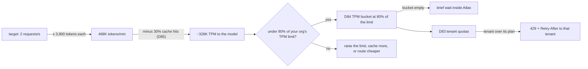
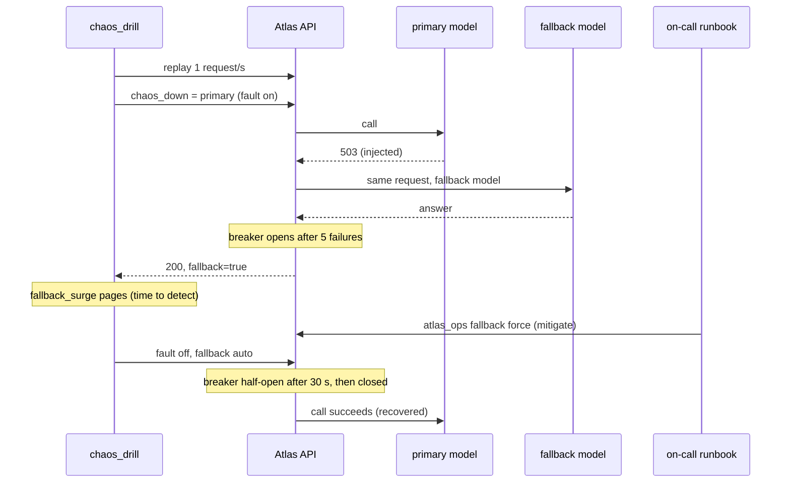
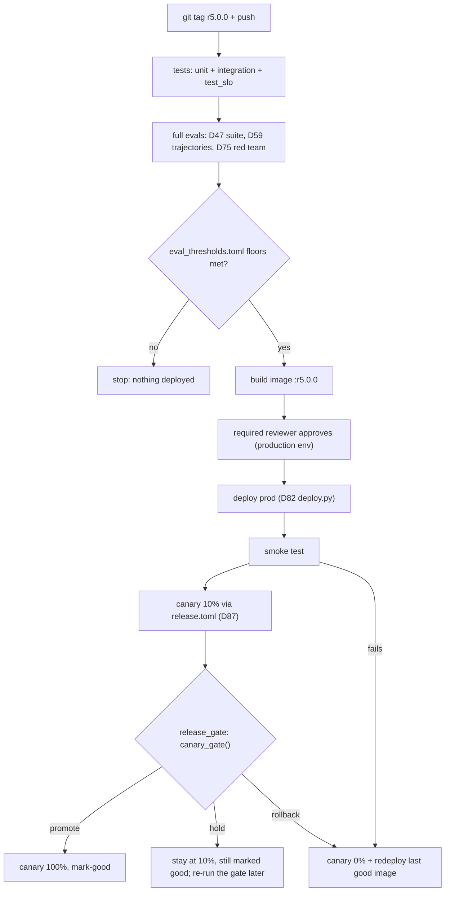
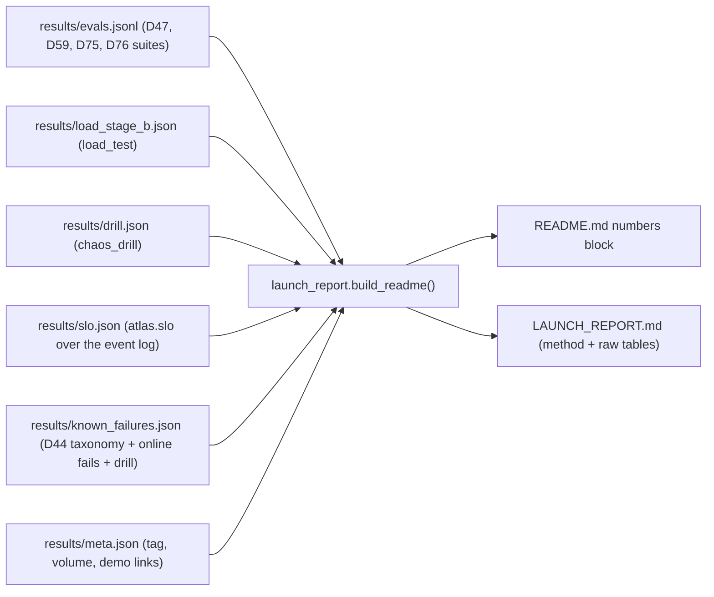

# Capstone R5, Part 2: Launch & Prove It

"It works" isn't a launch. A hiring manager or an Orbit maintainer will ask five questions: how fast, how much per request, what if the provider goes down, how good, and what still fails? Today you answer each one with a number you measured, then ship R5 to production behind the gates you built.

## At a Glance

- **Time:** ~3 h core (capstone; fine to split across two sittings) (+ optional Go Deeper) · **Depth:** working
- **Prerequisites:** [Day 89: Capstone R5, Part 1: Integrate & Harden](../../Phase_9_Production/Day_089_capstone_r5_integrate/capstone_r5_integrate.md) (your `r5.0.0-rc1` on staging); the release reuses [Day 47: Evals in CI](../../Phase_5_Evaluation_and_Observability/Day_047_evals_in_ci/evals_in_ci.md), [Day 59: Evaluating Agents](../../Phase_6_Agents/Day_059_evaluating_agents/evaluating_agents.md) and [Day 75: Red-Teaming & Security Tests in CI](../../Phase_8_Safety_and_Security/Day_075_red_teaming_ci/red_teaming_ci.md)
- **You'll build:** R5 in production: a load-test harness, a chaos drill, SLOs, a $/request report, an eval-gated release with canary and rollback, a public demo, and a numbers-first README tagged `r5.0.0`
- **Stops at:** multi-service scale (autoscaling and formal capacity planning are out of scope)
- **Fast path:** none for the finale; short on time, do Capacity on Paper, Stage B, the Chaos Drill, the Production Release and the Launch Report (~75 min)
- **Cost:** ≈ $1–5 in total, with Stage B hard-capped at $0.50 (prices as of 2026-11, [verify](https://developers.openai.com/api/docs/pricing)). Without a key, Stage A, the drill and all tests run on `ATLAS_BACKEND=stub`
- **New terms:** TPM capacity planning, open-loop load test, SLO + error budget, launch report, eval-gated production release

> **Coming from Software Engineering?** This is a production-readiness review: load test, failure drill, SLOs with error budgets, a release with rollback. Three things are new. Capacity is often bounded by the *provider's* tokens-per-minute limit, not your CPU. Quality is an SLO next to latency. And cost per request is a launch metric, because the fallback that keeps you up costs about 10× more per answer. Load is generated **open-loop** (arrival-rate testing, like k6's arrival-rate executors), which avoids *coordinated omission*: a generator that waits on a slow server never measures the slowness.

## Proving It With Numbers

Before a restaurant opens, the staff run a practice night (load test) and a fire drill (chaos), print promises and prices on the menu (SLOs, cost), then seat a few tables first (canary). R5 does the same:

| Question | Answered by | Section |
|---|---|---|
| How fast, up to what load? | `load_test` → `LoadReport` | Load test, Stages A and B |
| What if the provider goes down? | `run_chaos_drill` | Chaos Drill |
| What do we promise? | `SLOS`, `slo_report()` | SLOs and Error Budgets |
| What does a request cost? | `cost_per_request()` | Cost per Request |
| How good is it, what still fails? | full evals, known failures | Production Release, Launch Report |

**Start state:** your `r5.0.0-rc1` on staging (or the course's `r5-part1-reference` tag). Today adds:

```text
scripts/load_test.py      NEW  capacity math + open-loop generator, LoadReport (Day 93 reuses it)
atlas/chaos.py            NEW  a staging-only fault switch for the pools
scripts/chaos_drill.py    NEW  provider-outage drill on staging
atlas/slo.py              NEW  SLO, SLOS, slo_report(), cost_per_request()
scripts/release_gate.py   NEW  canary replay + Day 87's canary_gate()
scripts/launch_report.py  NEW  results/*.json -> README numbers block; eval floors
tests/test_slo.py         NEW  5 tests
.github/workflows/release.yml, eval_thresholds.toml, LAUNCH_REPORT.md   NEW (non-Python)
```

Imported, not re-printed: Day 86's `replay_traffic` and `monitoring`, Day 87's `flags`, Day 88's `ops` and `game_day`, Day 84's `resilience`, Day 83's `auth`. Day 89's `assemble_r5` writes the carried files, including `scripts/game_day.py`.

## Capacity on Paper

Start with arithmetic. **TPM capacity planning** turns a target load into the tokens per minute (TPM) the provider must accept, then checks it against your limit. Requests per minute (RPM) is the other limit, and you hit [whichever runs out first](https://developers.openai.com/api/docs/guides/rate-limits).

By hand: Day 89's replay showed an ask is roughly 3,500 input and 400 output tokens. At 2 requests/s:

- (3,500 + 400) × 2 × 60 = **468,000 TPM**
- With 30% cache hits ([Day 85](../../Phase_9_Production/Day_085_caching_cost_scale/caching_cost_scale.md)), only misses reach the model: **327,600 TPM**
- Set [Day 84](../../Phase_9_Production/Day_084_reliability_fallbacks/reliability_fallbacks.md)'s TPM bucket to about **80%** of your limit, so bursts wait inside Atlas instead of earning 429s

Read your organization's real limit from its limits page or the `x-ratelimit-limit-tokens` header (Day 84). Don't assume one, and check the fallback model's limit too: an outage sends everything there.



The first block of `load_test.py` encodes the same math:

```python
# script_id: day_090_capstone_r5_launch/scripts/load_test
# scripts/load_test.py: capacity math + an open-loop load generator for any Atlas-shaped API.
# Install: uv add httpx2 fastapi   (httpx2 also arrives with openai>=3)   Env: ATLAS_LOAD_KEYS, ORBIT_DATA
# Run: uv run python -m scripts.load_test --url https://staging.example --rps 0.2,0.5,1,2 --max-usd 0.50
# No --url: an offline demo against a toy in-process server. Day 93 reuses this file for self-hosted models.
from __future__ import annotations

import argparse
import asyncio
import json
import math
import os
import random
import time
from dataclasses import asdict, dataclass
from pathlib import Path

import httpx2


def tpm_needed(input_tokens: int, output_tokens: int, rps: float, cache_hit_rate: float = 0.0) -> int:
    """Tokens per minute the provider must accept. Cache hits never reach the model."""
    return math.ceil((input_tokens + output_tokens) * rps * 60 * (1 - cache_hit_rate))


def limiter_rate(tpm_limit: int, headroom: float = 0.8) -> float:
    """Tokens per second for Day 84's TPM TokenBucket: aim at 80% of the limit, not 100%."""
    return tpm_limit * headroom / 60


def pct(xs: list[float], q: float) -> float:
    """Nearest rank, the same rule as Day 86's pct(). Local copy: this file runs alone on the load box."""
    s = sorted(xs)
    return round(s[max(0, math.ceil(q / 100 * len(s)) - 1)], 1) if s else math.nan
```

## A Load Test That Doesn't Lie

A naive generator runs 8 virtual users that each wait for a reply before sending again: a **closed loop**. When the server slows, they send less, so the test reports a calm p95 while real users queue. That blind spot is coordinated omission.

An **open-loop load test** draws the arrival schedule in advance (Poisson: random gaps averaging 1/rps) and sends on schedule regardless, timing each request from its *scheduled* send. The **knee** is the load where p95 starts rising fast: capacity is reached and arrivals queue.

`LoadReport` keeps three failure kinds apart:

| Column | Meaning | Owner |
|---|---|---|
| `error_rate` | 5xx or a dropped connection | you, now |
| `own_429_rate` | Atlas's limiter or quota said no (Day 83) | a plan setting |
| `provider_429_rate` | provider pushback Atlas absorbed with a fallback or degraded answer (Day 84) | capacity |

```python
# script_id: day_090_capstone_r5_launch/scripts/load_test
@dataclass
class LoadReport:                  # field names are stable: Day 93 and launch_report.py read them
    rps_target: float
    rps_achieved: float
    n: int
    p50_ms: float
    p95_ms: float
    p99_ms: float
    ttft_p95_ms: float
    error_rate: float              # 5xx and transport errors: the outage column
    own_429_rate: float            # Atlas's limiter or quota said no (Day 83): a setting, not an outage
    provider_429_rate: float       # the provider pushed back and Atlas absorbed it (fallback/degraded, Day 84)
    tokens_per_min: float          # real usage from response bodies; cache hits add 0
    cost_usd: float
    aborted: int = 0               # arrivals never sent because the cost cap tripped


@dataclass
class Shot:                        # one request's outcome
    latency_ms: float
    status: int
    ttft_ms: float | None = None
    tokens: int = 0
    cost: float = 0.0
    absorbed: bool = False


@dataclass
class Spend:                       # shared by every step, so --max-usd caps the whole run
    usd: float = 0.0
```

One request; streams also time the first `token` event (time to first token, TTFT):

```python
# script_id: day_090_capstone_r5_launch/scripts/load_test
async def shoot(client: httpx2.AsyncClient, path: str, body: dict, key: str, scheduled: float) -> Shot:
    """Time from the SCHEDULED send, not the actual one: if the generator fell behind, a user still waited."""
    headers, first, data = {"Authorization": f"Bearer {key}"}, None, {}
    try:
        if path.endswith("/stream"):
            async with client.stream("POST", path, json=body, headers=headers) as r:
                status, event = r.status_code, ""
                async for line in r.aiter_lines():
                    if line.startswith("event: "):
                        event = line.removeprefix("event: ")
                        first = first or (time.perf_counter() if event == "token" else None)
                    elif line.startswith("data: ") and event == "final":
                        data = json.loads(line.removeprefix("data: "))
        else:
            r = await client.post(path, json=body, headers=headers)
            status = r.status_code
            data = r.json() if r.headers.get("content-type", "").startswith("application/json") else {}
    except httpx2.TransportError:                      # refused, reset, timed out
        status = 599
    usage = data.get("usage") or {}
    return Shot((time.perf_counter() - scheduled) * 1000, status,
                ttft_ms=(first - scheduled) * 1000 if first else None,
                tokens=usage.get("input_tokens", 0) + usage.get("output_tokens", 0),
                cost=usage.get("cost_usd", 0.0), absorbed=bool(data.get("fallback") or data.get("degraded")))
```

One step never waits for replies before the next send:

```python
# script_id: day_090_capstone_r5_launch/scripts/load_test
def summarize(rps: float, shots: list[Shot], elapsed_s: float, aborted: int) -> LoadReport:
    n, ok = len(shots), [s for s in shots if s.status == 200]    # latency of answers, not of fast 429s
    share = lambda test: round(sum(map(test, shots)) / n, 4) if n else math.nan
    lat = [s.latency_ms for s in ok]
    return LoadReport(rps, round(n / elapsed_s, 2), n, pct(lat, 50), pct(lat, 95), pct(lat, 99),
                      pct([s.ttft_ms for s in ok if s.ttft_ms is not None], 95),
                      share(lambda s: s.status >= 500), share(lambda s: s.status == 429),
                      share(lambda s: s.absorbed), round(sum(s.tokens for s in shots) * 60 / elapsed_s),
                      round(sum(s.cost for s in shots), 4), aborted)


async def run_step(client: httpx2.AsyncClient, plan: list[tuple[str, dict, str]], rps: float, step_s: int,
                   spend: Spend, max_usd: float, rng: random.Random) -> LoadReport:
    """Open loop: arrival times are drawn up front (Poisson, mean gap 1/rps) and never wait for replies."""
    start, t, tasks, aborted = time.perf_counter(), 0.0, [], 0
    for path, body, key in plan:
        t += rng.expovariate(rps)
        if t >= step_s:
            break
        if spend.usd >= max_usd:                       # checked on finished requests: leave headroom
            aborted += 1
            continue
        await asyncio.sleep(max(0.0, start + t - time.perf_counter()))
        task = asyncio.create_task(shoot(client, path, body, key, start + t))
        task.add_done_callback(lambda f: setattr(spend, "usd", spend.usd + f.result().cost))
        tasks.append(task)
    shots = await asyncio.gather(*tasks)
    return summarize(rps, list(shots), time.perf_counter() - start, aborted)
```

One step per rate, questions from Day 86's Orbit mix, stopping at `max_usd`:

```python
# script_id: day_090_capstone_r5_launch/scripts/load_test
MIX = [("/v1/ask", 0.85), ("/v1/ask/stream", 0.15)]   # ask-heavy like Day 86's replay; streams measure TTFT


async def load_test(base_url: str, *, keys: dict[str, str], rps_steps: list[float], step_s: int = 60,
                    max_usd: float = 0.5, seed: int = 0, questions: list[str] | None = None,
                    mix: list[tuple[str, float]] = MIX,
                    transport: httpx2.AsyncBaseTransport | None = None) -> list[LoadReport]:
    """One LoadReport per step. Stops early once real spend reaches max_usd."""
    if questions is None:
        from scripts.replay_traffic import build_workload   # Day 86's seeded Orbit mix (needs ORBIT_DATA)
        questions = build_workload(500, seed)
    rng, spend, reports, tenants = random.Random(seed), Spend(), [], sorted(keys)
    limits = httpx2.Limits(max_connections=2_000, max_keepalive_connections=200)   # never queue client-side
    async with httpx2.AsyncClient(base_url=base_url, timeout=60.0, limits=limits, transport=transport) as client:
        for rps in rps_steps:
            plan = [(rng.choices([p for p, _ in mix], [w for _, w in mix])[0],
                     {"question": rng.choice(questions)}, keys[rng.choice(tenants)])
                    for _ in range(int(rps * step_s * 2) + 10)]
            reports.append(await run_step(client, plan, rps, step_s, spend, max_usd, rng))
            if spend.usd >= max_usd:
                print(f"cost cap reached: ${spend.usd:.2f} of ${max_usd:.2f}; later steps skipped")
                break
    return reports
```

A table, and a toy server whose capacity you know in advance: 4 slots × 50 ms = 80 requests/s.

```python
# script_id: day_090_capstone_r5_launch/scripts/load_test
def print_table(reports: list[LoadReport]) -> None:
    print(f"{'rps':>5} {'got':>6} {'n':>5} {'p50 ms':>7} {'p95 ms':>7} {'ttft95':>7} {'5xx':>5} "
          f"{'own429':>6} {'absorb':>6} {'TPM':>9} {'$':>7}")
    for r in reports:
        print(f"{r.rps_target:5g} {r.rps_achieved:6.1f} {r.n:5} {r.p50_ms:7.0f} {r.p95_ms:7.0f} {r.ttft_p95_ms:7.0f} "
              f"{r.error_rate:5.1%} {r.own_429_rate:6.1%} {r.provider_429_rate:6.1%} {r.tokens_per_min:9,.0f} "
              f"{r.cost_usd:7.4f}")


def toy_api(slots: int = 4, service_s: float = 0.05):
    """Offline stand-in that serves `slots` requests at a time: capacity = 4 / 0.05 s = 80 requests/s."""
    from fastapi import FastAPI
    app, gate = FastAPI(), asyncio.Semaphore(slots)

    @app.post("/v1/ask")
    async def ask(body: dict) -> dict:
        async with gate:                               # arrivals beyond capacity wait here, like a busy worker
            await asyncio.sleep(service_s)
        return {"usage": {"input_tokens": 3_500, "output_tokens": 400, "cost_usd": 0.00055}}
    return app
```

```python
# script_id: day_090_capstone_r5_launch/scripts/load_test
if __name__ == "__main__":
    ap = argparse.ArgumentParser(description="Open-loop load test for the Atlas API")
    ap.add_argument("--url", help="API base URL; omit for the offline toy demo")
    ap.add_argument("--rps", default="0.2,0.5,1,2", help="comma-separated arrival rates, one step each")
    ap.add_argument("--step-s", type=int, default=60)
    ap.add_argument("--max-usd", type=float, default=0.50)
    ap.add_argument("--out", default="results/load.json")
    a = ap.parse_args()
    print(f"needed at 2 rps: {tpm_needed(3_500, 400, 2):,} TPM; with 30% cache hits: "
          f"{tpm_needed(3_500, 400, 2, 0.3):,}; bucket at 80% of an example 500,000 TPM limit: "
          f"{limiter_rate(500_000):,.0f} tokens/s")
    if a.url:
        keys = json.loads(os.environ["ATLAS_LOAD_KEYS"])        # {"loadtest": "atk_..."}: never in argv
        reports = asyncio.run(load_test(a.url, keys=keys, rps_steps=[float(x) for x in a.rps.split(",")],
                                        step_s=a.step_s, max_usd=a.max_usd))
    else:
        toy = httpx2.ASGITransport(app=toy_api())             # same process: fine for a demo, never for a test
        reports = asyncio.run(load_test("http://toy", keys={"demo": "k"}, rps_steps=[20, 60, 100], step_s=3,
                                        max_usd=5.0, questions=["How do retries back off?"],
                                        mix=[("/v1/ask", 1.0)], transport=toy))
    print_table(reports)
    Path(a.out).parent.mkdir(parents=True, exist_ok=True)
    Path(a.out).write_text(json.dumps([asdict(r) for r in reports], indent=1))
```

Offline demo, `python -m scripts.load_test` (the 500,000 TPM limit is illustrative; your numbers will differ):

```text
needed at 2 rps: 468,000 TPM; with 30% cache hits: 327,600; bucket at 80% of an example 500,000 TPM limit: 6,667 tokens/s
  rps    got     n  p50 ms  p95 ms  ttft95   5xx own429 absorb       TPM       $
   20   20.0    61      54      54     nan  0.0%   0.0%   0.0% 4,686,187  0.0335
   60   58.7   179      54      77     nan  0.0%   0.0%   0.0% 13,730,809  0.0984
  100   76.8   290     397     730     nan  0.0%   0.0%   0.0% 17,975,208  0.1595
```

At 20 and 60 requests/s p95 stays near the 50 ms service time. At 100 the toy is past capacity (it completes about 77/s) and p95 jumps more than tenfold: the knee.

## Stage A: Find Your Own Bottlenecks for Free

Stage A loads staging on `ATLAS_BACKEND=stub`: the whole pipeline runs and no tokens are bought. Step from 5 to 50 requests/s; whatever breaks is yours.

The first run usually shows `own429` near 100%: you measured the free plan's 60 requests/minute. Load tests need an internal plan:

```diff
 PLANS: dict[Plan, PlanLimits] = {             # atlas/quotas.py (Day 83)
     "demo": PlanLimits(10, 50_000, 500, 300, 1, "none"),
     "free": PlanLimits(60, 200_000, 2_000, 800, 2, "low"),
     "team": PlanLimits(300, 2_000_000, 8_000, 2_000, 3, "medium"),
+    "internal": PlanLimits(6_000, 50_000_000, 2_000, 800, 50, "low"),   # load tests + release gates only
 }
```

Add `"internal"` to the `Plan` literal (`atlas/api/auth.py`) and issue a staging-only key with `KeyStore.issue("loadtest", "internal", {"ask"})` into `ATLAS_LOAD_KEYS`.

```bash
uv run python -m scripts.load_test --url https://staging.example --rps 5,10,20,50 --step-s 60 \
  --out results/load_stage_a.json
```

Then find one bottleneck, fix it, and re-run the same steps; Go Deeper walks through the likely one in Day 89's code.

## Stage B: Real Model, Hard Cost Cap

Stage B switches staging to `ATLAS_BACKEND=reference` and buys tokens: 0.2 → 0.5 → 1 → 2 requests/s for 60 s each, at most about 220 asks. At ≈ $0.00055 per luna ask (3,500 × $0.10/1M + 400 × $0.50/1M, as of 2026-11, [verify](https://developers.openai.com/api/docs/pricing)) that's about $0.12. The `--max-usd 0.50` cap is for the surprise, a routing bug sending everything to the 10× model. Use a staging-only project key with its own spend limit.

```bash
uv run python -m scripts.load_test --url https://staging.example --rps 0.2,0.5,1,2 --max-usd 0.50 \
  --out results/load_stage_b.json
```

Read it in order: **5xx** must be 0; **own429** 0 on the internal plan; a rising **absorb** means you're near the provider's limit, so compare observed **TPM** with `tpm_needed()`. **p95 and TTFT** feed the SLOs below; **$ / n** is $/request under load.

| Stage B (reference, `gpt-6-luna`) | 0.2 rps | 0.5 rps | 1 rps | 2 rps |
|---|---|---|---|---|
| p50 / p95 / p99 (ms) | | | | |
| TTFT p95 (ms) | | | | |
| 5xx / own 429 / absorbed | | | | |
| TPM observed vs `tpm_needed()` | | | | |
| $ for the step | | | | |

Your numbers will differ; Exercise 2 measures what the cache buys.

## Chaos Drill: The Provider Goes Down

Day 88 rehearsed on a simulated clock. Now take the primary model down on staging for 5 minutes while traffic flows, and time what users saw and what you did.

A drill needs a fault switch. Every model call goes through the client inside Day 89's pools, so `ChaosClient` wraps it and fails the models named in one field of Day 88's audited override hash.

```python
# script_id: day_090_capstone_r5_launch/atlas/chaos
# atlas/chaos.py: a fault switch for staging drills. build_deps never installs it in prod.
# Stdlib + atlas. The switch is one field in Day 88's audited override hash, so drills leave a trail.
from __future__ import annotations

import time
from typing import Any

from atlas.ops import OVERRIDES_KEY, set_override
from atlas.resilience import FaultInjector

CHAOS_FIELD = "chaos_down"                 # comma-separated model ids that should fail like an outage


class ChaosClient:
    """Wraps any client with .responses.create; models named in the override fail with Day 84's fake 503."""

    def __init__(self, inner: Any, redis: Any, *, max_age_s: float = 2.0) -> None:
        self.inner, self.redis, self.max_age_s, self.responses = inner, redis, max_age_s, self
        self._down: set[str] = set()
        self._read_at = float("-inf")

    def down(self) -> set[str]:
        if time.monotonic() - self._read_at >= self.max_age_s:   # one Redis read per 2 s, like Day 88's levers
            try:
                raw = self.redis.hgetall(OVERRIDES_KEY).get(CHAOS_FIELD, "")
                self._down = {m for m in raw.split(",") if m}
            except Exception:                                    # a broken ops store never breaks requests
                pass
            self._read_at = time.monotonic()
        return self._down

    async def create(self, *, model: str, **kwargs: Any) -> Any:
        if model in self.down():
            raise FaultInjector({}, down={model}).pick(model)    # retryable 503: breakers and fallbacks react
        return await self.inner.responses.create(model=model, **kwargs)


def set_chaos(redis: Any, models: set[str], *, actor: str, reason: str) -> None:
    """An empty set turns the fault off. Audited, so the postmortem timeline has exact times."""
    set_override(redis, CHAOS_FIELD, ",".join(sorted(models)), actor=actor, reason=reason)
```

Install it in Day 89's composition root, outside prod only:

```diff
+from atlas.chaos import ChaosClient
 ...
-    pools, breakers = build_pools(ParseShim(client) if client else FakeAsyncClient(FaultInjector({})), models)
+    ops_redis = get_sync_redis(settings.redis_url)
+    inner = ParseShim(client) if client else FakeAsyncClient(FaultInjector({}))
+    if settings.env != "prod":                               # Day 90: staging can be told to fail
+        inner = ChaosClient(inner, ops_redis)
+    pools, breakers = build_pools(inner, models)
     redis = get_redis(settings.redis_url)
     settings.state_dir.mkdir(parents=True, exist_ok=True)
-    return Deps(settings=settings, redis=redis, ops_redis=get_sync_redis(settings.redis_url),
+    return Deps(settings=settings, redis=redis, ops_redis=ops_redis,
```

Day 86's availability alert watches `error_rate`, but R5 falls back to `gpt-6.1-terra`, so errors stay near zero while each answer costs about 10× more. The drill pages on the **fallback share** instead.

```python
# script_id: day_090_capstone_r5_launch/scripts/chaos_drill
# scripts/chaos_drill.py: take the primary model down on staging, replay traffic, time detection and recovery.
# Run ON the staging API host (it reads the API's event log), e.g.:
#   docker compose exec -T api python -m scripts.chaos_drill --minutes 5
# Env: ATLAS_REDIS_URL, ATLAS_STATE_DIR, ATLAS_MODEL, ATLAS_DRILL_KEYS (JSON tenant -> key; not the demo key)
from __future__ import annotations

import json
import os
import sys
import threading
import time
from dataclasses import asdict, dataclass
from pathlib import Path

from atlas.chaos import set_chaos
from atlas.monitoring import RULES, AlertRule, EventLog, evaluate_alerts
from atlas.ops import get_redis, set_override
from scripts.game_day import DrillReport             # Day 88: scenario, mttd_s, mttr_s, alerts, timeline
from scripts.replay_traffic import replay_traffic    # Day 86

# New rule: R5's fallbacks keep error_rate near 0 in an outage, so page on the fallback share instead.
FALLBACK_SURGE = AlertRule("fallback_surge", "fallback", ">", 0.2, 5, 30, "page")
DRILL_RULES = [r for r in RULES if r.name in ("availability", "spend")] + [FALLBACK_SURGE]


@dataclass
class LaunchDrill(DrillReport):
    n: int = 0                          # responses during the fault window
    availability: float = 0.0           # non-5xx share; degraded answers count as available
    fallback_share: float = 0.0         # answered by a model other than the primary
    degraded_share: float = 0.0         # cited links only, no generated answer (Day 84)
    mitigated_s: float | None = None    # fault on -> runbook lever applied
    recovered_s: float | None = None    # fault off -> first answer from the primary again
```

The loop follows Day 88's runbook: fault on after a baseline minute, alerts evaluated every 10 s, a scripted responder applying `fallback force` a minute after the page, and a `finally` that always turns the fault off.

```python
# script_id: day_090_capstone_r5_launch/scripts/chaos_drill
def run_chaos_drill(base_url: str, *, keys: dict[str, str], minutes: float = 5, rps: float = 1.0,
                    redis=None, log: EventLog | None = None, down: set[str] | None = None,
                    lead_s: float = 60, tick_s: float = 10, responder_delay_s: float = 60,
                    send=None, workers: int = 8) -> LaunchDrill:
    redis = redis or get_redis(os.environ["ATLAS_REDIS_URL"])   # unset would silently use a private in-process store
    log = log or EventLog(Path(os.environ.get("ATLAS_STATE_DIR", ".atlas")) / "events.db")
    primary = os.environ.get("ATLAS_MODEL", "gpt-6-luna")
    down = down or {primary}
    rep, seen, t0 = LaunchDrill("provider_outage"), [], time.time()
    clock = lambda: round(time.time() - t0, 1)
    note = lambda what: rep.timeline.append((clock(), what))
    on_result = lambda q, tenant, user, status, body: seen.append((clock(), status, body))
    replay = threading.Thread(target=replay_traffic, args=(base_url,), daemon=True, kwargs=dict(
        keys=keys, n=int((2 * lead_s + minutes * 60) * rps), rps=rps, send=send, workers=workers,
        on_result=on_result))
    replay.start()
    fault_on = fault_off = first_alert = None
```

```python
# script_id: day_090_capstone_r5_launch/scripts/chaos_drill
    # (run_chaos_drill continues: one pass every tick_s until the replay ends)
    try:
        while replay.is_alive():
            t = clock()
            if fault_on is None and t >= lead_s:
                set_chaos(redis, down, actor="drill", reason="game day: provider outage")
                fault_on = t
                note(f"fault on: {', '.join(sorted(down))} return 503")
            if fault_on is not None and fault_off is None and t >= fault_on + minutes * 60:
                set_chaos(redis, set(), actor="drill", reason="game day: fault off")
                set_override(redis, "force_fallback", "", actor="drill", reason="runbook: undo the lever")
                fault_off = t
                note("fault off; runbook: atlas_ops fallback auto")
            firing = {a.rule for a in evaluate_alerts(log, DRILL_RULES)}
            for name in sorted(firing - set(rep.alerts)):
                rep.alerts.append(name)
                note(f"ALERT {name}")
                if fault_on is not None and rep.mttd_s is None:
                    rep.mttd_s, first_alert = round(t - fault_on, 1), t
            if first_alert and rep.mitigated_s is None and fault_off is None and t - first_alert >= responder_delay_s:
                set_override(redis, "force_fallback", "1", actor="drill", reason="runbook step 1: provider outage")
                rep.mitigated_s = round(t - fault_on, 1)
                note("mitigation: atlas_ops fallback force")
            if rep.mitigated_s is not None and rep.mttr_s is None and not firing:
                rep.mttr_s = round(t - fault_on, 1)
                note("alerts clear")
            time.sleep(tick_s)
    finally:                                         # a drill must never leave the fault on
        set_chaos(redis, set(), actor="drill", reason="drill ended")
        set_override(redis, "force_fallback", "", actor="drill", reason="drill ended")
    return summarize_drill(rep, seen, fault_on, fault_off, primary)
```

```python
# script_id: day_090_capstone_r5_launch/scripts/chaos_drill
def summarize_drill(rep: LaunchDrill, seen: list, fault_on: float | None, fault_off: float | None,
                    primary: str) -> LaunchDrill:
    """Availability and shares over the fault window; recovery = first primary answer after fault off."""
    end = fault_off if fault_off is not None else float("inf")
    window = [(s, b) for t, s, b in seen if fault_on is not None and fault_on <= t < end]
    share = lambda test: round(sum(map(test, window)) / len(window), 4) if window else 0.0
    rep.n = len(window)
    rep.availability = share(lambda sb: sb[0] < 500)
    rep.fallback_share = share(lambda sb: sb[0] == 200 and (bool(sb[1].get("fallback")) or sb[1].get("model") != primary))
    rep.degraded_share = share(lambda sb: bool(sb[1].get("degraded")))
    back = [t for t, s, b in seen if fault_off is not None and t >= fault_off and s == 200
            and b.get("model") == primary and not b.get("fallback") and not b.get("cached")]
    rep.recovered_s = round(back[0] - fault_off, 1) if back else None
    return rep


if __name__ == "__main__":
    minutes = float(sys.argv[sys.argv.index("--minutes") + 1]) if "--minutes" in sys.argv else 5.0
    base = os.environ.get("ATLAS_API_URL", "http://localhost:8000")
    rep = run_chaos_drill(base, keys=json.loads(os.environ["ATLAS_DRILL_KEYS"]), minutes=minutes)
    print(f"availability {rep.availability:.2%}  fallback {rep.fallback_share:.0%}  "
          f"degraded {rep.degraded_share:.0%}  n={rep.n}")
    print(f"detect {rep.mttd_s}s  mitigate {rep.mitigated_s}s  alerts clear {rep.mttr_s}s  "
          f"primary back {rep.recovered_s}s after fault off")
    for t, what in rep.timeline:
        print(f"  t={t:>6}s  {what}")
    out = Path(os.environ.get("ATLAS_RESULTS_DIR", "results"))
    out.mkdir(parents=True, exist_ok=True)
    (out / "drill.json").write_text(json.dumps(asdict(rep), indent=1))
```



A scaled-down in-process run on the stub backend (a 1-minute fault, 2 requests/s, 2-s ticks, the alert window cut to 1 minute); your 7-minute staging run will differ:

```text
availability 100.00%  fallback 95%  degraded 0%  n=115
detect 8.0s  mitigate 24.0s  alerts clear 70.1s  primary back 3.4s after fault off
  t=  20.1s  fault on: gpt-6-luna return 503
  t=  28.1s  ALERT fallback_surge
  t=  44.1s  mitigation: atlas_ops fallback force
  t=  80.2s  fault off; runbook: atlas_ops fallback auto
  t=  90.3s  alerts clear
```

Availability stays at 100% because fallbacks count as available; the fallback share shows what users got. `fallback force` answers carry no `fallback=true` though each costs about 10× more, so watch `model` and $/request too. Write the drill up with Day 88's `postmortem()` template and file the gaps.

## SLOs and Error Budgets

A **service-level indicator** (SLI) measures one thing ("this ask took under 4 s"); a **service-level objective** (SLO) is its target (95% of asks over 30 days); the **error budget** is the failure it allows. At 99.5% over 30 days: 0.005 × 30 × 24 × 60 = **216 minutes (3.6 h)** of full outage. Budget left: ship. Spent: reliability first.

Every Atlas SLI judges one event row as good, bad or not counted, so one formula covers all five: `actual = good / counted` and `budget_left = 1 − (1 − actual) / (1 − target)` (1 = untouched, 0 = spent, negative = missed).

| SLO | Good when… | Target |
|---|---|---|
| availability | status < 500 (degraded counts; reported separately) | 99.5% |
| ask_latency | a 200 ask took ≤ 4,000 ms | 95% |
| ttft | first token ≤ 1,500 ms | 95% |
| quality | Day 86's sampled online checks passed | 95% |
| ask_cost | a 200 ask cost ≤ $0.002 | 95% |

Thresholds are **placeholders**: set each from Stage B's p95 × ~1.5, not from a blog post, and revisit after a week. The cost line sits between a luna ask (≈ $0.00055) and a terra ask (≈ $0.0055), so fallback-heavy days burn it.

```python
# script_id: day_090_capstone_r5_launch/atlas/slo
# atlas/slo.py: request-based SLOs over Day 86's event log, error budgets, and $/request by route.
# Stdlib + atlas. Run: uv run python -m atlas.slo --days 7 > results/slo.json   (reads $ATLAS_STATE_DIR/events.db)
from __future__ import annotations

import json
import math
import os
import sys
from collections.abc import Callable
from dataclasses import asdict, dataclass
from pathlib import Path

from atlas.monitoring import EventLog, RequestEvent, pct

Judge = Callable[[RequestEvent, "bool | None"], "bool | None"]   # (event, checks passed?) -> good? None = skip


@dataclass(frozen=True)
class SLO:
    name: str
    sli: str                   # a key of SLIS
    target: float              # share of counted requests that must be good
    window_days: int = 30


@dataclass(frozen=True)
class SLOResult:
    name: str
    target: float
    actual: float
    budget_left: float         # 1.0 untouched, 0 spent, < 0 missed
    n: int = 0


# Thresholds are PLACEHOLDERS: Stage B p95 x ~1.5, then revisit after a week of real traffic.
SLIS: dict[str, Judge] = {
    "non_5xx": lambda e, ok: e.status < 500,                    # 429s and degraded 200s are the plan working
    "ask_under_4s": lambda e, ok: e.latency_ms <= 4_000 if e.route == "ask" and e.status == 200 else None,
    "ttft_under_1500ms": lambda e, ok: e.ttft_ms <= 1_500 if e.ttft_ms is not None else None,
    "online_checks_pass": lambda e, ok: ok,                     # None unless Day 86 sampled the request
    "ask_under_0_002_usd": lambda e, ok: e.cost_usd <= 0.002 if e.route == "ask" and e.status == 200 else None,
}
SLOS = [SLO("availability", "non_5xx", 0.995), SLO("ask_latency", "ask_under_4s", 0.95),
        SLO("ttft", "ttft_under_1500ms", 0.95), SLO("quality", "online_checks_pass", 0.95),
        SLO("ask_cost", "ask_under_0_002_usd", 0.95)]
```

```python
# script_id: day_090_capstone_r5_launch/atlas/slo
def checks_by_request(log: EventLog, events: list[RequestEvent]) -> dict[str, bool]:
    """A request passes only if every code check on it passed (the same rule as Day 86's metrics())."""
    passed: dict[str, bool] = {}
    for s in log.scores(events):
        if s.source == "code":
            passed[s.request_id] = passed.get(s.request_id, True) and s.passed
    return passed


def slo_report(log: EventLog, window_days: int, slos: list[SLO] = SLOS) -> list[SLOResult]:
    events = log.window(window_days * 24 * 60)
    passed, out = checks_by_request(log, events), []
    for slo in slos:
        verdicts = [v for e in events if (v := SLIS[slo.sli](e, passed.get(e.request_id))) is not None]
        actual = sum(verdicts) / len(verdicts) if verdicts else math.nan   # no data is NOT 100%
        budget = 1 - (1 - actual) / (1 - slo.target)
        out.append(SLOResult(slo.name, slo.target, round(actual, 4), round(budget, 3), len(verdicts)))
    return out


def budget_minutes(slo: SLO) -> float:
    """The time reading of a budget: 99.5% over 30 days allows 216 minutes of full outage."""
    return (1 - slo.target) * slo.window_days * 24 * 60
```

Fill this from your staging window:

| SLO | Target | Actual (staging, 7 days) | Budget left | n |
|---|---|---|---|---|
| availability | 99.5% | | | |
| ask_latency | 95% | | | |
| ttft | 95% | | | |
| quality | 95% | | | |
| ask_cost | 95% | | | |

Expect `ttft` to read n/a with n = 0: Day 89's stream never writes `ttft_ms`, so that SLO has no SLI behind it. One line fixes it (until token streaming lands, TTFT equals answer time; say so in the README):

```diff
+            t.ev.ttft_ms = round((time.perf_counter() - t.started) * 1000, 1)   # Day 90: the TTFT SLI
             yield AgentEvent(type="token", data={"text": r.answer.text})   # one chunk: see Go Deeper
```

## Cost per Request, Honestly

`cost_per_request()` reports p50/p95 per route from **real `usage`** (Day 89 prices every event). Cache hits stay in at $0, with their savings attributed; `by="model"` shows Day 85's routing split.

```python
# script_id: day_090_capstone_r5_launch/atlas/slo
def cost_per_request(log: EventLog, by: str = "route", window_days: int = 30) -> dict[str, dict[str, float]]:
    """$/request from real usage, per route (or model, or tenant_id). Cache hits count, at $0."""
    groups: dict[str, list[RequestEvent]] = {}
    for e in log.window(window_days * 24 * 60):
        if e.status == 200:
            groups.setdefault(str(getattr(e, by)), []).append(e)
    out = {}
    for key, evs in sorted(groups.items()):
        costs, misses = [e.cost_usd for e in evs], [e.cost_usd for e in evs if not e.cached]
        hits = sum(bool(e.cached) for e in evs)
        out[key] = {"n": len(evs), "mean": sum(costs) / len(evs), "p50": pct(costs, 50), "p95": pct(costs, 95),
                    "p95_ms": pct([e.latency_ms for e in evs], 95), "cache_hit": hits / len(evs),
                    "saved_usd": hits * (sum(misses) / len(misses) if misses else 0.0)}   # Day 85's lever, priced
    return out


if __name__ == "__main__":
    days = int(sys.argv[sys.argv.index("--days") + 1]) if "--days" in sys.argv else 7
    log = EventLog(Path(os.environ.get("ATLAS_STATE_DIR", ".atlas")) / "events.db")
    print(json.dumps({"slos": [asdict(r) for r in slo_report(log, days)],
                      "cost": cost_per_request(log, window_days=days)}, indent=1))
```

A monthly projection is arithmetic on *stated* volume: 3,500 asks/day × 30 × $0.0004 mean = **$42/month** (illustrative volumes; prices as of 2026-11, verify). Price investigate separately: one run reserves up to 20,000 tokens.

Tests on a hand-made log: 200 events, 2 of them 5xx, 10 slow, 50 cache hits.

```python
# script_id: day_090_capstone_r5_launch/tests/test_slo
# tests/test_slo.py: SLO and cost math on a hand-made event log. No key, no services.
# Run: uv run pytest tests/test_slo.py -q
from __future__ import annotations

import math
import time

import pytest

from atlas.monitoring import EventLog, RequestEvent
from atlas.slo import SLOS, budget_minutes, cost_per_request, slo_report
from scripts.load_test import tpm_needed


def ev(i: int, *, status: int = 200, ms: float = 900.0, cached: bool = False) -> RequestEvent:
    return RequestEvent(request_id=f"r{i}", ts=time.time() - 60, tenant_id="acme", route="ask",
                        model="gpt-6-luna", status=status, latency_ms=ms,
                        cost_usd=0.0 if cached else 0.0005, cached=cached)


@pytest.fixture
def log(tmp_path) -> EventLog:
    log = EventLog(tmp_path / "events.db")
    for i in range(200):              # r0, r1 are 5xx; every 20th is slow; every 4th is a cache hit
        log.record(ev(i, status=503 if i < 2 else 200, ms=6_000 if i % 20 == 0 else 900, cached=i % 4 == 0))
    return log


def by_name(log: EventLog) -> dict:
    return {r.name: r for r in slo_report(log, 1)}
```

```python
# script_id: day_090_capstone_r5_launch/tests/test_slo
def test_1_tpm_by_hand():
    assert tpm_needed(3_500, 400, 2) == 468_000
    assert tpm_needed(3_500, 400, 2, cache_hit_rate=0.3) == 327_600


def test_2_availability_budget_is_overspent(log):
    a = by_name(log)["availability"]
    assert (a.actual, a.n) == (0.99, 200)            # 2 of 200 failed
    assert a.budget_left == -1.0                      # 1 failure allowed, 2 used: missed


def test_3_latency_counts_only_successful_asks(log):
    lat = by_name(log)["ask_latency"]
    assert lat.n == 198 and lat.actual == pytest.approx(189 / 198, abs=1e-4)   # 9 slow 200s


def test_4_no_data_is_nan_not_100_percent(log):
    ttft = by_name(log)["ttft"]
    assert ttft.n == 0 and math.isnan(ttft.actual)
    assert budget_minutes(SLOS[0]) == pytest.approx(216.0)


def test_5_cache_hits_cost_zero_and_are_attributed(log):
    c = cost_per_request(log)["ask"]
    assert c["n"] == 198 and c["cache_hit"] == pytest.approx(49 / 198)
    assert c["saved_usd"] == pytest.approx(49 * 0.0005) and c["p95"] == 0.0005
```

```text
.....                                                                    [100%]
5 passed
```

## The Eval-Gated Production Release

An **eval-gated production release** can't reach users unless the full quality suites pass, and it can undo itself. It runs only on a release tag, so a merge never ships by accident:

1. Keyless tests: unit, Day 89's integration tests, `test_slo`.
2. Full evals: Day 47 in `full` mode, Day 59 live, Day 75's suite (offline, plus live if you built its adapter), then the floors in `eval_thresholds.toml`.
3. Build the image, tagged with the release tag.
4. A required reviewer approves the `production` environment; deploy with Day 82's `deploy.py`.
5. Smoke test, then the canary gate: the release's behaviour change (`ask` prompt v3 → v4) serves 10% of keys while `release_gate` replays traffic through Day 87's `canary_gate()`.
6. Any failure redeploys the last good image.



The floors are policy, not benchmarks: start from rc1 minus a margin. A missing metric fails, so a suite that didn't run can't pass.

```toml
# file: eval_thresholds.toml  (launch floors; Day 47's PR thresholds stay where they are)
[floors]   # "<suite>.<metric>" = minimum. PLACEHOLDERS: set from your rc1 results.
"retrieval.recall_at_5" = 0.80
"retrieval.mrr" = 0.60
"answers.faithfulness_pass" = 0.90
"triage.label_accuracy" = 0.80
"triage.duplicate_f1" = 0.70
"agent.trajectory_pass" = 0.85
"redteam.pass_rate" = 1.0
```

Each suite reports its headline numbers with one `record_eval()` call (from `launch_report.py`, below) at the end of its runner, for example `record_eval(Path("results"), "redteam", "pass_rate", passed / total, total, "<dataset>@<version>")`.

```yaml
# file: .github/workflows/release.yml  (new; Day 82's deploy.yml keeps PRs and staging)
name: release
on:
  push:
    tags: ["r5.*"]                          # r5.0.0, r5.0.1, and rc tags like r5.0.0-rc2
permissions:
  contents: read
defaults:
  run:
    shell: bash
concurrency:
  group: release-prod                        # one production release at a time
  cancel-in-progress: false

jobs:
  test:
    runs-on: ubuntu-latest
    env: { ATLAS_BACKEND: stub, ATLAS_REDIS_URL: "fake://" }
    steps:
      - uses: actions/checkout@v7
      - uses: astral-sh/setup-uv@v10.3.3
        with: { enable-cache: true }
      - run: uv sync --locked --all-extras --dev
      - run: uv run pytest -m "not eval and not live" -q   # unit, integration (D89), test_slo
  evals:                                     # the FULL suites; PRs ran the fast tier
    needs: test
    runs-on: ubuntu-latest
    timeout-minutes: 45
    environment: release-evals               # an eval-only OpenAI key with its own spend limit
    env:
      OPENAI_API_KEY: ${{ secrets.OPENAI_API_KEY }}
      ATLAS_MODEL: gpt-6-luna
      EVAL_SUITE: full
      EVAL_OUT: evals
    steps:
      - uses: actions/checkout@v7
      - uses: astral-sh/setup-uv@v10.3.3
        with: { enable-cache: true }
      - run: uv sync --locked --all-extras --dev
      - run: uv run pytest -m eval tests/test_eval_gate.py           # Day 47: retrieval + answers
      - run: uv run python atlas/evals/run_suite_cli.py --live       # Day 59's runner (k=3) next to agent_evals.py
      - run: uv run pytest tests/security                            # Day 75: offline cases
      - run: uv run python tests/security/suite.py --out reports     # add --target live_target:live_target --k 3 once built
      - run: uv run python -m scripts.launch_report results --gate eval_thresholds.toml
      - if: always()
        run: cat results/evals.jsonl >> "$GITHUB_STEP_SUMMARY"      # copy these lines into results/ for the README
  build:
    needs: evals
    runs-on: ubuntu-latest
    permissions: { contents: read, packages: write }
    steps:
      - uses: actions/checkout@v7
      - run: |
          IMAGE="ghcr.io/${GITHUB_REPOSITORY_OWNER,,}/atlas:${GITHUB_REF_NAME}"
          echo "${{ secrets.GITHUB_TOKEN }}" | docker login ghcr.io -u "${{ github.actor }}" --password-stdin
          docker build --build-arg ATLAS_RELEASE="${GITHUB_REF_NAME}" -t "$IMAGE" .
          docker push "$IMAGE"
  deploy-prod:
    needs: build
    runs-on: [self-hosted, prod]
    environment: production                  # required reviewers: a person approves every prod deploy
    permissions: { contents: read, packages: read }
    env:
      ATLAS_ENV: prod
      ATLAS_ENV_FILE: /etc/atlas/prod.env    # ATLAS_RELEASE_FILE=/app/state/release.toml lives in here
      ATLAS_RELEASES_FILE: /var/lib/atlas/releases
    steps:
      - uses: actions/checkout@v7
      - run: |
          echo "ATLAS_IMAGE=ghcr.io/${GITHUB_REPOSITORY_OWNER,,}/atlas" >> "$GITHUB_ENV"
          echo "${{ secrets.GITHUB_TOKEN }}" | docker login ghcr.io -u "${{ github.actor }}" --password-stdin
      - run: python3 scripts/deploy.py deploy "$GITHUB_REF_NAME"
      - run: python3 scripts/smoke_test.py http://localhost:8000
        env: { ATLAS_SMOKE_KEY: "${{ secrets.ATLAS_SMOKE_KEY }}" }
      - run: docker compose exec -T api python -m scripts.release_gate --replay 1000
      - run: python3 scripts/deploy.py mark-good "$GITHUB_REF_NAME"
      - if: failure()                        # smoke or gate failed: put the last good image back
        run: python3 scripts/deploy.py rollback
```

Add the required-reviewer [protection rule](https://docs.github.com/en/actions/how-tos/deploy/configure-and-manage-deployments/manage-environments) to `production`. The prod runner is a self-hosted runner on the prod host, as Day 82 set up for staging.

Day 89 buckets canaries by API key, so a replay with three tenant keys puts zero or one key in a 10% canary. `release_gate` issues 100 short-lived keys on an internal tenant, replays 1,000 asks, then revokes them.

```python
# script_id: day_090_capstone_r5_launch/scripts/release_gate
# scripts/release_gate.py: after a prod deploy, replay traffic through the canary, then promote or roll back.
# Run on the prod host: docker compose exec -T api python -m scripts.release_gate --replay 1000
# Exit 0 = promote or hold (a hold keeps the canary %: re-run later), 1 = rollback (canary set to 0%). ~$0.50 on gpt-6-luna.
from __future__ import annotations

import math
import os
import re
import sys
import time
from pathlib import Path

from atlas.api.auth import KeyStore
from atlas.flags import GUARDS, VariantStats, canary_gate
from atlas.monitoring import EventLog, pct
from atlas.slo import checks_by_request
from scripts.replay_traffic import replay_traffic

STATE = Path(os.environ.get("ATLAS_STATE_DIR", ".atlas"))
RELEASE = Path(os.environ.get("ATLAS_RELEASE_FILE", "release.toml"))


def variant_stats(log: EventLog, minutes: int) -> dict[str, VariantStats]:
    """Day 87's VariantStats, computed from Day 86's event log (R5 writes `variant` on every row)."""
    events = [e for e in log.window(minutes) if e.route == "ask"]
    checks, out = checks_by_request(log, events), {}
    rate = lambda xs: sum(xs) / len(xs) if xs else math.nan
    for v in ("control", "canary"):
        ev = [e for e in events if e.variant == v]
        ok = [e for e in ev if e.status < 500]
        out[v] = VariantStats(n=len(ev), pass_rate=rate([checks[e.request_id] for e in ev if e.request_id in checks]),
                              citation_rate=rate([e.citations > 0 for e in ok]),
                              p95_ms=pct([e.latency_ms for e in ok], 95),
                              cost_per_request=rate([e.cost_usd for e in ev]),
                              error_rate=rate([e.status >= 500 for e in ev]))
    return out
```

```python
# script_id: day_090_capstone_r5_launch/scripts/release_gate
def set_canary_pct(path: Path, value: int) -> None:
    """Built on Day 87's helper (one canary per file). ReleaseWatcher picks the edit up: no redeploy."""
    path.write_text(re.sub(r"(?m)^pct = .*$", f"pct = {value}", path.read_text(), count=1))


def gate_keys(store: KeyStore, n: int = 100) -> dict[str, str]:
    """Canaries bucket by API key (Day 89), so the replay needs many keys. Revoked after the run."""
    return {f"gate-{i:03}": store.issue("release-gate", "internal", {"ask"}) for i in range(n)}


if __name__ == "__main__":
    n = int(sys.argv[sys.argv.index("--replay") + 1]) if "--replay" in sys.argv else 1000
    store, start = KeyStore(str(STATE / "keys.db")), time.time()
    keys = gate_keys(store)
    try:
        print(replay_traffic(os.environ.get("ATLAS_API_URL", "http://localhost:8000"), keys=keys, n=n, rps=2.0))
        time.sleep(10)                                   # let Day 86's background checks land
    finally:
        for raw in keys.values():
            store.revoke(raw.split("_")[1])              # the key id, as seed_tenants prints it
    minutes = math.ceil((time.time() - start) / 60)
    decision = canary_gate(variant_stats(EventLog(STATE / "events.db"), minutes), GUARDS)
    print(decision)
    if decision.action != "hold":
        set_canary_pct(RELEASE, 100 if decision.action == "promote" else 0)
    sys.exit(1 if decision.action == "rollback" else 0)
```

**Test the rollback once, on purpose:** tag `r5.0.0-rc2` with an `ask` v4 that drops citations, and time tag → `ROLLBACK: citation_rate …` → restored service. A rollback you've never run is a theory.

## A Public Demo That Can't Bankrupt You

A public demo link is an open door to your bill. The `demo` tenant (Day 89) is ask-only on Day 83's tightest plan: 10 requests/minute, 50,000 tokens/day, 500-token questions. Prove it before you publish:

```bash
ATLAS_LOAD_KEYS='{"demo": "<demo key>"}' uv run python -m scripts.load_test --url https://atlas.example \
  --rps 0.5 --step-s 60 --out results/demo_quota.json
```

Expect `own429` near two-thirds and no 5xx; investigate with the demo key must return 403.

Keep the key server-side. On Hugging Face Spaces it goes in the Space's **Secrets**. Free accounts can host up to 2 Gradio Spaces on ZeroGPU, and CPU Gradio Spaces need a paid plan (as of 2026-11, see the [Spaces overview](https://huggingface.co/docs/hub/spaces-overview); ⚠ verify).

Record a 2-minute demo: a cited answer, an investigation streaming its tool steps, a triage card awaiting approval, then Day 86's dashboard showing those requests.

## The Launch Report and README

A **launch report** holds the evidence behind a release: method, raw tables, drill timeline, SLOs and known failures. The README leads with the headline numbers. `launch_report.py` builds the README block from `results/`.



```python
# script_id: day_090_capstone_r5_launch/scripts/launch_report
# scripts/launch_report.py: results/*.json -> README's numbers-first block; eval floors for the release.
# Stdlib only. Run: python -m scripts.launch_report results > results/README_numbers.md
#   --gate eval_thresholds.toml : exit 1 if any eval is below its floor (or missing)
#   --sample                    : print a README from SAMPLE data (illustrative, not measured)
from __future__ import annotations

import argparse
import json
import math
import sys
import tempfile
import time
import tomllib
from pathlib import Path


def record_eval(results_dir: Path, suite: str, metric: str, value: float, n: int, dataset: str) -> None:
    """Call once per headline metric at the end of each eval runner (Days 47, 59, 75, 76)."""
    results_dir.mkdir(parents=True, exist_ok=True)
    with (results_dir / "evals.jsonl").open("a") as f:
        f.write(json.dumps({"suite": suite, "metric": metric, "value": value, "n": n, "dataset": dataset}) + "\n")


def load(results_dir: Path, name: str, default):
    p = results_dir / name
    if not p.exists():
        return default
    if name.endswith(".jsonl"):
        return [json.loads(line) for line in p.read_text().splitlines() if line.strip()]
    return json.loads(p.read_text())


def gate_evals(results_dir: Path, thresholds: Path) -> list[str]:
    floors = tomllib.loads(thresholds.read_text())["floors"]
    seen = {f"{e['suite']}.{e['metric']}": e["value"] for e in load(results_dir, "evals.jsonl", [])}
    return [f"{k}: {seen.get(k, 'missing')} < {v}" for k, v in floors.items() if not (k in seen and seen[k] >= v)]
```

```python
# script_id: day_090_capstone_r5_launch/scripts/launch_report
def fmt(x, spec: str = ".3f") -> str:
    return "n/a" if x is None or (isinstance(x, float) and math.isnan(x)) else format(x, spec)


def max_sustained(load_steps: list[dict]) -> dict:
    """The highest step with no 5xx, no own 429s and p95 within 1.5x of the lightest step: left of the knee."""
    base = load_steps[0]["p95_ms"] if load_steps else math.nan
    good = [r for r in load_steps if r["error_rate"] == 0 and r["own_429_rate"] == 0 and r["p95_ms"] <= 1.5 * base]
    return max(good, key=lambda r: r["rps_target"], default={})


def build_readme(results_dir: Path) -> str:
    meta, evals = load(results_dir, "meta.json", {}), load(results_dir, "evals.jsonl", [])
    slo, drill = load(results_dir, "slo.json", {"slos": [], "cost": {}}), load(results_dir, "drill.json", {})
    top, fails = max_sustained(load(results_dir, "load_stage_b.json", [])), load(results_dir, "known_failures.json", [])
    cost, volume = slo["cost"], meta.get("asks_per_day", {})
    out = [f"## Atlas {meta.get('tag', 'r5.0.0')}: numbers first", "",
           f"Measured {meta.get('date', time.strftime('%Y-%m-%d'))} on `{meta.get('model', 'gpt-6-luna')}`. "
           "Method and raw tables: [LAUNCH_REPORT.md](LAUNCH_REPORT.md). Prices as of 2026-11; verify at the provider.",
           "", "| Evals | Value | n | Dataset |", "|---|---|---|---|"]
    out += [f"| {e['suite']}: {e['metric']} | {fmt(e['value'])} | {e['n']} | {e['dataset']} |" for e in evals]
    out += ["", "| Cost (USD) | p50 | p95 | cache hit |", "|---|---|---|---|"]
    out += [f"| $/request, {route} | {fmt(c['p50'], '.5f')} | {fmt(c['p95'], '.5f')} | {fmt(c['cache_hit'], '.0%')} |"
            for route, c in cost.items()]
    month = cost.get("ask", {}).get("mean", math.nan) * sum(volume.values()) * 30
    out += [f"| Monthly ask projection, USD: {sum(volume.values()):,} asks/day, {len(volume)} tenants (stated volume) "
            f"| {fmt(month, ',.2f')} | | |"]
```

```python
# script_id: day_090_capstone_r5_launch/scripts/launch_report
    # (build_readme continues: latency, capacity, reliability, SLOs, known failures, links)
    out += ["", "| Latency, capacity, reliability | Value |", "|---|---|",
            f"| ask p50 / p95, ms, at {fmt(top.get('rps_target'), 'g')} rps | "
            f"{fmt(top.get('p50_ms'), '.0f')} / {fmt(top.get('p95_ms'), '.0f')} |",
            f"| TTFT p95, ms (one-chunk stream: equals answer time) | {fmt(top.get('ttft_p95_ms'), '.0f')} |",
            f"| investigate p95, ms (event log) | {fmt(cost.get('investigate', {}).get('p95_ms'), '.0f')} |",
            f"| Max sustained load before 429s or the knee | {fmt(top.get('rps_target'), 'g')} rps, "
            f"{fmt(top.get('tokens_per_min'), ',.0f')} TPM |",
            f"| Chaos drill: availability / fallback share | "
            f"{fmt(drill.get('availability'), '.2%')} / {fmt(drill.get('fallback_share'), '.0%')} |",
            f"| Chaos drill: detect / mitigate / alerts clear | {fmt(drill.get('mttd_s'), 'g')} s / "
            f"{fmt(drill.get('mitigated_s'), 'g')} s / {fmt(drill.get('mttr_s'), 'g')} s |"]
    out += [f"| SLO {r['name']}: actual vs target (budget left) | {fmt(r['actual'], '.2%')} vs {r['target']:.1%} "
            f"({fmt(r['budget_left'], '.0%')}) |" for r in slo["slos"]]
    top3 = sorted(fails, key=lambda f: -f["count"])[:3]
    out += ["", "**Known failures** (top 3 by count):"]
    out += [f"{i}. {f['failure']}: {f['count']} cases ({f['issue']})" for i, f in enumerate(top3, 1)]
    out += ["", f"**Demo:** {meta.get('demo_url', '<demo url>')} · 2-minute video: {meta.get('video_url', '<video>')}",
            "", f"**Tags:** `{meta.get('tag', 'r5.0.0')}` is this release. `r5-reference` is the course's reference "
            "solution (R1-R5 complete); `git checkout r5-reference` to compare, or to continue from it on Day 91."]
    return "\n".join(out)
```

```python
# script_id: day_090_capstone_r5_launch/scripts/launch_report
SAMPLE = {   # SAMPLE DATA, illustrative shapes only: run the real scripts for your numbers
    "meta.json": {"tag": "r5.0.0", "date": "SAMPLE (not a measurement)", "demo_url": "<demo url>",
                  "asks_per_day": {"acme": 2000, "zephyr": 1000, "orbit-maintainers": 500}},
    "evals.jsonl": [{"suite": "retrieval", "metric": "recall_at_5", "value": 0.9, "n": 40,
                     "dataset": "retrieval_queries@v1"}],
    "load_stage_b.json": [{"rps_target": 1, "p50_ms": 1500.0, "p95_ms": 3000.0, "ttft_p95_ms": 3100.0,
                           "error_rate": 0.0, "own_429_rate": 0.0, "tokens_per_min": 200000}],
    "drill.json": {"availability": 1.0, "fallback_share": 0.5, "mttd_s": 30, "mitigated_s": 90, "mttr_s": 330},
    "slo.json": {"slos": [{"name": "availability", "target": 0.995, "actual": 0.999, "budget_left": 0.8}],
                 "cost": {"ask": {"mean": 0.0004, "p50": 0.0005, "p95": 0.0009, "cache_hit": 0.3}}},
    "known_failures.json": [{"failure": "cites a tenant runbook the online check doesn't know", "count": 7,
                             "issue": "#12"}],
}

if __name__ == "__main__":
    ap = argparse.ArgumentParser()
    ap.add_argument("results", nargs="?", default="results")
    ap.add_argument("--gate", help="eval_thresholds.toml: exit 1 if any floor is missed")
    ap.add_argument("--sample", action="store_true")
    a = ap.parse_args()
    if a.gate:
        problems = gate_evals(Path(a.results), Path(a.gate))
        print("\n".join(problems) or "all eval floors met")
        sys.exit(1 if problems else 0)
    d = Path(tempfile.mkdtemp()) if a.sample else Path(a.results)
    for name, data in (SAMPLE.items() if a.sample else []):
        lines = [json.dumps(x) for x in data] if name.endswith(".jsonl") else [json.dumps(data)]
        (d / name).write_text("\n".join(lines))
    print(build_readme(d))
```

`--sample` output (illustrative numbers, not measured):

```text
## Atlas r5.0.0: numbers first

Measured SAMPLE (not a measurement) on `gpt-6-luna`. Method and raw tables: [LAUNCH_REPORT.md](LAUNCH_REPORT.md). Prices as of 2026-11; verify at the provider.

| Evals | Value | n | Dataset |
|---|---|---|---|
| retrieval: recall_at_5 | 0.900 | 40 | retrieval_queries@v1 |

| Cost (USD) | p50 | p95 | cache hit |
|---|---|---|---|
| $/request, ask | 0.00050 | 0.00090 | 30% |
| Monthly ask projection, USD: 3,500 asks/day, 3 tenants (stated volume) | 42.00 | | |

| Latency, capacity, reliability | Value |
|---|---|
| ask p50 / p95, ms, at 1 rps | 1500 / 3000 |
| TTFT p95, ms (one-chunk stream: equals answer time) | 3100 |
| investigate p95, ms (event log) | n/a |
| Max sustained load before 429s or the knee | 1 rps, 200,000 TPM |
| Chaos drill: availability / fallback share | 100.00% / 50% |
| Chaos drill: detect / mitigate / alerts clear | 30 s / 90 s / 330 s |
| SLO availability: actual vs target (budget left) | 99.90% vs 99.5% (80%) |

**Known failures** (top 3 by count):
1. cites a tenant runbook the online check doesn't know: 7 cases (#12)

**Demo:** <demo url> · 2-minute video: <video>

**Tags:** `r5.0.0` is this release. `r5-reference` is the course's reference solution (R1-R5 complete); `git checkout r5-reference` to compare, or to continue from it on Day 91.
```

Known failures start from Day 89's list plus today's drill gaps and missed SLOs, each with a count and an issue link. A README with none reads as untested.

The `LAUNCH_REPORT.md` template:

```markdown
<!-- file: LAUNCH_REPORT.md -->
# Atlas r5.0.0 launch report (<date>, <git sha>)
## Method
- Load: open-loop Poisson arrivals, scripts/load_test.py, generator on <machine>, steps <list>, 60 s each.
- Stage A (stub): <table>. Bottleneck found: <what>, fix: <commit>, before/after: <table>.
- Stage B (gpt-6-luna, cap $0.50): <table>; TPM observed vs tpm_needed(): <values>.
## Chaos drill (staging, <date>)
- Fault: <models> down for 5 min at 1 rps. Availability <x>, fallback <y>, degraded <z>.
- Timeline: <rep.timeline>. Postmortem: <link> (Day 88 template). Gaps filed: <issues>.
## SLOs (window <days>)
<slo table: target, actual, budget left, n>
## Cost
<cost_per_request by route and by model; cache savings; monthly projection with stated volumes>
## Evals at release
<evals.jsonl table with dataset versions and n; floors from eval_thresholds.toml>
## Known failures
<each: description, count, source (D44 taxonomy / online checks / drill), issue link>
```

Once the gate promotes, tag it: `git tag -a r5.0.0 -m "R5: Atlas in production"`, then push. The course's reference solution is the `r5-reference` tag (R1–R5 with today's files; ⚠ the repo link ships with the course materials). Diff against it, or `git checkout r5-reference` to start Phase 10 from known-good code.

## What Launch Taught You

| Choice | R5 picks | Pick the other when |
|---|---|---|
| One instance, in-process cache | simple, measured | you need replicas: Redis cache, Postgres event log |
| Canary by API key | stable per caller | many users share a key: bucket by user id |
| Fallback keeps availability | users get answers | cost or quality beats uptime: degrade (Exercise 3) |

Multi-service scale is the stop line; Exercise 4 is a first step.

### In production

- Review SLOs and error budgets weekly; spent budget puts reliability ahead of features.
- Re-run the drill after any change to fallbacks or alerts.
- Put Day 88's model shutdown dates next to the SLO review.
- Re-run Stage B before a 2× traffic jump, and ramp rather than jump.
- Rotate the demo key on a schedule, and at once if its spend alert fires.

These numbers answer [Day 97](../../Phase_11_Career_Launch/Day_097_system_design_interviews/system_design_interviews.md)'s "how would you scale it?", the drill is a STAR story for [Day 98](../../Phase_11_Career_Launch/Day_098_practical_interviews/practical_interviews.md), and R1–R5 anchor [Day 99](../../Phase_11_Career_Launch/Day_099_portfolio/portfolio.md)'s portfolio. [Day 93](../../Phase_10_Open_Models_and_Fine_Tuning/Day_093_vllm_serving/vllm_serving.md) reuses `load_test.py`.

## Go Deeper (optional)

<details><summary>Go deeper: the Stage A bottleneck hunt</summary>

Look for synchronous work on the event loop. Day 89's code has three candidates: `KeyStore.lookup` (a SQLite read in auth), `deps.events.record` (a SQLite write in `finish()`), and the semantic cache's linear scan over every stored entry. Here is the event-log write moved to a thread, still shielded from cancellation:

```diff
     t.ev.status, t.ev.latency_ms = status, round((time.perf_counter() - t.started) * 1000, 1)
-    deps.events.record(t.ev)                                # metrics only: no question or answer text
+    with anyio.CancelScope(shield=True):                    # a cancelled request still gets its row
+        await asyncio.to_thread(deps.events.record, t.ev)   # Stage A fix: SQLite off the event loop
```

Re-run the same steps and fill both rows from your runs; your numbers will differ by machine. If 50 requests/s is still flat, you have headroom far beyond what the provider will sell you, and that's the finding.

| Stage A (stub) | 5 rps | 10 rps | 20 rps | 50 rps |
|---|---|---|---|---|
| p95 before the fix (ms) | | | | |
| p95 after the fix (ms) | | | | |
| 5xx / own 429 | | | | |
| API CPU / generator CPU | | | | |

</details>

<details><summary>Go deeper: coordinated omission, measured</summary>

Point both kinds of generator at the same overloaded toy server. The closed loop has 8 virtual users, each waiting for its reply. The open loop sends 120 requests/s on schedule against an 80/s capacity.

```python
# script_id: day_090_capstone_r5_launch/closed_vs_open
# Coordinated omission, measured: one overloaded toy server, a closed-loop and an open-loop generator.
# Needs scripts/load_test.py (httpx2 + fastapi). No key, no services.
import asyncio
import random
import time

import httpx2

from scripts.load_test import Spend, pct, run_step, shoot, toy_api


async def closed_loop(client: httpx2.AsyncClient, users: int, seconds: float) -> list[float]:
    """Each virtual user waits for its reply before sending again, and times from its own send."""
    lat, stop = [], time.perf_counter() + seconds

    async def user() -> None:
        while time.perf_counter() < stop:
            s = await shoot(client, "/v1/ask", {"question": "q"}, "k", time.perf_counter())
            lat.append(s.latency_ms)
    await asyncio.gather(*(user() for _ in range(users)))
    return lat


async def main() -> None:
    async with httpx2.AsyncClient(base_url="http://toy", transport=httpx2.ASGITransport(app=toy_api())) as c:
        lat = await closed_loop(c, users=8, seconds=3)
        print(f"closed loop: {len(lat) / 3:.0f} requests/s got through, p95 {pct(lat, 95):.0f} ms")
        r = await run_step(c, [("/v1/ask", {"question": "q"}, "k")] * 1_000, 120, 3, Spend(), 99.0,
                           random.Random(0))
        print(f"open loop at 120/s: {r.rps_achieved:.0f} requests/s got through, p95 {r.p95_ms:.0f} ms")

asyncio.run(main())
```

```text
closed loop: 79 requests/s got through, p95 105 ms
open loop at 120/s: 77 requests/s got through, p95 1453 ms
```

Both generators hit the same throughput ceiling. The closed loop reports a p95 of about two service times because it stopped sending while the server was busy; the open loop shows the queue real users would sit in. Gil Tene named this blind spot *coordinated omission* in his talks on latency measurement. Tools such as wrk2 and k6's arrival-rate executors are built to avoid it.

</details>

<details><summary>Go deeper: burn-rate alerts on SLOs</summary>

Day 86's alerts fire on thresholds ("fallback share > 20% over 5 minutes"). SLO-based alerting asks a different question: **at this rate, when will the error budget run out?** The burn rate is the observed bad share divided by the allowed bad share. With a 99.5% target the allowed share is 0.5%, so a 5% error rate is a burn rate of 10: a 30-day budget gone in 3 days.

The pattern from Google's SRE workbook pairs a fast and a slow window. Page when the burn rate exceeds about 14 over both the last hour and the last 5 minutes: that spends about 2% of a 30-day budget in an hour, and the short window makes the alert stop soon after recovery. Open a ticket when the rate exceeds about 1 over 3 days. With `slo_report()` this is two calls with different windows and one comparison; `window_days` accepts fractions if you change its type to `float`. Check the multipliers against the workbook's "Alerting on SLOs" chapter before adopting them; they assume a 30-day window. The book and workbook are linked from the [SRE book table of contents](https://sre.google/sre-book/table-of-contents/).

</details>

<details><summary>Go deeper: reading your provider headroom during a test</summary>

`LoadReport.provider_429_rate` sees pushback only after Atlas absorbed it. To see the ceiling coming, read the provider's own counters: every Responses API reply carries `x-ratelimit-remaining-tokens` and `x-ratelimit-reset-tokens` (plus request and project variants), documented in the [rate-limits guide](https://developers.openai.com/api/docs/guides/rate-limits). Day 84's `ratelimit_headers` block shows how to read them with `client.responses.with_raw_response.create(...)`. During Stage B, add a sidecar that sends one tiny request every 10 s with the same project key and logs `remaining / limit`. When that ratio drops below about 10% at a load step, you've found the provider knee before any user got a 429. The guide also warns that a sudden rise in traffic can earn `slow_down` 429s even within your limits, which is one more reason Stage B ramps in steps.

</details>

## Common Pitfalls

- **A calm p95 under overload.** A closed-loop generator sends less exactly when the server is slow. Schedule arrivals open-loop and time from the scheduled send.
- **The generator saturates first.** On the API's box, you measure your laptop. Run it elsewhere and watch its CPU; `rps_achieved` well below target at low load is the tell.
- **`own429` near 100%, blamed on the provider.** It's your limiter (`{"error": "rate_limited"}` + `Retry-After`). Keep the three columns apart and load-test on an `internal`-plan key.
- **A real-model test burns the budget.** Always pass `--max-usd` with headroom (it counts finished requests), on a project key with a spend limit.
- **SLO targets copied from blog posts.** Derive them from Stage B plus headroom, treat `nan` as no data, and revisit after a week.
- **The demo key leaks** into the UI repo or the browser. Keep it in platform secrets, the tenant ask-only, and prove the quota before posting the link.

> **Where we stop:** R5 is live on one instance with measured numbers; multi-service scale and formal capacity planning are out of scope (the [SRE book](https://sre.google/sre-book/table-of-contents/) is the next step).

## Key Takeaways

- A launch is proven by numbers. Start on paper: tokens per request × rps × 60, minus cache hits, against *your* TPM limit, with the limiter at about 80%.
- Generate load open-loop and time from the scheduled send. Hunt your own bottlenecks keylessly (Stage A), then take a small, capped look at the real model (Stage B).
- A chaos drill measures what users saw (availability, fallback and degraded shares) and what you did (detect, mitigate, recover). In R5 an outage shows up as fallback share and cost, not errors.
- SLOs are targets for request-level SLIs with an error budget, set from measurements plus headroom. Quality and cost are SLOs too, and no data is not 100%.
- Ship from a tag through full evals, an approval, a smoke test and a canary gate, with a rollback you've run once, and lead the README with numbers and known failures.

## Quick Reference

| API / pattern | Use it for | Gotcha |
|---|---|---|
| `tpm_needed(in, out, rps, cache_hit_rate)` | capacity before any test | read your real limit |
| `load_test(url, keys=, rps_steps=, max_usd=)` | Stage A and B | `internal`-plan key, open loop |
| `own_429_rate` / `provider_429_rate` / `error_rate` | reading a step | three owners; never sum them |
| `ChaosClient`, `set_chaos()` | staging drills | never in prod; `finally` clears it |
| `run_chaos_drill(url, keys=, minutes=5)` | outage rehearsal | run where the event log lives |
| `slo_report(log, days)`, `cost_per_request(log)` | weekly review | `nan` = no SLI data |
| `on: push: tags` + `environment: production` | prod releases | merges never ship |
| `release_gate` + `canary_gate()` | after a prod deploy | needs many keys |

## Exercises

1. **Warm-up: read the tails.** Add a p99 column to the load table, flag steps where p99 > 3 × p95, and print one line counting the arrivals the cost cap aborted.

<details><summary>Solution</summary>

`LoadReport` already carries `p99_ms` and `aborted`; the table only has to show them. A p99 far above p95 means a few requests hit a wall (a cold connection, a retry, a fallback) that the p95 hides.

```python
# script_id: day_090_capstone_r5_launch/solution_ex1
# Load table v2: a p99 column, a tail flag and an aborted-by-cost-cap line. Needs scripts/load_test.py.
from scripts.load_test import LoadReport


def print_table_v2(reports: list[LoadReport]) -> None:
    print(f"{'rps':>5} {'n':>5} {'p50':>6} {'p95':>6} {'p99':>6} {'5xx':>5} {'own429':>6} {'$':>7}")
    for r in reports:
        tail = "  <- p99 > 3x p95" if r.p99_ms > 3 * r.p95_ms else ""
        print(f"{r.rps_target:5g} {r.n:5} {r.p50_ms:6.0f} {r.p95_ms:6.0f} {r.p99_ms:6.0f} "
              f"{r.error_rate:5.1%} {r.own_429_rate:6.1%} {r.cost_usd:7.4f}{tail}")
    aborted, sent = sum(r.aborted for r in reports), sum(r.n for r in reports)
    if aborted:
        print(f"cost cap: {aborted} of {aborted + sent} arrivals aborted ({aborted / (aborted + sent):.0%})")


if __name__ == "__main__":   # toy reports, not measurements
    print_table_v2([LoadReport(1, 1.0, 60, 850, 1900, 2400, 1200, 0, 0, 0, 230_000, 0.03),
                    LoadReport(2, 1.9, 104, 900, 2600, 9100, 1500, 0, 0.02, 0, 450_000, 0.06, aborted=16)])
```

```text
  rps     n    p50    p95    p99   5xx own429       $
    1    60    850   1900   2400  0.0%   0.0%  0.0300
    2   104    900   2600   9100  0.0%   2.0%  0.0600  <- p99 > 3x p95
cost cap: 16 of 180 arrivals aborted (9%)
```

</details>

2. **Core: caching as capacity.** Re-run Stage B with the semantic cache off and on, and report the TPM, p95 and $/request deltas per step.

<details><summary>Solution</summary>

Add a `NoCache` with the same surface as Day 85's `SemanticCache`, and select it in `build_deps` with `cache=NoCache() if os.environ.get("ATLAS_CACHE") == "off" else SemanticCache(...)`. Run Stage B twice with different `--out` files, then compare. Expect TPM and $/request to drop with the cache on, roughly by the hit rate, and p95 to move little, because the slow requests are the misses.

```python
# script_id: day_090_capstone_r5_launch/solution_ex2
# Cache off vs on: a NoCache drop-in for build_deps, and a delta table for two saved load runs.
# Run: python solution_ex2.py results/load_cache_on.json results/load_cache_off.json
import json
import sys
from pathlib import Path


class NoCache:
    """Day 85's SemanticCache surface that never hits: ATLAS_CACHE=off in build_deps."""
    def lookup(self, scope: str, query: str) -> None:
        return None

    def store(self, scope: str, query: str, answer: object) -> None:
        pass

    def invalidate(self, prefix: str) -> int:
        return 0


def deltas(on: list[dict], off: list[dict]) -> None:
    per = lambda r: r["cost_usd"] / r["n"] if r["n"] else float("nan")
    print(f"{'rps':>5} {'TPM on':>9} {'TPM off':>9} {'p95 on':>7} {'p95 off':>7} {'$/req on':>9} {'$/req off':>9}")
    for a, b in zip(on, off):
        print(f"{a['rps_target']:5g} {a['tokens_per_min']:9,.0f} {b['tokens_per_min']:9,.0f} {a['p95_ms']:7.0f} "
              f"{b['p95_ms']:7.0f} {per(a):9.5f} {per(b):9.5f}")


if __name__ == "__main__":
    if len(sys.argv) == 3:
        deltas(*(json.loads(Path(p).read_text()) for p in sys.argv[1:]))
    else:
        print("usage: solution_ex2.py <load_cache_on.json> <load_cache_off.json>")
```

</details>

3. **Core: reliability vs quality.** Run the chaos drill twice, once with fallback models available and once degraded-only (every model down), and compare availability, degraded share and citation rate.

<details><summary>Solution</summary>

Degraded-only means taking down every model in the pools, not only the primary, because Day 89's `build_deps` always adds `STRONG` to them. Availability stays at about 100% in both runs. What changes is what users got: real answers from the fallback, or cited links only. Day 86's online checks score only model answers, so read the degraded share as the quality signal. Wait between runs so the 5-minute alert windows drain.

```python
# script_id: day_090_capstone_r5_launch/solution_ex3
# Fallback vs degraded-only: the same drill twice. Run on the staging API host, like chaos_drill.
# Env: as scripts/chaos_drill.py. Cost: two drills of ~420 requests each on the reference backend.
import json
import os
import time
from pathlib import Path

from atlas.monitoring import EventLog, metrics
from scripts.chaos_drill import run_chaos_drill

if __name__ == "__main__":
    keys, base = json.loads(os.environ["ATLAS_DRILL_KEYS"]), os.environ.get("ATLAS_API_URL", "http://localhost:8000")
    log = EventLog(Path(os.environ.get("ATLAS_STATE_DIR", ".atlas")) / "events.db")
    primary = os.environ.get("ATLAS_MODEL", "gpt-6-luna")
    every = {primary, *os.environ.get("ATLAS_FALLBACK_MODELS", "gpt-6.1-terra").split(","),
             os.environ.get("ATLAS_STRONG_MODEL", "gpt-6.1-terra")} - {""}
    print(f"{'mode':14} {'avail':>7} {'fallback':>8} {'degraded':>8} {'cited':>6}")
    for label, down in [("fallback", {primary}), ("degraded-only", every)]:
        rep = run_chaos_drill(base, keys=keys, minutes=5, down=down, log=log)
        m = metrics(log.window(7))                     # the drill's 7 minutes
        print(f"{label:14} {rep.availability:7.1%} {rep.fallback_share:8.0%} {rep.degraded_share:8.0%} "
              f"{m['citation_rate']:6.0%}")
        time.sleep(300)                                # let the alert windows drain before the next run
```

</details>

4. **Stretch (optional): two replicas.** Run two API replicas behind your platform's load balancer, or two compose services on different ports, and show that the rate limit and the kill switch still hold across both.

<details><summary>Solution</summary>

Quotas and kill switches live in Redis, so they're shared. The semantic cache and the SQLite event log are per replica: the hit rate drops, and SLO reports need both logs or a shared Postgres log (Day 86 notes the swap). This script proves the two shared guards.

```python
# script_id: day_090_capstone_r5_launch/solution_ex4
# Two replicas, one set of limits. Needs both replicas running and two tenant keys in the env.
# Run: ATLAS_ACME_KEY=... ATLAS_ZEPHYR_KEY=... python solution_ex4.py http://localhost:8001 http://localhost:8002
import json
import os
import sys
import urllib.error
import urllib.request


def ask(base: str, key: str, q: str = "How do retries back off?") -> tuple[int, dict]:
    req = urllib.request.Request(f"{base}/v1/ask", json.dumps({"question": q}).encode(),
                                 {"Content-Type": "application/json", "Authorization": f"Bearer {key}"})
    try:
        with urllib.request.urlopen(req, timeout=60) as r:
            return r.status, json.loads(r.read())
    except urllib.error.HTTPError as e:
        return e.code, {}


if __name__ == "__main__":
    a, b = (sys.argv[1:3] + ["http://localhost:8001", "http://localhost:8002"])[:2]
    codes = [ask((a, b)[i % 2], os.environ.get("ATLAS_ACME_KEY", ""))[0] for i in range(61)]
    assert codes[:60] == [200] * 60 and codes[60] == 429, f"limit not shared: {codes.count(429)} x 429"
    print("rate limit shared: request 61 got 429 from the other replica")
    input("run `python -m atlas.ops fallback force --reason ex4`, wait 5 s, press Enter ")
    key = os.environ.get("ATLAS_ZEPHYR_KEY", "")
    models = {ask(u, key, q)[1].get("model") for u in (a, b) for q in ("What is a lease?", "What is a flow?")}
    assert models == {"gpt-6.1-terra"}, f"kill switch not shared: {models}"
    print("kill switch shared: both replicas answer on the fallback model")
```

Run Day 88's CLI as `python -m atlas.ops` (R5 keeps it in `atlas/ops.py`) with `REDIS_URL` set to the API's `ATLAS_REDIS_URL`. Undo the lever afterwards with `python -m atlas.ops fallback auto --reason ex4-done`.

</details>

## References & Further Reading

- [OpenAI: Rate limits](https://developers.openai.com/api/docs/guides/rate-limits): RPM/TPM, usage tiers, `x-ratelimit-*` headers.
- [OpenAI: Pricing](https://developers.openai.com/api/docs/pricing): the prices behind every $/request here (as of 2026-11).
- [GitHub: Managing environments](https://docs.github.com/en/actions/how-tos/deploy/configure-and-manage-deployments/manage-environments): required reviewers and secrets for `production`.
- [GitHub: Workflow syntax](https://docs.github.com/en/actions/reference/workflows-and-actions/workflow-syntax): tag filters, `needs`, `environment`, `if: failure()`.
- [Google SRE book](https://sre.google/sre-book/table-of-contents/): the "Service Level Objectives" chapter; its workbook covers alerting on SLOs.
- [Hugging Face: Spaces overview](https://huggingface.co/docs/hub/spaces-overview): hosting the demo UI and its Secrets.
- Gil Tene's talk "How NOT to Measure Latency": the classic on coordinated omission (search the title; hosting changes).

## What's Next

R5 is live, measured and tagged: that closes the production phase. [Day 91: Open-Weight Models & Local Inference](../../Phase_10_Open_Models_and_Fine_Tuning/Day_091_open_weight_local/open_weight_local.md) opens Phase 10 by running Atlas on a model you host yourself, swapping the `base_url` behind the same code.
