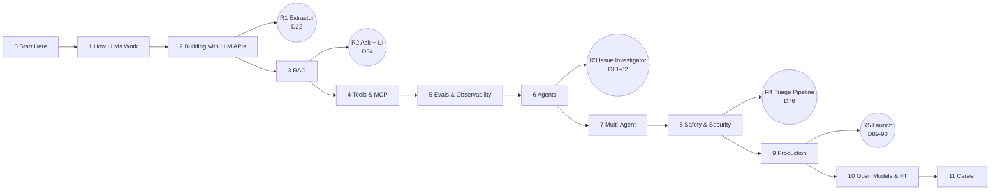

# Syllabus v2: 100 Days from Software Engineer (or Fresher) to AI Engineer

> **Status: REVISED DRAFT for Gate 2 (owner approval).**
>
> **Sources:**
> - 100 per-day digests (`.restructure/v2/days/`) and the coverage map (`.restructure/v2/coverage.md`)
> - Research in `.restructure/v2/research/`: A (landscape and job signal), B (currency, verified against OpenAI docs and PyPI on 2026-11-06), C (fresher lens)
> - A stress test by three reviewers (fresher, senior engineer, curriculum red-team) in `.restructure/v2/personas/`. What changed is listed at the end.
>
> **Conventions:** "old N" means a day in the current course (see `CURRENT_SYLLABUS.md`). **⚠ verify** marks a claim that `FACTS_PACK` must confirm against live docs before the lesson is written. If it can't be confirmed, it gets dropped.

## Design rules

1. **Order = dependency order.** No day's Learn or Build uses a concept from a later day.
   Forward mentions are pointers only ("we go deeper in Day N").
2. **Evals come back at every stage:**
   - D7: hand-checked comparison
   - D20: first eval set
   - D23: labelled queries
   - D29–30: RAG eval
   - D42–47: the full discipline, before agents
   - D59: agent eval
   - D75: red-team suite
   - D87: eval-gated releases

   Every eval-phase Build must show a **measured improvement** to the product.
3. **Security appears where each risk first shows up:**
   - D28: indirect injection via documents, plus permission-filtered retrieval
   - D37: approval gates on the first tool with side effects
   - D68–76: the deep dive
4. **One product, "Atlas", in five releases.**
   - Each release starts from the previous release's tagged reference solution, so a stuck learner can continue.
   - Each ships a numbers-first README (eval scores, $/request, p95, known failures) and a 2-minute demo.
5. **Stack:**
   - **Model API:** OpenAI Responses (`client.responses.*`) is primary. Chat Completions appears once (D12), for legacy code and OpenAI-compatible servers. **Anthropic** appears only in D2 and D7.
   - **Agent runtime:** LangGraph (1.x, with OpenAI models) for the capstones. The OpenAI Agents SDK (pre-1.0, pinned) is taught as the alternative (D56, D65).
   - **Tooling:** Gradio for UIs; Python ≥ 3.11 with uv.
   - **Model IDs:** one `MODEL` constant per lesson. Default to the cheapest current model (`gpt-6-luna` ⚠ verify).
   - **Never taught** (retired or closing): the OpenAI Evals platform, Assistants API, Agent Builder, reusable prompt objects, OpenAI self-serve fine-tuning, GPTCache.
6. **Every day declares four things:**
   - **Depth** (intro / working / deep)
   - **Stops at** (its ceiling, from research A §4)
   - **Fast path** (what an experienced engineer can skip)
   - **Cost** (estimated API spend for its Build on the default model)

   Math lives only in optional *Under the hood* asides.
7. **Fresher support:**
   - 13 appendix primers outside the 100 days, each tied to a "read before" day.
   - A plain-language version next to every SWE analogy, and terms defined before use.
   - Sync code first; async is optional until D22.
   - A no-cost way to share every artifact (a Gradio `share=True` link, local, or a free tier where one actually exists; FACTS_PACK serving_ft_prod).
8. **Every hardware- or account-dependent Build has a fallback:** Colab for GPUs, local for cloud, file-based for audio.
9. **Each repeated topic has one owner.** The day marked "**Owns:**" teaches it in full. Later days teach only the new part ("**Reuses:** Dxx").

## Phase map

| # | Phase | Days | Capstone | Why here |
|---|---|---|---|---|
| 0 | Start Here | 1–2 | — | Orientation + a working setup and first call on Day 2 |
| 1 | How LLMs Work | 3–7 | — | The mental model, kept short |
| 2 | Building with LLM APIs | 8–22 | **R1 · D22** | Prompting, the SDK, structured output, reliability, cost, tests, first evals |
| 3 | Retrieval (RAG) | 23–34 | **R2 · D34** | Data access before actions; first UI + free hosting |
| 4 | Tools & MCP | 35–41 | — | Actions, tool design, MCP, workflow patterns (pre-agent) |
| 5 | Evaluation & Observability | 42–47 | — | The #1 skill in job postings (52%); agents need a harness first |
| 6 | Agents | 48–63 | **R3 · D61–62** | Loop → context → planning → LangGraph → HITL → eval; career checkpoint on D63 |
| 7 | Multi-Agent Systems | 64–67 | — | "When not to" comes first |
| 8 | Safety & Security | 68–76 | **R4 · D76** | Threat model → defenses by architecture → red-teaming |
| 9 | Production | 77–90 | **R5 · D89–90** | Serve, UI, deploy, tenants, reliability, cost, monitoring, releases, operations |
| 10 | Open Models & Fine-Tuning (advanced) | 91–96 | — | Self-hosting and fine-tuning on open weights (6% of postings) |
| 11 | Career Launch | 97–100 | — | System design, practical interviews, portfolio, launch |

Action tags: **REWRITE** (same topic) · **MERGE** (several old days into one) · **NEW** ·
**REPLACE** (the slot gets a new topic).

---

## Phase 0: Start Here

### D001 · The AI Engineer: Role, Skills & How to Use This Course · `REWRITE`
- **Why:** You need a map before the journey: what AI engineers do (vs ML engineers and data scientists), and how your skills transfer.
- **Learn:** the role and the 2026 job signal; dual-track guidance (switching roles vs first role); the course structure, primers and Atlas storyline; how to read the lesson markers (depth, stop line, fast path).
- **Build:** a self-scored skills audit (revisited on D63 and D100).
- **Prereqs:** none · **Depth:** intro · **Stops at:** no code · **Fast path:** skim the role table · **Cost:** $0
- **From:** old 1.

### D002 · Setup & Your First LLM Call · `NEW`
- **Why:** Every later day runs code, so get a safe, working setup on day one.
- **Learn:**
  - uv and Python ≥ 3.11, with pinned dependencies.
  - API keys, `.env` files, never committing secrets, spend limits, and a **whole-course budget estimate** (⚠ verify prices).
  - A first `client.responses.create`: reading `output_text` and `usage`, and working out what one call cost.
  - One Anthropic "hello", for comparison only.
  - The Atlas repo, with an `AGENTS.md` so coding assistants are used responsibly from the start.
- **Build:** `hello_llm.py` and the Atlas project skeleton.
- **Prereqs:** D1; primers A1, A2, A5 (status codes) · **Depth:** intro · **Stops at:** SDK internals (D12) · **Fast path:** seniors do only the first call and the cost calc (30 min) · **Cost:** < $0.01
- **From:** old 10 (install/keys), old 1:288.

## Phase 1: How LLMs Work

### D003 · What an LLM Is (and Isn't) · `NEW`
- **Why:** A correct mental model prevents most beginner mistakes, such as expecting facts, determinism or memory.
- **Learn:** next-token prediction; how models are built (pretraining → post-training, intuition only); hallucination and the knowledge cutoff; statelessness; what models are good and bad at.
- **Build:** a probe script that shows non-determinism, the knowledge cutoff, and a confident wrong answer.
- **Prereqs:** D2; primer A11a (model words) · **Depth:** intro · **Stops at:** training math; architecture (D5) · **Fast path:** skim if you've shipped an LLM feature · **Cost:** < $0.01
- **From:** old 3 (framing).

### D004 · Tokens: How Models Read Text · `REWRITE`
- **Why:** Tokens drive cost, context limits and odd failures (spelling, numbers, other languages).
- **Learn:**
  - BPE intuition.
  - Counting tokens locally with `o200k_base`, as a **labelled approximation** (tiktoken has no gpt-6 entry).
  - Exact counts from the token-count endpoint (⚠ verify).
  - Token economics by hand, and token-boundary gotchas.
- **Build:** `count_tokens()` plus a back-of-envelope cost sheet. (The cost *tracker* comes in D12.)
- **Prereqs:** D2–3 · **Depth:** working · **Stops at:** implementing or training a tokenizer · **Fast path:** gotchas section only · **Cost:** ~$0
- **From:** old 2 (texting-shorthand BPE diagram).

### D005 · Inside the Transformer: Attention & Context Windows · `REWRITE`
- **Why:** Attention explains context limits, "lost in the middle", and why long prompts add latency.
- **Learn:**
  - Attention as a fuzzy lookup, in words and pictures. Q/K/V names go in *Under the hood*.
  - Context windows and the **>272K long-context surcharge** (⚠ verify).
  - The KV cache as a cost/latency idea.
  - Context rot.
- **Build:** a context-budget calculator, plus a **multi-needle-with-distractors** test (not the saturated single-needle test).
- **Prereqs:** D4 · **Depth:** intro · **Stops at:** matrix math, positional-encoding math · **Fast path:** diagrams + experiment · **Cost:** ~$0.05
- **From:** old 3 (fuzzy-join analogy, "your app drops messages" diagram).

### D006 · Controlling Generation: Sampling & Reasoning Effort · `MERGE`
- **Why:** You need to know which generation knobs exist on modern models, and which are now off-limits.
- **Learn:**
  - Next-token distributions.
  - **Offline temperature/top-p simulators as the core**, so learners can see sampling on any model.
  - Live sampling only with `reasoning={"effort":"none"}` on models that allow it (⚠ verify which).
  - Why sampling params are rejected otherwise.
  - Effort levels vs latency and cost; `max_output_tokens` and the `incomplete` status; determinism for tests.
- **Build:** the simulators, plus an effort sweep that prints cost and latency.
- **Prereqs:** D3–5 · **Depth:** working · **Stops at:** logit math, beam search, RL training · **Fast path:** effort section · **Cost:** ~$0.05
- **From:** old 4 (simulators, salvage #3), old 5 (penalties reduced to one line).

### D007 · Choosing a Model: Capability, Cost, Latency & Lifecycle · `NEW`
- **Why:** Model choice is the biggest lever on cost and quality, and model IDs go stale within a single cohort.
- **Learn:**
  - Tiers (cheap / mid / flagship) and effort; open-weight vs hosted.
  - Reading pricing pages; measuring total latency.
  - Lifecycle: GPT-6 models are alias-only (no dated snapshots), so pinning is shown with a model that has snapshots (`gpt-5.5` → `gpt-5.5-2026-04-23`), alongside real shutdowns (o3/gpt-5 on 2026-12-11; gpt-4o on 2027-01-14).
  - Reading model IDs from config.
  - The provider landscape, with Claude as one comparison row.
- **Build:** the same task across tiers, graded on **10 hand-checked items (exact match)**, producing a cost/latency/accuracy table. It's redone with real evals in D20–21.
- **Prereqs:** D4, D6 · **Depth:** working · **Stops at:** benchmark methodology · **Fast path:** lifecycle + table · **Cost:** ~$0.10
- **From:** old 11 (model selection), old 33 (pricing).

## Phase 2: Building with LLM APIs

### D008 · Messages, Roles & Conversation State · `REWRITE`
- **Why:** Roles and statelessness are the foundation of every chat app and agent.
- **Learn:**
  - Instructions vs developer/user/assistant inputs; system-prompt anatomy.
  - **The Responses output-item model.**
  - Carrying history yourself (`input += response.output`).
  - `previous_response_id`, which still bills the prior tokens.
  - `store` defaults to true (⚠ verify).
  - Pointers: compaction (a documented feature, not a preview) is covered in D49; `store=False` in D73. `previous_response_id` can't be combined with `conversation`.
- **Build:** a CLI chat with a persona and explicit history.
- **Prereqs:** D2–7 · **Depth:** working · **Stops at:** memory (D50), context engineering (D49) · **Fast path:** output-item model · **Cost:** ~$0.02
- **From:** old 6 (stateless diagram, "where does it go" flowchart), old 36.

### D009 · Writing Effective Prompts · `NEW`
- **Why:** Clear prompts beat clever tricks. This is the core craft.
- **Learn:** being specific (goal, audience, constraints, format); delimiters and XML/Markdown sections; templates and variables; decomposition; positive vs negative instructions; anti-patterns ("magic phrases").
- **Build:** a template library, plus a before/after rewrite of a weak prompt.
- **Prereqs:** D8 · **Depth:** working · **Stops at:** automated optimization (D21) · **Fast path:** anti-patterns · **Cost:** ~$0.02
- **From:** old 6 (templates), old 94 (anti-patterns).

### D010 · Few-Shot Prompting · `REWRITE`
- **Why:** Examples are the fastest way to pin down format, tone and labels.
- **Learn:** zero-shot vs few-shot; choosing and ordering examples; the token cost of shots; dynamic selection (pointer to D23); when structured outputs replace format examples.
- **Build:** a few-shot classifier vs zero-shot, scored on a small labelled set (accuracy only).
- **Prereqs:** D9; primer A12 (eval metrics basics) · **Depth:** working · **Stops at:** fine-tuning (D94) · **Fast path:** example selection · **Cost:** ~$0.05
- **From:** old 7.

### D011 · Reasoning: Chain-of-Thought & Reasoning Models · `MERGE`
- **Why:** Know when to prompt a model to "think", and when to just raise its effort setting.
- **Learn:**
  - Chain-of-thought (CoT) prompting, taught as a **heuristic** (most useful at effort `none`; unverified as a rule, so say so).
  - Reasoning models and effort; hidden reasoning tokens and their cost.
  - Extracting final answers; reasoning items across turns.
  - Self-consistency as an **offline aside**: "re-run a flaky test, trust the majority".
- **Build:** a "same problem, three ways" benchmark: plain, CoT, effort.
- **Prereqs:** D6, D10 · **Depth:** working · **Stops at:** how reasoning models are trained · **Fast path:** effort vs CoT table · **Cost:** ~$0.10
- **From:** old 8 (self-consistency, salvage #5), old 9.

### D012 · The OpenAI SDK in Production Code · `MERGE`
- **Why:** Real code needs error handling, timeouts, retries, usage tracking and visibility.
- **Learn:**
  - Error types, and the SDK's built-in retries and timeouts.
  - httpx2 note (⚠ verify).
  - **Owns:** the usage → cost tracker (one for the whole course).
  - **Basic local tracing:** log every call; local Phoenix + OpenInference auto-instrumentation (this traces `responses.create`; the official OTel openai-v2 instrumentation does not).
  - The async client as an *optional* block; a one-box Chat Completions comparison.
  - An optional zero-cost aside on pointing `base_url` at a local model (see D91).
- **Build:** `llm.py`, a helper (call, cost log, trace, errors) reused for the rest of the course.
- **Prereqs:** D2, D8; primer A4a (optional) · **Depth:** working · **Stops at:** SDK internals, custom backoff (D84) · **Fast path:** cost tracker + tracing · **Cost:** ~$0.02
- **From:** old 10 (finish_reason as truncated HTTP, usage → cost), old 11.

### D013 · Streaming Responses · `MERGE`
- **Why:** Streaming is the baseline UX for every chat and agent app.
- **Learn:** time to first token (TTFT); typed Responses stream events; collect-while-streaming; cancellation; usage on streams. Terminal only; HTTP/SSE serving is D77.
- **Build:** a streaming CLI chat that reports TTFT and throughput.
- **Prereqs:** D12; primer A5 · **Depth:** working · **Stops at:** web transports (D77, D79) · **Fast path:** event types table · **Cost:** ~$0.02
- **From:** old 12, old 13.

### D014 · Multimodal Inputs: Images, Files & Audio · `REWRITE`
- **Why:** Screenshots, PDFs and voice notes are routine inputs, and native file input changes when you need a parser at all.
- **Learn:** `input_image` and image token cost (count it with the token-count endpoint; published figures exist only for some models); `input_file` for PDFs; transcription with `gpt-transcribe` (⚠ verify; whisper-1 retires 2027-02-26); extracting text vs sending the file.
- **Build:** a screenshot → structured bug report converter, plus a one-shot PDF Q&A.
- **Prereqs:** D12 · **Depth:** working · **Stops at:** vision internals, realtime voice (D81) · **Fast path:** file input · **Cost:** ~$0.10
- **From:** old 32, old 10 (vision).

### D015 · Pydantic for LLM Apps · `REWRITE`
- **Why:** Typed, validated data is how model output becomes safe to use.
- **Learn:** Pydantic v2 models, types, coercion, validators and nesting; `Field` descriptions → JSON Schema; validating untrusted output.
- **Build:** the Atlas schema library, with validation tests.
- **Prereqs:** D12; primer A3 · **Depth:** working · **Stops at:** custom core schemas · **Fast path:** "LLM-specific Pydantic" section only (20 min) · **Cost:** $0
- **From:** old 14 ("TypeScript of Python", JSON Schema ≈ OpenAPI).

### D016 · Structured Outputs: Native JSON Schema & Extraction · `MERGE`
- **Why:** Native strict schemas make JSON output reliable, and extraction is the most common production LLM task.
- **Learn:** `responses.parse(text_format=Model)`; strict mode and schema limits; refusals; JSON mode vs structured outputs; extraction patterns (multi-entity, optional fields, enums, "unknown").
- **Build:** the Atlas document extractor, the core of R1.
- **Prereqs:** D15 · **Depth:** working · **Stops at:** constrained-decoding internals · **Fast path:** none; this is core · **Cost:** ~$0.05
- **From:** old 14 (extraction), old 29 (strict mode, annotated schema).

### D017 · Handling Semantic Failures: Validate, Re-ask, Bound · `REWRITE`
- **Why:** Valid JSON can still be wrong. Catch semantic failures and recover safely.
- **Learn:** semantic validation; re-asking with the error as feedback; capping attempts; configuring SDK retries and timeouts. **D84 owns custom backoff and circuit breakers.**
- **Build:** `reliable_extract()` with feedback retry.
- **Prereqs:** D16; primer A10 · **Depth:** working · **Stops at:** network resilience (D84) · **Fast path:** feedback-retry pattern · **Cost:** ~$0.05
- **From:** old 15 (failure → recovery table, feedback-retry sequence).

### D018 · Cost & Latency Engineering: Caching, Batch & Budgets · `REWRITE`
- **Why:** Cost and latency decide whether a feature ships.
- **Learn:**
  - **Owns: provider prompt caching** (prefix ordering, billed cache writes, TTLs; ⚠ verify).
  - Batch/Flex for **offline (deferred) jobs**.
  - Choosing effort and tier per task.
  - Per-run and per-job budgets (per-user quotas are D83).
- **Build:** a caching experiment that measures hit rate and savings, extending the D12 tracker.
- **Prereqs:** D7, D12 · **Depth:** working · **Stops at:** semantic caching and routing (D85) · **Fast path:** caching math · **Cost:** ~$0.10
- **From:** old 33 (with its caching math fixed).

### D019 · Testing LLM Code · `REWRITE`
- **Why:** Glue code, parsing and retries need tests that don't call the API.
- **Learn:** the testing pyramid for LLM apps; mocking the client; recorded-response fixtures; schema/contract tests; prompt snapshots; markers for live tests; CI basics.
- **Build:** a mocked pytest suite for the extractor, plus a GitHub Actions workflow.
- **Prereqs:** D16–17; primer A9 (includes a first Actions workflow) · **Depth:** working · **Stops at:** quality evals (D20) · **Fast path:** LLM-specific fixtures + snapshots · **Cost:** $0
- **From:** old 16 (test table, typed mock factory, tiered CI).

### D020 · Your First Eval Set · `NEW`
- **Why:** Tests check your code; evals check the model's behaviour. Start the habit now.
- **Learn:** a golden set; code-based checks (exact, contains, schema, tolerance); binary pass/fail; pass-rate thresholds; running a small sample in CI; reading failures.
- **Build:** `evals/` for the extractor: 20 cases, a runner and a CI gate.
- **Prereqs:** D16, D19; A12 · **Depth:** intro · **Stops at:** judges, error analysis (D43–46) · **Fast path:** none · **Cost:** ~$0.05/run
- **From:** old 16, old 17 (the Evaluate concept).

### D021 · Prompts as Code & Model Migrations · `MERGE`
- **Why:** Prompts and model IDs change constantly. Version them, and gate changes with evals.
- **Learn:**
  - A **file-based** prompt registry (OpenAI's reusable prompts close 2026-11-30).
  - Model IDs driven by config; regression testing with the D20 set.
  - **Owns:** the small-scale model-migration drill.
  - An optional DSPy section (`model_type="responses"`; ⚠ verify).
- **Build:** the registry, plus `migrate_model.py`, which re-runs evals and reports the diff.
- **Prereqs:** D9, D20 · **Depth:** working · **Stops at:** production A/B testing (D87) · **Fast path:** migration drill · **Cost:** ~$0.10
- **From:** old 94 (PromptRegistry), old 17 (DSPy, as a section).

### D022 · Capstone R1: The Extractor · `REWRITE`
- **Why:** Assemble Phase 2 into a tested, evaluated pipeline.
- **Learn:** integrating schemas, structured outputs, re-asking, streaming progress, batching, cost reporting, tests and evals. This is the first required async code (gather + semaphore; primer A4a).
- **Build:** **R1 Extractor**, turning docs and issues into typed records. Ships with field-level accuracy, $/1k docs, p95 latency, a tagged reference solution and a README.
- **Prereqs:** D8–21 · **Depth:** working · **Stops at:** serving (D77) · **Fast path:** start from the starter repo · **Cost:** ~$0.50
- **From:** old 18 (ETL bridge, pipeline flowchart, semaphore batch; fixes its multi-file `script_id` bug).

## Phase 3: Retrieval (RAG)

### D023 · Embeddings & Semantic Similarity · `MERGE`
- **Why:** Embeddings let software compare meaning, which powers search, RAG, dedup and routing.
- **Learn:** embeddings as meaning-vectors; cosine on normalized vectors (vs dot product and L2); the embeddings API (dimensions, batching, cost, caching); **a 20-query labelled set and hit@k**, to evaluate on *your* data (reused in D25–27).
- **Build:** numpy semantic search over the Atlas corpus, with a hit@k report.
- **Prereqs:** D12; primers A6, A12 · **Depth:** working · **Stops at:** training embedders · **Fast path:** labelled-set section · **Cost:** ~$0.02
- **From:** old 19 ("hash for meaning"), old 20 ([1,1] vs [2,2] demo), old 21.

### D024 · Ingesting Documents: Parsing PDFs, HTML & More · `REWRITE`
- **Why:** Parsing quality caps RAG quality.
- **Learn:** plain-text vs layout-aware extraction; pypdf/pdfplumber (pypdf 7; ⚠ verify); HTML cleanup; OCR and model-based parsing for scans; native file input as the alternative (D14); keeping structure and metadata.
- **Build:** `load_document()`, which keeps headings, tables and metadata.
- **Prereqs:** D14 · **Depth:** working · **Stops at:** writing parsers · **Fast path:** structure preservation · **Cost:** ~$0
- **From:** old 24 (with its newline bug fixed).

### D025 · Chunking Strategies · `REWRITE`
- **Why:** Chunking decides what retrieval can find.
- **Learn:** token-aware fixed-size; recursive and structure-aware; overlap; semantic chunking; **contextual chunk headers** (contextual *retrieval* is D31); comparing chunkers with D23's hit@k.
- **Build:** a `Chunker` with 3 strategies, plus a hit@k comparison.
- **Prereqs:** D4, D23, D24 · **Depth:** working · **Stops at:** late chunking · **Fast path:** comparison table · **Cost:** ~$0.05
- **From:** old 25 (before/after diagram, markdown-header chunker; fixes its overlap bugs).

### D026 · Vector Search with pgvector · `MERGE`
- **Why:** Vector search is just a table with a vector column and `ORDER BY distance LIMIT k`. pgvector is the default production vector store.
- **Learn:**
  - pgvector, run from a **ready-made `compose.yaml`**.
  - Distance operators; HNSW vs IVFFlat, tuned with hit@k.
  - Content-hash IDs, upserts (`ON CONFLICT`), deletes and metadata filters.
  - When a dedicated vector DB is worth it (comparison table).
- **Build:** `index.py`, which stores chunks and runs filtered search.
- **Prereqs:** D23, D25; primers A7 (read during D23–25), A8 (read the day before) · **Depth:** working · **Stops at:** ANN internals · **Fast path:** HNSW table + upsert pattern · **Cost:** ~$0.05
- **From:** old 22 ("indexed column ranked by similarity", HNSW table), old 23 (content-hash dedup).

### D027 · Hybrid Search: Keywords + Vectors · `MERGE`
- **Why:** Vectors miss exact terms such as error codes and names.
- **Learn:** Postgres full-text search (`tsvector`, `ts_rank_cd`; **not true BM25**, since it has no corpus statistics; true BM25 comes from an extension or `rank_bm25`, as an aside); reciprocal rank fusion (RRF); **Owns:** metadata and permission (ACL) filters as a mechanism; when keyword-only search wins.
- **Build:** `hybrid_search()` with RRF, compared against vector-only search on hit@k.
- **Prereqs:** D26 · **Depth:** working · **Stops at:** learned sparse retrieval (aside) · **Fast path:** RRF · **Cost:** ~$0.02
- **From:** old 22 (hybrid search, with its LEFT JOIN bug fixed), old 23.

### D028 · Building the RAG Pipeline: Grounded Answers with Citations · `REWRITE`
- **Why:** The core pattern: retrieve, assemble, answer, cite.
- **Learn:** assembling context within a token budget; grounding and saying "I don't know"; citations; multi-turn RAG. **Security touchpoint:** indirect injection through a poisoned document, and "filter by authorization, then rank".
- **Build:** `ask()`, which answers with citations.
- **Prereqs:** D16, D27 · **Depth:** working · **Stops at:** agentic retrieval (D52) · **Fast path:** security touchpoint · **Cost:** ~$0.05
- **From:** old 26 (RAG as dependency injection), old 62 (poisoned-doc diagram), old 67 ("filter by authorization, then rank").

### D029 · Evaluating Retrieval · `MERGE`
- **Why:** Most bad RAG answers are retrieval failures. Measure before tuning.
- **Learn:** growing the labelled set; **core metrics: recall@k and MRR** (precision@k and NDCG go in *Under the hood*); diagnosing whether a failure is retrieval, ranking or generation.
- **Build:** a retrieval eval harness, plus a baseline report.
- **Prereqs:** D23, D28 · **Depth:** working · **Stops at:** IR research metrics · **Fast path:** diagnosis tree · **Cost:** ~$0.02
- **From:** old 92 (harness, diagnosis tree; fixes its recall@k claim), old 23 ("answer key as unit test").

### D030 · Evaluating RAG Answers · `MERGE`
- **Why:** A faithful answer and a relevant answer are different things.
- **Learn:** faithfulness, answer relevance and context relevance; a **hand-built** binary judge (the full discipline is D45–46); reference-free vs reference-based evals; DeepEval as an optional extra; RAGAS mentioned only, not installed: a fresh 0.4.3 install breaks and downgrades openai (RAGAS `evaluate()` is deprecated; ⚠ verify).
- **Build:** an answer eval for `ask()`, added to the runner.
- **Prereqs:** D20, D28 · **Depth:** intro · **Stops at:** judge validation (D46) · **Fast path:** judge prompt · **Cost:** ~$0.10
- **From:** old 60, old 58 (RAG judge).

### D031 · Improving Retrieval: Reranking & Contextual Retrieval · `MERGE`
- **Why:** These are the highest-leverage fixes, once you can measure.
- **Learn:**
  - **Core:** reranking (a managed API or a small cross-encoder; ⚠ verify IDs).
  - **Core:** contextual retrieval (LLM-written chunk context + BM25), including what it costs.
  - **Optional:** multi-query and HyDE.
  - Measuring each change with D29.
- **Build:** a before/after table: vector → hybrid → +rerank → +contextual.
- **Prereqs:** D29 · **Depth:** working · **Stops at:** training rerankers · **Fast path:** results table · **Cost:** ~$0.30
- **From:** old 92 (reranking), old 26 (multi-query).

### D032 · Long Context vs RAG & Managed Retrieval · `NEW`
- **Why:** Sometimes the right answer is "don't build RAG at all".
- **Learn:**
  - Long-context trade-offs: cost, latency, lost-in-the-middle, the 272K surcharge.
  - Prompt caching for large static context (reusing D18).
  - **Owns:** hosted `file_search` and vector stores (⚠ verify pricing).
  - A decision table.
- **Build:** the same questions answered three ways, comparing cost and quality.
- **Prereqs:** D18, D29 · **Depth:** working · **Stops at:** vendor-specific tuning · **Fast path:** decision table · **Cost:** ~$0.50
- **From:** old 26 (RAG vs long-context flowchart).

### D033 · RAG over Structured Data: Text-to-SQL, Tables & Graphs · `NEW`
- **Why:** Much business data lives in databases, not documents.
- **Learn:** text-to-SQL as **structured output plus validated execution** (read-only connection **plus** `setlimit(SQLITE_LIMIT_ATTACHED, 0)`, a sqlglot SELECT-only check, allowlists, row limits; `mode=ro` alone still lets `ATTACH` write); table QA; knowledge graphs/GraphRAG and when relationships pay off (optional; neo4j 6, ⚠ verify).
- **Build:** a safe `ask_sql()` over the Atlas issues database (SQLite).
- **Prereqs:** D16, D28; A7 · **Depth:** working · **Stops at:** ontology design · **Fast path:** safety section · **Cost:** ~$0.05
- **From:** old 27 (GraphRAG, now a section).

### D034 · Capstone R2: Ask, a RAG Assistant with a UI · `REWRITE`
- **Why:** Turn Phase 3 into a measured, cited assistant that other people can try.
- **Learn:** using R1 records as chunk metadata; the full ingest → hybrid → rerank → cite pipeline; retrieval and answer evals in CI; a **~20-line Gradio front end** shared with a free temporary `share=True` link as the first shareable artifact (free HF CPU Spaces now need PRO; permanent hosting comes in D82).
- **Build:** **R2 Ask**: chat with citations, a before/after eval table, a demo of permission-filtered retrieval, and a public demo URL.
- **Prereqs:** D22–33 · **Depth:** working · **Stops at:** exposing it as a tool (D40), production serving (D77) · **Fast path:** starter repo · **Cost:** ~$0.50
- **From:** old 34 (now built from the phase's own pieces), old 86 (Gradio basics).

## Phase 4: Tools & MCP

### D035 · Function Calling: The Tool Loop · `MERGE`
- **Why:** Tools let a model act and fetch live data. They're the building block of every agent.
- **Learn:** the model never runs your code, you are the executor; function tools; the Responses loop (`function_call` → `function_call_output`); `tool_choice`; iteration caps.
- **Build:** an Atlas assistant with real tools: `search_issues`, `get_doc_section`, and a safe AST-based calculator.
- **Prereqs:** D12, D16 · **Depth:** working · **Stops at:** autonomous agents (D48) · **Fast path:** loop diagram + code · **Cost:** ~$0.05
- **From:** old 28 (sequence diagram, max rounds), old 30, old 35 (AST calculator).

### D036 · Designing Tools: Schemas, Strict Mode & Descriptions · `MERGE`
- **Why:** Tool quality affects reliability more than prompts do.
- **Learn:** Pydantic → tool schema; strict mode and its limits; naming and namespacing; descriptions; token-efficient responses; error messages the model can act on; consolidating tools.
- **Build:** a refactored toolset, scored before and after on a 20-case tool-choice eval.
- **Prereqs:** D20, D35 · **Depth:** working · **Stops at:** tool search over huge toolsets (aside) · **Fast path:** design checklist · **Cost:** ~$0.10
- **From:** old 29 (Pydantic → JSON Schema table).

### D037 · Robust Tool Execution: Parallel Calls, Errors & Approvals · `REWRITE`
- **Why:** Real tools time out, fail and have side effects.
- **Learn:** parallel tool calls; transient vs permanent errors; timeouts that actually return; idempotency. **Security touchpoint:** approval gates for side effects, and the lethal trifecta (preview of D68).
- **Build:** a `ToolExecutor` with timeouts, error envelopes and an approval hook.
- **Prereqs:** D17, D35; primer A4b · **Depth:** working · **Stops at:** sandboxing (D72) · **Fast path:** error taxonomy · **Cost:** ~$0.05
- **From:** old 31 (transient/permanent taxonomy, dead-letter-queue bridge; fixes its timeout bug).

### D038 · Built-in Tools: Web Search & Code Interpreter · `NEW`
- **Why:** Hosted tools cover common needs without any infrastructure.
- **Learn:** web search with citations ($ per call; ⚠ verify); the code interpreter / hosted execution; when built-in beats DIY; programmatic tool calling (⚠ verify, or drop). File search belongs to D32.
- **Build:** a research helper that combines web search with your own tool.
- **Prereqs:** D35 · **Depth:** working · **Stops at:** computer use (D72) · **Fast path:** cost/when table · **Cost:** ~$0.20
- **From:** new.

### D039 · MCP: Connecting to Tool Servers · `REPLACE` (moved from old 95)
- **Why:** MCP is to tools what LSP is to editors: one protocol, many clients and servers.
- **Learn:**
  - Hosts, clients and servers; tools, resources and prompts.
  - Transports (stdio, Streamable HTTP); the 2026 spec revision (⚠ verify).
  - Using a **public remote** server through the Responses API.
  - Using a **local stdio** server through your own Python MCP client.
  - Finding servers in the registry.
- **Build:** an assistant that uses one public remote server and one local server.
- **Prereqs:** D35–36 · **Depth:** working · **Stops at:** JSON-RPC internals; OAuth (D74) · **Fast path:** architecture diagram · **Cost:** ~$0.05
- **From:** old 95 (N×M diagram, client parts), updated to MCP SDK v2.

### D040 · Building an MCP Server · `REPLACE` (moved from old 95)
- **Why:** Wrapping your systems as MCP servers makes them usable from any agent or IDE.
- **Learn:** `MCPServer` (SDK v2; ⚠ verify) tools and resources; input validation; read-only by default; Streamable HTTP; testing with a Python test client (the Inspector needs Node; ⚠ verify); versioning.
- **Build:** an **R2-as-MCP** server (`search_docs`, `ask`), run locally. Remote hosting and OAuth come in D74.
- **Prereqs:** D34, D39 · **Depth:** working · **Stops at:** auth servers · **Fast path:** server skeleton · **Cost:** ~$0.02
- **From:** old 95 (server, `safe_path`; fixes its writable-SQL issue).

### D041 · Workflow Patterns: Chaining, Routing & Parallelization · `NEW`
- **Why:** Most "agent" problems are better solved with a fixed workflow.
- **Learn:** prompt chaining with gates; routing; parallelization (sectioning, voting); **code-decided** orchestrator–workers; **Owns: evaluator–optimizer**; workflow vs agent.
- **Build:** an **Atlas issue-router** workflow: classify → route → parallel checks → evaluator loop.
- **Prereqs:** D16, D35; A4a · **Depth:** working · **Stops at:** agents (D48), LLM-decided supervisors (D66) · **Fast path:** pattern table · **Cost:** ~$0.10
- **From:** old 50 (patterns).

## Phase 5: Evaluation & Observability

### D042 · Tracing & Observability in Depth · `MERGE`
- **Why:** You can't debug or evaluate what you can't see. D12 logged single calls; now you trace whole systems.
- **Learn:** traces and spans for LLM, tool and retrieval steps; OpenTelemetry GenAI conventions (status: Development, now in the `semantic-conventions-genai` repo) as the emerging standard; auto-instrumentation via **Phoenix/OpenInference by default** (it records `llm.*` attributes, and the official openai-v2 instrumentation doesn't yet trace Responses) (LangSmith and Langfuse optional); token, latency and cost metrics (p50/p95).
- **Build:** tracing for R2 and D41, plus a cost/latency dashboard.
- **Prereqs:** D12, D34, D41; A10 · **Depth:** working · **Stops at:** writing exporters · **Fast path:** OTel attribute table · **Cost:** ~$0.05
- **From:** old 56, old 57.

### D043 · Building Eval Datasets: Golden, Synthetic & Production · `NEW`
- **Why:** The dataset *is* the eval. Coverage and labels matter more than metrics.
- **Learn:** golden sets; synthetic generation (dimensions × personas, filtering, dedup); planning for production samples (D86); labelling; versioning; small-sample caveats.
- **Build:** a 100-case versioned dataset for R2.
- **Prereqs:** D20, D29 · **Depth:** working · **Stops at:** benchmark construction · **Fast path:** synthetic-generation recipe · **Cost:** ~$0.20
- **From:** old 77 (synthetic generation, from the eval angle).

### D044 · Error Analysis: From Traces to Failure Modes · `NEW`
- **Why:** Good evals come from looking at real failures, not from generic metrics.
- **Learn:** running the D43 set through traced R2; open coding → a failure taxonomy; prioritizing by frequency × impact; turning failure modes into binary criteria. **Owns:** the failure-taxonomy method (D58 applies it to agents).
- **Build:** a failure-mode table, three new criteria, and **a measured fix to R2**.
- **Prereqs:** D42, D43 · **Depth:** working · **Stops at:** qualitative-research methods · **Fast path:** taxonomy template · **Cost:** ~$0.10
- **From:** old 47 (failure modes).

### D045 · LLM-as-Judge · `REWRITE`
- **Why:** Open-ended quality needs a grader that scales.
- **Learn:** one judge per failure mode; binary verdicts over Likert scales; structured verdicts with reasons; pairwise comparison; cost-tiered judging.
- **Build:** judges for R2's top failure modes, added to the runner.
- **Prereqs:** D16, D44 · **Depth:** working · **Stops at:** fine-tuned judges · **Fast path:** judge template · **Cost:** ~$0.20
- **From:** old 58 (pairwise comparison).

### D046 · Trusting Your Judge · `REWRITE`
- **Why:** An unvalidated judge is just another opinion.
- **Learn:** **core:** percent agreement and TPR/TNR against ~30 human labels; position and verbosity bias (position-swap test); anchors and calibration; iterating on the judge. Kappa and confidence intervals go in *Under the hood*.
- **Build:** a judge-vs-human agreement report.
- **Prereqs:** D45; A12 · **Depth:** intro→working · **Stops at:** psychometrics · **Fast path:** swap test + agreement · **Cost:** ~$0.10
- **From:** old 59 (position-swap test, anchors, kappa worked example 7/10 → 0.615).

### D047 · Evals in CI: Regression Gates at Scale · `NEW`
- **Why:** Evals only protect you if they block bad changes. R2 already has a basic gate; now make it robust.
- **Learn:** fast vs full suites; flake handling and repeats; sampling and caching to control cost; diff comments on PRs; gating a model migration; a pytest harness by default, Promptfoo optional (Node; ⚠ verify).
- **Build:** a CI workflow that catches a deliberately seeded R2 regression and comments the diff.
- **Prereqs:** D19, D21, D45 · **Depth:** working · **Stops at:** building an eval platform · **Fast path:** flake handling · **Cost:** ~$0.10/run
- **From:** old 16 (tiered CI), old 94 (regression).

## Phase 6: Agents

### D048 · Your First Agent: The Loop, Stop Conditions & Budgets · `MERGE`
- **Why:** An agent is a loop in which the model picks the next step. Build it by hand so frameworks never feel like magic.
- **Learn:** the loop on native tool calls (not regex-parsed ReAct); stop conditions (done, steps, time, tokens, errors); budgets; graceful shutdown that returns a partial result; tracing each step.
- **Build:** `run_agent()` from scratch, with Atlas tools (R2 search, issues).
- **Prereqs:** D35–37, D42 · **Depth:** working · **Stops at:** frameworks (D53+) · **Fast path:** stop-condition checker · **Cost:** ~$0.10
- **From:** old 35 (rubber-duck framing), old 37 (StopConditionChecker, graceful shutdown).

### D049 · Context Engineering · `NEW`
- **Why:** Long-running agents fail because their context gets polluted, not because the model is weak.
- **Learn:**
  - What fills the context window; budgeting with an output reserve.
  - Compaction, server-side (⚠ verify) and DIY summarizing.
  - Clearing tool results; just-in-time retrieval by reference.
  - Context rot.
  - Pointer only: sub-agent isolation is covered in D64.
- **Build:** a `ContextManager` for the D48 agent, measured before and after on tokens and quality.
- **Prereqs:** D5, D48 · **Depth:** working · **Stops at:** framework memory APIs · **Fast path:** budget diagram · **Cost:** ~$0.10
- **From:** old 46 (zone-budget diagram, trimming with an output reserve), old 6 (SummarizingConversationManager), old 36.

### D050 · Memory for Agents · `MERGE`
- **Why:** Useful agents remember the right things across sessions, and forget the rest.
- **Learn:** short-term vs long-term memory; what to store (facts, preferences, episodes); retrieval-based memory; summarization; storage in SQLite/pgvector; privacy and deletion.
- **Build:** a long-term memory store for the agent.
- **Prereqs:** D26, D49 · **Depth:** working · **Stops at:** comparing memory products · **Fast path:** what-to-store table · **Cost:** ~$0.05
- **From:** old 46, old 44 (memory parts).

### D051 · Planning & Re-planning · `NEW`
- **Why:** Multi-step tasks go better with an explicit plan that adapts when steps fail.
- **Learn:** plan-and-execute; how to represent a plan; re-planning on failure; when raising reasoning effort replaces explicit planning. The critic loop belongs to D41.
- **Build:** a plan-and-execute agent, compared against the D48 loop on 5 tasks.
- **Prereqs:** D11, D48 · **Depth:** working · **Stops at:** tree search / MCTS · **Fast path:** results comparison · **Cost:** ~$0.15
- **From:** new.

### D052 · Agentic RAG: Search as a Tool · `NEW`
- **Why:** Hard questions need several searches, with reasoning between them.
- **Learn:** retrieval as a tool; query planning and multi-hop search; when to stop searching; the deep-research pattern; agentic vs classic RAG, compared on the D29/D30 evals.
- **Build:** a multi-hop agent over R2 plus web search.
- **Prereqs:** D31, D38, D48 · **Depth:** working · **Stops at:** search-engine internals · **Fast path:** eval comparison · **Cost:** ~$0.30
- **From:** new.

### D053 · LangGraph I: Graphs, State & Routing · `MERGE`
- **Why:** Explicit graphs give you control when the loop needs structure. LangGraph is the capstone runtime.
- **Learn:** `langchain.agents.create_agent` for the standard loop, and `StateGraph` when you need control; state, `TypedDict` and reducers (glossed); nodes, conditional edges, cycles; compile/invoke/stream; `InMemorySaver` (⚠ verify).
- **Build:** the agent rebuilt as a LangGraph graph.
- **Prereqs:** D48; primer A3 (`TypedDict`/`Annotated`) · **Depth:** working · **Stops at:** LangGraph platform · **Fast path:** create_agent vs graph · **Cost:** ~$0.10
- **From:** old 41 (loop vs state machine diagram, reducers), old 42, old 43.

### D054 · LangGraph II: Durable Execution, Checkpoints & Time Travel · `MERGE`
- **Why:** Production agents must survive restarts, pick up where they left off, and be debuggable step by step.
- **Learn:** checkpointers (SQLite/Postgres) and `thread_id` (a "save-game slot"); resuming after a crash; state history; replay and fork; **Owns:** idempotent side effects. Background mode and queues are D78.
- **Build:** a crash-and-resume demo, plus a replay-to-debug drill.
- **Prereqs:** D53 · **Depth:** working · **Stops at:** checkpoint internals · **Fast path:** resume demo · **Cost:** ~$0.10
- **From:** old 44, old 45 ("thread_id = save-game slot"; fixes its `update_state` errors).

### D055 · Human-in-the-Loop: Approvals, Edits & Feedback · `MERGE`
- **Why:** High-stakes actions need a human checkpoint, and human feedback improves agent output.
- **Learn:** `interrupt()` + `Command(resume=)`; approve, edit and reject flows; risk-based gates (deny by default on timeout); injecting feedback into state; audit logs. The Agents SDK's approvals are an aside.
- **Build:** an approval-gated "label or comment on an issue" tool in the **local Atlas mock tracker**, with edit and resume.
- **Prereqs:** D37, D54 · **Depth:** working · **Stops at:** workflow-engine products · **Fast path:** interrupt pattern · **Cost:** ~$0.05
- **From:** old 69 (with/without HITL flowchart), old 70 (deny by default), old 71, old 72.

### D056 · The OpenAI Agents SDK · `REPLACE` (old 96 Claude Agent SDK)
- **Why:** OpenAI's agent SDK packages the loop, tools, handoffs, guardrails, sessions and tracing.
- **Learn:** `Agent`/`Runner`, tools, sessions, guardrails and tracing (pinned `openai-agents==0.24.0`, per FACTS_PACK agents_frameworks); a thin adapter so SDK churn doesn't spread through your code; choosing a runtime (your own loop vs the SDK vs LangGraph vs OpenAI's managed Agents API, which appears in the docs but not in the released `openai` 3.46 SDK, so prose only).
- **Build:** the D48 agent ported to the SDK, compared against LangGraph.
- **Prereqs:** D48, D53 · **Depth:** working · **Stops at:** SDK internals · **Fast path:** runtime decision table · **Cost:** ~$0.10
- **From:** old 96 (loop and triage patterns).

### D057 · The Agent Framework Landscape · `MERGE`
- **Why:** You'll meet many frameworks at work. Know what each one automates, and when to use none.
- **Learn:**
  - Comparison rows for: your own loop, LangGraph, the Agents SDK, LangChain `create_agent`, **PydanticAI** (DI and TestModel testing), LlamaIndex and CrewAI.
  - Lock-in and debuggability.
  - Which model IDs each framework supports (e.g. llama-index; ⚠ verify).
- **Build:** the same task in **PydanticAI**, tested with TestModel, plus a short trade-off note.
- **Prereqs:** D53, D56, D19 · **Depth:** intro · **Stops at:** deep dives into extra frameworks · **Fast path:** comparison table · **Cost:** ~$0.05
- **From:** old 38, old 39, old 40 (DI/TestModel), old 53–55 (as rows).

### D058 · Debugging Agents · `REWRITE`
- **Why:** Agents fail in new ways: loops, wrong tools, lost context, hallucinated arguments.
- **Learn:** a catalogue of agent failure modes (applying D44's method); reading agent traces; replay (reusing D54); minimal repros; fix patterns.
- **Build:** three broken agent runs, diagnosed and fixed.
- **Prereqs:** D42, D44, D54 · **Depth:** working · **Stops at:** framework internals · **Fast path:** catalogue · **Cost:** ~$0.10
- **From:** old 47 (failure flowchart, AgentTrace).

### D059 · Evaluating Agents · `REWRITE`
- **Why:** Checking only the final answer misses bad paths. Agents need trajectory evals.
- **Learn:** task success; tool-call correctness; trajectory checks (expected sequences, step counts); judge-based process evals; simulated users; cost and latency per task.
- **Build:** an agent eval suite, run in CI.
- **Prereqs:** D45–47, D48 · **Depth:** working · **Stops at:** benchmark construction · **Fast path:** trajectory asserts · **Cost:** ~$0.30/run
- **From:** old 61.

### D060 · Coding Agents & Agent Skills · `NEW`
- **Why:** 20% of job postings name coding agents. Use them well, and package your team's know-how as skills.
- **Learn:** working with coding agents (scoped tasks, AGENTS.md, reviewing diffs, tests as guardrails); safe modes and permissions; Agent Skills (`SKILL.md`; ⚠ verify); when to trust generated code.
- **Build:** a skill for the Atlas repo, plus one agent-built feature that you review and test.
- **Prereqs:** D2, D19, D48 · **Depth:** working · **Stops at:** building a coding-agent product · **Fast path:** review checklist · **Cost:** varies (a tool subscription is optional)
- **From:** new.

### D061 · Capstone R3, Part 1: The Atlas Issue Investigator · `REWRITE`
- **Why:** Assemble Phase 6 into a durable, traced agent that does real work.
- **Learn:** a LangGraph agent that takes a new issue, searches the docs (R2 via the MCP server), past issues and the web, and writes a cited diagnosis; context engineering; a checkpointer.
- **Build:** a working investigator, assembled from the starter repo and the D48–60 parts.
- **Prereqs:** D38, D40, D47, D48–60 · **Depth:** working · **Stops at:** multi-agent (D64) · **Fast path:** starter repo · **Cost:** ~$0.50
- **From:** old 48 (fixes the missing checkpointer and the multi-file `script_id` bug).

### D062 · Capstone R3, Part 2: Durable, Evaluated, Shippable · `NEW`
- **Why:** An agent is only portfolio-grade when you can prove it works.
- **Learn:** a crash-and-resume demo; HITL on risky steps; trajectory evals in CI; a numbers-first README (eval scores, $/issue, p95); a tagged reference solution.
- **Build:** **R3**, released.
- **Prereqs:** D61 · **Depth:** working · **Stops at:** — · **Fast path:** — · **Cost:** ~$0.50
- **From:** old 48.

### D063 · Career Checkpoint · `REWRITE`
- **Why:** Turn three releases into career assets while your momentum is high.
- **Learn:** re-running the D1 audit; mapping R1–R3 to job requirements; resume and LinkedIn bullets (dual track); when to start applying. **Freshers start a DSA plan now**, because it takes months.
- **Build:** an updated audit, 3 resume bullets, an application plan and a DSA schedule.
- **Prereqs:** D62 · **Depth:** intro · **Stops at:** interview prep (D97–98) · **Fast path:** bullets only · **Cost:** $0
- **From:** old 49 (stale facts fixed).

## Phase 7: Multi-Agent Systems

### D064 · Multi-Agent Systems: When (Not) to Use Them · `REWRITE`
- **Why:** Multiple agents add cost and new ways to fail. Use them only when they pay off.
- **Learn:** topologies (supervisor, agents-as-tools, handoff, network); **Owns:** sub-agent context isolation, the real benefit; failure modes (errors compounding, context lost at handoffs); cost; a decision table.
- **Build:** one Atlas task done by a single agent and by two agents, measured.
- **Prereqs:** D41, D62 · **Depth:** working · **Stops at:** swarm research · **Fast path:** decision table · **Cost:** ~$0.20
- **From:** old 50 (topology chooser).

### D065 · Handoffs & Agents-as-Tools · `MERGE`
- **Why:** These are the two building blocks behind most production multi-agent systems.
- **Learn:** handoffs with typed contracts (Agents SDK); agents-as-tools; passing the right context; guardrails at boundaries; per-agent tracing.
- **Build:** the D41 issue router rebuilt as **triage-agent handoffs**, measuring the cost and quality difference against the workflow.
- **Prereqs:** D41, D56, D64 · **Depth:** working · **Stops at:** A2A internals · **Fast path:** delta report · **Cost:** ~$0.20
- **From:** old 51 (routing), old 96 (handoffs).

### D066 · Supervisor & Parallel Workers with LangGraph · `MERGE`
- **Why:** A supervisor with parallel workers is the workhorse orchestration shape. Here an **LLM decides** the fan-out; in D41, code did.
- **Learn:** supervisor routing; parallel workers and joins; shared vs private state; stopping rules; per-worker budgets.
- **Build:** a supervisor that runs 3 investigators in parallel and synthesizes their findings.
- **Prereqs:** D53, D64 · **Depth:** working · **Stops at:** distributed execution · **Fast path:** state design · **Cost:** ~$0.30
- **From:** old 51 (LangGraph), old 55 (DAG diagram).

### D067 · Debate, Consensus & Multi-Agent Operations · `MERGE`
- **Why:** Debate sometimes beats a single strong model, and multi-agent systems need discipline on cost and tracing.
- **Learn:** debate and consensus, and when they beat a single model; per-agent cost budgets; tracing and evaluating multi-agent runs; agent interoperability (A2A, a short section). The critic loop is reused from D41.
- **Build:** an eval of debate vs a single model, comparing quality and cost.
- **Prereqs:** D59, D66 · **Depth:** working · **Stops at:** A2A protocol details · **Fast path:** results table · **Cost:** ~$0.40
- **From:** old 52.

## Phase 8: Safety & Security

### D068 · Threat Modeling LLM Applications · `NEW`
- **Why:** Security starts with knowing what can go wrong in *your* architecture.
- **Learn:** the OWASP Top 10 for LLMs and agentic apps; the lethal trifecta; excessive agency; data-flow diagrams; regulation basics (EU AI Act transparency, a short section).
- **Build:** a threat model for R3 and for the planned R4.
- **Prereqs:** D62 · **Depth:** working · **Stops at:** formal security frameworks · **Fast path:** trifecta analysis · **Cost:** $0
- **From:** new.

### D069 · Prompt Injection: Attacks & Defenses by Design · `REWRITE`
- **Why:** Injection can't be fully fixed inside the model. Defend with architecture.
- **Learn:** direct vs indirect injection; why filters fail; privilege separation and the dual-LLM/quarantine pattern; structured inputs; tool scoping; detection as one layer among several.
- **Build:** a "break it, then fix it" lab on a vulnerable RAG agent.
- **Prereqs:** D28, D37, D68 · **Depth:** working · **Stops at:** jailbreak research · **Fast path:** lab · **Cost:** ~$0.10
- **From:** old 62 (canary lab).

### D070 · Guardrails & Moderation · `MERGE`
- **Why:** Input and output policy checks are a standard production layer.
- **Learn:** the moderation API (free; ⚠ verify); topic and policy classifiers; **your own guardrail layer as the core**; frameworks as **comparison rows only** (guardrails-ai and garak require `openai<3`, so they can't be installed with the course SDK; NeMo Guardrails optional); on-fail strategies; latency and cost.
- **Build:** an input/output guardrail layer for R2/R3.
- **Prereqs:** D68 · **Depth:** working · **Stops at:** training safety classifiers · **Fast path:** layer design · **Cost:** ~$0.05
- **From:** old 63, old 64.

### D071 · Safe Output Handling · `NEW`
- **Why:** Model output is untrusted input to your UI, your database and your shell.
- **Learn:** a 10-line toy XSS that fires, then the defenses; markdown-image exfiltration; escaping; SQL or command injection from model output; URL allowlists; safe rendering.
- **Build:** a safe renderer, plus exfiltration tests.
- **Prereqs:** D68 · **Depth:** working · **Stops at:** general web security · **Fast path:** exfiltration tests · **Cost:** $0
- **From:** old 63.

### D072 · Sandboxing Code & Computer-Use Agents · `MERGE`
- **Why:** Agents that run code, or drive a browser or desktop, need real isolation.
- **Learn:** Docker isolation done right (no network, read-only filesystem, limits, **no host mounts**, secrets never inside); hosted sandboxes and the code interpreter; **computer-use and browser agents**: the loop, the risks, allowlists and approvals (⚠ verify model support).
- **Build:** `run_untrusted()` with tests proving isolation, plus an elective sandboxed browser task behind approval.
- **Prereqs:** D38, D55, D68; A8 · **Depth:** working · **Stops at:** microVM internals · **Fast path:** isolation checklist · **Cost:** ~$0.20
- **From:** old 65 (`run_code_in_sandbox`), old 66 (fixes its host-mount and key-in-sandbox anti-patterns).

### D073 · Privacy & PII · `REWRITE`
- **Why:** Personal data (PII) enters through documents, prompts, logs and caches.
- **Learn:** the five places PII lands; detection and redaction with Presidio (⚠ verify); masking before embedding vs after retrieval; **Owns: `store=False`** and retention; erasure across documents, embeddings, caches and traces.
- **Build:** a PII-safe ingestion and logging path for R2.
- **Prereqs:** D28, D42 · **Depth:** working · **Stops at:** legal compliance programs · **Fast path:** PII-flow diagram · **Cost:** ~$0
- **From:** old 67 (PII-flow diagram).

### D074 · Least Privilege, Secrets & Securing MCP · `NEW`
- **Why:** Agents act with your credentials, so scope those credentials tightly.
- **Learn:** least-privilege tools and credentials; secrets management and rotation; MCP risks (confused deputy, token passthrough, tool poisoning); deploying the D40 server **remotely as an OAuth 2.1 resource server** via a library, validating tokens and enforcing scopes (⚠ verify); audit logs.
- **Build:** a hardened R2 MCP server reachable remotely, plus scoped R3 tools.
- **Prereqs:** D40, D68; primer A5 (OAuth) · **Depth:** working · **Stops at:** building an IAM system · **Fast path:** MCP risk checklist · **Cost:** ~$0
- **From:** old 66 (secrets).

### D075 · Red-Teaming & Security Tests in CI · `NEW`
- **Why:** Attackers iterate, so your tests have to as well.
- **Learn:** generating attacks; injection and exfiltration test suites; a pytest-based harness by default, with Promptfoo's red-team mode optional (⚠ verify); security regression gates; reporting.
- **Build:** a security test suite for R3, running in CI.
- **Prereqs:** D47, D69–74 · **Depth:** working · **Stops at:** adversarial ML · **Fast path:** suite template · **Cost:** ~$0.30/run
- **From:** new.

### D076 · Capstone R4: The Atlas Triage Pipeline · `REWRITE`
- **Why:** Combine multi-agent design, evals and security into a system that **takes real actions** on untrusted input.
- **Learn:**
  - R3 as the investigator, feeding a triager and then a responder.
  - Actions behind approval (label, link duplicates, draft a reply) on the local mock tracker, with a GitHub sandbox as an option.
  - Guardrails, safe output handling and the red-team suite.
  - **A measured case for single- vs multi-agent** (from D64).
- **Build:** **R4**, with an audit trail, threat model, red-team CI, README and release tag.
- **Prereqs:** D64–75 · **Depth:** working · **Stops at:** deployment (D77+) · **Fast path:** starter repo · **Cost:** ~$1
- **From:** old 73 (now genuinely uses the R3 agent and a graph).

## Phase 9: Production (each day commits to the R5 repo)

### D077 · Serving LLM Apps with FastAPI · `REWRITE`
- **Why:** AI features need a real API.
- **Learn:** FastAPI with `lifespan` and async clients; request and response models; **Owns:** SSE token streaming over HTTP and streaming agent events; cancellation and timeouts; health checks.
- **Build:** the R5 API (R2, R3 and R4 endpoints), with streaming.
- **Prereqs:** D13, D76; primers A4b, A5 · **Depth:** working · **Stops at:** generic FastAPI · **Fast path:** SSE agent events only · **Cost:** ~$0.05
- **From:** old 83 (fixes sync clients in async handlers).

### D078 · Async Jobs & Long-Running Work · `MERGE`
- **Why:** Some LLM work can't finish inside one request.
- **Learn:**
  - **Owns:** background mode and polling (⚠ verify, including behaviour with `store=False`).
  - Batch/Flex at scale.
  - **Redis basics**, taught here for the first time.
  - One queue (RQ 3.x) for your own background work; job status; resumable, idempotent jobs.
  - Webhooks (aside).
- **Build:** a submit/poll API for R4 reports.
- **Prereqs:** D54, D77; A8 · **Depth:** working · **Stops at:** queue tuning · **Fast path:** background mode · **Cost:** ~$0.10
- **From:** old 84.

### D079 · Chat UIs & Streaming Transports · `MERGE`
- **Why:** Users judge AI products by their interface.
- **Learn:** SSE vs WebSockets (when you need two-way traffic); a production **Gradio 6** chat on top of the API (no `type=`; ⚠ verify); rendering markdown, code, tool steps and citations safely (reusing D71); progress UX. Streamlit appears as a comparison row.
- **Build:** the R5 web UI on the D77 API.
- **Prereqs:** D71, D77 · **Depth:** working · **Stops at:** React (optional TypeScript primer A13) · **Fast path:** transport decision · **Cost:** ~$0.05
- **From:** old 85, old 86, old 88.

### D080 · Generative UI · `REWRITE`
- **Why:** Agents can return interfaces, not just text.
- **Learn:** tool calls → typed UI components; a component registry with validation; streaming UI events; MCP Apps (overview; ⚠ verify); ChatKit (still live; only Agent Builder closed); safety (D71).
- **Build:** a backend that streams typed components, plus a minimal renderer.
- **Prereqs:** D77, D79 · **Depth:** intro · **Stops at:** a full React app · **Fast path:** pattern section · **Cost:** ~$0.05
- **From:** old 87 (fixes its unescaped HTML).

### D081 · Voice & Realtime Agents · `NEW`
- **Why:** Voice is a growing interface with tight latency budgets.
- **Learn:** chained STT → LLM → speech vs speech-to-speech (the classic `tts-1`/`gpt-4o-mini-tts` retire 2027-01-06, so speech output goes through the Realtime models, e.g. `gpt-realtime-2.1-mini`); realtime sessions; turn-taking and interruption; latency budgets; tools in voice agents.
- **Build:** a voice assistant over R2. The default uses **audio files** (no mic needed); live audio is optional.
- **Prereqs:** D14, D77, D79 · **Depth:** intro · **Stops at:** signal processing, telephony · **Fast path:** architecture comparison · **Cost:** ~$0.20
- **From:** old 32 (audio).

### D082 · Containerize & Deploy with CI/CD · `MERGE`
- **Why:** Ship it where users can reach it, automatically.
- **Learn:** a multi-stage, non-root Dockerfile (keeping AI-dependency images small); compose with healthchecks; config and secrets; one managed platform (plus a comparison table); a **local-staging path plus whichever free tier is currently verified** (Fly.io has no free tier; check Render/Cloud Run at write time); healthchecks via Python, not curl (slim images lack curl); a GitHub Actions deploy **with an eval step**; rollbacks.
- **Build:** a deployed R5 staging environment.
- **Prereqs:** D19, D47, D77; A8 · **Depth:** working · **Stops at:** Kubernetes · **Fast path:** eval step in deploy · **Cost:** $0–5 (platform)
- **From:** old 89, old 93, old 97 (compose healthcheck, `render.yaml`).

### D083 · Auth, Multi-Tenancy & Usage Quotas · `NEW`
- **Why:** Real users mean per-user limits, isolated data and abuse controls.
- **Learn:** API auth for AI endpoints; **Owns:** tenant isolation (vector stores, caches, traces); per-user rate limits and token quotas; protection against cost attacks.
- **Build:** auth plus per-tenant quota middleware.
- **Prereqs:** D27, D73, D77; A5 · **Depth:** working · **Stops at:** identity providers · **Fast path:** tenant-keying checklist · **Cost:** $0
- **From:** old 68 (rate-limit parts).

### D084 · Reliability: Backoff, Fallbacks & LLM Gateways · `MERGE`
- **Why:** Providers have outages and rate limits; your service shouldn't go down with them.
- **Learn:** **Owns:** custom backoff and circuit breakers; client-side rate limiting; **fallback to another model from the same provider by default** (cross-provider optional); degraded modes; **supply-chain safety** (pinned versions plus hashes; LiteLLM 1.82.7/1.82.8 were compromised on PyPI in 2026-03); gateways (LiteLLM-class; ⚠ verify).
- **Build:** a resilient client, plus a chaos test.
- **Prereqs:** D17, D77; A10 · **Depth:** working · **Stops at:** SRE theory · **Fast path:** chaos test · **Cost:** ~$0.05
- **From:** old 90 (CircuitBreaker), old 68 (failure map).

### D085 · Caching & Cost Optimization at Scale · `MERGE`
- **Why:** At scale, small savings per request become real money.
- **Learn:**
  - **Owns:** semantic caching (tenant-keyed; `redisvl`, ⚠ verify; similarity threshold vs risk of wrong answers).
  - **Owns:** model routing with escalation.
  - Batch for offline work; cost dashboards and alerts.
  - Provider caching is reused from D18; distillation is covered in D96.
- **Build:** a router plus a tenant-safe semantic cache, with measured savings.
- **Prereqs:** D18, D78, D83 · **Depth:** working · **Stops at:** custom cache infrastructure · **Fast path:** routing results · **Cost:** ~$0.20
- **From:** old 91 (threshold vs risk table), old 33 (routing flowchart), old 82 (routing).

### D086 · Monitoring, Online Evals & Feedback Loops · `NEW`
- **Why:** Quality drifts after launch. You need to detect it and learn from users.
- **Learn:** online evals on sampled traffic; capturing user feedback; alerts on quality, cost and latency; turning production failures into dataset cases (D43); a **traffic-replay script** so there's something to measure.
- **Build:** a monitoring dashboard, plus a feedback → dataset pipeline.
- **Prereqs:** D42–47, D82 · **Depth:** working · **Stops at:** building an observability vendor · **Fast path:** alert design · **Cost:** ~$0.20
- **From:** old 72 (feedback), old 57 (dashboards).

### D087 · Shipping Changes Safely · `NEW`
- **Why:** Prompt and model changes are deploys, and should be treated like them.
- **Learn:** a "how a company deploys" diagram; eval gates in the pipeline; rollback (core); canaries, shadow traffic and A/B tests for prompts and models (intro); feature flags; **Owns:** the at-scale model-migration playbook (D21 was the drill).
- **Build:** a gated release of a prompt change, with canary metrics from replayed traffic.
- **Prereqs:** D21, D47, D86 · **Depth:** working · **Stops at:** experimentation statistics · **Fast path:** playbook · **Cost:** ~$0.20
- **From:** old 94 (A/B).

### D088 · Operating AI Systems: Incidents, Runbooks & Migrations · `NEW`
- **Why:** "What pages you, and what do you do?" Operations is where trust is earned.
- **Learn:** an incident catalogue (provider outage, quality regression, cost spike, injection attempt); runbooks and on-call drills; **embedding and index migrations** (dual-write, backfill, cutover, re-run the evals); provider deprecations as planned work.
- **Build:** two runbooks, plus a zero-downtime re-embedding drill.
- **Prereqs:** D84–87 · **Depth:** working · **Stops at:** general SRE · **Fast path:** incident drill · **Cost:** ~$0.20
- **From:** new.

### D089 · Capstone R5, Part 1: Integrate & Harden · `REWRITE`
- **Why:** Bring the Phase 9 pieces together into one system.
- **Learn:** wiring R2–R4 behind auth, quotas, the streaming UI, caching, resilience and tracing; deploying to staging.
- **Build:** R5, integrated and running on staging.
- **Prereqs:** D77–88 · **Depth:** working · **Stops at:** — · **Fast path:** the R5 repo already holds each day's commits · **Cost:** ~$1
- **From:** old 97 (fixes its hardcoded `API_URL`, heuristic cost estimate and missing tracing).

### D090 · Capstone R5, Part 2: Launch & Prove It · `NEW`
- **Why:** A launch is proven by numbers.
- **Learn:** a load test against rate and tokens-per-minute (TPM) limits; a provider-outage chaos drill; an SLO and $/request write-up; an eval-gated production release; a public demo.
- **Build:** **R5**, live, with a launch report and release tag.
- **Prereqs:** D89 · **Depth:** working · **Stops at:** multi-service scale · **Fast path:** — · **Cost:** ~$1–5
- **From:** old 97.

## Phase 10: Open Models & Fine-Tuning (advanced)

### D091 · Open-Weight Models & Local Inference · `MERGE`
- **Why:** Privacy, offline use and cost sometimes call for running models yourself.
- **Learn:** open-weight model families (including gpt-oss; ⚠ verify); Ollama (model tags; ⚠ verify); an OpenAI-compatible `base_url` swap (taught once); local embeddings (**different dimensions, so you must re-index**); an **option for 8 GB of RAM**.
- **Build:** R2 running on a local model, with a quality/latency comparison on the evals.
- **Prereqs:** D12, D29; primer A11b · **Depth:** working · **Stops at:** architecture differences · **Fast path:** base_url swap · **Cost:** $0
- **From:** old 74, old 75 (part 2, deduplicated).

### D092 · Quantization & Hardware Sizing · `REWRITE`
- **Why:** Quantization decides what fits on your machine, and at what quality.
- **Learn:** **core:** GGUF Q4 vs Q8, plus a sizing rule of thumb; measuring quality loss on your evals; llama.cpp tools. **optional:** AWQ/GPTQ (autoawq → llm-compressor; ⚠ verify) and VRAM math.
- **Build:** a Q4 vs Q8 comparison on the eval set.
- **Prereqs:** D91 · **Depth:** working · **Stops at:** quantization algorithms · **Fast path:** rule of thumb · **Cost:** $0
- **From:** old 75 (its KV cache/PagedAttention OS-paging analogy is kept for D93).

### D093 · Serving Open Models with vLLM (elective) · `REWRITE`
- **Why:** vLLM is the default engine for self-hosted, high-throughput serving.
- **Learn:** PagedAttention and continuous batching (intuition); `vllm serve`; throughput benchmarking; self-hosting vs API cost; a **Colab GPU path** (⚠ verify) and a `llama-server` fallback for Mac.
- **Build:** a load-test report (vLLM or llama-server).
- **Prereqs:** D91–92 · **Depth:** intro · **Stops at:** multi-node and tensor-parallel serving · **Fast path:** cost comparison · **Cost:** $0 (Colab)
- **From:** old 76 (OS-paging analogy).

### D094 · Should You Fine-Tune? Decision & Data · `MERGE`
- **Why:** Fine-tuning is rarely the first fix, and the data decides whether it succeeds.
- **Learn:** a decision flowchart (prompting → structured outputs → RAG → fine-tuning); what fine-tuning can and can't do; why we use open weights (OpenAI's hosted fine-tuning is closing); dataset requirements; generating and curating synthetic training data.
- **Build:** a filtered JSONL training set for one R1 task.
- **Prereqs:** D43, D91 · **Depth:** working · **Stops at:** RLHF/DPO math · **Fast path:** flowchart · **Cost:** ~$0.30
- **From:** old 78 (decision flowchart, "LoRA = monkey-patching"), old 77.

### D095 · Hands-On LoRA Fine-Tuning · `MERGE`
- **Why:** One real fine-tuning run demystifies the whole process.
- **Learn:** LoRA/QLoRA intuition (the matrices go in *Under the hood*); Unsloth + TRL supervised fine-tuning (SFT) on a small open model (**Colab** T4 using Unsloth's pinned notebook stack, or macOS via Unsloth's MLX path; TRL 1.x renamed `max_seq_length` → `max_length` and `tokenizer=` → `processing_class=`); the hyperparameters that matter; exporting to GGUF for Ollama.
- **Build:** a fine-tuned small model, served locally.
- **Prereqs:** D92, D94; A11b · **Depth:** working · **Stops at:** multi-GPU training · **Fast path:** Colab notebook · **Cost:** $0 (Colab)
- **From:** old 78, old 79.

### D096 · Evaluating, Shipping & Distilling Small Models · `MERGE`
- **Why:** A fine-tune is only "better" if your evals say so. Distillation plus routing is how small models pay for themselves.
- **Learn:** baseline vs candidate on the D43–47 evals; fine-tuning for tool calls/JSON vs strict schemas; a go/no-go checklist; distillation from a strong teacher model (a section); **optional R5.1**: route one R1 task to the fine-tuned model behind the eval gate.
- **Build:** an eval report and a go/no-go decision.
- **Prereqs:** D47, D85, D95 · **Depth:** working · **Stops at:** distillation research · **Fast path:** go/no-go checklist · **Cost:** under $0.10
- **From:** old 80, old 81, old 82.

## Phase 11: Career Launch

### D097 · AI System Design Interviews · `MERGE`
- **Why:** System design is where AI-engineering interviews are won.
- **Learn:** a framework for designing RAG, agent and eval systems; trade-offs; **turning a vague request into an eval-first spec** (the forward-deployed engineer style); worked designs; a lighter track for first-role candidates.
- **Build:** two written designs, scored against a rubric.
- **Prereqs:** D90 · **Depth:** working · **Stops at:** non-AI system design · **Fast path:** rubric · **Cost:** $0
- **From:** old 98 (system design).

### D098 · Practical Interviews: Coding, Take-Homes & DSA · `MERGE`
- **Why:** Practical rounds test whether you can build, quickly and cleanly.
- **Learn:** LLM coding tasks (extraction, tool loop, RAG, eval); take-home strategy; STAR stories drawn from R1–R5; negotiation basics; **a fresher track**: the DSA plan begun on D63, plus a project deep-dive.
- **Build:** a timed mock take-home, plus 3 STAR stories.
- **Prereqs:** D97 · **Depth:** working · **Stops at:** a full DSA course (linked) · **Fast path:** mock take-home · **Cost:** ~$0.10
- **From:** old 98.

### D099 · Building Your Portfolio · `REWRITE`
- **Why:** Proof beats claims.
- **Learn:** packaging R1–R5 (READMEs, demos, eval reports, architecture diagrams); 1–2 standalone repos (e.g. the D41 workflow, the D95 fine-tune); writing about your work; GitHub and LinkedIn.
- **Build:** a polished portfolio, plus one technical write-up.
- **Prereqs:** D90 · **Depth:** intro · **Stops at:** personal branding · **Fast path:** README checklist · **Cost:** $0
- **From:** old 99.

### D100 · Launch: Your Next 90 Days · `REWRITE`
- **Why:** Learning AI engineering doesn't stop at Day 100.
- **Learn:** the final skills audit; specialization paths (agents, search, evals, infra, applied research); staying current (sources and habits); a job-search plan.
- **Build:** a 90-day plan.
- **Prereqs:** D99 · **Depth:** intro · **Stops at:** — · **Fast path:** — · **Cost:** $0
- **From:** old 100 (presentation drill; dated recommendations refreshed).

---

## Capstone storyline: "Atlas", one product in five releases

**Corpus:** the **Orbit dataset** (`datasets/orbit/`, specified in `DATASET_SPEC.md`). Orbit is
a *fictional* open-source Python background-jobs library. The dataset provides its docs, about
240 issues (with duplicates, PII, injection and multilingual fixtures), a SQLite DB, eval seeds,
and a local mock tracker. Atlas is the assistant learners build for Orbit's maintainers. Learners
may swap in their own domain.

| Release | Day | What it adds | Reuses | Proof in its README |
|---|---|---|---|---|
| R1 Extractor | D22 | docs/issues → typed records; tests; eval gate | — | field accuracy, $/1k docs, p95 |
| R2 Ask | D34 | RAG with citations; hybrid + rerank; evals; **Gradio UI on free hosting** | R1 records as metadata | recall@5/MRR before and after, ACL demo, demo URL |
| R3 Issue Investigator | D61–62 | LangGraph agent: new issue → cited diagnosis; durable; HITL; trajectory evals | R2 via the MCP server | crash-resume demo, trajectory pass rate, $/issue |
| R4 Triage Pipeline | D76 | multi-agent pipeline that *acts* (label, dedupe, draft a reply) behind approval; guardrails; red-team CI | R3 as the investigator | single- vs multi-agent justification, red-team pass rate |
| R5 Launch | D89–90 | API, UI, auth/quotas, deploy, monitoring, eval-gated releases, runbooks | R2–R4 | load test, chaos drill, SLOs, $/request |

## Appendix primers (outside the 100 days)

| # | Primer | Read before |
|---|---|---|
| A1 | Terminal, Git & GitHub | D1 |
| A2 | Project setup & secrets (uv, `.env`, billing limits) | D2 |
| A3 | Python for this course (type hints incl. `TypedDict`/`Annotated`, dataclasses, decorators, generators) | D12 (and D53) |
| A4a | Async Python I: `await` and `gather` | D12 (optional); required by D22 |
| A4b | Async Python II: semaphores, timeouts, cancellation, `async for` | D37, D77 |
| A5 | HTTP, JSON & APIs (status codes, SSE/WebSockets, **OAuth basics**) | D2 (status codes), D13, D39 |
| A6 | NumPy & vectors | D23 |
| A7 | SQL & Postgres (incl. upserts) | during D23–25 |
| A8 | Docker & compose basics | the day before D26 |
| A9 | pytest (incl. a first GitHub Actions workflow) | D19 |
| A10 | Backend & production vocabulary (three named sections, not whole books) | D17 |
| A11a | Model words: parameters, training vs inference | D3 |
| A11b | Training vocabulary: loss, learning rate, epochs, VRAM | D91 |
| A12 | **Eval metrics basics** (accuracy, precision/recall, confusion matrix, agreement) | D10 |
| A13 | **TypeScript for AI engineers** (optional: Agents SDK in JS, a streaming UI) | D79 |

Each primer is about one page and ends with a 5-question self-check. The base scope and
resources are in `research/C_fresher.md`.

## What was removed or reduced, and why

| Old day(s) | Topic | Outcome | Reason |
|---|---|---|---|
| 5, 9, 11, 13, 20, 21, 30, 37, 42, 43, 45, 57, 66, 70–72, 75 (part 2), 80, 86, 88 | Part-2 days and duplicates | merged | flagged as thin or redundant by both the old and new digests |
| 17 | DSPy | a section in D21 | 3% of postings; needs evals first |
| 27 | GraphRAG | a section in D33 | niche |
| 39, 53–55 | LlamaIndex, CrewAI (×3) | comparison rows in D57 | 0 of 320 postings |
| 40 | PydanticAI | the framework used in D57's Build | keeps its DI/TestModel testing pattern |
| 52 | Adversarial debate | D67 | one day covers debate and operations |
| 60 | RAGAS deep-dive | optional in D30 | the library is stalling; `evaluate()` is deprecated |
| 82 | Distillation | a section in D96; routing moves to D85 | used only occasionally in practice |
| 96 | Claude Agent SDK | the OpenAI Agents SDK (D56) | decision to make OpenAI the primary provider |
| — | OpenAI fine-tuning jobs, Evals platform, Assistants, reusable prompts, GPTCache, Gemini SDK section | dropped | retired, closing or frozen (research B) |

## Changes from the stress test (fresher, senior, red-team)

1. **One capstone runtime: LangGraph.** The Agents SDK is taught as the alternative (D56, D65). *(red-team)*
2. **Two days each for R3 and R5.** The days come from three merges: long-running agents into D54/D78, distillation into D96, and containerize + deploy into D82. Each Phase 9 day commits to the R5 repo. *(red-team, senior)*
3. **R3 and R4 rebuilt around the Atlas issue tracker:** an investigator, then a triage pipeline that acts behind approval. Toy builds (weather, send-email, generic support) are replaced with Atlas tools. *(senior)*
4. **Measurement order fixed:** labelled queries and hit@k start at D23; datasets (D43) now come before error analysis (D44); basic tracing moves to D12. *(red-team, fresher)*
5. **Forward references removed:**
   - computer use moves to D72, after sandboxing
   - sub-agent isolation is owned by D64
   - per-user quotas move to D83
   - the Responses output-item model is taught in D8
   - there is one cost tracker, in D12

   *(red-team, fresher)*
6. **Duplicated topics given owners:**
   - critic / evaluator–optimizer → D41
   - caching → D18 and D85
   - background mode → D78
   - migrations → D21, D87 and D88
   - routing → D85
   - SSE → D77
   - `file_search` → D32

   *(senior, red-team)*
7. **Currency fixes and ⚠ verify flags** from research B: tiktoken, effort `none`, model aliases, gpt-transcribe, a DIY prompt registry, RAGAS, `create_agent`, Gradio 6, Python ≥ 3.11, MCP v2, ChatKit's status. *(red-team)*
8. **Learner support:**
   - a first UI with free hosting at D34
   - fast paths and cost estimates on every day
   - primers re-timed and split (A4, A11), with new A12 (metrics), OAuth added to A5, and new A13 (TypeScript)
   - a DSA track for freshers (D63 → D98)
   - no-cost fallbacks: Colab, local staging, file-based audio

   *(fresher, senior)*
9. **New operations day (D88)** on incidents, runbooks and embedding migrations, plus eval-first scoping in D97. *(senior)*
